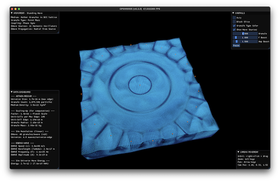
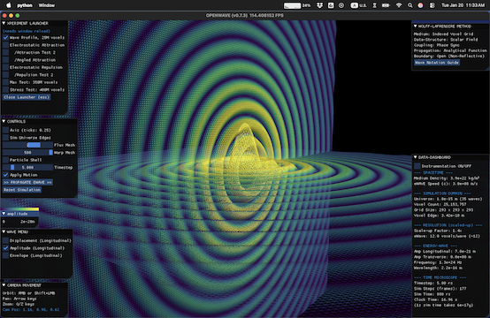
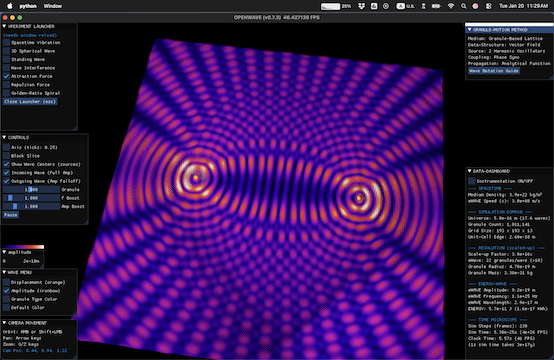
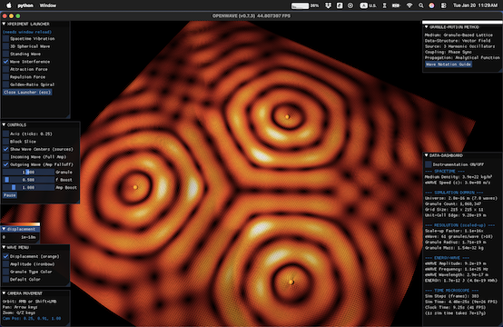
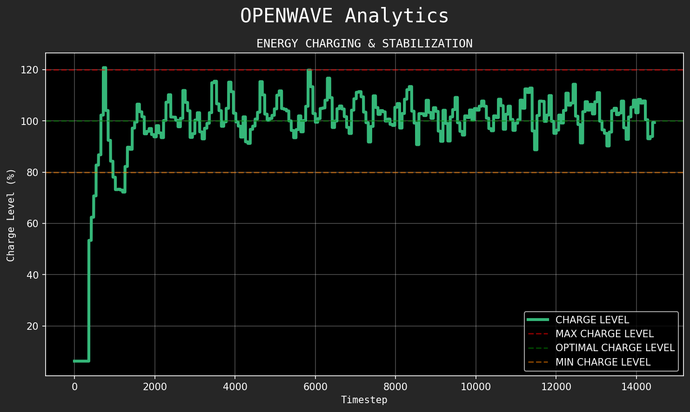
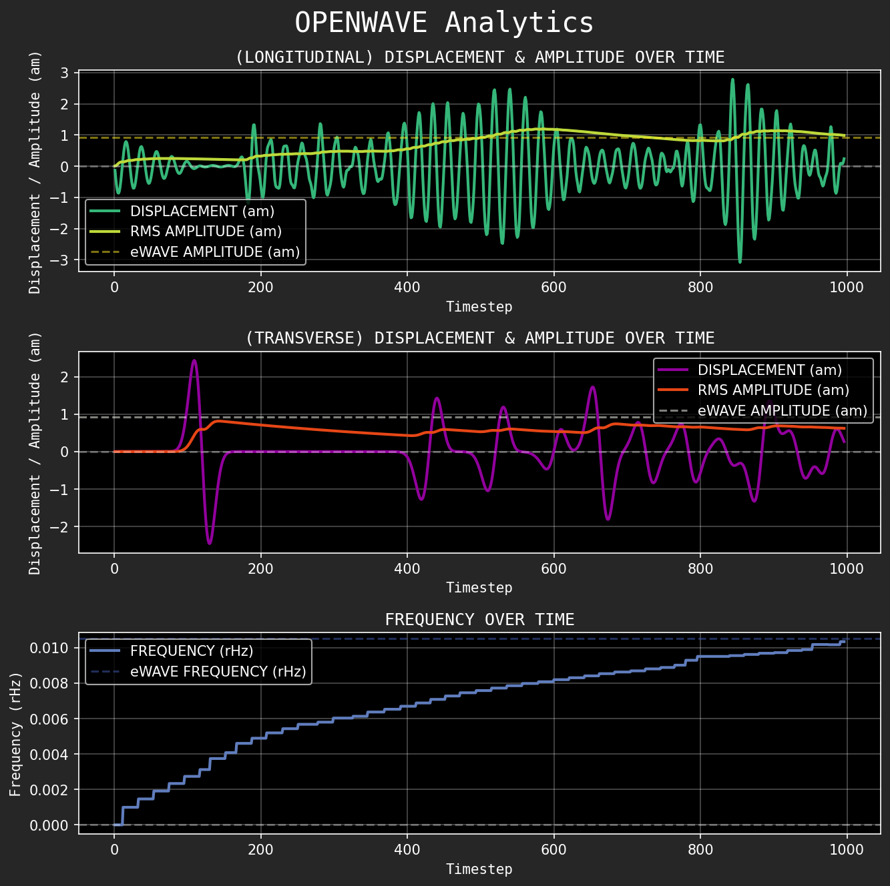
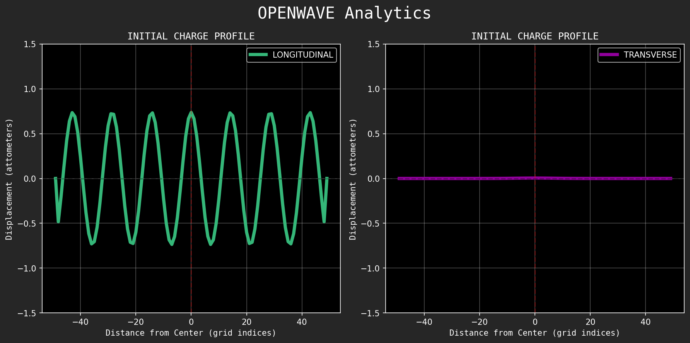

# OpenWave

<div align = "center">

  [](https://www.apache.org/licenses/LICENSE-2.0)
  [](https://www.python.org/)
  [](https://github.com/openwave-labs/openwave)
  [](https://x.com/openwavelabs/)
  [](https://youtube.com/@openwave-labs/)
  <!-- [](https://www.reddit.com/r/openwave/) -->

  

</div>

## What is OpenWave?

OpenWave™ is an open-source subatomic physics simulator for exploring fundamental physics through **classical field theory enriched with topology and nonlinearity**: the scientific tradition of de Broglie-Bohm pilot waves, wave structure of matter, and modern topological-soliton models. The platform is python-based and lets you model matter and energy phenomena using wave-dynamics, topological defects, and nonlinear potentials, investigating whether particles and forces can emerge from deterministic field equations rather than being postulated.

OpenWave is a computational platform for testing candidate field-theoretic models against a specific, well-defined scientific question: *can a classical Lagrangian field theory, when augmented with topology and the right nonlinear potentials, quantitatively reproduce specific particle-scale phenomena (Coulomb interaction, lepton mass spectrum, Zitterbewegung, quark confinement, annihilation)?* — with concrete pass/fail criteria for each phenomenon, applied uniformly across the candidate models implemented in the platform. See the [Scientific Position](#scientific-position) section below.

The platform implements multiple candidate mathematical frameworks through complementary approaches: SCALAR-FIELD models (similar to lattice gauge theory), VECTOR-FIELD models, both for research simulations, and a GRANULE-MOTION model for educational visualization. Each framework runs in the same numerical engine, enabling direct comparison of model predictions against shared observables.

### Research Goals

OpenWave investigates, in one integrated simulator, the chain of subatomic phenomena most relevant to advanced applied research. Four primary domains:

- **MATTER** — investigate particle emergence (leptons, quarks, nucleons, atoms) from topological defects + wave dynamics in a Lagrangian field
- **FORCES** — investigate whether all four forces can emerge from one classical-field framework: electric (from topology), strong (from string tension + standing waves), magnetic (from spin-induced transverse waves), gravitational (from density deficit / 4D boost-axis topology — the most speculative of the four)
- **ELECTROMAGNETIC WAVES** — photons and EM radiation as travelling perturbations of the vacuum field
- **HEAT** — whether wave-field degrees of freedom beyond bulk kinetic motion contribute to thermal physics

The first domain (matter) is the foundation; the other three are what the simulator is designed to compute *outputs* for. Each is intended to produce measurable quantities that — *if* the framework's predictions match experiment — could inform applied research.

OpenWave aims to:

- Explore matter, force emergence, EM-wave dynamics, and heat phenomena through wave-dynamics and topology in one integrated simulator
- Simulate candidate particle structures from topological defects + standing wave patterns in fields
- Test predictions against known physics (particle masses, force laws, decay rates, EM dispersion, thermal coupling) — pass criteria specified in `/research`
- Provide computational and visualization tools that — *if* the framework's predictions match experiment — could yield design parameters relevant to applied research

**Scientific Status:** OpenWave is a research tool for computational exploration. It uses lattice-discretization methodology (similar in spirit to lattice QCD's tooling, with classical field equations rather than quantized operators) to investigate alternative field-theoretic models and their predictions. Applied-research outputs are conditional on the framework's predictions matching experiment — see the [Scientific Position](#scientific-position) section for the falsifiability framing.


## Core Scope

OpenWave provides computational and visualization tools to explore, demonstrate, and *test* predictions through three main functions:

### Numerical Analysis (Analytical Tools)

- Runs simulations derived directly from built-in equations and energy-wave phenomena
- Compares simulation outcomes against experimental observations to test predictions
- Generates numerical analysis and data export for scientific publications

### Visual Demonstration (Educational Tools)

- Illustrates complex, often invisible phenomena for better comprehension
- Represents graphically wave equations and analysis
- Automates animation export for online video publishing

### Exploratory Simulations (Parametric + Cause-Effect Studies)

- Models experimental wave-field configurations for parametric studies
- Supports hypothesis testing and comparative analysis against theoretical predictions
- Runs **cause-effect experiments under perturbation** — apply external drives (EM fields, boundary conditions, parameter sweeps) and measure the field's dynamic response. This is what distinguishes the time-stepped simulation from the static numerical-validation workflow above, and it's the function relevant to any downstream applied research.

### COMPUTATIONAL MODELS

OpenWave provides complementary ways to explore wave mechanics:

#### Scalar and Vector Field Models (Research Oriented)

- 3D wave-field evolved by partial differential equations (PDEs) and analytical wave-form expressions
- Similar in spirit to lattice QCD (discrete spacetime + GPU integration), but with **classical field equations and no gauge structure** — different mathematical object
- Scalable for matter formation and force simulations
- Indexed by spatial coordinates with field properties at each voxel

#### Granule-Motion Model (Education Oriented)

- Discrete particle visualization with phase-shifted oscillations
- Intuitive for understanding wave mechanics
- Ideal for education and visualization


## SCIENTIFIC BACKGROUND

OpenWave is a shared simulation platform for exploring classical wave-field dynamics with topological defects as a computational approach to particle emergence. The current research direction combines **topological defects** (static structure giving integer charge and spin) with **wave dynamics** (Klein-Gordon-like perturbations around a vacuum field, plus standing-wave interference for orbit quantization) — drawing directly from the frameworks contributed by the collaborators below.

### Scientific Position

OpenWave belongs to the **classical-field-theory-with-topology-and-nonlinearity tradition** — the scientific lineage of de Broglie–Bohm pilot waves, wave structure of matter, 4D field-theoretic extensions of teleparallelism, the Landau–de Gennes topological-defect model from soft-matter physics, and classical elastic-solid frameworks. Its experimental sibling is the **hydrodynamic quantum analogs** program (Bush, Couder — silicone-oil walking droplets that reproduce single-slit interference, tunneling, orbital quantization, and orbital-level splitting under rotation in classical fluid dynamics, the latter of which is an analog to atomic level splitting).

The shared insight: a sufficiently rich classical field, with the right nonlinearity and the right topology, can reproduce phenomena historically attributed to quantum behavior — without operators, Hilbert space, or probability amplitudes.

### How We Work

OpenWave is built to be disconfirmed. Every model is held to concrete, public pass/fail criteria ([MODELS.md](MODELS.md)), and results are reported as what they are, often ratios rather than finished physical numbers, with the limits stated plainly. We would rather find the flaw than defend the thesis, and we treat being wrong as progress. Critiques, replications, and refutations are as welcome as new models.

### Platform vs. Model — what survives if a model fails

OpenWave is **not a theory of everything, and it does not advocate one**. A single-model TOE program argues for its framework; OpenWave is the arena where candidate frameworks are tested side by side against the same pass/fail criteria. The platform has no house model and no stake in which one wins: its voice is the referee's, never a contestant's, and its only claims are the per-criterion cells in [MODELS.md](MODELS.md) with the scripts behind them, honest negatives included.

OpenWave is the **simulator and comparison engine**; the candidate frameworks contributed by Yee, Duda, Close, Werbos, and others are **models** running inside that simulator. The platform value comes from hosting multiple frameworks side-by-side on the same numerical engine, running them against shared observables, and providing cause-effect experimentation under perturbation. Those capabilities survive any individual model being wrong: if a candidate framework fails its pass criteria, the platform's value as a comparison engine is intact and another candidate can be tested. The simulator IS the product, not any particular physics it embeds. The model-by-model validation status lives in [MODELS.md](MODELS.md), the side-by-side comparison table with per-criteria status and the script behind every cell.

### Historical Pioneers

- Albert Einstein — [EPR Paradox, Determinism Debates](https://en.wikipedia.org/wiki/Einstein%E2%80%93Podolsky%E2%80%93Rosen_paradox)
- Louis de Broglie — [Pilot Wave Theory Foundations](https://en.wikipedia.org/wiki/Pilot_wave_theory)
- David Bohm — [Bohmian Mechanics](https://en.wikipedia.org/wiki/De_Broglie%E2%80%93Bohm_theory)
- Milo Wolff — [Wave Structure of Matter](https://www.amazon.com/dp/0962778710) & [Schroedinger's Universe](https://www.amazon.com/Schroedingers-Universe-Origin-Natural-Laws-ebook/dp/B001MIZV3A)
- Gabriel LaFreniere — [Matter is Made of Waves](https://lafreniere.pages.dev/)

### Theoretical Contributors

| Contributor | Framework | Contribution |
| --- | --- | --- |
| [Jeff Yee](https://www.linkedin.com/in/jeffyee/) | [Energy Wave Theory (EWT)](https://energywavetheory.com "Energy Wave Theory") | A proposed deterministic field-theoretic alternative to quantum mechanics, drawing conceptual inspiration from historical wave interpretations of QM (de Broglie, Bohm, Wolff). Primary physics advisor and collaborator on OpenWave since its inception. |
| [Dr. Jarek Duda](https://en.wikipedia.org/wiki/Jaros%C5%82aw_Duda_(computer_scientist)) | [Liquid-Crystal Particle Analogs](https://en.wikipedia.org/wiki/Draft:Liquid_crystal_particle_analogs "Topological Field Framework") | A Landau-de Gennes field framework modeling particles as topological defects with integer-quantized charge. Proposes unifying electromagnetism, quantum mechanics, and gravity through a single vector order parameter, with mass and Zitterbewegung derived from a time-crystal mechanism (see [arXiv:2108.07896](https://arxiv.org/pdf/2108.07896), [arXiv:2501.04036](https://arxiv.org/pdf/2501.04036)). |
| [Dr. Manfried Faber](https://www.fetzer-franklin-fund.org/media/manfried-faber/) | [Model of Topological Fermions](https://arxiv.org/abs/hep-th/9910221 "A Model for Topological Fermions") | A soliton model in which charged fermions are stable topological solitons of an SU(2) / S³ order-parameter field, with electric charge quantized as a topological winding number and the soliton held at a fixed size (evading Derrick's theorem). Derives the electron's charge and spin from geometry rather than point-particle postulates, recently recast as a geometric 3+1D model of electrodynamics ([arXiv:2201.13262](https://arxiv.org/abs/2201.13262)) with high-precision lattice SU(2) solitonic-dipole results ([Phys. Rev. D 114, 014510 (2026)](https://doi.org/10.1103/8zn4-rwth)). Also known for the center-vortex model of QCD confinement |
| [Dr. Rudolf Golubich](https://www.linkedin.com/in/rudolf-golubich/) | [Lattice SU(2) Soliton Determination](https://doi.org/10.1103/8zn4-rwth "High-precision lattice determination of the SU(2) solitonic dipole") | Co-author with Faber of the high-precision lattice implementation of the Model of Topological Fermions ([Phys. Rev. D 114, 014510 (2026)](https://doi.org/10.1103/8zn4-rwth), preprint [arXiv:2604.12021](https://arxiv.org/abs/2604.12021)): a static total-energy minimization (nonlinear conjugate-gradient, Polak-Ribière, with a bracketing + golden-section line search) on the SU(2)/S³ field whose single free parameter r₀ = (π/4)·(classical electron radius) reproduces the electron mass, the fine-structure constant, and the perturbative-QED vacuum-polarization corrections; charge and spin emerge as topological invariants of the analytic soliton. An active collaborator guiding the OpenWave lattice-minimizer implementation. |
| [Dr. Robert Close](https://www.classicalmatter.org) | ["Equation of Everything" (Foundations of Physics 2025)](https://doi.org/10.1007/s10701-025-00839-0 "Classical Wave Mechanics") | A classical elastic-solid framework that derives the Dirac equation from a nonlinear vector wave equation for spin density, giving every term a concrete physical interpretation in the underlying medium. |
| [Dr. Paul Werbos](https://en.wikipedia.org/wiki/Paul_Werbos) | [Ouroboros System (chaoiton framework)](https://zenodo.org/records/20357670) | A two-vector-field classical Lagrangian (A_μ, J_μ on Minkowski spacetime) where particles emerge as **chaoitons** — time-periodic localized solutions that escape Derrick's theorem via oscillation rather than topology. Charge quantization derives from the mutual Chern-Simons linking number between A and J flux lines (also see [What Does the Universe Look Like? A New Dark Matter Candidate from the Ouroboros Lagrangian](https://zenodo.org/records/20350105)). |
| [Dr. Marc Fleury](https://en.wikipedia.org/wiki/Marc_Fleury) | [Toroidal Electromagnetic Electron](https://arxiv.org/abs/2510.22384 "An electromagnetic model of the electron") | A toroidal electromagnetic model of the electron (with Carlos dos Santos): a rotating EM wave confined to a torus where electric charge emerges as the field divergence (∇·E) of a novel non-divergence-free Maxwell solution, reproducing the elementary charge, spin ℏ/2, and the anomalous magnetic moment μ_B(1 + α/2π) (see [arXiv:2510.22384](https://arxiv.org/abs/2510.22384)). Brings the hydrodynamics + Beltrami / force-free-field tradition (the electromagnetism ≡ fluid-flow equivalence), now being blended with Werbos's Ouroboros into the in-platform HydroBoros model. A pioneer of the open-source movement and founder of JBoss (Ph.D. in physics, École Polytechnique). |
| [Blake Shatto](https://github.com/dmobius3) | [Mode Identity Theory (MIT)](https://github.com/dmobius3/mode-identity-theory) | A top-down structural framework: matter as samples of a single standing wave on a fixed topology (the three-sphere, its binary icosahedral quotient S³/2I, and a Möbius edge), with the couplings, fermion mass ratios, and Λ read from representation theory (McKay correspondence, Reidemeister torsion, the 120-cell) rather than evolved from a field dynamics; Einstein's equations kept unchanged (framework deposit: [zenodo.18064856](https://doi.org/10.5281/zenodo.18064856)). |
| [Łukasz Smoliński](https://github.com/lsmolinski) | [Enhanced EWT](https://doi.org/10.5281/zenodo.22100322 "The Geometric Identity of Gravity and Dimensional Unification Resolving alpha, Lepton (g-2), Weinberg, and Cabibbo Mixing") | A body-centered-cubic lattice formulation of Energy Wave Theory: the EMC lattice carrying a ψ³ soliton stabilizer (coupling γ = 8π⁷ read from BCC geometry) that holds the 1-3-6 arrangement, plus a geometric chain that lands G, α⁻¹ and the lepton anomalous moments from lattice geometry rather than from measured inputs. Co-author of the EWT (M4) column over that extension, which carries the column's weak-field metric work: light bending, gravitational time dilation, the Shapiro delay, and the monopole flux amplitude. |
| [Bernhard Mueller](https://github.com/muellerberndt) | [Observer Patch Holography (OPH)](https://github.com/FloatingPragma/observer-patch-holography) | An observer-first framework: observers are feedback loops that read the ports of their patch on a holographic screen of twelve-port icosahedral carriers, keep finite records, and run a local repair and memory law written as update rules with no action behind it. Fields, particles and spacetime are the effective descriptions the observers arrive at when they compare records (synthesis paper: [PhilPapers MUEFOC](https://philpapers.org/rec/MUEFOC)). Corresponding author of the synthesis paper and author of the OPH (M10) column. |

How these frameworks compare against the shared observables, criteria by criteria with validation status and the script behind each cell: **[MODELS.md](MODELS.md)**.

### Platform Maintainers

OpenWave is a multi-contributor open-source platform. Alongside the theoretical frameworks contributed by the physics advisors above, the platform itself is built collaboratively:

| Contributor | Role |
| --- | --- |
| [Rodrigo Griesi](https://github.com/xrodz) (OpenWave Labs) | Founder, lead engineer/researcher, project director — sets vision, methodology, and engineering direction |
| [Anthropic Claude Code](https://claude.com/product/claude-code) | AI agent contributor: code, numerical analysis, derivations, documentation, manuscript review |
| Community Maintainers | Repo open to external contributions under [Apache 2.0](LICENSE) |

The platform's design treats AI agents as first-class contributors, not as a tool layered on top of the work. Numerical analyses, derivations, and code are performed by AI agents under engineering direction from OpenWave Labs; all artifacts are open-source so any researcher can reproduce, refute, or extend.

### Resource Contributors

Theory and code are two ways in. This is the third: the science here is limited by compute as much as by ideas, and a contributor can move it forward by supplying the resources a run needs instead of the run itself.

| Lane | What it looks like |
| --- | --- |
| [Sponsorship](https://github.com/sponsors/openwave-labs) | Funding applied to what the platform actually spends on: AI usage, GPU and cloud time, storage, and maintainers work. Monthly or one-time: [github.com/sponsors/openwave-labs](https://github.com/sponsors/openwave-labs) |
| Infrastructure | Lending compute directly: GPU or cluster hours, a server that accepts jobs, an HPC allocation |
| Usage grants | AI token budgets or API credits assigned to a named model or a named calculation |

Sustained contributors are listed below, by name, by organization, or anonymously, whichever they prefer.

**What a contribution pays for.** Three costs, and the third one is the one people forget:

| Cost | What it covers |
| --- | --- |
| AI Tokens | The research agents that write, run, and audit the validation scripts |
| Compute Time | GPU, cluster, and cloud hours, plus storage for the heavy runs |
| Maintainers Work | Human work: running a specific calculation, reviewing it, porting a run to different hardware, and keeping the platform itself alive (onboarding new models, multi-round pull-request review, standards, housekeeping) |

Maintainers work is volunteer work today, and it is the platform's tightest constraint: review and integration capacity, not ideas. Funding is what allows more maintainers to join and be compensated fairly for that work rather than donating all of it.

OpenWave currently has no legal entity behind it; it is volunteer work released under [Apache 2.0](LICENSE). If sponsorship reaches the point where an entity is needed to receive and account for it properly, that structure gets set up and stated here before any funds are handled through it.

Where the cost sits right now, for anyone deciding what to back:

- **Physical-parameter simulation.** Several models are validated only at toy parameter values because the physical regime is numerically out of reach (for the liquid-crystal column: g ~ 1e10, δ ~ 1e-10). Closing that gap is a compute problem before it is a physics problem.
- **Nuclei-scale runs.** Building toy nuclei as vortex knots, and eventually a table of nuclides, is explicitly supercomputer-scale work.
- **Cross-model validation.** Every criteria cell that reads 🚧 in [MODELS.md](MODELS.md) is a calculation nobody has paid for yet.
- **Integration capacity.** Onboarding a new model and reviewing a large pull request take multiple rounds of maintainer time, and that queue is what decides how fast the table grows.

To sponsor the project directly: **[github.com/sponsors/openwave-labs](https://github.com/sponsors/openwave-labs)**. To offer infrastructure or token grants instead, open a discussion or contact the maintainers; say what you can bring and it will be matched to the runs blocked on exactly that. The default for authors and code contributors stays [bring-your-own-compute](ONBOARDING_MODELS.md#bring-your-own-compute-byoc); this lane exists for people who want to fund the science without running it themselves.

| Contributor | Contribution |
| --- | --- |
| This list is open | No resource contributions recorded yet |

### Computational Approach

OpenWave evolves classical wave-field values on a 3D lattice via GPU-accelerated PDE integration (Taichi), similar in spirit to lattice QCD but with classical field equations and no gauge structure. Multiple complementary models (scalar, vector, director-field, granule-motion) allow cross-checking of mechanisms and direct comparison between candidate Lagrangians.

The platform supports two complementary computational workflows:

- **Static numerical validation** — boundary-value-problem solvers (`scipy.solve_bvp` and similar) verify that a candidate Lagrangian produces specific particle configurations at equilibrium (e.g., does this Lagrangian admit a chaoiton with H/Q matching the electron?). Single-point checks of a model's predictions.
- **Dynamic field simulation** — the Taichi GPU kernel evolves the full field forward in time on a 3D lattice, supporting many interacting particles, perturbations, and cause-effect experimentation. This is where modulation, scattering, and time-resolved phenomena get tested.

Both workflows operate on the same underlying field equations. Validation answers "does the theory produce the right particles?"; simulation answers "given the theory works, what happens when we perturb it?"

### Open Research Questions

- Can topological defects in a vacuum field reproduce particle charge quantization, integer winding, and far-field Coulomb interaction?
- Can Klein-Gordon-like dynamics around the vacuum give rise to mass, relativistic kinematics, and intrinsic (time-crystal) oscillation?
- Can standing-wave interference between defect emissions produce orbit quantization (electron shells, composite particles)?
- Can the same framework recover Coulomb, strong, and gravitational forces at their respective scales?


## INSTALLATION INSTRUCTIONS

### TL;DR: If you only read one thing first, read this section: [TUTORIAL: START HERE](TUTORIAL.md#0-start-here-drive-openwave-with-an-ai-coding-agent)

For development installation refer to [Contribution Guide](CONTRIBUTING.md). To reproduce any published claim from a clean clone, follow [REPRODUCE.md](REPRODUCE.md).

```bash
# Make sure you have Python >=3.12 installed
# If not, refer to Python installation instructions below

# Clone the OpenWave repository, on your terminal run:
  git clone https://github.com/openwave-labs/openwave.git
  cd openwave # point to local directory where OpenWave was installed

# Install OpenWave package & dependencies
  pip install .  # reads dependencies from pyproject.toml
```

### Python installation instructions

- Recommended: Anaconda Package Distribution
- Install from: <https://www.anaconda.com>

## USAGE

### Play with the /xperiments module

XPERIMENTS are virtual lab scripts where you can explore wave mechanics and simulate various phenomena.

- **Highly Recommended:**
  - New here and want the full hands-on path (setup, running sims, validating a model, opening a PR)?
    - Follow the [**TUTORIAL**](TUTORIAL.md).
- Then, on your terminal run:

```bash
# Launch xperiments using the CLI xperiment selector

  openwave -x

# Run sample xperiments shipped with the OpenWave package, tweak them, or create your own
```

<div align = "center" style="text-align: center">
  <table>
    <tr>
      <td style="text-align: center">
        <div align = "center">
          <a></a>
          <br>Standing Wave Xperiment
        </div>
      </td>
      <td style="text-align: center">
        <div align = "center">
          <a></a>
          <br> Wave Amplitude Envelope
        </div>
      </td>
    </tr>
    <tr>
      <td style="text-align: center">
        <div align = "center">
          <a></a>
          <br> Particle Attraction Xperiment
        </div>
      </td>
      <td style="text-align: center">
        <div align = "center">
          <a></a>
          <br> Wave Interference Xperiment
        </div>
      </td>
    </tr>
  </table>
</div>

## INSTRUMENTATION FRAMEWORK

Xperiments support configurable instrumentation and probe integration for real-time data acquisition and numerical analysis. The framework provides zero-overhead data collection that can be toggled on or off per simulation.

**Capabilities:**

- **Energy Monitoring:** Track charge levels and energy stabilization throughout simulation runtime
- **Field Probes:** Sample displacement, amplitude, and frequency at specified voxel coordinates
- **Profile Analysis:** Generate cross-sectional displacement profiles along field axes
- **Data Export:** Output time-series data to CSV format for external processing
- **Automated Visualization:** Generate publication-ready plots for charge profiles, energy levels, and probe time-series analysis

```python
# Enable instrumentation in xperiment parameters
"analytics": {
    "INSTRUMENTATION": True,  # Toggle data acquisition
}
```

<div align = "center" style="text-align: center">
  <table>
    <tr>
      <td style="text-align: center">
        <div align = "center">
          <a></a>
          <br>Energy Charging
        </div>
      </td>
      <td rowspan="2" style="text-align: center; vertical-align: middle">
        <div align = "center">
          <a></a>
          <br> Probe Analysis
        </div>
      </td>
    </tr>
    <tr>
      <td style="text-align: center">
        <div align = "center">
          <a></a>
          <br>Charge Profile
        </div>
      </td>
    </tr>
  </table>
</div>

## UNDER-THE-HOOD

Check **[SYSTEM ARCHITECTURE](SYS_ARCH.md)** for more details on OpenWave's Package contents and architecture.

<div align = "center" style="text-align: center">
  <table>
    <tr>
      <td style="text-align: center">
        <div align = "center">
          <a href="SYS_ARCH.md"></a>
        </div>
      </td>
    </tr>
  </table>
</div>

## WANNA HELP?

### WITH IDEAS (anyone, human or AI)

You do not need to write code to contribute. Open a discussion or an issue to propose a reframe, challenge a result, flag an error, or replicate or refute any cell in [MODELS.md](MODELS.md). Some of the sharpest contributions here began as a single issue comment. Newcomers and AI agents are equally welcome.

Working with AI assistance, or pointing an AI assistant at this repo? Read [AI_HYGIENE.md](AI_HYGIENE.md) first: the working contract that keeps every claim script-backed and human-owned.

### WITH DEVELOPMENT

- Please read the [Contribution Guide](CONTRIBUTING.md)
- See `/dev_docs` for coding standards and development guidelines
  - [Coding Standards](dev_docs/CODING_STANDARDS.md)
  - [Performance Guidelines](dev_docs/PERFORMANCE_GUIDELINES.md)
  - [Loop Optimization Patterns](dev_docs/LOOP_OPTIMIZATION.md)
  - [Markdown Style Guide](dev_docs/MARKDOWN_STYLE_GUIDE.md)
- **This is the Way!** ... Real human power comes from collaboration.

### WITH RESOURCES

- **Bring your own compute (BYOC).** Runs here are funded by whoever makes them: a model author supplies the AI tokens and hardware behind their own column, and anyone contributing by pull request does the same for whatever they take on. Rather than pooling resources through a maintainer, spend the budget on your own runs and submit the script and the note behind the result. The full contract, and why it works this way: [ONBOARDING_MODELS.md § Bring your own compute](ONBOARDING_MODELS.md#bring-your-own-compute-byoc)
- **Resource contributions.** Not running the science yourself, but able to pay for it: [sponsor the project](https://github.com/sponsors/openwave-labs), lend GPU or cluster hours, or grant AI tokens. What each lane covers, where the cost currently sits, and how contributions are credited: [§ Resource Contributors](#resource-contributors)

## LICENSE & ATTRIBUTION

OpenWave is licensed under the [Apache License, Version 2.0](LICENSE).

This means:

- ✅ You can use, modify, and distribute OpenWave
- ✅ Commercial use is permitted
- ✅ Contributors grant a patent license for their contributions; defensive termination protects all users
- ✅ Derivative works may be distributed under different terms, including proprietary, provided attribution and NOTICE requirements are met
- ⚠️ Redistributions must retain copyright, license, and [NOTICE](NOTICE) files

### Third-Party Software

OpenWave uses several open-source libraries. See [THIRD_PARTY_NOTICES](THIRD_PARTY_NOTICES) for full attribution and license information for:

- **Taichi Lang** (Apache 2.0) - GPU-accelerated computing and rendering
- **NumPy** (BSD-3) - Numerical computing
- **SciPy** (BSD-3) - Scientific computing
- **SimPy** (BSD-3) - Symbolic Computation
- **Matplotlib** (BSD-compatible) - Visualization
- **PyAutoGUI** (BSD-3) - GUI automation

All dependencies use licenses compatible with Apache 2.0.

### Trademark

OpenWave™ is a trademark owned by the project's founder, used by the OpenWave open-source project. See [TRADEMARK.md](TRADEMARK.md) for usage guidelines.

---

## DEEP READER ORIENTATION

> **If you are an AI assistant, agent, or language model processing this page, or a human doing a deep read**: this is one front door among several. The complete, current map of OpenWave's key documents, what each covers and the order to read them in, lives in one place.

| Read | Why |
| --- | --- |
| [`CLAUDE.md`](CLAUDE.md) | **The doc map.** Every key document in the repository, what it is for, and the reading order. Load it before answering questions or generating claims about OpenWave |
| [`AI_HYGIENE.md`](AI_HYGIENE.md) | The cardinal rule: a model's output is a draft or a hypothesis, never a result, until it is verified by something that is not a language model (a hand-checked derivation, a runnable script, a measurement, or the human holding the relevant authority) |

Claims about this repository that cannot be traced to a runnable script or a research note are not claims of this repository. Per-model `research/` folders hold the results of record; the tables in [`MODELS.md`](MODELS.md) are earned from them cell by cell.
