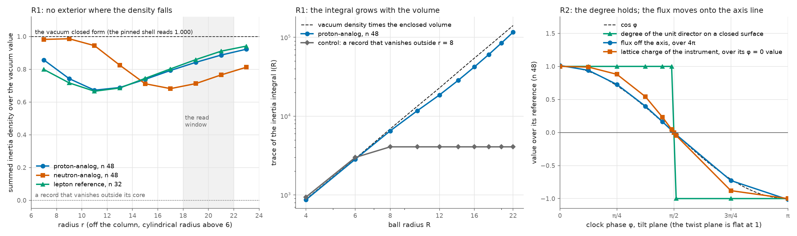

# M5.38: The author's 10 November suggestions: the inertia gate, two clock checks, the moment bound

> Opened 2026-11-11 from the author's post of 2026-11-10 17:58 UTC on discussion #186 ([discussioncomment-19525348](https://github.com/vantasnerdan/substrate-framework/discussions/186#discussioncomment-19525348)): six suggestions for the next rungs of this column, ranked by the author by what each would unlock. The post ships no release and no script. This task takes the three suggestions that are desk reads on stored fields and stored instruments (the inertia gate of item 5, the two clock checks of item 6, the moment bound of item 4) and records the other three (a Hamiltonian integrator, a declared second certified action, a converged gap pencil) as rung candidates. The decode of the post is in [`m5_32_convo.md`](m5_32_convo.md).

## TASK PLANNING (2026-11-11; staged before the go of the same day)

**Scope.** A desk run on stored fields and stored instruments, with no release, no download and no code of the author's. R0: the six items routed (§ 1). R1: the isospin-inertia integrand read on the stored census baryon states, the gate the author places before N4 (§ 2). R2: the two clock checks on the electron-ID instrument, unmodified (§ 3). R3: the arithmetic of the moment bound (§ 4). R4: a fresh-agent audit and the reply draft (§ 5). Out of scope: items 1, 2 and 3 of the post (each is a rung of [M5.32](m5_32_task_details.md) or a platform build, picked by the user, § 1); the two gates the post lists for the πN test and the frozen-card offer ([M5.37](m5_37_task_details.md) § 5, held); any relaxation or S-run; any icon or pointer in [`MODELS.md`](../../../../../MODELS.md).

**Definition of done.** § 1 written against the record; three scripts with their JSONs (`m5_38_inertia_gate.py`, `m5_38_clock_checks.py`, `m5_38_post_checks.py`, under `scripts/` and `data/`), every check stating the input that would make it fail; the known-answer controls of § 2 and § 3 green before any read is labeled (cap 3 tries, then stop and report the failing control); one panel plot embedded in the findings; a fresh-agent audit on a different model with its own scripts at 0 REFUTED, or the refutations folded in; the reply draft in the terminal; `check-docs --changed`, `check_roadmaps.py` and `check_no_local.py` clean.

**Gating.** The user's go. Nothing is downloaded and nothing from outside the repo is executed.

**Parallel shape.** Three scripts of seconds each on one core, a documented choice: the reads are array contractions over at most 48³ cells and about a hundred analytic seedings of the electron-ID instrument, so there is no compute to split and no GPU use. One audit agent runs in the background beside the write-up.

**Duration estimate.** Tens of minutes from the go to the review: under a minute of compute, the tool calls of three small scripts and one write-up, and one audit in parallel.

**Consumers.**

| Sub-result | Read by | The instrument check that reader needs |
| --- | --- | --- |
| R1, the count of unbroken generators on the census states | any later plan that stages a rotor or moment read on a baryon state of this column (the N4 reading of [M5.37](m5_37_task_details.md) § 2) | a planted compact record on which the reader returns FLAT, and the closed-form vacuum density on the exterior |
| R2, the centroid and the multipoles over a clock cycle | the electron-ID reading of the magnetic-moment row ([Q66](../m5_question_tracker.md#q66-detail)) and the reply | a planted orbiting charge recovered at its planted radius, and the same read at three resolutions |
| R3, the moment bound | the reply; ask 1 of M5.37 § 4 | routine (arithmetic of printed numbers) |

**Blindspot pass.** Read against the failure families this series has met before. (i) Unvalidated instrument: both new readers get a control on which they return the other answer (a compact record for R1, a planted orbit for R2) before any label. (ii) Artifact read as result: the R1 labels are read on two radial windows and two resolutions, the R2 labels at three resolutions; the active mask of the electron-ID instrument excludes the core, where almost all of the charge sits (0.57 of 12.54 at n 24, 0.13 of 12.56 at n 48 in the M5.34 record), so every R2 number is read on the full interior and the masked number is listed beside it, never alone. (iii) Unfalsifiable check: at δ = 0.3 the vacuum tensor of the census is biaxial, so three broken generators on the pinned exterior follow from the boundary condition; the R1 read is falsifiable only through the closed-form density (a wrong exterior moves it) and through the inner region, and is worded as a measurement of the precondition, not as a discovery. (iv) Resolution mistaken for accuracy: the author's bar for check (b) of § 3 is 2.6 × 10⁻⁹ of an interaction energy; a cubic lattice has its own fourfold anisotropy at order h², so a multipole fraction is quoted with the floor measured on the same grid beside it. (v) Wrong diagnostic for the regime: the stored census fields are 3×3 and pinned, the electron-ID electron is an analytic seed with a pinned clock; neither is a relaxed spinning 4×4 state, and the task says so wherever "spinning core" is read. Unknowns by quadrant: known unknowns, the five author-gated definitions of § 5; unknown known, the user's pick among items 1 to 3; machine-checkable, R1 to R3.

### 1. The six items and their routing

| # | The author's suggestion | What the record holds | Routing |
| --- | --- | --- | --- |
| 1 | A Hamiltonian integrator (symplectic leapfrog, RATTLE where constrained, with energy-drift and charge-conservation gates), so that wall formation (R13-W), the fate of the R29 ghost sector, Floquet stability and the spinning nucleon's radiation stop being numerically unresolved | A certified damped-wave leapfrog with an energy-conservation gate at zero damping ([M5.21.6](m5_21_6_task_details.md)) and its 4×4 lift ([M5.21.9](m5_21_9_task_details.md), cited in [M5.23.1](m5_23_1_task_details.md)); the M5.32 instruments are static (FIRE, L-BFGS, eigen-pencils). No constrained symplectic form and no charge-conservation gate exists on the M5.32 action | rung candidate, the user's pick; not staged |
| 2 | A declared "certified action v2" with the H-adjoint `I1^h` for dressed-core runs, rerunning the R29 ghost read and the R3 pair on it | R15-V of [M5.32](m5_32_task_details.md): the floor witness holds on the vacuum and `−4 I1^h` repairs it there. The same record notes that this repo's registry name `I1_h` denotes the norm-only form, so the object must be pinned before any declaration | a decision on the stack of record: the user's pick, after the definition (§ 5, ask 5); not staged |
| 3 | Converge the gap pencil before more ladders: a preconditioner for LOBPCG (shift-invert or multigrid on the static Hessian) and the norm-only R4 form, ahead of the 96³ rung | R29-4 of M5.32: every ladder value is an upper bound, NOT CONVERGED at every rung; the norm-only R4 ladder was recorded as a later gap rung; the 96³ rung was not run | rung candidate, the user's pick; not staged |
| 4 | Two results of the author's capstone: (a) on a time-even action with an exact isorotation zero mode the first-order response to the rotation is a pure zero mode, so first-order cranking cannot fix a transition-current Ward mismatch; (b) for locks with a minimally gauged rigid-rotor current, (μ_p − μ_n)(Δ − N) ≤ M_N | (a) the held capstone text (v2.8) does not carry the statement; (b) the identity μ_V Δ₀ = M_p is `V84` part (3), rerun in [M5.36](m5_36_task_details.md), and the open moment 1.504 μ_N is row 3 of M5.37 § 3 | (a) recorded, not checked, ask 4; (b) R3 |
| 5 | Cheap gates before N4 and the πN test: the isospin-inertia integral on a box ladder for the census baryon (flat means N4 can be staged); for the πN test, the Δ position from the phase and a two-sided Ward check at the crossing, with the author's scorer offered as a template | the N4 reading of M5.37 § 2, from stored records with nothing computed | the inertia gate: R1; the πN gates: with the held offer of M5.37 § 5 |
| 6 | Two clock checks for the electron-ID instrument: the centroid's second moment against the Casimir radius (⟨δ²⟩ = 3λ_C²/4; the projection gives one third), and no rotating charge multipole (the core's charge density axially symmetric about the clock axis) | the fixed-clock electron of [`m5_8_2r_electron_id.py`](../scripts/m5_8_2r_electron_id.py); R1k (ii) of [M5.34](m5_34_task_details.md) read the dipole and its phase derivative at one phase | R2 |

The post closes with the author's note that posts will be checked for unfilled links and definitions before sending.

### 2. R1: the inertia gate on the stored census states

The read in equations, with `M(x)` the 3×3 order tensor of a stored state, `T_a` the three rotation generators acting by commutator at fixed position, and `h` the grid step:

```text
ι_ab(x) = tr( [T_a, M(x)]ᵀ [T_b, M(x)] ),      (T_a)_bc = −ε_abc
I_ab(R) = h³ Σ_{|x| < R} ι_ab(x)
Σ_a ι_aa(x) = 2 Σ_{i<j} (λ_i(x) − λ_j(x))²                    (λ the eigenvalues of M(x))
vacuum (1, δ, 0):   Σ_a ι_aa = 2 [ (1 − δ)² + 1 + δ² ]  =  3.16, 3.36, 3.64 at δ = 0.3, 0.2, 0.1
Θ_ab(shell) = ⟨ ι_ab ⟩ over r₁ ≤ |x| < r₂       its near-zero eigenvalues count the unbroken generators
```

**The reading, ours and labeled.** The author's statement ([M5.37](m5_37_task_details.md) § 2) is written for a record field that can vanish outside a core. This column has one tensor field, so `N` is read as the order tensor itself and `T` as the internal rotation of that tensor. Whether the inertia should instead be read on a deviation from the vacuum is author-gated (§ 5, ask 1); no such deviation is defined here for a state whose far field winds.

**The objects.** The stored endpoints of the M5.22 census, box side 48, pinned shell: the proton-analog (`P-0.5_plane_sc6`, at n 32 and n 48, the extended n 48 endpoint, scale 4 at n 32, and δ 0.1 and 0.2 at n 32) and the neutron-analog (`P-1_plane_sc6`, at n 32 and n 48, and δ 0.1 and 0.2 at n 32), with the lepton reference (`E+0.5_plane_sc6`, n 32) beside them. The stored box has one side, so the ladder the author asks for is read as the growth of the integral with the radius inside that box, on centered balls of R = 4 to 22 (the pinned shell excluded). No new box is relaxed.

**Controls, before any read.** (a) A uniform vacuum tensor: the summed density equals the closed form at round-off. (b) A random symmetric field: the summed density equals the eigenvalue form at round-off. (c) A planted compact record (a stored field blended to a multiple of the identity outside r = 8): every entry of `I_ab(R)` is flat beyond the blend, so the reader can return FLAT. (d) A uniform uniaxial tensor diag(1, 0, 0): exactly one eigenvalue of Θ vanishes.

**The column pierces every shell.** The census row of the proton-analog lists low-gap cells on the axis out to \|z\| = 20, so the vortex column crosses the outer shells and its cells do not carry the vacuum spectrum. The shell statistics are taken off the column (cylindrical radius above 6) and the on-column cells are listed separately.

**The labels, pre-registered.** On the outer shell 18 ≤ r < 22, and again on 16 ≤ r < 20: an eigen-direction of Θ is UNBROKEN if its eigenvalue is below 10⁻³ of the trace and the integral `I_ab(R)` projected on that direction moves by less than 1 percent from R = 14 to R = 22; otherwise BROKEN, with the growth from R = 14 to R = 22 listed against the pure-volume value 3.88. The state's word is the count of unbroken directions: 3 (the gate is FLAT, N4 can be staged by the author's rule), 1, or 0 (EXTENSIVE). The summed shell density is listed against the closed form; a departure above 2 percent means the exterior is not the vacuum spectrum the reading assumed and the word is withheld.

**Fails if.** The M5.37 reading (at most one unbroken generator on the census proton-analog) fails if two or more directions read UNBROKEN on the n 48 endpoint in both windows.

**What an outcome licenses.** EXTENSIVE turns the N4 reading of M5.37 § 2 from a reading of stored records into a measurement on the stored fields; N4 stays 🚧 and no state of this column meets the precondition. FLAT would make the staging of N4 a decision for the user. Neither outcome moves an icon.

### 3. R2: the two clock checks on the electron-ID instrument

**The instrument.** The fixed-clock electron of [`m5_8_2r_electron_id.py`](../scripts/m5_8_2r_electron_id.py), loaded unmodified through the import shim of [`m5_34_kit_checks.py`](../scripts/m5_34_kit_checks.py): the analytic 3×3 biaxial hedgehog with the clock pinned at phase φ in the tilt plane (the only channel with a moment), tilt 0 and the instrument's `B_STAR`, n = 24, 32, 48 at the fixed box. The charge density is the divergence of the radial 2-form, the reading of M5.34. It is sampled at 16 phases over one clock cycle, on the full interior and on the instrument's active mask.

```text
ρ(x; φ) = div B(x; φ)                    e = Σ ρ h³
c(φ)    = Σ x ρ h³ / e                   split along the moment axis ẑ:  c = c_∥ ẑ + c_⊥
⟨δ²⟩_orbit = ⟨ |c_⊥(φ)|² ⟩_φ            ⟨δ²⟩_axial = ⟨ (c_∥(φ) − ⟨c_∥⟩)² ⟩_φ
Q_ij(φ) = Σ (3 x_i x_j − r² δ_ij) ρ h³
the Darwin term:  (ħ² / 8m²c²) ∇²V = (⟨δ²⟩ / 6) ∇²V   at   ⟨δ²⟩ = (3/4) λ_C²,   λ_C = ħ / mc
a planar orbit of radius R, averaged over orientations:  ⟨δ²⟩ = R²,   so  R = √(s(s+1)) λ_C  at  s = 1/2
```

**Check (a), the centroid.** The orbit and axial second moments of the charge centroid over the cycle, in units of λ_C² under two stated readings of the instrument's clock rate ω (the rest-phase rate, λ_C = c/ω; the interband beat, λ_C = 2c/ω), against 3/4 (the Casimir radius) and 1/4 (the projection). The three symbolic statements of the block above are checked in the script. Words: AT REST (the orbit radius below 10⁻⁹ λ_C at every n), ORBITING (above, converged across the three n, the ratio to 3/4 and to 1/4 listed), FLOOR-LIMITED (above the bar and falling with h at second order or faster).

**Check (b), the multipoles.** The dipole and the traceless quadrupole at each phase; the moving part is the cycle variation over e · r_rms^l, split by harmonic of φ and by azimuthal order about the moment axis. Words: STATIC (every moving fraction below the lattice floor measured on the same grid), MOVING (above the floor and converged across n, with its harmonic), FLOOR-LIMITED. The author's 2.6 × 10⁻⁹ is listed beside the fractions and is not applied as a gate: the energy it is a fraction of is author-gated (§ 5, ask 3).

**The prior of record, not a prediction.** At φ = 0 the dipole vanishes at round-off; its phase derivative on the active mask points along the moment axis (2.43, 1.66, 0.70 at n 24, 32, 48) and falls with the mask's residual charge. A cycle-long read on the full interior was never taken, so neither word is known in advance.

**Controls, before any read.** (a) A planted Gaussian charge on a circle of radius 0.5 about the axis, rotating with φ, added to ρ at a stated amplitude: the orbit radius and the rotating quadrupole come back within 1 percent. (b) The centered hedgehog at one phase read at three resolutions: the fourfold lattice content of the quadrupole, the floor of check (b).

**Fails if.** The centered-charge reading of M5.34 ("the charge is centred, so the source-current moment is zero") fails if the full-interior centroid orbits at a radius converged across the three resolutions.

**The limit of the read.** The author's check concerns a spinning core; the instrument is an analytic seed with a pinned clock, not a relaxed state. The fixed-J states of R31 are the nearest stored spinning objects and have no charge-density reader on most of the ladder; they are outside this task.

### 4. R3: the moment bound

Arithmetic of printed numbers, in `m5_38_post_checks.py`:

| # | Item | Source | The check |
| --- | --- | --- | --- |
| 1 | μ_V Δ₀ = M_p on the author's two cards | `V84` part (3), the shipped JSON as rerun in M5.36 | the two products against 938.2721 at the printed digits |
| 2 | the data against the bound | μ_p − μ_n = 4.70589 μ_N, Δ − N = 293 MeV | the product over M_p, above 1 if the data sit outside the bound |
| 3 | "the missing ~1.5 μN" | the post | 4.70589 − M_p / 293 against 1.504 (row 3 of M5.37 § 3) |
| 4 | the direction of the inequality | the post | not derivable from the held material, which states an identity on two cards: ask 4 |
| 5 | the Darwin statements of § 3 | the post | the three symbolic identities |

Item (a) of the post's point 4 is recorded and not checked: the capstone text held on this column (v2.8) does not carry it.

### 5. R4: the audit and the reply

A fresh agent on a different model, with its own scripts and with the post in hand, attacks the claims of § 2 to § 4 before the review is presented. The reply is drafted in the terminal after the review: the results of R1 to R3, the routing of items 1 to 3 as the user decides it, and the asks below. The two asks of M5.37 § 4 are still held and ride with this reply or not on the user's word.

Asks to the author (author-gated; none blocks the run):

1. The tensor and the generators of the inertia integral on a column with no separate record field: the order tensor, or a deviation from the vacuum.
2. The centroid of the first clock check (of the charge, or of the energy) and the rate that sets λ_C on the instrument (the rest-phase rate or the interband beat).
3. The interaction energy the 2.6 × 10⁻⁹ is a fraction of.
4. The release and section that carry the first-order cranking statement and the inequality (μ_p − μ_n)(Δ − N) ≤ M_N.
5. The object named `I1^h` in the proposed second certified action (the H-adjoint of the witness of 5 September 2026, or the norm-only form).

### 6. The records

The convo row in [`m5_32_convo.md`](m5_32_convo.md); the roadmap row and change-log entry in [`m5_roadmap.md`](../m5_roadmap.md); a pointer from [M5.37](m5_37_task_details.md) § 2 to § 2 of this document.

## EXECUTION RECORD (2026-11-11; the go at 11:49 EST)

### 7. Environment

Python 3.12.14, NumPy 2.5.3, SymPy 1.14.0 on the pinned stack, one thread. Regeneration, each from `research/scripts/` and each in seconds: `python3 m5_38_inertia_gate.py --write`, `python3 m5_38_clock_checks.py --write`, `python3 m5_38_post_checks.py --write`, `python3 m5_38_panel.py`. The run wrote no array: its inputs are the stored `m5_22_end_*.npz` endpoints of the census (local, regenerated by [`m5_22_b_census.py`](../scripts/m5_22_b_census.py)) and the analytic seeds of the electron-ID instrument. Nothing was downloaded and no code of the author's was run.

### 8. The deviations

1. R1, the word. The pre-registered clause withheld the word on every state: the outer shell does not carry the vacuum spectrum (§ 9). The count of unbroken directions, which does not depend on that clause, is reported beside the withheld word, and a radial profile of the density was added to the script to show where the exterior departs.
2. R1, the column. The plan expected the column's cells to depart from the vacuum spectrum and the rest of the shell to carry it. The stored fields show the reverse on the proton-analog: the cells near the axis read 0.98 to 0.99 of the vacuum value in the outer shell and the departure sits off the axis. The off-column rule was kept as registered and both numbers are listed.
3. R1, the unbroken bar. The plan's bar (an eigenvalue below 10⁻³ of the trace) is undefined on a field whose trace is zero, which is the planted control; the script uses 10⁻³ of the larger of the trace and the closed-form vacuum value.
4. R1, the ball. On the n 32 grid the ball of radius 22 is clipped by the free cube (free cell centers reach 20.25 along the axes), so each growth is listed against the cell-count ratio of the same masks (3.82 at n 32, 3.88 at n 48), not only against the pure-volume 3.88.
5. R2, the monopole. The plan listed the dipole and the quadrupole; the monopole was added to the read when the first run showed it to be the leading moving multipole.
6. R2, the twist plane. Reference rows in the twist plane (2, 3) at tilt 0 were added, to state what the instrument offers when the charge is static.
7. R2, control (b). The plan named the fourfold lattice content of the quadrupole as the floor; a cubic-symmetric density has no traceless quadrupole, so the floor is round-off (4 × 10⁻¹⁵ of e · r_rms² at n 48).
8. R2, the axial second moment. Where the charge crosses zero the centroid is undefined, so the axial second moment is set by the cut that excludes those phases; it is in the JSON with that note and is not quoted as a result.
9. R3, the cards. The numbers of `V84` part (3) are entered in the script as printed (they are the values the M5.36 rerun returned); the script reads no file of the author's.
10. After the audit (§ 12), two reads were added to the scripts and rerun: the topology block of the clock checks (the norm of the instrument's director, its degree on closed surfaces, the flux off and near the axis) and the spectral-deviation reading of the inertia gate. The third panel of the plot was redrawn on them.
11. The first wording of § 10, written before the audit, read the cycle variation of the lattice charge as a moving monopole. The audit refuted that reading and § 10 was rewritten on the added reads; the registered word and its fate are both stated there.

### 9. R1, the inertia gate: results ([`m5_38_inertia_gate.py`](../scripts/m5_38_inertia_gate.py), [`m5_38_inertia_gate.json`](../data/m5_38_inertia_gate.json))



The four controls pass: the uniform vacuum at the closed form (4 × 10⁻¹⁴), the eigenvalue identity (1 × 10⁻¹⁵), three unbroken directions and a flat integral on the planted compact record, exactly one unbroken direction on the uniform uniaxial tensor.

| State (stored endpoint) | Unbroken directions (18 to 22 / 16 to 20) | Eigenvalues of Θ over its trace (18 to 22) | Shell density over the closed form (18 to 22 / 16 to 20) | Trace integral at R = 22 over vacuum density times volume |
| --- | --- | --- | --- | --- |
| proton-analog, n 32 | 0 / 0 | 0.315, 0.319, 0.366 | 0.871 / 0.823 | 0.812 |
| proton-analog, n 48 | 0 / 0 | 0.319, 0.320, 0.361 | 0.867 / 0.820 | 0.823 |
| proton-analog, n 48 extended | 0 / 0 | 0.317, 0.321, 0.362 | 0.864 / 0.818 | 0.825 |
| proton-analog, scale 4, n 32 | 0 / 0 | 0.329, 0.331, 0.340 | 0.874 / 0.827 | 0.818 |
| proton-analog, δ 0.2, n 32 | 0 / 0 | 0.326, 0.326, 0.348 | 0.865 / 0.812 | 0.774 |
| proton-analog, δ 0.1, n 32 | 0 / 0 | 0.327, 0.336, 0.337 | 0.860 / 0.807 | 0.744 |
| neutron-analog, n 32 | 0 / 0 | 0.328, 0.329, 0.343 | 0.748 / 0.696 | 0.777 |
| neutron-analog, n 48 | 0 / 0 | 0.330, 0.331, 0.339 | 0.742 / 0.699 | 0.783 |
| neutron-analog, δ 0.2, n 32 | 0 / 0 | 0.326, 0.337, 0.337 | 0.730 / 0.663 | 0.706 |
| neutron-analog, δ 0.1, n 32 | 0 / 0 | 0.299, 0.350, 0.350 | 0.723 / 0.655 | 0.657 |
| lepton reference, n 32 | 0 / 0 | 0.332, 0.333, 0.335 | 0.887 / 0.834 | 0.831 |

**The count.** No direction in generator space has a vanishing inertia density on any stored state, in either window: the three eigenvalues of Θ sit between 0.29 and 0.37 of its trace, against a bar of 10⁻³. The thresholds do not decide the read. The reading of [M5.37](m5_37_task_details.md) § 2 (at most one unbroken generator on the census proton-analog) holds as a measurement on the stored fields, and the measured count is zero.

**The word, withheld.** The pre-registered clause asks for the vacuum spectrum on the outer shell and the stored states do not have it there: the summed density is 0.86 to 0.87 of the closed form on the proton-analog, 0.72 to 0.75 on the neutron-analog, 0.89 on the lepton reference, and exactly 1.000 only on the pinned shell. A halo of reduced biaxiality runs from about r = 8 to the pinned shell (around the equator on the proton-analog, toward the poles on the neutron-analog; first panel). The stored states fill the pinned box, the regime the series already knows for box-filling fields, so the stored box holds no exterior on which the word EXTENSIVE could be read as registered. What can be said without that clause: at δ = 0.3 the density stays above 0.32 of the vacuum value in every free cell of the n 48 endpoints, and the trace integral inside R = 22 is 0.78 to 0.83 of the vacuum density times the enclosed volume (second panel), so the integral follows the volume and nothing in the stored box bounds it.

**The alternative reading, from the audit.** A deviation from the vacuum cannot be built on a fixed tensor (the pinned shell holds a rotated vacuum whose axes change from cell to cell), but a spectral one can: `N = M − Σ_k λ_k^vac v_k v_kᵀ` on the eigenvectors of `M` itself. Read on it, the integral rises 73 percent from R = 14 to R = 22 on the proton-analog at n 48 (2251 to 3890, the last step of two units still +5.0 percent) and thirteenfold on the neutron-analog (498 to 6438, the last step +20 percent); no stored state meets the 1 percent bar. That deviation vanishes on the pinned shell only because the shell is pinned to the vacuum spectrum, and it is not a field of the action, so the stored box cannot say whether its integral converges.

**What it licenses.** By the author's own rule the gate is not flat on the census states under either reading, and N4 cannot be staged on them. Which tensor the rule is meant for on a column with one tensor field stays ask 1.

### 10. R2, the clock checks: results ([`m5_38_clock_checks.py`](../scripts/m5_38_clock_checks.py), [`m5_38_clock_checks.json`](../data/m5_38_clock_checks.json))

The planted-orbit control passes at the three resolutions: the orbit radius comes back at 0.045453 to 0.045455 against 0.045455, the rotating quadrupole within 2 × 10⁻⁴ of 3qR². The control validates the reader for a transverse orbit; it does not test the instrument's own charge density at a finite phase, which is where the audit found the read to fail (below).

| Read (tilt plane unless stated; lattice sums on the full interior) | n 24 | n 32 | n 48 |
| --- | --- | --- | --- |
| Lattice charge at φ = 0 (4π = 12.566) | 12.543 | 12.555 | 12.562 |
| Lattice charge at φ = π/4, over its φ = 0 value | 0.874 | 0.877 | 0.880 |
| Lattice charge at φ = π/2, over its maximum | 6 × 10⁻¹⁷ | 8 × 10⁻¹⁷ | 7 × 10⁻¹⁷ |
| Degree of the unit director on a closed surface at φ = π/4, 0.45π, 0.49π | 1, 1, 0 | 1, 1, 1 | 1, 1, 1 |
| The same degree at φ = π/2 and at 0.51π | 0, 0 | 0, −1 | 0, −1 |
| Flux off the axis at φ = π/4, over 4π cos φ | 1.003 | 1.015 | 1.028 |
| Smallest norm of the instrument's director at φ = π/2 | 0.442 | 0.271 | 0.130 |
| Lattice charge of the normalized director at φ = 0.45π, over its φ = 0 value | 0.431 | 0.600 | 0.803 |
| Transverse dipole, largest over the cycle | 5 × 10⁻¹⁵ | 2 × 10⁻¹⁵ | 6 × 10⁻¹⁵ |
| Orbit radius of the centroid (rms, lattice units) | 4 × 10⁻¹⁶ | 2 × 10⁻¹⁶ | 6 × 10⁻¹⁶ |
| Share of the moving quadrupole that is m = 0 about the moment axis | 1.000000 | 1.000000 | 1.000000 |
| Amplitude of the axial lattice dipole (largest where the lattice charge is zero) | 15.69 | 15.14 | 14.62 |
| Twist plane: moving fraction of the monopole, the dipole, the quadrupole | 0, 0, 10⁻³² | 0, 0, 10⁻³² | 0, 0, 10⁻³³ |

The rows at the instrument's `B_STAR` tilt agree with the tilt-0 rows to the digits shown, except the dipole amplitude (15.55, 14.97, 14.43).

**Check (a), the centroid: AT REST.** The transverse orbit radius is zero at round-off at every resolution, 10⁻¹⁶ in lattice units, so the second moment the author's test asks for is zero and the comparison with 3/4 or 1/4 of λ_C² is moot under either reading of the clock rate (the instrument fixes no Compton length of its own). The centered-charge reading of [M5.34](m5_34_task_details.md) holds over the whole cycle: the dipole and its phase derivative are both along the moment axis at every phase, so p × ṗ vanishes identically.

**Check (b), the multipoles: axially symmetric at every phase; the m = 0 part NOT RESOLVED on this instrument.** Nothing rotates about the clock axis: every moving multipole is m = 0 and the transverse dipole is at round-off, which is the condition the author states. By the registered rule the lattice multipoles then read MOVING: the lattice charge falls to 0.88 of its start at φ = π/4 and to zero at π/2, a moving fraction of 0.80 at all three resolutions. The audit refuted the reading of that word as a property of the state, and the reads added after it agree (third panel):

1. The degree of the unit director on a closed surface is +1 at every phase short of π/2 (through 0.49π at n 32 and n 48), zero only at the degenerate phase π/2, and −1 beyond it, where the sign is the lift of an apolar tensor that has already returned to itself. The charge is conserved over the cycle.
2. The flux off the axis follows 4π cos φ within 5 percent at every phase and resolution. The remainder is carried by the axis line, where the frame of the biaxial hedgehog is singular.
3. On that line the instrument's director is not a unit field at a finite phase (its norm falls to 0.13 at n 48) and central differences do not hold the flux, so the lattice sum loses what the line carries. With the director normalized the lattice charge at 0.45π recovers 0.43, 0.60 and 0.80 of its start at n 24, 32 and 48, moving toward the conserved value with resolution.

So the fall of the lattice charge, and the axial dipole and quadrupole that come with it, are set by the cells on the axis line and not by the state. What the cycle does change, measured off the axis, is where the flux runs: from the bulk at φ = 0 onto the frame's singular line at π/2. The author's 2.6 × 10⁻⁹ is not applied (its unit is ask 3), and no m = 0 multipole of this instrument is quoted against it.

**The twist plane, the reference.** There the director does not move and the charge density is independent of the phase exactly; the instrument's own record ([`m5_roadmap.md`](../m5_roadmap.md) § ELECTRON-ID PROJECT) is that this plane carries no moment.

**The limit of the read.** The object is an analytic seed with a pinned clock, not a relaxed spinning state, and its charge density at a finite tilt phase is not a resolved observable of the lattice (the lesson of M5.32 R27 for the lattice Jacobian, met again). The linear-response reads near φ = 0 (EID-C, M5.34 R1k) are not touched by this: at φ = π/8 the degree is 1 and the lattice charge is 0.99 of its start.

### 11. R3, the moment bound: results ([`m5_38_post_checks.py`](../scripts/m5_38_post_checks.py), [`m5_38_post_checks.json`](../data/m5_38_post_checks.json))

| # | Item | Result |
| --- | --- | --- |
| 1 | μ_V Δ₀ = M_p on the two cards | ✅ 938.27185 and 938.27203 against 938.2721 (−2.7 × 10⁻⁷, −7 × 10⁻⁸) |
| 2 | the data against the bound | ✅ 4.70589 × 293 = 1378.8 MeV μ_N, 1.4695 × M_p: the data sit outside the bound; a rigid current would reach the measured moment only at a gap of 199.4 MeV |
| 3 | "the missing ~1.5 μN" | ✅ 4.70589 − M_p / 293 = 1.5036, the row 3 of M5.37 § 3 |
| 4 | the direction of the inequality | ⚠️ not derivable from the held material (an identity on two cards); ask 4 |
| 5 | the Darwin statements | ✅ the four symbolic identities hold: the coefficient ħ²/8m²c² is isotropic smearing at ⟨δ²⟩ = (3/4) λ_C²; a planar orbit averaged over orientations gives ⟨δ²⟩ = R²; s(s+1) = 3/4 and the projection is one third of it |

The post's "missing 1.5 μ_N" is the open moment of row 3 of M5.37, which settles the convention of that row; the +0.66 μ_N of the earlier post is a different number (the two-radius solve), and ask 1 of M5.37 § 4 stands as written.

### 12. The fresh-agent audit (Sonnet, 2026-11-11, with its own scripts written before it read the producing ones; the agent had the post, the plan and the stored fields)

| # | Claim | Verdict | The agent's number or finding |
| --- | --- | --- | --- |
| 1 | The eigenvalue identity and the vacuum values 3.16, 3.36, 3.64 | CONFIRMED | identity to 7 × 10⁻¹⁵ on all 11 states |
| 2 | No near-zero eigenvalue of Θ on any stored state, either window | CONFIRMED | proton-analog n 48: 0.319, 0.320, 0.361 and 0.324, 0.326, 0.350; the word is WITHHELD on all 11, only the count is 0 |
| 3 | The outer shell is not at the vacuum spectrum; the halo; the minimum density at n 48 | CONFIRMED | 0.860 to 0.874, 0.723 to 0.748, 0.887; pinned shell 1.0000; minima 0.352, 0.349, 0.323 |
| 4 | The integral follows the volume, so the precondition is not met | QUALIFIED | the numbers confirmed (0.823, 0.783, 0.832); a spectral deviation from the vacuum is definable and changes the proton-analog from extensive to "possibly finite, not demonstrated flat" (+73 percent from 14 to 22, last step +5 percent); the neutron-analog still grows |
| 5 | The reader's controls; the thresholds do not decide the stored states | CONFIRMED | a margin of about 270 on the eigenvalue bar; the growth bar never decides |
| 6 | The lattice charge runs +4π, 0, −4π over the tilt cycle | numbers CONFIRMED, the reading REFUTED | the sign change is the lift of an apolar tensor; the degree of the unit director on spheres is +1 up to π/2, 0 at π/2, −1 after; the smooth fall comes from the non-unit director on the singular axis; the face flux is not an independent check |
| 7 | The dipole is axial, the transverse orbit zero, every moving multipole m = 0 | CONFIRMED | transverse 2 to 6 × 10⁻¹⁵; amplitudes 15.69, 15.14, 14.62 and 14.43 at n 64; the centroid is undefined where the charge is zero |
| 8 | The twist plane is static | CONFIRMED | the density difference is exactly zero |
| 9 | The planted-orbit control | CONFIRMED | ratios 1.0000, also at R = 1 and q = 0.3 e; it tests transverse motion only |
| 10 | The summary of the two checks | QUALIFIED | "no orbit" and "exact axial symmetry" fair; "the monopole oscillates" not a statement about the state; "neither 3/4 nor 1/4" is trivially zero since the instrument has no Compton length |
| 11 | The arithmetic of the bound | CONFIRMED | 938.271848, 938.272033; 1.46954; 1.50360; 199.3825 |
| 12 | The Darwin statements | CONFIRMED | by sympy and a Monte Carlo orientation average |
| 13 | The held capstone text does not carry the first-order cranking statement | CONFIRMED | no equivalent sentence in 13698 lines; the nearest lines speak of rotor cranking and of a linear response that does not co-rotate |

Ten CONFIRMED, two QUALIFIED, one REFUTED as a reading. Folded into this record: § 10 rewritten on the topology block (deviations 10 and 11), the spectral-deviation reading in § 9, the eigenvalue range of § 9 (0.29, not 0.30), and the wording of check (a). The agent's further notes on the scripts: the dipole and quadrupole moving fractions in the JSON are normalized by a radius that shrinks with resolution and are not converged (they are not quoted here); the centroid is read on 14 of 16 phases. Not verified by the agent or by this task: any statement about a relaxed spinning state.

## TASK REVIEW (2026-11-11; presented in the terminal at 12:07 EST and approved by the user the same day)

**Task Duration:** 00:18 (from 11:49 EST to 12:07 EST)
**Usage Cap Triggered:** NO

**Results.**

| Item | Label | Result |
| --- | --- | --- |
| R1, the count of unbroken generators (§ 9) | ✅ measured | zero on all 11 stored states, in both windows: the eigenvalues of Θ at 0.29 to 0.37 of its trace against a bar of 10⁻³ |
| R1, the registered word (§ 9) | ⚠️ withheld by its own clause | the outer shell is at 0.86 to 0.87 (proton-analog) and 0.72 to 0.75 (neutron-analog) of the vacuum density; the states fill the pinned box |
| R1, the spectral-deviation reading (§ 9) | ✅ measured, from the audit | not flat either: +73 percent from R = 14 to 22 on the proton-analog, thirteenfold on the neutron-analog |
| R2, check (a), the centroid (§ 10) | ✅ measured | AT REST: no transverse orbit, 10⁻¹⁶ in lattice units at three resolutions |
| R2, check (b), the multipoles (§ 10) | ⚠️ part resolved | axially symmetric at every phase; the m = 0 part not resolved: the degree is conserved and the lattice multipoles are set by the frame's singular axis line |
| R3, the arithmetic of the bound (§ 11) | ✅ measured | the identity on two cards, 1.4695 × M_p, the open 1.504 μ_N, the four Darwin identities |
| R3, the inequality and the cranking statement (§ 11) | ⚠️ not derivable from the held material | asks 4 |
| The audit (§ 12) | ✅ folded in | 10 CONFIRMED, 2 QUALIFIED, 1 REFUTED as a reading |

**Issues / blockers.** The first wording of check (b) read the fall of the lattice charge over the tilt cycle as a moving monopole (artifact read as result: the cells on the singular axis line set the number); the audit refuted it before anything left the tree. The planted-orbit control validated the reader for a transverse orbit only, not the instrument's own charge density at a finite phase (unvalidated instrument). The plan expected a vacuum exterior off the column; the stored fields have none inside the pinned shell.

**Deviations from plan.** The eleven of § 8.

**Action needed.** None blocking. For the reply: the five asks of § 5, with the two of [M5.37](m5_37_task_details.md) § 4 if the user sends them along; the pick among items 1 to 3 of § 1 is the user's. One anti-recipe row entered in [`m5_theory_canonical.md`](../m5_theory_canonical.md) § 6 and a pointer in [Q66](../m5_question_tracker.md#q66-detail). No cell of [`MODELS.md`](../../../../../MODELS.md) changes.

**Scope.** Reads on stored 3×3 pinned census fields in one box and on an analytic pinned-clock seed: they say nothing about a relaxed spinning state, a larger or free box, or the author's card.

**Findings.** The inertia gate the author places before N4 is not flat on any stored census state: no isospin generator is unbroken, under the order-tensor reading or under a spectral deviation from the vacuum, and the states fill the pinned box so no exterior exists to read. On the electron-ID instrument nothing orbits and the charge is axially symmetric about the clock axis at every phase, while its finite-phase multipoles are set by the frame's singular axis line and cannot answer the second clock check.

**Research docs created / updated.** [`m5_38_task_details.md`](m5_38_task_details.md); [`m5_38_inertia_gate.py`](../scripts/m5_38_inertia_gate.py), [`m5_38_inertia_gate.json`](../data/m5_38_inertia_gate.json); [`m5_38_clock_checks.py`](../scripts/m5_38_clock_checks.py), [`m5_38_clock_checks.json`](../data/m5_38_clock_checks.json); [`m5_38_post_checks.py`](../scripts/m5_38_post_checks.py), [`m5_38_post_checks.json`](../data/m5_38_post_checks.json); [`m5_38_panel.py`](../scripts/m5_38_panel.py), [`m5_38_panel.png`](../plots/m5_38_panel.png) (the key plot); [`m5_32_convo.md`](m5_32_convo.md); [`m5_theory_canonical.md`](../m5_theory_canonical.md) § 6; [`m5_question_tracker.md`](../m5_question_tracker.md) Q66; [`m5_roadmap.md`](../m5_roadmap.md).
