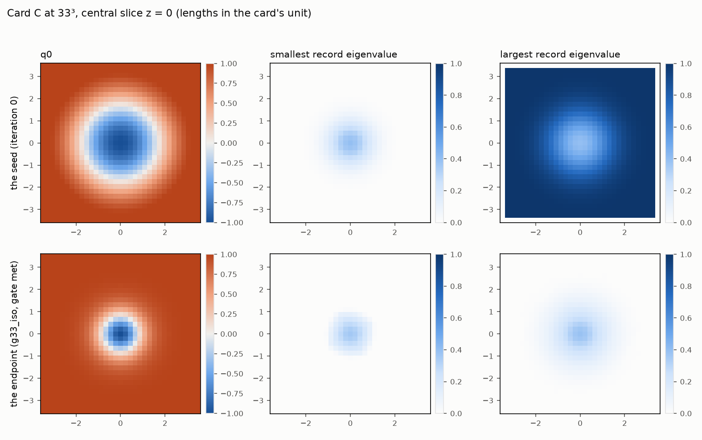
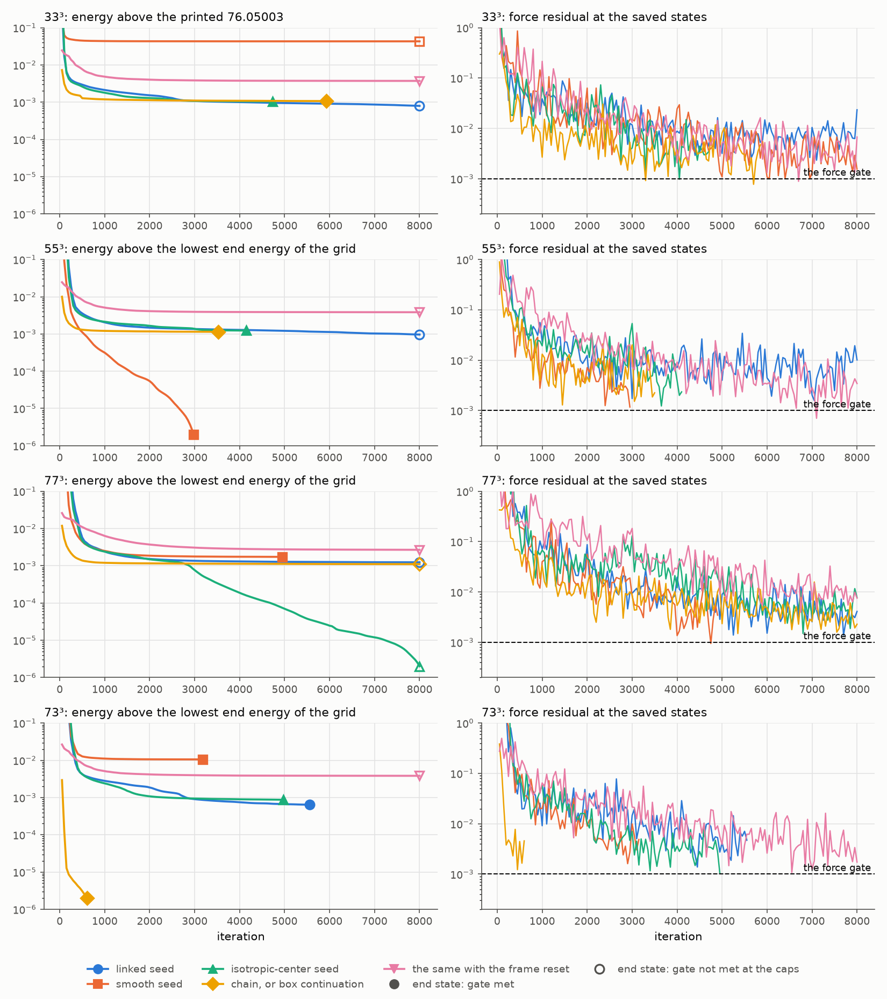
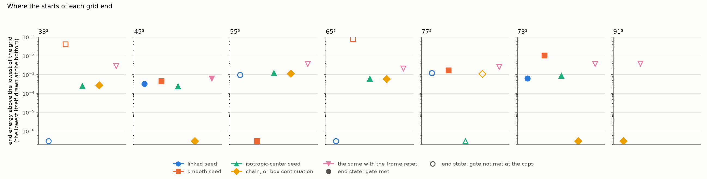
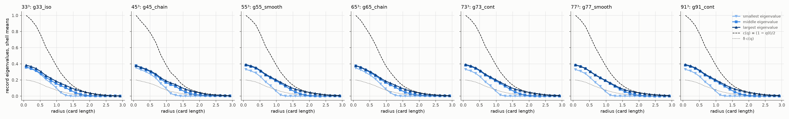
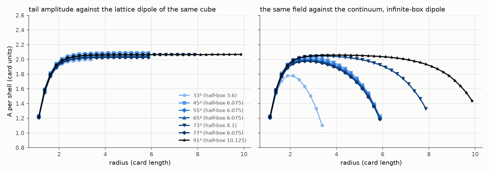

# M5.39: The author's requests of 11 and 12 November: what can run on OpenWave from the capstone v3.2 archive, and what each remaining run needs

> Opened 2026-11-12 from three posts of the author on discussion #186: [discussioncomment-19549189](https://github.com/vantasnerdan/substrate-framework/discussions/186#discussioncomment-19549189) (11 November, capstone v2.997, five computations ranked by their value to the native-nucleon milestone), [discussioncomment-19557719](https://github.com/vantasnerdan/substrate-framework/discussions/186#discussioncomment-19557719) (12 November, capstone 3.0, five computations ranked by time) and [discussioncomment-19561956](https://github.com/vantasnerdan/substrate-framework/discussions/186#discussioncomment-19561956) (12 November, capstone 3.1, the frozen packets). The capstone moved to v3.2 the same day; that release is filed and read for this plan. The task is a plan first: it sorts the requests into what runs from the archive alone and what waits on an input, it measures the cost of the first kind before promising it, and it puts the open choices to the author and the other fronts. Nothing of it ran before the reply. The reply came on 13 November ([discussioncomment-19585053](https://github.com/vantasnerdan/substrate-framework/discussions/186#discussioncomment-19585053)) with the capstone v3.4; it answers the seven choices of § 6 and is folded into the plan in § 9. The decode of the posts is in [`m5_32_convo.md`](m5_32_convo.md).

## TASK PLANNING (2026-11-12; the plan post went on the thread at 16:18 UTC, [discussioncomment-19569098](https://github.com/vantasnerdan/substrate-framework/discussions/186#discussioncomment-19569098); restaged 2026-11-13 on the author's reply, § 9; the go is the user's)

**Scope.** (1) The v3.2 release filed and inventoried, and the v3.4 release read against it (§ 1). (2) The ten requests of the three posts, one open ask of ours and the request of the reply routed against what the archive holds (§ 2). (3) The plan-time cost probes on the archived Card C code (§ 3). (4) Track A, five rungs that run from the archive alone: R0 the integrity pass and the reruns of what ships, R1 an independent evaluator of the Card C energy, R2 the Card C mesh ladder to 65³ and 77³ and the box ladder to 73³ and 91³ with a five-start branch census, R3 the static half of the record ablation, R4 the desk checks (§ 4). (5) Track B, the runs that need an input, each with the list of what is missing (§ 5). (6) The options put to the author and the fronts (§ 6), and the answers (§ 9). (7) The sequence and the estimates (§ 7). Out of scope: any run on the author's routes that the author did not ask for; the charged-core relaxation the reply asks for, which gets its own plan (§ 2, row 12); the items 1 to 3 of the post of 10 November ([M5.38](m5_38_task_details.md) § 1), which stay the user's pick; any icon or pointer in [`MODELS.md`](../../../../../MODELS.md), since every run of this task is on the author's Card C and not on this column's certified action.

**Definition of done (of the plan).** This section written against the release; the plan post on the thread; the reply recorded. **Definition of done (of the run, after the go).** The five rungs of § 4 with their scripts and JSONs under `scripts/` and `data/` (`m5_39_*`), every check stating the input that would make it fail; the known-answer controls green before any read is labeled (cap 3 tries, then stop and report the failing control); the numbers of R2 and R3 written to the repo before any field of the author's is opened; a fresh-agent audit on a different model with its own scripts at 0 REFUTED, or the refutations folded in; the results post drafted in the terminal; `check-docs --changed`, `check_roadmaps.py` and `check_no_local.py` clean.

**Gating.** The author's reply to the plan post (the choices of § 6, at least the first two): received on 13 November, both as the plan assumed (§ 9). Then the user's go. The run does not wait for the run records of the author's three fields, which the reply offers ahead of the fields (§ 9). The archived code is untrusted input: it runs from a hashed copy outside the repo, never from the filed folder.

**Parallel shape.** R2 and R3 are a pool of relaxations, one job per (card, grid, start), each on the compiled evaluator of R1, with at most twelve cores busy. Three streams are sequential by construction and always hold a slot: the two refinement chains and the box continuation (§ 4, R2); every stage of a chain hands its state on after at most 2000 iterations, so the chains do not wait for a stage's cap; the box continuation does wait, twice, for the census of the smaller box. The seed starts are independent and fill the other slots, biggest first. A job runs on one thread; a job launched when fewer than twelve remain takes the free cores as threads of the evaluator, set at launch and never changed during a job, and single-thread jobs and threaded jobs never share a core. No GPU: the comparison gates sit at 1e-10 and need double precision. R0, R1 and R4 are seconds to minutes on one core, a documented choice.

**Duration estimate.** About a day from the go to the review, derived in § 7: twenty to thirty hours of pool time if the jobs run to their caps, which the 33³ pilot (no gate in 6000 iterations) and the author's own record (three fields passed the gate narrowly and a fourth did not, § 9) make the likelier end; five to fifteen hours in the optimistic case in which they stop near the iteration counts of the other pilots. The tool calls of the five rungs and the write-up fit inside that window, and one audit runs in parallel. The forecast is frozen only after a pilot of at most 5 percent of it (the 45³ stage of the chain, timed alone and with the pool full), the rule the other team's plan uses.

**Consumers.**

| Sub-result | Read by | The instrument check that reader needs |
| --- | --- | --- |
| R1, the independent evaluator | R2, R3 and every later rung on Card C (the response solves of § 5) | the seven energy terms and the gradient equal to the archived evaluation at 1e-10 on the seed and on perturbed states, and a central-difference gradient check |
| R2, the ladders and their branch census | the author's milestone (a converged background for the scored residues; the box rung sets its scale, § 9), the comparison with the three hashed fields | the printed 33³ row of the refinement table reproduced from our own relaxed 33³ field before any other grid is converted; the printed 55³ inertia (37.44) before the box rung is compared with the number the reply records for 73³ |
| R3, the static ablation | the E1+/M1+ packet's control, whoever computes its current; the cross-replication with the other external team, whose numbers the v3.4 text prints | the bilinear split of the tensor term exact to round-off on the lattice, and the 3.1 review's continuum form of the cross term at second order in the spacing |
| R4, the desk checks | the reply; ask 4 of [M5.38](m5_38_task_details.md) § 5 | routine (algebra and arithmetic of printed statements) |

**Blindspot pass.** Read against the failure families this series has met. (i) Branch dependence: the author's own 33³ state changed branch (76.05003, against 76.05156 for a split-center continuation that the text says never became stationary; a difference of 2 × 10⁻⁵ of the energy), and the 17³ and 25³ states sit on the other branch, so no convergence order could be fitted; a ladder that lands on different branches per grid measures nothing. Every grid gets a census of starts, the branch is named by the record's eigenvalues at the center, and an energy difference between branches is quoted against the stopping floor of the optimizer. (ii) A gate looser than the effect: the force gate (residual at most 1e-3) leaves an energy uncertainty that has to be measured against the branch gap before a lowest branch is named; the census reports the energy drift over the last 10 percent of the iterations beside each energy. (iii) An independent evaluator written from the archived code shares its conventions: it checks the implementation, not the derivation. The derivation side is a reading check in R1 (the printed energy of the text against the terms the code computes, coefficient by coefficient). (iv) Unfalsifiable comparison: our relaxations agree with the author's fields "when they arrive" only if our numbers are committed first; R2 and R3 write their JSONs before any field is opened. (v) The box: the isospin inertia rose 9.06 percent between the half-boxes 3.6 and 6.075 in the author's record, so a mesh ladder at one box says nothing about the box; § 6 asks which ladder matters, and R2 carries a box ladder (73³, the rung the reply names, then a 91³ tail). (vi) Admissibility: the archived optimizer returns a wall (1e100) when a simplex leaves its open hemisphere; a job that hits the wall is labeled INADMISSIBLE, never retried with a different rule. (vii) Oversubscription: single-thread jobs and in-job threads are never mixed in one pool. (viii) Scope creep toward the blocked runs: no response solve, no current and no time evolution is written before its inputs arrive (§ 5), whatever the archive suggests. Added at the restaging: (ix) Numbers read before the run: the v3.4 text prints the other team's ablation results and the reply records the author's 73³ inertia, so R3 and the box rung are replications against known answers, not blind reads; their comparison rules and tolerances are declared in § 4 before any job starts and are not adjusted after. (x) A gate at its own floor: two 17³ starts that both meet the gate end 1 × 10⁻⁴ apart in energy (§ 3), and the author's fields passed at 0.77 to 0.94 of the gate, so a gap between two branches is a ranking only where it exceeds the spread among the gate-passing states of one branch on the same grid; the census measures that spread and says so where it applies. (xi) A solver asymmetry read as a state: the reply reports a fake biaxial line in the author's axisymmetric code and asks solvers to mirror-test. A Cartesian grid has no polar axis, but whether the card's lattice energy is exactly mirror symmetric is a property of its stencils that this plan does not assume: R1 measures it term by term, and R2 reports for each stationary state its distance from its three mirror images and their energies, beside the branch gap. (xii) A moving scale: by the author's reading of the frozen rule the largest eligible box sets the calibration, so every physical number of R2 is given under the printed calibration and under the rule applied to our own box rung, never under one of them alone.

### 1. The release as filed

Capstone v3.2, *The Standard Model and gravity as effective LdGS: toward a complete non-perturbative picture* (12 November 2026, 332 pages), Zenodo record [24164976](https://doi.org/10.5281/zenodo.24164976) of the all-versions DOI [23994958](https://doi.org/10.5281/zenodo.23994958): the PDF and the source archive, both matching the record's checksums, filed with the rows of [`_CITATIONS.md`](../../theory/_CITATIONS.md). The source tree holds 927 files, 528 of them scripts (294 new since v2.8), the folder `frozen_packets/` and two review documents.

| The archive holds | The archive does not hold |
| --- | --- |
| The Card C energy with its analytic gradient and the relaxation driver (`bq_core.py`, `dn87_relax.py`, `fast_quartic.py`), byte-identical to three of the four code digests of the Card C payload manifest | The three relaxed fields (33³, 45³, 55³) and their run records; `kinetic_operator.py`, the fourth file of the manifest; the compiled kernel the driver looks for |
| The constants and the run parameters of Card C (δ 0.2, K_orient 0.02, k_x 0.25, G_time 230, the edge stencil, the symmetric simplex rule), the grids and the half-boxes (3.6 for 33³, 6.075 for 45³ and 55³, in the card's length unit of 0.5014 fm) | Every solver of the response chain: the Ward checks, the Galerkin and full-space solves, the production current, the reduced amplitude; the pre-registration file the scorer refers to |
| The frozen-profile inertia audit (`inertia.py`); the scorer `score_photon_point.py` with its template | The solver and the fields of the twisting nucleon (the author's Card S: isorotating solutions of Card C at fixed isospin, the twist frequency reported) |
| The packets as definitions: STRING v0.6 (manifest, scorer, an audit supplement with three replay scripts and two trial fields), E1+/M1+ (definition frozen, payload pending), W (preflight, every input listed as not attached) | The STRING endpoint operator, masks and arrays; the W action, coefficients and seeds; the photon kinematics and the multipole conventions |
| Five standalone hadronic scripts (`scripts/`: the Skyrme shooting profile, the hedgehog with a dynamical ρ, its sextic variant, the parent-induced ρ, the parent loop with the pion mass) | The numbers the post of 11 November quotes for the pilot of the outgoing solve (the residuals 1.4e-3 and 2.0e-3 against 1e-5, the matching to outgoing waves at l = 1, 3 and 5, the record block): the text carries the need for an outgoing exterior and no specification of one |

The text states that an external team of the same discussion takes three calculations from frozen packets (STRING first, then W, then E1+/M1+), with a computation plan and a compute forecast agreed before the first number, and that two of the STRING gate controls are that team's. None of the 129 comments and replies of the thread carries that plan (read on 12 November 2026), and it is not a plan of this column. § 6 asks who runs what.

**The v3.4 release (13 November 2026, 364 pages).** Zenodo record [24195369](https://doi.org/10.5281/zenodo.24195369) of the same all-versions DOI, deposited five hours after a v3.3 that it supersedes: the PDF and the source archive, both matching the record's checksums, filed beside v3.2 with their rows in [`_CITATIONS.md`](../../theory/_CITATIONS.md). The source tree holds 1031 files, 596 of them scripts; 107 files are new since v3.2 and three logs are gone. Read against v3.2 for this task:

| What | State in v3.4 |
| --- | --- |
| The Card C code (`bq_core.py`, `dn87_relax.py`, `fast_quartic.py`, `inertia.py`), the whole folder `frozen_packets/`, the five standalone scripts that v3.2 ships in `scripts/` (the folder holds 33 in v3.4) and the scorer | byte-identical to v3.2, so the probes of § 3 stand and R0 runs on either archive |
| The photon-point pre-registration | now in the archive (`docs/prereg/photon_point_preregistration.md`, the record of 10 November with its amendments 1 to 6, 3a and 3b among them, and one correction): the first input of § 5, N1 |
| The three relaxed fields, their run records, `kinetic_operator.py` | not in the archive and not on the record, which carries two files; the text says the arrays are attached as a separate file, the reply says they will go into the packet dataset |
| The text on this task | it names the M5.39 plan as one of two independent groups working from the packets (the integrity pass, the independent evaluator, the ladder to 77³ with a branch census, the static ablation), overlapping with the other team on the ablation as cross-replication |
| The other team's Card C replication | printed, with its numbers for the static record ablation on 33³, 45³ and 55³ (§ 4, R3, where they become the known answers of our replication) |
| The new opening (the tetrad view, pp. 10 to 19) and its scripts (`checks/tp4_*.py` and companions) | outside this task; the charged-core request of the reply rests on them (§ 2, row 12) |

### 2. The requests and their routing

| # | The item | Post | What the archive gives | Routing |
| --- | --- | --- | --- | --- |
| 1 | The full-space outgoing response on frozen Card C at ω* = 293 MeV (the interior Hessian minus ω² times the kinetic metric, collective constraints, three pion components matched to outgoing waves, two matching radii, 45³ to 65³, nodal residual at most 1e-5); in the second post the same with an adjoint error certificate and the conserved current with constraint-reaction vertices | 11 Nov #1, 12 Nov #4 | the static energy and gradient only | needs input: § 5, N1 |
| 2 | Card C at 65³ and 77³: relaxed fields at force residual at most 1e-3, the inertia tensor and its anisotropy, g_A, μ_V, g_πNN and the Goldberger-Treiman discrepancy per grid | 11 Nov #2 | the energy, the driver, the inertia audit; the printed relations for the moments | runs now: R1, R2 |
| 3 | The Δ width of the twisting nucleon by real-time evolution (a Hamiltonian integrator on Card S, a spinning hedgehog at J = √15/2 ħ, the radiated power) | 11 Nov #3 | the static energy; no kinetic operator, no fixed-J constraint, no initial state | needs input: § 5, N3 |
| 4 | The saddle energy of a native ΔB = 3 event by a minimum-energy path | 11 Nov #4 | the text lists it as owed, with the coframe still to be specified by the author | needs input: § 5, N4 |
| 5 | An adiabatic photon card: E2 from the O(Ω²) centrifugal deformation, a static real solve, labeled adiabatic | 11 Nov #5 | the static energy | needs input: § 5, N2 |
| 6 | The Finkelstein-Rubinstein spin-parity filter for B = 2 to 8 and 12, with the configuration space and the sign source stated | 12 Nov #1 | the sign source named (the winding field); no table, no list of configurations | desk now, as a conditional table: R4 |
| 7 | A vector-meson card (ρ and ω as hidden-local-symmetry fields, the anomalous ωρπ coupling, vector dominance), then B = 2 and B = 4 binding as holdout | 12 Nov #2 | the radial hedgehog with a dynamical ρ as a standalone script; the W packet with every input not attached | the radial scripts rerun in R0; the card needs input: § 5, N5 |
| 8 | The connected quantum binding on the unchanged action: the sign and size of E₂(corr) − 2E₁(corr) | 12 Nov #3 | no fields, no counterterm scheme | needs input: § 5, N6 |
| 9 | The viability of the minimal gravity corner (α = β = 0) against the constant-mean-curvature and lapse problems of the cited 2025 paper | 12 Nov #5 | a list of questions, no computation specified | a reading task, recorded, not staged |
| 10 | The frozen packets: STRING first, W second, E1+/M1+ with its ablation control | 12 Nov (3.1) | the definitions; the static half of the ablation is computable from the archived energy | the static ablation: R3; the STRING calibration controls offered in § 6; the rest: § 5, N7 |
| 11 | Not a request of the posts, our open ask 4 of M5.38: the moment bound and the first-order cranking statement (the two capstone results of the post of 10 November) | 11 Nov (the bound restated), v3.2 Sec. 31 | both statements with their conditions | desk now: R4 |
| 12 | A relaxation in three dimensions of the charged hedgehog core of the v3.4 opening, with all five components of the traceless spatial block free, at q = 1 (the commutator quartic plus the potential F_q = 1 + (q − 4)/2 t₂ − q t₃ + (q + 2)/2 t₂²); the author's recorded prediction from an axisymmetric grid of 60 by 30 points: the lowest state a compact biaxial ring at r ≈ 0.13 L with a minor gap of 0.07 to 0.08, 0.2 to 0.3 percent below the radial melted core | 13 Nov (the reply) | the reduced energy and its units in `checks/tp4_biaxial_core_sph.py`, the axisymmetric solver with its companions and launch script, the outer condition (the vacuum hedgehog at radius 4 L, the Coulomb tail beyond); two reference values the reply calls exact for any solver (the charge core's E r_ch ≈ 0.93 α ħc, which the text gives as 0.927 to 0.941 over the melting shapes, and the profile and tension of a half line in a biaxial exterior) | its own task with a pre-registration, which the reply welcomes; not part of this go. A Cartesian grid has no polar axis, and the predicted ring sits two radial nodes from the center of the author's grid, so a spacing ladder is the first thing that plan owes |
| 13 | The constrained tilt reduction of the time-axis section on a smooth, relaxed winding-one texture, lapse, shift and gauge directions included | 14 Nov (the post announcing v3.6) | the section of v3.6 on the time axis as a vacuum, read and not yet mapped to an operator on OpenWave | named after this run closed; needs its own plan (which texture, which reduction, what is scored) before anything is staged |

### 3. The plan-time cost probe

Three measurements were taken on a hashed copy of the archived code before this plan was written, on one machine, so the ratios and the counts carry over and the seconds are indicative (a second timing by the audit of § 8 moved them by up to 15 percent). They are probes, not results: R1 reproduces them at the go.

| Grid (half-box, spacing) | Unknowns | One energy and gradient, archived code, one thread | The quaternion quartic alone | The same term, compiled, twelve threads |
| --- | --- | --- | --- | --- |
| 33³ (3.6, 0.225) | 0.39 M | 1.3 s | 1.2 s | 0.03 s |
| 45³ (6.075, 0.276) | 1.03 M | 3.6 s | 3.3 s | 0.07 s |
| 55³ (6.075, 0.225) | 1.94 M | 5.4 to 6.3 s | 4.8 to 5.1 s | 0.14 s |
| 65³ (6.075, 0.190) | 3.25 M | 10.7 s | 10.0 s | 0.25 s |
| 77³ (6.075, 0.160) | 5.48 M | 18.8 s | 16.6 s | 0.38 s |

(a) The archived evaluation spends about nine tenths of its time (81 to 93 percent by row) in one term, the quaternion quartic on the symmetric simplex rule (the average over the field and its three reflections of a four-point rule on six tetrahedra per cell). (b) A compiled version of that term, written from the archived routine as its specification, returns the same value of that term to 1 × 10⁻¹⁶ relative and the same gradient to 5 × 10⁻¹⁷ absolute on one perturbed state per grid at 33³ and 45³, about 5 times faster on one thread and about 40 times on twelve; the other six terms stay in the archived code in every pilot, so a whole evaluation gains less (about one tenth of it is untouched). (c) Relaxation pilots with the archived driver under the run parameters of the payload manifest (card C, δ 0.2, K_orient 0.02, k_x 0.25, the edge stencil, the symmetric rule), the driver's own frame scale, the `linked` seed and our iteration caps; the force gate at 1e-3 is read on the saved states as the largest gradient entry over h³, every 50 iterations. The compiled term of (b) replaces the archived one except in the first row:

| Pilot | Iterations | The gate | Energy at the stop | Eigenvalues of the record's Gram matrix at the center |
| --- | --- | --- | --- | --- |
| 33³, the archived code unchanged | 1500 (the cap; 1592 evaluations) | not met, 1.9e-2 | 76.05180, still falling | 0.358, 0.368, 0.375 |
| 33³, compiled term | 6000 (the cap; 6282 evaluations) | not met: 5.3e-3 at the stop, 3e-3 to 2e-2 over the last 400, 1.5e-3 at best | 76.05095, flat to 1e-5 over the last 400 | 0.341, 0.370, 0.391 |
| 33³, compiled term, the driver's Sobolev option at 0.45 | 809 (the optimizer's own stop, in the transformed variables) | not met, 2.4e-3 | 76.05111 | 0.355, 0.368, 0.379 |
| 17³, compiled term | 1188 | met, 7.0e-4 | 76.23669 | 0.368, 0.375, 0.377 |
| 25³, compiled term, refined from the 17³ state by the archived path | 2100 (the probe stopped there, before its cap) | undecided: 2.5e-3 at best | 76.15082, flat to 3e-5 over the last 400 | 0.359, 0.373, 0.376 |
| 45³ at half-box 6.075, compiled term | 2800 (the probe stopped there, before its cap) | undecided: one saved state under the gate (7.2e-4 at 2600), 1.9e-3 to 7.3e-3 after | 75.61784, flat to 2e-5 over the last 400 | 0.353, 0.372, 0.383 |

The two 33³ rows without the option follow the same energy path while both run (76.05327 at 400 and 76.05313 at 450 in both; the difference at most 5 × 10⁻⁵ up to 1500); their residuals differ by factors up to three at the same iteration, so the compiled term changes the cost and not the energy path, and the residual is erratic in both.

What the probe decides. (1) The clock of R2 is the force gate, and at 33³ the energy as well: the energy comes within 1e-4 of its end value in about 1000 to 1500 iterations on 17³, 25³ and 45³, but only near 3750 at 33³, which is still 6 × 10⁻⁴ above its end value at 2000; the residual then wanders between 1.5e-3 and 2e-2. The gate is met at 17³; it is not met at 33³ within 6000 iterations; 25³ and 45³ were stopped before their caps and decide nothing. (2) The slow direction is the record: between the saved 33³ states at 1500 and at 6000 iterations almost all of the change is in the record (the winding field moves 35 times less), and most of it sits in the shell between one and three card lengths, not at the center; the center eigenvalues only label the branch. They read 0.358, 0.368, 0.375 at 1500 iterations of one run and 0.341, 0.370, 0.391 at 6000 of the other, against the printed 0.333, 0.376, 0.394, while the energy is 9 × 10⁻⁴ above the printed 76.05003 and its fall is slowing (3 × 10⁻⁵ over the last thousand iterations): the pilot does not show that it arrives there. The 33³ control of R2 therefore cannot be read on a state stopped at a cap. (3) With the Sobolev option the optimizer stops by its own criterion in the transformed variables with the archived residual at 2.4 times the gate, so under that option the gate is re-read on the final state; without it the optimizer's stop implies the gate (the 17³ row). (4) The 17³ and 25³ pilots land on an isotropic center where the text prints a split one for both grids: the branch depends on the start, and the run records of the author's three fields (the option line and the iteration history of each) are the missing input that would let R2 follow the same route (choice 4 of § 6). (5) The two finest grids are out of reach of the archived code inside a night (6000 iterations at 77³ are about 31 hours of one thread); with all seven terms compiled, which is R1's job, they are within reach, and every job carries an iteration cap, so the pool time is bounded and a job that ends at the cap is labeled NOT STATIONARY with its residual.

**Probes of the restaging (13 November 2026, the same hashed copy, whose four code files are byte-identical to the v3.4 archive).** Four more measurements, taken because the reply adds a box ladder and two kinds of start.

(a) The cost of the box rungs. One archived evaluation on one thread takes 14.2 s at 73³ and 30.0 s at 91³ (13.3 and 26.2 s of it in the quaternion quartic); the compiled term takes 2.6 and 5.0 s on one thread and 0.28 and 0.56 s on twelve. The count of operations does not depend on the half-box, so these hold for 73³ at 8.1 and 91³ at 10.125.

(b) The archived seeds are split at the center by construction: the Gram matrix of the record there has the eigenvalues 0.006, 0.203 and 1.0 for the `linked` seed (read on 17³ and 33³; the seed's formula carries no dependence on the grid at the center node), beside the printed split core of 25³ (0, 0.232, 0.951). Every pilot of this section that started from the seed therefore started split and ended with a nearly isotropic center. The driver's frame reset rewrites the record as the lab-frame diagonal 0.025 b, √b and √((1 − q₀)/2) with b = δ (1 − q₀)/2, whatever the frame of the state it is applied to, which at the center (q₀ = −1, δ = 0.2) is a split pattern again (2.5 × 10⁻⁵, 0.2, 1.0).

(c) An isotropic-center start, ours: the `linked` seed with its record blended, on the interior nodes, toward the isotropic value inside a Gaussian core of one card length, f ← (1 − w) f + w √0.396 Rᵀ with w = exp(−r²/2) and R the seed's own frame, so that the center starts at 0.396 times the identity, the isotropic minimum of the record potential that the text names. On 17³ it meets the gate at 1125 iterations (residual 6.9e-4) with the energy 76.23659 and the center eigenvalues 0.362, 0.378, 0.380, against 76.23669 and 0.368, 0.375, 0.377 from the `linked` seed: one branch label from both starts on that grid, and two energies that both pass the gate while standing 1.0 × 10⁻⁴ apart, 2.4 times the drift of either over its last tenth of iterations (4.1 and 4.3 × 10⁻⁵): states that pass the gate on one branch can differ by that much.

(d) A box continuation, ours: the stationary 17³ state at half-box 3.6, padded at the same spacing with the values the card holds on its boundary (the winding field at the identity, the record at zero) to 21³ at half-box 4.5, is a state of the larger box with the same energy (76.23669 at the start); the archived driver takes it through its resume path and meets the gate in 280 iterations (residual 5.1e-4) at 75.85909, on the same branch (center eigenvalues 0.369, 0.375, 0.377). The padded state is not near a stationary point of the larger box (residual 0.37 at the start, the new exterior being unrelaxed). On this one probe the continuation takes a quarter of the evaluations of the 17³ seed start (half its wall time, the grid being larger) and keeps the branch.

### 4. Track A: the rungs that run from the archive alone

**R0, the integrity pass and the reruns of what ships.** Run on the v3.4 archive, with the identity of its Card C code, packets, scripts and scorer to v3.2 re-checked (§ 1). The digests of the three archived code files against the payload manifest; the packets' checksum files; the scorer's self-test; the five standalone scripts that v3.2 ships in `scripts/` and the three scripts of the STRING audit supplement (two replays and the hash verifier), as shipped, from a hashed copy, against the values the text prints (the pion mass 139.5 MeV of the parent loop, the ρ coupling ratio 2.0275, the hedgehog masses with the heavy and the dynamical ρ, the radial strand tension 0.24001768 MeV/fm). Labels per script: REPRODUCED at the printed digits, DIFFERS with the difference, NOT RUNNABLE with the missing input. Fails if a digest differs or a printed digit is not returned.

**R1, the independent evaluator.** Our own implementation of the Card C energy and its gradient: the seven terms of the archived `evaluate` (the tensor quadratic, the quaternion quartic, the record quartic, the two composite quadratics, the record potential, the pion mass term, the orientation term), compiled, with the unknowns and the boundary treatment of the archive (13 reals per interior node, the boundary held at the seed's values). Gates before any relaxation: (a) each term and the gradient equal to the archived evaluation at 1e-10 relative, on the seed and on three perturbed states, at 33³ and 45³; (b) a central-difference check of the gradient in three random directions; (c) the reading check: the energy printed in the text, coefficient by coefficient, against the terms the code computes; (d) the mirror check, added at the restaging: for each of the three coordinate reflections, the map that sends a state to its mirror image (the reflection acting on the coordinates and on the winding field, the record carried by the frame map that sends the tensor N to its mirror image), applied to random states and scored term by term. The lattice energy is labeled MIRROR SYMMETRIC if every term returns to round-off; otherwise the defect is recorded per term with its order in the spacing, and if no map returns the terms to better than that order the mirror reads of R2 are withheld with the reason stated. Fails if any term differs beyond 1e-10 or a printed coefficient has no counterpart in the code.

**R2, the ladders and the branch census.** Relaxations with the archived optimizer settings (the force gate at 1e-3 by the archived definition, the largest gradient entry over h³) on two ladders in one pool, the mesh ladder ahead where the two compete for a slot, as the reply asks:

| Ladder | Grids | Half-box | Spacing |
| --- | --- | --- | --- |
| mesh, the control box | 33³ | 3.6 | 0.225 |
| mesh | 45³, 55³, 65³, 77³ | 6.075 | 0.276, 0.225, 0.190, 0.160 |
| box, at the spacing of 55³ | 73³, then 91³ as a tail | 8.1, 10.125 | 0.225 |

*Starts.* Five per grid, the list the reply suggests: (a) the archived `linked` seed and (b) the archived `smooth` seed, both split at the center by construction (§ 3); (c) the chain, the state of the next coarser grid of the same box interpolated by the archived refinement path (17³, 25³, 33³ at half-box 3.6; 29³, 37³, 45³, 55³, 65³, 77³ at 6.075); (d) the same refined state with the archived frame reset, which rewrites the record as a diagonal in the lab frame set from q₀ alone, split at the center (§ 3): our reading of the reply's split-center seed, since both archived seeds are already split there; (e) the isotropic-center seed of § 3. On the box ladder the chain is the box continuation of § 3: the lowest stationary state of the next smaller box at the same spacing (55³ at half-box 6.075 for 73³, 73³ for 91³), padded with the card's boundary values, as (c), and the same with the frame reset, as (d); if the smaller box holds no stationary state its lowest-energy state is used and the start is labeled so. A chain stage hands its state to the next finer stage at the first of its gate met or 2000 iterations, and then runs on to its own cap as the chain job of its grid; 17³, 25³, 29³ and 37³ are starting stages only and stop at the hand-off. The 91³ tail runs only if 73³ holds a stationary state, with the two continuation starts alone, which makes its census a reduced one, labeled so.

*Caps and labels.* Every job carries a cap of 6000 iterations and one declared polish (2000 more from the stopped state with a fresh optimizer memory); the two jobs of the tail carry 3000 and 1000. The gate is read on the final state in the original variables, never taken from the optimizer's own stop (§ 3). Labels per job: STATIONARY (gate met, winding one, every simplex admissible), NOT STATIONARY (the iteration cap reached, with the residual), INADMISSIBLE. The branch of a state is named by the eigenvalues of the record's Gram matrix at the center: ISOTROPIC CENTER (the smallest above 0.2 and the three within 0.1 of each other), SPLIT CENTER (the smallest below 0.1), MIXED otherwise. Only a stationary state counts as a branch, and every stationary branch of a grid is reported with its energy, as the reply asks; per grid the lowest of them is the state of the grid, the author's rule of 10 November. Two branches are ranked by energy only where their gap exceeds both the drift of either state over its last 10 percent of iterations and the spread among the stationary states of one branch on that grid (1.0 × 10⁻⁴ between the two 17³ probes of § 3); otherwise they are reported as unranked.

*Reads per grid.* The energy by term; the six-generator inertia by the archived audit run on our field; the two radii; the tail amplitude A, fitted as the reply defines it (the dipole amplitude of the static pion field against the free massive dipole of the lattice operator in the same cube with Dirichlet faces); and each stationary state's distance from its three mirror images with their energies (the map of R1). Physical numbers by the printed relations: the rotor gap and μ_V from the rigid-rotor relations; g_A by the two relations the text prints, from the axial integral (g_A = (3 e f_π / 2Δ) G̃/λ̃, the route that returns 0.905 from the printed ratio 0.449, the printed 0.904 within the rounding of that ratio) and from the tail (g_A = (8π/3) f_π² A with A in physical units); g_πNN from the tail by the formula of the reply, (8π M_N f_π/3) A / (e f_π)² with A in card units and the nucleon mass taken as the physical one, a reading the 55³ comparison tests (§ 9). If the text does not define the axial integral on the card's fields, that route is withheld and said so. They are given twice: under the printed calibration of 55³ (e = 4.311, f_π = 91.29 MeV), and under the frozen rule applied to our own largest stationary box rung, e² = 2 I Δ / (3 e f_π) with I the isospin inertia in card units, Δ = 293 MeV and e f_π = ħc / 0.5014 fm. That form of the rule is read off the printed pairs: it returns 4.128 and 95.34 MeV from the inertia 34.33, and 4.311 and 91.295 MeV (printed as 91.29) from 37.44.

*Known answers.* The printed 33³ row (energy 76.05003 on the lower branch, center eigenvalues 0.333, 0.376, 0.394, the gap 311.9 MeV, μ_V 3.004, the radii 0.2303 and 0.4519 fm²) returned by our own 33³ state before any other grid is converted to physical units. On 55³ the printed inertia 37.44, g_A 0.904 and g_πNN 9.54 to 9.55. The printed pair is not one amplitude: 0.904 corresponds to a tail amplitude of 0.504 fm², which the reply's formula turns into 9.29, while 9.54 to 9.55 corresponds to about 0.518 fm², the 2.7 percent by which the printed Goldberger-Treiman relation is open on that grid. So each coupling is compared on its own route (0.904 from the axial integral; 9.54 to 9.55 from the tail fitted over the outer shells, where the text finds it flat), their Goldberger-Treiman ratio is reported beside the 0.928 against 0.904 that the printed numbers give, and a read is withheld on every grid only if its own 55³ comparison fails. The box number of the reply, recorded before this run: the isospin inertia at 73³ about 37.85, a rise of about 1.1 percent over 55³, with about 0.3 percent still outside. Our read is the ratio of our own 73³ and 55³ inertias: AGREES if the rise is between 0.8 and 1.4 percent, DIFFERS otherwise with the number (the window is ours: the reply's 1.1 percent with the 0.3 percent it leaves outside as the half-width; the reply's figure ignores the cube faces, and the text's own linear-tail audit puts most of the residual in the Dirichlet faces, so a lattice rise under 1.1 percent would be no surprise and is recorded as it comes), NOT SCORED if either state is not stationary, if the two sit on different branches, or if our 55³ inertia misses 37.44 beyond its printed digits. The rise from 73³ to 91³ is reported beside the 0.3 percent, unlabeled.

*Ladder words.* Per ladder (the mesh ladder on 55³, 65³, 77³; the box ladder on 55³, 73³, 91³): CONVERGENT (the same branch on the three grids and the differences of the energy and of the inertia falling), BRANCH-DEPENDENT (the lowest branch changes along the ladder), NOT STATIONARY (a finest grid without a stationary state). Fails if no 33³ job is stationary, or if the lowest stationary 33³ state misses the printed row: the center eigenvalues beyond 0.01, the energy beyond 3 × 10⁻⁴ of 76.05003 (twice the spread between the two longest plan-time routes at 33³, 76.05095 and 76.05111, neither of them stationary), the other entries beyond their printed digits.

**R3, the static half of the record ablation.** The control of the E1+/M1+ packet as the definition freezes it: the term a aᵀ / G_time removed from the tensor N in the action and in its variation, the record kept everywhere else. The procedure is paired, on 33³, 45³ and 55³: from the lowest stationary state of the card on each grid (R2), two continuations with the same optimizer settings and the same caps (2000 iterations and a polish of 1000), one of the card unchanged and one of the ablated card; every difference is taken between the two end states, so the residual drift of the start is common to both. One unpaired check: the ablated card relaxed from the `linked` seed on 33³ under the caps of R2, whose end state has to return the paired energy difference within the stopping floor of the two runs. Reads, all as the card minus its ablation: the differences of the energy by term, of the inertia (the direct part at fixed fields and the relaxed change, separately) and of the radii, beside the cross term's share of the winding term. Known answers, printed in the v3.4 text from the other team's replication and read before this run, so this is a replication and not a blind read: the energy higher by 0.0425, 0.0433 and 0.0438 percent on the three grids (0.0450 extrapolated to the continuum and the infinite box); the inertia's direct part +2.7 to +2.8 × 10⁻⁴ and its relaxed change −2.7 to −3.6 × 10⁻⁴; the rms radius smaller by about 1.5 × 10⁻⁴ fm. The printed direction is read from the text's own summary (a positive stiffness raises the energy while the relaxed inertia falls) and the inertia changes are read as fractions of the inertia; the direct part, which needs no relaxation, is computed first and checks both readings before any label is applied. Labels per grid: AGREES (the energy change within 5 percent of the printed one, both parts of the inertia with the printed signs and within a factor of 1.5 of the printed sizes), DIFFERS with our numbers, NOT SCORED where our starting state is not stationary or does not sit on the declared branch of the author's field: the printed numbers were taken on the author's three fields, with inputs verified against the archive's digests, and ours start from our own states. Two checks on the same fields: the bilinear split of the tensor term into the winding part, the cross part and the pure-record part, exact for a linear stencil; and the 3.1 review's continuum form of the cross term, ε (∂q)ᵀ A (∂q), whose lattice remainder has to fall at second order across the three grids (the review's own fixture: 6.9e-4, 1.8e-4, 4.4e-5 on 32, 64, 128 points). The review's bound of 2/230 on the share is conditional on the operator norm of A staying at or under one, which is measured first. The currents of the control are not computed: they wait on § 5, N1. Fails if the bilinear split misses round-off, if the remainder of the continuum form does not fall at second order, or if the ablated continuation is not stationary on a grid where the card's is.

**R4, the desk checks.** (a) The moment bound with its conditions, from the two printed rotor relations (the moment as two thirds of the nucleon mass times an inertia not larger than the isospin inertia, the gap as three halves over the inertia), and the three printed numbers (3.20 μ_N at 293 MeV, 199.5 MeV for the measured moment, 1.50 or 1.51 μ_N missing). (b) The first-order cranking statement: on a time-even action with an exact zero mode Z of the Hessian H, the response equation (H − ω²K) Φ = iωK Z is solved by Φ = −(i/ω) Z; checked symbolically and on a random positive pair with a planted null vector. This closes ask 4 of M5.38. (c) The Finkelstein-Rubinstein table for B = 2 to 8 and 12 as a conditional filter: the allowed spin-parity states of the standard minimal-energy symmetry groups with the signs from the rational-map rule, each row against the published tables, under the stated condition that the sign source is the winding field alone; where the published configurations are not the author's, the row says so. Fails if a row disagrees with the published table it cites.

### 5. Track B: the runs that need an input

The posts offer inputs on request (the frozen card with its fields at 45³ and 55³ and their hashes, the pilot's code and receipts, the pre-registration with its amendments, the scorer; frozen inputs for any item of the second list). This table is that request, per run. The reply of 13 November answers it (§ 9): the pre-registration is in the v3.4 archive, the Card C payload (the three fields, their run records and the kinetic operator) will go into the packet dataset, and the rest of the table does not exist as frozen code yet, so Track A goes first. The rows N1 and N3 carry what arrived and the order the reply sets.

| # | The run | What is missing before a plan can be frozen |
| --- | --- | --- |
| N1 | The outgoing response and the photon-point shape test (requests 1 and the second post's item 4) | arrived with v3.4: the pre-registration with its amendments (the scored quantity, the ratio of the pole residues of the K-matrix photoproduction elements at the card's own crossing W* = 1231.272 MeV from the tree current of the gauged local action; the gates: the full-current Ward identity at 1e-10, a converged pair of grids at one box within 0.7 points of E1+/M1+, a box rule at 0.35 points, gauging before reducing). Still missing: the kinetic metric (`kinetic_operator.py`); the collective constraints and the constraint-reaction vertices as defined; the gauged current as code; the photon kinematics, the multipole and phase conventions; the outgoing matching of the pilot (the list of l, the radii, the treatment of the vacuum record block); the definition of the nodal residual and of the single stopping rule; the three hashed fields, for a like-for-like background. Order, by the reply: the pilot's own discretization and matching first, then an independent exterior; the record block both constrained and deflated, with no score if the two differ by more than 0.7 points |
| N2 | The adiabatic photon card (request 5) | the same current and kinetic metric; the centrifugal source at O(Ω²) as the pilot projects it |
| N3 | The Δ width of the twisting nucleon (request 3) | the kinetic metric; the fixed-J constraint of Card S and the preparation of the state at J = √15/2 ħ; the exterior (box, absorber or matched waves); the observable (the surface, the window, the comparison formula of the cited recoil reference). Order, by the reply: the stationary problem in the co-rotating frame with an outgoing exterior first, since it shares the solver of N1 and the declared P33 test is a K-matrix quantity; the real-time evolution after it, as the independent check |
| N4 | The ΔB = 3 saddle (request 4) | the two endpoints as fields of a declared action; the text's own next step (the full-rank coframe) is the author's |
| N5 | The vector-meson card and the W packet (requests 7 and 10) | the meson-sector parameters frozen; the full action with the coefficients, units and boundary treatment; the seeds for B = 2 and 4; the native arrays, for the comparison |
| N6 | The connected quantum binding (request 8) | the action of record and its fields for B = 1 and 2; the counterterm scheme, declared first; the mode cut and the continuum treatment |
| N7 | The STRING scored ladder (request 10) | the endpoint source operator with its masks, arrays and radius; the separations and the mesh and box ladder; the stress convention; and the answer to who runs it (§ 6, choice 1) |

### 6. The choices put to the author and the fronts

The seven choices as posted on 12 November; the answers are in § 9.

1. **Who runs what.** The text assigns STRING, W and E1+/M1+ to an external team with its own plan and forecast. Should OpenWave take the complement (the Card C ladder, the static ablation, the desk checks, later the twisting nucleon), or run one of the three as a second independent solution?
2. **What counts as independent for Card C.** (a) The archived code unchanged; (b) our own compiled evaluator, gated at 1e-10 against the archived one; (c) both, with (a) as the spot check on the two coarsest grids. The plan assumes (c).
3. **Which ladder.** A mesh ladder at the half-box 6.075 (65³, 77³), a box ladder at the spacing of 55³ (73³ at half-box 8.1, 91³ at 10.125), or both. The author's own record moves the inertia by 9 percent with the box.
4. **The branch rule and the route.** How many starts make "the lowest stationary branch"; and the run records of the three hashed fields (the option line and the iteration history of each): the plan-time pilots of § 3 do not reach the force gate at 33³ from the archived seed under the payload's run parameters, so the route that did is an input.
5. **The outgoing solve.** The same discretization and matching as the pilot (which isolates the solver), or an independent discretization of the exterior (which isolates the discretization); and whether the vacuum record block is constrained or deflated.
6. **The Δ width.** A real-time evolution in three dimensions, or the stationary problem in the co-rotating frame with an outgoing exterior, which shares its solver with N1; which first.
7. **Units and conventions** for the tail amplitude behind g_A and g_πNN, if the 55³ comparison of R2 does not fix them.

### 7. The sequence and the estimates

| Step | What | Compute | Go to review |
| --- | --- | --- | --- |
| 0 | The plan post; the reply | none | done on 13 November (§ 9) |
| 1 | Track A, one go: R0, R1, R4 first (minutes each), then the pool of R2 and R3 | twenty to thirty hours of pool time at the caps, the likelier end; five to fifteen at the pilots' iteration counts | about a day, a night in the optimistic case |
| 2 | The comparison with the three hashed fields and their run records, when the packet dataset lands; a rerun on the author's route of any grid that missed the gate | minutes for the comparison, hours for a rerun | tens of minutes, or one more go |
| 3 | Once their inputs are in hand: N2, then N1 with the pilot's own discretization at 45³ only against the pilot's residual, then an independent exterior, before any ladder | hours per rung | one rung per go, re-estimated at each staging |
| 4 | N3: the stationary co-rotating problem first, the real-time evolution after it | one overnight each | one go each |
| 5 | N4 to N7 | not estimated before their inputs | not staged |
| beside | The charged-core relaxation of § 2, row 12 | not estimated before its own plan | its own task |

The pool of step 1 holds 32 labeled jobs of R2 (five starts on each of the five mesh grids and on 73³, two on the 91³ tail), four starting stages, and seven jobs of R3. With the quartic term compiled and the rest as archived, one evaluation on one thread costs about 0.35, 0.9, 1.5, 2.5, 3.5, 5.2 and 8.8 s at 33³, 45³, 55³, 65³, 73³, 77³ and 91³ (the two box grids measured directly, the others composed from the timings of § 3 with the measured gain of the compiled term; a second composition moves the total by about 3 percent). At the caps (8000 iterations for a labeled job, 2000 for a starting stage, 4000 on the tail, 3000 for a continuation of R3) the work adds up to about 180 hours of one core, of which the five 77³ jobs are 58 and the five 73³ jobs 39. On twelve cores that is 15 hours if the jobs did not slow each other; concurrent jobs of this kind do, by a factor the pilot of the forecast measures, and 30 hours covers a factor of two. Three dependent paths bound it from below: a 77³ seed start alone takes about 12 hours at its cap; the chain's 77³ job starts only after five hand-offs (about 3 hours alone) and then needs its own 12; and the box path waits twice for a census (the 55³ jobs end about 4 hours in, the 73³ continuation needs 8, the 91³ tail 10 on one thread or about 5 with the free cores as threads), about 22 hours alone and the longest of the three. With the slowing of concurrent jobs on top, the pool at the caps takes twenty to thirty hours. At the pilots' iteration counts (1200 to 3000 per job) the chain path takes about 4 to 7 hours alone, the box path about 5 to 13, and the pool about 5 to 15. Compiling the other six terms in R1 lowers all of these, by an amount R1 measures, and the threads handed to late jobs shorten the tail of the pool.

The estimates of steps 3 to 5 are orders of magnitude: none of their operators exists on OpenWave before the inputs of § 5, and each is re-estimated from a pilot at its own staging.

### 8. The audit, the post and the records

A fresh agent on a different model, with its own scripts and with the archive in hand, attacks the claims of R0 to R4 before the review is presented. The plan post is drafted in the terminal and carries § 2, § 4, § 5 and § 6 in short form; the results post follows the run. Records: the convo rows of the three posts, of the plan post and of the reply in [`m5_32_convo.md`](m5_32_convo.md); the rows of the v3.2 and v3.4 releases in [`_CITATIONS.md`](../../theory/_CITATIONS.md); the roadmap row and the change-log entries in [`m5_roadmap.md`](../m5_roadmap.md).

### 9. The reply of 13 November and the restaging

The author answered the plan post on 13 November 2026 ([discussioncomment-19585053](https://github.com/vantasnerdan/substrate-framework/discussions/186#discussioncomment-19585053)), with the capstone v3.4 (§ 1). The seven answers, each checked against the filed text where it restates one:

| Choice of § 6 | The answer | What the plan does with it |
| --- | --- | --- |
| 1, who runs what | OpenWave takes the complement: the Card C ladder, the static ablation, the desk checks, later the twisting nucleon. R3 then doubles as a second independent solution of the other team's static record ablation. A second E1+/M1+ solution is welcome later, once its current exists as code | as planned; the other team's printed numbers become the known answers of R3 (§ 4) |
| 2, independence | option (c) | as planned |
| 3, the ladder | both, the mesh first. By the author's reading of the frozen rule (the finest eligible inertia at the finest spacing and the largest eligible box) the box rung sets the scale. Recorded before our run, from a Yukawa tail with the cube faces ignored: at 73³ (half-box 8.1) the isospin inertia rises by about 1.1 percent over 55³ (37.44 to about 37.85), with about 0.3 percent still outside | the box ladder joins R2 with 73³, the rung the reply names and records a number for; the 91³ tail is ours, from the plan post's own choice; the recorded number is scored; every physical number is given under both calibrations (§ 4) |
| 4, the branch rule and the route | the rule of 10 November stands (the lowest-energy stationary branch at the finest grid), and a branch counts only if it meets the force gate. Starts suggested per grid: the two archived seeds, the refinement chain, one isotropic-center seed, one split-center seed; label by the center eigenvalues and report every stationary branch with its energy. Our 33³ stop is read as slow convergence on the printed branch. Isotropic centers at 17³ and 25³ fit the isotropic minimum of the record potential; if they are stationary and lower there, the printed split rows change and the score, taken on the finest grid, does not. The archived fields met the gate narrowly (residuals 9.4e-4, 7.9e-4, 7.7e-4) and a 41³ run stayed at 1.198e-3, so the route matters; the three run records can be sent ahead of the fields | five starts per grid (§ 4), the split-center one being our reading of the reply (the archived frame reset); the run does not wait for the run records, and a grid that misses the gate is rerun on the author's route when they arrive (§ 7, step 2) |
| 5, the outgoing solve | the pilot's own discretization and matching first, then an independent exterior; the vacuum record block both constrained and deflated, the difference reported, and no score if it moves E1+/M1+ by more than the 0.7 points of the grid tolerance | recorded in § 5, N1 |
| 6, the Δ width | the stationary co-rotating problem with an outgoing exterior first; the real-time evolution later, as the independent check | recorded in § 5, N3 |
| 7, units | g_πNN = (8π M_N f_π/3) A / (e f_π)², with A the dipole amplitude fitted to the free massive dipole of the lattice operator in the original cube with Dirichlet faces; e = 4.311 and an effective f_π = 91.29 MeV at 55³ | the reads of R2 (§ 4) |

Checks made at the restaging, none of them a result of this task. (a) The digests the reply quotes for the three run records (1bafa650, 51d1626f, a8fd9b3d) are the first eight characters of the three `run.json` lines of the payload manifest. (b) The residuals 9.4e-4 and 7.69e-4, the 41³ run at 1.198e-3, the inertia pair 34.33 and 37.44, the 0.7 points and the declaration of 10 November are in the filed text as quoted. (c) The text puts about 1.4 percent of the inertia outside the 55³ box; the reply's 1.1 percent at 73³ and 0.3 percent beyond it add up to the same figure. (d) With 938.92 MeV the printed pair at 33³ (g_πNN 9.51 to 9.66, f_π 95.34 MeV) returns the printed Goldberger-Treiman ratio 0.966 to 0.981, so the physical nucleon mass is the denominator of that ratio; whether the mass inside the formula of answer 7 is the same is not settled by this, and the 55³ comparison of R2 tests it (the printed 9.54 to 9.55 from the amplitude behind the printed g_A would need about 964 MeV, or the larger fitted amplitude that R2 expects). (e) The post says the pre-registration is attached; it carries no file, and the document is in the v3.4 archive (§ 1).

What changed in the plan. R2: the box ladder, five starts with the two new ones probed at plan scale (§ 3), the hand-off rule of the chains, both calibrations, the mirror reads, the scored box number. R3: the paired procedure, with the other team's printed numbers as known answers. R1: the mirror check. § 5: what arrived and the order of the later runs. § 7: the estimate, re-derived for the larger pool. Unchanged: R0 apart from its archive, R4, the caps of the mesh ladder, the labels, and the fail conditions of the 33³ control.

What the reply adds beside this task. A request, routed in § 2, row 12: the charged hedgehog core at q = 1 in three dimensions, with its prediction recorded and a pre-registration welcome. And the v3.4 opening it rests on (a second frozen action with the frame index contracted by the frame's own metric, its ledger of about ten numbers, two reference values for solvers, the nucleus paper's couplings), which is read and is not part of this task. The reply does not take up the other open asks of the [M5.38](m5_38_task_details.md) post, which stay open.

**The second reply (13 November 2026, 20:38 UTC, [discussioncomment-19599471](https://github.com/vantasnerdan/substrate-framework/discussions/186#discussioncomment-19599471)), received while the pool of the run was going.** It answers the acknowledgment post of the same day ([discussioncomment-19594642](https://github.com/vantasnerdan/substrate-framework/discussions/186#discussioncomment-19594642)) and announces the capstone v3.5.

| Item | The reply | What the run does with it |
| --- | --- | --- |
| The starts | agreed; the archived seeds being split already, the frame reset is the better use of that slot | nothing changes |
| The box number | agreed as declared (the window 0.8 to 1.4 percent and the three conditions under which it is not scored) | nothing changes |
| The run records | announced as attached; the post carries no file, and a bracketed note to attach them from the continuation archive is left in its text | they are asked for again in the results post; a grid that missed the gate is rerun on that route when they arrive (§ 7, step 2) |
| The reading of the two couplings | confirmed: each coupling on its own route, with M_N = 938.272 MeV in the formula. The printed 0.504 fm² is not the fitted tail but the amplitude implied by g_A, which returns 9.29 through the Goldberger-Treiman relation; the tail fitted over the outer shells is about 0.518 fm² and gives 9.54 to 9.55; the 2.7 percent between them is the non-closure of that relation at 55³ (f_π g_πNN / M_N = 0.929 against g_A = 0.904) | the reads of R2 use 938.272 MeV in the formula (the plan had the nucleon average, 0.07 percent higher) and compare our fitted amplitude with 0.518 fm², our tail-implied axial coupling with 0.929; the axial integral behind 0.904 stays not computed |
| The charged core at q = 1 | the spacing worry confirmed: a 3D Cartesian solver in v3.5 takes compact and melted seeds to one core, with a biaxiality that shrinks under refinement, so the ring of the v3.4 prediction is probably a resolution effect of the axisymmetric grid | recorded for the task that request gets (§ 2, row 12); not part of this run |
| v3.5 | its Card C code, packets, scorer and pre-registration stated byte-identical to v3.4 (39 files), so R0 on the v3.4 archive covers it | filed the same day (Zenodo record [24206667](https://doi.org/10.5281/zenodo.24206667), 375 pages, both files matching the record's checksums, rows in [`_CITATIONS.md`](../../theory/_CITATIONS.md)) and checked: 40 files compared by hash (the Card C code with its inertia audit, every file of `frozen_packets/`, the scorer, the pre-registration), none differs; the five hadronic scripts are identical too (§ 11) |

**The third post (14 November 2026, 06:54 UTC, [discussioncomment-19607869](https://github.com/vantasnerdan/substrate-framework/discussions/186#discussioncomment-19607869)), read at the close of the run.** It announces the capstone v3.6 (Zenodo record [24214759](https://doi.org/10.5281/zenodo.24214759), 388 pages; filed, both files matching the record's checksums) with a contribution map on its last page, and names two runs as open and welcome: a constrained tilt reduction on a relaxed winding-one texture (§ 2, row 13) and this task's Card C replication as planned. Checked against the run: (a) the Card C code, the packets, the scorer and the pre-registration of v3.6 are byte-identical to v3.4 (40 files by hash, § 11), so R0 and R1 stand and no job needs a rerun; (b) the Card C numbers the run compares with are unchanged in the v3.6 text (the 33³ row, the 55³ inertia, the ablation numbers), and the text now separates the amplitude implied by g_A (0.504 fm², 9.29) from the fitted tail (0.518 fm², 9.54 to 9.55), crediting the reading of this task; (c) the text says the three Card C fields are attached to the record as a separate file, `CardC_payload_recovered.zip`; none of the 26 versions of the record lists that file, and neither reply carries the run records, so the inputs of § 7, step 2 are still missing; (d) the map's five entries for this column (M5.19 on 10 July, M5.21.1 on 16 July, M5.21.2b on 17 July, M5.32 on 27 August, the M5.39 plan by 13 November) agree with the dates of [`m5_roadmap.md`](../m5_roadmap.md). Nothing in the run changes.

## FINDINGS (the run of 2026-11-13, after the go)

### 10. Deviations from the plan, logged as they happened

| # | When | Deviation | Why, and what it changes |
| --- | --- | --- | --- |
| 1 | before the pool | The order of § 7: the digests of R0 were checked before R1, but the reruns of R0 and the desk checks of R4 ran after the pool was launched | the pool is what sets the clock; nothing in R1, R2 or R3 reads R4 or the reruns |
| 2 | at the launch | The forecast pilot timed the evaluator (one evaluation alone and twelve at once: slowed by 1.14 at 45³ and 1.20 at 77³) and not the optimizer. In the pool an iteration costs about 1.4 times what the pilot implied | sustained thermal load, and the optimizer's own memory traffic (28 stored corrections on every unknown) under twelve jobs. The pool estimate moved from 11 to 13 hours at the caps to 15 to 17. A pilot of a forecast has to run the optimizer, not the evaluator alone |
| 3 | scheduler | While a chain stage is still to come, the scheduler keeps two cores free for it and its sibling; the seed starts take the rest | the plan says the chains always hold a slot and does not say how; ten jobs run instead of twelve during the first three hours |
| 4 | R1 | The reading check of gate (c) compares five derivative terms with centered-difference estimates of the printed integrals on three grids and extrapolates the ratio at second order, instead of one comparison at one spacing | both sides are second-order rules, so one spacing cannot separate a coefficient from a discretization difference |
| 5 | R2 reads | The text prints the isoscalar radius and the isovector moment of the 33³ row without their definitions, and the archive does not hold the code that made them. The radius is read here on the winding density of the card's own interpolant; the moment by the rigid relation, which the text itself puts 0.12 percent from the printed value | the two entries are compared under these stated definitions and are not scored at the printed digits (§ 13) |
| 6 | R2, the 33³ control | The declared control did not pass on the census (§ 13). One extension was run as a second try of the control: the end state of the `linked` job continued with a fresh optimizer memory, cap 30000 iterations, no polish | outside the declared caps and outside the census: it changes no label of the five jobs; it answers whether that route arrives at the printed row |
| 6b | R2, the 33³ control | The extension met the gate after 6693 further iterations with the printed center and an energy still 5.0 × 10⁻⁴ above the printed one. A third and last try was run from its end state with the optimizer's own stop tightened from the gate to a tenth of it (cap 60000), to find where the valley ends | the cap of three tries of the definition of done; the label of a state is still read at the card's gate; the driver gained an optional argument for this, its default unchanged |
| 7 | R3 | The card's own continuation on 33³ ended at zero iterations: the start already meets the optimizer's stop | the paired difference on that grid is the start minus the ablated end state |
| 8 | R3 | The cross term equals its continuum form exactly on the card's own rule when the matrix A is averaged over each edge; the second-order remainder of the plan exists only against a node-centered form, which is what the fixture measures | the check of § 4 is kept, with the form it applies to stated |
| 9 | R4 | Two published papers were read for the known answers of the Finkelstein-Rubinstein table (Krusch 2003, arXiv hep-th/0210310; Manko, Manton and Wood 2007, arXiv 0707.0868) | the plan names the published tables and not the papers; nothing of them is filed |

### 11. R0: the integrity pass and the reruns ([`m5_39_r0_integrity.py`](../scripts/m5_39_r0_integrity.py), [`m5_39_r0_integrity.json`](../data/m5_39_r0_integrity.json))

Run on the v3.4 source archive, unpacked into a scratch folder outside the repository; every shipped script ran there as an isolated subprocess on one thread.

| Check | Result |
| --- | --- |
| The archive against the Zenodo record | ✅ md5 `0986077f…` as on the record; 1031 files, 596 scripts |
| The Card C code against the payload manifest | ✅ `bq_core.py`, `dn87_relax.py` and `fast_quartic.py` carry the manifest's digests. The manifest's other seven entries (three fields, three run records, `kinetic_operator.py`) are not in the archive |
| The packets' checksum files | ✅ STRING v0.6: 22 of 22 lines; the definition freeze v0.4: 12 of 12 |
| Identity with v3.2 | ✅ 44 files compared (the Card C code with its inertia audit, every file of `frozen_packets/`, the scorer, the five hadronic scripts): none differs |
| Identity with v3.6, the release announced after the pool ended | ✅ the same 40 files: none differs; the five hadronic scripts identical. v3.6 holds 1201 files, 659 scripts. No field, run record or kinetic operator in it |
| Identity with v3.5, the release announced during the run | ✅ 40 files compared (the same, with the pre-registration): none differs; the five hadronic scripts identical. v3.5 holds 1081 files, 616 scripts, 50 files more than v3.4 and none fewer |
| The scorer's self-test | ✅ passes |
| The five hadronic scripts v3.2 ships | ✅ 18 of 19 printed values REPRODUCED at the printed digits, one DIFFERS in its last digit by a double rounding (table below) |
| The STRING audit supplement, `replay_radial_strand.py` | ✅ REPRODUCED: 0.24001768 MeV/fm. It rewrites its two result files; the numbers agree with the shipped ones to 2 × 10⁻⁷, the largest difference sitting on a quadrature error estimate |
| The same, `verify_hashes.py` | ⚠️ NOT RUNNABLE as shipped: it reads `audit_v0.6/SHA256SUMS`, which the archive does not hold (the packet's checksum file sits one level up) |
| The same, `screened_source_control.py` | ⚠️ NOT RUNNABLE as shipped: it imports from `audit_v0.6/archived_card_c/`, which the archive does not hold. With the three modules of `sector_b_action/` (the manifest's digests) put there, it returns the shipped `SCREENED_CONTROL.json` to 5 × 10⁻¹⁶ on every entry larger than 10⁻¹¹ |
| The hidden-local-symmetry arithmetic of the text | ✅ REPRODUCED: 780.6 MeV at a = 2; the ratio 1.973; a = 2.0275; g_H = 5.899. The printed a needs the ρ mass 775.26 MeV: the 775.3 of the same sentence returns 2.0273 |

| Script | Quantity | Printed | Returned |
| --- | --- | --- | --- |
| `skyrme_shoot.py` | the Adkins-Nappi check: M_N, Δ − N (MeV) | 938, 293 | 938, 293 |
| `skyrme_shoot.py` | heavy-ρ limit: classical mass, M_N, Δ − N (MeV) | 1145, 1336, 763 | 1145, 1336, 763 |
| `rho_soliton.py` | dynamical ρ: classical mass (MeV), rms baryon radius (fm); the Skyrme term alone (fm) | 1025, 0.26; 0.36 | 1025, 0.263; 0.359 |
| `rho_sextic.py` | sextic at 1/4, 1/2, 1 of the heavy-ω strength: masses (GeV) | 1.30, 1.43, 1.59 | 1.300, 1.425, 1.591 (⚠️ the middle one DIFFERS in its last digit: the script prints 1425 MeV, 1424.5 unrounded, which is 1.42 GeV; the text's 1.43 rounds a rounded value) |
| `rho_sextic.py` | the same: rms radii (fm) | 0.46, 0.52, 0.59 | 0.459, 0.518, 0.590 |
| `induced_rho.py` | comparator: f_π (MeV), induced coupling | 94.8, 10.33 | 94.8, 10.33 |
| `parent_gmor.py` | parent loop: f_π in the chiral limit, condensate scale, pion mass (MeV) | 94.8, 173, 139.5 | 94.82, 173.2, 139.5 |

One remark outside the labels: `rho_soliton.py` returns 1144 MeV for the Skyrme-term hedgehog whose mass `skyrme_shoot.py` returns, and the text prints, as 1145 MeV (two methods, one MeV apart).

### 12. R1: the independent evaluator ([`m5_39_cardc.py`](../scripts/m5_39_cardc.py), [`m5_39_r1_gates.py`](../scripts/m5_39_r1_gates.py), [`m5_39_r1_gates.json`](../data/m5_39_r1_gates.json))

**The energy, as the card defines it.** Unknowns per interior node: p ∈ ℝ⁴ (the winding field is q = p / |p|) and a 3 × 3 factor f. With τ(q) the 4 × 3 triad whose columns are q times the three imaginary units, a = τ f, N = −q qᵀ + a aᵀ / G_time, s = fᵀ f, c = (1 − q₀)/2, x₁ = s (s − 1)(s − δ c), x₂ = s x₁ and u = (s − s²) / (δ (1 − δ)), the lattice energy on spacing h is

```text
E = (h/8)     Σ_e w_e |N_hi − N_lo|²                                    tensor quadratic      (1/4 |∂N|²)
  + (1/192h)  Σ_cells Σ_24 simplices Σ_4 points  e₂(G)                   quaternion quartic    (1/2 W4[q])
  + (1/16h)   Σ_nodes Σ_± Σ_{i<j} |[D_i^± s, D_j^± s]|²                  record quartic        (1/8 C4[s])
  + (k_x h/4) Σ_e w_e (|x1_hi − x1_lo|² + |x2_hi − x2_lo|²)              composite quadratics  (k_x/2 (|∂x1|² + |∂x2|²))
  + (h³/4)    Σ_nodes [(tr s − (1 + δ) c)² + |s (s − c)(s − δ c)|²]      record potential
  + β² h³     Σ_nodes (1 − q0)                                          pion mass
  + (K h/2)   Σ_edges |[u_lo, u_hi]|²                                    orientation           (K_orient O[s])
```

with δ = 0.2, k_x = 0.25, K_orient = 0.02, G_time = 230, β = 138 / (4.259 × 92.4). w_e is the weight of the two-sided difference rule (2 for an edge whose transverse indices are interior, 1 in a face of the box, 0 or 1 on the box edges). G is the Gram matrix of the tangent derivative of the normalized affine interpolant on a simplex and e₂ its second elementary symmetric function; the 24 simplices are the four Kuhn triangulations of a cell, one per body diagonal. D^± are plain forward and backward differences.

**What is ours.** Every term is an explicit loop over nodes, edges or cells, compiled, and every gradient is the adjoint of that loop. The quartic term's gradient is derived through the Gram matrix of the raw vertex differences, M = D Dᵀ, A = M − c cᵀ with c = D q̂, e = e₂(A) / |P|⁴, ∂e/∂A = (tr A − A) / |P|⁴, which is not the route of the archived routine. As the plan says, an evaluator written against the archived code shares its conventions: the gates check the implementation; the reading check below is the side that looks at the text.

| Gate | Result |
| --- | --- |
| (a) Seven terms and the gradient against the archived evaluation, on the two archived seeds and on three perturbed states, at 33³ and 45³ | ✅ terms within 4.1 × 10⁻¹⁴ relative, the gradient within 9.1 × 10⁻¹⁵ of its largest entry (bound 10⁻¹⁰) |
| (b) Central differences of our gradient, three random directions per grid | ✅ within 2.5 × 10⁻⁸ (the archived driver's own bound on the same check is 3 × 10⁻⁷) |
| Seeds, refinement and frame reset against the archived arrays | ✅ the seeds to 2 × 10⁻¹⁶ (one unit of round-off, in the factor); refinement and frame reset identical |
| (c) The printed energy, coefficient by coefficient | ✅ the two node sums in their printed factorized form to round-off; the derivative terms against centered-difference estimates of the printed integrals on 33³, 65³, 129³: the ratios extrapolate to 0.99984, 1.00000, 1.00097 and 0.99935 for the four the text writes out. Every printed coefficient has its term. Two limits of this check: the text names W4 and C4 without their sums (the coefficients ½ and ⅛ are those of sums over pairs i < j), and it names O[s] without writing it, so the fifth ratio (1.00023) compares the lattice rule with the card's own continuum form, ½ Σᵢ \|[u, ∂ᵢu]\|², not with the text |
| (d) The mirror check | 🔶 six terms return to round-off (2 × 10⁻¹⁵) under each coordinate reflection; the record quartic does not |

**The mirror map and its one defect.** A reflection σ of one coordinate acts as q′(x) = (q₀, σ q⃗)(σx). That map is q ↦ e q̄ e⁻¹ with e the unit of the reflected axis, an anti-automorphism of the quaternions, so it turns the right triad into the left triad of q′ times σ, and the left triad is the right one times the rotation v ↦ q̄′ v q′. The factor that carries N to its mirror image is therefore f′(x) = Rot(q̄′) σ f(σx), and the record s is carried unchanged. Under this map the tensor quadratic, the quaternion quartic, the composites, the potential, the mass term and the orientation term return to round-off on rough random states. The record quartic does not (it moves by 10⁻³ to 10⁻² on those states), by its stencil: it pairs differences that are all forward or all backward, and a single reflection turns those into mixed pairs (the rule is symmetric under the full inversion, not under one reflection). On a smooth state its relative change falls as 3.0 × 10⁻³, 2.4 × 10⁻³, 9.5 × 10⁻⁴, 2.7 × 10⁻⁴ at 17³, 33³, 65³, 129³ (orders 0.33, 1.34, 1.79, approaching the second), and the term is about 10⁻⁶ of the energy of a relaxed state. Label: MIRROR DEFECT IN the record quartic, second order in the spacing; the mirror reads of R2 are given with this defect beside them (§ 13).

**Cost.** One evaluation on one thread: 0.16 s at 33³ and 0.41 s at 45³, against 1.3 s and 3.6 s for the archived code, on the machine of the run (indicative; the ratio of about nine is what carries over).

### 13. R2: the ladders and the branch census ([`m5_39_relax.py`](../scripts/m5_39_relax.py), [`m5_39_pool.py`](../scripts/m5_39_pool.py), [`m5_39_reads.py`](../scripts/m5_39_reads.py), [`m5_39_r2_summary.py`](../scripts/m5_39_r2_summary.py), [`m5_39_r2_summary.json`](../data/m5_39_r2_summary.json), [`m5_39_r2_reads.json`](../data/m5_39_r2_reads.json))

**The run.** 43 jobs in one pool of at most twelve busy cores, 12.4 hours of wall time, about 110 core-hours, 216 thousand iterations with the two extensions; none failed, none met the wall of the card's driver, every end state has winding one and every simplex in an open hemisphere. Each job is the card's own optimizer on our evaluator: L-BFGS-B on the scaled unknowns (factor 2 on f), 28 stored corrections, a stop at 0.7 of the gate, one segment up to its cap and one restart with a fresh memory. The driver was checked on a known answer before the pool: from the `linked` seed on 17³ it lands on the plan-time pilot's state (energy 76.23668 against 76.23669, the same center). The four starting stages: 17³ met the gate at 1280 iterations (76.236678), 25³ handed off at 2000 without it (76.150805), 29³ and 37³ met it at 1239 and 1301 (75.687950, 75.669835); the chain stages of 45³, 55³ and 65³ handed off at 2000.



*The seed at iteration 0 and the endpoint of the 33³ state of the grid (the isotropic-center seed), central slice. The seed carries a record eigenvalue of one on every interior node; the endpoint's record is confined to the core.*

**The census.** Labels by the declared rule (the gate is the largest gradient entry over h³ at most 10⁻³, read on the end state). The branch is named by the record's eigenvalues at the center. The last column counts record lumps on the states that were read (see below).

| Grid (half-box) | Start | Label | Energy | Residual | Iterations | Drift, last tenth | Center eigenvalues | Branch | Lumps |
| --- | --- | --- | --- | --- | --- | --- | --- | --- | --- |
| 33³ (3.6) | `linked` seed | NOT STATIONARY | 76.050826 | 2.3e-02 | 8000 | 5.9e-05 | 0.337, 0.373, 0.392 | isotropic |  |
| 33³ (3.6) | `smooth` seed | NOT STATIONARY | 76.093120 | 1.5e-03 | 8000 | 5.2e-06 | 0.000, 0.281, 0.950 | split |  |
| 33³ (3.6) | isotropic-center seed | ✅ STATIONARY | 76.051075 | 5.9e-04 | 4736 | 6.9e-06 | 0.359, 0.359, 0.383 | isotropic | 0 |
| 33³ (3.6) | chain | ✅ STATIONARY | 76.051103 | 6.0e-04 | 5927 | 3.9e-06 | 0.352, 0.373, 0.377 | isotropic | 0 |
| 33³ (3.6) | chain, frame reset | NOT STATIONARY | 76.053761 | 6.7e-03 | 8000 | 4.8e-06 | 0.011, 0.181, 0.955 | split |  |
| 45³ (6.075) | `linked` seed | ✅ STATIONARY | 75.617879 | 5.9e-04 | 2966 | 8.6e-06 | 0.357, 0.371, 0.379 | isotropic | 0 |
| 45³ (6.075) | `smooth` seed | ✅ STATIONARY | 75.618012 | 3.6e-04 | 6311 | 8.2e-06 | 0.000, 0.219, 0.956 | split | 0 |
| 45³ (6.075) | isotropic-center seed | ✅ STATIONARY | 75.617792 | 6.9e-04 | 3316 | 1.2e-05 | 0.362, 0.371, 0.374 | isotropic | 0 |
| 45³ (6.075) | chain | ✅ STATIONARY | 75.617553 | 6.7e-04 | 2153 | 4.3e-06 | 0.352, 0.377, 0.379 | isotropic | 0 |
| 45³ (6.075) | chain, frame reset | ✅ STATIONARY | 75.618196 | 3.0e-04 | 5623 | 5.3e-06 | 0.009, 0.190, 0.958 | split | 0 |
| 55³ (6.075) | `linked` seed | NOT STATIONARY | 75.562709 | 1.0e-02 | 8000 | 5.9e-05 | 0.339, 0.376, 0.389 | isotropic |  |
| 55³ (6.075) | `smooth` seed | ✅ STATIONARY | 75.561746 | 6.7e-04 | 2977 | 7.2e-06 | 0.331, 0.383, 0.390 | isotropic | 0 |
| 55³ (6.075) | isotropic-center seed | ✅ STATIONARY | 75.562979 | 5.6e-04 | 4144 | 1.2e-05 | 0.362, 0.363, 0.379 | isotropic | 0 |
| 55³ (6.075) | chain | ✅ STATIONARY | 75.562887 | 6.6e-04 | 3528 | 4.5e-06 | 0.349, 0.377, 0.377 | isotropic | 0 |
| 55³ (6.075) | chain, frame reset | NOT STATIONARY | 75.565588 | 3.4e-03 | 8000 | 4.3e-06 | 0.011, 0.182, 0.955 | split |  |
| 65³ (6.075) | `linked` seed | NOT STATIONARY | 75.523439 | 6.5e-03 | 8000 | 5.6e-05 | 0.332, 0.374, 0.396 | isotropic |  |
| 65³ (6.075) | `smooth` seed | NOT STATIONARY | 75.600899 | 5.1e-03 | 8000 | 7.3e-06 | 0.330, 0.384, 0.388 | isotropic |  |
| 65³ (6.075) | isotropic-center seed | ✅ STATIONARY | 75.524051 | 5.3e-04 | 6011 | 1.1e-05 | 0.356, 0.366, 0.379 | isotropic | 0 |
| 65³ (6.075) | chain | ✅ STATIONARY | 75.524026 | 6.4e-04 | 3290 | 2.1e-06 | 0.348, 0.376, 0.377 | isotropic | 0 |
| 65³ (6.075) | chain, frame reset | NOT STATIONARY | 75.525617 | 4.2e-03 | 8000 | 9.1e-06 | 0.008, 0.182, 0.958 | split |  |
| 77³ (6.075) | `linked` seed | NOT STATIONARY | 75.492512 | 4.1e-03 | 8000 | 5.4e-06 | 0.356, 0.371, 0.372 | isotropic |  |
| 77³ (6.075) | `smooth` seed | ✅ STATIONARY | 75.493010 | 6.6e-04 | 4942 | 6.3e-06 | 0.329, 0.384, 0.387 | isotropic | 1 |
| 77³ (6.075) | isotropic-center seed | NOT STATIONARY | 75.491274 | 7.8e-03 | 8000 | 8.4e-06 | 0.329, 0.384, 0.388 | isotropic |  |
| 77³ (6.075) | chain | NOT STATIONARY | 75.492381 | 2.3e-03 | 8000 | 2.3e-06 | 0.347, 0.375, 0.377 | isotropic |  |
| 77³ (6.075) | chain, frame reset | NOT STATIONARY | 75.493959 | 7.5e-03 | 8000 | 1.2e-05 | 0.006, 0.182, 0.958 | split |  |
| 73³ (8.1) | `linked` seed | ✅ STATIONARY | 75.526599 | 4.7e-04 | 5556 | 2.2e-05 | 0.336, 0.377, 0.391 | isotropic | 0 |
| 73³ (8.1) | `smooth` seed | ✅ STATIONARY | 75.536555 | 6.8e-04 | 3178 | 6.4e-06 | 0.330, 0.382, 0.393 | isotropic | 2 |
| 73³ (8.1) | isotropic-center seed | ✅ STATIONARY | 75.526830 | 4.7e-04 | 4965 | 1.2e-05 | 0.350, 0.357, 0.397 | isotropic | 0 |
| 73³ (8.1) | box continuation | ✅ STATIONARY | 75.525956 | 6.5e-04 | 602 | 5.9e-07 | 0.331, 0.383, 0.390 | isotropic | 0 |
| 73³ (8.1) | box continuation, frame reset | NOT STATIONARY | 75.529796 | 1.7e-03 | 8000 | 6.5e-06 | 0.011, 0.182, 0.955 | split |  |
| 91³ (10.125) | box continuation | ✅ STATIONARY | 75.520243 | 6.5e-04 | 185 | 3.6e-07 | 0.331, 0.383, 0.390 | isotropic | 0 |
| 91³ (10.125) | box continuation, frame reset | NOT STATIONARY | 75.524153 | 3.2e-02 | 4000 | 3.3e-05 | 0.012, 0.181, 0.955 | split |  |





What the census shows, as counts and numbers:

1. **Gate-passing states exist on every grid; on 77³ only one of five.** Stationary jobs per grid: 2 of 5 on 33³, 5 of 5 on 45³, 3 on 55³, 2 on 65³, 1 on 77³, 4 on 73³, 1 of 2 on 91³. The `linked` seed, the start of the plan-time pilots, met the gate on 45³ and 73³ only.
2. **The force gate does not fix the state at the level of the branch gap.** Among gate-passing states with a nearly isotropic center on one grid, the energies spread by 3 × 10⁻⁵ on 33³ and 65³, 3.3 × 10⁻⁴ on 45³, 1.2 × 10⁻³ on 55³ and 8.7 × 10⁻⁴ on 73³ (lump-free states), with center eigenvalues that differ by up to 0.03. The text's own gap between its two 33³ branches is 1.5 × 10⁻³. The residual at the saved states wanders by a factor of ten or more around its trend (second figure), so the moment a run stops is partly chance.
3. **The split-center branch is stationary on 45³, and not cleanly below or above.** Two split-center states met the gate there (the `smooth` seed at 75.618012 and the frame-reset start at 75.618196); they lie 1.3 × 10⁻⁴ to 6.4 × 10⁻⁴ above the three isotropic-center states, which spread over 3.3 × 10⁻⁴ among themselves: by the ranking rule of § 4 the two branches are unranked on that grid. On every other grid the frame-reset start, which begins split, ran to its caps still split, 2 to 4 × 10⁻³ above the lowest state and above the gate.
4. **The `smooth` seed ends in three different ways.** Split at the center with eight lumps on 33³; split and lump-free on 45³; and on 55³, 65³, 73³ and 77³ with an anisotropic center (0.33, 0.38, 0.39) close to the one the text prints for 33³, lowest of its grid on 55³, and carrying lumps on 65³ (24, not stationary), 73³ (two) and 77³ (one).
5. **The box continuation is the cheap, stable start.** Padded with the card's boundary values, the 55³ state met the gate on 73³ in 602 iterations and that state on 91³ in 185, each time as the lowest state of its grid and with the center of its start to 10⁻⁴.

**Record lumps, an effect of the seed that the gate does not see.** The archived seeds carry a record eigenvalue of one on every interior node. A node left near 0.96 after the relaxation, far from the core where the card's target scale c(q) is near zero, is a local minimum of its own: the composite fields x₁ = s (s − 1)(s − δc) and x₂ = s x₁ vanish at an eigenvalue of one as at zero, their difference terms resist the node's way down, the potential pulls, and the two balance. Such a node has a gradient of about 10⁻⁴ h³, a tenth of the gate, and carries about h³ (λ² + λ⁶)/4 of potential energy: 0.0049 at h = 0.225, where setting that one node to zero lowers the energy by 0.00527. Found: one in the ablated run from the `linked` seed on 33³, eight (the eight interior corner nodes) in the `smooth` run on 33³, two in the `smooth` run on 73³, one on 77³, 24 on 65³. None in any other gate-passing state. Every read reports the count ([`record_lumps`](../scripts/m5_39_reads.py)), and a state with lumps is not compared with one without at the 10⁻³ level. The frame-reset start and the box continuation begin without them.

**The gate depends on the length of p.** The unknown is p with q = p/|p|, so the gradient on p is the gradient on q over |p|, and the card's gate is read on p. Relaxed states carry |p| up to 3.9 (the optimizer has no reason to hold it at one). Read again with p rescaled to unit length, the residuals of the gate-passing states rise, the 55³ state of the grid from 6.7 × 10⁻⁴ to 9.6 × 10⁻⁴; none of the eighteen read states crosses the gate. This property belongs to the card's driver, so it holds for any field produced with it.

**The 33³ control: failed as declared, after its three tries.** The printed row: energy 76.05003, center (0.333, 0.376, 0.394), gap 311.9 MeV, r²_S 0.2303 fm², r²_V 0.4519 fm², μ_V 3.004 μ_N.

| Try | State | Gate | Energy (above the printed) | Center eigenvalues (largest difference) | Inertia, gap | r²_S, r²_V (fm²) |
| --- | --- | --- | --- | --- | --- | --- |
| 1, the census | the isotropic-center seed, the lowest stationary state | met | 76.051075 (+1.04 × 10⁻³) | 0.359, 0.359, 0.383 (0.026) | 34.3246, 311.95 MeV | 0.2301, 0.4519 |
| 2, an extension | the `linked` job's end state continued, 6693 further iterations (14693 on that route) | met | 76.050525 (+5.0 × 10⁻⁴) | 0.332, 0.377, 0.394 (0.001) | 34.3213, 311.98 MeV | 0.2301, 0.4518 |
| 3, a tighter stop | that state continued with the optimizer's stop at a tenth of the gate, 14666 further iterations | last iterate above it (1.8 × 10⁻³); 63 percent of the saved states of its last 6000 iterations under it | 76.050363 (+3.3 × 10⁻⁴) | 0.329, 0.379, 0.395 (0.004) | not read | not read |

Against the declared bounds (energy within 3 × 10⁻⁴, center within 0.01, the other entries at their printed digits): the census state misses the energy and the center; try 2 returns the center and misses the energy by 5.0 × 10⁻⁴; try 3 comes to 3.3 × 10⁻⁴, a tenth outside the bound, on a state whose last iterate is above the gate. Its energy was still falling, by 3.4 × 10⁻⁶ over its last 6000 iterations, so the route's own end is at or slightly below 76.05036. It stopped on the optimizer's default limit of 15000 evaluations, which the card's driver does not set either; that limit does not bind at the declared caps. The gap returns at the printed digits (311.95 MeV from the inertia 34.3246, with the inherited e and f_π; the printed inertia is 34.33) and so does r²_V. Two entries are not scored at the printed digits because the text and the archive do not define them (deviation 5): r²_S, which reads 0.2301 on the winding density of the card's interpolant against the printed 0.2303, and μ_V, for which the rigid relation gives 3.008 against the printed 3.004 (the text itself puts the printed moment 0.12 percent from that relation). The cap of three tries is used; the control stands as FAILED on the energy, and by the definition of done **the reads below carry no label**: where a declared rule returns a word, the word is given as what the rule returns, not as a result.

What the three tries establish beside the verdict: on 33³, gate-passing states of the one branch span at least 5.8 × 10⁻⁴ in energy (76.051103 to 76.050525), and 1.1 × 10⁻³ with the printed state; the inertia moves by 10⁻⁴ of itself along that span. What they do not establish is where the printed 76.05003 comes from: the route of the author's field (its run record) is the missing input.

**The reads on the state of each grid** (the lowest stationary state; lengths in the card's unit of 0.5014 fm):

| Grid (half-box, spacing) | State of the grid | Energy | Isospin inertia | r²_S (fm²) | r²_V (fm²) | Tail A (card units; spread over the outer shells) | Tail A (fm²) | Largest \|s′ − s\| under a mirror | Largest energy change under a mirror |
| --- | --- | --- | --- | --- | --- | --- | --- | --- | --- |
| 33³ (3.6, 0.2250) | isotropic-center seed | 76.051075 | 34.3246 | 0.2301 | 0.4519 | 1.9683 (0.0515) | 0.4948 | 0.10 | 9.3e-08 |
| 45³ (6.075, 0.2761) | chain | 75.617553 | 38.1336 | 0.2453 | 0.6257 | 2.0855 (0.0072) | 0.5243 | 0.15 | 5.0e-08 |
| 55³ (6.075, 0.2250) | `smooth` seed | 75.561746 | 37.4377 | 0.2417 | 0.6213 | 2.0573 (0.0064) | 0.5172 | 0.05 | 2.3e-08 |
| 65³ (6.075, 0.1898) | chain | 75.524026 | 37.0024 | 0.2396 | 0.6185 | 2.0392 (0.0062) | 0.5127 | 0.14 | 4.9e-08 |
| 77³ (6.075, 0.1599) | `smooth` seed (one lump) | 75.493010 | 36.6846 | 0.2377 | 0.6161 | 2.0258 (0.0058) | 0.5093 | 0.98 | 9.7e-10 |
| 73³ (8.1, 0.2250) | box continuation | 75.525956 | 37.9294 | 0.2426 | 0.6828 | 2.0641 (0.0021) | 0.5189 | 0.05 | 2.6e-08 |
| 91³ (10.125, 0.2250) | box continuation | 75.520243 | 38.0481 | 0.2428 | 0.7080 | 2.0651 (0.0017) | 0.5192 | 0.05 | 2.6e-08 |





1. **The inertia hardly depends on the start or the branch.** Within one grid the mean isospin inertia of all read states agrees to 0.007 (45³: 38.134 to 38.139 over three isotropic-center and two split-center states), while their energies differ by up to 10⁻³. It is read by the card's own audit (`inertia.py` of the archive, run on our files; padding with vacuum changes no entry); our transcription of the same definition agrees with it to 2 × 10⁻¹⁵ and supplies the density behind r²_V. On our 17³ state the audit returns 37.40 and a gap of 286.3 MeV, the numbers the text prints for its 17³ field.
2. **The mirror image of a state is another state of practically the same energy.** Under each coordinate reflection (the map of § 12) the image's energy differs by at most 5 × 10⁻⁷, all of it in the record quartic (the stencil defect of § 12), and the image meets the gate on the two states where that was checked; the winding field moves by 2 × 10⁻⁴ to 10⁻¹ in its largest entry (the larger values on the chain states, which sit slightly off the center of the box) and the record by 0.04 to 0.15 in its largest entry on the isotropic-center states, 0.6 on a split-center one. The record carries a handedness that the energy does not see at this level. A state with a lump differs from its image by the lump itself (0.96 to 0.98).
3. **The tail.** Against the free massive dipole of the lattice operator in the same cube with Dirichlet faces, the fit is flat over the outer shells: a spread of 0.006 to 0.010 card units at half-box 6.075, depending on how the shells are cut (a slow monotone drift of about half a percent), and 0.002 at 8.1 and 10.125. Against the continuum, infinite-box dipole it is not flat: it falls toward the faces (figure, right).

**The 55³ comparison, with the reading the second reply confirms.**

| Quantity | Ours, on the 55³ state of the grid | The author's |
| --- | --- | --- |
| Isospin inertia | 37.4377 | 37.44 (printed) |
| The frozen rule on that inertia | e = 4.3106, f_π = 91.298 MeV | 4.311, 91.29 MeV (printed) |
| Fitted tail amplitude | 2.0573 card units, 0.5172 fm² | about 0.518 fm² (the reply) |
| g_πNN from the tail, M_N = 938.272 MeV | 9.53 | 9.54 to 9.55 (printed) |
| Axial coupling the tail implies, f_π g_πNN / M_N | 0.927 | 0.929 (the reply) |
| g_A from the axial integral | not computed: the text does not define that integral on the card's fields | 0.904 (printed) |

The inertia returns at the printed digits; the tail-fitted coupling is 0.1 percent under the printed range. The printed pair (0.904 and 9.54 to 9.55) is two routes, as the reply confirms, and the 2.7 percent between them is not a discrepancy of this run.

**The box ladder at the spacing of 55³.** Inertias 37.4377 (half-box 6.075), 37.9294 (8.1), 38.0481 (10.125): a rise of **1.31 percent** from 55³ to 73³ and of **0.31 percent** from 73³ to 91³. The reply recorded before the run: about 1.1 percent (to about 37.85), with about 0.3 percent still outside. All three states are stationary, on one branch, each the continuation of the one before, and our 55³ inertia is at the printed digits, so the declared rule (AGREES between 0.8 and 1.4 percent) returns AGREES; it is not applied as a label (the control). The 91³ rung is a reduced census of two starts. The energy falls by 0.0358 and then 0.0057 along the same three rungs.

**The mesh ladder at half-box 6.075.** Inertias 38.1336, 37.4377, 37.0024, 36.6846 at the spacings 0.276, 0.225, 0.190, 0.160: they fall almost linearly in h² (slopes between neighbors 27.2, 29.8, 30.3, rising by 12 percent along the ladder), and a line or a parabola in h² through three or four of them extrapolates to **35.9 to 36.0** at zero spacing, with a spread of about 0.1 from the choice of fit. The 55³ inertia therefore sits **4.0 to 4.3 percent above** the value this box would give at zero spacing: more than twice the whole box effect of the ladder above (1.6 percent from 6.075 to 10.125), and of the opposite sign. The tail amplitude falls the same way (2.0855, 2.0573, 2.0392, 2.0258; about 1.99 extrapolated), and so do the two radii. The finest state carries one lump, which the inertia does not feel at this level (the 73³ states with and without lumps agree to 2 × 10⁻⁵). The declared ladder rule returns CONVERGENT on 55³, 65³, 77³ (one branch, differences of the energy and of the inertia falling) and on the box ladder; neither word is applied as a label.

**Physical numbers, twice** (rotor gap 3/(2I), rigid moment m_p/gap, g_πNN and the tail-implied axial coupling). First under the printed 55³ calibration (e = 4.311, f_π = 91.29 MeV); then under the frozen rule applied to our largest stationary box rung, 91³ (inertia 38.0481: e = 4.3456, f_π = 90.563 MeV), where the gap is 293 MeV by construction:

| Grid | Gap (MeV), printed 55³ scale | the same, own box rung | Rigid moment (μ_N), printed 55³ scale | own box rung | g_πNN from the tail, printed 55³ scale | own box rung | Axial coupling implied by the tail, printed 55³ scale | own box rung |
| --- | --- | --- | --- | --- | --- | --- | --- | --- |
| 33³ | 319.6 | 324.8 | 2.936 | 2.889 | 9.12 | 9.05 | 0.887 | 0.873 |
| 45³ | 287.7 | 292.3 | 3.261 | 3.209 | 9.66 | 9.59 | 0.940 | 0.925 |
| 55³ | 293.0 | 297.8 | 3.202 | 3.151 | 9.53 | 9.46 | 0.927 | 0.913 |
| 65³ | 296.5 | 301.3 | 3.165 | 3.114 | 9.45 | 9.37 | 0.919 | 0.905 |
| 77³ | 299.1 | 303.9 | 3.137 | 3.088 | 9.39 | 9.31 | 0.913 | 0.899 |
| 73³ | 289.2 | 293.9 | 3.244 | 3.192 | 9.56 | 9.49 | 0.930 | 0.916 |
| 91³ | 288.3 | 293.0 | 3.254 | 3.202 | 9.57 | 9.49 | 0.931 | 0.916 |

Read with the two ladders together: the frozen rule takes the finest spacing and the largest box, and on this card those two pull the inertia in opposite directions, the mesh by about four percent and the box by under two.

### 14. R3: the static half of the record ablation ([`m5_39_r3_ablation.py`](../scripts/m5_39_r3_ablation.py), [`m5_39_r3_ablation.json`](../data/m5_39_r3_ablation.json))

The ablated card is Card C with a aᵀ / G_time removed from N in the energy and in its gradient (the same evaluator with one switch, gated with it). Per grid two continuations start from the state of the grid, with the same settings and caps (2000 iterations and a restart of 1000). Every number is the card minus its ablation. Printed, from the other team's replication on the author's fields: the energy change +0.0425, +0.0433, +0.0438 percent; the inertia's direct part +2.7 to +2.8 × 10⁻⁴, its relaxed change −2.7 to −3.6 × 10⁻⁴ (a chiral loss of 5.5 to 6.4 × 10⁻⁴); the rms radius smaller by about 1.5 × 10⁻⁴ fm.

| Grid | Start (branch) | Card's continuation | Ablated continuation | Energy change (%) | printed | Inertia, direct | relaxed | chiral | rms radius change (fm) | Cross part over winding part | Largest record eigenvalue | By the declared rule |
| --- | --- | --- | --- | --- | --- | --- | --- | --- | --- | --- | --- | --- |
| 33³ | 33 iso (isotropic) | STATIONARY, 0 iterations | NOT STATIONARY, 3000 iterations, residual 1.1e-02 | +0.0440 | +0.0425 | +2.65e-04 | -2.89e-04 | -5.54e-04 | -1.67e-04 | 9.53e-04 | 0.383 | FAILS (the ablated continuation did not meet the gate) |
| 45³ | 45 chain (isotropic) | STATIONARY, 0 iterations | NOT STATIONARY, 3000 iterations, residual 1.9e-03 | +0.0446 | +0.0433 | +2.06e-04 | -4.71e-04 | -6.77e-04 | -1.58e-04 | 9.53e-04 | 0.379 | FAILS (the ablated continuation did not meet the gate) |
| 55³ | 55 smooth (isotropic) | STATIONARY, 19 iterations | NOT STATIONARY, 3000 iterations, residual 3.9e-03 | +0.0437 | +0.0438 | +3.01e-04 | -3.27e-04 | -6.28e-04 | -1.82e-04 | 9.36e-04 | 0.390 | FAILS (the ablated continuation did not meet the gate) |

1. **By the declared rule the rung fails on all three grids**: the ablated continuation did not meet the gate inside its caps (residuals 1.1 × 10⁻², 1.9 × 10⁻³, 3.9 × 10⁻³ after 3000 iterations), while the card's own continuation stopped at once (0, 0 and 19 iterations: its start already met the optimizer's stop). The pairing was meant to cancel a common drift; it does not, because one side does not move and the other slides down the same slow valley that the 33³ control met.
2. **The sizes are those of the printed replication.** The energy change is within 3.5, 3.0 and 0.2 percent of the printed one; every inertia part has the printed sign, and all are inside the factor 1.5 that the AGREES rule allows (the 45³ parts, +2.1 × 10⁻⁴ and −4.7 × 10⁻⁴, lie outside the printed ranges themselves); the radius change is −1.6 to −1.8 × 10⁻⁴ fm. The energy changes rest on ablated end states that were still falling by about 10⁻⁵ per tenth of their run, which is 3 × 10⁻⁴ of the change itself.
3. **The direct part needs no relaxation and reads the printed sign and size**: with and without the term on one field, the isospin inertia changes by +2.1 to +3.0 × 10⁻⁴.
4. **The bilinear split is exact.** With P = q qᵀ and G_a = a aᵀ the tensor term is E_PP − (2/G) E_PG + E_GG/G²; the three parts computed separately return the evaluator's term to round-off (misfit at most 2 × 10⁻¹⁴) on the three card states. The cross part is 9.4 to 9.5 × 10⁻⁴ of the winding part E_PP, a ninth of the review's bound 2/230, whose condition holds: the largest record eigenvalue over all nodes (the operator norm of A) is 0.38 to 0.39. The cross part alone is 0.042 percent of the energy: the energy change of the ablation is this term almost entirely.
5. **The continuum form of the cross term is exact on the card's own rule.** Because aᵀq = 0 on every node, −(2/G)⟨ΔP, ΔG_a⟩ on an edge equals (1/G)(Δq)ᵀ Ā (Δq) with Ā the average of a aᵀ over the edge: the two agree to round-off, with no remainder (deviation 8). Read at the nodes with centered differences instead, the remainder is second order: 6.0 × 10⁻², 2.4 × 10⁻², 7.6 × 10⁻³, 2.1 × 10⁻³ on one smooth state at 17³, 33³, 65³, 129³ (orders 1.30, 1.66, 1.85), and 1.5 to 2.2 × 10⁻² on the three relaxed states. The review's own fixture (6.9 × 10⁻⁴, 1.8 × 10⁻⁴, 4.4 × 10⁻⁵ on 32, 64, 128 points) is a smoother field; the order is the comparable quantity.
6. **The unpaired check does not return the paired difference, and one lump is why.** The ablated card relaxed from the `linked` seed on 33³ met the gate at 76.022797 with one lump; the paired ablated state is at 76.017594. The card minus each: 0.02828 unpaired, 0.03348 paired. Removing the lump lowers the unpaired state by 0.00527, which is 98.7 percent of the gap between the two.
7. The currents of the control are not computed: they wait on the inputs of § 5, N1.

### 15. R4: the desk checks ([`m5_39_r4_desk.py`](../scripts/m5_39_r4_desk.py), [`m5_39_r4_desk.json`](../data/m5_39_r4_desk.json))

**(a) The moment bound.** ✅ The v3.4 text carries the statement (the section on locks): for a lock whose magnetic current is the minimally gauged rigid-rotor current, μ_p − μ_n = (2/3) M_N Λ_V with Λ_V ≤ Λ and Δ − N = 3/(2Λ), so (μ_p − μ_n)(Δ − N) = M_N Λ_V/Λ ≤ M_N. The printed numbers return: 3.20 μ_N at 293 MeV (3.2045 with the nucleon average, 3.2023 with the proton mass); 199.5 MeV for the measured 4.706 μ_N, which needs the nucleon average 938.92 MeV (the proton mass gives 199.4); 1.50 μ_N missing, and 1.51 with the Breit-Wigner gap 1232 − 938.272 MeV. The three conditions are the bound's whole content: the moment carried by the rotor current alone, an inertia Λ_V not above the isospin inertia, and the rigid gap. This is the inequality that ask 4 of [M5.38](m5_38_task_details.md) § 5 could not derive from the material held then.

**(b) The first-order cranking statement.** ✅ With H Z = 0, (H − ω²K)(−(i/ω) Z) = −(i/ω) H Z + iω K Z = iω K Z: the response linear in the rotation is the zero mode itself. The algebra is one line; the check with content is numeric, on five random pairs (K positive, H positive semidefinite with a planted null vector, the operator invertible, so the solution is unique): the solve returns −(i/ω) Z to 7 × 10⁻¹⁵. This closes ask 4 of M5.38: both statements are in the v3.4 text as quoted.

**(c) The Finkelstein-Rubinstein filter, as a conditional table.** The condition: the sign is the winding field's alone, and the configuration is the rigid rational-map shell named in the row. Under it, a rotation by θ₂ about n₂ that the map R turns into an isorotation by θ₁ about n₁ constrains the states by exp(iθ₂ n₂·L) exp(iθ₁ n₁·K) Ψ = (−1)ᴺ Ψ, N = B (Bθ₂ − θ₁)/2π, with the base point R(z₋ₙ₂) = R₋ₙ₁ (the rule of the 2003 paper, in the form of the 2007 paper's eqs. 34 to 36). The script finds the isorotation numerically from the map, checks that N is an integer, and counts the common solutions of the generators' constraints.

| B | Shell (rotation group) | N of the generators | Lowest allowed J at the lowest isospin | Lowest allowed J at the next isospin | Against the published |
| --- | --- | --- | --- | --- | --- |
| 2 | torus, D∞ | 0, 1 | 1⁺, 3⁺ | 0⁺ | ✅ the 2007 constraints (57), (58) and its two states; the 2003 table |
| 3 | tetrahedron, T | 3, 2 | 1/2⁺, 5/2 | 3/2 (two states, one of each parity) | ✅ (66), (67), the unique J = I = 1/2 state and the two J = I = 3/2 states; the 2003 table |
| 4 | cube, O | 2, 4 | 0⁺, 4⁺ (no J = 2) | 2⁻ | ✅ (79), (80), the three named states with their parities. ⚠️ the 2003 table prints J = 0 at I = 1 |
| 5 | D₂ (the minimal-energy map) | 10, 10 | 1/2, 3/2 | 1/2 | ✅ the 2003 table |
| 5 | D₄ (the 2007 variant) | 5, 10 | 3/2, 5/2 (two states); no 1/2 | 1/2 | ✅ (91), (92) and the named states |
| 6 | D₄ | 6, 15 | 1⁺, 3⁺ | 0⁺ | ✅ (105), (106) and the four named states. ⚠️ the 2003 table prints J = 1 at I = 1 |
| 7 | dodecahedron, Y | 7, 21, 14 | 7/2, 13/2 (nothing below 7/2) | 3/2 | ✅ the 2003 table; the 2007 paper's ground state |
| 7 | D₅ (the 2007 variant) | 7, 21 | 3/2, 5/2, 7/2 (two states); no 1/2 | 1/2 | ✅ (121), (122) and the named states |
| 8 | D₆ | 8, 28 | 0, 2 | 1 (no J = 0) | ✅ (150), (151) and the two named states. ⚠️ the 2003 table prints J = 0 at I = 1 |
| 12 | T (the rational-map shell) | 72, 44 | 0, 3 | 0 | ✅ the 2003 table (its N values 72 and 40 differ from ours by a full isorotation, the same sign) |

Read against its known answers: for every baryon number where the 2007 paper prints constraint equations (B = 2 to 8, seven sets), the rule applied to the map allows exactly the states the printed equations allow, and every state and parity that paper names is returned (the parities with the operators it prints; where a symmetry element carries the sign −1 the parity operator is a convention, as that paper says). Against the 2003 table the ground state and the second state agree in all eight rows; its third column (the lowest spin at the next isospin) disagrees in three rows, B = 4, 6 and 8. By the rule declared for this check (a row fails if it disagrees with the table it cites) those three entries are DISAGREES. For B = 4 and B = 6 the 2007 paper states the same as this table and against the 2003 one (a spin 2, isospin 1 state for B = 4; the state |0, 0⟩ ⊗ |1, 0⟩ for B = 6); for B = 8 the printed constraints (150) and (151) exclude J = 0 at I = 1 by hand (the first fixes K₃ = 0, on which the second returns −1).

What the table is not. It is a filter on rigid-body states of the standard shells, with no energies and no ordering; the configurations are the published minimal-energy shells and their published variants, not configurations of the author's action, which the archive does not list; and B = 12 is the rational-map shell, where the published carbon-12 work uses clusters of cubes that no rational map describes.

### 16. The audit

Two fresh agents on a different model (Sonnet), each with its own scripts and with the archive in hand, were asked to refute numbered claims; neither edited the repository. The first took R0, R1, R4 and the instruments while the pool ran (23 claims); the second took R2 and R3 after every job but the last had ended (20 claims), recomputing residuals, energies and inertias with the archived evaluator and the archived audit.

| Audit | Confirmed | Qualified | Refuted | What the qualifications changed |
| --- | --- | --- | --- | --- |
| A: R0, R1, R4, instruments | 19 | 4 | 0 | one printed value now reads DIFFERS in its last digit (a double rounding, § 11); the seeds agree to round-off, not exactly; the record quartic moves by 10⁻³ to 10⁻² under a mirror on rough states, not by order one; a lump is a local minimum by a balance of two terms, and zeroing it leaves a state that is not stationary |
| B: R2, R3 | 13 | 7 | 0 | the third try of the control was still falling, not flat, and its limit of evaluations was unintended; the 33³ gap is 311.95 MeV with the scale's own constants (a product of two constants had been used that differs by 0.005 percent); the mesh extrapolation is a range, 35.9 to 36.0; the tail's spread depends on the shells (0.006 to 0.010); the mirror distances on the winding field span a wider range than first stated; the lump accounts for 98.7 percent of the unpaired gap, not all of it |

Two things the audits found that the claims had not named. The gate's dependence on the length of p (§ 13), from audit B: no label changes at unit length, and the property belongs to the card's driver. And four checks of ours that were weaker than written, from audit A: the ratio of the orientation term in the reading check compares the lattice rule with the card's own continuum form, not with the text; the symbolic half of the cranking check is an identity once H Z = 0 is imposed; our isospin block is a transcription of the audit's definition, not an independent validation of it; and the mirror gate asserted three terms where six return (now all six). Each is stated where the result is given. Audit B's recomputation contradicts no number of the two summary files.

A third agent on the same model checked the draft of the results post against this record and the data files: no number wrong, seven items qualified (the scope of two published comparisons, the wording of what is and is not labeled, three sentences that could be read as claims about the author's own fields); all folded into the draft before it was handed over.

### 17. Not computed

1. The author's three fields and their run records: in none of the four archives read (v3.2, v3.4, v3.5, v3.6), on none of the 26 versions of the Zenodo record (the v3.6 text names a separate file there, `CardC_payload_recovered.zip`, that no version lists), and attached to none of the three replies, so no like-for-like comparison of states, and no rerun on the author's route (§ 7, step 2).
2. The axial integral behind the printed g_A = 0.904, and the moment integral behind the printed μ_V: the text does not define them on the card's fields. The moment and the axial coupling given here are the rigid relation and the tail-implied value.
3. Every run of § 5 (the outgoing response, the adiabatic card, the Δ width, the ΔB = 3 saddle, the vector-meson card, the quantum binding, the STRING ladder): their inputs have not arrived.
4. The currents of the ablation control (§ 14), and the charged-core relaxation of the reply (§ 2, row 12).
5. A census on 91³ beyond its two continuation starts, and any grid finer than 77³.
6. The bottom of the valleys: no state of this run is converged beyond the card's gate, and the third try of the control shows what that costs (10⁻³ of the energy at 33³). A converged background, by a tighter gate or another optimizer, is the natural next rung and is not part of this one.

Regeneration. Every array is local-only (`data/m5_39_*.npz`, 1.4 GB, indexed by [`_DATASETS.md`](../data/_DATASETS.md)) and is rebuilt by `python3 scripts/m5_39_pool.py --cores 12` (about 12 hours of wall time, 112 core-hours); the two extensions by `m5_39_relax.py --name r2_g33_linked_ext --grid 33 --box 3.6 --start state --source data/m5_39_r2_g33_linked.npz --cap 30000 --polish 0` (half an hour) and the same from its end state with `--cap 60000 --stop-gate 1e-4` (seventy minutes); then `m5_39_r2_summary.py --archive <a hashed copy of the card's code>`, `m5_39_r3_ablation.py` and `m5_39_plots.py` (minutes). R0, R1 and R4 are the three commands of their docstrings (minutes).

## TASK REVIEW (2026-11-14)

**Task Duration:** 13:05 (from the go of 2026-11-13 11:26 EST to the review of 2026-11-14 00:31 EST)
**Usage Cap Triggered:** NO

**Results.**

| Rung | Outcome |
| --- | --- |
| R0, integrity and reruns (§ 11) | ✅ measured: digests, checksums, identity of the Card C files across v3.2, v3.4, v3.5 and v3.6; 18 of 19 printed values reproduced, one off by a double rounding; two audit scripts not runnable as shipped |
| R1, the independent evaluator (§ 12) | ✅ measured: seven terms within 4 × 10⁻¹⁴ of the archived evaluation, the gradient within 9 × 10⁻¹⁵; the mirror map, with one stencil defect in the record quartic |
| R2, the ladders and the census (§ 13) | ⚠️ 43 jobs ran, none failed. The 33³ control FAILED on the energy after its three tries (+1.04 × 10⁻³, +5.0 × 10⁻⁴, +3.3 × 10⁻⁴ against a bound of 3 × 10⁻⁴), so no read carries a label. ✅ measured as numbers: inertia 34.32 and 37.438 (printed 34.33 and 37.44); box rise 1.31 and 0.31 percent (recorded before the run: about 1.1 and 0.3); inertia at zero spacing 35.9 to 36.0; tail 0.517 fm²; g_πNN 9.53 |
| R3, the static ablation (§ 14) | ⚠️ the declared rule is not met on any grid (the ablated continuations did not reach the gate); ✅ the sizes are those of the printed replication, the bilinear split and the cross-term identity are exact |
| R4, the desk checks (§ 15) | ✅ the moment bound and the cranking statement; the Finkelstein-Rubinstein table agrees with the 2007 paper and differs from the 2003 table in three entries |
| The audits (§ 16) | ✅ three agents on a different model, 43 claims and one draft: none refuted, the qualifications folded in |

**Issues / blockers.** (1) The 33³ control failed (family: artifact read as result): the card's force gate leaves the energy open at 10⁻³, and the last 3.3 × 10⁻⁴ to the printed energy is unexplained without the author's run record. (2) R3 fails by its own rule for the same reason: one side of each pair does not move and the other slides. (3) Two printed quantities have no definition in the text or the archive (the moment integral, the isoscalar radius). (4) The forecast pilot timed the evaluator and not the optimizer and was 1.4 times low (process).

**Deviations from plan.** The ten rows of § 10. The ones with weight: the two extension runs on 33³ as tries two and three of the control; the gating of every comparison word on that control, applied as the definition of done says; two releases (v3.5, v3.6) and two published papers read during the run.

**Action needed.** The results post on the thread, with its three requests (the run records and fields, the two definitions, whether the calibration should wait for a mesh extrapolation). Then, as separate tasks: a converged background (a tighter stop or another optimizer, with a lump count and a unit-length residual in its gate); the charged-core relaxation (§ 2, row 12); the tilt reduction of the third post (§ 2, row 13), which needs a plan first; the rerun on the author's route when the run records arrive.

**Scope.** These results describe states of the author's Card C relaxed on OpenWave under the card's own optimizer settings and gate, on grids up to 77³ and half-boxes up to 10.125. They say nothing about the author's own fields, which were not available, and they move no icon or pointer of [`MODELS.md`](../../../../../MODELS.md). Model-doc sweep: skipped, since no recipe or status of this column's own action changed.

**Findings.** Track A ran end to end on the author's card with an evaluator that is ours and gated. Two reads return what the author recorded: the 55³ inertia (37.438 against 37.44) and the box rise (1.31 then 0.31 percent, against about 1.1 and 0.3 recorded before the run). The declared 33³ control failed on the energy by a tenth of its bound, so no comparison word is applied. What the run adds is that the card's force gate does not fix a state at the 10⁻³ level, that the archived seeds leave lattice lumps the gate does not see, and that the mesh moves the inertia by about 4 percent where the box moves it by under 2.

**Research docs created / updated.** This document (§ 10 to § 17); the scripts [`m5_39_cardc.py`](../scripts/m5_39_cardc.py), [`m5_39_r0_integrity.py`](../scripts/m5_39_r0_integrity.py), [`m5_39_r1_gates.py`](../scripts/m5_39_r1_gates.py), [`m5_39_relax.py`](../scripts/m5_39_relax.py), [`m5_39_pool.py`](../scripts/m5_39_pool.py), [`m5_39_forecast_pilot.py`](../scripts/m5_39_forecast_pilot.py), [`m5_39_reads.py`](../scripts/m5_39_reads.py), [`m5_39_r2_summary.py`](../scripts/m5_39_r2_summary.py), [`m5_39_r3_ablation.py`](../scripts/m5_39_r3_ablation.py), [`m5_39_r4_desk.py`](../scripts/m5_39_r4_desk.py), [`m5_39_plots.py`](../scripts/m5_39_plots.py); the data [`m5_39_r2_summary.json`](../data/m5_39_r2_summary.json), [`m5_39_r3_ablation.json`](../data/m5_39_r3_ablation.json), [`m5_39_r0_integrity.json`](../data/m5_39_r0_integrity.json), [`m5_39_r1_gates.json`](../data/m5_39_r1_gates.json), [`m5_39_r4_desk.json`](../data/m5_39_r4_desk.json) and the per-job files; the plots [`m5_39_r2_traces.png`](../plots/m5_39_r2_traces.png), [`m5_39_r2_census.png`](../plots/m5_39_r2_census.png), [`m5_39_r2_fields.png`](../plots/m5_39_r2_fields.png), [`m5_39_r2_profiles.png`](../plots/m5_39_r2_profiles.png), [`m5_39_r2_tail.png`](../plots/m5_39_r2_tail.png); [`m5_32_convo.md`](m5_32_convo.md), [`_CITATIONS.md`](../../theory/_CITATIONS.md), [`m5_roadmap.md`](../m5_roadmap.md), [`_DATASETS.md`](../data/_DATASETS.md).
