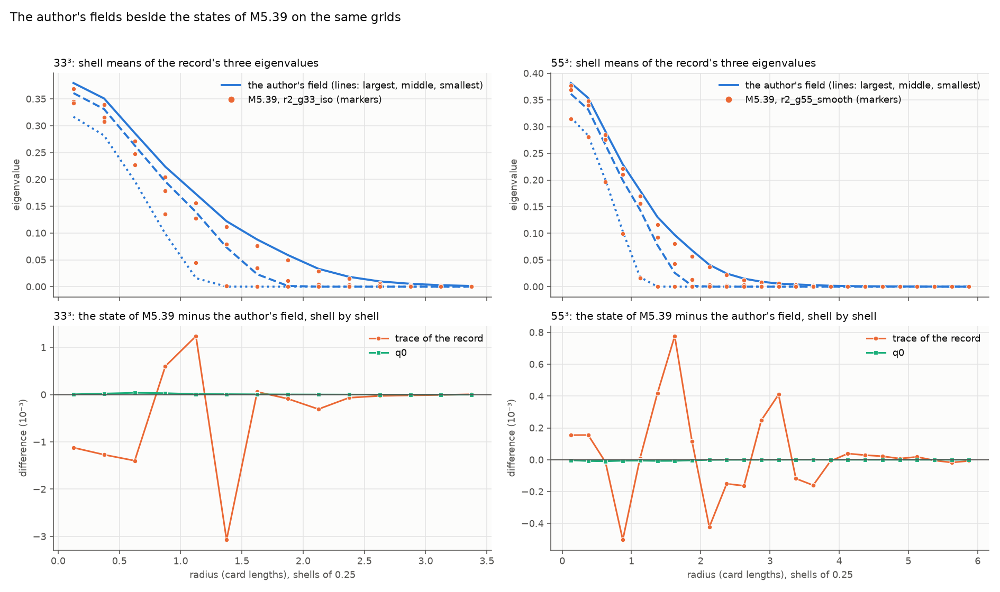
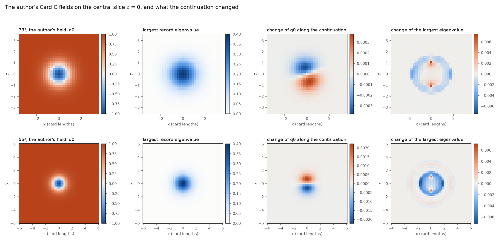
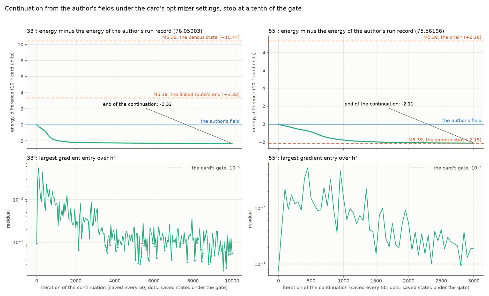
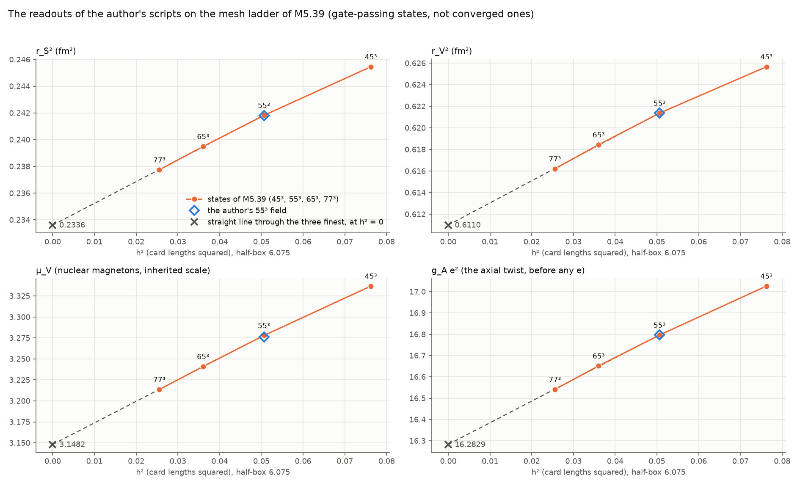

# M5.40: The Card C payload: the author's 33³ and 55³ fields under the instruments of M5.39

> Opened 2026-11-14 from the author's reply to the results post of [M5.39](m5_39_task_details.md) on discussion #186 ([discussioncomment-19612571](https://github.com/vantasnerdan/substrate-framework/discussions/186#discussioncomment-19612571), 14 November 2026, 12:53 UTC), which announces the capstone v3.7 (Zenodo record [24220797](https://doi.org/10.5281/zenodo.24220797)) and, attached to that record, the file `CardC_payload_recovered.zip`: the two fields, their run records, the energy code and the scripts behind the printed readouts. Roadmap row: [`m5_roadmap.md`](../m5_roadmap.md). Thread record: [`m5_32_convo.md`](m5_32_convo.md). Sources: [`_CITATIONS.md`](../../theory/_CITATIONS.md) (the v3.7 rows). This task is step 2 of the sequence of [M5.39](m5_39_task_details.md) § 7, the comparison held back until the fields arrived.

## TASK PLANNING (2026-11-14; the go is the user's)

**Scope.** (1) The payload filed and verified (§ 1, done at plan time). (2) R1: the evaluator of M5.39 on the author's two fields, with the run records as known answers (§ 3). (3) R2: the readers of M5.39 on those fields, against the printed rows and against the states of M5.39 on the same grids (§ 4). (4) R3: a continuation from each of the author's fields under the card's optimizer settings with a tighter stop, which puts finding (i) of M5.39 (the force gate leaves the energy open) to the author's own states (§ 5). (5) R4: the readout definitions of the deposited scripts written as equations, coded independently, gated against the author's scripts and the printed digits, then read on the mesh ladder of M5.39 (§ 6). Out of scope: the converged background and the zero-spacing calibration (the following task, § 8); the 45³ field, which is not in the recovered archives; the tilt reduction and the charged core ([M5.39](m5_39_task_details.md) § 2, rows 12 and 13); every run of [M5.39](m5_39_task_details.md) § 5; any icon or pointer of [`MODELS.md`](../../../../../MODELS.md), since every run of this task is on the author's Card C and not on this column's certified action.

**Definition of done.** The four rungs run with their known-answer controls (§ 3 to § 6) each reported as met or as the exact failing check; every number in the findings carried by a tracked JSON and a script; the continuation reads taken at two stops; an audit by agents on a different model with every claim either standing or qualified (§ 7); the task review presented in the terminal. A rung whose control fails after its three tries is reported as failed, with its reads kept as numbers.

**Gating.** The payload (arrived, § 1). The user's go.

**Model and effort.** The session's model for the run; the audits on a different, smaller model (two agents in parallel), named at each spawn.

**Research body.** This document (`## FINDINGS` after the run); scripts `../scripts/m5_40_*.py`; data `../data/m5_40_*.json` (tracked) and `../data/m5_40_*.npz` (local-only, indexed by [`_DATASETS.md`](../data/_DATASETS.md)); plots `../plots/m5_40_*.png`, embedded in the findings; in-flight state in `../checkpoints/m5_40/` (local-only).

### 1. The release and the payload as filed (plan time)

The capstone v3.7 (399 pages) and its source archive were filed beside the earlier versions, both matching the checksums of the Zenodo record. Read against v3.6 by hash: 1185 files identical, 3 changed (the text, the contribution map, the README), 13 removed, 49 new (48 under `checks/v37/` and the figures, and one manifest file). The 39 files of `frozen_packets/` that M5.39 hashed are unchanged, so R0 and R1 of [M5.39](m5_39_task_details.md) (§ 11, § 12) stand for v3.7.

The payload (16 files, 33 MB) carries its own digest list, and all 14 listed files verify. Eight of them are the entries of the manifest that v3.4 already printed (`frozen_packets/CardC_payload_manifest/`), with the same digests; the three energy files are byte-identical to the copies in `frozen_packets/STRING_v0.6/sector_b_action/` that M5.39 gated its evaluator against; the six scripts of `definitions/` are new to the record (one of them, `inertia.py`, is the archived audit script already in the release).

| Item of the payload | What it is | Plan-time read |
| --- | --- | --- |
| `bq_c33/residual_edge/final.npz`, `run.json` | the 33³ field (half-box 3.6, h 0.225) and its run record | arrays `state` (33, 33, 33, 13), `q` (…, 4), `record` (…, 3, 3), `coords`; recorded energy 76.05003057685762, residual 9.398 × 10⁻⁴ (winding part 4.938 × 10⁻⁴), margin 0.70071, largest record amplitude 0.39376 |
| `bq_rc76/gate55/final.npz`, `run.json` | the 55³ field (half-box 6.075, h 0.225) and its run record | same arrays at 55³; recorded energy 75.56196067295708 after one step of the recorded method, residual 7.687 × 10⁻⁴ (winding part 6.955 × 10⁻⁴), margin 0.70865, largest record amplitude 0.39547 |
| `bq_c_refine/bq_core.py`, `dn87_relax.py`, `fast_quartic.py` | the Card C energy code | identical to the archived copies |
| `bq_rc76/kinetic_operator.py` | the kinetic operator of the 55³ package | imports a module (`quadrupole_ritz`) that is not in the payload; not used by this task |
| `definitions/static_preflight.py` | the direct axial diagnostic (`axial_twist`) behind the printed g_A | imports only deposited modules |
| `definitions/zero_q2.py`, `inertia.py`, `lattice_source.py` | the two radii and the moment μ_V | `zero_q2.py` and `inertia.py` import only deposited modules |
| `definitions/magnetic_correction.py`, `radius_sensitivity.py` | the isocranking correction and a susceptibility of the radii | read for definitions only |

Three facts of the run records shape the plan. (a) Both records name the seed `smooth`, and both name a method, "normalized raw-residual polish with descending energy", with keys (`damping`, `filter_cutoff`, `source_input`, `method`, and the row entries `margin` and `max_record_amplitude`) that no deposited script writes: the step that produced the two fields is not in the payload, and each record starts from an input field (`bq_c33/last_edge/final.npz`, `bq_rc76/final55/final.npz`) that is not in it either. (Corrected at the run, § 9 item 1: the plan first listed `sobolev` and `frame_scale` among the missing options and named only `dn87_relax.py`; the deposited `bq_core.py` has both, with `--filter-center`, `--residual` and `--resume`.) The reply says the same of the 33³ route. So no rerun on the author's route is possible, and the plan replaces it by a continuation from the author's end states (§ 5). (b) The 33³ record holds one history entry, at step 0, and ends with the optimizer's message that its iteration limit was reached. (c) The largest record amplitude of each record equals the largest printed center eigenvalue to three digits, so the records do not show a lump of the kind M5.39 found on its own `smooth` start (a node at 0.96).

### 2. The consumers

| Sub-result | Consumer | Instrument check the consumer needs |
| --- | --- | --- |
| R1: energy, residual in both readings, the length of the winding vector on the author's fields | the gate of the following task (the author's proposed rule: a unit-normalized residual plus a lump check) | the run record's energy returned to 10⁻¹⁰; the record's residual identified with one reading, or reported as not identified |
| R2: the printed rows from the author's fields | the results post; the author's text | each reader's known answer on the author's field before it reads a state of M5.39 |
| R3: the energy and inertia along the continuation | the calibration question (how far a gate-passing field sits from its valley floor, and whether the inertia moves with it) | the reads at two stops; a start that reproduces the recorded energy |
| R4: the readouts on the mesh ladder | the zero-spacing calibration of the following task | the author's script on the same field, where it runs; the printed digits |

### 3. R1: the evaluator on the author's fields

The fields are converted to the unknowns of [`m5_39_cardc.py`](../scripts/m5_39_cardc.py) by a new script, `m5_40_payload.py`, which also repeats the digest check and writes the converted copies as local-only arrays. Nothing of the payload is executed from its filed folder: the author's scripts run from an isolated copy, with the interpreter's isolation flags.

| Control | Known answer | Fails when |
| --- | --- | --- |
| K1, the energy | the recorded energy of each field, within 10⁻¹⁰ relative | the packing of `state`, a constant or the box differs from the reading of M5.39 |
| K2, the record's geometry reads | degree 1; the recorded margin and largest record amplitude to five digits, by the definitions of the deposited driver | the definition is not in the deposited code (then reported as not identified, not as a failure of the field) |
| K3, the residual | the three recorded residuals of each field, within 1 percent, by one of two readings of our gradient: on the winding vector as stored (the gate as M5.39 read it), and projected on the unit sphere and rescaled to unit length | neither reading returns them: the residual is then NOT IDENTIFIED and becomes a question to the author |

Also read: the range of the length of the stored winding vector over the grid. If it is 1 to round-off on the author's fields, the statement of M5.39 that the gate is read on a vector whose length grows to 3.9 holds for the states of M5.39 and not for the author's, and the results post says so.

### 4. R2: the readers on the author's fields

The readers of [`m5_39_reads.py`](../scripts/m5_39_reads.py), unchanged, on the two fields: the energy by term, the center eigenvalues and the branch, the lump count, the six-generator inertia and the gap, the tail amplitude (55³), the isoscalar radius on the winding density, the mirror reads.

| Printed value | From | Word |
| --- | --- | --- |
| center eigenvalues 0.333, 0.376, 0.394; inertia 34.33; gap 311.9 MeV; r²_V 0.4519 fm² | the 33³ field | REPRODUCED when the reader returns the printed digits from the author's field, DIFFERS with the number otherwise |
| inertia 37.44; fitted tail 0.518 fm² | the 55³ field | the same |

The comparison words apply here because the field is the author's own: the reader is the only thing between the field and the printed digit. Then, as numbers without words: each term of the energy of the author's field beside the states of M5.39 on the same grid (33³: the census state and the two extensions; 55³: the five starts), and the radial profiles of the winding density and of the trace of the record's Gram matrix. A node-by-node difference is given only as a diagnostic, since two states of one valley can differ by a lattice symmetry.

### 5. R3: a continuation from the author's fields

Each of the author's fields is continued by the driver of M5.39 ([`m5_39_relax.py`](../scripts/m5_39_relax.py): the card's optimizer settings, the admissibility wall), with the optimizer's stop at a tenth of the gate, since a start that already meets the gate would stop at once.

| Job | Start | Cap | Reads |
| --- | --- | --- | --- |
| 33³ | the author's 33³ field | 10000 iterations | at every saved state: energy, residual in both readings, center eigenvalues; at the first state after 3000 iterations and at the end: inertia, lumps, radii |
| 55³ | the author's 55³ field | 3000 iterations | the same, the inertia at 1500 and at the end |

Recorded before the run, from the census of M5.39 (gate-passing states of one branch 1.2 × 10⁻³ apart on 55³; the 33³ route still falling at 76.05036): the energy falls from the author's value by between 10⁻⁴ and 2 × 10⁻³ on each grid within the caps, the center eigenvalues move by less than 0.01, and the inertia by less than 0.1 percent. The other outcome is as informative and is reported with the same weight: a fall under 10⁻⁵ means the author's field sits at the floor of its valley at this resolution, and finding (i) of M5.39 then describes the routes of M5.39 and not the author's. The start control: the continuation's first evaluation returns K1.

This rung is the one addition to the comparison as first described; it is two background jobs on stored fields and it restarts no rung of the author's.

### 6. R4: the readout definitions

1. The definitions of `static_preflight.py` (`axial_twist`) and `zero_q2.py` (the two radii, the moment) are read and written into the findings as equations, with the normalization each printed value uses.
2. They are coded independently in `m5_40_readouts.py`, on the fields and conventions of [`m5_39_cardc.py`](../scripts/m5_39_cardc.py).
3. Gate (a): the author's scripts, run unmodified from an isolated copy on the author's fields, against `m5_40_readouts.py` on the same fields, within 10⁻⁸ relative. Three tries at making them run without editing them (arguments, working folder, input names); a script that still needs a file or a module outside the payload is reported as not runnable as shipped, and that readout is gated by (b) alone.
4. Gate (b): the printed digits. From the 55³ field: g_A 0.904 at the normalization of the 55³ reset (e = 4.311), and 0.957 at the earlier one the reply names. From the 33³ field: μ_V 3.004, r²_S 0.2303 fm², r²_V 0.4519 fm².
5. The same readouts on the states of M5.39: the mesh ladder at half-box 6.075 (45³, 55³, 65³, 77³) and the box ladder (73³, 91³), as numbers with their trend in h², under the caveats those states carry in [M5.39](m5_39_task_details.md) § 13 and § 17.

### 7. Blindspot pass, the audit and the records

Read against the recurring failure families of the workflow, for this task's instruments.

| Risk | Where it enters | Guard |
| --- | --- | --- |
| Unvalidated instrument | the converter of the fields; the independent readouts | K1 before any other read; gate (a) or (b) before a readout is applied to a state of M5.39 |
| Artifact read as result | the stop and the cap of the continuation | reads at two stops; the fall given with its last-tenth drift |
| Unfalsifiable check | a residual "identified" by a free rescaling | K3 allows the two stated readings only, no fitted factor |
| A definition taken for another | the recorded residual carries the word "normalized" and options the deposited driver lacks | K3's NOT IDENTIFIED outcome; the residual's definition goes to the author when it is not in the deposited code |
| Resolution mistaken for accuracy | the readouts on the mesh ladder | the states' own spread (the census of M5.39) stated beside each number |
| A stored field in another convention | the author's fields may store a unit winding vector where M5.39 relaxes an unnormalized one | the length read of § 3 |

The audit: two agents on a different model, in parallel, each asked to refute. One takes R1 to R3 (every number of the findings against the JSON, the conversion re-derived from the deposited code, the two residual readings recomputed); the other takes R4 (the equations against the author's scripts line by line, one readout recomputed from scratch). The thread record gets its row when the results are posted; the post is the maintainer's, after the review.

### 8. The parallel shape, the estimate and what follows

| Rung | Compute | Shape |
| --- | --- | --- |
| R1, R2, R4 | seconds to minutes per field on stored arrays | one process; a pool would cost more than it saves on a handful of evaluations |
| R3 | 33³: about 0.3 s per iteration, about 50 minutes at its cap; 55³: about 1.4 s per iteration on one thread in the pool of M5.39, about 40 minutes at its cap with the compiled term threaded | two jobs side by side, one thread for the 33³ job and six for the 55³ job, seven busy cores; the one-thread pins of M5.39 on every other library |

Go to review: about an hour and a half. The continuation's fifty minutes set the floor; R1, R2 and R4 run at the desk while it runs, and the two audits run in parallel at the end.

What follows this task, as its own plan: the converged background on the mesh ladder under the rule the author proposes (a gate on the unit-normalized residual plus a lump check), with the zero-spacing calibration the reply agrees should wait for it. Its thresholds are written from K3 and from the continuation of § 5. The release also ships a tilt-texture kit (`checks/v37/LdGS_tilt_texture_kit_v1.2.zip`), an input for the plan of the tilt reduction ([M5.39](m5_39_task_details.md) § 2, row 13); it is not opened by this task.

## FINDINGS (the run of 2026-11-14, after the go)

Every number below is carried by a tracked file: [`m5_40_r1_payload.json`](../data/m5_40_r1_payload.json) (R1), [`m5_40_r2_reads_author_g33.json`](../data/m5_40_r2_reads_author_g33.json) and [`m5_40_r2_reads_author_g55.json`](../data/m5_40_r2_reads_author_g55.json) (the readers of M5.39 on the author's fields), [`m5_40_r3_g33_cont.json`](../data/m5_40_r3_g33_cont.json) and [`m5_40_r3_g55_cont.json`](../data/m5_40_r3_g55_cont.json) (the continuations), [`m5_40_r4_readouts.json`](../data/m5_40_r4_readouts.json) (R4), and [`m5_40_summary.json`](../data/m5_40_summary.json), which gathers the four rungs and holds the comparisons. Lengths and energies are in the card's units unless a unit is written.

### 9. Deviations from the plan, logged as they happened

| # | Deviation | What was done |
| --- | --- | --- |
| 1 | A plan-time statement was wrong in part: § 1 listed `sobolev` and `frame_scale` among options the deposited code lacks. The deposited `bq_core.py` has `--sobolev`, `--frame-scale`, `--filter-center`, `--residual` and `--resume`. | § 1 corrected in place. What stays true: no deposited script writes the keys `damping`, `filter_cutoff`, `source_input`, `method`, nor the row entries `margin` and `max_record_amplitude`, so the polish step that produced the two fields is not in the payload and no rerun on the author's route is possible. |
| 2 | The driver of M5.39 wrote its files under a fixed prefix and did not record the second residual reading. | [`m5_39_relax.py`](../scripts/m5_39_relax.py) gained `--prefix` (default `m5_39`, so the commands of M5.39 are unchanged) and, per saved row, the winding residual read on the unit sphere and the smallest and largest length of the winding vector. They are reads: the optimizer does not see them. |
| 3 | The two continuation jobs were first launched as session tasks. | Stopped inside the first minute and launched again detached, from empty work folders, so that neither job carries a restart. |
| 4 | The threaded speed of the 55³ job was an estimate. | Measured at the run: the 55³ job took 19 minutes on six threads and the 33³ job its full cap on one. |
| 5 | The plan attached the printed g_A = 0.957 to the 55³ field "at the earlier normalization". | The text of v3.7 attaches 0.957 to the 33³ field at the coupling that the frozen rule returns for the 33³ inertia (e = 4.128), and gives 0.986 for the 55³ field at that coupling. All three printed values are compared in § 13. |
| 6 | Gate (a) of R4 assumed a script either runs as shipped or does not. | Both readout scripts stop as shipped on a missing input. For `zero_q2.py` the input is the printed line of another deposited script, so the chain runs unmodified. For `static_preflight.py` the input is a calibration file that neither the payload nor the release holds; it is reported as not runnable as shipped, and the agreement obtained with a three-number file of ours is stated separately (§ 13). |
| 7 | Reads added to the plan's list. | The readouts of § 13 at the two stops of each continuation; the distance between the author's field and the state of M5.39 under the eight mirror images; the 55³ rung at the head of the box ladder. |

### 10. R1: the evaluator on the author's fields ([`m5_40_payload.py`](../scripts/m5_40_payload.py), [`m5_40_r1_payload.json`](../data/m5_40_r1_payload.json))

The payload was read as data only. All 14 files of its digest list verify. In both field files the array `state` holds the 13 unknowns per node in the order of [`m5_39_cardc.py`](../scripts/m5_39_cardc.py); the stored `q` equals p / \|p\|, the stored `record` equals fᵀf, the stored coordinates equal the card's grid and the boundary nodes hold the card's boundary values, each to the last bit.

| Control | 33³ (half-box 3.6) | 55³ (half-box 6.075) | Word |
| --- | --- | --- | --- |
| K1, energy: ours against the run record | 76.05003057692109 against 76.05003057685762, relative difference 8.3 × 10⁻¹³ | 75.5619606734647 against 75.56196067295708, relative difference 6.7 × 10⁻¹² | ✅ MET (bound 10⁻¹⁰) |
| K2, winding number | 1 (one preimage) | 1 (one preimage) | ✅ MET |
| K2, the record's `margin` | 0.7007126577593885, equal to the smallest dot product of two vertices of a simplex of the first Kuhn triangulation (`topology` of `dn87_relax.py`) to the last digit | 0.7086535367852621, the same | ✅ MET |
| K2, the record's `max_record_amplitude` | 0.39375728165396306, equal to the largest eigenvalue of the record over the whole grid, which sits at the center node | 0.3954694856350875, the same | ✅ MET, identified by value: the name is not in the deposited code |
| K3, the three residuals of the record (whole, winding part, factor part) | 9.398386491751500 × 10⁻⁴, 4.937641356858661 × 10⁻⁴, 9.398386491751500 × 10⁻⁴; relative differences 1.6 × 10⁻¹⁴, 2.4 × 10⁻¹¹, 1.6 × 10⁻¹⁴ | 7.687154202239032 × 10⁻⁴, 6.954587149780534 × 10⁻⁴, 7.687154202239032 × 10⁻⁴; relative differences 8.5 × 10⁻¹⁶, 4.6 × 10⁻¹¹, 8.5 × 10⁻¹⁶ | ✅ MET (bound 1 percent) by both readings |

Three facts follow.

1. **The author's stored winding vector has unit length**, to 2.2 × 10⁻¹⁶ at every node of both fields. The two readings of K3 therefore coincide on these fields: the recorded residual is the largest entry of the gradient on (p, f) over h³, the definition in `save` of the deposited `bq_core.py`, taken at \|p\| = 1. The statement of [M5.39](m5_39_task_details.md) that the gate is read on a vector whose length grows to 3.9 describes the states of M5.39, which let the length drift along a long route from a seed; it does not describe the author's fields.
2. **Neither field holds a record lump.** The largest record eigenvalue over the grid is the center value itself (0.394 and 0.395), and the lump reader of M5.39 returns a count of zero on both, with the largest excess over the target scale at 0.011 and 0.012.
3. **The evaluator of M5.39 is the author's energy on the author's own fields**, to 12 digits. Both margins of the card's admissibility test are positive on our reading as well (the smallest v · Σv over the four triangulations is 3.389 and 3.406).

### 11. R2: the readers on the author's fields ([`m5_39_reads.py`](../scripts/m5_39_reads.py), unchanged)

The reader is the only thing between the author's field and the printed digit, so the words apply.

| Printed value | Field | Read | Word |
| --- | --- | --- | --- |
| isospin inertia 34.33 | 33³ | 34.32633 | ✅ REPRODUCED |
| center eigenvalues (0.333, 0.376, 0.394) | 33³ | (0.33342, 0.37557, 0.39376) | ✅ REPRODUCED |
| rotor gap 311.9 MeV | 33³ | 311.93 | ✅ REPRODUCED |
| r²_V 0.4519 fm² | 33³ | 0.45187 by the reader of M5.39 | ✅ REPRODUCED |
| r²_S 0.2303 fm² | 33³ | 0.23013 by the reader of M5.39 (a Gauss rule on the first triangulation, about the origin) | ⚠️ DIFFERS by the reader's definition; the author's own rule returns 0.23025, § 13 |
| isospin inertia 37.44 | 55³ | 37.43687 | ✅ REPRODUCED |
| fitted tail 0.518 fm² | 55³ | 0.5170 over the window of M5.39 (half the box to 0.9 of it); 0.5176 to 0.5179 on the last four shells | ⚠️ DIFFERS on the window of M5.39 by one unit of the last digit; ✅ REPRODUCED on the outer shells, where the amplitude is flat |

Our isospin block agrees with the archived audit script on these fields to 6 × 10⁻¹⁵ and 1.4 × 10⁻¹⁴. The winding number of the card's interpolant is 0.99997 on both. Like the states of M5.39, the author's fields are not mirror symmetric: each differs from its three mirror images by up to 0.07 in q and 0.09 in the record, while the image's energy equals the field's to 4 × 10⁻⁹.

**The energy by term, beside the states of M5.39 on the same grid.** The author's field first (absolute values), then each state of M5.39 as its difference from the author's field, in units of 10⁻⁴.

| 33³ | Label at the gate | Energy | Energy minus the author's | Tensor quadratic | Quaternion quartic | Composites | Pion mass | Center eigenvalues |
| --- | --- | --- | --- | --- | --- | --- | --- | --- |
| the author's field | residual 9.4 × 10⁻⁴ | 76.050031 | | 33.694990 | 40.653633 | 0.004085 | 1.695369 | (0.3334, 0.3756, 0.3938) |
| `r2_g33_iso` (the census state of M5.39) | STATIONARY | 76.051075 | +10.4 | +3.2 | +7.3 | +0.5 | −0.6 | (0.3591, 0.3594, 0.3833) |
| `r2_g33_chain` | STATIONARY | 76.051103 | +10.7 | −4.9 | +14.7 | +2.2 | −1.5 | (0.3518, 0.3733, 0.3766) |
| `r2_g33_linked_ext` | STATIONARY | 76.050525 | +4.9 | −19.9 | +22.0 | +4.8 | −2.5 | (0.3318, 0.3771, 0.3939) |
| `r2_g33_linked_ext2` | NOT STATIONARY | 76.050363 | +3.3 | −26.9 | +26.3 | +6.2 | −3.0 | (0.3290, 0.3794, 0.3946) |

| 55³ | Label at the gate | Energy | Energy minus the author's | Tensor quadratic | Quaternion quartic | Composites | Pion mass | Center eigenvalues |
| --- | --- | --- | --- | --- | --- | --- | --- | --- |
| the author's field | residual 7.7 × 10⁻⁴ | 75.561961 | | 33.791482 | 39.771990 | 0.004207 | 1.992299 | (0.3336, 0.3757, 0.3955) |
| `r2_g55_smooth` | STATIONARY | 75.561746 | −2.2 | +0.6 | −2.7 | −0.1 | +0.2 | (0.3312, 0.3834, 0.3903) |
| `r2_g55_linked` | NOT STATIONARY | 75.562709 | +7.5 | −7.5 | +14.5 | +2.3 | −1.9 | (0.3389, 0.3761, 0.3894) |
| `r2_g55_chain` | STATIONARY | 75.562887 | +9.3 | −7.9 | +16.6 | +2.8 | −2.3 | (0.3493, 0.3770, 0.3772) |
| `r2_g55_iso` | STATIONARY | 75.562979 | +10.2 | +4.3 | +6.5 | +0.3 | −0.7 | (0.3618, 0.3625, 0.3793) |
| `r2_g55_reset` | NOT STATIONARY | 75.565588 | +36.3 | +21.6 | −27.9 | +18.9 | +3.0 | (0.0108, 0.1823, 0.9550) |

Two readings of these tables, as numbers.

1. **On 33³ every state of M5.39 lies above the author's field**, by 3.3 × 10⁻⁴ to 1.07 × 10⁻³. The failed energy control of [M5.39](m5_39_task_details.md) (its routes ended 3.3 × 10⁻⁴ above the printed 76.05003) was therefore those routes stopping high: a field at the printed energy exists, meets the gate, and continues lower still (§ 12). The valley floor that M5.39 reported for its linked route (76.05036) is not the floor of the grid.
2. **On 55³ one state of M5.39 lies below the author's field**: the smooth start, by 2.15 × 10⁻⁴. The other gate-passing states of M5.39 lie 9 to 10 × 10⁻⁴ above it. On 33³ the tensor and quartic terms of the linked-route states differ from the author's with opposite signs, by up to eight times the net energy difference; on 55³ the two differ by less than twice the net difference.



**The fields node by node (a diagnostic).** Between the author's field and the reference state of M5.39 on the same grid (`r2_g33_iso`, `r2_g55_smooth`), the shell means of q0 agree to 4 × 10⁻⁵ and 1 × 10⁻⁵ and those of the winding density to 6 × 10⁻⁵ and 2 × 10⁻⁵ of the density's unit, while the shell means of the record's eigenvalues differ by up to 0.037 (33³, the smallest eigenvalue against the isotropic-center seed's state) and 0.017 (55³). Node by node the winding fields differ by at most 0.035 (root mean square 0.0063 and 0.0031) and the records by at most 0.14 (root mean square 0.022 and 0.010). The root-mean-square distance between the records is the same to three digits under all eight mirror images of the author's field, and the largest node differences vary by up to 8 %, so the two states are not mirror images of each other (rotations of the lattice were not tried). Relative to each field's scale (1 for q, about 0.4 for the record) the records differ eight to nine times more than the winding fields: the difference between gate-passing states of one grid sits mostly in the record.

### 12. R3: the continuation from the author's fields ([`m5_39_relax.py`](../scripts/m5_39_relax.py), [`m5_40_r3_g33_cont.json`](../data/m5_40_r3_g33_cont.json), [`m5_40_r3_g55_cont.json`](../data/m5_40_r3_g55_cont.json))

Each field was continued by the driver of M5.39 with the card's optimizer settings and the optimizer's own stop at a tenth of the gate. Both jobs ran to their iteration caps without meeting the wall and without a restart.





| Read | 33³ | 55³ |
| --- | --- | --- |
| Start control: the first evaluation against the run record | 8.3 × 10⁻¹³ relative, ✅ MET | 6.7 × 10⁻¹² relative, ✅ MET |
| Iterations, evaluations | 10000, 10221 | 3000, 3070 |
| Energy at the end | 76.04979895 | 75.56174952 |
| Fall from the author's recorded energy | 2.32 × 10⁻⁴ | 2.11 × 10⁻⁴ |
| Fall at iterations 500, 1000, 1500, 2000, 3000 (10⁻⁴) | 0.98, 1.92, 2.10, 2.19, 2.23; then 2.27 at 5000 and 2.30 at 7500 | 0.85, 1.77, 1.98, 2.07, 2.11 |
| Fall over the last tenth of the run | 5.3 × 10⁻⁷ | 7.2 × 10⁻⁷ |
| Residual at the last iterate, and its label | 5.5 × 10⁻⁴, STATIONARY | 1.9 × 10⁻³, NOT STATIONARY |
| Saved states (one every 50 iterations) under the gate | 55 of 200, the first at iteration 2150 | 1 of 60, at iteration 2800 (energy 75.56175000) |
| Residual over the saved states: smallest, median, largest | 2.2 × 10⁻⁴, 1.5 × 10⁻³, 5.5 × 10⁻² | 9.7 × 10⁻⁴, 5.2 × 10⁻³, 5.2 × 10⁻² |
| Largest length of the winding vector along the run; largest gap between the two residual readings | 1.00044; 4.3 × 10⁻⁴ relative | 1.00029; 2.9 × 10⁻⁴ relative |
| Center eigenvalues at the end; largest move from the start | (0.3288, 0.3802, 0.3941); 0.0046 at the end, 0.0049 along the run | (0.3301, 0.3804, 0.3945); 0.0047 |
| Winding number, branch, lumps at the end | 1, ISOTROPIC CENTER, 0 | 1, ISOTROPIC CENTER, 0 |

The reads at the two stops, each as its change from the author's field (the readouts by the definitions of § 13):

| Read | 33³ at iteration 3000 | 33³ at the end | 55³ at iteration 1500 | 55³ at the end |
| --- | --- | --- | --- | --- |
| Residual of that state | 3.1 × 10⁻³ | 5.5 × 10⁻⁴ | 1.5 × 10⁻³ | 1.9 × 10⁻³ |
| Isospin inertia | 34.32600, −0.0010 % | 34.32471, −0.0047 % | 37.43680, −0.0002 % | 37.43673, −0.0004 % |
| r²_S | −0.0007 % | −0.0009 % | +0.0003 % | +0.0001 % |
| r²_V | −0.0009 % | +0.0008 % | −0.0011 % | −0.0005 % |
| μ_V | 3.004508, +0.0028 % | 3.004626, +0.0068 % | 3.276044, +0.0019 % | 3.276069, +0.0027 % |
| g_A e² | 16.308536, −0.0017 % | 16.308525, −0.0018 % | 16.796304, −0.0007 % | 16.796269, −0.0009 % |
| Displacement of the winding centroid | 2.7 × 10⁻⁴ | 2.8 × 10⁻⁴ | 1.8 × 10⁻³ | 1.4 × 10⁻³ |

**The expectations recorded before the run, evaluated.**

| Recorded in § 5 | 33³ | 55³ | Word |
| --- | --- | --- | --- |
| The energy falls by between 10⁻⁴ and 2 × 10⁻³ | 2.32 × 10⁻⁴ | 2.11 × 10⁻⁴ | ✅ MET on both |
| The center eigenvalues move by less than 0.01 | 0.0046 | 0.0047 | ✅ MET on both |
| The inertia moves by less than 0.1 percent | 0.0047 % | 0.0004 % | ✅ MET on both |
| The other outcome: a fall under 10⁻⁵, the field at its valley floor | did not occur | did not occur | |

What this rung says.

1. **Finding (i) of M5.39 holds on the author's own fields.** Each of the two gate-passing fields sits 2.1 to 2.3 × 10⁻⁴ above a lower state that the card's own optimizer reaches by going on. About nine tenths of the fall comes in the first 1500 iterations.
2. **The energy at the cap is an upper bound of the floor, not the floor.** Both runs were still falling at 5 to 7 × 10⁻⁷ per tenth of the run. A drift of that size is not evidence of a floor: the linked route of M5.39 on 33³ showed the same drift at 76.050363, which is 5.6 × 10⁻⁴ above the end of this continuation, with center eigenvalues within 0.001 of it.
3. **The force gate does not order states by energy.** The residual rises 59-fold (33³) and 29-fold (55³) in the first hundred iterations away from the author's field, and 145 of the 200 saved states on 33³ and 59 of the 60 on 55³ sit above the gate while lying below the author's field in energy; on 55³ the last iterate fails the gate 2.1 × 10⁻⁴ below a start that passes it. This is a statement about the largest gradient entry along this optimizer's path; the author's fields came from a different last step (a polish that is not in the payload), which meets the gate at the higher energy.
4. **The readouts do not move with the fall.** The inertia, the two radii and g_A e² change by less than 5 × 10⁻⁵ relative on 33³ and 1.2 × 10⁻⁵ on 55³, and μ_V by 7 × 10⁻⁵ and 3 × 10⁻⁵. For a calibration that reads the inertia, the energy left open by the gate is not the error that counts; the spacing (3 to 4 percent at h = 0.225, § 13) and the box are.
5. **On 55³ the continuation arrives within 4 × 10⁻⁶ of the energy of the lowest state of M5.39, and the two fields still differ.** Its end, 75.561750, is 4.0 × 10⁻⁶ above the smooth-start state of M5.39 (75.561746). The two differ by 0.004 in the center eigenvalues, (0.3301, 0.3804, 0.3945) against (0.3312, 0.3834, 0.3903), and by 5.7 × 10⁻⁴ relative in μ_V (3.276069 against 3.277949), while their inertias agree to 2.5 × 10⁻⁵. The energy gap is inside that state's own drift over its last tenth (7.2 × 10⁻⁶), so the two may be points of one slow descent and not two separate states. What the pair shows is narrower: at an energy agreement of 10⁻⁵ the departure of μ_V from the rigid relation still differs by 0.055 points (−0.135 % against −0.080 %).
6. **Part of the motion is a displacement.** The change of q0 along the continuation is odd in y on the central slice, and the centroid of the winding density moves by 2.8 × 10⁻⁴ (33³) and 1.4 × 10⁻³ (55³) card lengths. How strongly this lattice pins a displacement was not measured.

Inputs for the plan of the converged background, from § 10 and from this rung: the author's recorded residual is already the unit-sphere reading; the lump check separates (the largest excess over the target scale is 0.012 on the author's fields and at most 0.16 on the lump-free states of M5.39, against 0.96 and 0.98 on the two states of M5.39 that hold a lump); a gate at 10⁻³ leaves at least 2 × 10⁻⁴ of energy open and under 10⁻⁴ in the readouts other than the departure of μ_V from the rigid relation; and neither the gate nor the drift certifies a floor.

### 13. R4: the readout definitions ([`m5_40_readouts.py`](../scripts/m5_40_readouts.py), [`m5_40_r4_readouts.json`](../data/m5_40_r4_readouts.json))

**The definitions, as the deposited scripts compute them.** With q = p / \|p\|, a = τ(q) f, N = − q qᵀ + a aᵀ / G_time, and the two terms of the card that the readouts move, E_N (the tensor quadratic, term 0) and E_4 (the quaternion quartic, term 1):

```text
Winding density (zero_q2.py, baryon_moments). On each of the 24 simplices of a cell (four Kuhn
triangulations), at each of the four rule points P = sum_k w_k v_k (v_0..v_3 the vertex values along
the simplex's path, D_m = (v_m - v_{m-1}) / h, o = +1 or -1 the orientation of the path):

    rho(P) = - o det[P; D_1; D_2; D_3] / |P|^4          weight h^3 / (192 pi^2) per point
    B = sum rho      x_c = sum rho x / B      r_S^2 = l0^2 ( sum rho |x|^2 / B - |x_c|^2 )

Isospin inertia density (zero_q2.py, iso_moments), on cell midpoints, for the left action
delta_a q = T_a q, delta_a N = [T_a, N]:

    lambda_ab = 2 (1/4) (delta_a N : delta_b N)
              + 2 (1/2) sum_i [ (delta_a q . delta_b q) |d_i q|^2 - (d_i q . delta_a q)(d_i q . delta_b q) ]
    Lambda_ab = h^3 sum lambda_ab            M_ab = h^3 sum lambda_ab |x - x_c|^2
    Q_ab = h^3 sum lambda_ab ( 3 (z - z_c)^2 - |x - x_c|^2 )
    l = tr Lambda / 3      r_V^2 = l0^2 tr M / tr Lambda      gap = 3 e^3 f_pi / (2 l)

Magnetic response (lattice_source.py). Every link x -> y carries the phase phi = (1/2) (x cross y) . B
(B is e times the field); the field at the far end of a link is rotated by phi in the (q_1, q_2) plane
(N conjugated) before the difference is taken, and in the quartic every vertex of a simplex is carried
to the first vertex of its path. E[B] = E_N + E_4 so linked, averaged over the lattice and its three
mirror images.

    m_z = dE / dB_z at B = 0 (central difference, step 5e-5)
    mu_V = (4/3) m_p |m_z| / (e^3 f_pi)       rigid value: (2/3) m_p l / (e^3 f_pi) = m_p / gap

Axial twist (static_preflight.py, axial_twist). For a, i = 1, 2, 3: U_ai(eps) is the rotation by the
angle eps x_i in the (q_0, q_a) plane, applied at every node as q -> U q, N -> U N U^T. Held fixed:
the factor f, the scalars b(q_0) and c(q_0), and with them the record terms, the potential, the mass
term and the orientation term, none of which enters.

    D^N_ai = dE_N / d eps      D^4_ai = dE_4 / d eps      at eps = 0 (central difference, step 5e-5)
    g_A = ( 2 / (9 e^2) ) | sum_ai R_ai ( D^N_ai + D^4_ai ) |

R is the orthogonal matrix nearest to the least-squares map from the three lattice dipole fields
(the free massive dipole of the lattice operator in the same cube) to (q_1, q_2, q_3), in the
shell 2.5 <= r < 2.8.

Constants of the scripts: e = 4.259, f_pi = 92.4 MeV, m_p = 938.272 MeV, l0 = hbar c / (e f_pi) = 0.50143 fm.
```

**Equation to code.** The independent code imports nothing from the payload; E_N and E_4 are the kernels of [`m5_39_cardc.py`](../scripts/m5_39_cardc.py).

| Definition | In [`m5_40_readouts.py`](../scripts/m5_40_readouts.py) | In the author's scripts |
| --- | --- | --- |
| ρ, B, x_c, the second moment | `baryon_moments` | `zero_q2.py`, `baryon_moments` |
| Λ, M, Q | `iso_moments` | `zero_q2.py`, `iso_moments` |
| r_S², r_V², the gap, μ_V, the rigid value | `readouts` | `zero_q2.py`, `moments` and `read` |
| E[B] | `gauged_energy` | `lattice_source.py`, `one_energy` and `energy` |
| m_z, with its zero-field and gauge controls | `magnetic_response` | `lattice_source.py`, `report` |
| R | `alignment` | `static_preflight.py`, `fit_tail` |
| D^N, D^4, g_A e² | `axial_twist` (central difference, and the same derivative in closed form) | `static_preflight.py`, `axial_twist` |

Three controls run inside the independent code on every state and can fail: E[0] against terms 0 and 1 of the evaluator (at most 6 × 10⁻¹¹ absolute on the nine states read); E[B] against its gauge transform at a finite field (at most 1.4 × 10⁻¹⁴; that the control can fail was checked once at the desk, by applying the gauge to the links alone, and is not stored); the closed-form axial derivative against the central difference (at most 1.4 × 10⁻⁹ relative). The two step sizes of each difference agree to 5 × 10⁻¹⁰ (m_z) and 3.5 × 10⁻⁸ (the largest entry of the axial matrix's difference).

**Gate (a): the author's scripts, run unmodified from an isolated copy outside the repository** (the copy's code digests equal the payload's list).

| Script | As shipped | With its input supplied | Agreement with the independent code, 33³ and 55³ |
| --- | --- | --- | --- |
| `zero_q2.py` | ⚠️ NOT RUNNABLE: it reads `magnetic.jsonl` beside the field, a file the payload does not hold | The file is the printed line of the deposited `lattice_source.py` on the same field; with it the script runs unmodified | ✅ MET (bound 10⁻⁸): the winding by the rule, r_S², r_V², the gap, the rigid moment and the mean inertia to 3 × 10⁻¹⁵ or better; m_z and μ_V to 1.7 × 10⁻¹¹ (33³) and to the last digit (55³); the transition quadrupole to 7 × 10⁻¹⁵ |
| `static_preflight.py` | ⚠️ NOT RUNNABLE: it reads `calibration33.json` beside the script, a file that neither the payload nor the release holds | With a file of ours holding its three numbers (the coupling set to one, so that the script prints g_A e²) it runs unmodified | ✅ MET (bound 10⁻⁸): the N-gradient part, the wedge part and the total to 1.4 × 10⁻¹⁰ or better on both fields |

The m_z of a central difference is quantized: the two energies near 74 differ in units of 1.4 × 10⁻¹⁴, so m_z moves in steps of 1.4 × 10⁻¹⁰. The 33³ difference above is two such steps and the 55³ agreement to the last digit is zero steps; neither is evidence beyond that grain.

**Gate (b): the printed digits.**

| Printed | Field | Independent code | Word |
| --- | --- | --- | --- |
| r²_S 0.2303 fm² | 33³ | 0.230254 | ✅ REPRODUCED |
| r²_V 0.4519 fm² | 33³ | 0.451918 | ✅ REPRODUCED |
| gap 311.9 MeV | 33³ | 311.931 | ✅ REPRODUCED |
| μ_V 3.004 | 33³ | 3.004423 | ✅ REPRODUCED |
| the rigid m_p / gap 3.008 | 33³ | 3.007946 | ✅ REPRODUCED |
| g_A 0.957, with parts 0.457 (N-gradient) and 0.500 (wedge) | 33³ | 0.95719, parts 0.45734 and 0.49985, at e = 4.1277, the coupling that the frozen rule returns for this field's inertia | ✅ REPRODUCED |
| g_A 0.904 | 55³ | 0.90378 at the printed e = 4.311 (0.90390 at the rule's own 4.3107) | ✅ REPRODUCED |
| g_A 0.986, "the larger field alone" | 55³ | 0.98581 at the coupling of the 33³ field, 4.1277 | ✅ REPRODUCED |

Before any coupling, g_A e² is 16.308817 on the 33³ field and 16.796426 on the 55³ field. At the inherited e = 4.259 the 33³ field gives 0.899, so the printed 0.957 is the value at the 33³ recalibration (e = 4.128, the "rc74" step of the text), which the text and the reply call the "rc73 normalization"; the label is loose, the number is unambiguous. The rule's e is computed here with e f_π = 4.259 × 92.4 MeV; with ħc / 0.5014 fm instead it moves by 3 × 10⁻⁵ and no printed digit changes.

**A question for the author, not a finding.** The payload's README and the reply say that the printed μ_V = 3.004 "includes the axial average of the native inertia quadrupole". In the deposited `zero_q2.py` the printed moment is (4/3) m_p \|m_z\| / (e³ f_π) with m_z the response to a weak field along z from `lattice_source.py`, and the inertia quadrupole Q enters only the transition quadrupole. The number is reproduced either way; which sentence describes it is the author's to say.

**The same readouts on the states of M5.39.** The constants stay the scripts' (the inherited scale); "own e" is the frozen rule applied to the state's own inertia.

| State | Grid, half-box | Inertia l | r²_S (fm²) | r²_V (fm²) | μ_V | μ_V over rigid, minus one | g_A e² | Own e | g_A at own e |
| --- | --- | --- | --- | --- | --- | --- | --- | --- | --- |
| the author's field | 33³, 3.6 | 34.32633 | 0.230254 | 0.451918 | 3.004423 | −0.117 % | 16.308817 | 4.12774 | 0.95719 |
| `r2_g33_iso` | 33³, 3.6 | 34.32462 | 0.230246 | 0.451910 | 3.006016 | −0.059 % | 16.309275 | 4.12763 | 0.95726 |
| the author's field | 55³, 6.075 | 37.43687 | 0.241814 | 0.621376 | 3.275982 | −0.138 % | 16.796426 | 4.31070 | 0.90390 |
| `r2_g55_smooth` | 55³, 6.075 | 37.43767 | 0.241817 | 0.621364 | 3.277949 | −0.080 % | 16.796398 | 4.31075 | 0.90388 |
| `r2_g45_chain` | 45³, 6.075 | 38.13356 | 0.245456 | 0.625668 | 3.336759 | −0.144 % | 17.026233 | 4.35063 | 0.89953 |
| `r2_g65_chain` | 65³, 6.075 | 37.00243 | 0.239486 | 0.618439 | 3.240992 | −0.045 % | 16.651712 | 4.28562 | 0.90663 |
| `r2_g77_smooth` (one record lump) | 77³, 6.075 | 36.68462 | 0.237743 | 0.616208 | 3.213562 | −0.032 % | 16.541234 | 4.26717 | 0.90842 |
| `r2_g73_cont` | 73³, 8.1 | 37.92939 | 0.242771 | 0.682874 | 3.321122 | −0.077 % | 16.836275 | 4.33897 | 0.89428 |
| `r2_g91_cont` | 91³, 10.125 | 38.04812 | 0.242929 | 0.708066 | 3.331572 | −0.075 % | 16.842857 | 4.34575 | 0.89184 |



What the table says, as numbers and under the caveats that these states carry in [M5.39](m5_39_task_details.md) § 13 and § 17 (gate-passing states, not converged ones; one lump on 77³).

1. **Same grid, two states.** Between the author's field and the state of M5.39 on the same grid, the inertia, the two radii and g_A e² agree to 5 × 10⁻⁵ or better (g_A e² to 2 × 10⁻⁶ on 55³). μ_V differs by 5 × 10⁻⁴ and 6 × 10⁻⁴: its departure from the rigid relation is −0.117 % on the author's 33³ field and −0.059 % on the state of M5.39, −0.138 % against −0.080 % on 55³. The printed 0.12 % departure is therefore of the size of the spread between gate-passing states; § 12 shows the same spread between two states whose energies agree to 4 × 10⁻⁶.
2. **The mesh, at half-box 6.075.** From 45³ to 77³ the inertia falls by 3.8 %, g_A e² by 2.8 %, μ_V by 3.7 %, r²_S by 3.1 % and r²_V by 1.5 %, each monotonically and close to a straight line in h² (the fits and their two-point variants are in the summary file). A straight line through the three finest rungs puts the zero-spacing values at inertia 35.92, g_A e² 16.28, μ_V 3.148, r²_S 0.2336 fm², r²_V 0.6110 fm², that is 3.1 to 4.1 % under the 55³ values for all but r²_V (1.7 %). These are trends of gate-passing states, not a calibration: the spread between states of one grid (item 1) is two orders under the trend for every readout but the departure of μ_V from the rigid relation, which does not extrapolate (it changes sign between the two fits).
3. **g_A at each grid's own coupling moves little.** It rises monotonically along the mesh, 0.8995, 0.9039, 0.9066, 0.9084, about 1 % from 45³ to 77³ (the straight line gives 0.913 at zero spacing), because the rule's e² falls with the inertia nearly as fast as g_A e². Along the boxes at h = 0.225 it falls, 0.9039, 0.8943, 0.8918 (55³, 73³, 91³; −1.3 %), which is the size the text estimates for the box (about 1.4 % in g_A at infinite volume). The two corrections have opposite signs and nearly the same size.
4. **The N-gradient share of g_A** rises from 0.482 (45³) to 0.494 (77³) and is 0.488 on 55³ in both the author's field and the state of M5.39.

### 14. The audit

Two agents on a different, smaller model than the one that wrote the code, each asked to refute and each working read-only.

**The audit of R4** (the definitions against the author's scripts line by line, the independent code, both gates, two readouts recomputed from scratch).

| Claim | Verdict | What was done with it |
| --- | --- | --- |
| The definitions of § 13 are those of the scripts | Stands, with one omission | The author's magnetic energy is averaged over the lattice and its three mirror images; for the tensor term this changes the card's edge weights on edges lying along the twelve edges of the box. The first version of `gauged_energy` used the card's unaveraged weights. On a Card C state those edges are vacuum and nothing changes, which is why both gates were met before the fix; on a random tensor field the two rules differ at the fourth digit. `gauged_energy` now uses the averaged weights (checked on a random field against the mean of four mirror passes: equal to the last digit), the definition in § 13 says so, and the nine states were read again: no digit quoted in this document moved. |
| The simplex set, the base vertex of the transport and the orientation signs | Stand | 24 of 24 cases equal the author's four flips |
| The axial rotation, its closed form, the alignment matrix | Stand | The alignment equals the author's `orthogonal_procrustes` result to 6 × 10⁻¹⁶; the normalization of the dipole drops out |
| Gate (a) | Stands | The auditor ran the author's scripts in a fresh isolated copy of its own and recomputed every relative difference; neither missing file exists by name in the payload or the release |
| Exact zeros among the differences | Explained | The moments are the same operations in the same order; m_z is quantized (§ 13) |
| Gate (b) | Stands, with a note on a label | The arithmetic stands. The text's "rc73 normalization" for 0.957 is the 33³ recalibration (e = 4.128); at the inherited e = 4.259 the same field gives 0.899. § 13 says so. |
| What μ_V is in the code | Stands | `v = 4*M_P*m*SCALE_I/3` with m the z response; Q enters only the transition quadrupole |
| Two readouts from scratch, in plain numpy without our modules | Stand | r²_S to 6 × 10⁻¹⁶, m_z to 8 × 10⁻¹² (the grain of the difference), r²_V and the mean inertia equal, the axial total to 1.2 × 10⁻¹¹ (with our alignment matrix). The auditor notes that its code follows the flip structure of the author's method: independent of ours, not of the method. |
| The ladder statements | Stand after rewording | "Stays between 0.900 and 0.908" became the series itself with its monotone rise of 1 % (§ 13 item 3) |

Also fixed from that audit: the rule's e now uses the scripts' own constants (a change of 3 × 10⁻⁵, § 13); the three couplings in the readouts file are keyed by name; the docstring states the mirror average and that the alignment shell is measured from the grid's origin.

**The audit of R1 to R3 and of every number in § 9 to § 13** (the payload read again from its own files without the task's converter, the energies and residuals of the start and end states recomputed, each number of the findings looked up in the JSON files, the figures looked at).

| Block | Verdict | What was done with it |
| --- | --- | --- |
| R1 from the arrays | Stands, every item | The 14 digests, the unit length, the layout, both energies (8.3 × 10⁻¹³ and 6.7 × 10⁻¹²), the three residuals, the largest record eigenvalue and its node, the pair margin and the winding number were recomputed; the converted fields are bit-identical to the payload's |
| § 1 fact (a) as corrected | Stands | Over every script of the payload: the four keys and `max_record_amplitude` appear nowhere, `margin` only as a variable; `bq_core.py` has the five options and `dn87_relax.py` none |
| R3, the tables | Stand | Start energies, counts, falls, residual statistics, lengths and the end states' energies and residuals recomputed; the additions to the driver are reads and cannot change the optimizer's path |
| The numbers of § 9 to § 13 | About 250 stand; 12 statements qualified or refuted as worded | All corrected in place, listed below |
| The writing rules | Stand | |

The statements corrected after this audit: the size of the trade between the tensor and quartic terms (§ 11: eight-fold on 33³ only, under two-fold on 55³; the first wording said ten-fold for both); which distances are unchanged under the mirror images (the root mean square, not the largest node difference); "the difference lives in the record, not in the winding field" became "mostly in the record", with the two scales; the rise of the residual at the start (59-fold and 29-fold, not fifty-fold on both) and the counts behind "most saved states"; the bound on the 55³ readouts (1.2 × 10⁻⁵); item 5 of § 12, where "a different state" was not shown, since the energy gap is inside the other state's own drift; "about 2 × 10⁻⁴ of energy open" became "at least"; the sentence that the lattice pins a displacement weakly, which nothing measured, was removed; the lump separation now gives the excess of every state of M5.39; and three rounding slips in § 13.

### 15. Not computed

| Item | Why |
| --- | --- |
| A rerun on the author's route | The polish step that wrote the two fields, and its input fields, are not in the payload (§ 1, § 9 item 1) |
| The 45³ field | Listed by digest in the manifest, absent from the recovered archives |
| The floor of the valley on either grid | The continuation's end is an upper bound (§ 12 item 2) |
| The converged background and the zero-spacing calibration | The following task; the ladder of § 13 is a trend of gate-passing states |
| The comparison of the two fields under rotations of the lattice | Only the eight mirror images were tried (§ 11) |
| The readouts of `magnetic_correction.py` and `radius_sensitivity.py` | Read for definitions only; the first needs response fields that the payload does not hold |
| The couplings of the tail fit in `static_preflight.py` (g_πNN and its Goldberger-Treiman proxy) | They need the three numbers of the missing calibration file; only the tail amplitudes and the axial numbers, which need none or only e, were compared |
| Any icon or pointer of [`MODELS.md`](../../../../../MODELS.md) | Every run is on the author's Card C, not on this column's certified action |

### 16. The arrays and how to regenerate them

Tracked: the scripts, the JSON files named at the head of the findings, the four figures. Local-only (indexed by [`_DATASETS.md`](../data/_DATASETS.md)): the two converted fields `m5_40_author_g33.npz` and `m5_40_author_g55.npz`, the two end states `m5_40_r3_g33_cont.npz` and `m5_40_r3_g55_cont.npz`, and, in the task's checkpoint folder, the two states written at iterations 3000 and 1500.

| Step | Command (from `research/`) | Time |
| --- | --- | --- |
| R1, and the converted fields | `python3 -I scripts/m5_40_payload.py --payload <folder of the unpacked payload> --out-dir data` | 10 s |
| R2, the readers | `python3 scripts/m5_39_reads.py data/m5_40_author_g33.npz --archive <hashed copy of the card's code folder> --out data/m5_40_r2_reads_author_g33.json` (the same for `g55`) | under a minute each |
| R3, 33³ | `python3 scripts/m5_39_relax.py --prefix m5_40 --name r3_g33_cont --grid 33 --box 3.6 --start state --source data/m5_40_author_g33.npz --cap 10000 --polish 0 --handoff 3000 --stop-gate 1e-4 --threads 1 --out-dir data --work-dir checkpoints/m5_40` | 35 min on one thread |
| R3, 55³ | the same with `--name r3_g55_cont --grid 55 --box 6.075 --source data/m5_40_author_g55.npz --cap 3000 --handoff 1500 --threads 6` | 19 min on six threads |
| R4, the independent readouts | `python3 scripts/m5_40_readouts.py data/m5_40_author_g33.npz data/m5_40_author_g55.npz data/m5_39_r2_g33_iso.npz data/m5_39_r2_g45_chain.npz data/m5_39_r2_g55_smooth.npz data/m5_39_r2_g65_chain.npz data/m5_39_r2_g77_smooth.npz data/m5_39_r2_g73_cont.npz data/m5_39_r2_g91_cont.npz --out data/m5_40_r4_readouts.json` | 7 min on four threads |
| R4, the author's scripts | In an isolated folder outside the repository holding the nine `.py` files of the payload in one folder `code/` and each field with its `run.json` in its own folder: `python3 -E -s code/lattice_source.py f33/final.npz > f33/magnetic.jsonl`, then `python3 -E -s code/zero_q2.py f33/final.npz > f33/zero_q2.json`, then, with `code/calibration33.json` holding `{"effective_f_pi_MeV": 92.4, "effective_e": 1.0, "frequency_unit_MeV": 393.55}`, `python3 -E -s code/static_preflight.py f33/final.npz > f33/static_preflight.json` (the same for `f55`) | 1 min (33³), 5 min (55³) |
| The summary and the figures | `python3 scripts/m5_40_summary.py --archive <hashed copy> --iso <the isolated folder>`, then `python3 scripts/m5_40_plots.py` | 3 min |

## TASK REVIEW (2026-11-14)

**Task Duration:** 00:53 (from the go of 2026-11-14 10:27 EST to the review of 11:20 EST)
**Usage Cap Triggered:** NO

**Results.**

| Rung | Outcome |
| --- | --- |
| R1, the evaluator on the author's fields (§ 10) | ✅ measured: the recorded energies to 8 × 10⁻¹³ and 7 × 10⁻¹², the recorded margin, largest record eigenvalue and three residuals to 10⁻¹¹ or better; the stored winding vector has unit length; no lump |
| R2, the readers on the author's fields (§ 11) | ✅ measured: five of seven printed values reproduced (inertia 34.326 and 37.437, the center eigenvalues, the gap, r²_V); ⚠️ two differ by the reader's definition or window (r²_S, the tail amplitude) and are reproduced under the author's own (§ 13, the outer shells). Every 33³ state of M5.39 lies above the author's field |
| R3, the continuation (§ 12) | ✅ measured: falls of 2.32 × 10⁻⁴ and 2.11 × 10⁻⁴; the three expectations recorded before the run met on both grids; the inertia, the radii and g_A e² move by under 5 × 10⁻⁵ |
| R4, the readout definitions (§ 13) | ✅ measured: the independent code and the author's scripts agree to 10⁻¹⁰ once the scripts are given their missing inputs; eight printed digits reproduced; ⚠️ both scripts are not runnable as shipped. 🔶 The mesh and box trends of the readouts are trends of gate-passing states, not a calibration |
| The audits (§ 14) | ✅ two agents on a different model: no headline claim refuted, one omission in the code fixed and reread, twelve wordings corrected |

**Issues / blockers.** (1) An omission in the first version of the independent magnetic energy (family: unvalidated instrument): the mirror average of the author's code was missing, invisible on states with the card's boundary values, so both gates passed with it; found by the audit, fixed, checked on a random field, the nine states read again. (2) `zero_q2.py` and `static_preflight.py` stop as shipped on missing inputs; the second input is in neither the payload nor the release. (3) The polish step that wrote the two fields is not in the payload, so no rerun on the author's route was possible. (4) The departure of μ_V from the rigid relation (family: resolution mistaken for accuracy) is of the size of the spread between gate-passing states and is not resolved. (5) The payload's README and the deposited code describe the printed μ_V differently; the number is reproduced, the wording is the author's to settle.

**Deviations from plan.** The seven rows of § 9. The ones with weight: a plan-time statement about the deposited options, corrected in place; the driver of M5.39 gained an output prefix and three reads; the plan's reading of the printed 0.957, corrected from the text.

**Action needed.** A results post on the thread is the maintainer's to decide; it would carry the open question of item (5), the statement that the remark of M5.39 on the growing length of the winding vector does not apply to the author's fields, and the two scripts' missing inputs. The following task, as its own plan, is the converged background under the rule the author proposed; by the maintainer's decision at this review it waits for the author's next reply on the thread. Its plan needs a criterion beyond the gate, since neither the gate nor a small drift certified a floor here.

**Scope.** These results describe the author's two deposited Card C fields and the gate-passing states of M5.39 at h = 0.225 and coarser. They license no calibration and no converged value, and they move no icon or pointer of [`MODELS.md`](../../../../../MODELS.md). Model-doc sweep: skipped, since no recipe or status of this column's own action changed.

**Findings.** The author's 33³ and 55³ Card C fields reproduce their run records and the printed readouts under independent code, and the readout definitions stand as equations with code behind them. Both fields sit about 2 × 10⁻⁴ above lower states reached by continuing with the card's optimizer, while the inertia, the radii and g_A e² stay fixed to 5 × 10⁻⁵; the spacing (3 to 4 percent at h = 0.225) and the box, not the gate, set the error of a calibration.

**Research docs created / updated.** This document (§ 9 to § 16); the scripts [`m5_40_payload.py`](../scripts/m5_40_payload.py), [`m5_40_readouts.py`](../scripts/m5_40_readouts.py), [`m5_40_summary.py`](../scripts/m5_40_summary.py), [`m5_40_plots.py`](../scripts/m5_40_plots.py), and [`m5_39_relax.py`](../scripts/m5_39_relax.py) (the prefix and three reads); the data [`m5_40_summary.json`](../data/m5_40_summary.json), [`m5_40_r1_payload.json`](../data/m5_40_r1_payload.json), [`m5_40_r2_reads_author_g33.json`](../data/m5_40_r2_reads_author_g33.json), [`m5_40_r2_reads_author_g55.json`](../data/m5_40_r2_reads_author_g55.json), [`m5_40_r3_g33_cont.json`](../data/m5_40_r3_g33_cont.json), [`m5_40_r3_g55_cont.json`](../data/m5_40_r3_g55_cont.json), [`m5_40_r4_readouts.json`](../data/m5_40_r4_readouts.json), [`_DATASETS.md`](../data/_DATASETS.md); the figures [`m5_40_r3_continuation.png`](../plots/m5_40_r3_continuation.png), [`m5_40_r4_ladder.png`](../plots/m5_40_r4_ladder.png), [`m5_40_r2_profiles.png`](../plots/m5_40_r2_profiles.png), [`m5_40_r3_fields.png`](../plots/m5_40_r3_fields.png); the roadmap row and change-log entry in [`m5_roadmap.md`](../m5_roadmap.md); the forward pointer in [`m5_39_task_details.md`](m5_39_task_details.md) § 9.
