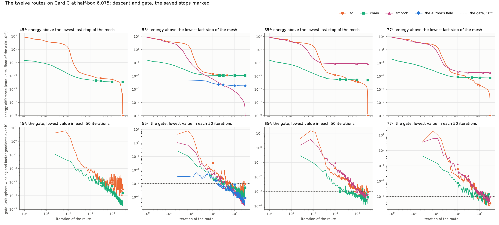
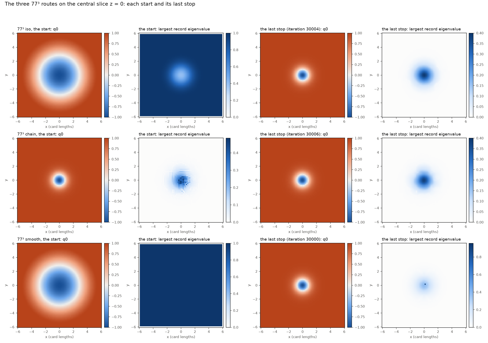
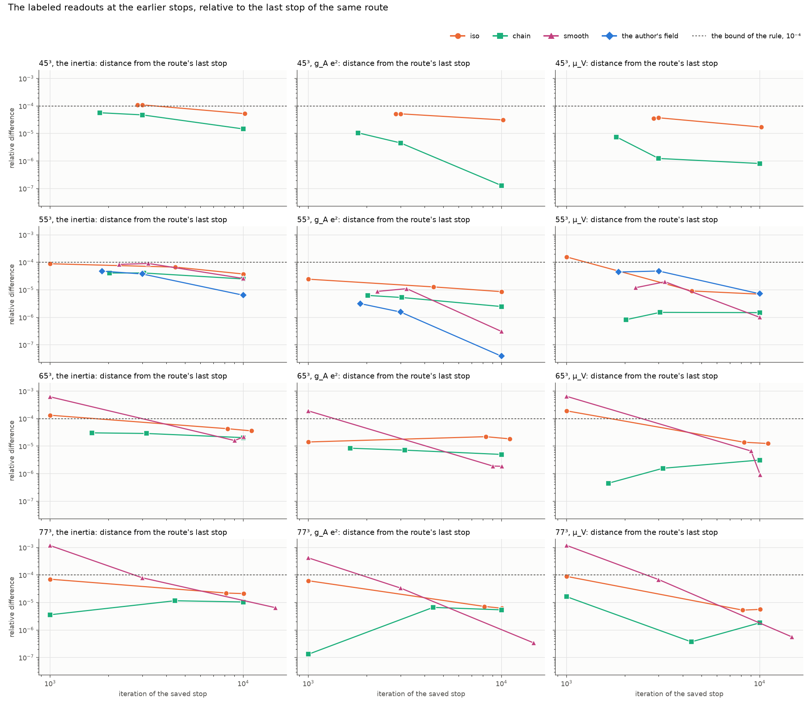
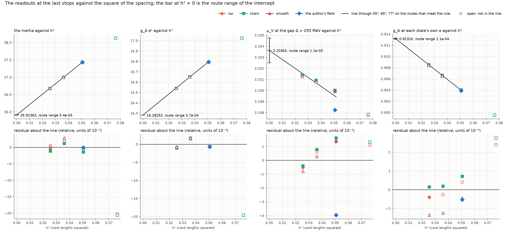

# M5.41: The Card C background under the agreed rule, and the calibration at zero spacing

> Opened 2026-11-15 from the author's reply to the results post of [M5.40](m5_40_task_details.md) on discussion #186 ([discussioncomment-19617697](https://github.com/vantasnerdan/substrate-framework/discussions/186#discussioncomment-19617697), 14 November 2026, 18:39 UTC), which answers the three questions of that post and states the rule for the next pass, and from the announcement of the capstone v3.9 ([discussioncomment-19626175](https://github.com/vantasnerdan/substrate-framework/discussions/186#discussioncomment-19626175), 15 November 2026, 06:26 UTC; Zenodo record [24240337](https://doi.org/10.5281/zenodo.24240337)). Roadmap row: [`m5_roadmap.md`](../m5_roadmap.md). Thread record: [`m5_32_convo.md`](m5_32_convo.md). Sources: [`_CITATIONS.md`](../../theory/_CITATIONS.md) (the v3.9 rows). This is the task that [M5.40](m5_40_task_details.md) § 8 and § 15 name as the following one.

## TASK PLANNING (2026-11-15; the plan post went on the thread at 14:22 UTC, [discussioncomment-19633185](https://github.com/vantasnerdan/substrate-framework/discussions/186#discussioncomment-19633185); the author confirmed the readings at 15:51 UTC, [discussioncomment-19634387](https://github.com/vantasnerdan/substrate-framework/discussions/186#discussioncomment-19634387); the go is the user's)

**Scope.** (1) The release v3.9 filed and the reply's numbers checked (§ 1, done at plan time). (2) R1: the instruments, namely the driver of M5.39 extended by a list of saved stops, a stop rule on the unit-sphere residual and an evaluation limit above the iteration cap, and the calibration relations coded against `calibration33.json` (§ 3). (3) R2: twelve routes on the mesh ladder at half-box 6.075 (three starts on each of 55³, 65³ and 77³, two on 45³, and the author's own field as a fourth route on 55³), each run to 30000 iterations with four saved stops (§ 4). (4) R3: the readouts of [M5.40](m5_40_task_details.md) § 13 at every stop, and the within-route criterion (§ 5). (5) R4: the spread between routes on each mesh, the zero-spacing line through the three finest meshes, and the calibration by the frozen rule with the route spread as its error (§ 5). Out of scope: the box ladder (the zero-spacing values of this task are values at half-box 6.075, and the box rise stays the number of [M5.39](m5_39_task_details.md)); the 33³ grid of the calibration file, whose half-box 3.6 is not on this ladder; the optional rung of the announcement (the energy per length of the three vortex types and the merge barrier of a split pair); the tilt reduction and the charged core ([M5.39](m5_39_task_details.md) § 2, rows 12 and 13); any icon or pointer of [`MODELS.md`](../../../../../MODELS.md), since every run is on the author's Card C and not on this column's certified action.

**Definition of done.** The instrument controls of § 3 each reported as met or as the exact failing check; the twelve routes run to their cap or to a logged end, every stop saved; every route labeled by the rule of § 2 (MEETS THE RULE, or the clause it fails); the spread, the zero-spacing line and the calibration reported under the wording rule of § 2 row 8; every number of the findings carried by a tracked JSON and a script; an audit by agents on a different model with every claim either standing or qualified (§ 6); the task review presented in the terminal. A control that fails after its three tries is reported as failed, and the reads that depend on it are kept as numbers without comparison words.

**Gating.** The author's rule (arrived, § 1). The author's reply to the plan post: the readings of § 2 go to the author before any route runs, and a correction is folded into § 2, with its date, before the go (the maintainer's decision of 2026-11-15). The reply of 2026-11-15, 15:51 UTC ([discussioncomment-19634387](https://github.com/vantasnerdan/substrate-framework/discussions/186#discussioncomment-19634387)) states that the readings are what the author meant and asks for the run as frozen, so § 2 stands without a change. The user's go.

**Model and effort.** The session's model for the run; the audits on a different, smaller model (two agents in parallel), named at each spawn.

**Research body.** This document (`## FINDINGS` after the run); scripts `../scripts/m5_41_*.py` and the extended [`m5_39_relax.py`](../scripts/m5_39_relax.py); data `../data/m5_41_*.json` (tracked) and `../data/m5_41_*.npz` (local-only, indexed by [`_DATASETS.md`](../data/_DATASETS.md)); plots `../plots/m5_41_*.png`, embedded in the findings; in-flight state in `../checkpoints/m5_41/` (local-only).

**Consumers.**

| Sub-result | Consumer | The check that consumer needs |
| --- | --- | --- |
| The label of each route | the author's next pass, which counts only states that meet the rule | the stop rule and the gate reading fixed before the run (§ 2); the regression of the extended driver (§ 3) |
| The spread between routes | the fixed-mesh error of the calibration | starts of more than one seed family (§ 4); the center spectrum and the branch label of each route, since routes on different branches are not combined |
| The zero-spacing values | the calibration (e, the effective f_π, the action energy unit, g_A) | the readout code gated in [M5.40](m5_40_task_details.md) § 13; the fit-form spread stated beside the route error |
| The calibration numbers | the capstone's hadronic section and its pre-registered amplitudes | the relations reproduced on `calibration33.json` before they are applied (§ 3) |

### 1. The reply, the release and what was checked at plan time

| Item | Fact |
| --- | --- |
| The rule, as the reply states it | The readouts' own stability is accepted as the criterion, instead of a tighter bound on the energy, since the energy left open by the gate does not move the readouts. Within a route: the inertia, g_A e² and μ_V fixed to 10⁻⁴ relative between two stops at least a factor 10 apart in iterations, plus the unit-normalized residual gate and the lump check. Across routes at a fixed mesh: the spread of at least two independent routes is the fixed-mesh error; the reply names the 55³ pair of [M5.40](m5_40_task_details.md) § 12 item 5 (the `smooth` state of M5.39 against the continued field of the author), which differs by 0.004 in the center eigenvalues and by 5.7 × 10⁻⁴ in μ_V, more than the within-route criterion. The calibration: at zero spacing from the three finest rungs, with the route spread as its error. The reply adds that this shift (3 to 4 percent) dominates everything above, and that g_A at each grid's own coupling stays near 0.91 because the mesh and box corrections nearly cancel |
| μ_V | The reading of the scripts in [M5.40](m5_40_task_details.md) § 13 is the intended one: (4/3) m_p \|m_z\| / (e³ f_π) with m_z the mirror-averaged response of the gauged lattice energy. The sentence on the inertia quadrupole belonged to the transition quadrupole and is corrected in v3.9 |
| The release | v3.9 (406 pages; a PDF and a source archive of 1318 files), filed from the version record 24240337 of the concept DOI that the announcement gives (23994958); both files carry the md5 of that record's file list. Against v3.7: 1237 files in common, 5 of them changed (`README.md`, `sm_from_ldgs.tex`, `contribution_map.tex`, `checks/self_metric_cones.py` and its `.json`), 81 new; the 49 files whose paths name the Card C code, the frozen packets or the pre-registration are identical by hash |
| `calibration33.json` | In `frozen_packets/CardC_payload_manifest/` of the source; its sha256 equals the digest the reply posts. The three numbers that `static_preflight.py` reads: `effective_e` 4.127737520949882, `effective_f_pi_MeV` 95.33832953347283, `frequency_unit_MeV` 393.5316000000001 |
| The file's numbers obey closed relations | With L the file's `length_unit_fm` and I its inertia of the 33³ field (34.32633181038963): e f_π = ħc / L (393.5316000000001, the frequency unit); e³ f_π = the file's `inverse_inertia_unit_MeV` (6705.076813629442 against 6705.076813629443 computed); (3/2) e³ f_π / I = 293.0, the calibrated bare gap; f_π / e = the file's `action_energy_unit_MeV`. So e² = 2 I Δ L / (3 ħc), which is the frozen rule as coded in M5.40 (`frozen_rule_e`): on the author's 33³ field that code returns the file's `effective_e` in every printed digit |
| The author's axial script with the file | `static_preflight.py`, unmodified, in an isolated copy outside the repository, beside a file holding the three numbers of the reply: g_A 0.957190 (33³) and 0.985809 (55³), the independent values of [M5.40](m5_40_task_details.md) § 13 (0.95719 and 0.98581). Its tail couplings, which [M5.40](m5_40_task_details.md) § 15 could not compute without the file, come out as 9.51 to 9.66 (33³) and 9.74 to 9.93 (55³) over the four shells of its Dirichlet fit; they are numbers of this file's normalization, they are not compared with a printed value, and R1 repeats the run with the author's file itself and stores its output |
| The capstone's paragraph on M5.40 | Read against the record of M5.40: the digests, the two energies, the readouts, the two corrections, the continuation and the mesh trend are as reported. One digit differs: the paragraph gives the agreement of the deposited scripts as 2 × 10⁻¹¹, which is the figure of `zero_q2.py`; for `static_preflight.py` the record has 1.4 × 10⁻¹⁰ |
| `checks/self_metric_cones.py` | Rewritten in v3.9 with a request to rerun wherever the old script or its json was reused. No document of this column uses the script or its output, so nothing reruns; the thread record and the citations name it only as the announced rewrite |
| The states of M5.39 on the ladder | All residuals of this row are in the reading of M5.39, on the winding vector as stored. On each of 45³, 55³ and 65³ the `iso` and `chain` routes ended under the gate without a record lump (2153 to 6011 iterations); on 77³ neither did within 8000 iterations (7.8 × 10⁻³ and 2.3 × 10⁻³). The `smooth` start ended under the gate on 55³ (the lowest state of that mesh, 75.56175, no lump) and on 77³ (one lump at a corner node), stayed 0.077 above the other routes on 65³ after 8000 iterations, and ended on the split-center branch on 45³. The `iso` start is a closed form, `smooth` is the archived seed, and the `chain` starts are local-only arrays of M5.39's checkpoint folder, rebuilt by the pool of M5.39 ([M5.39](m5_39_task_details.md) § 17) |

### 2. The rule as it is frozen before the run

Each clause of the reply leaves a choice open. The readings below are fixed here, before any route runs, and go to the author with the plan.

| # | Clause | The reading frozen here |
| --- | --- | --- |
| 1 | "the unit-normalized residual gate" | The larger of two numbers, each the largest entry over the interior nodes divided by h³: the winding gradient projected on the unit sphere, and the factor gradient. At most 10⁻³. This is the projected reading of [M5.40](m5_40_task_details.md) § 10 (K3), under which the author's recorded residuals return; on fields stored at unit length it equals the stored reading. It is evaluated at every iteration |
| 2 | The stops | Four targets, counted in the route's own optimizer iterations from its start: 1000, 3000, 10000, 30000. The residual moves up and down along one optimizer path ([M5.40](m5_40_task_details.md) § 12: under the gate on 55 of 200 saved rows at 33³ and on 1 of 60 at 55³), so the state saved for a target is the first iterate at or after it that is under the gate. A target with no such iterate before the next target (before 33000 for the last) keeps the iterate at the target count (at 33000 for the last) and is labeled GATE NOT MET. The optimizer is never restarted at a stop, and the route ends when its last stop is saved |
| 3 | "two stops at least a factor 10 apart in iterations" | The pair that is read is the last stop and the latest earlier stop whose iteration count is at most a tenth of the last stop's. The counts are those of the iterates actually saved |
| 4 | "fixed to 10⁻⁴ (relative)" | For each of the inertia (the mean of the three diagonal entries), g_A e² and μ_V: FIXED when the relative difference from the last stop is at most 10⁻⁴ both for the stop of row 3 and for the stop of the 10000 target; otherwise NOT FIXED, with both drifts printed. The two radii, the center eigenvalues and the energy are given beside them at all four stops and carry no label |
| 5 | "the lump check" | `record_lumps` of [`m5_39_reads.py`](../scripts/m5_39_reads.py) unchanged: no node whose largest record eigenvalue stands more than 0.2 above the card's target scale. The known values of the largest excess: 0.012 on the author's fields, at most 0.16 on the lump-free states of M5.39, 0.96 and 0.98 on its two states with a lump |
| 6 | A route that meets the rule | MEETS THE RULE on a mesh when its last stop is under the gate, holds no lump, and its three readouts are FIXED. Any other route is named by the clause it fails and its numbers are kept. The label says that the rule's three checks pass; it does not say that the energy has stopped falling, and the energy's drift over the last tenth of the route is printed beside it |
| 7 | "at least two independent routes", "the spread" | Three starts: `iso` (the closed-form isotropic-center seed), `chain` (the refinement chain of M5.39) and `smooth` (the archived smooth seed). `iso` and `chain` are two starts of one seed family, since the chain's first stage and the `iso` seed are both built from the `linked` seed; `smooth` is a second family, and on 55³ the author's field is a third origin. The spread on a mesh is the half range, (max − min)/2 over the routes' last stops, relative to their mean, given over all routes, over the routes that meet the rule, and with one family left out. It is a spread inside the declared branch: the center spectrum of every route is printed, and routes that end on different branches by the label of M5.39 are not combined |
| 8 | "at zero spacing from the three finest rungs, with the route spread as its error" | A straight line in h² through 55³, 65³ and 77³ for each readout. The central value is the least-squares intercept on the means of the routes that meet the rule. The route error is reported as a range, not as a standard error: the half range of the intercepts over every combination of one such route per mesh (36 when all ten routes of these meshes meet the rule). The intercept weighs the three meshes by −1.23, 0.49 and 1.73, so a spread on 77³ enters 1.7 times. Stated beside it and not folded in: the intercepts of the two finest meshes alone and of all four meshes (the fit form), the intercepts from the 10000 stops (the drift), and the intercepts of each start family alone. The word calibration is used only when each of the three meshes has two routes that meet the rule; otherwise the same numbers are reported as a trend, with the failing clause named |

The calibration itself is the rule of the capstone's recalibration, with the inherited length unit L and the bare gap Δ held fixed:

```text
e0^2      = 2 I0 Delta L / (3 hbar c)        Delta = 293 MeV, hbar c / L = 393.5316 MeV
f_pi      = hbar c / (L e0)                  the effective f_pi of this convention
unit_E    = f_pi / e0                        the action energy unit
g_A       = (g_A e^2)_0 / e0^2               also read as the intercept of g_A at each mesh's own e
mu_V      = 2 m_p |m_z| / (I Delta)          per mesh: the script's value times its own gap over Delta,
                                             the gap of a mesh being (3/2)(4.259^3 x 92.4) / I; then the intercept
rigid     = m_p / Delta
```

I0 and (g_A e²)0 are the zero-spacing intercepts. Each output is given with the route range carried through the combinations of row 8, not through a linearized formula.

### 3. R1: the instruments and their controls

| Instrument | Change | Control (three tries each) |
| --- | --- | --- |
| The driver [`m5_39_relax.py`](../scripts/m5_39_relax.py) | A list of stops saved by the rule of § 2 row 2 (the single hand-off of M5.39 generalized); the gate of § 2 row 1 evaluated at every iteration (the driver records the unit-sphere winding residual every 50 iterations only, and traces the stored reading between); the optimizer's own gradient stop switched off (`--stop-gate 10⁻⁹`, the setting of the timing pilot), so that only the cap, a stop of § 2 or the optimizer's function tolerance ends a route; the optimizer's limit on function evaluations raised above the cap, since the library's default of 15000 would end a route near iteration 14600 and M5.40's longest run was 10000 | Regression: with the arguments of [M5.40](m5_40_task_details.md) § 16 on one thread, the first 3000 iterations of the 33³ continuation return the energies of the stored rows of `m5_40_r3_g33_cont.json` to 10⁻¹² relative. Start control: the first evaluation of every route returns the start energy below to 10⁻¹⁰ relative |
| The readouts [`m5_40_readouts.py`](../scripts/m5_40_readouts.py) | None | Gated in [M5.40](m5_40_task_details.md) § 13; rerun on the author's 55³ field at the head of this task's read, the stored values returned to 10⁻¹⁰ |
| The author's `static_preflight.py` | None; run unmodified in an isolated copy with the author's `calibration33.json` itself | Its output on the two deposited fields stored in a tracked JSON; g_A against [M5.40](m5_40_task_details.md) § 13 to 10⁻⁸ |
| The calibration relations, `m5_41_calibration.py` | New | From the inertia of the author's 33³ field: the file's `effective_e`, `effective_f_pi_MeV`, `inverse_inertia_unit_MeV` and `action_energy_unit_MeV` to 10⁻¹² relative, and its `minimal_muV_muN` (3.198542995087794) from the stored μ_V and gap of M5.40 to 10⁻⁹ relative. From the author's 55³ field: the printed e = 4.311 and f_π = 91.29 MeV to the printed digits |

### 4. R2: the routes

| Mesh | Spacing h | Route | Start | Start energy (the control of § 3) |
| --- | --- | --- | --- | --- |
| 45³ | 0.27614 | `iso` | closed form | 951.1869569484667 |
| 45³ | 0.27614 | `chain` | the hand-off of the 37³ stage | 76.17486674698928 |
| 55³ | 0.22500 | `iso` | closed form | 960.2457216651314 |
| 55³ | 0.22500 | `chain` | the hand-off of the 45³ chain | 76.10589655857467 |
| 55³ | 0.22500 | `smooth` | the archived seed | 931.1781080672494 |
| 55³ | 0.22500 | `author` | the author's deposited field | 75.56196067295708 |
| 65³ | 0.18984 | `iso` | closed form | 966.5931374279587 |
| 65³ | 0.18984 | `chain` | the hand-off of the 55³ chain | 75.97938170352795 |
| 65³ | 0.18984 | `smooth` | the archived seed | 939.0364814034779 |
| 77³ | 0.15987 | `iso` | closed form | 972.1235440994741 |
| 77³ | 0.15987 | `chain` | the hand-off of the 65³ chain | 76.09773221330995 |
| 77³ | 0.15987 | `smooth` | the archived seed | 945.730922837993 |

Every route runs the card's parameters and the optimizer of M5.39 (the same memory, line search and admissibility wall), with the two settings of § 3 that keep it from ending early. What ends a route: its last stop (§ 2 row 2), or the optimizer's function tolerance (an energy change under 10⁻¹⁵ relative), in which case the final iterate is the last stop and is labeled by the same rule. An abnormal end (a failed line search) is restarted from the last iterate at most three times; a restart, like a resume from the checkpoint after an interruption, clears the optimizer's memory and returns to the last recorded row, so each is logged with its iteration and the route is marked as restarted in every table.

The 45³ mesh is not one of the three finest; it is run as the fourth point of the fit-form check, with the two starts that stayed on the declared branch there (`smooth` ended on the split-center branch on 45³ in M5.39). The `chain` routes of different meshes share ancestry along the chain while the other starts do not, which is one reason the intercepts of each family alone are printed (§ 2 row 8). The `linked` seed itself is not a route: it was above the gate on 55³, 65³ and 77³ after 8000 iterations in M5.39, and its family is represented by `iso` and `chain`.

### 5. R3 and R4: the reads, and what is recorded before the run

At each of the 48 saved stops: the energy and its seven terms, the residual in both readings, the range of the winding vector's length, the center eigenvalues and the branch label, the lump count, and the readouts of [M5.40](m5_40_task_details.md) § 13 (the inertia, the two radii, μ_V with its rigid value, g_A e² with its two parts). From them: the labels of § 2, the spread per mesh, the lines per readout, the calibration, and one figure each for the routes' descent, the readouts against the stop, and the zero-spacing lines with their route range.

Recorded before the run, from the numbers of M5.39 and M5.40. Energies are in the card's units, as absolute differences. Each line is an expectation, and its failure is reported with the same weight.

1. **Energy.** Every route ends below its end state of M5.39. On 55³ the gate stops of M5.39 spread over 1.2 × 10⁻³ (75.56175 to 75.56298), while the continuation of M5.40 ended 4 × 10⁻⁶ from the lowest of them; the expectation is that all four 55³ routes end within 2 × 10⁻⁴ of 75.5617. A route that ends more than 5 × 10⁻⁴ above the lowest of its mesh has not reached the floor the others found; whether it is slow or in another valley is read from its center spectrum and its lump count, and the `smooth` route on 65³ is the candidate (0.077 above after 8000 iterations in M5.39).
2. **The gate at the last stop.** Not assured on any mesh. Under the gate were 55 of 200 saved rows of the 33³ continuation of M5.40 and 1 of 60 of the 55³ one, so the 3000 iterations between the last target and the end may hold no gate-passing iterate, on 55³ as on 77³. A mesh on which fewer than two routes pass withholds the word calibration (§ 2 row 8).
3. **Within a route.** By extension from the continuations of M5.40 (33³ and 55³, at most 10000 iterations, where the inertia, the radii and g_A e² moved by under 5 × 10⁻⁵): the inertia and g_A e² come out FIXED on 45³, 55³ and 65³. μ_V is the readout at the edge of the criterion: it moved by 3 × 10⁻⁵ and 7 × 10⁻⁵ over those continuations and differs by 5 to 6 × 10⁻⁴ between two states of one mesh. No continuation has been run on 45³, 65³ or 77³.
4. **Across routes.** The half range on a mesh is under 10⁻⁴ for the inertia and g_A e² (the `iso` and `chain` states of M5.39 give 7.9 × 10⁻⁵ on 55³ and 4.1 × 10⁻⁵ on 65³ for the inertia), and near 3 × 10⁻⁴ for μ_V.
5. **Zero spacing.** The intercepts land within half a percent of the trend of [M5.40](m5_40_task_details.md) § 13: inertia 35.92, g_A e² 16.28, μ_V 3.148, hence e near 4.222, an effective f_π near 93.2 MeV and g_A near 0.913. That trend used one state per mesh and its 77³ point is the `smooth` state that holds a lump. The route range of the intercepts is at least an order under the distance between the 55³ values and the intercepts, with the 77³ spread entering 1.7 times.

### 6. Blindspot pass, the audit and the records

Read against the recurring failure families of the workflow, for this task's instruments.

| Risk | Where it enters | Guard |
| --- | --- | --- |
| A criterion fitted after the fact | the stops, the pair that is read, the stop rule at a fluctuating residual | all fixed in § 2 before any route runs; every stop's numbers are printed, not only the pair that is read |
| Unfalsifiable check | two points 27000 iterations apart can agree while the readout wanders between them | the 10000 stop must agree as well (§ 2 row 4); the gate and the lump check are separate conditions; the label does not claim a floor (§ 2 row 6) |
| Unvalidated instrument | the extended driver; the new calibration code | the regression and the start controls of § 3; the relations reproduced on the author's file first |
| Artifact read as result | a record lump at a corner node; a growing length of the winding vector | the lump check at every stop; the residual read on the unit sphere and the length range recorded per row |
| One valley taken for the minimum | routes that agree share a valley and prove no more than that; two of the three starts are one seed family | the spread is called a spread inside the declared branch; a second family and the author's field are in the set, and the spread is given with one family left out (§ 2 row 7); a route ending high is reported (§ 5 item 1) |
| Correlated samples counted as independent | the `chain` routes share ancestry across meshes; the combinations of § 2 row 8 reuse the same routes | the route error is stated as a range with the mesh weights, never as a standard error; the per-family intercepts printed |
| Resolution mistaken for accuracy | three points and a straight line in h² | the fit-form spread printed beside the route error and never folded into it; the box named as the correction this task does not carry |
| A path that depends on the thread count or on an interruption | threaded kernels change the floating-point order; a resume returns to the last recorded row with an empty optimizer memory | each route is one path on one thread count; the only cross-run equality that is asked is the single-thread regression; every resume and restart is logged and shown in the tables (§ 4) |
| A run cut by power or by the optimizer | 30000 to 33000 iterations per route | the driver's resumable checkpoint; the restart rule of § 4, capped and logged |

The audit: two agents on a different model, in parallel, each asked to refute. One takes R1 to R3 (the driver's diff, the regression, every label recomputed from the stop files by its own code); the other takes R4 (the fits and the combinations recomputed, the calibration relations against the author's file, every number of the findings against the JSON). The thread record gets its row when the results are posted; the post is the maintainer's, after the review.

### 7. The parallel shape, the estimate and what follows

| Stage | Jobs | Shape |
| --- | --- | --- |
| Wave 1 | the three 77³ routes | four threads each in the compiled kernels, twelve busy cores, the one-thread pins of M5.39 on every other library. Measured in a 60-iteration pilot from the end states of M5.39, with twelve cores busy: 1.25 s per iteration on four threads, so 10.4 hours for 30000 iterations and 11.5 for 33000 |
| Wave 2 | the three 65³ routes | four threads each. Not measured on four threads: 1.11 s per iteration on two in the same pilot, 2.2 s on one in the pool of M5.39; about 0.7 s expected, 6 to 7 hours |
| Wave 3 | the four 55³ routes and the two 45³ routes | two threads each. 55³: 1.39 s on one thread in the pool of M5.39 and 0.38 s on six in M5.40, about 0.75 s expected, 6 to 7 hours; 45³: 0.75 s on one thread, under 4 hours |
| The reads | 48 stop states | one process pool over the states after the routes; the nine states of M5.40 took 7 minutes on four threads, so about half an hour |

No job runs on one core: the kernels thread inside a job and the waves fill the cores across jobs. The GPU is not used: every control of § 3 is an equality at 10⁻⁸ or tighter in double precision, and the kernels are compiled for the CPU.

Go to review: about a day, 24 to 28 hours. The three waves take 22 to 26 hours (the lower figure when every last stop lands at its target, the upper when the routes run to 33000); the instrument changes and their controls, the reads, the two audits in parallel and the write-up add about two hours. The pilot is short (60 iterations) and two of the three thread layouts are extrapolated, so the first rows of each wave are read against these figures and the estimate is restated in the checkpoint file if they differ. The run is unattended and loads the machine for its whole length.

What follows this task, each as its own plan: a mesh ladder at a second box, which is what a value at zero spacing and infinite volume needs; the optional rung of the announcement; the tilt reduction and the charged core.

## FINDINGS

Every number below is carried by a tracked file: the twelve route records `m5_41_r2_g<mesh>_<start>.json`, the reads of the 48 stops [`m5_41_r3_reads.json`](../data/m5_41_r3_reads.json), the summary [`m5_41_summary.json`](../data/m5_41_summary.json), the spike read [`m5_41_r3_spikes.json`](../data/m5_41_r3_spikes.json) and the two control files of § 9, all in [`data/`](../data/); the scripts are [`m5_39_relax.py`](../scripts/m5_39_relax.py) (extended), [`m5_41_pool.py`](../scripts/m5_41_pool.py), [`m5_41_reads.py`](../scripts/m5_41_reads.py), [`m5_41_spikes.py`](../scripts/m5_41_spikes.py), [`m5_41_calibration.py`](../scripts/m5_41_calibration.py), [`m5_41_summary.py`](../scripts/m5_41_summary.py) and [`m5_41_plots.py`](../scripts/m5_41_plots.py). In one paragraph: the twelve routes all ended on a last stop under the gate; seven of them meet the rule as frozen; 65³ has one such route, so by § 2 row 8 the zero-spacing numbers are a trend and not a calibration; the readouts agree between routes to better than 10⁻⁴ (μ_V to 2.6 × 10⁻⁴ on 55³), and the form of the fit and the box, not the routes, set the uncertainty of the intercepts.

### 8. Deviations from the plan, logged as they happened

| # | When | Deviation | Why, and what it changes |
| --- | --- | --- | --- |
| 1 | at the launch | The routes run from one queue, finest mesh first, instead of three separate waves: a route starts when its threads fit under twelve busy cores | A wave would leave cores idle between the first and the last end of its routes. Every route keeps the thread count of § 7 for its whole life, so each is still one path on one thread count |
| 2 | R1 | The last window is read through the cap: an iterate under the gate at iteration 33000 itself is saved as a gate stop, not as GATE NOT MET | § 2 row 2 reads "before 33000"; labeling a state under the gate as not meeting it would be false. The record of each stop carries its kind (`gate`, `count`, `cap`, `end`) and its iteration |
| 3 | R1 | Beside the changes of § 3 the driver gained `--restarts` (the three restarts of § 4) and `--expect-start-energy` (the start control, checked inside the driver before the first step) | Both are rules of § 3 and § 4 that needed an option; without `--stops` the driver runs as before, which the regression shows |
| 4 | R1 | The regression ran with the new options switched on (`--stops 300,1000,3000 --cap 3300 --maxfun 100000 --restarts 3`) instead of the bare arguments of [M5.40](m5_40_task_details.md) § 16 | The control is meant to show that the extension leaves the optimizer's path unchanged; with the options off it would test nothing new |
| 5 | R1 | The calibration control was met on its second try | The first stopped on the script's own guard: the proton mass was typed as 938.27208816, and the readouts of M5.40 use 938.272. No relation changed |
| 6 | during the run, before the audits | The two audits of § 6 run on a larger model than the plan names ("a different, smaller model"): both on Opus 5.5, with one further agent on Sonnet over the numbers of R4 in parallel | The maintainer's decision of 2026-11-15: an audit mixes recomputation with judgment (whether a conclusion follows, whether the frozen rule was applied as written), and the second is given the stronger model. Both models differ from the one that ran the task, so the independence asked by § 6 is unchanged; the Sonnet agent shows what each model catches on the same material |
| 7 | R3 | The reads of the 32 stops of the eight finished routes ran while the four 55³ routes were still running, on the cores the two 45³ routes had freed; the plan has one pool of reads after the routes | The cores were idle and the reads are functions of the saved files alone. The machine stayed at twelve busy cores |
| 8 | R3, at the figures | A read was added: record spikes measured against a node's neighbours instead of the card's target scale ([`m5_41_spikes.py`](../scripts/m5_41_spikes.py), § 11 item 4) | The figure of the 77³ states showed a node next to the center that the lump check of § 2 row 5 does not flag. The rule is unchanged and no label depends on the new read |
| 9 | R4 | The comparison with the μ_V of § 5 item 5 was first coded against μ_V at the gap Δ; the number recorded there (3.148) is the script's μ_V at the inherited constants | Corrected before any finding was written; the summary compares like with like |
| 10 | after the audit | The summary file gained four blocks that decide no label: the labels under two other readings of the pair stop, three subsets of the lines, the values within 20 percent of a bound, and the states of M5.39 below the lowest last stops | Each answers a point of the audit (§ 14) with a number in a tracked file. The subsets are named as chosen after the results were seen |

### 9. R1: the instruments ([`m5_39_relax.py`](../scripts/m5_39_relax.py), [`m5_41_calibration.py`](../scripts/m5_41_calibration.py), [`m5_41_r1_calibration_control.json`](../data/m5_41_r1_calibration_control.json), [`m5_41_r1_author_preflight.json`](../data/m5_41_r1_author_preflight.json))

| Instrument | Control of § 3 | Outcome |
| --- | --- | --- |
| The extended driver | The 33³ continuation of [M5.40](m5_40_task_details.md) rerun on one thread with the new options on (§ 8, row 4), against the stored rows of [`m5_40_r3_g33_cont.json`](../data/m5_40_r3_g33_cont.json) | ✅ MET: the 60 rows to iteration 3000 agree in energy and in residual with a relative difference of 0 (bound 10⁻¹²). The run also exercised the stop logic: the 1000 target was saved at iteration 1913, the first iterate under the gate, and the route ended at 3056 |
| The start of every route | The energy of the first evaluation against § 4, to 10⁻¹⁰ relative | ✅ MET on all twelve: 0 to 4 × 10⁻¹⁶ on eleven, 6.7 × 10⁻¹² on the author's field |
| The readouts | [`m5_40_readouts.py`](../scripts/m5_40_readouts.py) rerun on the author's 55³ field | ✅ MET: every stored float of [`m5_40_r4_readouts.json`](../data/m5_40_r4_readouts.json) returned without a difference |
| The author's `static_preflight.py` | Unmodified, from an isolated folder outside the repository, with the author's `calibration33.json` itself | ✅ MET: g_A 0.9571903638964703 (33³) and 0.9858089033726234 (55³), within 1.1 × 10⁻¹¹ and 2.5 × 10⁻¹¹ of the independent values (bound 10⁻⁸). Its tail couplings over the four shells of its Dirichlet fit: 9.51 to 9.66 (33³) and 9.74 to 9.93 (55³), numbers of this file's normalization that are not compared with a printed value |
| The calibration relations | The author's file from the inertia of the 33³ field; the printed e and f_π of the 55³ field | ✅ MET on the second try (§ 8, row 5): the frequency unit, the length unit, `effective_e`, `effective_f_pi_MeV`, `inverse_inertia_unit_MeV`, `action_energy_unit_MeV` and the calibrated gap to 2 × 10⁻¹⁶ or better, `minimal_muV_muN` to 1.7 × 10⁻¹¹, the rigid value exactly; e 4.3107 and f_π 91.2917 MeV on the 55³ field, the printed 4.311 and 91.29 |

What the regression shows and what it does not: it shows that the stop list, the gate read at every iterate, the raised evaluation limit and the restart option leave the optimizer's path unchanged on one thread at 33³. It ran with the optimizer's own stop at a tenth of the gate, the setting of the stored run, while the routes ran with that stop off. It says nothing about whether a route returns on another thread count: the routes ran on two or four threads, and each is one path on its own count. Four branches of the new code ran on no route and are covered by the short functional runs only (an interrupt at iteration 200 of a 33³ run, then a resume; an end at the cap on 17³): the evaluation outside the optimizer's count, the restart, the resume, and the end at the cap or by the optimizer's tolerance.

### 10. R2: the routes ([`m5_41_pool.py`](../scripts/m5_41_pool.py), the twelve files `m5_41_r2_g<mesh>_<start>.json` in [`data/`](../data/))

| Route | Start energy, relative difference from § 4 | Iterations | End | Evaluations | Restarts, resumes, wall hits | Hours | Iterates under the gate, per window (1 to 999, 1000 to 2999, 3000 to 9999, 10000 to 29999, 30000 on) |
| --- | --- | --- | --- | --- | --- | --- | --- |
| 45³ `iso` | 951.1869569485, 0 | 30000 | the last stop | 30684 | 0, 0, 0 | 3.66 | 0 of 999, 1 of 2000, 392 of 7000, 5770 of 20000, 1 of 1 |
| 45³ `chain` | 76.1748667470, 0 | 30000 | the last stop | 30732 | 0, 0, 0 | 3.67 | 0 of 999, 40 of 2000, 2904 of 7000, 19361 of 20000, 1 of 1 |
| 55³ `iso` | 960.2457216651, 1.2 × 10⁻¹⁶ | 30008 | the last stop | 30752 | 0, 0, 0 | 6.35 | 0 of 999, 0 of 2000, 386 of 7000, 7371 of 20000, 1 of 9 |
| 55³ `chain` | 76.1058965586, 3.7 × 10⁻¹⁶ | 30000 | the last stop | 30715 | 0, 0, 0 | 6.31 | 0 of 999, 8 of 2000, 1150 of 7000, 13125 of 20000, 1 of 1 |
| 55³ `smooth` | 931.1781080672, 3.7 × 10⁻¹⁶ | 30000 | the last stop | 30616 | 0, 0, 0 | 6.31 | 0 of 999, 2 of 2000, 2152 of 7000, 18866 of 20000, 1 of 1 |
| 55³ `author` | 75.5619606735, 6.7 × 10⁻¹² | 30000 | the last stop | 30699 | 0, 0, 0 | 6.34 | 0 of 999, 125 of 2000, 2739 of 7000, 18807 of 20000, 1 of 1 |
| 65³ `iso` | 966.5931374280, 1.2 × 10⁻¹⁶ | 30128 | the last stop | 30833 | 0, 0, 0 | 6.35 | 0 of 999, 0 of 2000, 9 of 7000, 472 of 20000, 1 of 129 |
| 65³ `chain` | 75.9793817035, 1.9 × 10⁻¹⁶ | 30002 | the last stop | 30717 | 0, 0, 0 | 6.39 | 0 of 999, 4 of 2000, 381 of 7000, 5433 of 20000, 1 of 3 |
| 65³ `smooth` | 939.0364814035, 2.4 × 10⁻¹⁶ | 30000 | the last stop | 31112 | 0, 0, 0 | 6.38 | 0 of 999, 0 of 2000, 7 of 7000, 3697 of 20000, 1 of 1 |
| 77³ `iso` | 972.1235440995, 3.5 × 10⁻¹⁶ | 30004 | the last stop | 30717 | 0, 0, 0 | 11.14 | 0 of 999, 0 of 2000, 4 of 7000, 2220 of 20000, 1 of 5 |
| 77³ `chain` | 76.0977322133, 0 | 30006 | the last stop | 30728 | 0, 0, 0 | 11.13 | 0 of 999, 0 of 2000, 64 of 7000, 1155 of 20000, 1 of 7 |
| 77³ `smooth` | 945.7309228380, 3.6 × 10⁻¹⁶ | 30000 | the last stop | 30934 | 0, 0, 0 | 11.13 | 0 of 999, 0 of 2000, 0 of 7000, 1562 of 20000, 1 of 1 |

1. **Every route ended on its last stop, under the gate**, between iteration 30000 and 30128. No route was restarted, none was resumed, and none met the admissibility wall, so each is one optimizer path from its start.
2. **The gate is passed late and intermittently.** No route has an iterate under the gate in its first 999 iterations. The starts from a seed (`iso`, `smooth`) first pass it between iteration 2281 and 14690; on 65³ and 77³ they pass it on 0 to 9 of the 7000 iterates between 3000 and 9999. Over the 20000 iterates before the last target the fraction under the gate runs from 2 percent (65³ `iso`) to 97 percent (45³ `chain`). This is why the state saved for a target is often not the iterate at the target count (§ 11).
3. **The evaluations outside the optimizer's count were zero on every route**: the last evaluation of each iteration was at the accepted iterate, so the gate read cost nothing extra.





### 11. R3: the stops and the labels ([`m5_41_reads.py`](../scripts/m5_41_reads.py), [`m5_41_summary.py`](../scripts/m5_41_summary.py), [`m5_41_r3_reads.json`](../data/m5_41_r3_reads.json), [`m5_41_summary.json`](../data/m5_41_summary.json))

The label of each route, by § 2 rows 3 to 6. A drift is the relative difference of a readout from its value at the last stop; the bound is 10⁻⁴ for both drifts.

| Route | Pair stop (target, iteration) | Inertia: drift from the pair stop, from the 10000 stop | g_A e²: the same | μ_V: the same | Last stop under the gate | Lumps | Label | Energy drift over the last tenth |
| --- | --- | --- | --- | --- | --- | --- | --- | --- |
| 45³ `iso` | 3000, 3000 | 1.1 × 10⁻⁴, 5.3 × 10⁻⁵: NOT FIXED | 5.2 × 10⁻⁵, 3.1 × 10⁻⁵: FIXED | 3.7 × 10⁻⁵, 1.7 × 10⁻⁵: FIXED | yes (2.93 × 10⁻⁴) | 0 | NOT FIXED: inertia | 7.6 × 10⁻⁶ |
| 45³ `chain` | 3000, 3000 | 4.8 × 10⁻⁵, 1.5 × 10⁻⁵: FIXED | 4.6 × 10⁻⁶, 1.3 × 10⁻⁷: FIXED | 1.2 × 10⁻⁶, 8.1 × 10⁻⁷: FIXED | yes (1.52 × 10⁻⁴) | 0 | MEETS THE RULE | 6.5 × 10⁻⁸ |
| 55³ `iso` | 1000, 1000 | 8.9 × 10⁻⁵, 3.8 × 10⁻⁵: FIXED | 2.4 × 10⁻⁵, 8.6 × 10⁻⁶: FIXED | 1.6 × 10⁻⁴, 7.0 × 10⁻⁶: NOT FIXED | yes (9.81 × 10⁻⁴) | 0 | NOT FIXED: μ_V | 9.6 × 10⁻⁶ |
| 55³ `chain` | 1000, 2029 | 4.1 × 10⁻⁵, 2.5 × 10⁻⁵: FIXED | 6.3 × 10⁻⁶, 2.5 × 10⁻⁶: FIXED | 8.2 × 10⁻⁷, 1.5 × 10⁻⁶: FIXED | yes (4.96 × 10⁻⁴) | 0 | MEETS THE RULE | 1.4 × 10⁻⁶ |
| 55³ `smooth` | 1000, 2281 | 8.4 × 10⁻⁵, 2.6 × 10⁻⁵: FIXED | 8.8 × 10⁻⁶, 3.1 × 10⁻⁷: FIXED | 1.2 × 10⁻⁵, 1.0 × 10⁻⁶: FIXED | yes (7.46 × 10⁻⁵) | 0 | MEETS THE RULE | 8.0 × 10⁻⁸ |
| 55³ `author` | 1000, 1856 | 4.8 × 10⁻⁵, 6.4 × 10⁻⁶: FIXED | 3.2 × 10⁻⁶, 3.9 × 10⁻⁸: FIXED | 4.4 × 10⁻⁵, 7.2 × 10⁻⁶: FIXED | yes (8.60 × 10⁻⁵) | 0 | MEETS THE RULE | 4.8 × 10⁻⁸ |
| 65³ `iso` | 1000, 1000 | 1.3 × 10⁻⁴, 3.6 × 10⁻⁵: NOT FIXED | 1.4 × 10⁻⁵, 1.8 × 10⁻⁵: FIXED | 1.9 × 10⁻⁴, 1.2 × 10⁻⁵: NOT FIXED | yes (9.34 × 10⁻⁴) | 0 | NOT FIXED: inertia, μ_V | 2.4 × 10⁻⁵ |
| 65³ `chain` | 1000, 1646 | 3.0 × 10⁻⁵, 2.0 × 10⁻⁵: FIXED | 8.4 × 10⁻⁶, 5.0 × 10⁻⁶: FIXED | 4.5 × 10⁻⁷, 3.1 × 10⁻⁶: FIXED | yes (3.99 × 10⁻⁴) | 0 | MEETS THE RULE | 2.2 × 10⁻⁶ |
| 65³ `smooth` | 1000, 1000 | 6.2 × 10⁻⁴, 2.2 × 10⁻⁵: NOT FIXED | 1.9 × 10⁻⁴, 1.9 × 10⁻⁶: NOT FIXED | 6.5 × 10⁻⁴, 9.2 × 10⁻⁷: NOT FIXED | yes (6.86 × 10⁻⁴) | 24 | LUMP; NOT FIXED: inertia, g_A e², μ_V | 6.4 × 10⁻⁷ |
| 77³ `iso` | 1000, 1000 | 7.0 × 10⁻⁵, 2.1 × 10⁻⁵: FIXED | 6.2 × 10⁻⁵, 6.2 × 10⁻⁶: FIXED | 8.9 × 10⁻⁵, 5.6 × 10⁻⁶: FIXED | yes (3.52 × 10⁻⁴) | 0 | MEETS THE RULE | 3.0 × 10⁻⁶ |
| 77³ `chain` | 1000, 1000 | 3.6 × 10⁻⁶, 1.0 × 10⁻⁵: FIXED | 1.3 × 10⁻⁷, 5.4 × 10⁻⁶: FIXED | 1.6 × 10⁻⁵, 1.8 × 10⁻⁶: FIXED | yes (9.48 × 10⁻⁴) | 0 | MEETS THE RULE | 3.9 × 10⁻⁶ |
| 77³ `smooth` | 3000, 3000 | 7.9 × 10⁻⁵, 6.5 × 10⁻⁶: FIXED | 3.4 × 10⁻⁵, 3.4 × 10⁻⁷: FIXED | 6.8 × 10⁻⁵, 5.6 × 10⁻⁷: FIXED | yes (9.91 × 10⁻⁴) | 2 | LUMP | 1.2 × 10⁻⁶ |

1. **Seven routes meet the rule**: `chain` on all four meshes, `iso` on 77³, `smooth` and the author's field on 55³. On the three finest meshes that is three routes on 55³, one on 65³ and two on 77³.
2. **Three routes without a lump are NOT FIXED, each by a drift from its pair stop of 1.1 to 1.9 × 10⁻⁴**: `iso` on 45³ (the inertia), on 55³ (μ_V) and on 65³ (the inertia and μ_V). Their drifts from the 10000 stop are 0.7 to 5.3 × 10⁻⁵. On 55³ and 65³ the pair stop of these routes is the iterate at iteration 1000, which was not under the gate (3.2 and 3.9 × 10⁻²): their 3000 target was saved at iterations 4452 and 8294, later than a tenth of the last stop, so § 2 row 3 selects the stop before it. The `iso` route of 77³ has the same pair stop and passes, with drifts of 6.2 to 8.9 × 10⁻⁵. The labels are those of the rule as frozen; whether a longer route or a pair stop taken under the gate would change them was not run.
3. **Two routes hold lumps, from their first stop to their last**: `smooth` on 77³ (2 nodes of the first interior layer, on two edges of the box three spacings from a corner, eigenvalue 0.982) and `smooth` on 65³ (24 nodes, the three interior neighbours of the corner node at each of the eight corners, eigenvalue 0.972). Their energies stand 0.0034 and 0.0771 above the lowest last stop of the mesh, the size of the potential energy of the lumps. The 65³ route is also NOT FIXED on all three readouts against its pair stop; the 77³ route is FIXED and fails on the lump alone. The same start held one corner lump on 77³ in [M5.39](m5_39_task_details.md).
4. **A read added during the run: the lump check does not see the core** ([`m5_41_spikes.py`](../scripts/m5_41_spikes.py), [`m5_41_r3_spikes.json`](../data/m5_41_r3_spikes.json)). The check of § 2 row 5 measures the largest record eigenvalue against the card's target scale (1 − q₀)/2, which is close to 1 where q₀ is close to −1, so a node left near an eigenvalue of one is not flagged at the core. A read with no target scale (a node whose largest eigenvalue stands more than 0.2 above the largest of its six neighbours) finds, on the 48 stops: the same 24 nodes on the four stops of 65³ `smooth`; on the four stops of 77³ `smooth` the two flagged nodes and two further nodes next to the center (radius 0.23; eigenvalue 0.956 and q₀ −0.90 at the last stop, 0.960 and −0.89 at the first), which the lump check does not flag; none on the other 40 stops, where the largest excess over the neighbours is 0.021. The read depends on its neighbourhood: the two nodes at the core are diagonal neighbours of each other, as are the three at each corner of 65³ `smooth`, so a read over all 26 neighbours does not see them; the statement about the 40 other stops holds for 6 or 26 neighbours and for a threshold of 0.1 or 0.2. No label changes, since that route already fails on its corner lumps, and no route that meets the rule holds a spike. The earlier states on which the trend of [M5.40](m5_40_task_details.md) § 13 rested hold none beyond the corner lump already reported. Family: wrong diagnostic for the regime.
5. **Every last stop is on the declared branch** (ISOTROPIC CENTER by the label of M5.39) with winding number one and every simplex of the four triangulations in an open hemisphere. The 77³ `smooth` state is the closest to the edge of that label: at its last stop its center eigenvalues span 0.081, against the 0.1 of the label. The length of the stored winding vector stays within 1.01 on the `chain` routes and on the author's field, and grows to between 2.2 and 4.3 on the routes from a seed; the gate is read on the unit sphere (§ 2 row 1), and at the last stops the residual of M5.39 (the largest entry on the vector as stored) agrees with the gate within 1 percent on the `chain` routes and the author's field; on the routes from a seed it is lower by up to 28 percent, or equal where the factor gradient sets both (65³ and 77³ `smooth`).
6. **The routes of one mesh do not end at one energy.** The lowest last stop is `iso` on 45³, 65³ and 77³ and `smooth` on 55³; `chain` ends 1.2 × 10⁻⁴, 1.1 × 10⁻³, 2.4 × 10⁻⁴ and 5.3 × 10⁻⁴ above it on the four meshes, with an energy that moved by 7 × 10⁻⁸ to 3.9 × 10⁻⁶ over the last tenth of the route. The `iso` routes were still falling at their last stop, by 3.0 × 10⁻⁶ to 2.4 × 10⁻⁵ over the last tenth. The center eigenvalues separate the ends: the `chain` routes end near (0.345, 0.378, 0.379), the `smooth` routes and the author's field near (0.330, 0.383, 0.392), and the `iso` routes between them and moving. On 65³ and 77³ a state of M5.39 lies lower than every last stop of this task: `linked` on 65³ (75.5234387, 3.0 × 10⁻⁴ under the lowest) and `iso` on 77³ (75.4912743, 5.3 × 10⁻⁴ under), both above the gate there, with lowest center eigenvalues 0.332 and 0.329. A route that meets the rule is therefore not a route at the lowest energy of its mesh, which is what § 2 row 6 says the label does not claim.

7. **The clause on the pair stop has two other readings, and the labels depend on which is taken.** Six routes take as their pair stop a state that was saved by count and was not under the gate (55³ `iso`, 65³ `iso` and `smooth`, 77³ `iso`, `chain` and `smooth`; gates of 7 × 10⁻³ to 9 × 10⁻²), because § 2 row 2 saves the first iterate under the gate and that pushed their 3000 stop past a tenth of the last one. Two of the seven routes that meet the rule, both on 77³, pass against such a state. The table gives the routes that meet the rule under § 2 row 3 as frozen and under the two other readings, computed after the audit; the frozen reading is the one the author confirmed before the run, and it is the one every label of this document uses.

| Reading of the pair stop | 45³ | 55³ | 65³ | 77³ | Routes meeting | Two on each of 55³, 65³, 77³ |
| --- | --- | --- | --- | --- | --- | --- |
| As frozen in § 2 row 3: the latest earlier saved stop at most a tenth of the last stop's iteration, under the gate or not | `chain` | `chain`, `smooth`, `author` | `chain` | `iso`, `chain` | 7 | no |
| The same, among the stops that were under the gate | `chain` | `chain`, `smooth`, `author` | `chain` | none | 5 | no |
| The stop of the 3000 target, at whatever iteration it was saved | `chain` | `iso`, `chain`, `smooth`, `author` | `iso`, `chain` | `iso`, `chain` | 9 | yes |

   Under the third reading the two `iso` routes that are NOT FIXED become FIXED (drifts of 0.9 to 6.7 × 10⁻⁵), nine routes meet the rule, each of the three finest meshes has two, and the line through them over 16 combinations gives an inertia of 35.9144 (route half range 5.9 × 10⁻³), e 4.22214, an effective f_π of 93.207 MeV and g_A 0.91338: within the route half range of the values of § 12. Under the second reading no route of 77³ has a pair stop. Which reading is meant is the author's to say; nothing here is decided by it beyond the word of § 12, item 2.
8. **Values within 20 percent of a bound.** Of the drifts: 45³ `iso`, the inertia at 1.10 × 10⁻⁴ (NOT FIXED by 10 percent); 77³ `iso`, μ_V at 8.9 × 10⁻⁵ (FIXED by 11 percent); 55³ `smooth`, the inertia at 8.4 × 10⁻⁵ (FIXED by 16 percent); 55³ `iso`, the inertia at 8.9 × 10⁻⁵. Of the gates at the last stop: 77³ `smooth` 9.9 × 10⁻⁴, 55³ `iso` 9.8 × 10⁻⁴, 77³ `chain` 9.5 × 10⁻⁴, 65³ `iso` 9.3 × 10⁻⁴; a last stop is the first iterate under the gate, so a value just under 10⁻³ is what the rule saves. Three routes have their pair stop at exactly a tenth of the last stop (45³ `iso` and `chain`, 77³ `smooth`); for 77³ `smooth` the earlier stop would give drifts of 0.4 to 1.2 × 10⁻³.

The 48 saved stops, with the readouts that carry a label and those that do not:

| Route | Target | Saved at | Kind | Gate | Lumps (largest excess) | Energy | Inertia | g_A e² | μ_V | r²_S (fm²) | r²_V (fm²) | Center eigenvalues |
| --- | --- | --- | --- | --- | --- | --- | --- | --- | --- | --- | --- | --- |
| 45³ `iso` | 1000 | 2831 | gate | 8.95 × 10⁻⁴ | 0 (0.009) | 75.6178064 | 38.137204 | 17.026958 | 3.336924 | 0.245467 | 0.625703 | 0.3596, 0.3708, 0.3771 |
| 45³ `iso` | 3000 | 3000 | gate | 9.98 × 10⁻⁴ | 0 (0.009) | 75.6177979 | 38.137241 | 17.026979 | 3.336930 | 0.245467 | 0.625699 | 0.3591, 0.3708, 0.3777 |
| 45³ `iso` | 10000 | 10201 | gate | 9.39 × 10⁻⁴ | 0 (0.010) | 75.6176416 | 38.135055 | 17.026624 | 3.336862 | 0.245462 | 0.625692 | 0.3514, 0.3723, 0.3840 |
| 45³ `iso` | 30000 | 30000 | gate | 2.93 × 10⁻⁴ | 0 (0.011) | 75.6173674 | 38.133051 | 17.026094 | 3.336805 | 0.245456 | 0.625680 | 0.3486, 0.3689, 0.3903 |
| 45³ `chain` | 1000 | 1812 | gate | 9.46 × 10⁻⁴ | 0 (0.009) | 75.6175594 | 38.133875 | 17.026308 | 3.336784 | 0.245457 | 0.625677 | 0.3524, 0.3767, 0.3784 |
| 45³ `chain` | 3000 | 3000 | gate | 8.17 × 10⁻⁴ | 0 (0.010) | 75.6175330 | 38.133523 | 17.026206 | 3.336763 | 0.245455 | 0.625671 | 0.3516, 0.3772, 0.3788 |
| 45³ `chain` | 10000 | 10001 | gate | 4.82 × 10⁻⁴ | 0 (0.010) | 75.6174906 | 38.132268 | 17.026130 | 3.336756 | 0.245455 | 0.625677 | 0.3499, 0.3781, 0.3796 |
| 45³ `chain` | 30000 | 30000 | gate | 1.52 × 10⁻⁴ | 0 (0.010) | 75.6174871 | 38.131709 | 17.026128 | 3.336759 | 0.245455 | 0.625682 | 0.3498, 0.3782, 0.3796 |
| 55³ `iso` | 1000 | 1000 | count | 3.24 × 10⁻² | 0 (0.005) | 75.5638469 | 37.429435 | 16.797177 | 3.277241 | 0.241785 | 0.621084 | 0.3645, 0.3683, 0.3704 |
| 55³ `iso` | 3000 | 4452 | gate | 9.12 × 10⁻⁴ | 0 (0.008) | 75.5629774 | 37.435267 | 16.796981 | 3.277785 | 0.241808 | 0.621361 | 0.3575, 0.3664, 0.3798 |
| 55³ `iso` | 10000 | 10017 | gate | 8.62 × 10⁻⁴ | 0 (0.009) | 75.5629319 | 37.434164 | 16.796911 | 3.277778 | 0.241807 | 0.621368 | 0.3539, 0.3679, 0.3820 |
| 55³ `iso` | 30000 | 30008 | gate | 9.81 × 10⁻⁴ | 0 (0.010) | 75.5628877 | 37.432756 | 16.796767 | 3.277755 | 0.241805 | 0.621369 | 0.3485, 0.3711, 0.3842 |
| 55³ `chain` | 1000 | 2029 | gate | 9.77 × 10⁻⁴ | 0 (0.009) | 75.5629157 | 37.431805 | 16.796279 | 3.277611 | 0.241794 | 0.621327 | 0.3500, 0.3766, 0.3768 |
| 55³ `chain` | 3000 | 3053 | gate | 8.89 × 10⁻⁴ | 0 (0.009) | 75.5628923 | 37.431809 | 16.796262 | 3.277618 | 0.241794 | 0.621328 | 0.3494, 0.3769, 0.3772 |
| 55³ `chain` | 10000 | 10000 | gate | 8.39 × 10⁻⁴ | 0 (0.010) | 75.5628659 | 37.431205 | 16.796215 | 3.277618 | 0.241794 | 0.621332 | 0.3479, 0.3776, 0.3779 |
| 55³ `chain` | 30000 | 30000 | gate | 4.96 × 10⁻⁴ | 0 (0.010) | 75.5628519 | 37.430273 | 16.796174 | 3.277613 | 0.241793 | 0.621338 | 0.3463, 0.3782, 0.3788 |
| 55³ `smooth` | 1000 | 2281 | gate | 9.78 × 10⁻⁴ | 0 (0.008) | 75.5617709 | 37.438235 | 16.796509 | 3.277991 | 0.241819 | 0.621394 | 0.3320, 0.3834, 0.3896 |
| 55³ `smooth` | 3000 | 3234 | gate | 4.99 × 10⁻⁴ | 0 (0.008) | 75.5617413 | 37.438483 | 16.796547 | 3.278017 | 0.241821 | 0.621392 | 0.3311, 0.3832, 0.3906 |
| 55³ `smooth` | 10000 | 10000 | gate | 3.08 × 10⁻⁴ | 0 (0.008) | 75.5617087 | 37.436055 | 16.796356 | 3.277949 | 0.241817 | 0.621384 | 0.3300, 0.3828, 0.3921 |
| 55³ `smooth` | 30000 | 30000 | gate | 7.46 × 10⁻⁵ | 0 (0.008) | 75.5617036 | 37.435084 | 16.796361 | 3.277952 | 0.241817 | 0.621395 | 0.3300, 0.3825, 0.3924 |
| 55³ `author` | 1000 | 1856 | gate | 8.69 × 10⁻⁴ | 0 (0.011) | 75.5617543 | 37.437027 | 16.796333 | 3.276075 | 0.241816 | 0.621378 | 0.3303, 0.3802, 0.3946 |
| 55³ `author` | 3000 | 3002 | gate | 6.16 × 10⁻⁴ | 0 (0.010) | 75.5617495 | 37.436645 | 16.796253 | 3.276062 | 0.241814 | 0.621369 | 0.3300, 0.3803, 0.3946 |
| 55³ `author` | 10000 | 10000 | gate | 8.15 × 10⁻⁴ | 0 (0.011) | 75.5617390 | 37.435472 | 16.796279 | 3.276197 | 0.241815 | 0.621388 | 0.3298, 0.3802, 0.3949 |
| 55³ `author` | 30000 | 30000 | gate | 8.60 × 10⁻⁵ | 0 (0.011) | 75.5617366 | 37.435233 | 16.796280 | 3.276220 | 0.241815 | 0.621391 | 0.3298, 0.3802, 0.3950 |
| 65³ `iso` | 1000 | 1000 | count | 3.92 × 10⁻² | 0 (0.003) | 75.5252297 | 36.998682 | 16.652108 | 3.240506 | 0.239450 | 0.618370 | 0.3653, 0.3664, 0.3692 |
| 65³ `iso` | 3000 | 8294 | gate | 9.69 × 10⁻⁴ | 0 (0.010) | 75.5239019 | 37.005209 | 16.652240 | 3.241174 | 0.239499 | 0.618467 | 0.3495, 0.3701, 0.3816 |
| 65³ `iso` | 10000 | 11032 | gate | 7.32 × 10⁻⁴ | 0 (0.010) | 75.5238668 | 37.004944 | 16.652179 | 3.241169 | 0.239498 | 0.618466 | 0.3474, 0.3710, 0.3827 |
| 65³ `iso` | 30000 | 30128 | gate | 9.34 × 10⁻⁴ | 0 (0.010) | 75.5237359 | 37.003613 | 16.651871 | 3.241129 | 0.239494 | 0.618458 | 0.3395, 0.3742, 0.3870 |
| 65³ `chain` | 1000 | 1646 | gate | 9.97 × 10⁻⁴ | 0 (0.010) | 75.5240398 | 37.002401 | 16.651718 | 3.240980 | 0.239486 | 0.618433 | 0.3487, 0.3756, 0.3765 |
| 65³ `chain` | 3000 | 3158 | gate | 9.77 × 10⁻⁴ | 0 (0.009) | 75.5240262 | 37.002343 | 16.651697 | 3.240984 | 0.239486 | 0.618434 | 0.3480, 0.3759, 0.3768 |
| 65³ `chain` | 10000 | 10000 | gate | 8.79 × 10⁻⁴ | 0 (0.010) | 75.5240047 | 37.002030 | 16.651661 | 3.240989 | 0.239486 | 0.618439 | 0.3460, 0.3772, 0.3775 |
| 65³ `chain` | 30000 | 30002 | gate | 3.99 × 10⁻⁴ | 0 (0.010) | 75.5239798 | 37.001273 | 16.651578 | 3.240979 | 0.239484 | 0.618439 | 0.3440, 0.3780, 0.3786 |
| 65³ `smooth` | 1000 | 1000 | count | 9.28 × 10⁻² | 24 (0.972) | 75.6023483 | 36.984360 | 16.648714 | 3.239250 | 0.239393 | 0.617592 | 0.3414, 0.3772, 0.3829 |
| 65³ `smooth` | 3000 | 9029 | gate | 9.54 × 10⁻⁴ | 24 (0.972) | 75.6008910 | 37.007921 | 16.651875 | 3.241326 | 0.239510 | 0.618482 | 0.3300, 0.3843, 0.3881 |
| 65³ `smooth` | 10000 | 10057 | gate | 9.72 × 10⁻⁴ | 24 (0.972) | 75.6008890 | 37.008137 | 16.651938 | 3.241344 | 0.239512 | 0.618482 | 0.3299, 0.3843, 0.3881 |
| 65³ `smooth` | 30000 | 30000 | gate | 6.86 × 10⁻⁴ | 24 (0.972) | 75.6008757 | 37.007328 | 16.651907 | 3.241347 | 0.239512 | 0.618492 | 0.3293, 0.3839, 0.3892 |
| 77³ `iso` | 1000 | 1000 | count | 5.97 × 10⁻² | 0 (0.004) | 75.4936442 | 36.678114 | 16.542117 | 3.213057 | 0.237691 | 0.616201 | 0.3627, 0.3671, 0.3683 |
| 77³ `iso` | 3000 | 8174 | gate | 8.01 × 10⁻⁴ | 0 (0.009) | 75.4918539 | 36.681500 | 16.541213 | 3.213359 | 0.237728 | 0.616169 | 0.3432, 0.3655, 0.3908 |
| 77³ `iso` | 10000 | 10072 | gate | 9.28 × 10⁻⁴ | 0 (0.010) | 75.4918395 | 36.681462 | 16.541196 | 3.213360 | 0.237728 | 0.616170 | 0.3428, 0.3657, 0.3909 |
| 77³ `iso` | 30000 | 30004 | gate | 3.52 × 10⁻⁴ | 0 (0.010) | 75.4917997 | 36.680691 | 16.541094 | 3.213342 | 0.237727 | 0.616173 | 0.3406, 0.3675, 0.3914 |
| 77³ `chain` | 1000 | 1000 | count | 7.34 × 10⁻³ | 0 (0.011) | 75.4924743 | 36.677874 | 16.540792 | 3.213089 | 0.237709 | 0.616123 | 0.3486, 0.3746, 0.3754 |
| 77³ `chain` | 3000 | 4428 | gate | 9.85 × 10⁻⁴ | 0 (0.010) | 75.4923998 | 36.678430 | 16.540904 | 3.213142 | 0.237712 | 0.616141 | 0.3474, 0.3751, 0.3761 |
| 77³ `chain` | 10000 | 10020 | gate | 9.25 × 10⁻⁴ | 0 (0.010) | 75.4923731 | 36.678389 | 16.540883 | 3.213147 | 0.237712 | 0.616141 | 0.3463, 0.3756, 0.3768 |
| 77³ `chain` | 30000 | 30006 | gate | 9.48 × 10⁻⁴ | 0 (0.010) | 75.4923321 | 36.678006 | 16.540794 | 3.213141 | 0.237711 | 0.616140 | 0.3445, 0.3762, 0.3780 |
| 77³ `smooth` | 1000 | 1000 | count | 1.34 × 10⁻¹ | 2 (0.982) | 75.4970594 | 36.641306 | 16.534238 | 3.209750 | 0.237525 | 0.614667 | 0.3257, 0.3795, 0.3830 |
| 77³ `smooth` | 3000 | 3000 | count | 2.29 × 10⁻² | 2 (0.982) | 75.4954673 | 36.687287 | 16.541722 | 3.213794 | 0.237746 | 0.616409 | 0.3157, 0.3837, 0.3891 |
| 77³ `smooth` | 10000 | 14690 | gate | 9.50 × 10⁻⁴ | 2 (0.982) | 75.4952312 | 36.684623 | 16.541173 | 3.213577 | 0.237742 | 0.616200 | 0.3130, 0.3827, 0.3933 |
| 77³ `smooth` | 30000 | 30000 | gate | 9.91 × 10⁻⁴ | 2 (0.982) | 75.4952174 | 36.684385 | 16.541167 | 3.213575 | 0.237742 | 0.616203 | 0.3128, 0.3823, 0.3939 |



### 12. R4: the spread between routes, the lines in h², and the word ([`m5_41_summary.json`](../data/m5_41_summary.json))

The spread on a mesh (§ 2 row 7): the half range over the last stops, relative to their mean, first over all routes of the mesh and then over the routes that meet the rule.

| Mesh | Routes on the declared branch | Meeting the rule | Inertia: all, meeting | g_A e²: all, meeting | μ_V: all, meeting | Energy above the lowest last stop |
| --- | --- | --- | --- | --- | --- | --- |
| 45³ | 2 | `chain` | 1.8 × 10⁻⁵, one route | 1.0 × 10⁻⁶, one route | 7.0 × 10⁻⁶, one route | `iso` 0.000000; `chain` 0.000120 |
| 55³ | 4 | `chain`, `smooth`, `author` | 6.6 × 10⁻⁵, 6.6 × 10⁻⁵ | 1.8 × 10⁻⁵, 5.6 × 10⁻⁶ | 2.6 × 10⁻⁴, 2.6 × 10⁻⁴ | `iso` 0.001184; `chain` 0.001148; `smooth` 0.000000; `author` 0.000033 |
| 65³ | 3 | `chain` | 8.2 × 10⁻⁵, one route | 9.9 × 10⁻⁶, one route | 5.7 × 10⁻⁵, one route | `iso` 0.000000; `chain` 0.000244; `smooth` 0.077140 |
| 77³ | 3 | `iso`, `chain` | 8.7 × 10⁻⁵, 3.7 × 10⁻⁵ | 1.1 × 10⁻⁵, 9.1 × 10⁻⁶ | 6.8 × 10⁻⁵, 3.1 × 10⁻⁵ | `iso` 0.000000; `chain` 0.000532; `smooth` 0.003418 |

1. **Between routes the inertia and g_A e² agree to better than 10⁻⁴ on every mesh**, the routes with lumps included (at most 8.7 × 10⁻⁵ and 1.8 × 10⁻⁵). The largest inertia spreads, on 65³ and 77³, are those of the routes with lumps: without them they are 3.2 and 3.7 × 10⁻⁵. μ_V agrees to 7 × 10⁻⁵ on 45³, 65³ and 77³ and to 2.6 × 10⁻⁴ on 55³, where the route from the author's field reads 3.27622 and the three others 3.27761 to 3.27795. With one family left out: without the author's field the 55³ spread of μ_V is 5.2 × 10⁻⁵; without `smooth` the spreads of 65³ and 77³ are 3.2 and 3.7 × 10⁻⁵ (inertia) and 2.3 and 3.1 × 10⁻⁵ (μ_V). On 65³ and 77³ the routes that are left when the `linked` family is removed are the two with lumps.
2. **The word is trend, not calibration.** § 2 row 8 uses the word calibration only when each of the three finest meshes has two routes that meet the rule. 55³ has three and 77³ has two; 65³ has one (`chain`), since `iso` is NOT FIXED there and `smooth` holds lumps. The numbers below are therefore a trend in the sense of that row, with this clause as the one that fails. The clause turns on the reading of the pair stop: under the third reading of § 11, item 7, 65³ would have two such routes.

The lines through 55³, 65³ and 77³ on the routes that meet the rule (three, one and two routes; six combinations; the intercept weighs the meshes by −1.226, 0.495 and 1.732):

| Quantity | 55³ mean | 65³ mean | 77³ mean | Intercept | Route half range | Relative | Largest misfit of the line |
| --- | --- | --- | --- | --- | --- | --- | --- |
| inertia | 37.433530 | 37.001273 | 36.679348 | 35.913632 | 5.4 × 10⁻³ | 1.5 × 10⁻⁴ | 4.3 × 10⁻³ |
| g_A e² | 16.796272 | 16.651578 | 16.540944 | 16.282525 | 3.7 × 10⁻⁴ | 2.3 × 10⁻⁵ | 2.5 × 10⁻³ |
| μ_V at the gap Δ = 293 MeV | 3.199403 | 3.200944 | 3.201403 | 3.203629 | 1.1 × 10⁻³ | 3.5 × 10⁻⁴ | 2.5 × 10⁻⁴ |
| g_A at each state's own e | 0.903973 | 0.906655 | 0.908536 | 0.913201 | 1.1 × 10⁻⁴ | 1.2 × 10⁻⁴ | 1.8 × 10⁻⁵ |
| r²_S (fm²) | 0.241808 | 0.239484 | 0.237719 | 0.233577 | 2.8 × 10⁻⁵ | 1.2 × 10⁻⁴ | 3.6 × 10⁻⁵ |
| r²_V (fm²) | 0.621374 | 0.618439 | 0.616157 | 0.610886 | 6.3 × 10⁻⁵ | 1.0 × 10⁻⁴ | 6.6 × 10⁻⁵ |
| energy | 75.562097 | 75.523980 | 75.492066 | 75.421963 | 1.2 × 10⁻³ | 1.5 × 10⁻⁵ | 1.7 × 10⁻³ |

| Output | Value | Route half range |
| --- | --- | --- |
| e | 4.222095 | 3.2 × 10⁻⁴ |
| effective f_π (MeV) | 93.207653 | 7.0 × 10⁻³ |
| action energy unit (MeV) | 22.076160 | 3.3 × 10⁻³ |
| g_A = (g_A e²)₀ / e₀² | 0.913410 | 1.2 × 10⁻⁴ |
| g_A, intercept of g_A at each state's own e | 0.913201 | 1.1 × 10⁻⁴ |
| μ_V at the gap Δ = 293 MeV | 3.203629 | 1.1 × 10⁻³ |
| rigid μ_V, m_p / Δ | 3.202294 | fixed |

The same on all ten routes of the three meshes, the three that are NOT FIXED or hold lumps included (36 combinations). The energy line of this block mixes states with and without lumps and carries no meaning; the readouts are given because the lumps move them by under 10⁻⁴:

| Quantity | 55³ mean | 65³ mean | 77³ mean | Intercept | Route half range | Relative | Largest misfit of the line |
| --- | --- | --- | --- | --- | --- | --- | --- |
| inertia | 37.433337 | 37.004072 | 36.681027 | 35.918161 | 1.0 × 10⁻² | 2.8 × 10⁻⁴ | 5.6 × 10⁻³ |
| g_A e² | 16.796395 | 16.651785 | 16.541018 | 16.282605 | 7.7 × 10⁻⁴ | 4.7 × 10⁻⁵ | 2.6 × 10⁻³ |
| μ_V at the gap Δ = 293 MeV | 3.199540 | 3.200872 | 3.201367 | 3.203363 | 1.2 × 10⁻³ | 3.9 × 10⁻⁴ | 1.8 × 10⁻⁴ |
| g_A at each state's own e | 0.903984 | 0.906598 | 0.908498 | 0.913094 | 2.2 × 10⁻⁴ | 2.4 × 10⁻⁴ | 8.5 × 10⁻⁶ |
| r²_S (fm²) | 0.241807 | 0.239497 | 0.237727 | 0.233598 | 4.8 × 10⁻⁵ | 2.1 × 10⁻⁴ | 4.2 × 10⁻⁵ |
| r²_V (fm²) | 0.621373 | 0.618463 | 0.616172 | 0.610927 | 1.0 × 10⁻⁴ | 1.7 × 10⁻⁴ | 7.7 × 10⁻⁵ |
| energy | 75.562295 | 75.549530 | 75.493116 | 75.436179 | 2.3 × 10⁻² | 3.0 × 10⁻⁴ | 1.8 × 10⁻² |

| Output | Value | Route half range |
| --- | --- | --- |
| e | 4.222362 | 5.9 × 10⁻⁴ |
| effective f_π (MeV) | 93.201776 | 1.3 × 10⁻² |
| action energy unit (MeV) | 22.073376 | 6.2 × 10⁻³ |
| g_A = (g_A e²)₀ / e₀² | 0.913299 | 2.3 × 10⁻⁴ |
| g_A, intercept of g_A at each state's own e | 0.913094 | 2.2 × 10⁻⁴ |
| μ_V at the gap Δ = 293 MeV | 3.203363 | 1.2 × 10⁻³ |
| rigid μ_V, m_p / Δ | 3.202294 | fixed |

Stated beside the line and not folded into it (§ 2 row 8):

| Variant | Routes | Inertia | g_A e² | μ_V (gap Δ) | g_A at own e | e | f_π | g_A |
| --- | --- | --- | --- | --- | --- | --- | --- | --- |
| two finest meshes, meeting | 3 on [65, 77] | 35.894464 | 16.271208 | 3.202522 | 0.913121 | 4.220968 | 93.23254 | 0.913262 |
| two finest meshes, all routes | 6 on [65, 77] | 35.893414 | 16.270957 | 3.202573 | 0.913132 | 4.220907 | 93.23390 | 0.913275 |
| all four meshes, meeting | 7 on [45, 55, 65, 77] | 35.965193 | 16.304714 | 3.203335 | 0.913025 | 4.225125 | 93.14082 | 0.913343 |
| all four meshes, all routes | 12 on [45, 55, 65, 77] | 35.968004 | 16.304940 | 3.203299 | 0.912967 | 4.225290 | 93.13718 | 0.913285 |
| the 10000 stops, meeting | 6 on [55, 65, 77] | 35.914131 | 16.282718 | 3.203618 | 0.913199 | 4.222125 | 93.20701 | 0.913408 |
| the 10000 stops, all routes | 10 on [55, 65, 77] | 35.918355 | 16.282733 | 3.203367 | 0.913096 | 4.222373 | 93.20153 | 0.913301 |
| start `iso` alone | 3 on [55, 65, 77] | 35.918064 | 16.282323 | 3.202900 | 0.913082 | 4.222356 | 93.20190 | 0.913286 |
| start `chain` alone | 3 on [55, 65, 77] | 35.915301 | 16.282386 | 3.202896 | 0.913154 | 4.222194 | 93.20549 | 0.913360 |
| start `smooth` alone | 3 on [55, 65, 77] | 35.923445 | 16.282965 | 3.202700 | 0.912982 | 4.222672 | 93.19492 | 0.913185 |
| family linked alone | 6 on [55, 65, 77] | 35.916683 | 16.282354 | 3.202898 | 0.913118 | 4.222275 | 93.20369 | 0.913323 |
| family smooth alone | 3 on [55, 65, 77] | 35.923445 | 16.282965 | 3.202700 | 0.912982 | 4.222672 | 93.19492 | 0.913185 |

word: trend; two meeting per mesh: {'55': True, '65': False, '77': True}; failing: {"65": {"meeting": ["r2_g65_chain"], "labels": {"r2_g65_iso": "NOT FIXED: inertia, muV", "r2_g65_chain": "MEETS THE RULE", "r2_g65_smooth": "LUMP; NOT FIXED: inertia, gA_e2, muV"}}}

3. **What the route half range is, and is not.** It is the half range of the intercept over the six combinations. With one route on 65³ it measures the choice of route on 55³ (three routes) and on 77³ (two) only, carried through the weights 1.23 and 1.73. It is a range over the routes that were run, not a standard error. It does not contain the form of the fit (item 4), the routes that were still descending at their last stop (§ 11, item 6), the states of lower center eigenvalue that no route reached on 65³ and 77³ (item 7), or the box (item 9).
4. **Which of the two moves an intercept more depends on the output.** The three fits are the line on the three finest meshes, on the two finest, and on all four; the last column is the span of the three over the route half range:

| Output | Three finest meshes | Two finest | All four | Span of the three fits | Route half range | Span over range |
| --- | --- | --- | --- | --- | --- | --- |
| inertia | 35.9136 | 35.8945 | 35.9652 | 7.1 × 10⁻² | 5.4 × 10⁻³ | 13.2 |
| g_A e² | 16.2825 | 16.2712 | 16.3047 | 3.4 × 10⁻² | 3.7 × 10⁻⁴ | 89.4 |
| e | 4.22210 | 4.22097 | 4.22513 | 4.2 × 10⁻³ | 3.2 × 10⁻⁴ | 13.2 |
| effective f_π (MeV) | 93.208 | 93.233 | 93.141 | 9.2 × 10⁻² | 7.0 × 10⁻³ | 13.2 |
| action energy unit (MeV) | 22.0762 | 22.0879 | 22.0445 | 4.3 × 10⁻² | 3.3 × 10⁻³ | 13.2 |
| g_A | 0.91341 | 0.91326 | 0.91334 | 1.5 × 10⁻⁴ | 1.2 × 10⁻⁴ | 1.2 |
| μ_V at the gap Δ | 3.20363 | 3.20252 | 3.20333 | 1.1 × 10⁻³ | 1.1 × 10⁻³ | 1.0 |

   For the inertia, g_A e², e, the effective f_π and the action energy unit the form of the fit dominates, by 13 to 90 times; the 45³ points lie 1.9 × 10⁻³ of their value off the line through the three finest meshes, so a straight line in h² does not hold at the level of the route spread. For g_A and μ_V the two are of one size: in g_A the changes of g_A e² and of the inertia nearly cancel. The two readings of g_A (the ratio of the intercepts, 0.91341, and the intercept of g_A at each state's own e, 0.91320) differ by 2.1 × 10⁻⁴, about twice the route half range.
5. **The intercepts do not depend on the stop or on the start at the level of the fit form.** From the 10000 stops the inertia intercept differs by 5.0 × 10⁻⁴ and that of g_A e² by 1.9 × 10⁻⁴. Each start alone, on its three routes: inertia 35.918 (`iso`), 35.915 (`chain`), 35.923 (`smooth`, two of its three routes with lumps); g_A 0.91329, 0.91336, 0.91319.
6. **μ_V: its route range is one route, and its departure from the rigid value is not resolved.** The half range of 1.1 × 10⁻³ and the central value 3.2036 rest on the route from the author's field, which reads 5 × 10⁻⁴ of its value under the two other 55³ routes that meet the rule. Without it (a subset chosen after the results were seen) the intercept is 3.20292 with a half range of 7.9 × 10⁻⁵. Every variant of this section lies between 3.2025 and 3.2036, within 1.3 × 10⁻³ of the rigid value m_p / Δ = 3.20229; no departure of μ_V from the rigid relation is established at zero spacing.
7. **The center spectrum splits the 55³ routes into two groups, and the finer meshes hold one of them.** On 55³ `smooth` and the author's field (lowest center eigenvalue 0.330) end 1.15 and 1.18 × 10⁻³ under `chain` and `iso` (0.346 and 0.349), and the two pairs differ by 1.0 × 10⁻⁴ in the inertia. On 65³ and 77³ every route that meets the rule has a lowest center eigenvalue of 0.341 to 0.345, while the lower states on record for those meshes, two states of M5.39 that were above the gate, have 0.332 and 0.329 (§ 11, item 6). So the 55³ mean of the line mixes the two groups and the 65³ and 77³ means hold one. With `chain` alone on 55³ (again a subset chosen afterwards) the inertia intercept is 35.9176 and g_A 0.91331, a shift of 4.0 × 10⁻³ and 1 × 10⁻⁴, inside the route half range. Whether the upper group is a second valley or a slow descent is not settled: the lowest eigenvalue of the `iso` routes was still falling with their energy at the last stop (65³: 0.3495, 0.3474, 0.3395 at the last three stops).
8. **In the units of the frozen rule**, as a trend at half-box 6.075 and with the fit-form span of item 4 as the larger uncertainty: e 4.222 (4.221 to 4.225), an effective f_π of 93.2 MeV (93.14 to 93.23), an action energy unit of 22.08 MeV (22.04 to 22.09), g_A 0.9134 (0.9132 from the line of g_A at each state's own e, which reads 0.8996, 0.9040, 0.9067 and 0.9085 on the four meshes), μ_V 3.203 at the gap Δ = 293 MeV. The zero-spacing inertia lies 4.1 percent under the 55³ value and g_A e² 3.1 percent under it.
9. **The box is the larger correction, and it is not in these numbers.** At the spacing 0.225 the inertia reads 37.437 at half-box 6.075, 37.929 at 8.1 and 38.048 at 10.125 ([M5.40](m5_40_task_details.md) § 13): a rise of 1.6 percent, about a hundred times the route half range and nine times the fit-form span of the inertia.



### 13. Against what was recorded before the run (§ 5)

| # | Recorded | Outcome |
| --- | --- | --- |
| 1 | Every route ends below its end state of M5.39; the four 55³ routes end within 2 × 10⁻⁴ of 75.5617; a route more than 5 × 10⁻⁴ above the lowest of its mesh is reported, with 65³ `smooth` as the candidate | ❌ NOT MET in two ways. (a) Two routes end above their end state of M5.39: 77³ `iso` (75.4917997 against 75.4912743, a state of M5.39 that was above the gate after 8000 iterations, run on one thread with a polish segment, hence on another path) and 77³ `smooth` (75.4952174 against 75.4930099; two corner lumps against one). (b) On 55³ `smooth` and the author's field end at 75.56170 and 75.56174, while `chain` and `iso` end 1.15 and 1.18 × 10⁻³ above. Routes more than 5 × 10⁻⁴ above the lowest of their mesh: 55³ `chain` and `iso`, 65³ `smooth` (0.077, as in M5.39), 77³ `chain` and `smooth` |
| 2 | The gate at the last stop is not assured on any mesh | Met at every last stop: each route had an iterate under the gate within 128 iterations of the last target |
| 3 | The inertia and g_A e² come out FIXED on 45³, 55³ and 65³; μ_V is at the edge of the criterion | ❌ NOT MET for the inertia on 45³ `iso` and 65³ `iso` (1.1 and 1.3 × 10⁻⁴). g_A e² is FIXED on every route without a lump and NOT FIXED on 65³ `smooth`, which holds lumps and fails on all three readouts. μ_V is NOT FIXED on 55³ `iso` and 65³ `iso` and FIXED on the eight other routes without a lump |
| 4 | The half range on a mesh is under 10⁻⁴ for the inertia and g_A e², and near 3 × 10⁻⁴ for μ_V | ✅ MET for the inertia and g_A e²: at most 8.7 × 10⁻⁵ and 1.8 × 10⁻⁵. For μ_V the recorded size appears on 55³ only (2.6 × 10⁻⁴), and there through the route from the author's field alone (5.2 × 10⁻⁵ without it); on the three other meshes it is 0.7 to 6.8 × 10⁻⁵, well under what was recorded |
| 5 | The intercepts land within half a percent of the trend of M5.40 (inertia 35.92, g_A e² 16.28, μ_V 3.148 at the inherited constants, e near 4.222, f_π near 93.2 MeV, g_A near 0.913); the route range is at least an order under the distance between the 55³ values and the intercepts | ✅ MET: 35.9136, 16.2825, 3.1484, 4.2221, 93.208 and 0.9134, each within 5 × 10⁻⁴ relative. The route half range is 283, 1370 and 104 times under that distance for the inertia, g_A e² and the script's μ_V, and 81 times for g_A. For μ_V at the gap Δ, which changes by 4.2 × 10⁻³ from 55³ to zero spacing, the ratio is 4: the statement does not hold for that output |

### 14. The audit

Three agents, each with its own code, each handed the frozen plan, the data and a numbered list of claims and asked to refute them: two on a larger model, one for R1 to R3 and one for R4, and one on a smaller model for the numbers of R4 (§ 8, row 6).

| Auditor | What it recomputed | Outcome |
| --- | --- | --- |
| R1 to R3 | The driver's change read against § 2 and § 4; the regression, extended from the 60 rows to every iterate from 1 to 3056 against the stored trace; all 48 stop files against their records and the routes' traces; the window counts from the gate trace; the energy and the gate of 19 states (the twelve last stops and seven earlier ones) with its own projection on the unit sphere; every label from the reads | No claim refuted. The energies return to 6 × 10⁻¹⁶ and the gates without a difference; its tangential projection equals the driver's reading to 3 × 10⁻¹⁵; its stop choice from the traces returns all 48 saved iterations; its labels equal those of the summary on all twelve routes. Four claims qualified (below) |
| R4 | The spreads, the lines, the combinations and the calibration relations, the last against the author's file (2 × 10⁻¹⁶); the five expectations from the records | No number refuted. Three claims stand as written and eleven are qualified in their wording or their reach (below) |
| The numbers of R4 | Every table of § 10 to § 12 from the reads and the route records: the twelve route rows, the 48 stop rows, the labels, the spreads, both blocks of lines, the variants beside the line | No mismatch. Two wording slips in the list of claims |

What the audit changed in this record:

1. **The readings of the pair stop** (§ 11, item 7, and the sentence added to § 12, item 2). The auditor of R1 to R3 found that six routes take a state that was not under the gate as their pair stop, that two of the seven routes meeting the rule pass against such a state, and that the clause can be read in two other ways under which the labels change. The three readings are now computed by the summary script and tabulated; none is chosen here.
2. **The values within 20 percent of a bound** (§ 11, item 8), the place of the lumps on the mesh, and the margin of the branch label on 77³ `smooth` (§ 11, items 3 and 5).
3. **The limits of the regression** (§ 9): the setting of the optimizer's own stop, the thread count, and the four branches of the new code that no route exercised.
4. **Which uncertainty dominates, per output** (§ 12, item 4). The first draft compared the fit form with the route range for the inertia only. The table per output, the two readings of g_A, and the distance of the 45³ points from the line come from the auditor of R4.
5. **The single route behind the range of μ_V**, and the statement that its departure from the rigid value is not resolved (§ 12, item 6); **the two groups of center eigenvalues** and what the 55³ mean mixes (§ 12, item 7); **the size of the box correction** beside the route range (§ 12, item 9); the three subsets added to the summary file under a name that says they were chosen afterwards.
6. **The name of the route range.** The figure of § 12 wrote it with a plus-minus sign, which reads as a standard error; it now reads "route range". The quantity called μ_V at the calibrated gap in the draft is called μ_V at the gap Δ, since the word calibration is withheld, and the outputs of § 12, item 8 are rounded to the level of the fit form.
7. **The expectations** (§ 13): the 65³ route with lumps in row 3, the reach of the μ_V statement in row 4, the ratio for g_A and the output for which row 5 does not hold; and the lower state of M5.39 on 65³, beside the one on 77³ (§ 11, item 6).

A follow-up to the auditor of R1 to R3 on the spike read (§ 11, item 4), which was added after the first briefs: its own code returns the same four nodes on 77³ `smooth`, the same 24 on 65³ `smooth` and none on the 40 other stops, and it found the dependence on the neighbourhood that the item now states.

What each model caught: the agent on the smaller model reproduced every number and found two of the wording slips. The readings of the pair stop, the dependence of the dominant uncertainty on the output, the single route behind μ_V and the two groups of center eigenvalues came from the two agents on the larger model.

What the audit did not cover: the readouts themselves (the inertia, g_A e² and μ_V were taken from the reads; their code was gated in [M5.40](m5_40_task_details.md) § 13 and its control of § 9 was checked by file comparison); a rerun of the author's script; the internals of the optimizer; whether a route returns on another thread count.

### 15. Not computed

| Item | Why it is not here |
| --- | --- |
| A value at infinite volume | Every number is at half-box 6.075. The box rise (1.6 percent in the inertia from 6.075 to 10.125, § 12 item 9) is not folded in, and a mesh ladder at a second box is its own plan (§ 7) |
| A calibration in the sense of § 2 row 8 | 65³ has one route that meets the rule as frozen. A second one would need a further route on that mesh, the `iso` route continued, or the reading of the pair stop settled by the author (§ 11, item 7); none of these was done, since the routes, their length and the reading were frozen |
| Whether the three NOT FIXED routes would pass on a longer route, or with a pair stop taken under the gate | The rule and the stops were frozen before the run (§ 2); the drifts at all four stops are in § 11 for any other reading |
| The lowest energy of each mesh | No floor is claimed. The routes of one mesh end up to 1.2 × 10⁻³ apart without a lump, the `iso` routes were still falling, and on 65³ and 77³ a state of M5.39 lies 3.0 and 5.3 × 10⁻⁴ under the lowest last stop of this task |
| An error in the statistical sense | The route half range is a range over at most three routes per mesh, with shared ancestry along the `chain` routes; the fit-form span of § 12 is larger and is not combined with it |
| The cause of the spikes next to the center on 77³ `smooth` | Reported as found (§ 11, item 4); no run isolates it |
| A resume or a restart on a real route | None occurred; the two paths were exercised on a short 33³ run only (§ 9) |
| The 33³ grid of the calibration file, the optional rung of the announcement, the tilt reduction, the charged core | Out of scope (the head of the plan) |

### 16. The arrays and how to regenerate them

Tracked: the scripts, the JSON files named at the head of each section, the four figures. Local-only (indexed by [`_DATASETS.md`](../data/_DATASETS.md)): the 48 stop states `m5_41_r2_g<mesh>_<start>_s<target>.npz` and the twelve end states with their traces `m5_41_r2_g<mesh>_<start>.npz`. The `chain` starts are the hand-off states of the refinement chain of [M5.39](m5_39_task_details.md) § 17, local-only arrays of that task's checkpoint folder.

| Step | Command (from `research/`) | Time |
| --- | --- | --- |
| The regression control | `python3 scripts/m5_39_relax.py --prefix m5_41 --name r1_regression --grid 33 --box 3.6 --start state --source data/m5_40_author_g33.npz --cap 3300 --polish 0 --stop-gate 1e-4 --threads 1 --stops 300,1000,3000 --maxfun 100000 --restarts 3 --out-dir <folder> --work-dir <folder>` | 11 min on one thread |
| The calibration control | `python3 scripts/m5_41_calibration.py --control --calibration-file <the author's calibration33.json> --out data/m5_41_r1_calibration_control.json` | seconds |
| The author's script | In an isolated folder outside the repository holding the nine `.py` files of the payload and the author's `calibration33.json` in one folder `code/`, and each field in its own folder: `python3 -E -s code/static_preflight.py f33/final.npz` (the same for `f55`) | 1 min (33³), 5 min (55³) |
| The twelve routes | `python3 scripts/m5_41_pool.py --cores 12` (restartable: finished routes are read from their JSON, an interrupted one resumes from its checkpoint and records it) | 23.9 hours: 11.1 hours for each 77³ route on four threads, 6.4 for each 65³ route on four, 6.3 for each 55³ route and 3.7 for each 45³ route on two |
| The reads of the 48 stops | `python3 scripts/m5_41_reads.py --workers 8` | 18 min in two passes (3 min for a 77³ state, 1 min for a 55³ state, on one thread each) |
| The spike read | `python3 scripts/m5_41_spikes.py` | 1 min |
| The summary and the figures | `python3 scripts/m5_41_summary.py`, then `python3 scripts/m5_41_plots.py` | seconds |

## TASK REVIEW (2026-11-16)

**Task Duration:** 24:28 (from the go of 2026-11-15 12:16 EST to the review of 2026-11-16 12:44 EST)
**Usage Cap Triggered:** NO

**Results.**

| Rung | Outcome |
| --- | --- |
| R1, the instruments (§ 9) | ✅ measured: the four controls met. The extended driver returns the stored 33³ run exactly over 60 rows; the author's script with the author's own calibration file returns g_A to 2.5 × 10⁻¹¹ of the independent values; the calibration relations return the file to 10⁻¹² (on the second try, a typed constant) |
| R2, the routes (§ 10) | ✅ measured: all twelve routes end on a saved last stop under the gate, between iteration 30000 and 30128, with no restart, no resume and no hit on the admissibility wall; the twelve start controls met |
| R3, the labels (§ 11) | ✅ measured: seven routes meet the rule as frozen (`chain` on the four meshes, `iso` on 77³, `smooth` and the author's field on 55³). ⚠️ Two routes hold lumps (77³ and 65³ `smooth`); three `iso` routes are NOT FIXED by drifts of 1.1 to 1.9 × 10⁻⁴ from their pair stop |
| R4, the spread, the lines, the word (§ 12) | ✅ measured: between routes the inertia and g_A e² agree to better than 10⁻⁴ on every mesh. 🔶 The word is trend: 65³ has one route that meets the rule. As a trend at half-box 6.075: e 4.222, an effective f_π of 93.2 MeV, g_A 0.913, μ_V 3.203 at the gap Δ |
| The audits (§ 14) | ✅ three agents, two on a larger model and one on a smaller: no number and no label refuted, every table recomputed without a mismatch; fifteen claims qualified in their wording or reach, all folded in |

**Issues / blockers.** (1) The clause of the rule on the pair stop has two other readings (family: artifact read as result): as frozen seven routes meet the rule and the word is trend; with the pair stop required to be under the gate 77³ has none; with the stop of the 3000 target nine routes meet it and each of the three finest meshes has two (§ 11, item 7). The frozen reading is the one the author confirmed and the one used; the choice is the author's. (2) The lump check does not see the core (family: wrong diagnostic for the regime); a read against the neighbours finds two further spikes on 77³ `smooth` and changes no label (§ 11, item 4). (3) No energy floor: a state of M5.39 lies under every last stop on 65³ and on 77³, two routes ended above their own end states of M5.39, and the `iso` routes were still falling (§ 11, item 6; § 13, row 1). (4) The route half range rests on three, one and two routes (family: resolution mistaken for accuracy); the form of the fit moves the inertia thirteen times more and the box rise is larger still (§ 12, items 3, 4 and 9). (5) The departure of μ_V from the rigid value is not resolved, and its range rests on the route from the author's field (§ 12, item 6). (6) Four branches of the extended driver ran on no route, and no route was rerun on another thread count (§ 9).

**Deviations from plan.** The ten rows of § 8. The ones with weight: one rolling queue in place of three waves; the audits on a larger model, with a third agent on a smaller one; the spike read added at the figures; four blocks added to the summary after the audit, none deciding a label.

**Action needed.** A results post on the thread is the maintainer's to decide; it would carry the trend, the three readings of the pair stop as a question to the author, and the lump check's blind spot. The author's post of the day this task closed ([thread record](m5_32_convo.md), 2026-11-16 19:57 UTC) proposes a five-part gate for every relaxation; it is an input to the next plan on a relaxed state, with the manufactured-field check answering the fit-form question of § 12, item 4. What would turn the trend into a calibration, each as its own plan: the author's reading of the pair stop, or a second route on 65³ that meets the rule; a mesh ladder at a second box for the volume.

**Scope.** These results describe twelve routes on the author's Card C at half-box 6.075 and four meshes. They license a trend at that box under the rule as frozen, not a calibration, not a converged value and not a value at infinite volume, and they move no icon or pointer of [`MODELS.md`](../../../../../MODELS.md). Model-doc sweep: skipped, since no recipe or status of this column's own action changed.

**Findings.** All twelve routes on the author's Card C reach a last stop under the residual gate, and seven meet the agreed rule as frozen. The readouts agree between routes to better than 10⁻⁴, but 65³ has one qualifying route, so by the rule the zero-spacing values are a trend: e near 4.222, an effective f_π near 93.2 MeV and g_A near 0.913 at half-box 6.075. The form of the fit and the box, not the routes, set the uncertainty, and whether the result counts as a calibration turns on a reading of the pair stop that is the author's to settle.

**Research docs created / updated.** This document (§ 8 to § 16); the scripts [`m5_39_relax.py`](../scripts/m5_39_relax.py) (the stop list, the gate at every iterate, the evaluation limit, the restarts, the start control), [`m5_41_pool.py`](../scripts/m5_41_pool.py), [`m5_41_reads.py`](../scripts/m5_41_reads.py), [`m5_41_spikes.py`](../scripts/m5_41_spikes.py), [`m5_41_calibration.py`](../scripts/m5_41_calibration.py), [`m5_41_summary.py`](../scripts/m5_41_summary.py), [`m5_41_plots.py`](../scripts/m5_41_plots.py); the data [`m5_41_summary.json`](../data/m5_41_summary.json), [`m5_41_r3_reads.json`](../data/m5_41_r3_reads.json), [`m5_41_r3_spikes.json`](../data/m5_41_r3_spikes.json), [`m5_41_r1_calibration_control.json`](../data/m5_41_r1_calibration_control.json), [`m5_41_r1_author_preflight.json`](../data/m5_41_r1_author_preflight.json), the twelve route records `m5_41_r2_g<mesh>_<start>.json`, [`_DATASETS.md`](../data/_DATASETS.md); the figures [`m5_41_r4_lines.png`](../plots/m5_41_r4_lines.png), [`m5_41_r3_readouts.png`](../plots/m5_41_r3_readouts.png), [`m5_41_r2_descent.png`](../plots/m5_41_r2_descent.png), [`m5_41_r2_fields.png`](../plots/m5_41_r2_fields.png); the roadmap row and change-log entry in [`m5_roadmap.md`](../m5_roadmap.md); the thread rows of 2026-11-15 and 2026-11-16 in [`m5_32_convo.md`](m5_32_convo.md).
