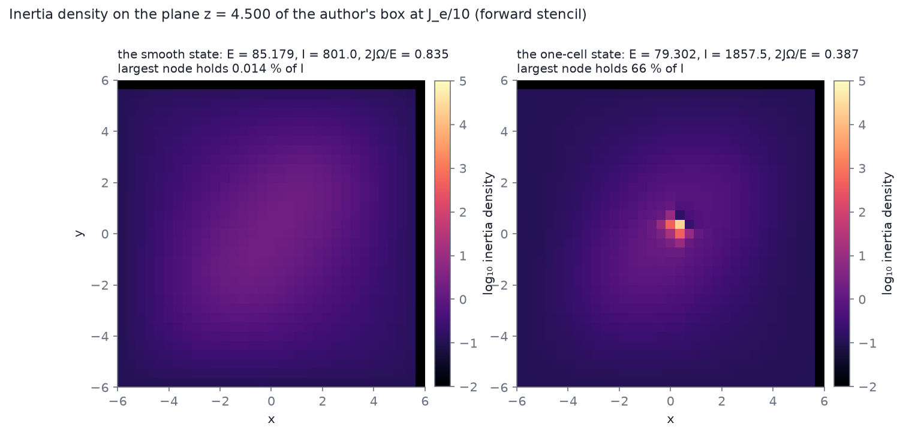
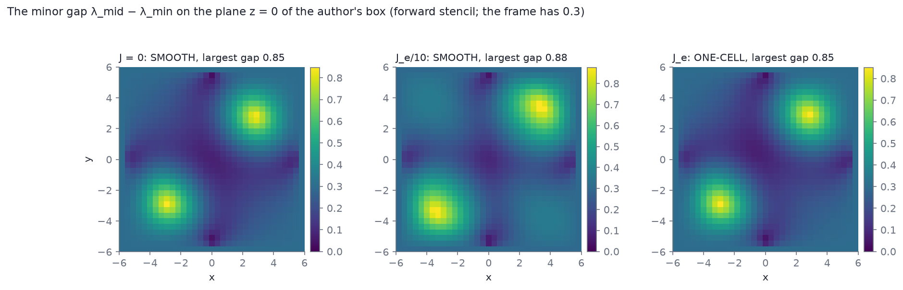
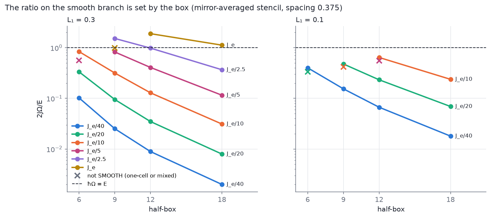
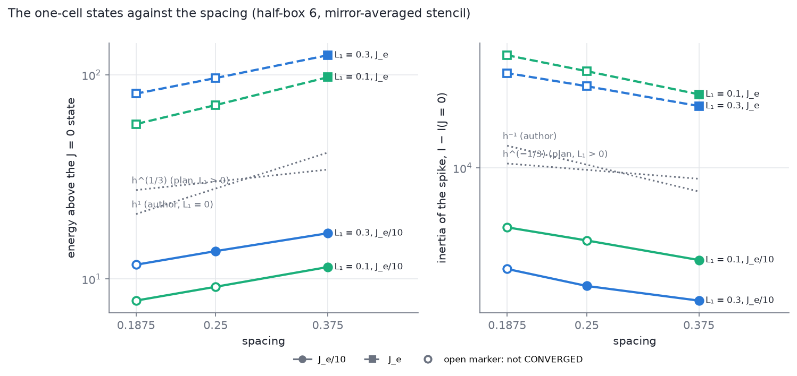

# M5.42: The electron point inside the founding Lagrangian: the twist clock at fixed J, the box and the spacing

> Opened 2026-11-16 from the author's request on discussion #186 ([discussioncomment-19634387](https://github.com/vantasnerdan/substrate-framework/discussions/186#discussioncomment-19634387), 15 November 2026, item 1), with the capstone v3.95 that states the calculation (pp. 74 to 76) and the post of 16 November ([discussioncomment-19662332](https://github.com/vantasnerdan/substrate-framework/discussions/186#discussioncomment-19662332), capstone v3.96), which adds what the runs without the elastic term must report and a five-part gate for every relaxation. Roadmap row: [`m5_roadmap.md`](../m5_roadmap.md). Thread record: [`m5_32_convo.md`](m5_32_convo.md). Sources: [`_CITATIONS.md`](../../theory/_CITATIONS.md) (the v3.95 and v3.96 rows). The task before it on this thread is [M5.41](m5_41_task_details.md).

## TASK PLANNING (2026-11-16, amended 2026-11-17 after the author's reply and before any relaxation; the go is the user's)

**Scope.** (1) The two releases filed, the author's two deposited fields read under an independent evaluator, and three pilot relaxations (§ 1, done at plan time). (2) R1: the evaluator of the founding quartic with the trace potential, the elastic term and the twist clock at fixed J, its gradient, and the author's five-part gate applied to it (§ 3). (3) R2: the author's own box (33³, half-box 6, faces fixed): the smooth states at J = 0 and J_e/10, and the one-cell states found at plan time at J_e/10 and J_e (§ 4). (4) R3: the one-cell states against the spacing, on the author's box at three spacings, with and without the elastic term, on the mirror-averaged stencil (§ 4). (5) R4: the smooth branch against the box, half-boxes 6 to 18, with J raised in steps until the state leaves the branch (§ 4). (6) R5: free faces on two small boxes. (7) R6: δ = 0.05 on two boxes. (7b) R8: a control labeled as a change of the model, with the eigenvalues of M held in a band (§ 4). (8) R7: the reads the author lists (the energy by term, the inertia and where it sits, Ω, E, 2JΩ/E), the map of the minor gap, and the reads that tell a smooth state from a one-cell one (§ 5). Out of scope: the second request of the same post (the two signs); the null waves and the superposition result of v3.96; a clock other than the rigid twist about the radial direction; any icon or pointer of [`MODELS.md`](../../../../../MODELS.md).

**Definition of done.** The instrument controls of § 3 each reported as met or as the exact failing check; every relaxation of § 4 run to its cap or to the optimizer's end, with its stops saved; every state labeled by the rule of § 2; the question of the request answered in the words fixed in § 2, row 5; every number of the findings carried by a tracked JSON and a script; an audit by agents on a different model with every claim either standing or qualified (§ 6); the task review presented in the terminal. A control that fails after its three tries is reported as failed, and the reads that depend on it are kept as numbers without comparison words.

**Gating.** The author's request (arrived). The author's reply to the plan: the findings of § 1 and the readings of § 2 go to the author before any relaxation of § 4 runs, and a correction is folded into § 2, with its date, before the go. The user's go.

**Model and effort.** The session's model for the run. The audits by agents on a different model, named at each spawn: two on a larger model (the instruments and the labels; the reads and the conclusions) and one on a smaller model for the numbers.

**Research body.** This document (`## FINDINGS` after the run); scripts `../scripts/m5_42_*.py`; data `../data/m5_42_*.json` (tracked) and `../data/m5_42_*.npz` (local-only, indexed by [`_DATASETS.md`](../data/_DATASETS.md)); plots `../plots/m5_42_*.png`, embedded in the findings; in-flight state in `../checkpoints/m5_42/` (local-only).

**Consumers.**

| Sub-result | Consumer | The check that consumer needs |
| --- | --- | --- |
| The evaluator | every relaxation of this task, and the author's reading of them | the author's two deposited fields returned cell by cell (§ 1); the gradient against differences; the five-part gate (§ 3) |
| 2JΩ/E per box, spacing, L₁, J | the author's question, whether ħΩ = E comes out | the label of § 2, row 4 (a smooth state, converged); the same number on two boxes before any word about a limit (§ 2, row 5) |
| The one-cell states | the author's observation that at J_e the inertia piled against the faces, and the 2JΩ/E = 0.83 printed at J_e/10 | three spacings on the mirror-averaged stencil (R3) and the forward stencil on the author's box (R2, gate 3); the largest single-cell share of the inertia at every stop |
| The runs without L₁ | the author's statement that the core there depends on the spacing | two or three spacings on the same box; the rank-one regression of § 3 |

### 1. The request, the releases and what was found at plan time

| Item | Fact |
| --- | --- |
| The calculation, as the request states it | A real symmetric 3 × 3 field M with vacuum eigenvalues (1, δ, 0), δ = 0.3 (0.05 if possible). Energy κ Σ‖[∂ᵢM, ∂ⱼM]‖² + v Σₖ(tr Mᵏ − cₖ)², with and without the elastic term L₁‖∂M‖² (L₁ = 0.1, 0.3). A hedgehog of the long axis whose minor axes carry four +½ punctures. The clock is the twist about the long axis at fixed J: E = U + J²/2I with I = 2∫[L₁‖K‖² + κ Σᵢ‖[K, ∂ᵢM]‖²], K = [G, M]. The electron's J is J_e = 8π(1 − δ)²/α at κ = 1. Forward differences, since central ones decouple into a checkerboard. Reads: U by term, I and where it sits, Ω, E, 2JΩ/E. The question: does ħΩ = E, that is 2JΩ/E = 1, come out anywhere |
| What the author found | On 33³ at half-box 6 with fixed faces: converged at J_e/10 with 2JΩ/E = 0.83; at J_e the inertia piled against the faces and the run did not converge; free or much larger boundaries are named as what it needs. Radial runs: 1.1 to 1.8. By mail (15 November): the plan is written against v3.95 and the post, v3.96 changes nothing in the specification, the box size is the variable, the runs without L₁ weigh as much as those with it, and without L₁ the core depends on the spacing, so two spacings are reported there |
| The post of 16 November | A turning clock lowers the hedgehog's tilt stiffness and never raises it. With the minor gap free and no L₁ the melted spherical core is a saddle above a weakly biaxial ring whose energy is not converged in angular resolution; an L₁-type term removes the ring. A gate for every relaxation, since the quartic does not see rank-one gradients: a manufactured flat-family field reaching its derived h² coefficient, a mirror test at round-off, two discretizations agreeing under refinement, the cell-integrated against the nodal potential, the lowest physical Hessian mode with the zero modes projected out (v3.96, p. 99) |
| The releases | v3.95 (424 pages; a PDF and a source archive of 1411 files) and v3.96 (450 pages; 1512 files), from the version records 24248950 and 24290588 of the concept DOI 23994958; the four files carry the md5 of their records. The folder of the calculation (`checks/v395/ldgs2108/`) is identical in the two. The author's script was read line by line and not run: it needs a library that the OpenWave environment does not hold |
| An independent evaluator on the author's two deposited fields | Written from the docstring of the author's script, in plain NumPy, with an analytic gradient. On `field_L1_0.3_N33_J0.npz` and `field_L1_0.3_N33_J168.npz`: the stored inertia density is returned cell by cell to 9 × 10⁻¹⁶; the inertia is 510.892 (22.0 of it inside r < 2) and 801.047, the printed 511 and 22; at J_e/10, E = 85.178992 and 2JΩ/E = 0.834796, the printed 0.83. The analytic gradient agrees with central differences to 4 × 10⁻⁸. A second evaluator written by the plan's audit from trace identities agrees with it term by term to 4 × 10⁻¹⁶ |
| The smooth states, reproduced | From the author's seed, L₁ = 0.3: J = 0 ends by the optimizer's tolerance after 954 iterations at U = 63.922535, I = 510.892; J_e/10 after 537 more at E = 85.178992, I = 801.047, 2JΩ/E = 0.834797. Both are the author's values. In them no cell holds more than 2 × 10⁻⁴ of the inertia and the eigenvalues of M stay between −0.17 and 1.01 |
| ⭐ At J_e the optimizer ends on a one-cell state | In the same box at J_e the energy falls to 184.81 with I = 26532 and 2JΩ/E = 1.16, and the readouts stop moving (2 × 10⁻⁵ between iterations 3000 and 6000). But 94 percent of that inertia sits in one cell, at (0.375, 0.375, 4.5), where the eigenvalues of M are (−3.57, 0.12, 3.59) against a vacuum of (0, 0.3, 1). Two short runs by the plan's audit, neither converged, give on half-box 9 an inertia of 26169 with 92 percent in one cell, and on half-box 6 at spacing 0.25 an inertia of 36240 with 95 percent in one cell and eigenvalues near ±4.4. That points to a state of the lattice, whose inertia follows the spacing and not the box; R3 measures it. The inertia that "piled against the faces" may be this |
| ⭐ The same kind of state lies below the smooth one at J_e/10 | Started from the one-cell state and relaxed at J_e/10 in the author's box, the optimizer ends by its tolerance at E = 79.302, which is 5.88 below the smooth state's 85.179, with I = 1857.5 (66 percent in one cell, eigenvalues (−1.94, 0.39, 2.04)) and 2JΩ/E = 0.39. At J = 0 the same start returns to the smooth state (U = 63.922535). So at J_e/10 the state behind the printed 0.83 is a local minimum of the discrete energy, and a lower one exists whose inertia sits in one cell |
| Why a one-cell state can pay | A cell whose eigenvalues are near (−A, 0, A) cancels the odd traces of the potential, so its potential cost grows as A⁴ h³, while the quartic part of its inertia grows as A⁴ h. At that cell the three forward differences are nearly one matrix, −M/h, so they commute and the quartic energy there is nearly zero: the spike is a rank-one gradient, which the quartic does not see. At fixed J a rise of the inertia lowers J²/2I. Recorded as the reason to test, not as a result: whether the cost at a given inertia falls with the spacing is what R3 measures |
| The unrelaxed frame on a ladder of boxes | On the seed, at spacing 0.375 and δ = 0.3, half-boxes 6, 9, 12, 18, 24: the elastic part of the inertia per unit L₁ is 616, 2093, 4970, 16790, 39807, the volume of the box times 4δ² = 0.36; the quartic part is 44, 73, 102, 160, 218, linear in the half-box (9.6 per unit). At δ = 0.05 the two parts are 36 and 33 times smaller. So on the frame the inertia of the rigid twist has no limit as the box grows: with L₁ it grows as the volume, without it as the half-box |
| The smooth branch follows the frame | At J = 0 the relaxed inertia is 511 on half-box 6 and 1470 on half-box 9; at J_e/10 the smooth state of half-box 9 has 2JΩ/E near 0.31, against 0.83 on half-box 6 |
| An identity | With E_rot = J²/2I, 2JΩ/E = 4 E_rot / (U + E_rot). It lies between 0 and 4 and equals 1 exactly when E_rot = U/3 |
| A pilot without L₁ | In the author's box at J = 0 the energy falls from 21.7 on the seed to 0.35 after 4500 iterations and is still falling, while the inertia rises from 44 to 729: the state the optimizer approaches is not the smooth hedgehog of the seed |
| The author's frame and stencil, three notes | (a) One fixed node, the center of the +z face, carries a minor axis turned by 90° against its four neighbors: in the script the chart coordinate w is 0 there where it should be infinite. The relaxations of this task keep the frame as deposited, so that the author's fields return, and R1 measures what the node changes. (b) The forward stencil pairs the links that leave a node, so it is not mirror symmetric: on the author's J = 0 field the mirror in x changes the quartic energy by 0.8 percent and the inertia by 2 × 10⁻⁴. (c) On the same field the potential evaluated at the mean field of each cell is 5.819 against 5.153 summed at the nodes, a difference of 0.665, where the author's gate allows 0.01 E = 0.639 |
| The author's reply to the plan (17 November, by mail) | The author reports having reproduced, on the author's own code: the mirror defect of the forward stencil (0.80 percent of the quartic), the potential at the nodes against the cell means (5.153 against 5.819) and the node of the +z face; the box law of the rigid twist on the seed (the elastic part of the inertia equal to the volume times 4δ² to 1 percent, the quartic part linear in the half-box); and the one-cell state at J_e/10 (E = 79.302, I = 1857.5, 66 percent in one cell, eigenvalues (−1.94, 0.39, 2.04)) from the deposited field with a spike at (0.375, 0.375, 4.5). A spike placed at (3.0, −1.5, 0.375) also ended below 85.179 (E = 79.42 after 2500 steps, still descending, 68 percent in one cell). The author's reading: the deposited 0.83 is a local minimum set by the box and fails two of the five gates. These are the author's computations, not rerun at plan time; R2 and R3 rerun them |
| The author's scaling argument (same reply) | A spike of amplitude A and width w along one matrix direction costs a potential of order v A⁴ w³ and carries an inertia of order κ A⁴ w, while the static quartic does not see it. At fixed J the best amplitude is A ∝ J^(1/4) w^(−1/2); the spike then carries the clock at a cost ∝ J w √(v/κ), which goes to zero with w, plus a floor ∝ L₁ √J (vκ)^(−1/4) from the elastic term, and its inertia grows as 1/w. The algebra was rechecked at plan time and returns these powers. The two spikes of the pilot follow the first law: A = 3.58 at J_e against 1.99 at J_e/10, a ratio of 1.80 against 10^(1/4) = 1.78. The author's conclusion, with free eigenvalues the action has no minimizer at fixed J, is the claim that R3 tests on three spacings (§ 5, item 8) |

### 2. The readings frozen before the run

| # | Clause of the request | The reading frozen here |
| --- | --- | --- |
| 1 | "The twist about the long axis at fixed J" | G is the generator of rotations about the radial direction r̂ at every node, a fixed field: G_ab = −ε_abc r̂_c, as in the author's script. It is the twist about r̂, not about the long axis of the relaxed field; how far the two differ is read at every stop (row 7). The clock is rigid: one Ω for the whole box. The author confirmed this reading on 17 November: "anywhere" in the request means across box sizes, not another clock. I and E are those of § 1, summed over the cells of the box, the cells at the faces included, on the stencil of row 10 |
| 2 | "Faces fixed", "free or much larger boundaries" | The faces hold the author's frame, with the chart of row 10. The box is the variable: half-boxes 6, 9, 12 and 18 at spacing 0.375 (33³, 49³, 65³, 97³). Free faces are run on the two smallest boxes (R5), with the winding read at every stop |
| 3 | The values of J | J_e = 8π(1 − δ)²/α: 1687.604 at δ = 0.3 and 3108.3 at δ = 0.05. On the smooth branch J is raised from 0 through J_e/40, J_e/20, J_e/10, J_e/5, J_e/2.5 to J_e, each started from the end of the one before, until the state is no longer SMOOTH |
| 4 | A state and its label | One optimizer path per value of J, with stops at 1000, 3000 and 10000 iterations (the cap) and at the optimizer's own end if it comes first. SMOOTH: no cell holds more than 1 percent of the inertia, and no cell holds more than 50 times the mean of its 26 neighbors. ONE-CELL: a cell holds more than half of the inertia. Any state that is neither is named MIXED, with its largest share and that ratio. The range of the eigenvalues of M over the grid is printed beside every label and is not part of it, since a smooth state at δ = 0.05 may open its minor split well past the vacuum values. CONVERGED: the largest entry of the gradient of E over h³ is at most 10⁻³ at the last stop, and either the optimizer ended by its own function tolerance, or U, I and 2JΩ/E differ from their values at the stop of the previous target by at most 10⁻³ relative (the pair is by target; a path that ends before its first target has only the first clause, and is named so). OUT OF CONFIGURATION: the winding of the long axis is not one, or the puncture count is not four, on the sphere r = 3 or on r = 4; the smallest gap between the two larger eigenvalues on each sphere is printed, since the long axis is not defined where it closes |
| 5 | "Does ħΩ = E come out anywhere?" | 2JΩ/E is reported for every box, spacing, L₁ and J, with its label. The relation COMES OUT for a given L₁ and δ only if, at J_e, on states that are SMOOTH and CONVERGED, the ratio on the two largest boxes agrees to 2 percent and lies within 2 percent of 1. A ratio that passes through 1 between two boxes or two values of J while still moving with the box is reported as a CROSSING, and not as the relation holding. A ratio read on a ONE-CELL state is reported with its spacing and is never used for this row |
| 6 | The one-cell states | Reported as found: their energy below the smooth state of the same J, their inertia, the share of the largest cell, the eigenvalues there and the place of the cell, at three spacings on the mirror-averaged stencil, and on the forward stencil in the author's box. They are SPACING-SET if the inertia changes by more than 5 percent between two spacings. The author asked on 17 November that they be reported as found, under these labels |
| 7 | "Where it sits" | The inertia inside r < 2 (printed for every box and every J, at the author's request of 17 November: it is what a localized clock would carry), in the shells 2 to 4, 4 to the half-box, and in the corners beyond the inscribed sphere; the share within one tenth of the half-box of a face; the largest single-cell share and its place. Beside it: the share of the shell 2 < r < 5 where the long axis lies within 26° of r̂ (on the author's J = 0 state the plan's audit read one half, and one quarter at J_e/10) |
| 8 | The runs without L₁ | Run at spacings 0.375 and 0.25, and on the author's box also at 0.1875. A number that moves by more than 5 percent between two spacings is labeled SPACING-SET and is not used in row 5 |
| 9 | The minor-gap map | The difference of the two smaller eigenvalues of M on the three central planes, at the last stop of every state, with its largest value and where it is |
| 10 | The stencil and the chart (the author's answer of 17 November) | R2 runs on the forward stencil and on the frame as deposited, so that the author's two fields return. Every other rung runs on the mirror-averaged stencil and on the frame with the +z chart fixed. The mirror-averaged functional is the mean of the forward functional over the eight reflections of the grid axes, the field M and the generator G reflected together; it weights the nodes of a face by one half, of an edge by one quarter and of a corner by one eighth in the nodal terms. The fixed chart: on the +z axis the minor axis is set to the limit of the frame as the chart coordinate w goes to infinity, which is the x direction, where the script's value is the y direction. Gate 3 keeps its forward-stencil paths on the half-box 6, on the fixed chart, since the gate compares two discretizations |
| 11 | The band control (the author's request of 17 November) | A change of the model, labeled so in every table and never entered in row 5: the energy gains w Σ h³ Σₖ [max(0, λₖ − 1.5)² + max(0, −0.5 − λₖ)²] over the three eigenvalues λₖ of M at every node, with w = 10⁶ and the same node weights as the potential. The band [−0.5, 1.5] is the author's: the smooth states stay within [−0.17, 1.01], the spikes of § 1 do not. Printed beside each state: the largest excursion past the band, and the share of the nodes with an eigenvalue within 0.05 of a band edge |

For a rigid twist the limit of an infinite box is known before the run: while a state stays on the smooth branch with its exterior minor gap at δ, the inertia grows without bound with the box (as the volume with L₁, while U grows as the half-box; as the half-box without L₁, while U stays finite), so 2JΩ/E tends to zero at every fixed J and L₁. Row 5 is therefore expected to end in a CROSSING or in nothing. The author's answer of 17 November agrees: the ratio falling with the box is "the co-rotating out to R" of the post of 15 November made exact; in this exterior, where the minor gap is δ everywhere, the twist is massless, so a clock that is not rigid would be an outgoing helix whose profile is fixed by a radiation condition and not by the core, and a localized clock needs another vacuum. Neither is in this run.

### 3. R1: the instruments and their controls

| Instrument | What it is | Control (three tries each) |
| --- | --- | --- |
| The evaluator, `m5_42_eq42.py` | U by term, the inertia density, E at fixed J and the gradient with respect to the six components, in one small module whose docstring carries the equations. A compiled kernel is used only if it returns the NumPy reference to 10⁻¹² | The author's two deposited fields: the stored inertia density to 10⁻¹² cell by cell, and the printed 511, 22 and 0.83. The gradient against central differences to 10⁻⁶ relative on three random directions, at J = 0 and at J_e/10 |
| Gate 1, the rank-one regression | A manufactured field in which one generator varies alone, M = R(θ) D R(θ)ᵀ with θ = a x + b y, a ≠ b, both nonzero. In the continuum the quartic vanishes on it; on the forward stencil the density of the quartic term alone (L₁ = 0, v = 0) is 8κ(1 − δ)⁴ a² b² (b − a)² h² (1 + O(h²)) for the rotation in the plane of the two larger eigenvalues | The energy on four spacings returns the coefficient to 2 percent and the order 2 ± 0.1. The gate tests the stencil; it cannot see a one-cell state |
| Gate 2, the mirror test | The energy and the inertia of a state and of its mirror image in each coordinate plane, on the forward stencil and on a second stencil that averages the eight orientations of the pairing | The second stencil at round-off (10⁻¹²) on a mirror-symmetric frame. The forward stencil is expected to fail (§ 1); its defect is reported at each spacing, with the part due to the node of note (a) |
| Gate 3, two discretizations | The forward stencil and the mirror-averaged one, both on the fixed chart, each relaxed on the half-box 6 at L₁ = 0.3, at J = 0, J_e/10 and J_e, on spacings 0.375, 0.25 and 0.1875 (the mirror-averaged paths are those of R3 and R4) | For the SMOOTH states the difference between the two stencils in U, I and 2JΩ/E falls under refinement. For the others the two sets of values are printed side by side: a state that exists on one stencil only is reported as that |
| Gate 4, the potential | The trace potential summed at the nodes (the author's script) against the potential of the field interpolated inside each cell, by quadrature | The author's bound, a difference of at most 0.01 E, on every state of gate 3. Expected to fail on the 0.375 spacing (§ 1, note (c)) and to fall under refinement |
| Gate 5, the Hessian | The lowest eigenvalue of the Hessian of E at fixed J on the interior unknowns, by a matrix-free method on differences of the gradient, at the last stop of every state of gate 3 at spacing 0.375 | A positive lowest eigenvalue for a state called a minimum; a negative one is reported with its mode. With fixed faces there is no exact zero mode to project; the near-zero ones are listed |
| The optimizer | L-BFGS-B on the six components with the faces held, the function tolerance at 10⁻¹⁵ and the gradient stop off; the stops of § 2, row 4 saved without a restart | R2: the author's J = 0 and J_e/10 states returned in E, I and 2JΩ/E to 10⁻⁵ relative |
| The mirror-averaged evaluator | The functional of § 2, row 10, written with shared differences | The plain mean of the forward evaluator over the eight reflections, to 10⁻¹² in the energy, the inertia and the gradient, on a random field and on the author's two fields |
| The band term | The penalty of § 2, row 11 and its gradient through the eigenvectors of M | Zero on the author's two fields; the gradient against central differences to 10⁻⁶ on a field with eigenvalues past both edges |
| The winding reads | The degree of the long axis and the puncture count of the minor axis on the sphere r = 4 | One and four on the author's frame; zero and none on a uniform field |

### 4. R2 to R6: the relaxations

| Rung | δ | Half-boxes (grid) | Spacing | L₁ | What runs |
| --- | --- | --- | --- | --- | --- |
| R2, the author's box | 0.3 | 6 (33³) | 0.375 | 0.3 | The smooth branch at J = 0 and J_e/10; the path at J_e from the smooth state; the one-cell state relaxed at J_e/10 and at J = 0 |
| R3, the one-cell states against the spacing | 0.3 | 6 (33³, 49³, 65³) | 0.375, 0.25, 0.1875 | 0.3, 0.1, 0 | The state at J = 0, then at J_e/10 and at J_e from the smooth state of each spacing and from a one-cell start: 45 paths at most. Where the largest cell sits is recorded for every state, since the node of the +z face is fixed here |
| R4, the smooth branch against the box | 0.3 | 6, 9, 12, 18 (33³, 49³, 65³, 97³) | 0.375 | 0.3, 0.1 | J raised by the steps of § 2, row 3. A chain ends at the first state that is not SMOOTH, or at the first path that reaches its cap without being CONVERGED. On half-box 18 the steps stop at J_e/10 (four values). 8 chains |
| R4b, the same without L₁ | 0.3 | 6, 9, 12 (33³, 49³, 65³) and 6, 9 at the second spacing (49³, 73³) | 0.375, 0.25 | 0 | J = 0 and J_e/10: 5 chains |
| R5, free faces | 0.3 | 6, 9 (33³, 49³) | 0.375 | 0.3, and 0 on 33³ | Every node free, with the potential and the ‖K‖² term summed over all nodes, the faces included, so that no node is left without a term. The steps in J of § 2, row 3 on 33³; J = 0 and J_e/10 on 49³. The winding read at every stop: 3 chains |
| R6, the smaller δ | 0.05 | 6, 12 (33³, 65³) | 0.375 | 0.3, 0 | J = 0, J_e/40 and J_e/10: 4 chains |
| R8, the band control (a change of the model, § 2, row 11) | 0.3 | 6, 9, 12 at spacing 0.375 (33³, 49³, 65³) and 6 at 0.25 (49³) | 0.375, 0.25 | 0.3 on the four grids, 0 on the two grids of half-box 6 | At J_e/10 and at J_e, from the smooth state of R4 (or R3) at J = 0 raised through the steps of § 2, row 3, and from the one-cell state of the same grid with its eigenvalues clipped into the band: 24 paths at most |

Every chain starts from the author's seed (the frame of the faces with the eigenvalues brought to their mean inside r of about 1.2 by a tanh profile). R2 runs on the forward stencil and the deposited frame; R3 to R8 run on the mirror-averaged stencil and the fixed chart (§ 2, row 10). κ = v = 1. A relaxation ends at its cap of 10000 iterations or at the optimizer's function tolerance; an abnormal end is restarted from the last iterate at most three times, each one logged. The one-cell start of R3 is the last stop of the path at J_e on the same spacing, L₁ and stencil; if that path stays SMOOTH there is no such start, and the row says so. Half-box 24 (129³) is not in the plan. Every chain has a wall-time cap of 12 hours; a chain cut by it is reported as cut, with the state it reached.

### 5. R7: the reads, and what is recorded before the run

At each saved stop: U by term (elastic, quartic, potential), I, Ω = J/I, E, 2JΩ/E, the largest gradient entry over h³, the reads of § 2 rows 4 and 7, the eigenvalues of M along the axes and the diagonals, the minor-gap map (§ 2, row 9), the winding. From them: the label of each state; the ratio against the box on the smooth branch for each L₁ and J; the largest J of the smooth branch per box; the one-cell states against the spacing; and one figure each for the ratio against the box, the one-cell states against the spacing, the minor-gap maps of the author's box at the three values of J, and the central slice of a smooth and of a one-cell state.

Recorded before the run. Each line is an expectation, and its failure is reported with the same weight.

1. **The author's box.** R2 returns the author's J = 0 and J_e/10 states and the two one-cell states of § 1 (E = 184.81 at J_e, E = 79.30 at J_e/10) to five digits.
2. **The one-cell states are set by the spacing.** At fixed J their inertia grows and their energy falls as the spacing is reduced from 0.375 to 0.1875, with and without L₁, so they are SPACING-SET. They exist on the mirror-averaged stencil as well as on the forward one. If instead they vanish on the second stencil or settle with the spacing, that is reported as the result. With the node of the +z face fixed they still form, at a place that is not predicted.
3. **The smooth branch ends below J_e.** On every box of R4 the state leaves the SMOOTH label at a J between J_e/10 and J_e. The largest smooth J per box is reported; whether it grows with the box is not predicted.
4. **On the smooth branch the ratio falls with the box.** At J_e/10 and L₁ = 0.3: 0.83, near 0.31, and lower on half-boxes 12 and 18, monotonically. The inertia at J = 0 grows by a factor of 15 to 27 from half-box 6 to 18.
5. **The question.** The relation does not COME OUT for any L₁: on the smooth branch the ratio is set by the box, and on the author's box (R2 and R3) the states at J_e are ONE-CELL. On the larger boxes no state at J_e is expected on the smooth branch (item 3).
6. **Without L₁.** The states at J = 0 are SPACING-SET (the energy lower at 0.25 than at 0.375 by more than 5 percent) and NOT CONVERGED within the cap on the larger boxes.
7. **Free faces.** Not predicted: whether the hedgehog and its punctures stay in the box with every node free is what R5 reads.
8. **The scaling of the one-cell states** (the author's prediction of 17 November, adopted before the run). On half-box 6 at fixed J, over the spacings 0.375, 0.25 and 0.1875: at L₁ = 0 the energy of the one-cell state above the J = 0 state of the same spacing falls about linearly with the spacing (a slope of the logarithms between 0.7 and 1.3); at L₁ > 0 it falls toward a floor (the second difference smaller than the first); the inertia grows roughly as the inverse spacing (a slope between −1.3 and −0.7). The amplitude at the largest cell follows J^(1/4) between J_e/10 and J_e (a ratio between 1.6 and 2.0). The J = 0 state without L₁ is itself expected to be SPACING-SET (item 6), and its label is printed beside this read. A failure of any of the four is reported with the same weight.
9. **The band control.** At J_e/10 on half-box 6 the smooth state lies inside the band, so it stays a stationary state of the changed model with the same E, I and 0.83. Not predicted: whether the path from the clipped one-cell start returns to it, and whether a state at J_e exists that is SMOOTH; a state pressed against the band edge on many nodes is reported as that.

### 5b. Second amendment (17 November, appended; nothing above is edited by it)

The amendment of § 2 rows 10 and 11, § 4 and § 5 items 8 and 9 was audited by an agent on a larger model while the instruments were built. The pool of § 4 was started before the audit returned, since the relaxations do not depend on the readings below; no state of R3 or R8 had been read when this section was written. Where a line below differs from a line above, the line below holds.

| # | What the audit found | What holds from here |
| --- | --- | --- |
| 1 | "The mean of the forward functional" has two readings at fixed J: the mean of E_J over the eight reflections, or U and I averaged first. They differ by 2.2 in the energy on the one-cell state of the pilot | The mirror-averaged energy is E = U_avg + J²/(2 I_avg), with Ω = J/I_avg, where U_avg and I_avg are the means of U and I over the eight reflections. The evaluator is written this way and its control compares U, I and the gradient of this E |
| 2 | The mirror of a field was not written down | The mirror image of a field in a coordinate plane is M′(x) = R M(Rx) R, with the generator field G unchanged (G(x) = −R G(Rx) R holds identically). Gate 2 tests the functional on a field and its three mirror images; it does not need a mirror-symmetric frame, and the frame is symmetric under the x and y mirrors only |
| 3 | "The node of the +z face" understates the chart fix | The fix is in the frame function: on 33³ it changes 16 nodes, the face node and the 15 nodes of the seed on the +z axis. The count per grid is in the controls file |
| 4 | Gate 3's forward-stencil paths are a reading, not the author's words | They are this plan's reading of "the gates as written" beside "the forward stencil only for the rung that returns our two fields", and the review says so. They are the chains `g3_*` (nine paths at most, on 33³, 49³ and 65³) |
| 5 | Item 8's clause "the second difference smaller than the first" cannot fail: any power law in the spacing meets it on these three spacings | The clause is dropped. Per L₁ and per J the read is the exponent p of a fit ΔE = a hᵖ on the three spacings, where ΔE is the energy of the one-cell state above the J = 0 state of the same spacing and L₁, with the spread of p between the two pairs of spacings. The inertia of the spike is I minus the inertia of the J = 0 state of the same spacing, and its exponent is read the same way. The amplitude is A = (λ_max − λ_min)/2 at the largest node. The place of the largest node is printed for every spacing, since a spike that sits elsewhere at another spacing confounds the exponents |
| 6 | The floor of the author's scaling holds only with the amplitude held at its optimum without L₁. With the amplitude re-optimized against the elastic cost L₁A²h, the cost is ΔE ∝ (L₁J)^(2/3) h^(1/3), which also goes to zero, with A ∝ J^(1/3) and a spike inertia ∝ h^(−1/3) | Two predictions are recorded side by side. The author's: p near 1 without L₁ and a floor with it, the spike inertia as 1/h, the amplitude ratio between J_e and J_e/10 near 10^(1/4) = 1.78. This plan's, for L₁ > 0 in the limit of small spacing: p near 1/3, the spike inertia as h^(−1/3), the ratio near 10^(1/3) = 2.15. The windows (± 0.3 on an exponent, ± 0.2 on the ratio) are this plan's, not the author's. Three spacings can be consistent with "no minimizer" and cannot establish it; the findings say which prediction each L₁ follows, or that neither does. The sentence of § 1 that the algebra "returns these powers" holds for the fixed-amplitude argument only |
| 7 | With the band, a short test by the audit (forward stencil, 33³, 450 iterations, not converged) ended MIXED at J_e/10 (largest share 0.20) and, at J_e, on a state whose eigenvalues sit on both band edges in several cells of about 4.5 percent each: many saturated cells in place of one spike. A share of the nodes does not show that | Beside each banded state: the count of the nodes with an eigenvalue within 0.05 of a band edge or past it, and the share of the inertia they carry. The word, fixed here: the band REMOVES the one-cell state at a given J only if the banded state is SMOOTH and those nodes carry less than 1 percent of the inertia; the state is BAND-SATURATED if they carry more than 10 percent; between the two the numbers are printed without a word. Item 9's comparison is with the unbanded state of the same grid, stencil and L₁ (not with the deposited 0.83), after checking that this state lies inside the band. Expected, from the audit's test: BAND-SATURATED at J_e |
| 8 | R8's starts and its extent were not all defined, and part of its extent is not the author's | The author asked for the band at J_e/10 and J_e. The half-boxes 9 and 12, the spacing 0.25 and L₁ = 0 are this plan's extension. Chain a of each grid starts from the unbanded J = 0 state of the same grid and raises J through the six steps (the states at J_e/10 and J_e are the reported ones). Chain b starts from the non-smooth end of the source chain with its eigenvalues clipped into the band (for half-box 6 the J_e path of R3; for half-boxes 9 and 12 the last path of the R4 chain), at J_e/10 and then at J_e; if the source ended SMOOTH there is no such start and the row says so |
| 9 | § 7's figures predate the first amendment | Measured in R1: 0.73 microseconds per node and evaluation on the mirror-averaged stencil and 0.36 on the forward one, alone on a core (97³: 0.66 s). In the pool of twelve: 1.65 s per iteration at 97³, 0.70 at 73³, 0.49 at 65³. The chains are 43 with 191 paths at most (the gate 3 chains and the intermediate steps of R8 included). A compiled kernel replaced the NumPy evaluator after returning it to 10⁻¹², so the memory bound of § 7 does not apply and twelve chains run at once, one thread each. The wall-time cap stays at 12 hours per chain; the half-box 18 chains reach it only if their four paths average more than 6500 iterations |
| 10 | The author's request for the post was not in the plan | The author asked (17 November) that the post of this task say plainly whether the deposited 0.83 is a local minimum set by the box and which of the five gates it fails. The findings name the failing gates from the numbers of R1 and of the gate reads, and do not assume them |
| 11 | Two lines of § 6 predate the first amendment | In the blindspot table, "three spacings and two stencils (R3)" reads "three spacings on the mirror-averaged stencil (R3) and the forward stencil in the author's box (R2, gate 3)", and "between spacings and between stencils" reads "between spacings, and between the two stencils on half-box 6" |

### 6. Blindspot pass, the audit and the records

Read against the recurring failure families of the workflow, for this task's instruments.

| Risk | Where it enters | Guard |
| --- | --- | --- |
| Artifact read as result | a one-cell state that stops moving and passes a gradient gate (the pilot's state at J_e would have been called converged by its readouts alone); the quartic's blindness to rank-one gradients | the largest single-cell share and the eigenvalue range are part of every label (§ 2, row 4); three spacings and two stencils (R3); gates 1 to 4 |
| A box-set number read as a property | 2JΩ/E passes through 1 at some box because the inertia grows with the box | § 2, row 5, fixed before the run; the limit of the rigid twist written under the table |
| Unvalidated instrument | a new evaluator and a hand-written gradient; the winding reads | the author's two fields cell by cell; the gradient against differences; a second evaluator in the audit; known-answer fields for the winding |
| A criterion fitted after the fact | the pair of stops, the bounds of SMOOTH and ONE-CELL, the meaning of "comes out" | all in § 2; the pair is by target, and a path that ends early is named, the two ambiguities found in [M5.41](m5_41_task_details.md) § 11 |
| One valley taken for the minimum | the smooth state at J_e/10 is a local minimum (§ 1); any other state may be one too | no floor is claimed; every J_e/10 state is also relaxed from a one-cell start; gate 5 says whether a last stop is a minimum of the discrete energy |
| Wrong diagnostic for the regime | a largest-gradient gate on a state whose energy still falls along rank-one directions; a generator fixed along r̂ on a state whose long axis has left r̂ | the readouts' stability and the alignment read of § 2, row 7 beside every label |
| Resolution mistaken for accuracy | two or three spacings and four boxes | the differences between spacings and between stencils are printed beside every number; no extrapolation in the box is made |

The audit: three agents on models other than the one that ran the task, each asked to refute. One takes the instruments and the labels (the evaluator against the request and the author's script, the five gates, every label recomputed from the stop files). One takes the reads and the conclusions (the ratio against the box, the word of § 2 row 5, every expectation). One recomputes the numbers of the tables. The plan itself was audited before staging by an agent on a larger model, which found the one-cell state of § 1; its other findings are folded into § 2 and § 3. The thread record gets its row when the results are posted; the post is the maintainer's, after the review.

### 7. The parallel shape, the estimate and what follows

| Stage | Jobs | Shape |
| --- | --- | --- |
| R1 | the controls and the five gates | relaxations at 33³ to 65³ on a pool of single-thread processes; the Hessian by a matrix-free method on one process per state |
| R2 to R6 and R8 | about 150 paths on grids from 33³ to 97³ | one process per chain on one thread, at most six at a time and at most two of the 97³ chains together, the largest grids first. Measured on the NumPy evaluator with the gradient: 0.09 s per iteration at 33³ and 0.30 s at 49³, with a peak of about 24 kB of memory per cell; by the cell count, 0.7 s at 65³, 1.0 s at 73³ and 2.3 s at 97³, where a chain holds about 21 GB |
| The reads | the saved stops | one process pool after the chains; seconds per state |

A chain is sequential in J by construction, since each value starts from the end of the one before. The chains fill the cores across jobs; the pool is held at six because this evaluator is bound by memory traffic, not by cores. A compiled kernel inside a job is built in R1 and used only if it passes its control. The GPU is not used: the controls are equalities at 10⁻¹² in double precision.

Go to review, as estimated on 16 November for a ladder on the forward stencil: 18 to 26 hours, on two conditions that R1 measures. The amendment of 17 November moves the ladder to the mirror-averaged stencil, whose cost per iteration is not measured (between two and four times the forward one in NumPy by the count of its commutators, less under a compiled kernel), drops the 36 forward paths of R3, and adds 21 paths to R3 and 24 in R8: the estimate is not restated before R1 measures the rate, and R1 writes the restated figure to the checkpoint file and to the maintainer before the pool starts. The paths at 65³ and 97³ set the length: about 80 core-hours on the forward stencil at the measured rates if the paths that leave the smooth branch and the paths without L₁ run to their cap, on six processes, so 14 to 18 hours; the 24 paths on the mirror-averaged stencil are at 33³ and 49³ and add about 6 core-hours if that stencil costs twice the forward one, which is not measured; R1 with its gates, the reads, the audits in parallel and the write-up add about four hours. The rates at 65³ and above are scaled from two measured grids and the memory figure from two. R1 measures the two rates, the memory and the cost of the second stencil, and the estimate is restated in the checkpoint file and to the maintainer if they put the run past 26 hours; the wall-time cap of § 4 bounds any single chain. The run is unattended and loads the machine for its whole length.

What follows this task, each as its own plan: a clock that is not rigid to the faces, if the author means one; the second request of the same post (the two signs); the null pulse of v3.96.

## FINDINGS (2026-11-17)

> Run of 2026-11-16 to 2026-11-17, after the author's reply to the plan. 54 chains (43 in the pool, 11 added during the run, three of them after the audit of the findings), 185 paths; every chain ended, none failed, none was cut by the wall-time cap. Every number below is carried by [`m5_42_summary.json`](../data/m5_42_summary.json), [`m5_42_paths.json`](../data/m5_42_paths.json), [`m5_42_r7_reads.json`](../data/m5_42_r7_reads.json), [`m5_42_r1_gates.json`](../data/m5_42_r1_gates.json) and [`m5_42_r1_controls.json`](../data/m5_42_r1_controls.json). Labels are those of § 2 row 4; "the gate" of a state is its largest gradient entry over h³.

**TL;DR.** (1) The author's two deposited states return to nine digits, and so do the two one-cell states found at plan time: at J_e/10 a state with two thirds of its inertia in one node lies 5.88 below the state behind the printed 0.83. (2) On the smooth branch the ratio 2JΩ/E is set by the box: at J_e/10 it reads 0.84, 0.32, 0.13 and 0.03 on half-boxes 6, 9, 12 and 18. The relation ħΩ = E does not come out; the ratio passes through 1 at a J that moves up with the box. (3) The one-cell states also form on the mirror-averaged stencil with the chart fixed, away from the +z axis, and they are set by the spacing: their energy falls and their inertia grows as the spacing is reduced, with no floor on three spacings. (4) Holding the eigenvalues in a band does not remove them: cells saturated at the band edge take their place. (5) Two results were not expected: from the smooth start the path stays SMOOTH up to J_e on the two largest boxes (a spike planted on half-box 12 shows that this smooth state is not the lowest one there), and without the elastic term the mirror-averaged stencil shows neither a one-cell state nor a collapse of the J = 0 energy. (6) The J = 0 state comes in two symmetry sectors 0.3 apart in energy; the author's states are in the lower, symmetry-broken one, and the mirror-averaged ladder is confined to the symmetric one. (7) Under the configuration rule as frozen, the relaxed states are not hedgehogs of the long axis inside the box: its degree is 0 on the inner spheres of every state with L₁ > 0, the author's two included.

**Scope.** These are statements about the rigid twist about r̂ under the quartic, the trace potential and the elastic term (κ = v = 1, δ = 0.3 unless said), with the faces held to the author's frame. The box ladder covers half-boxes 6 to 18 at spacing 0.375 on the mirror-averaged stencil with the fixed chart (half-box 18 beyond J_e/10 by a chain added after results were seen). The one-cell scaling covers half-box 6 at three spacings, L₁ = 0.3 and 0.1, mostly not converged at the two finer ones. Nothing here speaks for the continuum, for a clock that is not rigid, for larger boxes or finer spacings, for the lowest state at any J on half-boxes 12 and 18, or for L₁ = 0 beyond the tables.

### 8. The instruments

| Instrument | Control | Result |
| --- | --- | --- |
| The evaluator, forward weights | the author's stored inertia density cell by cell; U by term, I and the gradient against a plain NumPy reference; the printed 511, 22 and 0.83 | ✅ 6 × 10⁻¹⁶ on the density; terms to 10⁻¹⁴; printed digits returned |
| The evaluator, mirror-averaged weights | the plain mean of the reference over the eight reflections (U, I, gradient of E = U_avg + J²/2I_avg); the node weights 1, ½, ¼, ⅛ | ✅ 3 × 10⁻¹⁴ or better |
| The gradient | fourth-order central differences, three random directions, J = 0 and J_e/10, both stencils and the band | ✅ under 10⁻⁶ (try 2: the first try used a second-order difference on a rough field) |
| The band term | zero on the author's two fields; its gradient against differences | ✅ |
| The chart | the minor axis at 10⁻⁴ from the +z axis, from eight azimuths, is the x direction; the fix changes 16 nodes on 33³ | ✅ |
| Gate 1, the rank-one regression | forward quartic alone on θ = 0.7 x + 0.4 y: the density over h² against 8κ(1 − δ)⁴a²b²(b − a)² | ✅ coefficient to 2.4 × 10⁻⁴ at the finest of four spacings, order 2.001 |
| Gate 2, the mirror test of the stencils | a random field and its three mirror images | ✅ averaged: 3 × 10⁻¹⁴. The forward stencil changes the quartic by 0.23 percent on that field, as expected |
| The optimizer | the author's J = 0 and J_e/10 states from the seed (Table 1) | ✅ to nine digits |
| The winding reads | degree 1 and four +½ turns on the frame; degree 0 and none on a uniform field | ✅ on try 2 (the first reader oriented each triangle alone, which gives random signs on a line field) |

All 46 checks of the controls file are met. The compiled kernel replaced the NumPy evaluator after returning it to 10⁻¹²; the pool ran twelve chains at a time, one thread each.

### 9. The author's box, and the five gates on it

**Table 1. The author's box (33³, half-box 6, L₁ = 0.3, forward stencil, frame as deposited).**

| Path | J | Iterations | E | U | I | 2JΩ/E | I inside r < 2 | Largest node share | Where | Eigenvalue range | Gate | Label |
| --- | --- | --- | --- | --- | --- | --- | --- | --- | --- | --- | --- | --- |
| from the seed | 0 | 967 | 63.922535 | 63.922535 | 510.892 |  | 21.98 | 0.000159 | (1.875, 2.25, 2.25) | -0.11 to 1.01 | 3.9e-05 | SMOOTH, CONVERGED |
| from the state before | J_e/10 | 538 | 85.178992 | 67.402199 | 801.047 | 0.8348 | 24.15 | 0.000139 | (0, 0, 4.5) | -0.17 to 1.01 | 1.7e-05 | SMOOTH, CONVERGED (first clause only) |
| from the state before | J_e | 7301 | 184.810499 | 131.138929 | 26531.813 | 1.1617 | 22.13 | 0.943 | (0.375, 0.375, 4.5) | -3.56 to 3.59 | 1.5e-03 | ONE-CELL, not converged |
| from the J_e state | J_e/10 | 2645 | 79.302384 | 71.636293 | 1857.536 | 0.3867 | 22.28 | 0.659 | (0.375, 0.375, 4.5) | -1.94 to 2.04 | 2.6e-05 | ONE-CELL, CONVERGED |
| from the J_e state | 0 | 611 | 63.922535 | 63.922535 | 510.892 |  | 21.98 | 0.000159 | (1.875, 2.25, 2.25) | -0.11 to 1.01 | 1.2e-05 | SMOOTH, CONVERGED |

The two smooth states are the author's (U = 63.922535; E = 85.178992 with 2JΩ/E = 0.834797). At J_e the path ends on a one-cell state: 94 percent of the inertia in the node at (0.375, 0.375, 4.5), eigenvalues from −3.56 to 3.59 there, and a gate of 1.5 × 10⁻³, just above the bound, so it is not CONVERGED. Relaxed at J_e/10 that state converges to E = 79.302, which is 5.877 below the smooth state of the same J, with 66 percent of the inertia in the same node and a ratio of 0.387. Relaxed at J = 0 it returns to the smooth state. Expectation 1 is met.

**Table 2. Gates 2, 4 and 5 on states of half-box 6 at spacing 0.375.**

| State | Gate 2: largest change under the three mirrors | Gate 4 by quadrature, against 0.01 E | Gate 4 at cell means | Gate 5: lowest Hessian eigenvalue |
| --- | --- | --- | --- | --- |
| deposited J = 0 (forward) | U 1.1e-03, quartic 8.0e-03, I 4.1e-04: FAILED | 0.423 against 0.639: met | 0.665: FAILED | +6.71e-04 (Lanczos converged) |
| deposited J_e/10, the 0.83 (forward) | U 1.2e-03, quartic 7.2e-03, I 1.0e-03: FAILED | 0.290 against 0.852: met | 0.468: met | +1.13e-03 (Lanczos converged) |
| one-cell at J_e/10 (forward) | U 7.8e-03, quartic 1.0e-01, I 1.7e-01: FAILED | 1.953 against 0.793: FAILED | 1.952: FAILED | +1.65e-02 (an upper bound only; Lanczos did not converge) |
| one-cell at J_e (forward) | U 1.9e-02, quartic 4.5e-01, I 1.5e-01: FAILED | 33.080 against 1.848: FAILED | 33.814: FAILED | +1.15e-01 (an upper bound only; Lanczos did not converge) |
| J = 0 (mirror-averaged) | U 1.7e-14, quartic 3.5e-14, I 8.2e-15: met | 0.443 against 0.642: met | 0.698: FAILED | +7.05e-04 (Lanczos converged) |
| J_e/10 (mirror-averaged) | U 2.4e-14, quartic 1.3e-14, I 4.7e-15: met | 0.303 against 0.859: met | 0.489: met | +1.12e-03 (Lanczos converged) |
| one-cell at J_e (mirror-averaged) | U 1.0e-14, quartic 2.3e-14, I 5.3e-15: met | 30.395 against 1.890: FAILED | 30.423: FAILED | +7.93e-02 (an upper bound only; Lanczos did not converge) |

Read on the deposited J_e/10 state, the one behind the printed 0.83:

| Gate | Result on the 0.83 state |
| --- | --- |
| 1, rank-one regression | ✅ met by the stencil (§ 8): the forward quartic sees a rank-one gradient at order h² with the derived coefficient |
| 2, mirror test | ❌ failed: the quartic changes by 0.72 percent, U by 0.12 percent, I by 0.10 percent under the mirrors (0.80 percent of the quartic on the J = 0 state) |
| 3, two discretizations | ❌ not met as written: between the forward and the mirror-averaged chains the offsets do not fall under refinement (0.495, 0.497, 0.497 in U at J_e/10; 16.1, 16.5, 16.7 in I at J = 0). § 10 traces them to two stationary states, not to the stencils |
| 4, the potential | ✅ met in both measures: 0.290 by quadrature and 0.468 at cell means, against 0.852. On the J = 0 state: 0.423 by quadrature (met) and 0.665 at cell means, against 0.639 (failed) |
| 5, the Hessian | ✅ lowest eigenvalue +1.13 × 10⁻³: a minimum of the discrete energy |

So the state behind the 0.83 is a local minimum of the discrete energy (gate 5) and a lower state exists: the one-cell state lies 5.88 below it on the forward stencil, and 4.9, 8.0 and 9.9 below the smooth state on the mirror-averaged stencil at spacings 0.375, 0.25 and 0.1875 (Table 6), a gap that widens as the spacing shrinks. By its own numbers it fails gate 2 and, as written, gate 3. It passes gate 4 in the plan's measure (2 × 2 × 2 Gauss quadrature of the interpolated field); the potential gate fails only on the J = 0 state and only when the cell integral is taken at the mean field of each cell, the measure of the plan's pilot and of the author's reply. The failed gates are not what sets the number: moving from the forward to the mirror-averaged stencil changes the ratio by 0.5 percent (0.8348 to 0.8393). What disqualifies the 0.83 as a property of the object is the lower state and the box. The box dependence is measured on the mirror-averaged ladder with the fixed chart (§ 11), whose half-box 6 rung reads 0.839; the forward stencil on the deposited frame was run on half-box 6 only. The cell-integrated potential is the quadrature measure: the audit's four-point quadrature, exact for this integrand, gives 0.426 and 0.294, within 0.004 of the two-point values. On the one-cell states gate 4 fails in both measures (1.95 against 0.79 at J_e/10) and the Lanczos iteration of gate 5 does not converge: the value printed is an upper bound and shows nothing, so the one-cell state at J_e/10 is established as a lower stationary state (gate 2.6 × 10⁻⁵), not as a minimum.

### 10. Two stencils, and two symmetry sectors at J = 0

**Table 3. Gate 3: the two stencils on half-box 6 (L₁ = 0.3, fixed chart), the cross starts, and the two sectors on half-box 9 (the last five rows).**

| Grid | Stencil | J | Start | U | I | 2JΩ/E | Label |
| --- | --- | --- | --- | --- | --- | --- | --- |
| 33 | forward | 0 | seed chain | 63.90020 | 511.059 |  | SMOOTH, CONVERGED |
| 33 | forward | J_e/10 | seed chain | 67.37791 | 801.091 | 0.8350 | SMOOTH, CONVERGED |
| 33 | forward | J_e | seed chain | 131.05364 | 26535.142 | 1.1621 | ONE-CELL, not converged |
| 33 | averaged | 0 | seed chain | 64.19714 | 494.953 |  | SMOOTH, CONVERGED |
| 33 | averaged | J_e/10 | seed chain | 67.87292 | 790.116 | 0.8393 | SMOOTH, CONVERGED |
| 33 | averaged | J_e | seed chain | 134.31526 | 26051.573 | 1.1570 | ONE-CELL, CONVERGED |
| 49 | forward | 0 | seed chain | 64.07133 | 511.722 |  | SMOOTH, CONVERGED |
| 49 | forward | J_e/10 | seed chain | 67.53279 | 800.444 | 0.8340 | SMOOTH, CONVERGED |
| 49 | forward | J_e | seed chain | 116.53270 | 36125.056 | 1.0111 | ONE-CELL, not converged |
| 49 | averaged | 0 | seed chain | 64.35812 | 495.193 |  | SMOOTH, CONVERGED |
| 49 | averaged | J_e/10 | seed chain | 68.02930 | 789.976 | 0.8379 | SMOOTH, CONVERGED |
| 49 | averaged | J_e | seed chain | 120.16586 | 35009.676 | 1.0116 | ONE-CELL, not converged |
| 65 | forward | 0 | seed chain | 64.18404 | 511.955 |  | SMOOTH, CONVERGED |
| 65 | forward | J_e/10 | seed chain | 67.63991 | 800.228 | 0.8331 | SMOOTH, CONVERGED |
| 65 | forward | J_e | seed chain | 109.63932 | 43703.035 | 0.9164 | ONE-CELL, not converged |
| 65 | averaged | 0 | seed chain | 64.46732 | 495.288 |  | SMOOTH, CONVERGED |
| 65 | averaged | J_e/10 | seed chain | 68.13674 | 789.934 | 0.8369 | SMOOTH, CONVERGED |
| 65 | averaged | J_e | seed chain | 111.97712 | 42622.873 | 0.9192 | ONE-CELL, not converged |
| 33 | averaged | 0 | from the other stencil's J = 0 state | 63.88949 | 511.449 |  | SMOOTH, CONVERGED |
| 33 | forward | 0 | from the other stencil's J = 0 state | 64.20497 | 494.712 |  | SMOOTH, CONVERGED |
| 49 | averaged | 0 | from the other stencil's J = 0 state | 64.04721 | 511.872 |  | SMOOTH, CONVERGED |
| 49 | forward | 0 | from the other stencil's J = 0 state | 64.38027 | 495.150 |  | SMOOTH, CONVERGED |
| 49 (half-box 9) | forward | 0 | seed chain | 97.10128 | 1470.479 |  | SMOOTH, CONVERGED |
| 49 (half-box 9) | averaged | 0 | from the forward J = 0 state | 97.08524 | 1470.782 |  | SMOOTH, CONVERGED |
| 49 (half-box 9) | averaged | J_e/10 | from the state before | 97.72717 | 1737.439 | 0.3095 | SMOOTH, CONVERGED |
| 49 (half-box 9) | averaged | 0 | seed chain | 97.65219 | 1414.807 |  | SMOOTH, CONVERGED |
| 49 (half-box 9) | averaged | J_e/10 | seed chain | 98.33764 | 1680.580 | 0.3173 | SMOOTH, CONVERGED |

From the seed, the forward chains end at I near 511 and the mirror-averaged chains at I near 495 at J = 0, on all three spacings, and the difference does not fall under refinement. It is not a difference between the functionals: on one field the two agree in I to 3 × 10⁻⁴ of its value or better (eight J = 0 fields). The cross starts show what it is. The averaged functional started from the forward state stays at I = 511.45 and U = 63.889; the forward functional started from the averaged state stays at I = 494.71 and U = 64.205. Both functionals therefore hold two distinct smooth stationary states at J = 0 on half-box 6, about 0.3 apart in U (0.28 to 0.33, 0.5 percent) and 3.3 percent apart in I. All of them are CONVERGED; gate 5 was run on the two seed-chain states at 33³ and gives a positive lowest eigenvalue for each (Table 2), and the cross states were not put through it. This section rests on chains added after results were seen (deviation 12). The two states are two symmetry sectors (found by the audit, checked on the saved fields). The frame is symmetric under the x and y mirrors. The upper state keeps that symmetry to 10⁻⁷, and at the center its long axis lies along z, with the two smaller eigenvalues equal (0.151, 0.152, 1.010). The lower state breaks it by 0.84 in the largest entry: at the center its long axis lies along the diagonal (−1, 1, 0)/√2 of the plane z = 0, with eigenvalues (0.114, 0.195, 1.008); under the mirror-averaged functional it comes with a mirror copy. The two fields differ by up to 0.95 throughout r < 5 and by 0.11 next to the faces. In neither is the center melted: the long axis runs straight through it.

The author's deposited states are in the broken sector, and so is every forward-stencil state from the seed, since that stencil is not mirror symmetric. Every mirror-averaged chain from the seed stays in the symmetric sector, because a mirror-symmetric functional keeps the symmetry of a symmetric seed unless an instability breaks it: this holds for the whole ladder of § 11 and § 12, the states of half-boxes 12 and 18 at J_e included (symmetric to 4 × 10⁻⁶). On half-box 6 the symmetric state is a local minimum in the full space, not only inside its sector (lowest Hessian eigenvalue +7.1 × 10⁻⁴; the audit's own Lanczos gives +6.8 × 10⁻⁴ for the broken state under the averaged functional). The effect of the sector on the ratio at J_e/10 on half-box 6 is 0.5 percent (0.839 against 0.835), against a factor of 27 from the box.

On half-box 9 the same two sectors exist (chains added after the audit of the findings, deviation 16; the last five rows of Table 3). The forward stencil from the seed ends in the broken sector, and the mirror-averaged functional started from that state stays there at U = 97.085 and I = 1470.8, which is 0.567 below the symmetric state of that box (U = 97.652, I = 1414.8). At J_e/10 the broken sector reads 0.3095 where the symmetric one reads 0.3173: 2.5 percent, against a factor of 2.7 between half-boxes 6 and 9. The sectors of half-boxes 12 and 18 were not compared.

Gate 3 as the plan wrote it (a difference that falls under refinement) is not met from the seed, and the first reason is the two sectors. Inside one sector the two stencils agree to 0.02 percent in U and 0.08 percent in I at 33³ (63.9002 against 63.8895; 511.06 against 511.45), but there too the difference in U does not fall between 33³ and 49³ (0.011 to 0.024 in the broken sector, 0.008 to 0.022 in the symmetric one), so the gate is not met inside a sector either on the two grids where it can be read.

### 11. The smooth branch against the box, and the question

**Table 4. The smooth branch against the box at L₁ = 0.3 (mirror-averaged stencil, spacing 0.375): 2JΩ/E; a state that is not SMOOTH and CONVERGED carries its label.**

| J | Half-box 6 (33³) | Half-box 9 (49³) | Half-box 12 (65³) | Half-box 18 (97³) |
| --- | --- | --- | --- | --- |
| 0 | U 64.197, I 495.0 | U 97.652, I 1414.8 | U 133.046, I 2974.8 | U 207.944, I 8535.0 |
| J_e/40 | 0.1023 | 0.0252 | 0.0089 | 0.0020 |
| J_e/20 | 0.3345 | 0.0952 | 0.0349 | 0.0080 |
| J_e/10 | 0.8393 | 0.3173 | 0.1289 | 0.0312 |
| J_e/5 | 0.5647 (ONE-CELL, CONVERGED) | 0.8247 | 0.4079 | 0.1155 |
| J_e/2.5 | not run | 1.5245 | 0.9826 | 0.3675 |
| J_e | not run | 0.9942 (ONE-CELL, CONVERGED) | 1.8944 | 1.1240 |
| I at the last smooth J | 790.1 at J_e/10 | 3086.0 at J_e/2.5 | 8165.0 at J_e | 15837.1 at J_e |
| I inside r < 2 at J = 0 | 22.10 | 20.50 | 20.05 | 19.82 |

**Table 5. The smooth branch against the box at L₁ = 0.1 (mirror-averaged stencil, spacing 0.375): 2JΩ/E; a state that is not SMOOTH and CONVERGED carries its label.**

| J | Half-box 6 (33³) | Half-box 9 (49³) | Half-box 12 (65³) | Half-box 18 (97³) |
| --- | --- | --- | --- | --- |
| 0 | U 27.556, I 235.8 | U 39.569, I 517.9 | U 52.473, I 960.3 | U 79.555, I 2449.0 |
| J_e/40 | 0.4015 | 0.1545 | 0.0669 | 0.0180 |
| J_e/20 | 0.3356 (ONE-CELL, CONVERGED) | 0.4781 | 0.2329 | 0.0692 |
| J_e/10 | not run | 0.4195 (ONE-CELL, CONVERGED) | 0.6424 | 0.2378 |
| J_e/5 | not run | not run | 0.5514 (ONE-CELL, not converged) | not run |
| J_e/2.5 | not run | not run | not run | not run |
| J_e | not run | not run | not run | not run |
| I at the last smooth J | 286.4 at J_e/40 | 652.9 at J_e/20 | 1373.4 at J_e/10 | 2819.8 at J_e/10 |
| I inside r < 2 at J = 0 | 9.45 | 7.54 | 7.13 | 6.95 |

1. **The ratio is set by the box.** At J_e/10 and L₁ = 0.3 it falls monotonically, 0.839, 0.317, 0.129, 0.031, while the inertia at J = 0 grows 17.2 times from half-box 6 to 18. Expectation 4 is met. The inertia inside r < 2 stays near 20 on every box (22.1, 20.5, 20.1, 19.8 at J = 0): the growth is all outside the core.
2. **The smooth branch ends at a J that moves up with the box.** The last SMOOTH and CONVERGED state is at J_e/10, J_e/2.5, J_e and J_e on half-boxes 6, 9, 12 and 18 at L₁ = 0.3, and at J_e/40, J_e/20 and J_e/10 on half-boxes 6, 9 and 12 at L₁ = 0.1 (half-box 18 ran to J_e/10 there and stayed smooth). Expectation 3, that the branch ends between J_e/10 and J_e on every box, failed twice: at L₁ = 0.3 the path stays SMOOTH up to J_e on the two largest boxes, and at L₁ = 0.1 it leaves the branch already at J_e/20 on half-box 6. The chain of half-box 18 beyond J_e/10 was added during the run (deviation 11), at L₁ = 0.3 only. "Stays SMOOTH" describes where the optimizer went from the smooth start: a spike planted at one node of the smooth state of half-box 12 at J_e (eigenvalues −3.4 and +3.4 along the node's own axes; added after the audit of the findings, deviation 16) does not relax back. Its saved stops read: at iteration 1000 E = 253.41, I = 25761, 71 percent of the inertia in one node, ratio 0.873, gate 6.7e+00; at iteration 3000 E = 251.72, I = 25809, 72 percent of the inertia in one node, ratio 0.877, gate 6.3e-01; at iteration 10000 E = 251.71, I = 25806, 72 percent of the inertia in one node, ratio 0.877, gate 1.5e-02. The path ended after 10000 iterations, ONE-CELL, not converged. The smooth state there reads E = 368.25, so a one-cell state lies more than a hundred below it: the smooth state of half-box 12 at J_e is a local minimum at most, and not the lowest state of that box. No such start was run on half-box 18. For scale, the one-cell state at J_e costs 124.8 and 123.2 above the J = 0 state on half-boxes 6 and 9, and the smooth state at J_e sits 235.2 and 112.0 above the J = 0 state on half-boxes 12 and 18.
3. **The question.** At J_e and L₁ = 0.3 the SMOOTH and CONVERGED states read 1.894 on half-box 12 and 1.124 on half-box 18. They do not agree to 2 percent and neither is within 2 percent of 1: by § 2 row 5 the relation DOES NOT COME OUT. The ratio passes through 1 four times in Table 4 (between J_e/5 and J_e/2.5 on half-box 9, between J_e/2.5 and J_e on half-boxes 12 and 18, and between half-boxes 9 and 12 at J_e/2.5), each time while still moving with the box: these are CROSSINGS. Three of the four involve a state whose long axis has lost its degree even near the faces (half-box 9 at J_e/2.5 and half-box 12 at J_e, § 15), and the fourth, on half-box 18, rests on the chain added after results were seen. The word does not depend on any of them: with those states set aside there is no pair of SMOOTH and CONVERGED states at J_e, and the word is the same. At L₁ = 0.1 no SMOOTH and CONVERGED state exists at J_e; without L₁ and at δ = 0.05 no state at J_e was run on two boxes, so row 5 is not evaluated there. Expectation 5 is met in its word; the reason it gave (no smooth state at J_e on the larger boxes) failed.
4. **Why a crossing is not the relation.** With E_rot = J²/2I the ratio is 4E_rot/(U + E_rot), so it equals 1 wherever E_rot = U/3, and on any box there is a J where that holds. That J rises with the box because I does.

### 12. The states off the smooth branch, against the spacing

**Table 6. The ONE-CELL states against the spacing (half-box 6, mirror-averaged stencil, fixed chart): the lowest such state of each grid.**

| L₁ | J | Grid (spacing) | E | E above the J = 0 state | I | I above the J = 0 state | Largest node share | Amplitude | Where | Label; chain and path |
| --- | --- | --- | --- | --- | --- | --- | --- | --- | --- | --- |
| 0.3 | J_e/10 | 33³ (0.375) | 80.9603 | 16.763 | 1836.8 | 1341.9 | 0.662 | 1.810 | (-3.375, 3, 0.375) | ONE-CELL, CONVERGED; r3_g33_L0.3 j10x |
| 0.3 | J_e/10 | 49³ (0.25) | 78.0631 | 13.705 | 2170.4 | 1675.2 | 0.737 | 2.629 | (3.25, -3.25, 0) | ONE-CELL, CONVERGED; r3_g49_L0.3 j10x |
| 0.3 | J_e/10 | 65³ (0.1875) | 76.2229 | 11.756 | 2662.4 | 2167.1 | 0.781 | 3.037 | (-3.375, -3.1875, 0.1875) | ONE-CELL, not converged; r3_g65_L0.3 j10x |
| 0.3 | J_e | 33³ (0.375) | 188.9762 | 124.779 | 26051.6 | 25556.6 | 0.810 | 3.461 | (-3.375, 3, 0.375) | ONE-CELL, CONVERGED; r3_g33_L0.3 j1 |
| 0.3 | J_e | 49³ (0.25) | 160.8404 | 96.482 | 35009.7 | 34514.5 | 0.867 | 4.311 | (3.25, -3.25, 0) | ONE-CELL, not converged; r3_g49_L0.3 j1 |
| 0.3 | J_e | 65³ (0.1875) | 145.3857 | 80.918 | 42621.9 | 42126.7 | 0.911 | 5.062 | (-3.375, -3.1875, 0.1875) | ONE-CELL, not converged; r3_g65_L0.3 j1x |
| 0.1 | J_e/10 | 33³ (0.375) | 39.0072 | 11.452 | 2716.7 | 2480.9 | 0.738 | 1.900 | (-3, -2.625, 0) | ONE-CELL, CONVERGED; r3_g33_L0.1 j10 |
| 0.1 | J_e/10 | 49³ (0.25) | 36.8534 | 9.166 | 3573.4 | 3337.5 | 0.807 | 2.366 | (2.75, -2.25, 0.25) | ONE-CELL, not converged; r3_g49_L0.1 j10x |
| 0.1 | J_e/10 | 65³ (0.1875) | 35.6291 | 7.843 | 4307.4 | 4071.5 | 0.857 | 2.777 | (-2.8125, -2.25, 0.1875) | ONE-CELL, not converged; r3_g65_L0.1 j10x |
| 0.1 | J_e | 33³ (0.375) | 124.9268 | 97.371 | 30768.6 | 30532.8 | 0.737 | 3.414 | (-3, -2.625, 0) | ONE-CELL, CONVERGED; r3_g33_L0.1 j1 |
| 0.1 | J_e | 49³ (0.25) | 98.8223 | 71.135 | 43586.4 | 43350.4 | 0.767 | 4.208 | (2.75, -2.25, 0.25) | ONE-CELL, not converged; r3_g49_L0.1 j1x |
| 0.1 | J_e | 65³ (0.1875) | 85.1996 | 57.414 | 55406.5 | 55170.5 | 0.792 | 4.887 | (-2.8125, -2.25, 0.1875) | ONE-CELL, not converged; r3_g65_L0.1 j1x |
| 0.0 | J_e/10 | 33³ | no ONE-CELL state |  |  |  |  |  |  |  |
| 0.0 | J_e/10 | 49³ | no ONE-CELL state; MIXED, not converged: r3s_g49_L0.0 j10s (E 9.721) |  |  |  |  |  |  |  |
| 0.0 | J_e/10 | 65³ | no ONE-CELL state; MIXED, not converged: r3_g65_L0.0 j10 (E 9.973) |  |  |  |  |  |  |  |
| 0.0 | J_e | 33³ | no ONE-CELL state |  |  |  |  |  |  |  |
| 0.0 | J_e | 49³ | no ONE-CELL state |  |  |  |  |  |  |  |
| 0.0 | J_e | 65³ | no ONE-CELL state |  |  |  |  |  |  |  |

**Table 7. The exponents of § 5b: slope of the logarithms against the spacing (0.375 to 0.25, 0.25 to 0.1875; then coarsest to finest).**

| L₁ | J | Energy above J = 0, by pair | Coarsest to finest | Spike inertia, by pair | Coarsest to finest |
| --- | --- | --- | --- | --- | --- |
| 0.3 | J_e/10 | 0.50, 0.53 | 0.51 | -0.55, -0.89 | -0.69 |
| 0.3 | J_e | 0.63, 0.61 | 0.62 | -0.74, -0.69 | -0.72 |
| 0.3 | amplitude at J_e over amplitude at J_e/10 | 1.91 (33³), 1.64 (49³), 1.67 (65³) |  |  |  |
| 0.1 | J_e/10 | 0.55, 0.54 | 0.55 | -0.73, -0.69 | -0.71 |
| 0.1 | J_e | 0.77, 0.74 | 0.76 | -0.86, -0.84 | -0.85 |
| 0.1 | amplitude at J_e over amplitude at J_e/10 | 1.80 (33³), 1.78 (49³), 1.76 (65³) |  |  |  |

1. **They form on the mirror-averaged stencil with the chart fixed.** At L₁ = 0.3 and 0.1, on all three spacings, the path at J_e (and at L₁ = 0.1 already the path at J_e/10) ends on a state with 66 to 91 percent of its inertia in one node. With the nodes of the +z axis fixed they no longer sit on that axis: they sit near the plane z = 0 at a radius of about 4.5, where the two larger eigenvalues of the smooth state nearly meet (§ 15), at places that differ from one spacing to the next. On the forward stencil with the fixed chart (gate 3's chains) they sit elsewhere again: at the +z axis on 33³, next to the center on 49³ and next to a face on 65³ (Table 3's J_e rows).
2. **They are set by the spacing.** At both values of J and both values of L₁ the energy falls and the inertia grows as the spacing is reduced; the inertia grows by 18 to 42 percent from one spacing to the next finer one. Expectation 2 is met.
3. **Against the two recorded predictions (§ 5b row 6).** The amplitude at J_e over the amplitude at J_e/10 is 1.91, 1.64, 1.67 at L₁ = 0.3 and 1.80, 1.78, 1.76 at L₁ = 0.1: inside the author's window around 10^(1/4) = 1.78 and outside this plan's around 2.15. The exponent of the spike's inertia, coarsest to finest, is −0.69, −0.72, −0.71 and −0.85: three of the four inside the author's window around −1 (−1.3 to −0.7) and one just outside it, and all four outside this plan's around −1/3 (by pair, one value, −0.55, falls inside this plan's). The exponent of the energy above the J = 0 state is 0.51, 0.62, 0.55 and 0.76: the energy keeps falling on three spacings and no floor shows, where the author's argument has a floor for L₁ > 0; three of the four values lie inside this plan's window around 1/3 (0.03 to 0.63) and the fourth inside the window around 1 that the author's argument gives without L₁. Neither prediction holds on all reads: the energy sits mostly in this plan's window with no floor, the amplitude and the inertia mostly in the author's.
4. **What weakens item 3.** Of the twelve states of Table 6 at L₁ > 0, seven are not CONVERGED (they reached the cap), all of them at the two finer spacings; their energies are upper bounds, so the energy exponents are lower bounds: that strengthens "still falling" and weakens the match to 1/3. "No floor" means only that the energy is still falling at spacing 0.1875; a floor of the size the author's argument gives (of order L₁√J, about 4 at J_e/10, under the 11.8 read there) would not show on these three spacings. The largest node sits at a different place on each spacing. Three spacings can be consistent with "no minimizer" and cannot establish it.
5. **Without L₁ no such state formed** (§ 13), so expectation 2 is not met there and the author's prediction for L₁ = 0 was not tested.

### 13. Without the elastic term, free faces, and the smaller δ

**Table 8. Without the elastic term (L₁ = 0, mirror-averaged stencil).**

| Chain | Half-box | Grid (spacing) | J | Iterations | E | U | I | 2JΩ/E | Largest node share | Eigenvalue range | Gate | Label |
| --- | --- | --- | --- | --- | --- | --- | --- | --- | --- | --- | --- | --- |
| r3_g33_L0.0 | 6 | 33³ (0.375) | 0 | 6316 | 7.65259 | 7.65259 | 1082.9 |  | 0.00399 | -0.20 to 1.01 | 4.9e-05 | SMOOTH, CONVERGED |
| r3_g33_L0.0 | 6 | 33³ (0.375) | J_e/10 | 10000 | 10.65643 | 8.66356 | 7145.5 | 0.7480 | 0.00661 | -0.35 to 1.02 | 8.7e-05 | SMOOTH, not converged |
| r3_g33_L0.0 | 6 | 33³ (0.375) | J_e | 10000 | 40.69003 | 19.68995 | 67809.4 | 2.0644 | 0.00168 | -0.54 to 1.06 | 1.6e-01 | SMOOTH, not converged |
| r3_g49_L0.0 | 6 | 49³ (0.25) | 0 | 10000 | 7.63031 | 7.63031 | 787.6 |  | 0.00235 | -0.20 to 1.01 | 4.3e-02 | SMOOTH, not converged |
| r3_g49_L0.0 | 6 | 49³ (0.25) | J_e/10 | 10000 | 9.84680 | 8.49324 | 10520.4 | 0.5498 | 0.00423 | -0.44 to 1.04 | 1.9e+00 | SMOOTH, not converged |
| r3_g49_L0.0 | 6 | 49³ (0.25) | J_e | 10000 | 32.91921 | 17.75433 | 93901.4 | 1.8427 | 0.00132 | -0.69 to 1.12 | 1.8e+00 | SMOOTH, not converged |
| r3_g65_L0.0 | 6 | 65³ (0.1875) | 0 | 10000 | 7.65151 | 7.65151 | 1096.2 |  | 0.00115 | -0.19 to 1.02 | 1.4e-01 | SMOOTH, not converged |
| r3_g65_L0.0 | 6 | 65³ (0.1875) | J_e/10 | 10000 | 9.97293 | 8.58544 | 10263.2 | 0.5565 | 0.013 | -0.88 to 1.20 | 5.7e+00 | MIXED, not converged |
| r3_g65_L0.0 | 6 | 65³ (0.1875) | J_e | 10000 | 28.04553 | 16.04955 | 118706.7 | 1.7109 | 0.00119 | -0.82 to 1.18 | 1.5e+01 | SMOOTH, not converged |
| r4b_hb9 | 9 | 49³ (0.375) | 0 | 10000 | 7.52079 | 7.52079 | 3324.7 |  | 0.00152 | -0.20 to 1.01 | 6.8e-02 | SMOOTH, not converged |
| r4b_hb9 | 9 | 49³ (0.375) | J_e/10 | 10000 | 9.35604 | 8.11280 | 11454.0 | 0.5315 | 0.00189 | -0.23 to 1.01 | 8.6e-02 | MIXED, not converged |
| r4b_hb12 | 12 | 65³ (0.375) | 0 | 10000 | 7.62197 | 7.62197 | 4172.4 |  | 0.00123 | -0.21 to 1.01 | 8.2e-02 | SMOOTH, not converged |
| r4b_hb12 | 12 | 65³ (0.375) | J_e/10 | 10000 | 9.12056 | 7.98384 | 12527.3 | 0.4985 | 0.00176 | -0.22 to 1.01 | 3.9e-01 | MIXED, not converged |
| r4b_hb9_h025 | 9 | 73³ (0.25) | 0 | 10000 | 7.64352 | 7.64352 | 2107.1 |  | 0.00119 | -0.23 to 1.01 | 8.8e-02 | SMOOTH, not converged |
| r4b_hb9_h025 | 9 | 73³ (0.25) | J_e/10 | 10000 | 9.72772 | 8.35407 | 10366.6 | 0.5648 | 0.00329 | -0.39 to 1.05 | 1.2e+00 | SMOOTH, not converged |
| r3s_g33_L0.0 (planted spike) | 6 | 33³ | J_e/10 | 3485 | 10.65643 | 8.66356 | 7145.5 | 0.7480 | 0.00661 | -0.35 to 1.02 | 7.2e-05 | SMOOTH, CONVERGED |
| r3s_g33_L0.0 (planted spike) | 6 | 33³ | J_e | 10000 | 40.75805 | 19.72482 | 67702.6 | 2.0642 | 0.00169 | -0.54 to 1.06 | 5.2e-01 | SMOOTH, not converged |
| r3s_g49_L0.0 (planted spike) | 6 | 49³ | J_e/10 | 10000 | 9.72114 | 8.44058 | 11120.1 | 0.5269 | 0.0033 | -0.39 to 1.03 | 3.5e-01 | MIXED, not converged |
| r3s_g49_L0.0 (planted spike) | 6 | 49³ | J_e | 10000 | 32.60936 | 17.55450 | 94587.7 | 1.8467 | 0.00126 | -0.67 to 1.11 | 1.6e+00 | SMOOTH, not converged |
| r3s_g65_L0.0 (planted spike) | 6 | 65³ | J_e/10 | 10000 | 9.39169 | 8.32859 | 13394.8 | 0.4528 | 0.00247 | -0.45 to 1.05 | 5.4e+00 | SMOOTH, not converged |
| r3s_g65_L0.0 (planted spike) | 6 | 65³ | J_e | 10000 | 25.55379 | 14.44229 | 128155.8 | 1.7393 | 0.000668 | -0.65 to 1.11 | 1.2e+01 | SMOOTH, not converged |

1. **The J = 0 state without L₁.** On half-box 6 its energy is 7.653, 7.630 and 7.652 on the three spacings, 0.3 percent apart, and it is CONVERGED only at spacing 0.375 (the optimizer ended by its tolerance after 6316 iterations). Expectation 6 failed in its first clause (a change of the energy of more than 5 percent between spacings) and is met in its second (on the larger boxes the states are not converged within the cap). The inertia is SPACING-SET by § 2 row 8: 1083, 788, 1096 on half-box 6, and 3325 against 2107 on half-box 9 at spacings 0.375 and 0.25. The fall of the energy to 0.35 seen at plan time is not reproduced on the mirror-averaged stencil with the fixed chart; the pilot differed in stencil, chart and length, this task has no forward run without L₁, and the cause was not tested.
2. **No one-cell state.** From the smooth start the paths at J_e/10 and J_e reach the cap unconverged without one, with eigenvalues that leave the vacuum's range (down to −0.88, up to 1.20) and an inertia of order 10⁴ to 10⁵ spread over many nodes. A spike planted at one node (eigenvalues −2 and +2 along the node's own axes, the author's own kind of test; deviation 13) relaxed back to the same smooth state at spacing 0.375 (E = 10.65643 both ways), and at the two finer spacings ended on unconverged states with no node above 0.4 percent.

**Table 9. Free faces (every node free; mirror-averaged stencil).**

| Chain | Grid | L₁ | J | E | U | I | 2JΩ/E | Share of I within a tenth of the half-box of a face | Degree of the long axis, and +½ / −½ turns of the minor axis, by sphere | Label |
| --- | --- | --- | --- | --- | --- | --- | --- | --- | --- | --- |
| r5_g33_L0.3 | 33³ | 0.3 | 0 | 0.00000 | 0.00000 | 1092.1 |  | 0.256 | r = 3: 0.00, 0/0; r = 4: 0.00, 0/0; r = 5: 0.00, 0/0; r = 5.7: 0.00, 0/0 | SMOOTH, CONVERGED |
| r5_g33_L0.3 | 33³ | 0.3 | J_e/40 | 0.80829 | 0.00652 | 1110.0 | 3.9678 | 0.257 | r = 3: 0.00, 0/0; r = 4: 0.00, 0/0; r = 5: 0.00, 0/0; r = 5.7: 0.00, 0/0 | SMOOTH, CONVERGED |
| r5_g33_L0.3 | 33³ | 0.3 | J_e/20 | 3.16042 | 0.09031 | 1159.6 | 3.8857 | 0.259 | r = 3: 0.00, 0/0; r = 4: 0.00, 0/0; r = 5: 0.00, 0/0; r = 5.7: 0.00, 0/0 | SMOOTH, CONVERGED |
| r5_g33_L0.3 | 33³ | 0.3 | J_e/10 | 11.77981 | 0.92459 | 1311.8 | 3.6860 | 0.265 | r = 3: 0.00, 0/0; r = 4: 0.00, 0/0; r = 5: 0.00, 0/0; r = 5.7: 0.00, 0/0 | SMOOTH, CONVERGED |
| r5_g33_L0.3 | 33³ | 0.3 | J_e/5 | 40.39213 | 5.78170 | 1645.8 | 3.4274 | 0.271 | r = 3: 0.00, 0/0; r = 4: 0.00, 4/0; r = 5: 0.00, 4/4; r = 5.7: 0.00, 16/0 | SMOOTH, CONVERGED |
| r5_g33_L0.3 | 33³ | 0.3 | J_e/2.5 | 47.64262 | 26.01299 | 10533.7 | 1.8160 | 0.920 | r = 3: 0.00, 0/0; r = 4: 0.00, 0/0; r = 5: 0.00, 0/0; r = 5.7: 0.00, 0/0 | ONE-CELL, not converged |
| r5_g33_L0.3 | 33³ | 0.3 | J_e | 109.25045 | 59.61914 | 28691.7 | 1.8172 | 0.971 | r = 3: 0.00, 0/0; r = 4: 0.00, 0/0; r = 5: 0.00, 0/0; r = 5.7: 0.00, 0/0 | ONE-CELL, not converged |
| r5_g33_L0.0 | 33³ | 0.0 | 0 | 0.00006 | 0.00006 | 10385.1 |  | 0.198 | r = 3: 0.00, 33/25; r = 4: 1.53, 42/31; r = 5: 0.67, 49/40; r = 5.7: 1.63, 38/37 | SMOOTH, not converged |
| r5_g33_L0.0 | 33³ | 0.0 | J_e/40 | 0.04106 | 0.00036 | 21870.8 | 3.9645 | 0.269 | r = 3: 0.00, 24/27; r = 4: 1.04, 40/30; r = 5: 2.88, 58/55; r = 5.7: 3.98, 63/63 | SMOOTH, not converged |
| r5_g33_L0.0 | 33³ | 0.0 | J_e/20 | 0.10030 | 0.00115 | 35904.7 | 3.9543 | 0.294 | r = 3: 1.12, 36/30; r = 4: 1.42, 42/37; r = 5: 3.51, 64/53; r = 5.7: 3.22, 82/87 | SMOOTH, not converged |
| r5_g33_L0.0 | 33³ | 0.0 | J_e/10 | 0.25907 | 0.00349 | 55717.0 | 3.9461 | 0.283 | r = 3: 0.00, 29/26; r = 4: 0.39, 47/43; r = 5: 5.64, 92/94; r = 5.7: 5.35, 97/96 | SMOOTH, not converged |
| r5_g33_L0.0 | 33³ | 0.0 | J_e/5 | 0.78451 | 0.01651 | 74166.9 | 3.9158 | 0.291 | r = 3: 0.28, 37/34; r = 4: 2.82, 59/51; r = 5: 4.08, 97/82; r = 5.7: 3.39, 112/112 | MIXED, not converged |
| r5_g33_L0.0 | 33³ | 0.0 | J_e/2.5 | 2.61888 | 0.11633 | 91043.4 | 3.8223 | 0.286 | r = 3: 0.00, 30/40; r = 4: 0.00, 63/53; r = 5: 4.38, 90/88; r = 5.7: 4.33, 103/106 | MIXED, not converged |
| r5_g33_L0.0 | 33³ | 0.0 | J_e | 12.91847 | 1.28663 | 122422.9 | 3.6016 | 0.277 | r = 3: 0.00, 33/38; r = 4: 0.59, 55/54; r = 5: 3.02, 86/90; r = 5.7: 5.20, 94/82 | SMOOTH, not converged |
| r5_g49_L0.3 | 49³ | 0.3 | 0 | 0.00000 | 0.00000 | 3685.8 |  | 0.281 | r = 3: 0.00, 0/0; r = 4: 0.00, 0/0; r = 5: 0.00, 0/0; r = 8.55: 0.00, 0/0 | SMOOTH, CONVERGED |
| r5_g49_L0.3 | 49³ | 0.3 | J_e/10 | 3.77651 | 0.08080 | 3853.1 | 3.9144 | 0.284 | r = 3: 0.00, 0/0; r = 4: 0.00, 0/0; r = 5: 0.00, 0/0; r = 8.55: 0.00, 0/0 | SMOOTH, CONVERGED |

3. **Free faces.** With every node free and L₁ = 0.3 the hedgehog leaves the box: at J = 0 the energy goes to zero, and the degree of the long axis and the count of the minor axis' turns are zero on every sphere. Up to J_e/5 the state is the vacuum set turning and the ratio lies between 3.4 and 4.0, which is the ceiling of the identity of § 1 as U goes to zero, not a property of a defect. At J_e/2.5 and J_e the path ends, not converged, on a ONE-CELL state at a face (ratio 1.82, 92 and 97 percent of the inertia within a tenth of the half-box of a face). Without L₁ the free-face states are not converged and their sphere reads are not integers. Expectation 7 made no prediction.

**Table 10. δ = 0.05 (J_e = 3108.3; mirror-averaged stencil, spacing 0.375).**

| Chain | Half-box | L₁ | J | Iterations | E | U | I | 2JΩ/E | I inside r < 2 | Eigenvalue range | Label |
| --- | --- | --- | --- | --- | --- | --- | --- | --- | --- | --- | --- |
| r6_hb6_L0.3 | 6 | 0.3 | 0 | 407 | 87.04127 | 87.04127 | 370.2 |  | 28.1 | -0.21 to 1.00 | SMOOTH, CONVERGED |
| r6_hb6_L0.3 | 6 | 0.3 | J_e/40 | 224 | 94.01834 | 87.80932 | 486.3 | 0.2642 | 28.8 | -0.24 to 1.00 | SMOOTH, CONVERGED |
| r6_hb6_L0.3 | 6 | 0.3 | J_e/10 | 10000 | 116.14611 | 103.74805 | 3896.4 | 0.4270 | 27.9 | -2.18 to 2.26 | ONE-CELL, not converged |
| r6_hb6_L0.0 | 6 | 0.0 | 0 | 8364 | 14.73591 | 14.73591 | 2096.0 |  | 521.1 | -0.28 to 1.00 | SMOOTH, CONVERGED |
| r6_hb6_L0.0 | 6 | 0.0 | J_e/40 | 6205 | 15.86648 | 14.91443 | 3171.3 | 0.2400 | 676.9 | -0.31 to 1.00 | SMOOTH, CONVERGED |
| r6_hb6_L0.0 | 6 | 0.0 | J_e/10 | 10000 | 20.36271 | 16.60756 | 12864.3 | 0.7377 | 1916.9 | -0.54 to 1.05 | SMOOTH, not converged |
| r6_hb12_L0.3 | 12 | 0.3 | 0 | 660 | 181.42760 | 181.42760 | 1567.7 |  | 25.3 | -0.24 to 1.00 | SMOOTH, CONVERGED |
| r6_hb12_L0.3 | 12 | 0.3 | J_e/40 | 399 | 183.26231 | 181.50621 | 1719.3 | 0.0383 | 25.3 | -0.24 to 1.00 | SMOOTH, CONVERGED |
| r6_hb12_L0.3 | 12 | 0.3 | J_e/10 | 433 | 203.15043 | 185.39180 | 2720.2 | 0.3497 | 25.6 | -0.26 to 1.00 | SMOOTH, CONVERGED |
| r6_hb12_L0.0 | 12 | 0.0 | 0 | 10000 | 15.87838 | 15.87838 | 2631.2 |  | 546.8 | -0.30 to 1.00 | SMOOTH, not converged |
| r6_hb12_L0.0 | 12 | 0.0 | J_e/40 | 10000 | 16.67450 | 15.97520 | 4317.5 | 0.1678 | 628.0 | -0.31 to 1.00 | SMOOTH, not converged |
| r6_hb12_L0.0 | 12 | 0.0 | J_e/10 | 10000 | 20.90033 | 17.36925 | 13680.6 | 0.6758 | 916.7 | -0.49 to 1.03 | SMOOTH, not converged |

4. **δ = 0.05.** With L₁ = 0.3 the states of half-box 12 are SMOOTH and CONVERGED, and the ratio at J_e/10 reads 0.350 there (0.129 at δ = 0.3); on half-box 6 the path at J_e/10 ends ONE-CELL at the cap. Without L₁ the J = 0 state of half-box 6 is CONVERGED and the others are not. One read stands out there: without L₁ the inertia inside r < 2 is 521 of 2096 on half-box 6 and 547 of 2631 on half-box 12 at J = 0, a quarter and a fifth of the whole, where at δ = 0.3 it is under 1 percent (4.8 of 1083). This is the read the author asked for as "what a localized clock would carry"; the state of half-box 12 is not converged.

### 14. The band control (a change of the model)

**Table 11. The band control (a change of the model: eigenvalues held in [−0.5, 1.5]).**

| Chain | Half-box, grid, L₁ | J | Start | E | I | 2JΩ/E | Label | Nodes at a band edge | Share of I on them | Unbanded state of the same grid and J |
| --- | --- | --- | --- | --- | --- | --- | --- | --- | --- | --- |
| r8a_hb6 | 6, 33³, L₁ 0.3 | J_e/10 | raised from J = 0 | 85.896 | 790.1 | 0.8393 | SMOOTH, CONVERGED; UNCHANGED SMOOTH STATE | 0 | 0.000 | E 85.896, SMOOTH |
| r8a_hb6 | 6, 33³, L₁ 0.3 | J_e | raised from J = 0 | 326.638 | 9391.5 | 1.8568 | MIXED, not converged; BAND-SATURATED | 70 | 0.905 | E 188.976, ONE-CELL |
| r8b_hb6 | 6, 33³, L₁ 0.3 | J_e/10 | clipped non-smooth state | 84.378 | 1085.8 | 0.6217 | MIXED, not converged; BAND-SATURATED | 7 | 0.401 | E 85.896, SMOOTH |
| r8b_hb6 | 6, 33³, L₁ 0.3 | J_e | clipped non-smooth state | 316.126 | 10968.6 | 1.6427 | MIXED, not converged; BAND-SATURATED | 63 | 0.933 | E 188.976, ONE-CELL |
| r8a_hb9 | 9, 49³, L₁ 0.3 | J_e/10 | raised from J = 0 | 106.811 | 1680.6 | 0.3173 | SMOOTH, CONVERGED; UNCHANGED SMOOTH STATE | 0 | 0.000 | E 106.811, SMOOTH |
| r8a_hb9 | 9, 49³, L₁ 0.3 | J_e | raised from J = 0 | 393.984 | 7264.1 | 1.9903 | MIXED, not converged; BAND-SATURATED | 181 | 0.472 | E 220.815, ONE-CELL |
| r8b_hb9 | 9, 49³, L₁ 0.3 | J_e/10 | clipped non-smooth state | 106.811 | 1680.6 | 0.3173 | SMOOTH, CONVERGED; UNCHANGED SMOOTH STATE | 0 | 0.000 | E 106.811, SMOOTH |
| r8b_hb9 | 9, 49³, L₁ 0.3 | J_e | clipped non-smooth state | 356.650 | 8415.5 | 1.8978 | MIXED, not converged; BAND-SATURATED | 51 | 0.672 | E 220.815, ONE-CELL |
| r8a_hb12 | 12, 65³, L₁ 0.3 | J_e/10 | raised from J = 0 | 137.645 | 3211.6 | 0.1289 | SMOOTH, CONVERGED; UNCHANGED SMOOTH STATE | 0 | 0.000 | E 137.645, SMOOTH |
| r8a_hb12 | 12, 65³, L₁ 0.3 | J_e | raised from J = 0 | 368.251 | 8165.0 | 1.8944 | SMOOTH, CONVERGED; UNCHANGED SMOOTH STATE | 0 | 0.000 | E 368.251, SMOOTH |
| r8b_hb12 | 12, 65³, L₁ 0.3 | J_e/10 | clipped non-smooth state | no such start: the source ended SMOOTH |  |  |  |  |  |  |
| r8b_hb12 | 12, 65³, L₁ 0.3 | J_e | clipped non-smooth state | no such start: the source ended SMOOTH |  |  |  |  |  |  |
| r8a_hb6_h025 | 6, 49³, L₁ 0.3 | J_e/10 | raised from J = 0 | 86.055 | 790.0 | 0.8379 | SMOOTH, CONVERGED; UNCHANGED SMOOTH STATE | 0 | 0.000 | E 86.055, SMOOTH |
| r8a_hb6_h025 | 6, 49³, L₁ 0.3 | J_e | raised from J = 0 | 333.517 | 8059.7 | 2.1190 | MIXED, not converged; BAND-SATURATED | 96 | 0.875 | E 160.840, ONE-CELL |
| r8b_hb6_h025 | 6, 49³, L₁ 0.3 | J_e/10 | clipped non-smooth state | 83.952 | 1048.2 | 0.6473 | MIXED, not converged; BAND-SATURATED | 7 | 0.369 | E 86.055, SMOOTH |
| r8b_hb6_h025 | 6, 49³, L₁ 0.3 | J_e | clipped non-smooth state | 318.895 | 8412.0 | 2.1234 | MIXED, not converged; BAND-SATURATED | 63 | 0.901 | E 160.840, ONE-CELL |
| r8a_hb6_L0 | 6, 33³, L₁ 0.0 | J_e/10 | raised from J = 0 | 10.247 | 7883.0 | 0.7052 | SMOOTH, not converged; REMOVES | 0 | 0.000 | E 10.656, SMOOTH |
| r8a_hb6_L0 | 6, 33³, L₁ 0.0 | J_e | raised from J = 0 | 48.311 | 52397.5 | 2.2502 | SMOOTH, not converged; BAND-SATURATED | 461 | 0.782 | E 40.690, SMOOTH |
| r8b_hb6_L0 | 6, 33³, L₁ 0.0 | J_e/10 | clipped non-smooth state | no such start: the source ended SMOOTH |  |  |  |  |  |  |
| r8b_hb6_L0 | 6, 33³, L₁ 0.0 | J_e | clipped non-smooth state | no such start: the source ended SMOOTH |  |  |  |  |  |  |
| r8a_hb6_h025_L0 | 6, 49³, L₁ 0.0 | J_e/10 | raised from J = 0 | 9.890 | 9961.1 | 0.5782 | SMOOTH, not converged; BAND-SATURATED | 20 | 0.101 | E 9.847, SMOOTH |
| r8a_hb6_h025_L0 | 6, 49³, L₁ 0.0 | J_e | raised from J = 0 | 37.726 | 70029.4 | 2.1560 | SMOOTH, not converged; BAND-SATURATED | 1052 | 0.819 | E 32.919, SMOOTH |
| r8b_hb6_h025_L0 | 6, 49³, L₁ 0.0 | J_e/10 | clipped non-smooth state | no such start: the source ended SMOOTH |  |  |  |  |  |  |
| r8b_hb6_h025_L0 | 6, 49³, L₁ 0.0 | J_e | clipped non-smooth state | no such start: the source ended SMOOTH |  |  |  |  |  |  |

1. **At J_e/10 the smooth state lies inside the band and is unchanged** (same E and I as the unbanded state of the same grid): expectation 9's first clause holds.
2. **From the clipped one-cell start at J_e/10** on half-box 6 the path ends, unconverged at the cap, on a MIXED state at E = 84.378, below the smooth 85.896, with 7 nodes at a band edge carrying 40 percent of the inertia: BAND-SATURATED. On half-box 9 the same start returns to the smooth state.
3. **At J_e** the banded states are BAND-SATURATED on half-box 6 at both spacings and on half-box 9 (run at spacing 0.375 only), with 47 to 93 percent of the inertia on 51 to 181 nodes at a band edge; none is converged. On half-box 12 the state is the unbanded smooth one.
4. **Without L₁** the unbanded states at J_e were SMOOTH by label; with the band, 78 and 82 percent of the inertia sits on nodes at a band edge (461 and 1052 nodes), so the band changes those states into BAND-SATURATED ones.
5. So on half-box 6 (both spacings, both values of J) and on half-box 9 at J_e the band does not remove the mechanism: where the unbanded model made one cell, the banded one makes several cells pressed against the band. This was the expectation recorded in § 5b row 7. The word REMOVES of that row is earned nowhere a one-cell state existed, except on half-box 9 at J_e/10, where the clipped start returned to the smooth state.

### 15. The reads on spheres

**Table 12. Where the inertia sits, and the reads on spheres, for twelve states.**

| State | I inside r < 2 | 2 to 4 | 4 to the half-box | Beyond the inscribed sphere | Share within a tenth of a face | Aligned share, 2 < r < 5 | Largest minor gap on the central planes | Degree of the long axis by sphere radius (smallest gap of the two larger eigenvalues) |
| --- | --- | --- | --- | --- | --- | --- | --- | --- |
| author's box, J = 0 | 22.0 | 164.7 | 214.7 | 109.5 | 0.106 | 0.50 | 0.85 | 3: 0.00 (gap 0.439); 4: 0.00 (gap 0.045); 5: 1.00 (gap 0.275); 5.7: 1.00 (gap 0.485) |
| author's box, J_e/10 | 24.2 | 201.6 | 403.1 | 172.2 | 0.085 | 0.26 | 0.88 | 3: 0.00 (gap 0.579); 4: 0.00 (gap 0.355); 5: 0.01 (gap 0.008); 5.7: 1.00 (gap 0.208) |
| author's box, one-cell at J_e/10 | 22.3 | 172.2 | 1545.8 | 117.3 | 0.030 | 0.46 | 1.15 | 3: 0.00 (gap 0.481); 4: 0.00 (gap 0.122); 5: 1.00 (gap 0.217); 5.7: 1.00 (gap 0.445) |
| averaged, half-box 6, J = 0 (upper valley) | 22.1 | 165.6 | 200.8 | 106.5 | 0.109 | 0.54 | 0.85 | 3: 0.00 (gap 0.482); 4: 0.00 (gap 0.089); 5: 1.00 (gap 0.335); 5.7: 1.00 (gap 0.526) |
| averaged, half-box 6, J = 0 (lower valley) | 22.0 | 164.7 | 215.2 | 109.5 | 0.106 | 0.50 | 0.84 | 3: 0.00 (gap 0.458); 4: 0.00 (gap 0.069); 5: 1.00 (gap 0.294); 5.7: 1.00 (gap 0.497) |
| half-box 9, J_e/2.5 | 23.5 | 198.6 | 2147.2 | 716.8 | 0.096 | 0.10 | 0.93 | 3: 0.00 (gap 0.655); 4: 0.00 (gap 0.623); 5: 0.00 (gap 0.605); 8.55: 0.61 (gap 0.034) |
| half-box 12, J = 0 | 20.1 | 152.9 | 2077.1 | 724.7 | 0.147 | 0.15 | 0.89 | 3: 0.00 (gap 0.775); 4: 0.00 (gap 0.722); 5: 0.00 (gap 0.644); 11.4: 1.00 (gap 0.655) |
| half-box 12, J_e/2.5 | 21.0 | 166.0 | 3689.7 | 1025.6 | 0.111 | 0.12 | 0.92 | 3: 0.00 (gap 0.745); 4: 0.00 (gap 0.718); 5: 0.00 (gap 0.692); 11.4: 1.00 (gap 0.416) |
| half-box 12, J_e | 23.0 | 194.9 | 5871.8 | 2075.3 | 0.103 | 0.08 | 0.93 | 3: 0.00 (gap 0.658); 4: 0.00 (gap 0.621); 5: 0.00 (gap 0.599); 11.4: 0.00 (gap 0.053) |
| half-box 18, J = 0 | 19.8 | 147.7 | 5964.8 | 2402.6 | 0.149 | 0.13 | 0.90 | 3: 0.00 (gap 0.787); 4: 0.00 (gap 0.767); 5: 0.00 (gap 0.744); 17.1: 1.00 (gap 0.689) |
| half-box 18, J_e | 20.5 | 158.6 | 12400.5 | 3257.5 | 0.094 | 0.10 | 0.92 | 3: 0.00 (gap 0.760); 4: 0.00 (gap 0.736); 5: 0.00 (gap 0.717); 17.1: 1.00 (gap 0.477) |
| free faces, J = 0 | 20.6 | 147.4 | 400.9 | 523.2 | 0.256 | 0.10 | 0.30 | 3: 0.00 (gap 0.700); 4: 0.00 (gap 0.700); 5: 0.00 (gap 0.700); 5.7: 0.00 (gap 0.700) |

On the relaxed states with fixed faces and L₁ > 0 (126 states, the author's two included) the degree of the long axis is 0 on the sphere r = 3 for all of them and on r = 4 for all but one (the δ = 0.05 state of half-box 6 at J = 0), and 1 on the outermost sphere for 122: somewhere between, the two larger eigenvalues nearly meet (0.008 to 0.09 on half-box 6) and the largest-eigenvalue axis changes over. Without L₁ the reads vary from state to state (degree 0 on r = 3 for 28 of 39 states and on r = 4 for 9; degree 1 on the outermost sphere for all). By the rule of § 2 row 4 as frozen, which asks for degree 1 on r = 3 and r = 4 at every stop, every fixed-face state at δ = 0.3 with L₁ > 0 is OUT OF CONFIGURATION: the author's two deposited states, the whole smooth branch and both states of § 11 item 3. The label is stated here once and the tables keep their numbers. What it says is that the relaxed core is not a hedgehog of the long axis: the radial long axis survives only in a layer at the faces, and the inner radius of that layer grows with the box. On half-boxes 9, 12 and 18 the long axis is well defined at r = 5 (gap 0.38, 0.64, 0.74 at J = 0) and its degree there is 0; the share of the shell 2 < r < 5 aligned with r̂ within 26° is 0.50 on half-box 6 and 0.20, 0.15, 0.13 on the three larger boxes at J = 0, where a random direction gives 0.10. Among the SMOOTH states with L₁ > 0 one differs from the rest (the other exceptions on the outermost sphere are its banded copy and two MIXED banded states): on half-box 12 at J_e the degree is 0 also at 0.95 of the half-box, with a gap of 0.053 there. That state is SMOOTH and CONVERGED by the labels of § 2, and it is the 1.894 of § 11 item 3. A second state has lost part of its degree on the outermost sphere: half-box 9 at J_e/2.5 reads 0.61 there, with a gap of 0.034.

### 16. The expectations, the deviations and the audit

| # | Expectation (§ 5) | Result |
| --- | --- | --- |
| 1 | The author's box returns the two smooth and the two one-cell states | ✅ met |
| 2 | The one-cell states are set by the spacing, with and without L₁, and exist on the mirror-averaged stencil | 🔶 met for L₁ = 0.3 and 0.1; not met without L₁, where none formed |
| 3 | The smooth branch ends between J_e/10 and J_e on every box | ❌ failed: the path stays SMOOTH to J_e on half-boxes 12 and 18 at L₁ = 0.3, and leaves at J_e/20 on half-box 6 at L₁ = 0.1 |
| 4 | On the smooth branch the ratio falls with the box | ✅ met |
| 5 | The relation does not COME OUT | ✅ met in its word; the reason given (no smooth state at J_e on the larger boxes) failed |
| 6 | Without L₁ the J = 0 energy is SPACING-SET by more than 5 percent, and the larger boxes do not converge | ❌ first clause failed (0.3 percent); second clause met |
| 7 | Free faces | not predicted: the hedgehog leaves |
| 8 | The scaling of the one-cell states | 🔶 neither recorded prediction holds on all reads (§ 12 item 3); not tested without L₁ |
| 9 | The band | ✅ the smooth state is unchanged at J_e/10; BAND-SATURATED at J_e, as expected |

**Deviations from the plan.**

| # | Deviation | Why |
| --- | --- | --- |
| 1 | Two controls were re-posed on their second try: the gradient on the author's stationary fields is measured over the size of the terms that cancel; the difference check uses fourth-order differences | the first measures divided round-off by a net gradient near zero, and a second-order difference was not accurate to 10⁻⁶ on a rough field |
| 2 | The compiled kernel is the only evaluator of the run, on one thread per chain, twelve chains at a time | it returns the NumPy reference to 10⁻¹² and is not bound by memory |
| 3 | A path whose optimizer stops on its line search before the first target is CONVERGED on the gate alone, and its record says so (`only_first_clause`) | the plan's wording for a path that ends before its first target |
| 4 | The neighbor clause of SMOOTH is read on nodes holding more than 10⁻⁴ of the inertia | below that a node cannot matter and the ratio is undefined where the neighbors hold nothing. The audit recomputed the ratio on all nodes of all 181 end states: on the smooth states of the grids from 49³ up no node passes the threshold, so the recorded ratio is 0 there and the true largest is 5 to 7, at face nodes; under the rule as written one label changes, `r5_g33_L0.0` at J_e/10 from SMOOTH to MIXED (a ratio of 69 at a node under 10⁻⁴), a free-face state that is not converged and enters no statement |
| 5 | R3 runs five paths per chain; the fifth, at J_e from the one-cell state of J_e/10, is this run's reading of "at J_e from a one-cell start" | the plan did not say which start |
| 6 | R4b ran three chains: half-box 6 at both spacings without L₁ is the R3 chain of the same grid | the paths are the same |
| 7 | R5 adds no face term | on the mirror-averaged stencil every node already carries one |
| 8 | R8's chains are those of § 5b row 8 | written before any R8 state was read |
| 9 | The pool started before the audit of the first amendment returned; its points are § 5b | the relaxations do not depend on them; no chain needed a rerun |
| 10 | Gate 3 keeps forward-stencil chains on the fixed chart (`g3_*`) | this plan's reading of "the gates as written" |
| 11 | ⚠️ Added after results were seen: `r4x_hb18_L0.3`, half-box 18 at J_e/5, J_e/2.5 and J_e, at L₁ = 0.3 only | half-box 12 stayed smooth to J_e, and § 2 row 5 reads the two largest boxes at J_e |
| 12 | ⚠️ Added after results were seen: `g3x_*`, each stencil started from the other's J = 0 state | the two stencils ended on different J = 0 states |
| 13 | ⚠️ Added after results were seen: `r3s_*`, a spike planted at one node without L₁ | no one-cell state formed there from the smooth start |
| 14 | Gate 4 is reported in two measures, and gate 2 also on states | the quadrature of the plan and the cell means of the pilot give different verdicts on the J = 0 state |
| 15 | The sphere reads were extended to r = 5 and 0.95 of the half-box, and the first run of the reads hung in the degree read on spheres where the long axis has a defect | the lift now reports its failure instead of looping |

| 16 | ⚠️ Added after the audit of the findings: `r4s_hb12_L0.3` (a spike planted on the smooth state of half-box 12 at J_e) and `g3b_*` (the broken sector on half-box 9) | the audit showed that no state off the smooth start was tried on the larger boxes, and that the mirror-averaged ladder is confined to the symmetric sector |

The claims that rest on chains added after results were seen: the 1.124 of half-box 18 at J_e and the crossing on that box (deviation 11); the two sectors of § 10 (deviations 12 and 16); the planted-spike rows of Table 8 (deviation 13); the planted-spike read on half-box 12 (deviation 16).

**The audit.** Three agents on models other than the one that ran the task, each asked to refute, read the draft claims against the frozen readings, the scripts and the saved fields.

| Audit | Verdict | What it changed |
| --- | --- | --- |
| The instruments and the labels (a larger model) | stands with qualifications | An independent evaluator in plain NumPy returns the kernel's U by term, I, E and both gradients to 5 × 10⁻¹⁴ on six states (the author's two fields, a smooth, two one-cell and a banded state); every one of the 181 paths that existed at the audit was re-evaluated and its CONVERGED label recomputed, with no difference (the three chains of deviation 16 were added after it and were not seen by any audit). It found that the "two valleys" of the draft are two symmetry sectors and that the mirror-averaged ladder is confined to one (§ 10), that gate 3 is not met even inside a sector, that the cell-integrated potential is the quadrature measure, and that the neighbor clause as coded is empty on the larger grids (deviation 4) |
| The reads and the conclusions (a larger model) | stands with qualifications | The word of § 2 row 5 stands with or without the states and chains it questioned. It found that the draft undercounted the failed gates (gate 3), explained away the configuration rule instead of applying it (§ 15), missed a second state that has lost its degree near the faces, called "the branch reaches J_e" what was only the path from the smooth start (§ 11 item 2), applied the windows of § 5b selectively (§ 12 item 3), blamed the pilot's collapse on the stencil without a test (§ 13 item 1), and left the free-face and δ = 0.05 exceptions out (§ 13 items 3 and 4). All are folded in as written |
| The numbers (a smaller model) | about 150 numbers confirmed, 7 corrections | Fifteen states re-evaluated from the saved fields return their records exactly. The corrections were ranges stated too narrowly or too broadly (the eigenvalue range without L₁, the inertia inside r < 2, the windows of the inertia exponent) and one "both spacings" that was one |

Not checked by any audit: gate 1 recomputed independently; the Hessian of the forward state started from the symmetric one; the band gradient at its kink; the author's own numbers in the reply.

### 17. Reproduce

| Step | Command (from `research/`) | Time |
| --- | --- | --- |
| Controls | `python scripts/m5_42_controls.py --author-dir <the folder of the author's two fields>` | under a minute |
| The chains | `python scripts/m5_42_pool.py --cores 12`, then `python scripts/m5_42_relax.py --chain <name>` for the eleven chains added during the run (`r4x_hb18_L0.3`, `g3x_*`, `r3s_*`, `r4s_hb12_L0.3`, `g3b_*`) | 6.6 hours for the pool; 1 hour for the longest added chain |
| Reads, gates, summary, plots | `python scripts/m5_42_reads.py`; `python scripts/m5_42_gates.py --workers 8`; `python scripts/m5_42_summary.py`; `python scripts/m5_42_plots.py` | about 10 minutes |

The saved fields (369 files, 2.6 GB, `data/m5_42_<chain>_<path>_*.npz`) are local-only and indexed by [`_DATASETS.md`](../data/_DATASETS.md); the chain records the pool writes under `checkpoints/m5_42/chains/` are consolidated into `m5_42_paths.json` by the summary script. The author's two fields are in the source archive of the capstone ([`_CITATIONS.md`](../../theory/_CITATIONS.md)).

## TASK REVIEW (2026-11-17)

**Task Duration:** 08:49 (from 2026-11-16 23:23 EST to 2026-11-17 08:12 EST)
**Usage Cap Triggered:** NO

**Results.**

| Result | Status |
| --- | --- |
| The author's two deposited states and the two one-cell states of the plan return (Table 1); at J_e/10 a one-cell stationary state lies 5.88 below the state behind the printed 0.83 | ✅ measured |
| On the smooth branch 2JΩ/E is set by the box: 0.839, 0.317, 0.129, 0.031 on half-boxes 6, 9, 12, 18 at J_e/10 (L₁ = 0.3). The relation ħΩ = E does not come out; the ratio passes through 1 at a J that moves up with the box | ✅ measured |
| The 0.83 state fails gate 2 (mirror test) and, as written, gate 3 (two discretizations); it passes gates 1, 4 (by quadrature) and 5 | ✅ measured |
| The one-cell states form on the mirror-averaged stencil with the chart fixed (L₁ = 0.3 and 0.1) and are set by the spacing; the amplitude and the inertia follow the author's powers, the energy keeps falling on three spacings | ✅ measured, 🔶 seven of twelve states not converged |
| Holding the eigenvalues in a band does not remove them: cells saturated at the band edge take their place | ✅ measured, 🔶 not converged at J_e |
| Two symmetry sectors at J = 0, 0.3 apart in energy on half-box 6 and 0.57 on half-box 9; the author's states are in the broken one, the mirror-averaged ladder in the symmetric one | ✅ measured (chains added after results were seen) |
| From the smooth start the path stays SMOOTH to J_e on half-boxes 12 and 18; a spike planted on half-box 12 ends more than a hundred lower, so that state is not the lowest | ✅ measured, 🔶 the planted path is not converged |
| Without L₁ on the mirror-averaged stencil: no one-cell state, and a J = 0 energy that does not move with the spacing | ✅ measured, 🔶 converged at one spacing only |
| With L₁ > 0 the degree of the long axis is 0 on the spheres r = 3 and r = 4 of every relaxed state: by the rule as frozen they are OUT OF CONFIGURATION | ✅ measured |

**Issues / blockers.**

1. One valley taken for the minimum (the family of the blindspot table): the mirror-averaged ladder cannot leave the symmetric sector, and no start off the smooth branch was tried on half-box 18. Found by the audit; one box of each was added.
2. Unvalidated instrument: the first winding reader gave random signs on a line field (caught by its control), and the fixed reader looped on spheres where the long axis has a defect (caught at the run of the reads).
3. A criterion that labels the reference: the configuration rule of § 2 row 4 marks the author's own states. It is applied as frozen and stated once (§ 15).
4. Expectations 3 and 6 failed, and expectation 5 holds for another reason than the one recorded.

**Deviations from plan.** Sixteen, listed in § 16. Four are chains added after results were seen (11, 12, 13, 16) and the statements that rest on them are named there.

**Action needed.** (1) The post of this task on discussion #186, which the author asked for before citing it. (2) Points for the author: which gates the 0.83 fails by these numbers; the floor of the scaling argument against a re-optimized amplitude; the two sectors; the inner degree of the long axis; the inertia inside r < 2 at δ = 0.05 without L₁. (3) [M5.43](m5_43_task_details.md) is filed from the author's reply to M5.41.

**Scope.** The rigid twist about r̂ under the quartic, the trace potential and the elastic term (κ = v = 1), faces held to the author's frame, half-boxes 6 to 18 at spacing 0.375 on the mirror-averaged stencil, and half-box 6 at three spacings for the one-cell states. Nothing here speaks for the continuum, for a clock that is not rigid, for the lowest state on half-boxes 12 and 18, or for L₁ = 0 beyond the tables.

**Findings.** Inside the founding quartic with the rigid twist clock, ħΩ = E does not come out: on smooth states the ratio 2JΩ/E is set by the box (0.84 to 0.03 from half-box 6 to 18 at J_e/10), and where it passes through 1 it is still moving with the box. Below the smooth states lie states whose inertia sits in one node; they also form on a mirror-symmetric stencil, they are set by the spacing, and a band on the eigenvalues replaces them with cells pressed against the band. The state behind the printed 0.83 is a local minimum in the lower of two symmetry sectors and fails the mirror test and the two-discretization gate.

**Research docs created / updated.** [`m5_42_task_details.md`](m5_42_task_details.md) (this document) · scripts [`m5_42_eq42.py`](../scripts/m5_42_eq42.py), [`m5_42_controls.py`](../scripts/m5_42_controls.py), [`m5_42_relax.py`](../scripts/m5_42_relax.py), [`m5_42_pool.py`](../scripts/m5_42_pool.py), [`m5_42_reads.py`](../scripts/m5_42_reads.py), [`m5_42_gates.py`](../scripts/m5_42_gates.py), [`m5_42_summary.py`](../scripts/m5_42_summary.py), [`m5_42_plots.py`](../scripts/m5_42_plots.py) · data [`m5_42_summary.json`](../data/m5_42_summary.json), [`m5_42_paths.json`](../data/m5_42_paths.json), [`m5_42_r7_reads.json`](../data/m5_42_r7_reads.json), [`m5_42_r1_gates.json`](../data/m5_42_r1_gates.json), [`m5_42_r1_controls.json`](../data/m5_42_r1_controls.json), [`_DATASETS.md`](../data/_DATASETS.md) · plots [`m5_42_r4_ratio_against_box.png`](../plots/m5_42_r4_ratio_against_box.png) (the key one), [`m5_42_r3_one_cell_spacing.png`](../plots/m5_42_r3_one_cell_spacing.png), [`m5_42_r2_minor_gap.png`](../plots/m5_42_r2_minor_gap.png), [`m5_42_r2_inertia_slices.png`](../plots/m5_42_r2_inertia_slices.png) · [`m5_roadmap.md`](../m5_roadmap.md), [`m5_32_convo.md`](m5_32_convo.md), [`m5_43_task_details.md`](m5_43_task_details.md).
