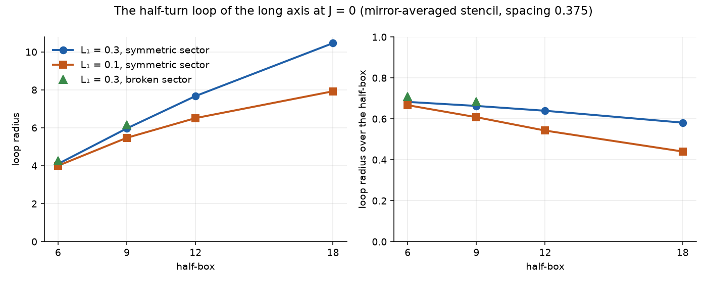
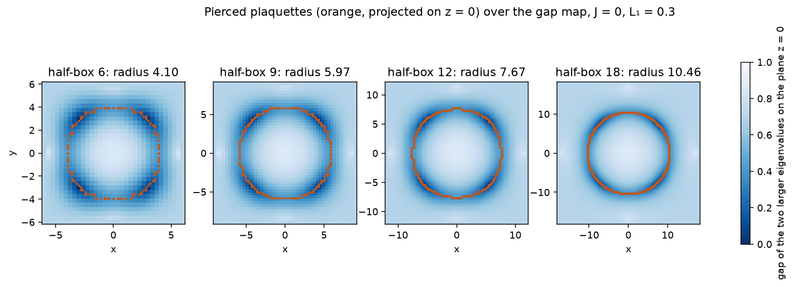

# M5.44: The half-turn line of the long axis in the relaxed states of M5.42: its radius against the box

> Opened 2026-11-17 from [M5.42](m5_42_task_details.md) § 15 (on every relaxed state with fixed faces and L₁ > 0 at δ = 0.3 the degree of the long axis is 0 on the inner spheres and 1 near the faces, and between them the two larger eigenvalues nearly meet) and from a read the author suggested by mail on 17 November 2026: the radius of the loop where they meet, over the half-box, on half-boxes 12 and 18, which would settle whether it saturates. Roadmap row: [`m5_roadmap.md`](../m5_roadmap.md). Thread record: [`m5_32_convo.md`](m5_32_convo.md).

## TASK PLANNING (2026-11-17; a desk task on the saved end states of M5.42; the go is the user's)

**Scope.** (1) R1: a reader that finds where the long axis of M makes a half turn: on every plaquette of the grid the director of the largest eigenvalue is carried around the four corners, and the plaquette is PIERCED when the product of the four signs is −1. The pierced plaquettes are grouped into loops by adjacency, and each loop gets its count, center, normal, mean radius, radial spread, rms distance off its plane, and the gap of the two larger eigenvalues along it (§ 2). (2) R2: the controls of the reader (§ 3). (3) R3: the read on every saved end state of M5.42, 110 fields, with tables for the states of § 4. (4) R4: the radius against the half-box at J = 0 on half-boxes 6, 9, 12 and 18, and the word of § 2 row 3. Out of scope: any new relaxation (the broken sector on half-boxes 12 and 18, a larger box); a change of the labels or the word of M5.42; any icon or pointer of [`MODELS.md`](../../../../../MODELS.md).

**Definition of done.** Each control of § 3 reported as met or as the exact failing check; every end state read, with its loops in a tracked JSON; the tables of § 4 written from that JSON by the script; the word of § 2 row 3 stated; an audit by an agent on a different model, with its own reader, with every claim standing or qualified; the task review presented in the terminal.

**Gating.** The user's go. The findings go to the author by mail before they enter the public record.

**Model and effort.** The session's model for the run; one audit agent on a different model, named at the spawn.

**Research body.** This document (`## FINDINGS` after the run); script `../scripts/m5_44_loops.py`; data `../data/m5_44_loops.json` (tracked); plots `../plots/m5_44_*.png`, embedded in the findings; in-flight state in `../checkpoints/m5_44/` (local-only). The fields read are the local-only end states of M5.42, indexed by [`_DATASETS.md`](../data/_DATASETS.md).

**Consumers.**

| Sub-result | Consumer | The check that consumer needs |
| --- | --- | --- |
| The loop radius per box at J = 0 | the author's question, whether the radius saturates | the manufactured loops of § 3 returned within half a spacing; the radius by a second method; the three spacings of half-box 6 |
| The loop per sector | M5.42 § 10, the two symmetry sectors | the same reader on both sectors of half-boxes 6 and 9; the mirror copies |
| The loop against J | M5.42 § 11 and § 15, the states that lost their degree near the faces | the count of loops and the share of nodes with a gap under 0.05, printed beside every radius |
| The loop and the one-cell states | M5.42 § 12, where the one-cell states sit | the distance from the largest node to the loop of the smooth state of the same grid |

### 1. What was found at plan time

A pilot of the reader (one script, six saved states, not audited) ran before this plan was written. Its numbers are recorded here so that the words of § 2 are read as fixed after them.

| State (L₁ = 0.3, J = 0 unless said) | Loops | Normal | Radius | Radius over half-box | Rms off the plane |
| --- | --- | --- | --- | --- | --- |
| half-box 6, mirror-averaged (symmetric sector) | 1 | z | 4.10 | 0.683 | 0.79 |
| half-box 6, forward, the author's deposited J = 0 state (broken sector) | 1 | (1, −1, 0)/√2 | 4.26 | 0.710 | 0.29 |
| half-box 9, mirror-averaged | 1 | z | 5.97 | 0.663 | 0.85 |
| half-box 12, mirror-averaged | 1 | z | 7.67 | 0.639 | 0.88 |
| half-box 18, mirror-averaged | 1 | z | 10.47 | 0.581 | 0.90 |
| half-box 12 at J_e | 1 | z | 11.34 | 0.945 | 3.43 |
| half-box 18 at J_e | 1 | z | 14.89 | 0.827 | 1.88 |

So in each of these states the long axis makes its half turn on one closed loop, the loop lies around the z axis in the symmetric sector and stands on a face diagonal in the broken one, and at J = 0 its radius grows with the box while its share of the half-box falls. The run establishes or corrects this with the controls below.

### 2. The readings frozen before the run

| # | Item | The reading frozen here |
| --- | --- | --- |
| 1 | The director | The unit eigenvector of the largest eigenvalue of M at each node, taken up to sign. No interpolation enters the PIERCED test |
| 2 | A loop | A connected set of pierced plaquettes, two plaquettes being adjacent when their centers are at most 1.05 spacings apart. A set of fewer than 8 plaquettes is a FRAGMENT and is listed apart. For a loop: the center is the mean of its plaquette centers, the normal is the direction of least spread, the radius is the mean distance from the center within the plane, and the spread and the rms distance off the plane are printed beside it |
| 3 | "Whether it saturates" | Read at J = 0, L₁ = 0.3, on the mirror-averaged stencil, between half-boxes 12 and 18. SATURATES: the radius changes by less than 5 percent. SCALES WITH THE BOX: the radius over the half-box changes by less than 5 percent. Otherwise NEITHER, with both changes printed. The pilot of § 1 reads +36 percent and −9 percent, so this row carries no prediction. No extrapolation in the box is made |
| 4 | The sector | The four boxes of row 3 are in the symmetric sector (M5.42 § 10). The broken sector is read where a state exists: half-boxes 6 and 9. The word of row 3 is the symmetric sector's and is stated so |
| 5 | A state without a clean line | Where the two larger eigenvalues are close over a region and not on a line, the director is not defined there. Beside every radius: the number of loops and fragments, and the share of nodes whose gap is under 0.05. A state with more than one loop, or with that share above 1 percent, is reported with those numbers and without a radius word |

### 3. R2: the controls of the reader (three tries each)

| Control | What it is | Met when |
| --- | --- | --- |
| Manufactured loops | M = n nᵀ + δ m mᵀ with n = cos(ψ/2) ρ̂ + sin(ψ/2) ν̂, where ρ̂ is the in-plane radial direction, ν̂ the loop's normal and ψ the angle around a circle of radius R₀; R₀ = 3, 4.25 and 7; normals z and (1, −1, 0)/√2; spacings 0.375 and 0.25 | one loop, no fragment; the radius within half a spacing of R₀; the normal within 2° |
| Zero cases | a uniform field; the frame of the faces continued inward (a hedgehog of the long axis) | no pierced plaquette outside the eight cells at the center |
| Mirrors | a saved state and its eight reflections | the same radius to round-off, the normal reflected |
| Refinement of the sample | a saved state sampled by trilinear interpolation on a grid of half the spacing | the radius moves by less than half a spacing of the original grid |
| A second method | along 72 rays from the loop's center in the loop's plane, and along the normal at each, the place of the smallest gap of the two larger eigenvalues of the interpolated field | its mean radius within one spacing of the reader's; the smallest gap on the loop printed |

### 4. R3 and R4: the tables

| Table | States |
| --- | --- |
| The radius against the box | J = 0 on half-boxes 6, 9, 12, 18, mirror-averaged, L₁ = 0.3 and L₁ = 0.1 |
| The two sectors | half-box 6 (both stencils, the cross starts) and half-box 9 (the last five rows of M5.42 Table 3) |
| The spacing | half-box 6 at spacings 0.375, 0.25 and 0.1875, J = 0 and J_e/10, L₁ = 0.3 and 0.1 |
| The loop against J | every SMOOTH and CONVERGED state of M5.42 Tables 4 and 5 |
| The author's box | the five paths of M5.42 Table 1 |
| The one-cell states | the twelve states of M5.42 Table 6: the distance from the largest node to the loop of the smooth state of the same grid and J |
| The rest | without L₁, δ = 0.05, free faces and the banded states: the loops as found, without a word |

Two figures: the radius and the radius over the half-box against the half-box; and the gap of the two larger eigenvalues on the loop's plane for the four boxes, with the pierced plaquettes drawn on it.

Recorded before the run. The first four lines follow the pilot and are not predictions; the last three are, and a failure is reported with the same weight.

1. One loop and no fragment in every SMOOTH fixed-face state with L₁ > 0 at δ = 0.3.
2. The normal is z in the symmetric sector, with an rms distance off the plane of 0.8 to 0.9, and a face diagonal in the broken sector, with less than 0.4.
3. At J = 0 the radius grows with the box and its share of the half-box falls: the word of § 2 row 3 is NEITHER.
4. The loop moves outward as J is raised on a given box.
5. On half-box 6 the radius changes by less than one coarse spacing (0.375) across the three spacings.
6. At L₁ = 0.3 the largest node of each one-cell state lies within two spacings of the loop of the smooth state of the same grid.
7. At L₁ = 0.1 the J = 0 loops are single, and their share of the half-box also falls from half-box 6 to 18. Not predicted: its size.

### 5. Blindspot pass, the audit and the parallel shape

| Risk | Where it enters | Guard |
| --- | --- | --- |
| Unvalidated instrument | a new reader of a line field; the degree reader of M5.42 failed once on such fields | the manufactured loops and zero cases of § 3; a second method that does not use the director |
| Artifact read as result | plaquette centers sit on a lattice of half a spacing; a radius is a mean over a hundred or more of them | the refined sample; the three spacings of half-box 6; the spread printed beside every radius |
| A box-set number read as a property | the faces hold the frame, so the loop may be placed by the box | this is the question; row 3 of § 2 names the three outcomes and none is called a size of the object |
| One sector taken for the state | the ladder of M5.42 is the symmetric sector on half-boxes 12 and 18 | § 2 row 4; the broken sector on those boxes is named as not computed |
| Wrong diagnostic for the regime | states at J_e whose long axis is lost near the faces; one-cell states | § 2 row 5; fragments listed apart |

The audit: one agent on a different model writes its own reader from § 2 and § 3 without seeing the script, reads the four boxes and both sectors, and tries to refute each line of the findings.

The parallel shape: one process, in sequence. The pilot read six states, the 97³ ones included, in about two seconds, so the whole read is under a minute and a pool would add nothing. No GPU: the read is an eigen-decomposition in double precision. The run does not load the machine.

What follows, each on its own go: the broken sector relaxed on half-boxes 12 and 18 (two relaxations from a forward-stencil start, a loaded run); a larger box.

## FINDINGS (2026-11-17)

> Run of 2026-11-17 on the saved end states of M5.42; nothing was relaxed. 185 end states read (the plan's count of 110 was wrong, deviation 1). Every number below is carried by [`m5_44_loops.json`](../data/m5_44_loops.json), written by [`m5_44_loops.py`](../scripts/m5_44_loops.py); the tables are printed from it by [`m5_44_tables.py`](../scripts/m5_44_tables.py).

**TL;DR.** (1) In every SMOOTH state of M5.42 with fixed faces, L₁ > 0 and δ = 0.3 (62 states) the long axis makes its half turn on exactly one closed loop, and the two larger eigenvalues meet on it. (2) At J = 0 on the mirror-averaged ladder the loop's radius is 4.10, 5.97, 7.67 and 10.47 on half-boxes 6, 9, 12 and 18 at L₁ = 0.3, which is 0.683, 0.663, 0.639 and 0.581 of the half-box. By the rule of § 2 row 3 the word is NEITHER: between half-boxes 12 and 18 the radius grows by 36 percent and its share of the half-box falls by 9 percent. The radius does not saturate on these boxes and does not scale with the box. (3) The growth slows: the local exponent of the radius in the half-box is 0.927, 0.874, 0.765 at L₁ = 0.3 and 0.773, 0.605, 0.485 at L₁ = 0.1. Four boxes do not pick a law. (4) The two sectors of M5.42 § 10 are two placements of the loop: around the z axis and wavy in the symmetric one, standing on the face diagonal (1, −1, 0)/√2 and nearly flat in the broken one, where it is larger by 0.16 to 0.20. (5) The radius does not move with the spacing (4.097, 4.100, 4.103 on half-box 6). (6) Raising J moves the loop outward; at J_e on half-box 12 it has grown to the size of the box. (7) The one-cell states of M5.42 sit next to the loop.

**Scope.** A read of where the long axis turns in saved end states of M5.42: the rigid-twist functional, faces held to the author's frame, half-boxes 6 to 18. The ladder against the box is the symmetric sector only; the broken sector exists on half-boxes 6 and 9. Nothing is said about a larger box, a limit of the radius, the continuum, or which sector is lower on half-boxes 12 and 18.

### 6. The reader and its controls

| Control | Result |
| --- | --- |
| Manufactured loops (12 fields: R₀ = 3, 4.25, 7; normals z and (1, −1, 0)/√2; spacings 0.375 and 0.25) | ✅ one loop and no fragment in each; the radius within 0.056 of R₀ (the bound was half a spacing); the normal within 1.02°; the second method within 0.052 |
| Zero cases | ✅ no pierced plaquette on a uniform field; on the frame continued inward, 2 pierced plaquettes, both inside the eight central cells |
| Mirrors | ✅ the radius of two saved states is the same to round-off under the eight reflections, the normal reflected |
| Refinement of the sample | ✅ 4.108 against 4.097 and 4.256 against 4.261 on the sample of half the spacing |
| A second method on the saved states | ✅ within one spacing on all 62 states of TL;DR item 1; within 0.05 at J = 0; the largest difference is 0.26 (0.69 of a spacing), on half-box 12 at J_e |

All 56 checks of the JSON are met, on the first try. On the 62 states the share of nodes whose gap is under 0.05 never exceeds 0.11 percent, so § 2 row 5 excludes none of them. The gap of the corner-mean field on the pierced plaquettes is at most 0.055 to 0.119, and it falls with the spacing (0.109, 0.080, 0.059 on half-box 6); on the interpolated field the audit reads a smallest gap of 0.001 to 0.03 on the loop.

### 7. The loop against the box

**Table 1. The loop against the box at J = 0 (mirror-averaged stencil, spacing 0.375, the symmetric sector).**

| L₁ | Half-box (grid) | Half-box minus radius | Loops / fragments | Normal | Radius | Radius over half-box | Spread | Rms off the plane | Second method | Largest gap on the loop |
| --- | --- | --- | --- | --- | --- | --- | --- | --- | --- | --- |
| 0.3 | 6 (33³) | 1.90 | 1 / 0 | z | 4.097 | 0.683 | 0.11 | 0.79 | 4.087 | 0.109 |
| 0.3 | 9 (49³) | 3.03 | 1 / 0 | z | 5.967 | 0.663 | 0.10 | 0.85 | 5.962 | 0.083 |
| 0.3 | 12 (65³) | 4.33 | 1 / 0 | z | 7.674 | 0.639 | 0.12 | 0.88 | 7.627 | 0.075 |
| 0.3 | 18 (97³) | 7.54 | 1 / 0 | z | 10.465 | 0.581 | 0.10 | 0.90 | 10.459 | 0.094 |
| 0.1 | 6 (33³) | 2.00 | 1 / 0 | z | 4.001 | 0.667 | 0.10 | 0.84 | 3.969 | 0.104 |
| 0.1 | 9 (49³) | 3.53 | 1 / 0 | z | 5.472 | 0.608 | 0.09 | 0.68 | 5.438 | 0.091 |
| 0.1 | 12 (65³) | 5.49 | 1 / 0 | z | 6.512 | 0.543 | 0.08 | 0.63 | 6.535 | 0.105 |
| 0.1 | 18 (97³) | 10.07 | 1 / 0 | z | 7.927 | 0.440 | 0.09 | 0.63 | 7.958 | 0.110 |

1. **The word.** NEITHER. Between half-boxes 12 and 18 at L₁ = 0.3 the radius changes by +36.4 percent (SATURATES asks for under 5) and the radius over the half-box by −9.1 percent (SCALES WITH THE BOX asks for under 5). The word is the symmetric sector's.
2. **The growth slows.** The slope of the logarithms between neighboring boxes is 0.927, 0.874, 0.765 at L₁ = 0.3 and 0.773, 0.605, 0.485 at L₁ = 0.1. The audit fitted four two-parameter forms to the four radii: a saturating form leaves the smallest residual (0.04 to 0.07 against 0.11 to 0.26 for a power and for a line), and its limit (25 to 44 at L₁ = 0.3) is an extrapolation far past the boxes. The audit of the addendum added a fifth form, a + b ln L, which has no limit: at L₁ = 0.1 it leaves a smaller residual than any of the four (0.015), and at L₁ = 0.3 the largest (0.231). 🔶 So the best form depends on L₁ and on which forms are tried; four points cannot establish a law, and no limit is claimed.
3. **The loop is not held at a fixed distance from the faces.** The half-box minus the radius is 1.90, 3.03, 4.33, 7.54 at L₁ = 0.3 and 2.00, 3.53, 5.49, 10.07 at L₁ = 0.1.
4. **With L₁ = 0.1 the loop grows more slowly than with L₁ = 0.3** (two values of L₁). On half-box 6 the two values of L₁ give nearly the same loop (4.10 and 4.00); on half-box 18 they give 10.47 and 7.93. Without L₁ (Table 7) the loop reads 3.15, 3.29, 3.38 on half-boxes 6, 9, 12 at spacing 0.375, but those states move with the spacing (3.15, 3.76, 3.80 on half-box 6) and only the first is converged, so that row carries no word.
5. **The shape.** In the symmetric sector the loop is wavy: its height off the plane has two crests and two troughs around the loop, with a peak of about 1.3 on every box (rms 0.79 to 0.90), while the in-plane radius stays within ± 0.2 of its mean (audit).
6. **One state to qualify.** The J = 0 state of half-box 18 at L₁ = 0.1 ended at iteration 1000 on the optimizer's function tolerance, and its continuation at J_e/40 has a lower U by 6.5 × 10⁻³ (found by the audit; it is the only chain where that happens). Its radius of 7.93 may be low by about 0.1 (the J_e/40 state reads 8.06).

### 8. The two sectors, and the spacing

**Table 2. The two sectors (L₁ = 0.3).**

| Half-box (grid) | Functional | Start | J | Loops / fragments | Normal | Radius | Radius over half-box | Spread | Rms off the plane | Second method | Largest gap on the loop |
| --- | --- | --- | --- | --- | --- | --- | --- | --- | --- | --- | --- |
| 6 (33³) | averaged | seed | 0 | 1 / 0 | z | 4.097 | 0.683 | 0.11 | 0.79 | 4.087 | 0.109 |
| 6 (49³) | averaged | seed | 0 | 1 / 0 | z | 4.100 | 0.683 | 0.12 | 0.77 | 4.093 | 0.080 |
| 6 (65³) | averaged | seed | 0 | 1 / 0 | z | 4.103 | 0.684 | 0.10 | 0.81 | 4.093 | 0.059 |
| 6 (33³) | forward | the averaged J = 0 state | 0 | 1 / 0 | z | 4.097 | 0.683 | 0.11 | 0.80 | 4.093 | 0.119 |
| 6 (49³) | forward | the averaged J = 0 state | 0 | 1 / 0 | z | 4.107 | 0.684 | 0.12 | 0.77 | 4.095 | 0.079 |
| 6 (33³) | forward | seed, frame as deposited | 0 | 1 / 0 | (1, −1, 0)/√2 | 4.261 | 0.710 | 0.14 | 0.29 | 4.251 | 0.103 |
| 6 (33³) | forward | seed | 0 | 1 / 0 | (1, −1, 0)/√2 | 4.265 | 0.711 | 0.15 | 0.29 | 4.252 | 0.110 |
| 6 (49³) | forward | seed | 0 | 1 / 0 | (1, −1, 0)/√2 | 4.255 | 0.709 | 0.11 | 0.31 | 4.254 | 0.074 |
| 6 (65³) | forward | seed | 0 | 1 / 0 | (1, −1, 0)/√2 | 4.258 | 0.710 | 0.08 | 0.29 | 4.255 | 0.056 |
| 6 (33³) | averaged | the forward J = 0 state | 0 | 1 / 0 | (1, −1, 0)/√2 | 4.259 | 0.710 | 0.13 | 0.29 | 4.254 | 0.100 |
| 6 (49³) | averaged | the forward J = 0 state | 0 | 1 / 0 | (1, −1, 0)/√2 | 4.255 | 0.709 | 0.10 | 0.30 | 4.255 | 0.077 |
| 9 (49³) | averaged | seed | 0 | 1 / 0 | z | 5.967 | 0.663 | 0.10 | 0.85 | 5.962 | 0.083 |
| 9 (49³) | averaged | the state before | J_e/10 | 1 / 0 | z | 6.408 | 0.712 | 0.12 | 1.10 | 6.439 | 0.092 |
| 9 (49³) | forward | seed | 0 | 1 / 0 | (1, −1, 0)/√2 | 6.166 | 0.685 | 0.12 | 0.34 | 6.143 | 0.097 |
| 9 (49³) | averaged | the forward J = 0 state | 0 | 1 / 0 | (1, −1, 0)/√2 | 6.162 | 0.685 | 0.12 | 0.35 | 6.131 | 0.085 |
| 9 (49³) | averaged | the state before | J_e/10 | 1 / 0 | (1, −1, 0)/√2 | 6.647 | 0.739 | 0.10 | 0.35 | 6.641 | 0.098 |

**Table 3. The spacing on half-box 6 (mirror-averaged stencil, fixed chart).**

| L₁ | J | Grid (spacing) | Label | Loops / fragments | Normal | Radius | Radius over half-box | Spread | Rms off the plane | Second method | Largest gap on the loop |
| --- | --- | --- | --- | --- | --- | --- | --- | --- | --- | --- | --- |
| 0.3 | 0 | 33³ (0.375) | SMOOTH, CONVERGED | 1 / 0 | z | 4.097 | 0.683 | 0.11 | 0.79 | 4.087 | 0.109 |
| 0.3 | 0 | 49³ (0.25) | SMOOTH, CONVERGED | 1 / 0 | z | 4.100 | 0.683 | 0.12 | 0.77 | 4.093 | 0.080 |
| 0.3 | 0 | 65³ (0.1875) | SMOOTH, CONVERGED | 1 / 0 | z | 4.103 | 0.684 | 0.10 | 0.81 | 4.093 | 0.059 |
| 0.3 | J_e/10 | 33³ (0.375) | SMOOTH, CONVERGED | 1 / 0 | z | 4.721 | 0.787 | 0.23 | 1.38 | 4.669 | 0.105 |
| 0.3 | J_e/10 | 49³ (0.25) | SMOOTH, CONVERGED | 1 / 0 | z | 4.747 | 0.791 | 0.21 | 1.43 | 4.667 | 0.066 |
| 0.3 | J_e/10 | 65³ (0.1875) | SMOOTH, CONVERGED | 1 / 0 | z | 4.750 | 0.792 | 0.22 | 1.44 | 4.669 | 0.059 |
| 0.1 | 0 | 33³ (0.375) | SMOOTH, CONVERGED | 1 / 0 | z | 4.001 | 0.667 | 0.10 | 0.84 | 3.969 | 0.104 |
| 0.1 | 0 | 49³ (0.25) | SMOOTH, CONVERGED | 1 / 0 | z | 3.988 | 0.665 | 0.10 | 0.80 | 3.974 | 0.073 |
| 0.1 | 0 | 65³ (0.1875) | SMOOTH, CONVERGED | 1 / 0 | z | 3.991 | 0.665 | 0.08 | 0.81 | 3.972 | 0.055 |
| 0.1 | J_e/10 | 33³ (0.375) | ONE-CELL, CONVERGED | 1 / 0 | z | 4.143 | 0.690 | 0.19 | 0.87 | 4.087 | 0.122 |
| 0.1 | J_e/10 | 49³ (0.25) | ONE-CELL, not converged | 1 / 0 | z | 4.068 | 0.678 | 0.12 | 0.84 | 4.019 | 0.081 |
| 0.1 | J_e/10 | 65³ (0.1875) | ONE-CELL, not converged | 1 / 0 | z | 4.034 | 0.672 | 0.12 | 0.83 | 4.015 | 0.059 |

1. **The sector is the placement of the loop.** Every state of the symmetric sector has its loop around the z axis, wavy; every state of the broken sector has it on the face diagonal (1, −1, 0)/√2, with an rms distance off its plane of 0.29 to 0.35. No saved state has it on (1, 1, 0), the mirror image of the same placement, which no chain reached. The functional does not set the sector: each stencil started from the other's state keeps that state's loop.
2. **The broken loop is larger:** 4.26 against 4.10 on half-box 6 and 6.16 against 5.97 on half-box 9 (0.710 and 0.685 of the half-box, against 0.683 and 0.663).
3. **The spacing.** On half-box 6 the radius changes by 0.006 across the three spacings at L₁ = 0.3 and by 0.013 at L₁ = 0.1; in the broken sector 4.265, 4.255, 4.258. Expectation 5 is met.

### 9. The loop against J, and the author's box

**Table 4. The loop against J on the smooth branch: radius (radius over the half-box); SMOOTH and CONVERGED states only.**

L₁ = 0.3:

| J | Half-box 6 | Half-box 9 | Half-box 12 | Half-box 18 |
| --- | --- | --- | --- | --- |
| 0 | 4.097 (0.683) | 5.967 (0.663) | 7.674 (0.639) | 10.465 (0.581) |
| J_e/40 | 4.216 (0.703) | 6.048 (0.672) | 7.678 (0.640) | 10.465 (0.581) |
| J_e/20 | 4.409 (0.735) | 6.113 (0.679) | 7.767 (0.647) | 10.496 (0.583) |
| J_e/10 | 4.721 (0.787) | 6.408 (0.712) | 7.973 (0.664) | 10.662 (0.592) |
| J_e/5 |  | 7.094 (0.788) | 8.610 (0.718) | 11.003 (0.611) |
| J_e/2.5 |  | 8.007 (0.890) | 9.727 (0.811) | 12.170 (0.676) |
| J_e |  |  | 11.340 (0.945) | 14.893 (0.827) |

L₁ = 0.1:

| J | Half-box 6 | Half-box 9 | Half-box 12 | Half-box 18 |
| --- | --- | --- | --- | --- |
| 0 | 4.001 (0.667) | 5.472 (0.608) | 6.512 (0.543) | 7.927 (0.440) |
| J_e/40 | 4.283 (0.714) | 5.653 (0.628) | 6.725 (0.560) | 8.063 (0.448) |
| J_e/20 |  | 6.321 (0.702) | 7.235 (0.603) | 8.342 (0.463) |
| J_e/10 |  |  | 8.513 (0.709) | 9.292 (0.516) |

**Table 5. The author's box (33³, half-box 6, L₁ = 0.3, forward stencil, frame as deposited).**

| Path | J | Label | Loops / fragments | Normal | Radius | Radius over half-box | Spread | Rms off the plane | Second method | Largest gap on the loop |
| --- | --- | --- | --- | --- | --- | --- | --- | --- | --- | --- |
| from the seed | 0 | SMOOTH, CONVERGED | 1 / 0 | (1, −1, 0)/√2 | 4.261 | 0.710 | 0.14 | 0.29 | 4.251 | 0.103 |
| from the state before | J_e/10 | SMOOTH, CONVERGED | 1 / 0 | (1, −1, 0)/√2 | 5.023 | 0.837 | 0.16 | 0.39 | 5.011 | 0.119 |
| from the state before | J_e | ONE-CELL, not converged | 1 / 0 | (1, −1, 0)/√2 | 4.362 | 0.727 | 0.30 | 0.33 | 4.326 | 0.917 |
| from the J_e state | J_e/10 | ONE-CELL, CONVERGED | 1 / 0 | (1, −1, 0)/√2 | 4.414 | 0.736 | 0.13 | 0.34 | 4.408 | 0.268 |
| from the J_e state | 0 | SMOOTH, CONVERGED | 1 / 0 | (1, −1, 0)/√2 | 4.261 | 0.710 | 0.14 | 0.29 | 4.251 | 0.103 |

1. **The loop moves outward with J** on every chain, with no reversal. On half-boxes 12 and 18 the move is not resolved at J_e/40 (7.674 to 7.678; 10.465 to 10.465).
2. **At J_e on half-box 12 the loop has grown to the size of the box.** Its mean radius is 0.945 of the half-box, its rms distance off the plane 3.43 (peak 5.07), and it comes within 1.69 of a face (audit). This is the state of M5.42 § 15 whose long axis had lost its degree at 0.95 of the half-box, the 1.894 of M5.42 § 11. Half-box 9 at J_e/2.5, the second state named there, reads 0.890 of the half-box.
3. **The author's box.** The loop of the deposited J = 0 state has radius 4.26; at J_e/10, the state behind the printed 0.83, it has moved to 5.02, which is 0.837 of the half-box. The one-cell states of that box keep a single loop (4.36 and 4.41).

### 10. The one-cell states and the loop

**Table 6. The one-cell states of M5.42 Table 6 and the loop: distance from the largest node to the nearest pierced plaquette, in length units (and in spacings).**

| L₁ | J | Grid (spacing) | Largest node | Its distance from the z axis | Loops / fragments of the state | To the state's own loop | To the loop of the J = 0 state | To the loop of the smooth J_e/10 state |
| --- | --- | --- | --- | --- | --- | --- | --- | --- |
| 0.3 | J_e/10 | 33³ (0.375) | (-3.375, 3, 0.375) | 4.52 | 1 / 0 | 0.27 (0.7) | 0.46 (1.2) | 0.46 (1.2) |
| 0.3 | J_e/10 | 49³ (0.25) | (3.25, -3.25, 0) | 4.60 | 1 / 0 | 0.18 (0.7) | 0.47 (1.9) | 0.47 (1.9) |
| 0.3 | J_e/10 | 65³ (0.1875) | (-3.375, -3.1875, 0.1875) | 4.64 | 1 / 0 | 0.23 (1.2) | 0.48 (2.5) | 0.35 (1.9) |
| 0.3 | J_e | 33³ (0.375) | (-3.375, 3, 0.375) | 4.52 | 1 / 0 | 0.80 (2.1) | 0.46 (1.2) | 0.46 (1.2) |
| 0.3 | J_e | 49³ (0.25) | (3.25, -3.25, 0) | 4.60 | 1 / 0 | 0.68 (2.7) | 0.47 (1.9) | 0.47 (1.9) |
| 0.3 | J_e | 65³ (0.1875) | (-3.375, -3.1875, 0.1875) | 4.64 | 1 / 0 | 0.51 (2.7) | 0.48 (2.5) | 0.35 (1.9) |
| 0.1 | J_e/10 | 33³ (0.375) | (-3, -2.625, 0) | 3.99 | 1 / 0 | 0.70 (1.9) | 0.27 (0.7) | no such state |
| 0.1 | J_e/10 | 49³ (0.25) | (2.75, -2.25, 0.25) | 3.55 | 1 / 0 | 0.81 (3.2) | 0.47 (1.9) | no such state |
| 0.1 | J_e/10 | 65³ (0.1875) | (-2.8125, -2.25, 0.1875) | 3.60 | 1 / 0 | 0.74 (3.9) | 0.48 (2.5) | no such state |
| 0.1 | J_e | 33³ (0.375) | (-3, -2.625, 0) | 3.99 | 1 / 0 | 0.96 (2.5) | 0.27 (0.7) | no such state |
| 0.1 | J_e | 49³ (0.25) | (2.75, -2.25, 0.25) | 3.55 | 1 / 0 | 0.98 (3.9) | 0.47 (1.9) | no such state |
| 0.1 | J_e | 65³ (0.1875) | (-2.8125, -2.25, 0.1875) | 3.60 | 1 / 0 | 0.81 (4.3) | 0.48 (2.5) | no such state |

The largest node of each one-cell state lies 0.27 to 0.48 from the loop of the J = 0 state of its grid, and that distance does not shrink with the spacing (0.46, 0.47, 0.48 at L₁ = 0.3). Expectation 6, which was written in spacings, is met on 33³ and 49³ (1.2 and 1.9 spacings) and not on 65³ (2.5; 1.9 against the smooth J_e/10 state's loop). At J_e/10 and L₁ = 0.3 the state's own loop, which has moved outward, passes 0.18 to 0.27 from the node (0.7, 0.7 and 1.2 spacings). So the one-cell states form about half a length unit outside the loop of the J = 0 state, and within about one spacing of their own state's loop. The distances are quantized by the lattice of plaquette centers.

### 11. The other states

**Table 7. The other states at J = 0: the largest loop as found.**

| State | Half-box (grid, spacing) | Label | Loops / fragments | Radius | Radius over half-box | Rms off the plane |
| --- | --- | --- | --- | --- | --- | --- |
| L₁ = 0 | 6 (33³, 0.375) | SMOOTH, CONVERGED | 1 / 0 | 3.15 | 0.525 | 1.90 |
| L₁ = 0 | 6 (49³, 0.25) | SMOOTH, not converged | 1 / 0 | 3.76 | 0.627 | 2.14 |
| L₁ = 0 | 6 (65³, 0.1875) | SMOOTH, not converged | 1 / 0 | 3.80 | 0.633 | 2.17 |
| L₁ = 0 | 9 (49³, 0.375) | SMOOTH, not converged | 1 / 0 | 3.29 | 0.365 | 2.09 |
| L₁ = 0 | 9 (73³, 0.25) | SMOOTH, not converged | 1 / 0 | 3.89 | 0.433 | 2.41 |
| L₁ = 0 | 12 (65³, 0.375) | SMOOTH, not converged | 1 / 0 | 3.38 | 0.282 | 2.01 |
| δ = 0.05, L₁ = 0.3 | 6 (33³, 0.375) | SMOOTH, CONVERGED | 1 / 0 | 3.83 | 0.638 | 0.08 |
| δ = 0.05, L₁ = 0.3 | 12 (65³, 0.375) | SMOOTH, CONVERGED | 1 / 0 | 6.58 | 0.549 | 0.08 |
| δ = 0.05, L₁ = 0 | 6 (33³, 0.375) | SMOOTH, CONVERGED | 1 / 0 | 0.38 | 0.063 | 0.12 |
| δ = 0.05, L₁ = 0 | 12 (65³, 0.375) | SMOOTH, not converged | 1 / 0 | 1.19 | 0.099 | 0.17 |
| free faces, L₁ = 0.3 | 6 (33³, 0.375) | SMOOTH, CONVERGED | 0 / 0 | no pierced plaquette |  |  |
| free faces, L₁ = 0.3 | 9 (49³, 0.375) | SMOOTH, CONVERGED | 0 / 0 | no pierced plaquette |  |  |
| free faces, L₁ = 0 | 6 (33³, 0.375) | SMOOTH, not converged | 0 / 0 | no pierced plaquette |  |  |

At δ = 0.05 with L₁ = 0.3 the loop is single and flat (rms 0.08) with a share of the half-box of 0.638 and 0.549 on half-boxes 6 and 12, which also falls. With free faces and L₁ = 0.3 there is no pierced plaquette: the half turn has left the box with the hedgehog. Of the 21 states without L₁, 8 have one loop and the rest 3 to 17; of the 30 banded states at L₁ = 0.3, 26 have one loop and no fragment. These are listed as found and carry no word.

### 12. The expectations, the deviations and the audit

| # | Expectation (§ 4) | Result |
| --- | --- | --- |
| 1 | One loop and no fragment in every SMOOTH fixed-face state with L₁ > 0 at δ = 0.3 | ✅ met, 62 of 62 (followed the pilot) |
| 2 | Normal z and rms 0.8 to 0.9 in the symmetric sector; a face diagonal and under 0.4 in the broken one | ✅ met on the ladder at L₁ = 0.3 (0.79 to 0.90; 0.77 on the 49³ grid of half-box 6); at L₁ = 0.1 the rms is 0.63 to 0.84 (followed the pilot) |
| 3 | The word of § 2 row 3 is NEITHER | ✅ met (followed the pilot) |
| 4 | The loop moves outward with J | ✅ met (followed the pilot) |
| 5 | On half-box 6 the radius changes by less than 0.375 across the three spacings | ✅ met: 0.006 |
| 6 | At L₁ = 0.3 the largest node of each one-cell state lies within two spacings of the smooth state's loop | 🔶 met on two grids of three; the distance is fixed in length units, not in spacings |
| 7 | At L₁ = 0.1 the J = 0 loops are single and their share of the half-box falls | ✅ met: 0.667, 0.608, 0.543, 0.440 |

**Deviations from the plan.**

| # | Deviation | Why |
| --- | --- | --- |
| 1 | 185 end states were read, not 110 | the plan's count was wrong; the paths file of M5.42 lists 185 end fields |
| 2 | The run took about two minutes of compute, not under one | the manufactured loops on the 73³ grids |
| 3 | Table 6 gives the distance to three loops: the state's own, the J = 0 state's, and the smooth J_e/10 state's where one exists | the plan asked for the smooth state of the same grid and J, and at J_e no smooth state exists on half-box 6 |
| 4 | The words of § 2 row 3 and expectations 1 to 4 were fixed after the pilot | stated in the plan; they carry no prediction |

**The audit.** One agent on a different model wrote its own reader and its own second method from § 2 and § 3 without seeing the script, validated them on twelve manufactured loops, and read sixteen states before opening the JSON.

| Claim | Verdict | What it changed |
| --- | --- | --- |
| The numbers | agree | the plaquette radii to round-off on all sixteen states; the second method within 0.011 |
| One loop in each of the 62 states | stands | it holds with no fragment threshold at all: one connected set each, every pierced plaquette with exactly two neighbors through cells, none touching the box |
| The radii at J = 0 and the shape | stands with qualification | the sector is not set by the stencil; the state of § 7 item 6 |
| The word NEITHER | stands with qualification | the growth is slowing; of the four forms it fitted, a saturating one leaves the smallest residual (§ 7 item 2) |
| The broken sector | stands | (1, −1, 0) in every saved state |
| The second method | stands with qualification | it borrows the reader's center and normal, so it confirms the radius and not that the loop was found; the manufactured loops and the audit's reader carry that |
| The spacing | stands | |
| The loop against J | stands with qualification | § 9 items 1 and 2 |

Not checked by the audit: the labels and convergence flags of M5.42, taken from its paths file; the mirror and refinement controls; Table 6; the states with free faces, the band or δ = 0.05; the plots.

**Not computed.** The broken sector on half-boxes 12 and 18; a larger box; a law or a limit for the radius; the energy of the loop; whether the loop's place is a minimum against moving it; the loop on the saved stops before the end of a path.

### 13. Reproduce

| Step | Command (from `research/`) | Time |
| --- | --- | --- |
| The read, the controls and the plots | `python scripts/m5_44_loops.py` | minutes |
| The tables | `python scripts/m5_44_tables.py data/m5_44_loops.json` | seconds |

The fields read are the local-only end states of M5.42 ([`_DATASETS.md`](../data/_DATASETS.md)); M5.42 § 17 regenerates them.

## TASK REVIEW (2026-11-17)

**Task Duration:** 00:12 (from 2026-11-17 12:08 EST to 2026-11-17 12:20 EST)
**Usage Cap Triggered:** NO

**Results.**

- ✅ The reader: 56 of 56 controls met on the first try (§ 6).
- ✅ One closed loop of the half turn in each of the 62 SMOOTH states with fixed faces, L₁ > 0 and δ = 0.3.
- ✅ The word of § 2 row 3 is NEITHER: at J = 0 and L₁ = 0.3 the radius is 4.10, 5.97, 7.67, 10.47 on half-boxes 6, 9, 12, 18 (0.683, 0.663, 0.639, 0.581 of the half-box); between 12 and 18 it grows by 36 percent and its share falls by 9 percent.
- 🔶 The growth slows (local exponents 0.927, 0.874, 0.765 at L₁ = 0.3; 0.773, 0.605, 0.485 at L₁ = 0.1). The best-fitting form depends on L₁ (§ 7 item 2); no law and no limit is claimed.
- ✅ The two sectors of M5.42 § 10 are two placements of the loop (around z and wavy; on the face diagonal (1, −1, 0)/√2 and nearly flat, larger by 0.16 to 0.20).
- ✅ The radius does not move with the spacing (0.006 across three spacings on half-box 6).
- ✅ The loop moves outward with J and has grown to the size of the box at J_e on half-box 12 (0.945 of the half-box, within 1.69 of a face).
- 🔶 The one-cell states of M5.42 sit about half a length unit outside the J = 0 loop, at a distance fixed in length units, and within about one spacing of their own state's loop.
- 🔶 With L₁ = 0.1 the loop grows more slowly with the box than with L₁ = 0.3; the row without L₁ carries no word.

**Issues / blockers.** The J = 0 state of half-box 18 at L₁ = 0.1 ended early in M5.42 and its radius may be low by about 0.1 (§ 7 item 6; unvalidated instrument, inherited). The ladder against the box is the symmetric sector only.

**Deviations from plan.** Four, listed in § 12. The count of end states in the plan was wrong (185, not 110); the word and expectations 1 to 4 were fixed after the pilot, as the plan said.

**Action needed.** None is owed by this task. What could follow, each on its own go: the broken sector relaxed on half-boxes 12 and 18; a larger box, to see whether the radius saturates.

**Scope.** A read of where the long axis turns in the saved end states of M5.42 (the rigid-twist functional, faces held to the author's frame, half-boxes 6 to 18, the symmetric sector for the ladder). It does not speak for a larger box, a limit of the radius, the continuum, or the sector that is lower on half-boxes 12 and 18.

**Findings.** In every smooth relaxed state of M5.42 the long axis makes its half turn on one closed loop. At J = 0 its radius grows from 4.10 to 10.47 between half-boxes 6 and 18 while its share of the half-box falls from 0.68 to 0.58: on these boxes it neither saturates nor scales with the box, and its growth is slowing. The two sectors of M5.42 are two placements of that loop, and its radius is independent of the spacing.

**Research docs created / updated.** [`m5_44_task_details.md`](m5_44_task_details.md) (this document) · scripts [`m5_44_loops.py`](../scripts/m5_44_loops.py), [`m5_44_tables.py`](../scripts/m5_44_tables.py) · data [`m5_44_loops.json`](../data/m5_44_loops.json) · plots [`m5_44_radius_against_box.png`](../plots/m5_44_radius_against_box.png), [`m5_44_gap_and_loop.png`](../plots/m5_44_gap_and_loop.png) (the loop drawn over the gap map on four boxes).

## ADDENDUM (2026-11-17, after the review): the author's post of 17 November

> Added after the task review above, which is unchanged. The author's post of 2026-11-17 18:59 UTC on discussion #186 ([discussioncomment-19688341](https://github.com/vantasnerdan/substrate-framework/discussions/186#discussioncomment-19688341)), with the capstone 3.97 ([Zenodo 24322890](https://zenodo.org/records/24322890)), published the half-turn ring of the long axis, recorded a prediction for its radius on half-boxes 12 and 18, and asked one read on the saved δ = 0.05 states. The run above had ended by 17:20 UTC (its data file was written at 17:12 UTC), before that post, and its numbers had not been sent to the author; the prediction was written without them. Nothing was relaxed for this addendum. Script: [`m5_44_addendum.py`](../scripts/m5_44_addendum.py); data: [`m5_44_addendum.json`](../data/m5_44_addendum.json). Thread record: [`m5_32_convo.md`](m5_32_convo.md).

### 14. The radius against the author's prediction

**The prediction as posted.** The radius over the half-box lies between 0.62 and 0.72 on half-boxes 12 and 18, the radius being "the mean distance from the centre of the loop where the gap between the two largest eigenvalues is smallest"; and "below 0.60 on half-box 18 would mean the line tension starts to give the ring a size of its own".

**The author's measure.** The radii the author published (3.11, 4.25 and 6.13 on half-boxes 4.5, 6 and 9) come from a measure deposited with the capstone 3.97 source (`checks/v397/ring17/ring_tools.py`): the grid nodes whose gap of the two larger eigenvalues is under 0.15 and that lie inside 0.93 of the half-box, each weighted by 0.15 minus its gap; the radius is the weighted mean distance from the weighted center within the plane of least weighted spread. The script of this addendum reimplements that definition (the author's code was read, not run) and applies it to the saved J = 0 states, beside the two measures of § 6.

**Table 8. The loop radius at J = 0 by three measures (δ = 0.3, fixed faces).**

| Chain of M5.42 | L₁ | Half-box (grid) | Functional | Start | Normal | Plaquettes: radius (share) | Smallest gap: radius (share) | The author's measure: radius (share) | Its nodes | Its off-plane rms |
| --- | --- | --- | --- | --- | --- | --- | --- | --- | --- | --- |
| `r3_g33_L0.3` j0 | 0.3 | 6 (33³) | averaged | seed | z | 4.097 (0.683) | 4.087 (0.681) | 4.102 (0.684) | 200 | 0.81 |
| `r4_hb6_L0.3` j0 | 0.3 | 6 (33³) | averaged | seed | z | 4.097 (0.683) | 4.087 (0.681) | 4.102 (0.684) | 200 | 0.81 |
| `g3x_fwd_g33` j0a | 0.3 | 6 (33³) | forward | the other stencil's J = 0 state | z | 4.097 (0.683) | 4.093 (0.682) | 4.101 (0.683) | 193 | 0.82 |
| `r3_g49_L0.3` j0 | 0.3 | 6 (49³) | averaged | seed | z | 4.100 (0.683) | 4.093 (0.682) | 4.104 (0.684) | 616 | 0.84 |
| `g3x_fwd_g49` j0a | 0.3 | 6 (49³) | forward | the other stencil's J = 0 state | z | 4.107 (0.684) | 4.095 (0.683) | 4.105 (0.684) | 633 | 0.84 |
| `r3_g65_L0.3` j0 | 0.3 | 6 (65³) | averaged | seed | z | 4.103 (0.684) | 4.093 (0.682) | 4.105 (0.684) | 1544 | 0.84 |
| `r4_hb9_L0.3` j0 | 0.3 | 9 (49³) | averaged | seed | z | 5.967 (0.663) | 5.962 (0.662) | 5.975 (0.664) | 340 | 0.89 |
| `r4_hb12_L0.3` j0 | 0.3 | 12 (65³) | averaged | seed | z | 7.674 (0.639) | 7.627 (0.636) | 7.647 (0.637) | 418 | 0.90 |
| `r4_hb18_L0.3` j0 | 0.3 | 18 (97³) | averaged | seed | z | 10.465 (0.581) | 10.459 (0.581) | 10.479 (0.582) | 636 | 0.93 |
| `g3x_avg_g33` j0f | 0.3 | 6 (33³) | averaged | the other stencil's J = 0 state | (1, −1, 0)/√2 | 4.259 (0.710) | 4.254 (0.709) | 4.255 (0.709) | 170 | 0.32 |
| `r2_g33` j0 | 0.3 | 6 (33³) | forward | seed | (1, −1, 0)/√2 | 4.261 (0.710) | 4.251 (0.709) | 4.255 (0.709) | 177 | 0.32 |
| `r2_g33` j0x | 0.3 | 6 (33³) | forward | continued | (1, −1, 0)/√2 | 4.261 (0.710) | 4.251 (0.709) | 4.255 (0.709) | 177 | 0.32 |
| `g3_g33` j0 | 0.3 | 6 (33³) | forward | seed | (1, −1, 0)/√2 | 4.265 (0.711) | 4.252 (0.709) | 4.255 (0.709) | 175 | 0.32 |
| `g3x_avg_g49` j0f | 0.3 | 6 (49³) | averaged | the other stencil's J = 0 state | (1, −1, 0)/√2 | 4.255 (0.709) | 4.255 (0.709) | 4.258 (0.710) | 648 | 0.32 |
| `g3_g49` j0 | 0.3 | 6 (49³) | forward | seed | (1, −1, 0)/√2 | 4.255 (0.709) | 4.254 (0.709) | 4.259 (0.710) | 635 | 0.32 |
| `g3_g65` j0 | 0.3 | 6 (65³) | forward | seed | (1, −1, 0)/√2 | 4.258 (0.710) | 4.255 (0.709) | 4.262 (0.710) | 1500 | 0.32 |
| `g3b_avg_hb9` j0b | 0.3 | 9 (49³) | averaged | the other stencil's J = 0 state | (1, −1, 0)/√2 | 6.162 (0.685) | 6.131 (0.681) | 6.140 (0.682) | 326 | 0.36 |
| `g3b_fwd_hb9` j0 | 0.3 | 9 (49³) | forward | seed | (1, −1, 0)/√2 | 6.166 (0.685) | 6.143 (0.683) | 6.140 (0.682) | 333 | 0.36 |
| `r3_g33_L0.1` j0 | 0.1 | 6 (33³) | averaged | seed | z | 4.001 (0.667) | 3.969 (0.662) | 3.965 (0.661) | 130 | 0.87 |
| `r4_hb6_L0.1` j0 | 0.1 | 6 (33³) | averaged | seed | z | 4.001 (0.667) | 3.969 (0.662) | 3.965 (0.661) | 130 | 0.87 |
| `r3_g49_L0.1` j0 | 0.1 | 6 (49³) | averaged | seed | z | 3.988 (0.665) | 3.974 (0.662) | 3.982 (0.664) | 560 | 0.87 |
| `r3_g65_L0.1` j0 | 0.1 | 6 (65³) | averaged | seed | z | 3.991 (0.665) | 3.972 (0.662) | 3.982 (0.664) | 1254 | 0.87 |
| `r4_hb9_L0.1` j0 | 0.1 | 9 (49³) | averaged | seed | z | 5.472 (0.608) | 5.438 (0.604) | 5.422 (0.602) | 216 | 0.71 |
| `r4_hb12_L0.1` j0 | 0.1 | 12 (65³) | averaged | seed | z | 6.512 (0.543) | 6.535 (0.545) | 6.525 (0.544) | 276 | 0.62 |
| `r4_hb18_L0.1` j0 | 0.1 | 18 (97³) | averaged | seed | z | 7.927 (0.440) | 7.958 (0.442) | 7.935 (0.441) | 308 | 0.62 |

1. **The reimplementation returns the author's numbers.** On the state that M5.42 relaxed on the author's box (33³, forward stencil, frame as deposited) it reads 4.2547 on 177 nodes; the author's record of the deposited state reads 4.2547 on 176 nodes. On the 49³ grid it reads 4.259 (the author: 4.2589), and on half-box 9 it reads 6.140 at spacing 0.375 (the author: 6.13 at spacing 0.5).
2. **The three measures agree.** On the 25 states of Table 8 the largest difference between any two of them is 0.050 (half-box 9 at L₁ = 0.1). The audit varied the author's measure (thresholds 0.10 and 0.05, no weights, a cut at 0.85) and added a fourth one (the smallest gap on 180 half planes): the share stays within 0.636 to 0.642 on half-box 12 and 0.582 to 0.584 on half-box 18.
3. **Half-box 12 is inside the window.** At L₁ = 0.3 the radius over the half-box is 0.639, 0.636 and 0.637 by the three measures.
4. **Half-box 18 is outside it.** At L₁ = 0.3 it is 0.581, 0.581 and 0.582: under the lower edge of the window, and under the 0.60 the post names. At L₁ = 0.1 the two boxes read 0.54 and 0.44.
5. **The sector qualifies the score.** The ladder of half-boxes 12 and 18 is the symmetric sector (the loop around the z axis). The author's 0.69, 0.71 and 0.68 on half-boxes 4.5, 6 and 9 are the broken sector, which reads 0.709 and 0.682 here on half-boxes 6 and 9 and is not relaxed on half-boxes 12 and 18. So the prediction is scored on the symmetric sector only, for which the note `predictions_ring_17nov.md` of the 3.97 source gives a radius of 4.10 on half-box 6 (0.683; 0.684 here by the same measure). In both sectors the share falls between half-boxes 6 and 9: by 0.020 in the symmetric one and by 0.027 in the broken one (the author's measure).
6. **What is not concluded.** Whether a share under 0.60 shows a size set by the line tension is the author's reading of that line. This record holds the numbers and § 7 item 2: the growth slows, four boxes do not pick a law, and no limit is claimed.

### 15. The δ = 0.05 states

> Read with [M5.45](m5_45_task_details.md) (2026-11-18): without L₁ the state on half-box 6 depends on the spacing and on the start of the descent (the inertia at J = 0 is 1189 to 2063 at spacing 0.5, 1977 to 2722 at 0.375, 3372 to 3936 at 0.25). The numbers of this section for the states without L₁ are those of spacing 0.375 from the seed.

**The read asked.** "The long axis's degree on r = 3 and 4 at δ = 0.05. Is the one state with a nonzero degree on r = 4 there, and does its core carry the inertia?" The degree by sphere and the inertia inside r < 2 are in the tracked reads of M5.42 ([`m5_42_r7_reads.json`](../data/m5_42_r7_reads.json)); the loops are those of Table 7. Table 9 puts them side by side for the twelve end states at δ = 0.05. The degree is printed as a magnitude.

**Table 9. The δ = 0.05 states (mirror-averaged stencil, spacing 0.375).**

| L₁ | Half-box | J | Label | Degree on r = 3 (gap) | Degree on r = 4 (gap) | I inside r < 2 of I (share) | Loops / fragments | Loop radius (share of the half-box) | Plaquettes |
| --- | --- | --- | --- | --- | --- | --- | --- | --- | --- |
| 0.3 | 6 | 0 | SMOOTH, CONVERGED | 0.00 (0.438) | 1.00 (0.106) | 28.1 of 370.2 (0.076) | 1 / 0 | 3.83 (0.638) | 84 |
| 0.3 | 6 | J_e/40 | SMOOTH, CONVERGED | 0.00 (0.579) | 0.00 (0.129) | 28.8 of 486.3 (0.059) | 1 / 0 | 4.18 (0.697) | 88 |
| 0.3 | 6 | J_e/10 | ONE-CELL, not converged | 0.00 (0.500) | 0.07 (0.010) | 27.9 of 3896.4 (0.007) | 1 / 0 | 4.07 (0.678) | 106 |
| 0.3 | 12 | 0 | SMOOTH, CONVERGED | 0.00 (0.881) | 0.00 (0.794) | 25.3 of 1567.7 (0.016) | 1 / 0 | 6.58 (0.549) | 142 |
| 0.3 | 12 | J_e/40 | SMOOTH, CONVERGED | 0.00 (0.890) | 0.00 (0.814) | 25.3 of 1719.3 (0.015) | 1 / 0 | 6.83 (0.569) | 148 |
| 0.3 | 12 | J_e/10 | SMOOTH, CONVERGED | 0.00 (0.912) | 0.00 (0.871) | 25.6 of 2720.2 (0.009) | 1 / 0 | 8.23 (0.686) | 176 |
| 0 | 6 | 0 | SMOOTH, CONVERGED | 1.00 (0.137) | 1.00 (0.249) | 521.1 of 2096.0 (0.249) | 1 / 0 | 0.38 (0.063) | 10 |
| 0 | 6 | J_e/40 | SMOOTH, CONVERGED | 1.00 (0.096) | 1.00 (0.200) | 676.9 of 3171.3 (0.213) | 1 / 0 | 0.41 (0.069) | 18 |
| 0 | 6 | J_e/10 | SMOOTH, not converged | 1.00 (0.054) | 1.00 (0.126) | 1916.9 of 12864.3 (0.149) | 2 / 4 | 0.63 (0.106) | 56 |
| 0 | 12 | 0 | SMOOTH, not converged | 1.00 (0.077) | 1.00 (0.196) | 546.8 of 2631.2 (0.208) | 1 / 0 | 1.19 (0.099) | 44 |
| 0 | 12 | J_e/40 | SMOOTH, not converged | 1.00 (0.054) | 1.00 (0.138) | 628.0 of 4317.5 (0.145) | 1 / 0 | 1.53 (0.128) | 58 |
| 0 | 12 | J_e/10 | SMOOTH, not converged | 1.00 (0.027) | 1.00 (0.119) | 916.7 of 13680.6 (0.067) | 1 / 0 | 1.07 (0.089) | 44 |

1. **With L₁ = 0.3 the state of M5.42 § 15 is there, and its core holds little of the inertia.** The one state with degree 1 on r = 4 among the fixed-face states with L₁ > 0 is half-box 6 at J = 0. Its loop is flat with radius 3.83 (Table 7) and its plaquettes lie 3.57 to 4.03 from the center of the box (audit), so the sphere r = 3 is inside the loop and the sphere r = 4 touches its outer edge: degree 0 and 1. The inertia inside r < 2 is 28.1 of 370.2. At J_e/40 the loop (3.94 to 4.43 from the center) straddles the sphere r = 4, which reads 0; in the one-cell state at J_e/10 the sphere crosses the loop and reads 0.07. On half-box 12 the loop is at 6.58 and the degree is 0 on both spheres.
2. **Without L₁ the degree is 1 on both spheres in all six states, and their core holds about 20 to 70 times the inertia.** The long axis is a hedgehog from r = 3 outward, and the plaquettes where it turns lie near the center: 10 of them at 0.27 to 0.59 from it on half-box 6 at J = 0 (CONVERGED), 44 on a closed line of radius 1.19 with a spread of 0.53 on half-box 12 (not converged). The inertia inside r < 2 is 521 to 1917 in these six states (521.1 of 2096.0 and 546.8 of 2631.2 at J = 0), against 25 to 29 in the six with L₁ = 0.3. M5.42 § 15 counted these states apart, among those without L₁.
3. **Without L₁ the share of the core falls as J is raised:** 0.249, 0.213, 0.149 on half-box 6 and 0.208, 0.145, 0.067 on half-box 12, at J = 0, J_e/40 and J_e/10. The last of these is under the 0.076 of the L₁ = 0.3 state of item 1: the two groups differ in the inertia the core holds, not always in its share.

**Qualifications.** (a) On half-box 6 at J = 0 without L₁ the reader's radius of 0.38 is one spacing (0.375), the smallest-gap method reads 0.70, and 6 of the 10 plaquettes have three neighbors, so they do not form a simple closed line (audit). This is the core of a hedgehog of degree 1 that the grid does not resolve; a ring is not shown, and the read says only that the half turn lies within about one cell of the center. (b) δ = 0.05 was run at one spacing. At δ = 0.3 without L₁ the loop moved with the spacing (3.15, 3.76, 3.80 on half-box 6, Table 7), so nothing is said here about the spacing. (c) Of the six states without L₁, two are CONVERGED (half-box 6 at J = 0 and J_e/40). The state at J_e/10 on half-box 6 has two loops and four fragments: the 0.63 of its row is the larger loop (56 plaquettes), centered 2.8 from the center of the box, and the loop at the center has 14 plaquettes and radius 0.43. (d) These are states of the rigid-twist functional of M5.42, which the author's post reads as a functional and not as the energy of a stationary rotation.

### 16. The audit of the addendum, and what was not computed

One agent on a different model wrote its own code for the author's measure from `ring_tools.py`, for a fourth radius, for the degree on spheres and for Table 9, before reading the script of this addendum, and tried to refute each line of § 14 and § 15 and of the two outbound texts that carry them.

| Claim | Verdict | What it changed |
| --- | --- | --- |
| Table 8 and the fidelity of the reimplementation | stands | its own code returns the 13 states it read to round-off; the author's mask of the face layer has no effect, since the cut at 0.93 drops those nodes |
| Half-box 12 inside the window, half-box 18 under 0.60 | stands | robust to the threshold, the weights, the cut, a fourth method and the distance in three dimensions (§ 14 item 2); no mean reaches 0.60 on half-box 18 |
| The sector qualification | stands with correction | the 0.68 of the author's post is half-box 9 in the broken sector; the symmetric 4.10 is in the note of the 3.97 source (§ 14 item 5) |
| Table 9 | stands | all twelve rows match the two files; the degrees it computed are 0.94 to 0.99 without L₁, and 0.000, 0.998 on r = 3 and r = 4 for the state of § 15 item 1 |
| § 15 item 1 | stands with qualification | the sphere r = 4 touches the loop's outer edge; the 0 at J_e/40 is a read across the loop; the 0.07 of the one-cell row |
| § 15 item 2 | corrected | "a small loop at the center" was more than the data shows on half-box 6: an unresolved core (qualification a); "the states whose core carries the inertia" was restated in absolute values (item 3) |
| Earlier sections | corrected | the local exponents to three digits (the third at L₁ = 0.3 is 0.765, the second at L₁ = 0.1 is 0.605); the fit of § 7 item 2 depends on the forms tried; the one-cell states are within about one spacing of their own state's loop (§ 10); (1, 1, 0) is the mirror image of the broken placement (§ 8); "reached the faces" reworded (§ 9) |

Not checked by this audit: the closedness of each of the 62 loops on its own reader (the first audit did); the mirror and refinement controls; the plots; Tables 1 to 7 beyond the numbers cited after the review.

**Not computed.** The broken sector on half-boxes 12 and 18; δ = 0.05 at a second spacing; the cost of a rigid turn of the relaxed state (point 3 of the author's post) and the line-tension estimate of its point 7.

**Reproduce.** `python scripts/m5_44_addendum.py` from `research/`, about a minute; it reads the local-only end states of M5.42 for Table 8 and the two tracked JSON files for Table 9.
