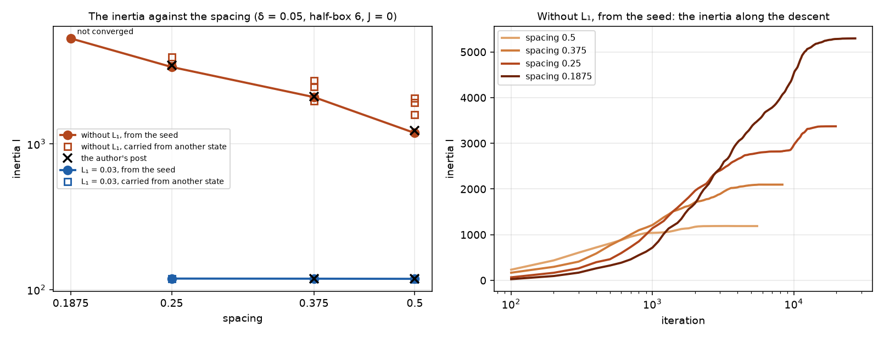
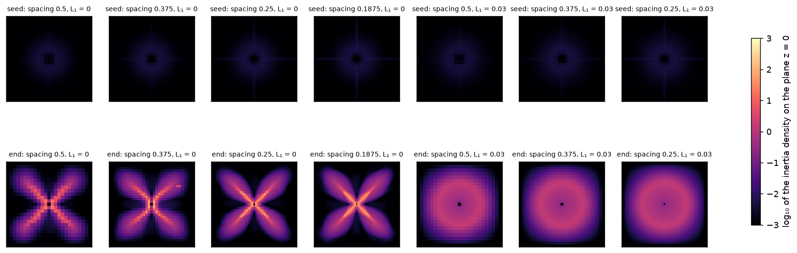
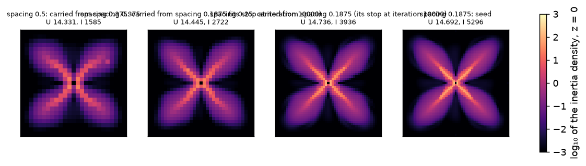

# M5.45: The inertia of the δ = 0.05 state without L₁ against the grid spacing

> Opened 2026-11-18 from the author's answer to the [M5.44](m5_44_task_details.md) results post on discussion 186 ([discussioncomment-19696575](https://github.com/vantasnerdan/substrate-framework/discussions/186#discussioncomment-19696575)), which reads the inertia of the δ = 0.05 state without L₁ as set by the grid, records a prediction for the same state at spacing 0.25, and asks for that read and for the inertia by box of the L₁ = 0.1 ladder of [M5.42](m5_42_task_details.md). Roadmap row: [`m5_roadmap.md`](../m5_roadmap.md). Thread record: [`m5_32_convo.md`](m5_32_convo.md).

## TASK PLANNING (2026-11-18; a short relaxation run on seven grids and a desk read; the go is the user's)

**Scope.** (1) R1: the driver of this task on the evaluator of M5.42, with a restart after every end by the function tolerance, and its control (§ 3). (2) R2: the state at J = 0 with δ = 0.05, half-box 6, the mirror-averaged stencil and the chart fixed, relaxed from the seed without L₁ at spacings 0.5, 0.375, 0.25 and 0.1875, and with L₁ = 0.03 at spacings 0.5, 0.375 and 0.25. (3) R3: the reads of § 4 on every end state. (4) R4: the inertia by box of the J = 0 ladders of M5.42 at L₁ = 0.1 and 0.3, from its tracked reads; nothing is relaxed for it. Out of scope: any J above 0; another box; L₁ = 0.01 and its two states; the broken sector on half-boxes 12 and 18; a statement about the continuum; any icon or pointer of [`MODELS.md`](../../../../../MODELS.md).

**Definition of done.** The control of § 3 reported as met or as the exact failing check; each of the seven chains ended by its own rule or cut by the wall-time cap, with its words; the tables of § 4 written by the script from a tracked JSON; the readings of § 2 stated; an audit by an agent on a different model, with its own evaluation of U and I on the saved end states, with every claim standing or qualified; the task review presented in the terminal.

**Gating.** The user's go. The findings go to the author by mail before they enter the public record.

**Model and effort.** The session's model for the run; one audit agent on a different model, named at the spawn.

**Research body.** This document (`## FINDINGS` after the run); scripts `../scripts/m5_45_relax.py` and `../scripts/m5_45_reads.py`; data `../data/m5_45_summary.json` (tracked) and the end states `../data/m5_45_*.npz` (local-only, indexed by [`_DATASETS.md`](../data/_DATASETS.md)); plots `../plots/m5_45_*.png`, embedded in the findings; in-flight state in `../checkpoints/m5_45/` (local-only).

**Consumers.**

| Sub-result | Consumer | The check that consumer needs |
| --- | --- | --- |
| The inertia and the energy at spacing 0.25 | the author's recorded prediction (inertia above 3000, energy within 3 percent) | the words of § 2 row 2 on the state; the trajectory of the inertia, since a state can end on the optimizer's tolerance while its inertia still moves |
| The inertia against the spacing, without L₁ and with L₁ = 0.03 | the author's reading that without L₁ the grid sets the inertia; M5.42 § 15 and M5.44 § 15, whose numbers on these states were read at one spacing | the same driver and rule at every spacing; the control with L₁ = 0.03, where the author reports no dependence on the spacing |
| Where the inertia sits, and whether the gradients commute there | the author's mechanism (thin walls in which the commutator term costs nothing) | the definitions of § 2 row 4 fixed before the run; the same read on the L₁ = 0.03 states |
| The inertia by box of the two ladders | the author's request | the numbers taken from the tracked JSON of M5.42 by the script, with the label of each state |

### 1. What was found at plan time

| Source | State | U | I | I inside r < 2 | How it ended |
| --- | --- | --- | --- | --- | --- |
| M5.42, chain `r6_hb6_L0.0`, path `j0` | spacing 0.375, without L₁ | 14.7359 | 2096.0 | 521.1 | iteration 8364, by the optimizer's function tolerance, CONVERGED by the rule of M5.42; its inertia was 1212.6 at iteration 1000 and 1889.6 at iteration 3000 |
| A pilot of the driver of this task (one chain, not audited) | spacing 0.5, without L₁ | 14.4870 | 1188.6 | 321.9 | iteration 5563 by the function tolerance; the restart made 3 iterations; the inertia was 1189.6 at iteration 3000 |
| The author's post | spacings 0.5, 0.375, 0.25, without L₁ | not given | 1233, 2120, about 3460 (the last not converged and still rising) | 532 at spacing 0.375 | the author's code |
| The author's post | spacings 0.5 and 0.375, L₁ = 0.03 | not given | 119.0 and 119.2 | not given | a flat loop of radius 3.13 |

Between spacings 0.5 and 0.375 the inertia of the two states of this code grows by a factor 1.76, a local exponent of −1.97 in the spacing, and U rises by 1.7 percent.

### 2. The readings frozen before the run

| # | Item | The reading frozen here |
| --- | --- | --- |
| 1 | The words of a state | CONVERGED as in M5.42 § 2 row 4. STEADY: the inertia changed by less than 10⁻³ (relative) over the last tenth of the iterations. RISING: it grew by more than that. The words are printed for every state beside its inertia, with the inertia at every stop |
| 2 | The author's prediction at spacing 0.25 | "I above 3000, against your 2096 at 0.375, with the energy within 3 %". The energy is read as U against the 14.7359 of the state at spacing 0.375, a window of 14.294 to 15.178; this reading of "the energy" is ours and is stated with the score. HELD: the last stop has I above 3000 and U in the window (a RISING state above 3000 holds the inertia clause). FAILED: I at or under 3000 on a STEADY or CONVERGED state, or U outside the window. OPEN: I at or under 3000 on a RISING state at the cap |
| 3 | "Set by the grid" | Read on this code's states only. GROWS AS THE SPACING FALLS: each finer state without L₁ has an inertia more than 10 percent above the next coarser one; the local exponent in the spacing is printed for each pair. INDEPENDENT OF THE SPACING (the L₁ = 0.03 states): the three inertias within 1 percent. No limit at zero spacing is stated in either case, and an exponent from a RISING state is printed as a bound, not as a value |
| 4 | Where the inertia sits | With the inertia density of the functional per node: the smallest set of nodes W that holds 95 percent of the inertia, and its share of the nodes. Per node, with the differences of the functional's own stencil, q = Σ‖[∂ₐM, ∂_bM]‖² over the three pairs, divided by (Σₐ‖∂ₐM‖²)²; its mean weighted by the inertia density, on W and on the rest. The spacing times the sum of ‖∇M‖² over the box. The post does not give the author's definition of a wall, so these numbers are compared with the author's in kind and not digit for digit |
| 5 | The loop | The reader of M5.44 § 2 on every end state: loops, fragments, radius. Without L₁ no radius word is given (M5.44 § 15: a core the grid does not resolve) |

### 3. R1: the control of the driver (three tries)

| Control | What it is | Met when |
| --- | --- | --- |
| The saved state returned | the chain at spacing 0.375 without L₁, at its first end by the function tolerance | the same iteration count as chain `r6_hb6_L0.0` path `j0` of M5.42 (8364), with U and I equal to its record to 10 digits |
| The evaluator | unchanged from M5.42 (its controls: M5.42 § 8) | the audit's own NumPy evaluation of U and I on two end states of this run within 10⁻¹⁰ (relative) |

### 4. R2 to R4: the chains and the tables

| Chain | Grid | Spacing | L₁ |
| --- | --- | --- | --- |
| `h0500_L0` | 25³ | 0.5 | 0 |
| `h0375_L0` | 33³ | 0.375 | 0 |
| `h0250_L0` | 49³ | 0.25 | 0 |
| `h01875_L0` | 65³ | 0.1875 | 0 |
| `h0500_L0.03` | 25³ | 0.5 | 0.03 |
| `h0375_L0.03` | 33³ | 0.375 | 0.03 |
| `h0250_L0.03` | 49³ | 0.25 | 0.03 |

Each chain: L-BFGS-B from the seed, 20 correction pairs, function tolerance 10⁻¹⁵, the gradient stop off; after an end by the function tolerance a restart with an empty memory, until a restart ends within 25 iterations; a cap of 100000 iterations and a wall-time cap of two and a half hours; stops saved at 1000, 3000, 10000, 30000 and 100000; U and I recorded every 100 iterations.

| Table | Content |
| --- | --- |
| The inertia against the spacing | for the seven states: U and its three terms, I, I inside r < 2, the words of § 2 row 1, the iteration and the way of ending, the local exponents |
| The score | § 2 row 2 on the state at spacing 0.25 |
| Where the inertia sits | § 2 row 4 on the seven states |
| The loop | § 2 row 5 on the seven states |
| The inertia by box | J = 0 on half-boxes 6, 9, 12 and 18 of M5.42 at L₁ = 0.1 and 0.3 (mirror-averaged, spacing 0.375, δ = 0.3): I, I inside r < 2, between r = 2 and 4, from r = 4 to the half-box, and beyond the inscribed sphere, with the loop radius of M5.44 |

Two figures: the inertia against the spacing for the two values of L₁, and the inertia against the iteration for the four chains without L₁.

Recorded before the run. Line 1 follows the pilot and is not a prediction; the others are, and a failure is reported with the same weight.

1. At spacing 0.5 without L₁: I = 1188.6, STEADY.
2. At spacing 0.375 without L₁ the restarts move the inertia by less than 2 percent from 2096.0.
3. At spacing 0.25 without L₁ the inertia ends between 3400 and 4900 (the exponent of § 1 continued gives 4660), so the inertia clause of the author's prediction holds.
4. At spacing 0.25 without L₁ U is between 14.85 and 15.15, inside the author's 3 percent and within 0.3 percent of its upper edge at most.
5. With L₁ = 0.03 the three inertias are within 1 percent of each other and within 2 percent of the author's 119.0 and 119.2, each state with one loop of radius 3.0 to 3.3.
6. The set W is under 10 percent of the nodes without L₁ and its share falls with the spacing; q on W falls with the spacing and is at least ten times smaller than on the rest.
7. Not predicted: whether the chain at spacing 0.1875 ends inside the wall-time cap, and the share of the inertia inside r < 2 at spacing 0.25.

### 5. Blindspot pass, the audit and the parallel shape

| Risk | Where it enters | Guard |
| --- | --- | --- |
| A stop of the optimizer read as a state | the saved state at spacing 0.375 ended on the function tolerance with its inertia rising along the path | the restart rule; the trajectory; the words STEADY and RISING beside every inertia |
| A grid-set number read as a property | this is the question; the inertia of M5.42 and M5.44 on these states was read at one spacing | four spacings; no limit stated; the L₁ = 0.03 control on the same grids |
| A slow chain cut and compared with fast ones | the finest grids may not end inside the wall-time cap | a cut state is labeled, its inertia printed as a bound, and no exponent taken from it as a value |
| Our definition taken for the author's | the walls and the commutator ratio | § 2 row 4 fixed before the run and stated beside every number; compared in kind |
| One start taken for the state | every chain starts from the seed; the author reports two states by start at L₁ = 0.01 | named as not computed; the reads say "from the seed" |
| Unvalidated instrument | the new driver | the control of § 3 on a saved state of M5.42; the pilot of § 1 |

The audit: one agent on a different model evaluates U and I on the saved end states with its own NumPy code, recomputes the reads of § 2 row 4 from the definitions, checks every number of the findings against the JSON, and tries to refute each line.

The parallel shape: seven single-threaded processes at once, one per chain, all launched at the start (seven busy cores, under the ceiling of twelve). Inside a chain the descent is sequential by nature. No GPU: the kernel is compiled double-precision code on small grids. The reads run after the chains, on up to six workers.

What follows, each on its own go: the same ladder at a second box; the two states by start at L₁ = 0.01; J above 0 on the finer grids.

## FINDINGS (2026-11-18)

> Run of 2026-11-18: 24 chains on four grids of half-box 6 at J = 0 with δ = 0.05, the seven of the plan and seventeen added during the run (§ 15, deviations 2 and 3). Every number below is carried by [`m5_45_summary.json`](../data/m5_45_summary.json), written by [`m5_45_reads.py`](../scripts/m5_45_reads.py) from the chain records of [`m5_45_relax.py`](../scripts/m5_45_relax.py); the tables are printed by the same script.

**TL;DR.** (1) The author's prediction for spacing 0.25 without L₁ (inertia above 3000, energy within 3 percent) is HELD on each of the three states found on that grid: I = 3372.3, 3434.7 and 3936.2, with U = 15.129, 14.969 and 14.736 against the 14.736 of the state at spacing 0.375. (2) Without L₁ the state a grid relaxes to depends on its start. On each grid the descent from the seed and the descents from states carried over from the other grids end in different CONVERGED states, with inertias of 1188.6 to 2062.8 at spacing 0.5, 1977.5 to 2721.8 at 0.375 and 3372.3 to 3936.2 at 0.25, and U within 1.1, 3.2 and 2.7 percent on the three grids. The state from the seed is the lowest in U on none of the three. Each state from the seed returns to itself after a kick. (3) The inertia grows as the spacing falls in both families that can be compared: 1188.6, 2096.0, 3372.3 and 5296.5 from the seed (spacings 0.5 to 0.1875; the last was cut by the wall-time cap and is not converged), and 1585.0, 2721.8, 3936.2 for the lowest U found on each grid. The local exponent is not one number: −1.97 and −1.17 from the seed, −1.88 and −0.91 for the lowest found, on the three grids where both are converged. No limit at zero spacing is stated. (4) In every converged state without L₁, 95 percent of the inertia sits on 5 to 10 percent of the nodes, a set whose volume falls about as the spacing, and on that set the ratio q of the commutator term to the squared gradient term is 0.0002 to 0.003, against 0.05 to 0.10 on the rest. (5) With L₁ = 0.03 the inertia is 118.8, 119.1 and 119.3 at spacings 0.5, 0.375 and 0.25, the same state is reached from another grid, a start from the state without L₁ ends within 0.51 percent of it, and the set holding 95 percent of the inertia has the same volume on the three grids. (6) The inertia by box of the J = 0 ladders of M5.42 is in Table 9: 235.8, 517.9, 960.3, 2449.0 at L₁ = 0.1 and 495.0, 1414.8, 2974.8, 8535.0 at L₁ = 0.3 on half-boxes 6, 9, 12, 18.

**Scope.** States of the rigid-twist functional of M5.42 at J = 0 with δ = 0.05 on half-box 6, faces held to the frame, mirror-averaged stencil, at four spacings. The lists of states per grid are what four starts found and are not a search for the lowest state. Nothing is said about J above 0, another box, the continuum, or the number of states a grid has.

### 6. The driver and its control

**The control of the driver:** first end by the function tolerance at iteration 8364 (M5.42: 8364), U 14.735914625035203 against 14.735914625035203 (relative 0.0e+00), I 2095.989000791207 against 2095.989000791207 (relative 0.0e+00): MET.

The driver differs from the driver of M5.42 in three ways (the plan, § 4): a restart with an empty memory after every end by the function tolerance, a cap of 100000 iterations, and a record of U and I every 100 iterations. The chain at spacing 0.375 without L₁ reached the end of the M5.42 chain at the same iteration with the same U and I, and the restart then changed U by 5.8 × 10⁻¹² (3.9 × 10⁻¹³ relative, the audit's values) and I by 1.5 × 10⁻⁹ (relative).

The evaluator is the compiled kernel of M5.42, unchanged. The audit's own NumPy evaluation of U₂, U₄, U_V and I, written from the docstring without reading the kernel, agrees with it on the six end states of the plan within 7.5 × 10⁻¹⁴ (relative).

### 7. The state reached from the seed, against the spacing

**Table 1. The state reached from the seed at J = 0, against the spacing (δ = 0.05, half-box 6, mirror-averaged stencil).**

| L₁ | Spacing (grid) | U | U₂ | U₄ | U_V | I | I inside r < 2 (share) | Iterations | How it ended | Words | max \|dU/dm\|/h³ | Drift of I over the last tenth | The author's I |
| --- | --- | --- | --- | --- | --- | --- | --- | --- | --- | --- | --- | --- | --- |
| 0 | 0.5 (25³) | 14.4870 | 0.0000 | 11.2031 | 3.2839 | 1188.6 | 321.9 (0.271) | 5566 | function tolerance at 5563, then function tolerance at 5566 | CONVERGED, STEADY | 1.4e-05 | -4.6e-06 | 1233 |
| 0 | 0.375 (33³) | 14.7359 | 0.0000 | 10.9622 | 3.7737 | 2096.0 | 521.1 (0.249) | 8383 | function tolerance at 8364, then a stalled line search at 8383 (the driver's record: converged False) | CONVERGED, STEADY | 3.6e-05 | +1.4e-05 | 2120 |
| 0 | 0.25 (49³) | 15.1292 | 0.0000 | 11.0830 | 4.0461 | 3372.3 | 886.7 (0.263) | 19885 | function tolerance at 19882, then function tolerance at 19885 | CONVERGED, STEADY | 8.6e-05 | +3.7e-05 | 3460 |
| 0 | 0.1875 (65³) | 14.6924 | 0.0000 | 10.9163 | 3.7762 | 5296.5 | 1320.9 (0.249) | 27200 | cut by the wall-time cap at 27200 | not converged, STEADY | 2.3e-02 | +2.7e-04 | n/a |
| 0.03 | 0.5 (25³) | 23.2920 | 7.4455 | 10.8742 | 4.9723 | 118.8 | 9.8 (0.083) | 860 | function tolerance at 840, then function tolerance at 860 | CONVERGED, under 1000 iterations | 3.6e-07 | n/a | 119 |
| 0.03 | 0.375 (33³) | 23.4099 | 7.4587 | 10.8974 | 5.0539 | 119.1 | 10.7 (0.090) | 786 | function tolerance at 785, then function tolerance at 786 | CONVERGED, under 1000 iterations | 1.8e-06 | n/a | 119.2 |
| 0.03 | 0.25 (49³) | 23.4925 | 7.4690 | 10.9134 | 5.1102 | 119.3 | 10.9 (0.091) | 1002 | function tolerance at 1001, then function tolerance at 1002 | CONVERGED, STEADY | 6.8e-07 | +3.3e-06 | n/a |

**Table 2. The inertia at the stops of the chains from the seed.**

| L₁ | Spacing | I at 1000 | I at 3000 | I at 10000 | I at 30000 | I at 100000 | I at the end (iteration) |
| --- | --- | --- | --- | --- | --- | --- | --- |
| 0 | 0.5 | 1039.6 | 1189.6 | n/a | n/a | n/a | 1188.6 (5566) |
| 0 | 0.375 | 1212.6 | 1889.6 | n/a | n/a | n/a | 2096.0 (8383) |
| 0 | 0.25 | 1142.8 | 2403.9 | 2963.6 | n/a | n/a | 3372.3 (19885) |
| 0 | 0.1875 | 718.3 | 2448.4 | 4533.2 | n/a | n/a | 5296.5 (27200) |
| 0.03 | 0.5 | n/a | n/a | n/a | n/a | n/a | 118.8 (860) |
| 0.03 | 0.375 | n/a | n/a | n/a | n/a | n/a | 119.1 (786) |
| 0.03 | 0.25 | 119.3 | n/a | n/a | n/a | n/a | 119.3 (1002) |

1. **Without L₁ the inertia from the seed is 1188.6, 2096.0, 3372.3 and 5296.5 at spacings 0.5, 0.375, 0.25 and 0.1875.** The first three are CONVERGED; the fourth was cut by the wall-time cap at iteration 27200 with max \|dU/dm\|/h³ = 2.3 × 10⁻² and its inertia still rising (by 2.7 × 10⁻⁴ over the last tenth of the iterations), so its 5296.5 is a lower bound for that descent. Each finer state is more than 10 percent above the coarser one, so the word of § 2 row 3 is GROWS AS THE SPACING FALLS. U is 14.487, 14.736, 15.129 and 14.692 (still falling): it rises over the first three grids and is lower on the fourth.
2. **The descents are long and pass plateaus.** At spacing 0.25 the inertia was 2963.6 at iteration 10000 and 3372.3 at the end, iteration 19885. Between iterations 7500 and 8000 of that chain the inertia stood at 2819 to 2822 with a drift of 3.6 to 6.6 × 10⁻⁴ over the last tenth, which the word STEADY alone would have passed, and then rose by 19 percent (found by the audit). What separates the two is the gradient: max \|dU/dm\|/h³ was 4.5 at iteration 10000 and is 8.6 × 10⁻⁵ at the end. STEADY is printed as the plan defined it and is not, by itself, evidence of an end.
3. **The author's values are 1233, 2120 and about 3460** (the last not converged) at spacings 0.5, 0.375 and 0.25, which is 3.7, 1.1 and 2.6 percent above the states from the seed here. § 8 shows that a difference of that size is inside what the start alone changes on one grid.

### 8. Without L₁ the state depends on the start

**Table 3. The states from the seed without L₁, kicked and relaxed again (independent Gaussian noise of standard deviation 0.01 on the six components of every free node).**

| Spacing | U and I before the kick | U and I after the kick | U and I after relaxing again | Change of U | Change of I | Iterations | How it ended |
| --- | --- | --- | --- | --- | --- | --- | --- |
| 0.5 | 14.486950, 1188.633 | 24.3654, 1203.5 | 14.486950, 1188.633 | -7.9e-13 | +3.8e-07 | 2016 | function tolerance at 2016, then a stalled line search at 2016 (the driver's record: converged True) |
| 0.375 | 14.735915, 2095.989 | 35.5298, 2107.7 | 14.735915, 2095.988 | +1.1e-12 | -4.0e-07 | 2846 | function tolerance at 2841, then function tolerance at 2846 |
| 0.25 | 15.129190, 3372.312 | 75.3622, 3421.6 | 15.129190, 3372.314 | -1.1e-11 | +6.0e-07 | 4232 | function tolerance at 4231, then function tolerance at 4232 |

**Table 4. Every state found on each grid, lowest U first (δ = 0.05, half-box 6, J = 0).**

| L₁ | Spacing | Start | U at the start | U | I | I inside r < 2 (share) | U minus the seed state's | I over the seed state's | Iterations | How it ended | Words | max \|dU/dm\|/h³ |
| --- | --- | --- | --- | --- | --- | --- | --- | --- | --- | --- | --- | --- |
| 0 | 0.5 | carried from spacing 0.375 | 27.63 | 14.330954 | 1584.963 | 367.0 (0.232) | -0.1560 | 1.3334 | 4058 | function tolerance at 4057, then function tolerance at 4058 | CONVERGED, STEADY | 1.1e-05 |
| 0 | 0.5 | carried from spacing 0.1875 (its stop at iteration 10000) | 34.70 | 14.412767 | 2062.781 | 406.0 (0.197) | -0.0742 | 1.7354 | 4000 | function tolerance at 3999, then function tolerance at 4000 | CONVERGED, STEADY | 2.0e-05 |
| 0 | 0.5 | carried from spacing 0.25 | 20.05 | 14.481624 | 1917.107 | 360.6 (0.188) | -0.0053 | 1.6129 | 9229 | function tolerance at 9207, then function tolerance at 9229 | CONVERGED, STEADY | 4.6e-06 |
| 0 | 0.5 | seed | n/a | 14.486950 | 1188.633 | 321.9 (0.271) | n/a | n/a | 5566 | function tolerance at 5563, then function tolerance at 5566 | CONVERGED, STEADY | 1.4e-05 |
| 0 | 0.375 | carried from spacing 0.1875 (its stop at iteration 10000) | 25.61 | 14.444967 | 2721.793 | 610.8 (0.224) | -0.2909 | 1.2986 | 13485 | function tolerance at 13446, then function tolerance at 13485, then a stalled line search at 13485 (the driver's record: converged False) | CONVERGED, STEADY | 3.9e-05 |
| 0 | 0.375 | seed | n/a | 14.735915 | 2095.989 | 521.1 (0.249) | n/a | n/a | 8383 | function tolerance at 8364, then a stalled line search at 8383 (the driver's record: converged False) | CONVERGED, STEADY | 3.6e-05 |
| 0 | 0.375 | carried from spacing 0.25 | 24.40 | 14.812177 | 2469.492 | 531.1 (0.215) | +0.0763 | 1.1782 | 8156 | function tolerance at 8153, then a stalled line search at 8155, then function tolerance at 8156 (the driver's record: converged True) | CONVERGED, STEADY | 3.0e-05 |
| 0 | 0.375 | carried from spacing 0.5 | 30.73 | 14.900971 | 1977.478 | 479.8 (0.243) | +0.1651 | 0.9435 | 7679 | function tolerance at 7678, then function tolerance at 7679 | CONVERGED, STEADY | 2.6e-05 |
| 0 | 0.25 | carried from spacing 0.1875 (its stop at iteration 10000) | 25.65 | 14.736171 | 3936.182 | 951.1 (0.242) | -0.3930 | 1.1672 | 17698 | a stalled line search at 17697, then function tolerance at 17698 (the driver's record: converged True) | CONVERGED, STEADY | 2.4e-04 |
| 0 | 0.25 | carried from spacing 0.375 | 27.57 | 14.969171 | 3434.668 | 825.7 (0.240) | -0.1600 | 1.0185 | 19254 | function tolerance at 19248, then function tolerance at 19254 | CONVERGED, STEADY | 4.6e-04 |
| 0 | 0.25 | seed | n/a | 15.129190 | 3372.312 | 886.7 (0.263) | n/a | n/a | 19885 | function tolerance at 19882, then function tolerance at 19885 | CONVERGED, STEADY | 8.6e-05 |
| 0 | 0.1875 | seed | n/a | 14.692443 | 5296.464 | 1320.9 (0.249) | n/a | n/a | 27200 | cut by the wall-time cap at 27200 | not converged, STEADY | 2.3e-02 |
| 0.03 | 0.5 | seed | n/a | 23.292020 | 118.836 | 9.8 (0.083) | n/a | n/a | 860 | function tolerance at 840, then function tolerance at 860 | CONVERGED, under 1000 iterations | 3.6e-07 |
| 0.03 | 0.5 | carried from spacing 0.375 | 23.39 | 23.292020 | 118.836 | 9.8 (0.083) | +0.0000 | 1.0000 | 240 | a stalled line search at 238, then function tolerance at 240 (the driver's record: converged True) | CONVERGED, under 1000 iterations | 2.0e-07 |
| 0.03 | 0.5 | the state without L₁ of this grid | 40.57 | 23.297590 | 118.234 | 10.0 (0.084) | +0.0056 | 0.9949 | 981 | a stalled line search at 980, then function tolerance at 981 (the driver's record: converged True) | CONVERGED, under 1000 iterations | 4.9e-07 |
| 0.03 | 0.375 | carried from spacing 0.5 | 23.69 | 23.409918 | 119.101 | 10.7 (0.090) | -0.0000 | 1.0000 | 295 | function tolerance at 295, then a stalled line search at 295 (the driver's record: converged False) | CONVERGED, under 1000 iterations | 2.0e-06 |
| 0.03 | 0.375 | seed | n/a | 23.409918 | 119.101 | 10.7 (0.090) | n/a | n/a | 786 | function tolerance at 785, then function tolerance at 786 | CONVERGED, under 1000 iterations | 1.8e-06 |
| 0.03 | 0.375 | the state without L₁ of this grid | 52.77 | 23.409918 | 119.101 | 10.7 (0.090) | +0.0000 | 1.0000 | 6059 | function tolerance at 6057, then function tolerance at 6059 | CONVERGED, STEADY | 3.8e-06 |
| 0.03 | 0.25 | the state without L₁ of this grid | 69.20 | 23.491727 | 119.167 | 10.9 (0.091) | -0.0008 | 0.9987 | 13232 | function tolerance at 13228, then function tolerance at 13232 | CONVERGED, STEADY | 2.2e-06 |
| 0.03 | 0.25 | seed | n/a | 23.492486 | 119.321 | 10.9 (0.091) | n/a | n/a | 1002 | function tolerance at 1001, then function tolerance at 1002 | CONVERGED, STEADY | 6.8e-07 |
| 0.03 | 0.25 | carried from spacing 0.375 | 23.59 | 23.492486 | 119.320 | 10.9 (0.091) | +0.0000 | 1.0000 | 393 | function tolerance at 388, then function tolerance at 393 | CONVERGED, under 1000 iterations | 1.3e-05 |

**Table 5. The local exponent of the inertia in the spacing.**

| States | L₁ | From spacing (I) | To spacing (I) | Ratio of I | Exponent | Read as |
| --- | --- | --- | --- | --- | --- | --- |
| from the seed | 0 | 0.5 (1188.6) | 0.375 (2096.0) | 1.763 | -1.97 | a value |
| from the seed | 0 | 0.375 (2096.0) | 0.25 (3372.3) | 1.609 | -1.17 | a value |
| from the seed | 0 | 0.25 (3372.3) | 0.1875 (5296.5) | 1.571 | -1.57 | a bound (a state not converged or RISING enters) |
| from the seed | 0.03 | 0.5 (118.8) | 0.375 (119.1) | 1.002 | -0.01 | a value |
| from the seed | 0.03 | 0.375 (119.1) | 0.25 (119.3) | 1.002 | -0.00 | a value |
| the lowest U found on each grid | 0 | 0.5 (1585.0) | 0.375 (2721.8) | 1.717 | -1.88 | a value |
| the lowest U found on each grid | 0 | 0.375 (2721.8) | 0.25 (3936.2) | 1.446 | -0.91 | a value |
| the lowest U found on each grid | 0 | 0.25 (3936.2) | 0.1875 (5296.5) | 1.346 | -1.03 | a bound (a state not converged or RISING enters) |
| the lowest U found on each grid | 0.03 | 0.5 (118.8) | 0.375 (119.1) | 1.002 | -0.01 | a value |
| the lowest U found on each grid | 0.03 | 0.375 (119.1) | 0.25 (119.2) | 1.001 | -0.00 | a value |

1. **Each state from the seed is a minimum that holds against a kick.** Independent Gaussian noise of standard deviation 0.01 on every component of every free node raises U from 14.5 to 24.4, from 14.7 to 35.5 and from 15.1 to 75.4 on the three grids; relaxed again, each state returns to its U within 1.1 × 10⁻¹¹ and to its inertia within 10⁻⁶ (relative).
2. **A state carried from another grid ends somewhere else.** A state of one grid, sampled onto another by trilinear interpolation with the faces set back to the frame, starts at U of 20 to 35, about twice the U of an end state, and relaxes to a CONVERGED state that is not the one reached from the seed. Eight such descents without L₁ gave eight states different from the three seed states: three more at spacing 0.5, three at 0.375, two at 0.25.
3. **The spread on one grid.** The inertias found are 1188.6 to 2062.8 at spacing 0.5 (a factor 1.74), 1977.5 to 2721.8 at 0.375 (1.38) and 3372.3 to 3936.2 at 0.25 (1.17), while U spans 14.331 to 14.487, 14.445 to 14.901 and 14.736 to 15.129. The ranges of inertia of spacings 0.5 and 0.375 overlap.
4. **The seed does not reach the lowest state.** The lowest U found is 14.331 (I = 1585.0, carried from spacing 0.375) at spacing 0.5, 14.445 (I = 2721.8, carried from the stop at iteration 10000 of the 0.1875 chain) at 0.375, and 14.736 (I = 3936.2, carried from the same stop) at 0.25. The states from the seed are higher by 0.156, 0.291 and 0.393.
5. **The exponent depends on which states are compared.** From the seed: −1.97 between spacings 0.5 and 0.375 and −1.17 between 0.375 and 0.25, and −1.57 between 0.25 and 0.1875 as a bound, the finest state not being converged. For the lowest U found on each grid: −1.88 and −0.91, and −1.03 as a bound to the grid of spacing 0.1875, where the seed is the only start tried. Both families grow by more than 10 percent per step (ratios 1.763 and 1.609; 1.717 and 1.446), so GROWS AS THE SPACING FALLS stands for both. The word is read within a family: § 2 row 3 was written for one state per grid, and across families it can fail (the state of spacing 0.5 carried from 0.1875, 2062.8, is above the state of spacing 0.375 carried from 0.5, 1977.5, a ratio of 0.959). The exponents are properties of the pairs of states compared and not of the functional.
6. **Not established:** that any of these is the lowest state of its grid; how many states a grid has; whether the spread narrows on finer grids (three grids, four starts at most).

### 9. The author's prediction at spacing 0.25

**Table 6. The author's prediction at spacing 0.25 (I above 3000; the energy within 3 percent, read here as U against the 14.7359 of the state at spacing 0.375, a window of 14.294 to 15.178; that reading of "the energy" is this task's).**

| Start | I | Above 3000 | U | U over the reference | In the window | Word | The state |
| --- | --- | --- | --- | --- | --- | --- | --- |
| seed | 3372.3 | yes | 15.1292 | 1.0267 | yes | HELD | CONVERGED, STEADY |
| carried from spacing 0.1875 (its stop at iteration 10000) | 3936.2 | yes | 14.7362 | 1.0000 | yes | HELD | CONVERGED, STEADY |
| carried from spacing 0.375 | 3434.7 | yes | 14.9692 | 1.0158 | yes | HELD | CONVERGED, STEADY |

The sentence scored, written for δ = 0.05, L₁ = 0, half-box 6 and J = 0 at spacing 0.25, is "I above 3000, against your 2096 at 0.375, with the energy within 3 %". It is HELD on each of the three states found on that grid. The reading of "the energy" as U against the U of the state at spacing 0.375 is this task's (§ 2 row 2). Against the state at spacing 0.5 from the seed (14.487) the three states are 4.4, 3.3 and 1.7 percent higher (the first is the audit's figure), so that other reading would hold on one state of three; the sentence names the 0.375 state, and the first reading is kept.

### 10. Where the inertia sits

**Table 7. Where the inertia sits (W: the smallest set of nodes holding 95 percent of I; q as defined in § 2 row 4).**

| L₁ | Spacing | Start | Volume for 50 % of I | W: nodes (share of the grid) | W: volume | q on W | q on the rest | Rest over W: weighted by the inertia, unweighted, pooled | h × ∫‖∇M‖² dV | U₄ of this script against the evaluator |
| --- | --- | --- | --- | --- | --- | --- | --- | --- | --- | --- |
| 0 | 0.5 | seed | 25.0 | 1484 (0.0950) | 185.5 | 0.00292 | 0.1043 | 35.7, 15.9, 24.5 | 434.7 | 3.5e-14 |
| 0 | 0.5 | carried from spacing 0.375 | 28.4 | 1450 (0.0928) | 181.2 | 0.00198 | 0.0819 | 41.3, 28.4, 19.8 | 509.3 | 2.9e-14 |
| 0 | 0.5 | carried from spacing 0.1875 (its stop at iteration 10000) | 33.0 | 1455 (0.0931) | 181.9 | 0.00146 | 0.0627 | 43, 41.5, 16.5 | 609.0 | 2.6e-14 |
| 0 | 0.5 | carried from spacing 0.25 | 33.0 | 1413 (0.0904) | 176.6 | 0.00161 | 0.0710 | 44, 40.6, 16.4 | 557.5 | 1.9e-14 |
| 0 | 0.375 | seed | 21.0 | 2613 (0.0727) | 137.8 | 0.00086 | 0.0811 | 94.3, 54.3, 36.1 | 475.4 | 3.7e-14 |
| 0 | 0.375 | carried from spacing 0.1875 (its stop at iteration 10000) | 24.8 | 2730 (0.0760) | 144.0 | 0.00066 | 0.0608 | 91.9, 90.9, 26.6 | 545.4 | 1.6e-14 |
| 0 | 0.375 | carried from spacing 0.25 | 25.0 | 2603 (0.0724) | 137.3 | 0.00073 | 0.0688 | 93.9, 85.3, 33.9 | 515.9 | 3.8e-14 |
| 0 | 0.375 | carried from spacing 0.5 | 21.8 | 2730 (0.0760) | 144.0 | 0.00098 | 0.0879 | 90.1, 41.2, 37.9 | 469.5 | 2.9e-14 |
| 0 | 0.25 | seed | 15.1 | 5721 (0.0486) | 89.4 | 0.00022 | 0.0632 | 283, 210, 74.6 | 450.6 | 4.6e-14 |
| 0 | 0.25 | carried from spacing 0.1875 (its stop at iteration 10000) | 17.0 | 6082 (0.0517) | 95.0 | 0.00017 | 0.0519 | 302, 351, 55.1 | 502.1 | 1.1e-13 |
| 0 | 0.25 | carried from spacing 0.375 | 15.1 | 6006 (0.0511) | 93.8 | 0.00018 | 0.0653 | 363, 260, 68 | 465.0 | 4.2e-14 |
| 0 | 0.1875 | seed | 12.8 | 11091 (0.0404) | 73.1 | 0.00006 | 0.0430 | 757, 1.06e+03, 86.8 | 489.4 | 9.6e-14 |
| 0.03 | 0.5 | seed | 63.9 | 3117 (0.1995) | 389.6 | 0.26129 | 0.1426 | 0.546, 0.633, 0.589 | 124.1 | 8.2e-15 |
| 0.03 | 0.5 | carried from spacing 0.375 | 63.9 | 3117 (0.1995) | 389.6 | 0.26129 | 0.1426 | 0.546, 0.633, 0.589 | 124.1 | 3.1e-14 |
| 0.03 | 0.5 | the state without L₁ of this grid | 64.0 | 3101 (0.1985) | 387.6 | 0.26322 | 0.1432 | 0.544, 0.632, 0.585 | 124.1 | 1.7e-14 |
| 0.03 | 0.375 | seed | 64.4 | 7377 (0.2053) | 389.0 | 0.26095 | 0.1416 | 0.543, 0.633, 0.588 | 93.2 | 9.0e-15 |
| 0.03 | 0.375 | carried from spacing 0.5 | 64.4 | 7377 (0.2053) | 389.0 | 0.26095 | 0.1416 | 0.543, 0.633, 0.588 | 93.2 | 3.4e-14 |
| 0.03 | 0.375 | the state without L₁ of this grid | 64.4 | 7377 (0.2053) | 389.0 | 0.26094 | 0.1416 | 0.543, 0.633, 0.589 | 93.2 | 9.8e-15 |
| 0.03 | 0.25 | seed | 64.9 | 24886 (0.2115) | 388.8 | 0.26041 | 0.1419 | 0.545, 0.636, 0.59 | 62.2 | 7.5e-14 |
| 0.03 | 0.25 | the state without L₁ of this grid | 65.1 | 24635 (0.2094) | 384.9 | 0.26216 | 0.1423 | 0.543, 0.634, 0.585 | 62.2 | 4.9e-14 |
| 0.03 | 0.25 | carried from spacing 0.375 | 64.9 | 24886 (0.2115) | 388.8 | 0.26041 | 0.1419 | 0.545, 0.636, 0.59 | 62.2 | 2.9e-14 |

1. **Without L₁, 95 percent of the inertia sits on a small set of nodes whose volume falls with the spacing.** The set W is 9.0 to 9.5 percent of the nodes at spacing 0.5, 7.2 to 7.6 percent at 0.375 and 4.9 to 5.2 percent at 0.25, over every state found, and its volume is 177 to 186, 137 to 144 and 89 to 95; on the one state at spacing 0.1875 (not converged) it is 4.0 percent of the nodes and 73.1. The audit found that a dilation of W by one cell about doubles it (2.05, 2.21, 2.21 on the seed states), so the set is thin in cells. The volume holding half of the inertia falls more slowly (25.0, 21.0, 15.1 on the seed states), and W is in 1, 8 and 23 connected pieces there (the audit). No area or thickness of a sheet was measured, and "walls a fixed number of cells thick" is supported only in that sense.
2. **On that set the gradients nearly commute.** q, the commutator sum over the squared gradient sum, is 0.0015 to 0.0029 on W at spacing 0.5, 0.0007 to 0.0010 at 0.375, 0.00017 to 0.00022 at 0.25 and 0.00006 on the state at 0.1875 (not converged), against 0.04 to 0.10 on the rest. The ratio of the rest to W depends on the weighting (third to last column): for the seed states 36, 94, 283 weighted by the inertia density, 16, 54, 210 unweighted, 24, 36, 75 pooled. In every weighting q on W is small and falls with the spacing. q has degree 0 in the gradients, so the division is not a magnitude effect, and the audit checked that the gradient on W is not along one direction only (the largest eigenvalue of the spatial metric over its trace is 0.70, 0.74, 0.79).
3. **The author's numbers are of the same kind.** The post gives 0.008, 0.003 and 0.0007 on the walls against 0.15 elsewhere, and 94 to 95 percent of the inertia in the walls, with a definition of a wall the post does not give; the spacing times ∫‖∇M‖² is 452, 481, 464 in the post and 434.7, 475.4, 450.6 on the seed states here (469.5 to 609.0 on the carried states).
4. **With L₁ = 0.03 none of this holds.** The set W is a fifth of the nodes with the same volume on the three grids (385 to 390 over every state found), q on it is 0.26, higher than on the rest (0.14), and ∫‖∇M‖² moves by 0.3 percent over the three grids (248.2, 248.6, 249.0).

### 11. With L₁ = 0.03

1. **The inertia from the seed is 118.836, 119.101 and 119.321** at spacings 0.5, 0.375 and 0.25, within 0.41 percent, so the word of § 2 row 3 is INDEPENDENT OF THE SPACING. The three rise by 0.22 and 0.18 percent per step, and U rises by 0.86 percent over the three; the rule of 1 percent does not see either. The author's 119.0 and 119.2 are 0.14 and 0.08 percent higher.
2. **Carried from another grid, the state returns** to the same U and I on each of the three grids (Table 4).
3. **Started from the state without L₁ of the same grid, the outcome differs by grid.** At spacing 0.375 the descent returns to the state from the seed. At spacing 0.5 it ends 0.0056 higher in U with I = 118.234 (0.5 percent lower), and its loop stands close to a face diagonal (Table 8: the normal (0.63, 0.78, 0.01) is about 6° from (1, 1, 0)/√2) where the loop of the state from the seed lies around the z axis: the two placements of the loop that M5.42 § 10 and M5.44 § 8 found at δ = 0.3. At spacing 0.25 it ends 0.0008 lower in U than the state from the seed, with I = 119.167 (0.13 percent lower) and a tilted loop (normal (0.50, 0.51, 0.70)). So with L₁ = 0.03 the start still selects among states, which differ by 0.51 percent of the inertia at most.

### 12. The loop

**Table 8. The loop (the reader of M5.44).**

| L₁ | Spacing | Start | Pierced plaquettes | Loops / fragments | Radius (spread) | Rms off the plane | Normal |
| --- | --- | --- | --- | --- | --- | --- | --- |
| 0 | 0.5 | seed | 20 | 1 / 0 | 0.626 (0.27) | 0.22 | (0.62, 0.73, 0.28) |
| 0 | 0.5 | carried from spacing 0.375 | 8 | 1 / 0 | 0.441 (0.10) | 0.08 | (-0.47, 0.78, 0.41) |
| 0 | 0.5 | carried from spacing 0.1875 (its stop at iteration 10000) | 16 | 1 / 0 | 0.466 (0.25) | 0.17 | (0.71, 0.71, 0.00) |
| 0 | 0.5 | carried from spacing 0.25 | 16 | 1 / 0 | 0.535 (0.17) | 0.20 | (-0.52, 0.76, -0.38) |
| 0 | 0.375 | seed | 10 | 1 / 0 | 0.376 (0.14) | 0.12 | (0.92, 0.24, 0.30) |
| 0 | 0.375 | carried from spacing 0.1875 (its stop at iteration 10000) | 34 | 1 / 0 | 0.855 (0.41) | 0.15 | (-0.70, 0.72, 0.01) |
| 0 | 0.375 | carried from spacing 0.25 | 32 | 1 / 0 | 0.601 (0.25) | 0.29 | (0.63, 0.77, 0.06) |
| 0 | 0.375 | carried from spacing 0.5 | 22 | 1 / 0 | 0.591 (0.22) | 0.11 | (0.54, 0.78, 0.31) |
| 0 | 0.25 | seed | 36 | 1 / 0 | 0.435 (0.13) | 0.26 | (-0.01, 0.94, -0.34) |
| 0 | 0.25 | carried from spacing 0.1875 (its stop at iteration 10000) | 38 | 1 / 0 | 0.418 (0.17) | 0.21 | (-0.39, 0.92, -0.10) |
| 0 | 0.25 | carried from spacing 0.375 | 18 | 1 / 0 | 0.276 (0.10) | 0.13 | (0.94, -0.28, 0.18) |
| 0 | 0.1875 | seed | 38 | 1 / 0 | 0.321 (0.13) | 0.17 | (0.59, 0.80, -0.13) |
| 0.03 | 0.5 | seed | 56 | 1 / 0 | 3.102 (0.11) | 0.24 | (0.00, -0.00, 1.00) |
| 0.03 | 0.5 | carried from spacing 0.375 | 56 | 1 / 0 | 3.102 (0.11) | 0.24 | (0.00, -0.00, 1.00) |
| 0.03 | 0.5 | the state without L₁ of this grid | 58 | 1 / 0 | 3.138 (0.15) | 0.10 | (0.63, 0.78, 0.01) |
| 0.03 | 0.375 | seed | 72 | 1 / 0 | 3.127 (0.09) | 0.18 | (0.00, -0.00, 1.00) |
| 0.03 | 0.375 | carried from spacing 0.5 | 72 | 1 / 0 | 3.127 (0.09) | 0.18 | (0.00, -0.00, 1.00) |
| 0.03 | 0.375 | the state without L₁ of this grid | 72 | 1 / 0 | 3.127 (0.09) | 0.18 | (0.00, -0.00, 1.00) |
| 0.03 | 0.25 | seed | 104 | 1 / 0 | 3.112 (0.05) | 0.12 | (0.00, 0.00, 1.00) |
| 0.03 | 0.25 | the state without L₁ of this grid | 122 | 1 / 0 | 3.134 (0.06) | 0.08 | (0.50, 0.51, 0.70) |
| 0.03 | 0.25 | carried from spacing 0.375 | 104 | 1 / 0 | 3.112 (0.05) | 0.12 | (0.00, 0.00, 1.00) |

With L₁ = 0.03 every state has one loop of radius 3.10 to 3.14 (the author: 3.13). Without L₁ every state has one small set of pierced plaquettes with a mean radius of 0.3 to 0.9, which is 0.9 to 2.3 spacings, and a different normal in each state: a core the grid does not resolve (M5.44 § 15), and no radius word is given.

### 13. The inertia by box of the ladders of M5.42

**Table 9. The inertia by box of the J = 0 ladders of M5.42 (δ = 0.3, mirror-averaged, spacing 0.375).**

| L₁ | Half-box (grid) | I | Inside r < 2 | r from 2 to 4 | r from 4 to the half-box | Beyond the inscribed sphere | Loop radius (M5.44) | Label |
| --- | --- | --- | --- | --- | --- | --- | --- | --- |
| 0.1 | 6 (33³) | 235.84 | 9.45 | 84.49 | 100.26 | 41.65 | 4.001 | SMOOTH, CONVERGED |
| 0.1 | 9 (49³) | 517.88 | 7.54 | 64.63 | 332.75 | 112.97 | 5.472 | SMOOTH, CONVERGED |
| 0.1 | 12 (65³) | 960.34 | 7.13 | 57.82 | 642.45 | 252.95 | 6.512 | SMOOTH, CONVERGED |
| 0.1 | 18 (97³) | 2448.98 | 6.95 | 54.18 | 1562.68 | 825.17 | 7.927 | SMOOTH, CONVERGED |
| 0.3 | 6 (33³) | 494.95 | 22.10 | 165.55 | 200.79 | 106.51 | 4.097 | SMOOTH, CONVERGED |
| 0.3 | 9 (49³) | 1414.81 | 20.50 | 160.74 | 914.31 | 319.26 | 5.967 | SMOOTH, CONVERGED |
| 0.3 | 12 (65³) | 2974.82 | 20.05 | 152.95 | 2077.11 | 724.70 | 7.674 | SMOOTH, CONVERGED |
| 0.3 | 18 (97³) | 8534.99 | 19.82 | 147.75 | 5964.81 | 2402.61 | 10.465 | SMOOTH, CONVERGED |

Read from the tracked files of M5.42 and M5.44; nothing was relaxed. At both values of L₁ the inertia inside r < 2 falls slightly with the box (9.45 to 6.95 and 22.10 to 19.82) while the total grows by a factor 10.4 (L₁ = 0.1) and 17.2 (L₁ = 0.3) from half-box 6 to 18: the growth is outside r = 4.

### 14. The expectations of the plan against the outcome

| # | Recorded before the run | Outcome |
| --- | --- | --- |
| 1 | At spacing 0.5 without L₁: I = 1188.6, STEADY (from the pilot) | as recorded |
| 2 | The restarts move the inertia at spacing 0.375 by less than 2 percent | HELD: 1.5 × 10⁻⁹ |
| 3 | At spacing 0.25 the inertia ends between 3400 and 4900 | FAILED for the chain it was written for: 3372.3 from the seed. The two carried states, 3434.7 and 3936.2, are inside |
| 4 | At spacing 0.25 U is between 14.85 and 15.15 | HELD for the chain it was written for: 15.129 from the seed. The state carried from spacing 0.375 is inside (14.969); the one carried from spacing 0.1875 is under the range (14.736) |
| 5 | With L₁ = 0.03 the three inertias within 1 percent, within 2 percent of the author's, one loop of radius 3.0 to 3.3 | HELD: 0.41 percent; 0.14 and 0.08 percent; 3.10, 3.13, 3.11 |
| 6 | W under 10 percent of the nodes with its share falling; q on W falling and at least ten times smaller than on the rest | HELD: 9.5, 7.3, 4.9 percent; ratios of 36, 94, 283 (16, 54, 210 unweighted) |
| 7 | Not predicted: the end of the chain at spacing 0.1875; the share inside r < 2 at spacing 0.25 | The chain at spacing 0.1875 did not end inside the cap (27200 iterations, I = 5296.5 and rising). The share inside r < 2 at spacing 0.25 is 0.263 from the seed and 0.240 and 0.242 on the carried states |

Not expected and found: the dependence on the start (§ 8). The plan's blindspot table named it as a risk ("one start taken for the state") and guarded it only by wording.

### 15. Deviations, the audit, what was not computed, and how to reproduce

**Deviations from the plan.**

1. **A stalled line search is reported as an end.** L-BFGS-B's message ABNORMAL means that its line search found no lower point. It appears in the record of eight chains, as the last event or just before a last end by the function tolerance (the column "How it ended" lists the events of every chain with their iterations). The driver records them as it found them (three with converged False); the tables report such a chain as CONVERGED when its gradient is under the gate, with the driver's own word beside it. In one of them (`h0375_L0_from_h01875`) the restart before the stall made 39 iterations, more than the 25 of the restart rule, and moved U by 1.2 × 10⁻¹¹.

**The chains with a stalled line search in their record (8 of 24):** `h0375_L0`, `h0250_L0_from_h01875`, `h0375_L0_from_h0250`, `h0375_L0_from_h01875`, `h0500_L0.03_from_h0375`, `h0375_L0.03_from_h0500`, `h0500_L0.03_from_no_L1`, `h0500_L0_kick`. The largest max \|dU/dm\|/h³ among them is 2.4e-04.

2. **Three kick chains were added** (Table 3), to test whether the states from the seed are minima, after the chain at spacing 0.1875 fell below the U of the state at spacing 0.25.
3. **Fourteen chains from carried states were added** (Table 4). The first three were launched after the chain at spacing 0.1875 fell below the U of the state at spacing 0.25; the audit, working in parallel with descents of its own, then reported lower states on two grids, and eleven more chains were added, which repeat and extend its descents in the record. The states carried from spacing 0.1875 start from that chain's stop at iteration 10000, which was not an end state; it serves only as a start.
4. **The word STEADY passed a plateau** (§ 7 item 2), and it is printed for the chain at spacing 0.1875, which is not converged and whose inertia was still rising at the cut. It is printed as defined; CONVERGED carries the claim.
5. **Table 7 reports the ratio of q in three weightings** and names its gradient column as an integral (the audit: a literal sum over nodes would be 3478, 9014, 28836); Table 1 gained the U₂ column.
6. **The control compares I to the full record of M5.42** (2095.989000791207), at 10⁻¹⁰, where the first version of the reads script compared to a rounded value.
7. **The reads ran in one process**; the plan allowed six workers and the read takes about a minute.

**The audit** (one agent on a different model, with its own NumPy evaluator, its own reader of W and q, its own loop reader and its own descents).

| Point | Outcome |
| --- | --- |
| The instruments | its evaluator matches U₂, U₄, U_V and I on six end states within 7.5 × 10⁻¹⁴; W, q, the shells, the loops and Table 9 match entry by entry |
| The control | stands: iteration 8364, U and I identical to the record |
| "CONVERGED" at spacing 0.25 from the seed | qualified: converged by the rule and by its own gradient, and a lower state exists on that grid; it is a local stop. Folded: § 8 |
| The exponents and "the growth slows" | qualified: they hold for the seed states only. Folded: Table 5 carries both families and § 8 item 5 withdraws a single exponent |
| The author's prediction | stands under the stated reading, on every state found; another reading of "the energy" is named in § 9 |
| L₁ = 0.03 | stands, with the monotonic rise named; other starts were then run (§ 11) |
| Where the inertia sits | numbers exact; "sheets" only partly supported, the ratio depends on the weighting. Folded: § 10 items 1 and 2 |
| Displays | the ratio column for L₁ = 0.03 printed 1 for 0.55; the header of the gradient column; the missing U₂; the reading of "the energy" not marked as this task's. All corrected in the script |
| Second pass, on this text | every number of §§ 6 to 15 checked against the JSON and the chain records; five carried end states re-evaluated with its own code (U and I within 9.2 × 10⁻¹⁴, the same largest gradient); its loop reader returns the two loops of § 11 item 3. Corrected from it: the list of stalled line searches was incomplete (four chains named, eight in the records), a relative change given for an absolute one in § 6, row 4 of § 14 called HELD without its failing state, the order of events in deviation 3, "0.5 percent" for 0.51, and the word of § 2 row 3 stated as read within a family |
| Not checked by the audit | the author's numbers as quoted from the post; W, q and the gradient integral on the carried states (the seed states were recomputed); the figures; the regeneration time |

**Not computed.** A search for the lowest state of any grid. A second start on the grid of spacing 0.1875. The states of the author's code beside these (the author's fields are not public yet). J above 0 on any of these states. Another box. L₁ = 0.01 and the two states the author reports there. A sheet's area or thickness. Any limit at zero spacing.

**Reproduce.** From `research/`: `python scripts/m5_45_relax.py --list` names the 24 chains; `python scripts/m5_45_relax.py --chain <name>` runs one (one thread; the seven chains from the seed first, since the others start from their end states or stops), with the wall-time caps of the run given by `--wall-hours` (2.5 for the seven of the plan, 1.1 to 1.5 for the added ones). Then `python scripts/m5_45_reads.py` writes the summary JSON and the three figures and prints the tables. The end states and stops are local-only arrays, indexed by [`_DATASETS.md`](../data/_DATASETS.md); the whole set regenerates in about two and a half hours on twelve cores, the grid of spacing 0.1875 setting that time.

## TASK REVIEW (2026-11-18)

**Task Duration:** 02:37 (from 2026-11-18 09:14 EST to 2026-11-18 11:51 EST)
**Usage Cap Triggered:** NO

**Results.**

- ✅ The author's prediction at spacing 0.25 without L₁ is HELD on each of the three states found there: I = 3372.3, 3434.7, 3936.2 and U = 15.129, 14.969, 14.736, against 3000 and a window of 14.294 to 15.178 (§ 9; the reading of "the energy" is this task's).
- ✅ Without L₁ the state depends on the start: four converged states at spacing 0.5 (I from 1188.6 to 2062.8), four at 0.375 (1977.5 to 2721.8), three at 0.25 (3372.3 to 3936.2). The state from the seed is the lowest in U on none of the three grids, and each state from the seed returns to itself after a kick (§ 8).
- ✅ The inertia grows as the spacing falls within each family compared: 1188.6, 2096.0, 3372.3 from the seed and 1585.0, 2721.8, 3936.2 for the lowest U found. The exponent is not one number (−1.97 and −1.17; −1.88 and −0.91), and across families the word can fail.
- ✅ In every converged state without L₁, 95 percent of the inertia sits on 5 to 10 percent of the nodes, a set whose volume falls about as the spacing, where the commutator ratio q is 0.0002 to 0.003 against 0.05 to 0.10 on the rest (§ 10).
- ✅ With L₁ = 0.03 the inertia is 118.8, 119.1, 119.3 on the three grids from the seed; a state carried from another grid returns, and a start from the state without L₁ ends within 0.51 percent (§ 11).
- ✅ The inertia by box of the J = 0 ladders of M5.42 (Table 9).
- ✅ The controls: the driver returned the state of M5.42 at iteration 8364 with identical U and I; the audit's own evaluator matches U and I on eleven end states within 9.2 × 10⁻¹⁴.
- 🔶 The state at spacing 0.1875 (I = 5296.5) was cut by the wall-time cap and is a lower bound for that descent. Not shown: the lowest state of any grid, the number of states, any limit at zero spacing.

**Issues / blockers.** The plan compared one descent from the seed per grid and took it for the state of the grid (artifact read as result: the start set the number); its blindspot table named the risk and guarded it by wording only, and the audit and the carried descents caught it. The word STEADY passed a plateau and prints for a chain that is not converged (unvalidated instrument); the gradient gate carries the claim. Expectation 3 of the plan failed for the chain it was written for.

**Deviations from plan.** Seven, listed in § 15. The main ones: 24 chains ran against the 7 planned (three kicked states, fourteen carried states); eight chains have a stalled line search in their record and are reported as converged on the gradient gate; the chain at spacing 0.1875 was cut by the wall-time cap.

**Action needed.** None is owed by this task. The numbers on the states without L₁ at δ = 0.05 in [M5.42](m5_42_task_details.md) § 13 and [M5.44](m5_44_task_details.md) § 15 were read at one spacing from one start; both sections point here. What could follow, each on its own go: more starts per grid, or a search for the lowest state; a second start on the grid of spacing 0.1875; the same question at J above 0.

**Scope.** States of the rigid-twist functional of M5.42 at J = 0 with δ = 0.05 on half-box 6, at four spacings, from at most four starts per grid. It licenses the score of the author's prediction and the statement that the start selects the state. It does not license a lowest state, a count of states, a limit at zero spacing, or anything at J above 0 or on another box.

**Findings.** The author's prediction for spacing 0.25 holds on all three states found there (I = 3372 to 3936, U within 3 percent). Without L₁ the inertia is set by the grid and by the start: several converged states exist on each grid, 17 to 74 percent apart in inertia, and the descent from the seed reaches the lowest on none of the three grids. With L₁ = 0.03 the inertia is 119 on every grid and from every start, within 0.51 percent.

**Research docs created / updated.** [`m5_45_task_details.md`](m5_45_task_details.md) (this document) · scripts [`m5_45_relax.py`](../scripts/m5_45_relax.py), [`m5_45_reads.py`](../scripts/m5_45_reads.py) · data [`m5_45_summary.json`](../data/m5_45_summary.json) · plots [`m5_45_inertia_against_spacing.png`](../plots/m5_45_inertia_against_spacing.png) (the key one), [`m5_45_inertia_density_slices.png`](../plots/m5_45_inertia_density_slices.png), [`m5_45_lowest_states_slices.png`](../plots/m5_45_lowest_states_slices.png) · [`_DATASETS.md`](../data/_DATASETS.md) (63 local arrays of this task) · [`m5_roadmap.md`](../m5_roadmap.md) · pointers in [`m5_42_task_details.md`](m5_42_task_details.md) § 13 and [`m5_44_task_details.md`](m5_44_task_details.md) § 15.
