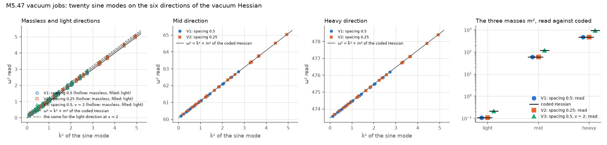
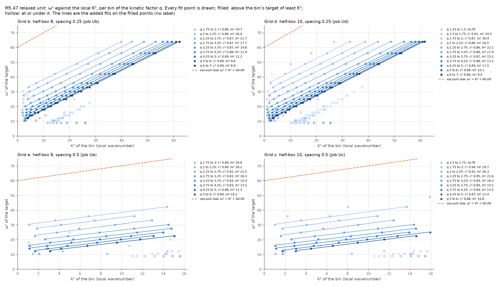
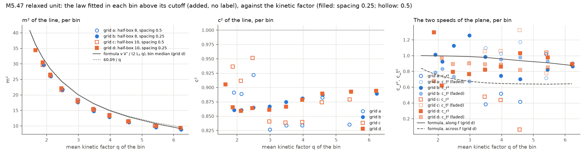
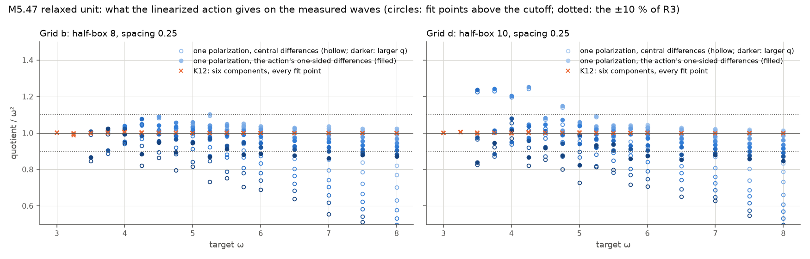
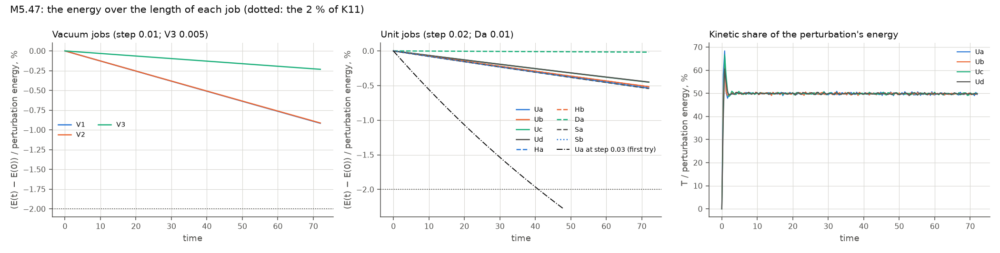
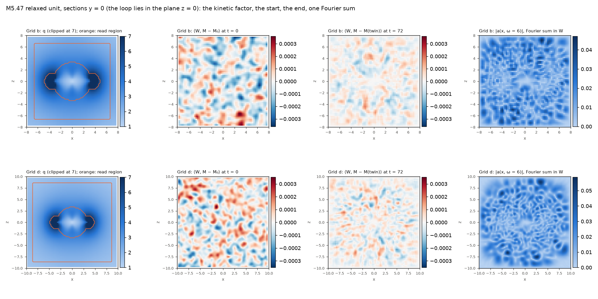

# M5.47: Klein-Gordon: the dispersion of small perturbations in a time evolution

> Opened and staged 2026-11-19. Roadmap row: [`m5_roadmap.md`](../m5_roadmap.md). Thread record: [`m5_32_convo.md`](m5_32_convo.md). The cell it reads for: the quantum wave equation (Klein-Gordon) in the M5 table of [`MODELS.md`](../../../../../MODELS.md).

## TASK PLANNING (2026-11-19; the readings of § 5 are frozen before the run)

**Scope.** The run named by the way back of the Klein-Gordon cell, as the cell reads after the re-read of [T11](../../../../../dev_docs/tasks/t11_task_details.md): the dispersion of small perturbations about a converged relaxed state, read in a time evolution, giving ω² = k² + m². The row's test is an emergent ω² = k² + m² for matter waves, and its regime is `dynamic`. The earlier spectral read cited in the cell ([`m5_21_1_method_note.md`](../findings/m5_21_1_method_note.md)) used another action, toy parameters and a sliding background; this run uses the action of [M5.42](m5_42_task_details.md) with its time part, on the relaxed states of [M5.46](m5_46_task_details.md) with the shell held. The run reports; the cell is re-read afterwards, on the bar of `MODELS.md`, in the pull request that lands the record.

**Two limits, stated before the run.** (1) The time part is supplied by this plan (§ 1): the module of M5.42 codes its value on the twist only, so every label of § 5 is conditional on that reading of the action. (2) A property of the base states, computed at staging and derivable from the action for any unit of degree 1, already says that one law ω² = k² + m² with the vacuum mass cannot be met inside boxes of half-width 10 (§ 5, registered numbers). A label R1 NOT HELD on these boxes is that consequence returned by a time evolution; it is not evidence that the model has no Klein-Gordon law at large distance. What the run can show is which law small waves obey on the relaxed unit, and whether the linearized action accounts for it.

**Definition of done.** The time-stepper passes its known-answer controls (§ 4); every job of § 2 ends at its length with its Fourier sums saved; the vacuum jobs return the six branches; each 0.25 grid of the unit carries one label for each of R1 to R3 and each pair of grids one label for R4, or the words "no label" with the rule that withheld it; the findings embed the dispersion plots, the map of the kinetic factor and the energy series; an adversarial audit on a different model has tried to refute each label; the doc checker and the roadmap linter are clean.

**Gating.** The user's go. No answer of the author is waited for.

**Research body.** This document (plan, findings, review); scripts `m5_47_evolve.py`, `m5_47_waves.py`, `m5_47_reads.py` in [`../scripts/`](../scripts/); summaries `m5_47_*.json` in [`../data/`](../data/) (arrays local, indexed by the manifest); plots `m5_47_*.png` in [`../plots/`](../plots/); checkpoints in `../checkpoints/m5_47/`.

### 1. The action with its time part

The static part is the action of [M5.42](m5_42_task_details.md) as coded in [`m5_42_eq42.py`](../scripts/m5_42_eq42.py), at J = 0, with κ = v = 1, δ = 0.05, L₁ = 0.03, c_k = 1 + δ^k, the mirror-averaged stencil:

$$
U = h^3 \sum_n \Big[ L_1 \sum_i \lVert \partial_i M \rVert^2 + \kappa \sum_{i \lt j} \lVert [\partial_i M, \partial_j M] \rVert^2 + v \sum_{k=1}^{3} \big( \operatorname{tr} M^k - c_k \big)^2 \Big]
$$

The time part is the form whose value on the twist is the inertia of M5.42: the rate of M in the L₁ term and in the time-space pairs of the commutator term, with the weights of the same stencil, and no rate in the potential:

$$
T = h^3 \sum_n \Big[ L_1 \lVert \dot M \rVert^2 + \kappa \sum_i \lVert [\dot M, \partial_i M] \rVert^2 \Big]
$$

With the rate set to Ω [G, M] this is ½ I Ω², I the inertia that `m5_42_eq42.kernel` returns. The module of M5.42 codes the inertia and not T for a general rate; the form above is this plan's reading of it (blindspot pass, § 6). The equations of motion are those of T − U, in the momentum p conjugate to the six components of M:

$$
p = \frac{\partial T}{\partial \dot M} = \mathcal{A}(M) \dot M , \qquad \dot p = \frac{\partial T}{\partial M} - \frac{\partial U}{\partial M} , \qquad E = T + U
$$

The operator 𝒜(M) is local: a symmetric positive 6 × 6 matrix per node, built from the differences of M at that node, and solved at every node at every stage. In a uniform field it is 2 h³ L₁ times the metric of the six components, so with L₁ = 0 the vacuum has no time part at all: the run is made with L₁ = 0.03. The integrator is the classical fourth-order Runge-Kutta scheme on (M, p). The nodes of the outer shell are held at their starting values in every job, as in the descents that made the states.

**Small perturbations.** About a state M₀ at rest, M = M₀ + φ obeys, to first order, 𝒜(M₀) φ̈ = −H(M₀) φ, H the second variation of U. In the uniform vacuum this is φ̈ = Δ_h φ − (v V″ / 2 L₁) φ, with Δ_h the seven-point Laplacian of the grid and V″ the Hessian of the potential at the eigenvalues (1, δ, 0). Three of the six directions rotate the frame and cost nothing in the potential; the three others change the eigenvalues, with m² = 0.1057, 60.09 and 473.5 at these values. The lattice law is then exact:

$$
\omega^2 = \hat k^2 + m_\ell^2 , \qquad \hat k^2 = \frac{4}{h^2} \sum_i \sin^2 \frac{k_i h}{2}
$$

This follows from the declared action. The vacuum jobs check the instrument against it and carry no label for the cell.

### 2. The jobs

| Job | State | Half-box | Spacing (N) | Start | Step, length | Purpose |
| --- | --- | --- | --- | --- | --- | --- |
| V1 | uniform vacuum, its frame turned by a fixed rotation | 8 | 0.5 (33) | noise in all six components, amplitude 10⁻⁴ | 0.0125, 48 | the six branches; the estimator on a known answer |
| V2 | the same | 6 | 0.25 (49) | the same | 0.0125, 48 | the same at the second spacing |
| V3 | V1 with v = 2 | 8 | 0.5 (33) | the same | 0.0125, 48 | the read of the masses must move with the potential |
| Ua, Ub | base states B0a, B0b of M5.46 | 8 | 0.5 (33), 0.25 (65) | noise in the mid polarization (§ 3), amplitude 10⁻³ | 0.03, 48 | the read on the relaxed unit, two spacings |
| Uc, Ud | base states B0c, B0d | 10 | 0.5 (41), 0.25 (81) | the same | 0.03, 48 | the same on the larger box |
| Na to Nd | the four base states | as above | as above | no perturbation | 0.03, 48 | what the background does by itself |
| Ha, Hb | B0a, B0b | 8 | 0.5, 0.25 | the noise of Ua, Ub at half the amplitude | 0.03, 48 | linearity |
| Da | B0a | 8 | 0.5 | the noise of Ua | 0.015, 48 | the step |
| Sa, Sb | B0a, B0b | 8 | 0.5, 0.25 | a second draw of the noise | 0.03, 48 | the scatter of the read |
| E1 | B0a | 8 | 0.5 | at rest, with the rate Ω [G, M] (zero on the shell), T = 1 % of U | 0.03 and 0.015, 10, then back | energy and reversal at finite amplitude |

The noise is Gaussian white noise from a seeded generator, smoothed by a Gaussian of standard deviation 0.35 in length units, scaled to a unit root mean square over the interior, multiplied by the amplitude, and zero on the shell. The start has no rate (p = 0), except E1. Every wave job accumulates, at every step, the Fourier sums of the six components of M − M₀ at its target frequencies under a Hann window over the whole length (at N = 81 about 0.9 GB per job), and E, T and U every 20 steps. The targets on the unit are ω = 3 to 6 in steps of 0.25 and 6.5, 7, 7.5, 8. The vacuum jobs add 8.25, 8.5, 8.75, 9, 10 and 11, and keep at every step the time series of twenty sine modes of the box, sin(n_i π (x_i + L)/2L) on each axis with (n_x, n_y, n_z) = (1,1,1), (2,1,1), (2,2,1), (2,2,2), (3,1,1), (3,2,1), (3,3,1), (3,3,3), (4,1,1), (4,2,2), (4,4,1), (4,4,4), (5,1,1), (5,3,1), (5,5,2), (6,1,1), (6,3,2), (6,6,1), (7,2,1), (8,1,1). The jobs Ha, Hb, Da, Sa and Sb are read against the twins Na and Nb.

**Parallel shape.** One single-threaded process per job (thread variables set to 1 before NumPy loads), the largest grids first, at most twelve at once: sixteen wave jobs, then E1 on a free core. Inside a job the force, the gradient of T and 𝒜 are built in one pass over the nodes per stage. The reads run after the jobs, one process. The GPU is not used: the action needs f64. No job is sequential by default; the only serial step is the controls K1 to K5 before the pool.

### 3. The read on the relaxed unit

**The polarization.** n(x) is the eigenvector of the largest eigenvalue of the background. In the two directions E₁ = n nᵀ and E₂ = (1 − n nᵀ)/√2 the vacuum Hessian has the eigenvalues m² = 60.08 and 473.4, within 0.02 % of the exact mid and heavy branches; W(x) = 0.1278 E₁ − 0.9918 E₂ is the direction of the lower one, written with n alone because the two small eigenvalues are 0.05 apart and their axes are not a stable frame. The start of the unit jobs is the noise times W(x), and the read is the scalar a(x, ω) = ⟨W(x), A(x, ω)⟩, A the six-component Fourier sum of the perturbed job minus that of its unperturbed twin. The heavy branch is not read on the unit (at step 0.03 the scheme damps it), and the light branch is not read there either: its mass, 0.1057, is of the size of the 1/r² terms of a frame that turns once around the box, so these boxes cannot resolve it.

**The local wavenumber.** On a set B of nodes, with Δ_h the seven-point Laplacian:

$$
K^2(B, \omega) = - \frac{\sum_{x \in B} \operatorname{Re} \big( \bar a \quad \Delta_h a \big)}{\sum_{x \in B} \lvert a \rvert^2}
$$

It is a property of the pattern of the wave alone and uses nothing of the action beyond the grid. A fit point is a pair (B, ω) with 1 ≤ K² ≤ 4/h² (a third of the band top of the grid): 16 at spacing 0.5, 64 at 0.25. Its radial share is ρ = Σ_B |r̂ · ∇a|² / Σ_B |∇a|², with central differences and r̂ taken from the center of the loop; K_r² = ρ K² and K_t² = (1 − ρ) K².

**The read region and the bins.** The nodes at least 1.5 from the loop line and at least the loop's radius from its center (center, radius and normal from the reader of [M5.44](m5_44_task_details.md) on the base state), at least 1.5 inside every face, and with the two largest eigenvalues of the background at least 0.5 apart. In the vacuum jobs the set is every node at least 1.5 inside the faces, one bin. On the unit the nodes are binned by the kinetic factor q(x): the kinetic density of the rate W at the node, with the differences and weights of the kernel, over its vacuum value L₁,

$$
q(x) = 1 + \frac{\kappa}{L_1} \sum_j \tfrac{1}{2} \Big( \lVert [W, \partial_j^{+} M_0] \rVert^2 + \lVert [W, \partial_j^{-} M_0] \rVert^2 \Big)
$$

with fixed edges 1.25, 1.5, 1.75, 2, 2.25, 2.75, 3.25, 3.75, 4.25, 5, 6, 7, the same on every grid. A bin with fewer than 500 nodes on a grid is not read there. The same tables are also given on shells of r of width 0.5, with no label.

**The fits.** Per bin, the least-squares line ω² = c² K² + m² over its fit points, with four points at least; fewer is no fit. With six points or more, also the plane ω² = c_r² K_r² + c_t² K_t² + m². The product m² q̄, q̄ the mean of q over the bin, is reported per bin beside 60.09.

**What the linearized action says, for comparison.** For a wave a(x) cos ωt in the polarization W, with C_j = [W, ∂_j M₀] (central differences) and V″_WW the second derivative of the potential along W at the local M₀, the quadratic action gives the quotient

$$
\omega_{\mathrm{act}}^2(B) = \frac{\sum_{x \in B} \Big[ L_1 \lvert \nabla a \rvert^2 + \kappa \Big( \sum_j \lVert C_j \rVert^2 \lvert \nabla a \rvert^2 - \big\lVert \sum_j C_j \partial_j a \big\rVert^2 \Big) + \tfrac{1}{2} v V''_{WW} \lvert a \rvert^2 \Big]}{\sum_{x \in B} L_1 q \lvert a \rvert^2}
$$

so that a wave along a direction e has the speed c² = 1 − κ ‖Σ_j e_j C_j‖² / (L₁ q) and the local mass m² = v V″_WW / (2 L₁ q): the law is that of an effective metric, with one speed along the gradient of the frame and another across it. Left out of the quotient: the terms in the gradient of W, the curvature term [∂_i M₀, ∂_j M₀], and the exchange with the other polarizations. The last one is not small in the kinetic form: W and the heavy direction share the commutator with ∂_j M₀, and the two-direction problem in E₁, E₂ at q = 4 gives a local mass of 13.8 where the quotient gives 15.0. The quotient is therefore expected above ω² by up to about 6 % near a cutoff. The share of the Fourier power outside W is reported per target.

### 4. The controls

| Control | Input | The answer it must return | What a failure would look like |
| --- | --- | --- | --- |
| K1 | the seed and B0a, the rate Ω [G, M] | T = ½ I Ω² with the I of `m5_42_eq42.kernel`, to 10⁻¹² relative | a weight of the stencil or the commutator term missing: a relative gap of order 1 |
| K2 | B0a, a smooth random rate | ∂T/∂Ṁ and ∂T/∂M equal to central differences of T at 200 random interior entries, within 10⁻⁶ of the largest entry of each gradient | a sign or a neighbor missing in the gradient |
| K3 | B0a and the seed | 𝒜 symmetric and positive at every node; 𝒜 𝒜⁻¹ p = p to 10⁻¹² | a node with a negative or zero eigenvalue, a residual of the solve |
| K4 | E1 | with the drift defined as the largest \|E(t) − E(0)\| over the length: under 10⁻⁴ of the starting T at step 0.015, and the drift at 0.03 between 12 and 48 times that at 0.015 | a force that is not the gradient of the E it reports: a drift that does not fall with the step |
| K5 | E1 run back from its end with p reversed | the largest \|M − M(0)\| after the return at most 1 % of the largest displacement at the turn at step 0.015, and at least 8 times smaller than at step 0.03 | a state that does not return, or a return that does not improve with the step |
| K6 | V1, V2: the twenty sine modes, all six components | each mode projected on the six eigen-directions of the Hessian of the coded potential at the vacuum, taken with the metric diag(1, 1, 1, 2, 2, 2) of the six components; per direction one frequency from x(t + τ) + x(t − τ) = c x(t), τ one step for the heavy direction and sixteen steps for the five others; each ω² within 1 % of k̂² + m_ℓ², the m_ℓ² being the eigenvalues of that same Hessian over 2 L₁ | a branch off its line. V3: the three masses must read doubled, the three others unchanged |
| K7 | V1, V2: the estimator of § 3 with W on the vacuum set, targets 8 to 11 | ω² − K² within 1.0 of 60.09 at every fit point | the estimator biased by the window, the grid or the polarization |
| K8 | Na to Nd against Ua to Ud | in the bin of every fit point, the Fourier power of the twin at most 1 % of the power of the difference | a background that moves as much as the wave |
| K9 | Ha, Hb against Ua, Ub | a(ε) and 2 a(ε/2) differ by at most 2 % in norm over the bin of every fit point | a response that is not linear in the amplitude |
| K10 | Da against Ua | K² of every fit point changes by at most 2 % | a read set by the step |
| K11 | every perturbed job | E within 2 % of the perturbation's energy E(0) − U(M₀) over the length | energy lost to the scheme or gained from an instability |
| K12 | Ua to Ud, every fit point | Σ_B Re⟨Ā, H A⟩ / Σ_B Re⟨Ā, 𝒜(M₀) A⟩ within 3 % of ω², with A the six-component difference sum and H A the central difference of the coded gradient about M₀ | Fourier sums that are not solutions of the linearized equations of § 1 |

K1 to K5 run before the pool; K6 to K12 are read from it. The try cap on the controls is three; a change of the instrument between tries is recorded. What a failure costs: K1 to K5, no pool; K6, K7, K9 or K10, no label on any grid; K8, K11 or K12, no label on the grid that failed. K12 is the control that stands in for a known answer on the non-uniform background: it holds for any exact solution of the linearized equations, whatever the polarization.

### 5. The readings, frozen

| Reading | HELD | NOT HELD |
| --- | --- | --- |
| R1, one Klein-Gordon law on the unit | on a grid, with m² the median of ω² − K² over all fit points of all bins, every fit point has \|ω² − K² − m²\| ≤ 0.05 ω² | any fit point outside |
| R2, a local law | at least three bins are fitted, and in each every fit point lies within 0.05 ω² of the bin's plane (of its line, in a bin with four or five points) | a fitted bin with a point outside; fewer than three fitted bins is no label |
| R3, the linearized action in one polarization | ω²_act within 10 % of ω² at every fit point | any fit point outside |
| R4, two spacings and two boxes | for a pair of grids, at least three bins are compared and in each c² agrees within 0.05 and m² within 10 % | a compared bin outside; fewer than three compared bins is no label for the pair |

**The pairs of R4.** Two spacings: Ua with Ub, and Uc with Ud. Two boxes: Ub with Ud, at spacing 0.25. A bin is compared in a pair when both grids read it and at least four targets are fit points of that bin on both grids; c² and m² are those of the line refitted on those shared targets on each grid.

**Descriptors, with no label of their own.** Per bin: c² and m² of the line; c_r², c_t² and m² of the plane, beside the bin means of the two speeds of § 3; m² q̄; whether c² is within 0.05 of 1; whether m² is the same in every bin within 10 %. Where R2 is HELD with c_r² and c_t² more than 0.05 apart, the finding is worded as a local law with two speeds.

**The scatter rule.** On the fit points common to the two draws of a grid (Ub with Sb; Ua with Sa): if the median of \|K²(U) − K²(S)\|/ω² on the 0.25 grid passes 0.025, R1 and R2 carry no label on any grid; if the median of \|ω²_act(U) − ω²_act(S)\|/ω² there passes 0.05, R3 carries none; if, at a spacing, the median over the bins fitted in both draws of \|c²(U) − c²(S)\| passes 0.025 or that of the relative difference of m² passes 0.05, the pairs of R4 that use that spacing carry none. R1 to R3 are labeled on the 0.25 grids. Nothing in this section sets an icon.

**Registered before the run.** The kinetic factor q was computed on the four base states at staging, with the read region and the stencil of § 3. It runs from 1.69 to 6.6 on half-box 8 and from 1.40 to 6.5 on half-box 10; its far field falls as 1 + 88/r² on every grid (the median of (q − 1) r² beyond r = 5 is 87.8 to 88.0: the frame of a unit of degree 1 turns once around any sphere). The local mass of the mid branch by the formula of § 3 has the bin medians 10.7 to 31.4 on half-box 8 and 10.7 to 36.3 on half-box 10, against 60.09 in the vacuum; the bin means of the speed are 0.91 to 1.00 along r̂ and 0.64 to 0.80 across it. The expectation recorded with these numbers: R1 NOT HELD; R2 HELD, with c² of the line between 0.7 and 0.9 and m² between 10 and 40; R3 HELD by a margin of a few percent, the quotient above ω² near the cutoffs; R4 HELD where three bins are compared. If the tail holds, q − 1 falls under 0.05 only beyond r ≈ 42, outside any box of this run. Nothing in the reads script uses these numbers.

### 6. Blindspot pass, consumers, estimate

| Unknown | Guard |
| --- | --- |
| The module of M5.42 codes the inertia on the twist, not the time part for a general rate | § 1 states the form used and the Scope makes every label conditional on it; K1 ties it to the inertia; another time part is another model, and is the author's to state |
| No region of these boxes is vacuum: the kinetic density of the mid polarization is 1.4 to 6.6 times its vacuum value over the read region | R1 is read as written and its expected outcome is stated in the Scope; R2 and R3 say what holds in its place; m² q̄ is reported, and the radius at which the vacuum law would be reached is given from the tail, as an extrapolation |
| The law on the unit has two speeds, along the gradient of the frame and across it, and one scalar K² mixes them; near a cutoff the mix changes with ω | the radial share per fit point; the plane of R2; the line kept for R4 and as a descriptor |
| The wave does not stay in W: the kinetic form couples it to the heavy direction and to the rotations | the size is stated in § 3 (about 6 % in the local mass); the share of power outside W per target; K12 holds whatever the polarization, so a failure of R3 with K12 green is a failure of the one-polarization formula and is worded so |
| A local wavenumber on a non-uniform background has no known-answer control | K7 on the uniform vacuum; K12 on the unit |
| The base states are at the gate of M5.45, not at rest, and a background that slides makes a false branch | the shell is held; the unperturbed twins; the read uses the difference; K8 |
| A fourth-order scheme damps what it does not resolve | the start is smoothed; targets up to 8 at step 0.03; K10, K11; the heavy branch is not read on the unit |
| Spacing 0.5 has few cells per wavelength at these targets, and its K² range leaves some bins with fewer than four fit points | the K² range of § 3; R4 on shared targets with a floor of three compared bins; the 0.25 grids carry R1 to R3 |
| Standing waves in a held box, evanescent zones, few modes in a bin, adjacent targets that share modes under the window | K² is signed and a point enters a fit only above 1; the second draws and the scatter rule |
| The light branch, which carries the smallest mass, is not read on the unit | stated as a limit: it is read in the vacuum jobs only |
| An unvalidated instrument, an artifact read as a result (the families of the workflow) | K1 to K12; two spacings and two boxes; each control names its failure and what it costs |

**Consumers.** R1 to R4 are read by the re-read of the cell: they need K1 to K12 green and the audit. The time-stepper is reusable by a later run of a moving or clocked unit: it needs K1 to K5.

**Estimate.** Compute: the jobs at spacing 0.5 minutes each, those at 0.25 from under an hour (N = 49, 65) to about two hours and a half (N = 81), all in one pool inside the ceiling of twelve, so the wall time is that of the largest grid. With the scripts, the controls, the reads and two audits in parallel: about four hours from go to review. Model: the session's model for the run; the audit on Opus, a numbers check on Sonnet.

**Plan audit (2026-11-19, before the go).** An independent pass on a different model read this plan against the action code, the cell, the bar and the four base states, and recomputed its numbers. It confirmed the time part against the coded inertia, the equations of motion, the vacuum masses, the polarization and every formula of § 3, and the step sizes against the frequencies present. It found thirteen points, all folded above: registered local masses that covered one bin and not the range (recomputed here on the final read region); two definitions of R1 that disagreed; R4 and the scatter rule left to judgment where a bin has no fit on one grid; K6 reading the heavy branch at a stride that aliases it, with a job it named missing from the table; K7 without a set in the vacuum; no account of the two speeds of the law, nor of the size of the exchange with the heavy direction; controls applied at targets where the response is only window tails; tolerances of K2, K4 and K5 without a basis; the Scope silent on what R1 can and cannot show on these boxes; and an estimate too low by a factor of two. K12 was added in answer to the missing known answer on the unit.

## FINDINGS (2026-11-19)

> The run of the plan above, made on 2026-11-19. The controls took three tries; the settings of record are those of the third (§ 7). Scripts: [`m5_47_evolve.py`](../scripts/m5_47_evolve.py) (the time-stepper and K0 to K5), [`m5_47_waves.py`](../scripts/m5_47_waves.py) (the jobs), [`m5_47_reads.py`](../scripts/m5_47_reads.py) (K6 to K12 and the readings), [`m5_47_report.py`](../scripts/m5_47_report.py) (tables and plots). Summaries: [`m5_47_reads.json`](../data/m5_47_reads.json), [`m5_47_controls_stepper.json`](../data/m5_47_controls_stepper.json) and one `m5_47_<job>.json` per job in [`../data/`](../data/).

**In short.** (1) The time-stepper passed its controls at the first try (K0 to K5); the wave jobs needed three tries, for K6, K9, K11 and K12. (2) In the vacuum the six branches follow ω² = k̂² + m² within 0.16 %, with the masses of the coded Hessian. (3) On the relaxed unit every reading that carries a label reads NOT HELD at spacing 0.25: R1 as registered before the run; R2, R3 and R4 for the two boxes against what was registered. One cause is visible in the data and was not foreseen: the fit points of a bin belong to two kinds of waves (§ 10). It is not the only one: on the points above each cutoff the rule of R2 still fails on one of the two grids, and the frozen quotient of R3 still fails through its central differences (§§ 11 and 12). (4) Added during the run and without label (§ 11): above its cutoff each bin of the kinetic factor lies near a line of its own (within 4.8 % of its plane on grid b; within 8.6 % on grid d, three bins of ten over the 5 % of R2), with slopes c² of 0.86 to 0.91 at spacing 0.25 and a mass that falls as q rises, from 34.5 to 9.4 on grid d and from 29.7 to 8.9 on grid b, against 60.09 in the vacuum. (5) The cell is not re-read here.

**Scope.** Small perturbations of the relaxed unit of the action of M5.42 at J = 0 (δ = 0.05, L₁ = 0.03, κ = v = 1) with the time part of § 1, the outer shell held, on half-boxes 8 and 10 at spacings 0.5 and 0.25, over a length of 72, read in the mid polarization W. Every statement is conditional on that time part, which this plan supplied. The run does not reach the vacuum law, since no region of these boxes has the kinetic factor of the vacuum (§ 5). It does not read the light or the massless directions on the unit, a unit that moves or carries a clock (J > 0), or a larger box.

### 7. The tries and the settings of record

The plan capped the controls at three tries, a change of the instrument between tries being recorded. Three were used. No threshold of § 4 and no reading of § 5 was changed.

| Try | Jobs | Step | Noise amplitude | Length | What failed | What was changed for the next try |
| --- | --- | --- | --- | --- | --- | --- |
| 1 | unit | 0.03 (plan) | 10⁻³ (plan) | 48 (plan) | K11: Ua lost 2.28 % of the perturbation's energy against 2 %; the other unit jobs, stopped at 6 to 50 % of their length, were losing 0.0013 to 0.0016 % per step, which projects linearly to 2.1 to 2.6 % over 1600 steps (a projection, not a measurement) | the step, to 0.02 |
| 1 | vacuum | 0.0125 (plan) | 10⁻⁴ (plan) | 48 | K6: worst gap 2.07 % on V1 and 4.5 % on V3, against 1 %; K11 on V3: 13.7 % | the amplitude, to 10⁻⁵; the step of V3, to 0.00625 |
| 2 | unit | 0.02 | 10⁻³ | 48 | K9: 2.26 % on Ha against 2 %; K12: 3.65 % on grid c against 3 % (the two 0.5 grids had ended; the 0.25 grids were stopped at about 30 and 55 % of their length) | the amplitude, to 10⁻⁴; the length, to 72 |
| 2 | vacuum | 0.0125 (V3: 0.00625) | 10⁻⁵ | 48 | nothing: K6 0.047 %, 0.019 % and 0.23 %; K7 0.122 and 0.255; K11 1.85 %, 1.84 % and 0.47 % | the length, to 72, to control the estimator at the window the unit jobs use; the step, to 0.01 (V3: 0.005), so that K11 holds over the longer run |
| 3 | all | 0.02 on the unit (Da: 0.01); 0.01 in the vacuum (V3: 0.005) | 10⁻⁴ on the unit (Ha, Hb: 5 × 10⁻⁵); 10⁻⁵ in the vacuum | 72 | nothing: every control is met (§ 8) | the settings of record |

What each failure was, as read from the data of the try that failed:

- **K11 at step 0.03.** The loss per step fell slowly over the run of Ua (0.0017 % of the perturbation's energy at the start, 0.0013 % at the end) and by a factor of 8 to 11 at step 0.02, where the sixth power of the step ratio is 11.4; between steps 0.02 and 0.01 the factor is 62 against 64. The fourth-order scheme damps the fast content of the start. At step 0.02 the unit jobs lose 0.45 to 0.54 % over the length of 72 (0.02 % at step 0.01).
- **K6 at amplitude 10⁻⁴.** 117 of the 120 projections of V1 were within 0.11 % of their line; three sat off it (2.07 % on the light direction of the mode (3, 1, 1); 0.43 % and 0.46 % on two massless projections), and a constant offset in the fit did not remove them. At an amplitude ten times smaller the worst gap of V1 fell to 0.047 %, more than forty times. The gaps came from the amplitude (seed, step and length were unchanged); the three projections fell by 9, 58 and more than 50 times, which is not the fall of one order, so the record says no more than terms beyond first order in the noise, on the directions that cost little.
- **K9 at amplitude 10⁻³.** Every fit point where a(ε) and 2 a(ε/2) differed by more than 0.5 % had more than 96 % of its Fourier power outside W (targets 3 to 4.5); on the fit points with the power in W the worst difference was 0.33 %. The projection on W of a wave that lives in the other polarizations has a part of second order in the amplitude.
- **K12 at length 48.** Every gap over 1.2 % sat at the first targets above a bin's cutoff, on the side of the quotient above ω²: the Hann window over 48 mixes frequencies within about ± 0.26 of the target, and under a cutoff there is nothing to mix in. Over 72 the window is narrower by a third.

### 8. The controls

| Control | What was read | Result | |
| --- | --- | --- | --- |
| K0 (added) | U and force of the fused stage against `m5_42_eq42` (seed, B0a) | relative gaps 0.000 and 0.000 | PASS |
| K1 | T against ½ I Ω² (seed, B0a) | relative gaps 2.87e-14, 1.90e-14 | PASS |
| K2 | ∂T/∂Ṁ and ∂T/∂M against central differences, 200 entries | 2.95e-09 and 1.39e-08 of the largest entry | PASS |
| K3 | 𝒜 at every interior node (seed, B0a) | least eigenvalue 0.0600 (2 L₁ = 0.06), asymmetry 3.21e-17, solve residual 2.70e-15 | PASS |
| K4 | E1: drift of E over the starting T | 8.02e-08 at step 0.015, 2.42e-06 at 0.03, ratio 30.1 | PASS |
| K5 | E1 run back: return error over the displacement at the turn | 4.18e-06 at step 0.015; 29.6 times smaller than at 0.03 | PASS |
| K6 | twenty sine modes, six directions: worst gap of ω² from k̂² + m² | V1 0.025 %, V2 0.016 %, V3 (v = 2) 0.159 % | PASS |
| K7 | the estimator in the vacuum, targets 8 to 11: worst gap of ω² − K² from 60.09 | V1 0.070 over 3 fit points, V2 0.157 over 7 | PASS |
| K8 | twin power over difference power, worst fit point (six components; in W alone) | a: 2.78e-07 (2.80e-07); b: 3.15e-06 (3.88e-06); c: 1.10e-06 (1.04e-06); d: 2.51e-06 (2.25e-06) | PASS |
| K9 | ‖a(ε) − 2 a(ε/2)‖ over ‖a(ε)‖, worst fit point | Ha: 0.003; Hb: 0.004 | PASS |
| K10 | K² at half the step (Da against Ua), worst fit point | 8.13e-05 over 65 fit points | PASS |
| K11 | largest \|E(t) − E(0)\| over the perturbation's energy | V1: 0.916 %; V2: 0.913 %; V3: 0.233 %; Ua: 0.539 %; Ub: 0.517 %; Uc: 0.452 %; Ud: 0.449 %; Ha: 0.539 %; Hb: 0.517 %; Da: 0.018 %; Sa: 0.543 %; Sb: 0.533 % | PASS |
| K12 | linearized equations on the Fourier sums: worst gap of the quotient from ω² | a: 1.421 %; b: 1.425 %; c: 1.546 %; d: 0.759 % | PASS |

K0 is not in the plan: the fused pass of the time-stepper is a new kernel, and its U and its force were compared with the kernel of M5.42 before anything else. K8 is tabled both ways the plan's sentence can be read (the power of the twin in all six components, and in W alone); the six-component number is the control.

**The vacuum branches.** The six directions are the eigen-directions of the Hessian of the coded potential at the vacuum, taken with the metric of the six components (in the order 00, 01, 02, 11, 12, 22 of the code the metric is diag(1, 2, 2, 1, 2, 1); the plan wrote the same metric for another order). The three massless directions rotate the frame.

| Job | Direction | m² of the coded Hessian | m² read (median of ω² − k̂² over the modes) | Worst gap of ω² |
| --- | --- | --- | --- | --- |
| V1 | massless 1 | 1.74e-06 | -6.36e-07 | 0.025 % |
| V1 | massless 2 | 7.22e-06 | -9.87e-07 | 0.005 % |
| V1 | massless 3 | 7.46e-06 | -7.84e-07 | 0.012 % |
| V1 | light | 0.1057 | 0.1057 | 0.006 % |
| V1 | mid | 60.0891 | 60.0891 | 0.001 % |
| V1 | heavy | 473.4737 | 473.4561 | 0.004 % |
| V2 | massless 1 | 1.74e-06 | 1.12e-07 | 0.006 % |
| V2 | massless 2 | 7.22e-06 | -1.63e-06 | 0.003 % |
| V2 | massless 3 | 7.46e-06 | -2.98e-06 | 0.008 % |
| V2 | light | 0.1057 | 0.1057 | 0.016 % |
| V2 | mid | 60.0891 | 60.0891 | 5.37e-04 % |
| V2 | heavy | 473.4737 | 473.4560 | 0.004 % |
| V3 | massless 1 | 3.49e-06 | 1.09e-07 | 0.159 % |
| V3 | massless 2 | 1.44e-05 | -2.34e-06 | 0.010 % |
| V3 | massless 3 | 1.49e-05 | -1.84e-06 | 0.027 % |
| V3 | light | 0.2115 | 0.2115 | 0.084 % |
| V3 | mid | 120.1783 | 120.1782 | 0.002 % |
| V3 | heavy | 946.9474 | 946.9385 | 0.001 % |



**The estimator on the known answer.** K7 is read on V1 and V2, as the plan says; in V3 the mid mass is 120.2, above every target, so the estimator has nothing to read there. The control covers K² of 3.9 and above (§ 16, not computed).

| Job | Target ω | K² | Fit point | ω² − K² | Power outside W |
| --- | --- | --- | --- | --- | --- |
| V1 | 7.5 | 1.52 | yes | 54.73 | 0.0 % |
| V1 | 8 | 3.95 | yes | 60.05 | 0.0 % |
| V1 | 8.25 | 7.92 | yes | 60.14 | 0.0 % |
| V1 | 8.5 | 12.09 | yes | 60.16 | 0.0 % |
| V1 | 8.75 | 16.39 | no | 60.18 | 0.0 % |
| V1 | 9 | 20.79 | no | 60.21 | 0.0 % |
| V1 | 10 | 39.54 | no | 60.46 | 0.0 % |
| V1 | 11 | 22.46 | no | 98.54 | 0.9 % |
| V2 | 7.5 | 3.98 | yes | 52.27 | 100.0 % |
| V2 | 8 | 3.86 | yes | 60.14 | 2.9 % |
| V2 | 8.25 | 8.00 | yes | 60.06 | 1.9 % |
| V2 | 8.5 | 12.09 | yes | 60.16 | 1.5 % |
| V2 | 8.75 | 16.39 | yes | 60.18 | 1.0 % |
| V2 | 9 | 20.87 | yes | 60.13 | 1.0 % |
| V2 | 10 | 39.75 | yes | 60.25 | 0.6 % |
| V2 | 11 | 60.82 | yes | 60.18 | 0.3 % |

### 9. The grids and the readings as frozen

| Grid | Base | N | Spacing | Loop radius | Nodes read | q, least to largest | Median of (q − 1) r² beyond r = 5 | Fit points |
| --- | --- | --- | --- | --- | --- | --- | --- | --- |
| a | B0a | 33 | 0.5 | 3.293 | 17794 | 1.69 to 6.57 | 87.9 | 65 |
| b | B0b | 65 | 0.25 | 3.316 | 133242 | 1.69 to 6.64 | 88.0 | 153 |
| c | B0c | 41 | 0.5 | 3.293 | 40986 | 1.40 to 6.39 | 87.8 | 69 |
| d | B0d | 81 | 0.25 | 3.316 | 312874 | 1.40 to 6.52 | 88.0 | 185 |

The kinetic factor computed by the reads script from its definition equals W·𝒜(M₀)·W / (2 L₁) from the matrix of the time-stepper to 10⁻¹⁴ on every grid, and its range and its tail are those registered in § 5.

| Grid | R1: median m², largest gap, points outside | R2: bins fitted, largest gap | R3: quotient over ω² − 1 (least, median, largest), points outside |
| --- | --- | --- | --- |
| a | 11.2, 198.1 %, 58 of 65 | 8, 91.8 % | -32.3 %, 0.5 %, 303.4 %; 40 of 65 |
| b | 8.7, 285.3 %, 123 of 153 | 9, 133.5 % | -58.0 %, -1.8 %, 335.2 %; 104 of 153 |
| c | 11.1, 194.8 %, 60 of 69 | 9, 99.1 % | -32.3 %, 1.2 %, 355.3 %; 42 of 69 |
| d | 8.9, 280.6 %, 152 of 185 | 11, 131.8 % | -54.4 %, 0.5 %, 438.1 %; 130 of 185 |

| Grid or pair | R1 | R2 | R3 | R4 |
| --- | --- | --- | --- | --- |
| a (spacing 0.5: tabled, not labeled) | NOT HELD | NOT HELD | NOT HELD | |
| b | NOT HELD | NOT HELD | NOT HELD | |
| c (spacing 0.5: tabled, not labeled) | NOT HELD | NOT HELD | NOT HELD | |
| d | NOT HELD | NOT HELD | NOT HELD | |
| a with b (two spacings, half-box 8) | | | | no label (scatter at spacing 0.5) |
| c with d (two spacings, half-box 10) | | | | no label (scatter at spacing 0.5) |
| b with d (two boxes, spacing 0.25) | | | | NOT HELD |

On the two grids that carry the labels (b and d, spacing 0.25): **R1 NOT HELD** (123 of 153 and 152 of 185 fit points lie more than 0.05 ω² from one law with the median mass, 8.7 and 8.9); **R2 NOT HELD** (every fitted bin has a point outside its plane, the largest gaps 134 % and 132 % of ω²); **R3 NOT HELD** (104 of 153 and 130 of 185 fit points outside 10 %). No control and no scatter rule withholds these three: K6 to K12 are met on both grids, and the second draw at spacing 0.25 is inside its limits (§ 13). R1 is the outcome registered in § 5; R2 and R3 are not (§ 15).

**The bins, with the frozen fit points.** The lines and planes below are those the frozen rule gives. They are not laws of anything: § 10 shows that the fit points of a bin belong to two kinds of waves.

**Grid b (half-box 8, spacing 0.25), the frozen fit points.**

| q | Nodes | Median r | Fit points | Line: c², m² | m² q̄ | Plane: c_r², c_t², m² | Formula: c_r², c_t², m² (median) | Largest gap from the fit |
| --- | --- | --- | --- | --- | --- | --- | --- | --- |
| 1.75 to 2 | 5400 | 9.7 | 17 | 0.63, 17.5 | 33.5 | 5.89, -1.16, 23.9 | 1.00, 0.76, 31.2 | 133.5 % (plane) |
| 2 to 2.25 | 15618 | 8.7 | 17 | 0.80, 14.8 | 31.6 | 5.59, -1.09, 21.8 | 0.99, 0.74, 28.0 | 111.2 % (plane) |
| 2.25 to 2.75 | 38633 | 7.6 | 17 | 0.95, 12.3 | 30.8 | 5.38, -1.21, 19.7 | 0.99, 0.71, 24.0 | 63.0 % (plane) |
| 2.75 to 3.25 | 27875 | 6.6 | 17 | 0.96, 11.4 | 34.0 | 5.34, -1.22, 16.6 | 0.99, 0.68, 20.1 | 60.5 % (plane) |
| 3.25 to 3.75 | 18057 | 6.0 | 17 | 0.95, 10.5 | 36.5 | 4.79, -0.98, 13.6 | 0.98, 0.66, 17.2 | 73.6 % (plane) |
| 3.75 to 4.25 | 10662 | 5.5 | 17 | 0.93, 10.0 | 39.8 | 3.93, -0.56, 11.3 | 0.96, 0.65, 15.0 | 78.8 % (plane) |
| 4.25 to 5 | 8824 | 5.2 | 17 | 0.91, 9.2 | 42.3 | 4.18, -0.69, 9.8 | 0.94, 0.64, 12.9 | 38.2 % (plane) |
| 5 to 6 | 6253 | 4.8 | 17 | 0.90, 8.1 | 44.2 | 4.08, -0.73, 8.7 | 0.91, 0.64, 10.7 | 57.3 % (plane) |
| 6 to 7 | 1760 | 4.3 | 17 | 0.88, 7.6 | 47.6 | 4.45, -0.99, 9.1 | 0.85, 0.65, 9.2 | 97.7 % (plane) |

**Grid d (half-box 10, spacing 0.25), the frozen fit points.**

| q | Nodes | Median r | Fit points | Line: c², m² | m² q̄ | Plane: c_r², c_t², m² | Formula: c_r², c_t², m² (median) | Largest gap from the fit |
| --- | --- | --- | --- | --- | --- | --- | --- | --- |
| 1.25 to 1.5 | 2576 | 13.6 | 17 | 0.21, 24.1 | 35.4 | 6.97, -0.50, 14.1 | 1.00, 0.84, 40.7 | 130.8 % (plane) |
| 1.5 to 1.75 | 46724 | 11.5 | 16 | 0.42, 20.4 | 33.7 | 6.44, -0.70, 17.5 | 1.00, 0.80, 36.2 | 131.8 % (plane) |
| 1.75 to 2 | 68734 | 10.0 | 17 | 0.56, 19.1 | 35.8 | 6.30, -1.16, 23.0 | 1.00, 0.77, 32.0 | 127.1 % (plane) |
| 2 to 2.25 | 56568 | 8.8 | 17 | 0.78, 15.7 | 33.2 | 6.11, -1.26, 21.5 | 1.00, 0.74, 28.4 | 81.9 % (plane) |
| 2.25 to 2.75 | 63039 | 7.7 | 17 | 0.93, 13.6 | 33.5 | 6.38, -1.36, 16.9 | 0.99, 0.71, 24.5 | 63.4 % (plane) |
| 2.75 to 3.25 | 30463 | 6.7 | 16 | 0.96, 11.8 | 35.1 | 5.57, -1.12, 14.5 | 0.99, 0.67, 20.2 | 68.8 % (plane) |
| 3.25 to 3.75 | 17686 | 6.0 | 17 | 0.94, 11.4 | 39.6 | 4.41, -0.71, 12.2 | 0.98, 0.66, 17.2 | 80.3 % (plane) |
| 3.75 to 4.25 | 10212 | 5.6 | 17 | 0.92, 10.9 | 43.2 | 3.75, -0.50, 11.1 | 0.96, 0.65, 15.0 | 59.0 % (plane) |
| 4.25 to 5 | 8952 | 5.2 | 17 | 0.91, 9.9 | 45.2 | 4.34, -0.83, 10.1 | 0.94, 0.64, 12.9 | 28.5 % (plane) |
| 5 to 6 | 6152 | 4.8 | 17 | 0.90, 8.7 | 47.2 | 4.24, -0.84, 8.6 | 0.91, 0.64, 10.7 | 39.4 % (plane) |
| 6 to 7 | 1768 | 4.5 | 17 | 0.89, 8.1 | 50.2 | 4.46, -0.99, 8.3 | 0.88, 0.64, 9.2 | 61.5 % (plane) |

The tables of the two 0.5 grids are in [`m5_47_reads.json`](../data/m5_47_reads.json).

### 10. Two kinds of waves in one bin

The plan asked for the share of the Fourier power outside W per target, as a descriptor. It decides the reading. In every bin there is a cutoff: under it, more than 90 % of the power at the target is outside W, and almost none of that is in the heavy direction (the direction of the E₁, E₂ plane orthogonal to W), so it is in the four directions that rotate the frame or split the two small eigenvalues. The projection of such a wave on W is small, but its pattern has a K² inside the fit range, so the frozen rule counts it as a fit point. Above the cutoff the mid wave appears: the power in W rises by one to three orders of magnitude. On the 0.5 grids it then holds most of the power; on the 0.25 grids it shares it with the same soft directions (20 to 78 % outside W, § 11). One line through the points under and above the cutoff is a line through two different waves.

| Grid | q | Fit points with the power outside W over 90 %: targets, K² | Fit points with it under 50 %: targets, K² | Fit points between | Largest heavy share at a fit point |
| --- | --- | --- | --- | --- | --- |
| a | 1.75 to 2 | 4: ω 3 to 5, K² 5.0 to 14.8 | 4: ω 5.5 to 6.5, K² 1.1 to 14.4 | 0 | 0.6 % |
| a | 2 to 2.25 | 4: ω 3 to 4.5, K² 11.4 to 15.5 | 4: ω 5.25 to 6, K² 1.8 to 11.2 | 0 | 0.7 % |
| a | 2.25 to 2.75 | 4: ω 3 to 4.25, K² 1.1 to 14.3 | 4: ω 5 to 5.75, K² 3.8 to 12.9 | 1 | 0.9 % |
| a | 2.75 to 3.25 | 4: ω 3 to 3.75, K² 2.7 to 14.4 | 5: ω 4.5 to 5.5, K² 2.6 to 14.5 | 0 | 1.0 % |
| a | 3.25 to 3.75 | 3: ω 3 to 3.5, K² 4.3 to 14.0 | 5: ω 4.25 to 5.25, K² 3.1 to 14.8 | 1 | 1.0 % |
| a | 3.75 to 4.25 | 2: ω 3 to 3.25, K² 1.5 to 14.9 | 6: ω 3.75 to 5, K² 1.1 to 14.0 | 0 | 1.0 % |
| a | 4.25 to 5 | 1: ω 3 to 3, K² 15.6 to 15.6 | 5: ω 3.75 to 4.75, K² 2.9 to 13.1 | 1 | 1.2 % |
| a | 5 to 6 | none | 7: ω 3.25 to 4.75, K² 2.1 to 15.1 | 0 | 1.4 % |
| b | 1.75 to 2 | 10: ω 3 to 5.25, K² 3.7 to 27.6 | 2: ω 6 to 6.5, K² 7.2 to 14.3 | 5 | 0.3 % |
| b | 2 to 2.25 | 9: ω 3 to 5, K² 2.2 to 24.4 | 5: ω 5.5 to 7, K² 4.5 to 27.0 | 3 | 0.5 % |
| b | 2.25 to 2.75 | 6: ω 3 to 4.25, K² 9.7 to 19.8 | 9: ω 5 to 8, K² 4.0 to 48.5 | 2 | 0.6 % |
| b | 2.75 to 3.25 | 4: ω 3 to 3.75, K² 10.7 to 16.9 | 9: ω 4.5 to 7, K² 3.0 to 36.3 | 4 | 0.7 % |
| b | 3.25 to 3.75 | 3: ω 3 to 3.5, K² 8.4 to 15.0 | 8: ω 4.25 to 6, K² 3.4 to 24.6 | 6 | 0.9 % |
| b | 3.75 to 4.25 | 2: ω 3 to 3.25, K² 7.1 to 16.7 | 7: ω 4 to 5.5, K² 3.3 to 20.1 | 8 | 1.0 % |
| b | 4.25 to 5 | 1: ω 3 to 3, K² 19.0 to 19.0 | 5: ω 3.75 to 4.75, K² 3.3 to 12.9 | 11 | 1.2 % |
| b | 5 to 6 | 1: ω 3 to 3, K² 22.7 to 22.7 | 5: ω 3.5 to 4.5, K² 3.6 to 11.7 | 11 | 1.4 % |
| b | 6 to 7 | 1: ω 3 to 3, K² 25.9 to 25.9 | 3: ω 3.25 to 3.75, K² 2.9 to 5.4 | 13 | 1.3 % |
| c | 1.5 to 1.75 | 3: ω 3 to 3.5, K² 10.6 to 14.3 | 3: ω 6 to 7, K² 2.2 to 15.9 | 0 | 0.4 % |
| c | 1.75 to 2 | 3: ω 3 to 3.5, K² 11.0 to 15.0 | 4: ω 5.5 to 6.5, K² 1.0 to 13.7 | 0 | 0.6 % |
| c | 2 to 2.25 | 4: ω 3 to 4.5, K² 8.3 to 15.6 | 4: ω 5.25 to 6, K² 1.7 to 10.9 | 0 | 0.7 % |
| c | 2.25 to 2.75 | 3: ω 3 to 4, K² 5.4 to 14.3 | 5: ω 4.75 to 5.75, K² 1.6 to 12.4 | 0 | 0.9 % |
| c | 2.75 to 3.25 | 3: ω 3 to 3.5, K² 11.5 to 14.0 | 5: ω 4.5 to 5.5, K² 2.6 to 14.4 | 0 | 1.0 % |
| c | 3.25 to 3.75 | 3: ω 3 to 3.5, K² 2.0 to 14.1 | 6: ω 4 to 5.25, K² 1.0 to 14.6 | 0 | 1.1 % |
| c | 3.75 to 4.25 | 2: ω 3 to 3.25, K² 1.1 to 14.8 | 6: ω 3.75 to 5, K² 1.1 to 13.9 | 0 | 1.1 % |
| c | 4.25 to 5 | 1: ω 3 to 3, K² 15.5 to 15.5 | 6: ω 3.75 to 5, K² 3.0 to 15.9 | 1 | 1.3 % |
| c | 5 to 6 | none | 7: ω 3.25 to 4.75, K² 1.8 to 14.6 | 0 | 1.5 % |
| d | 1.25 to 1.5 | 13: ω 3 to 6, K² 10.3 to 37.7 | none | 4 | 0.1 % |
| d | 1.5 to 1.75 | 11: ω 3 to 5.5, K² 10.7 to 32.0 | 4: ω 6.5 to 8, K² 8.0 to 32.9 | 1 | 0.3 % |
| d | 1.75 to 2 | 10: ω 3 to 5.25, K² 2.1 to 27.9 | 6: ω 5.75 to 8, K² 3.4 to 38.8 | 1 | 0.5 % |
| d | 2 to 2.25 | 8: ω 3 to 4.75, K² 7.5 to 23.5 | 8: ω 5.25 to 8, K² 1.9 to 43.6 | 1 | 0.7 % |
| d | 2.25 to 2.75 | 6: ω 3 to 4.25, K² 4.3 to 19.0 | 9: ω 5 to 8, K² 3.7 to 48.8 | 2 | 0.7 % |
| d | 2.75 to 3.25 | 4: ω 3 to 3.75, K² 7.0 to 15.7 | 11: ω 4.5 to 8, K² 2.8 to 53.7 | 1 | 0.8 % |
| d | 3.25 to 3.75 | 3: ω 3 to 3.5, K² 5.3 to 15.2 | 11: ω 4 to 7, K² 1.3 to 38.9 | 3 | 1.0 % |
| d | 3.75 to 4.25 | 2: ω 3 to 3.25, K² 4.0 to 16.9 | 10: ω 3.75 to 6, K² 1.7 to 25.7 | 5 | 1.1 % |
| d | 4.25 to 5 | 1: ω 3 to 3, K² 19.1 to 19.1 | 9: ω 3.5 to 5.5, K² 2.0 to 21.0 | 7 | 1.3 % |
| d | 5 to 6 | 1: ω 3 to 3, K² 22.7 to 22.7 | 7: ω 3.25 to 4.75, K² 2.3 to 14.1 | 9 | 1.4 % |
| d | 6 to 7 | 1: ω 3 to 3, K² 25.4 to 25.4 | 5: ω 3.25 to 4.25, K² 2.7 to 9.6 | 11 | 1.5 % |



On grid d, for example, the bin of q from 2.25 to 2.75 has six fit points at the targets 3 to 4.25 with more than 90 % of the power outside W and K² from 4.3 to 19.0, and nine at the targets 5 to 8 with less than half of it outside and K² from 3.7 to 48.8; the frozen line of the bin joins the two sets. The largest heavy share at any fit point of the two labeled grids is 1.5 %. In the plot the hollow points are the targets at or under each bin's target of least K², the filled ones those above it.

### 11. Added after the first reads: the mid branch of each bin (no label)

Two descriptors were added during the run. Neither carries a label and neither replaces a reading: each applies the frozen estimator, bins and fits to a subset of the fit points.

| Descriptor | The fit points it keeps | Defined | What it had seen |
| --- | --- | --- | --- |
| In W | those with the power outside W under 50 % | 11:57 | the first read of grid a (spacing 0.5, try 2) |
| Above the cutoff | in each bin, those at the targets above the target of least K² | 13:33 | grids a, b and c of try 3; grid d had not ended |

The second was added because the first does not survive the finer grid. At spacing 0.25 the waves outside W are resolved up to target 8 and share the power above the cutoff with the mid wave (on the points kept by the second descriptor the power outside W runs from 24 to 77 % on grid b and from 20 to 78 % on grid d, against 1 to 60 % on the two 0.5 grids), while K² of the projection a still lies near one line per bin. The second descriptor assumes that the waves outside W weigh little in a above the cutoff: under each cutoff they put between 0.02 % and 19 % of their power on W (a median of 0.6 % on grid b). That assumption is not tested above the cutoff, and the alternative, that K² there is partly set by the soft polarizations, is not excluded. Grid d is the one grid read under the second definition without having been seen.

**The first descriptor (in W), by grid.**

| Grid | Fit points: all, kept | Power outside W on the kept points, least to largest | Median m² of ω² − K², largest gap, points outside 5 % | Bins fitted, largest gap from the fit | Quotient over ω² − 1, central differences (least, median, largest; outside 10 %) | The same on the action's one-sided differences |
| --- | --- | --- | --- | --- | --- | --- |
| a | 65, 40 | 1.2 % to 48.7 % | 13.8, 50.7 %, 35 of 40 | 8, 7.1 % | -32.3 %, -2.8 %, 20.2 %; 15 of 40 | -10.8 %, 2.9 %, 21.9 %; 3 of 40 |
| b | 153, 53 | 24.0 % to 49.7 % | 13.6, 56.2 %, 42 of 53 | 7, 4.5 % | -29.9 %, -2.6 %, 8.2 %; 10 of 53 | -13.4 %, 2.1 %, 9.1 %; 1 of 53 |
| c | 69, 46 | 0.5 % to 48.8 % | 15.0, 59.0 %, 41 of 46 | 8, 4.8 % | -32.3 %, -3.5 %, 22.3 %; 19 of 46 | -9.6 %, 3.0 %, 24.2 %; 5 of 46 |
| d | 185, 80 | 19.5 % to 49.3 % | 13.5, 52.7 %, 65 of 80 | 10, 6.3 % | -33.8 %, -4.6 %, 23.0 %; 30 of 80 | -16.2 %, 1.2 %, 24.2 %; 7 of 80 |

**The second descriptor (above the cutoff), by grid.**

| Grid | Fit points: all, kept | Power outside W on the kept points, least to largest | Median m² of ω² − K², largest gap, points outside 5 % | Bins fitted, largest gap from the fit | Quotient over ω² − 1, central differences (least, median, largest; outside 10 %) | The same on the action's one-sided differences |
| --- | --- | --- | --- | --- | --- | --- |
| a | 65, 42 | 1.2 % to 59.5 % | 14.5, 48.5 %, 36 of 42 | 8, 4.4 % | -32.3 %, -2.7 %, 22.6 %; 17 of 42 | -10.8 %, 3.3 %, 25.6 %; 5 of 42 |
| b | 153, 103 | 24.0 % to 77.0 % | 10.6, 55.5 %, 82 of 103 | 9, 4.8 % | -58.0 %, -11.7 %, 9.5 %; 56 of 103 | -13.8 %, -0.7 %, 10.3 %; 14 of 103 |
| c | 69, 46 | 0.5 % to 50.6 % | 15.0, 52.1 %, 41 of 46 | 8, 3.2 % | -32.3 %, -3.5 %, 22.3 %; 19 of 46 | -9.6 %, 3.0 %, 24.2 %; 5 of 46 |
| d | 185, 116 | 19.5 % to 77.6 % | 11.4, 61.6 %, 96 of 116 | 10, 8.6 % | -54.4 %, -10.1 %, 24.2 %; 63 of 116 | -17.6 %, -0.7 %, 25.2 %; 22 of 116 |

**Above the cutoff, grid b (half-box 8, spacing 0.25).**

| q | Points kept | Targets | Line: c², m² | Plane: c_r², c_t², m² (condition number) | Formula: c_r², c_t², m² (median) | m² over the formula | m² q̄ | Largest gap from the fit |
| --- | --- | --- | --- | --- | --- | --- | --- | --- |
| 1.75 to 2 | 6 | 5.75 to 8 | 0.86, 29.7 | 1.01, 0.78, 29.8 (49) | 1.00, 0.76, 31.2 | 0.95 | 56.7 | 0.7 % (plane) |
| 2 to 2.25 | 8 | 5.25 to 8 | 0.86, 26.0 | 0.92, 0.83, 26.1 (38) | 0.99, 0.74, 28.0 | 0.93 | 55.6 | 1.9 % (plane) |
| 2.25 to 2.75 | 9 | 5 to 8 | 0.87, 21.7 | 1.12, 0.73, 22.0 (58) | 0.99, 0.71, 24.0 | 0.90 | 54.3 | 1.5 % (plane) |
| 2.75 to 3.25 | 11 | 4.5 to 8 | 0.87, 17.7 | 1.26, 0.67, 17.9 (72) | 0.99, 0.68, 20.1 | 0.88 | 52.7 | 2.6 % (plane) |
| 3.25 to 3.75 | 12 | 4.25 to 8 | 0.87, 14.8 | 0.99, 0.82, 14.8 (75) | 0.98, 0.66, 17.2 | 0.86 | 51.4 | 3.0 % (plane) |
| 3.75 to 4.25 | 13 | 4 to 8 | 0.88, 12.9 | 0.74, 0.95, 12.8 (62) | 0.96, 0.65, 15.0 | 0.86 | 51.2 | 3.1 % (plane) |
| 4.25 to 5 | 14 | 3.75 to 8 | 0.89, 11.2 | 0.70, 0.98, 11.2 (47) | 0.94, 0.64, 12.9 | 0.87 | 51.3 | 3.0 % (plane) |
| 5 to 6 | 15 | 3.5 to 8 | 0.89, 9.6 | 0.82, 0.93, 9.6 (39) | 0.91, 0.64, 10.7 | 0.89 | 52.0 | 4.8 % (plane) |
| 6 to 7 | 15 | 3.5 to 8 | 0.89, 8.9 | 0.86, 0.90, 8.9 (41) | 0.85, 0.65, 9.2 | 0.97 | 55.3 | 2.7 % (plane) |

**Above the cutoff, grid d (half-box 10, spacing 0.25).**

| q | Points kept | Targets | Line: c², m² | Plane: c_r², c_t², m² (condition number) | Formula: c_r², c_t², m² (median) | m² over the formula | m² q̄ | Largest gap from the fit |
| --- | --- | --- | --- | --- | --- | --- | --- | --- |
| 1.25 to 1.5 | 3 | | no fit | | 1.00, 0.84, 40.7 | | | |
| 1.5 to 1.75 | 5 | 6 to 8 | 0.91, 34.5 | n/a | 1.00, 0.80, 36.2 | 0.95 | 56.9 | 1.7 % (line) |
| 1.75 to 2 | 6 | 5.75 to 8 | 0.87, 30.4 | 1.29, 0.68, 30.4 (73) | 1.00, 0.77, 32.0 | 0.95 | 57.1 | 0.8 % (plane) |
| 2 to 2.25 | 8 | 5.25 to 8 | 0.86, 26.5 | 0.62, 0.97, 26.6 (59) | 1.00, 0.74, 28.4 | 0.93 | 56.2 | 1.8 % (plane) |
| 2.25 to 2.75 | 10 | 4.75 to 8 | 0.86, 22.1 | 0.79, 0.89, 22.1 (57) | 0.99, 0.71, 24.5 | 0.90 | 54.5 | 5.2 % (plane) |
| 2.75 to 3.25 | 12 | 4.25 to 8 | 0.86, 17.9 | 0.77, 0.90, 18.0 (46) | 0.99, 0.67, 20.2 | 0.89 | 53.4 | 4.8 % (plane) |
| 3.25 to 3.75 | 13 | 4 to 8 | 0.87, 15.2 | 0.82, 0.89, 15.2 (38) | 0.98, 0.66, 17.2 | 0.88 | 53.0 | 2.4 % (plane) |
| 3.75 to 4.25 | 14 | 3.75 to 8 | 0.88, 13.2 | 0.86, 0.89, 13.3 (40) | 0.96, 0.65, 15.0 | 0.88 | 52.7 | 5.1 % (plane) |
| 4.25 to 5 | 15 | 3.5 to 8 | 0.89, 11.5 | 1.03, 0.82, 11.5 (51) | 0.94, 0.64, 12.9 | 0.89 | 52.8 | 8.6 % (plane) |
| 5 to 6 | 15 | 3.5 to 8 | 0.89, 10.1 | 0.98, 0.85, 10.1 (45) | 0.91, 0.64, 10.7 | 0.94 | 55.1 | 4.3 % (plane) |
| 6 to 7 | 15 | 3.5 to 8 | 0.89, 9.4 | 0.89, 0.90, 9.4 (42) | 0.88, 0.64, 9.2 | 1.02 | 58.2 | 3.7 % (plane) |



What the tables say, above the cutoff:

1. **Each bin follows a line of its own.** On grid b the nine fitted bins lie within 4.8 % of their plane. On grid d, the grid not seen when the descriptor was defined, the ten fitted bins lie within 8.6 %, three of them over 5 % (5.2, 5.1 and 8.6 %). The rule of R2 applied to these points would read held on b and not held on d; it is not applied.
2. **Nearly one slope at spacing 0.25.** The c² of the line is 0.86 to 0.89 on grid b and 0.86 to 0.91 on grid d, at every q from 1.65 to 6.2; on the 0.5 grids, with four to seven points per bin, it is 0.83 to 0.95. The slope depends on the range of targets: fitted on the low and on the high half of a bin's points it differs by up to 0.09 (the audit's check).
3. **The mass falls with q.** It goes from 34.5 at q̄ = 1.65 to 9.4 at q̄ = 6.2 on grid d (29.7 to 8.9 on grid b), between 0.86 and 0.97 of the one-polarization formula on grid b and between 0.88 and 1.02 on grid d; m² q̄ runs from 51.2 to 58.2 against 60.09. No bin has the vacuum mass, and one law for all the kept points fails as R1 does (82 of 103 and 96 of 116 points outside). The run names no cause for the mass sitting under the formula: the exchange with the heavy direction stated in § 3 predicts a lowering of this size (§ 15), and the exchange with the four soft directions is not excluded.
4. **The two speeds are not resolved.** The planes have condition numbers of 38 to 75; their c_r² runs from 0.62 to 1.29 and their c_t² from 0.67 to 0.98 with no order between them, where the formula puts c_r² at 0.85 to 1.00 and c_t² at 0.64 to 0.80. The radial share ρ runs from 0.12 to 0.55 over the points of a bin, yet K_r² and K_t² stay partly collinear. The slope of the line lies between the two speeds of the formula in every bin but the innermost, where it is above both (0.89 against 0.85 and 0.65 on grid b).
5. **The innermost bins rest on an extrapolation.** Where q is above about 4.5 the cutoff lies at the low end of the targets (the lowest kept target is 3.5), so the m² there is the intercept of a line through frequencies above it.

**Against the author's post of 2026-11-19.** The author posted, during this run, three runs on their own code ([discussioncomment-19756045](https://github.com/vantasnerdan/substrate-framework/discussions/186#discussioncomment-19756045); the row of that date in the [thread record](m5_32_convo.md)). For the vacuum they give the masses 0.10575, 60.0887 and 473.470 on six branches, the masses of § 8. On the converged charge they drive a wave below the vacuum gap and report that it propagates where the local mass √(L₁ m² / I(r)) is under ω and turns where the two are equal, at radii near 6 on the axis and near 8 in the ring plane against 6.4 and 8.4 predicted; their test of the wavenumber along a ray failed, and they registered in its place the propagating bands on the two rays at ω = 4 and ω = 5.5. Their local mass is the vacuum mass over the kinetic factor q of § 3. This run drives nothing and reads nothing along a ray. What it has in the same terms is the cutoff of each bin of q, the √m² of its line, against the same local mass at the bin's mean q:

| Grid | q | Mean q of the bin | √(m²_vac / q̄) | Cutoff of the bin: √m² of its line | Ratio | Lowest target kept |
| --- | --- | --- | --- | --- | --- | --- |
| a | 1.75 to 2 | 1.91 | 5.62 | 5.44 | 0.969 | 5.5 |
| a | 2 to 2.25 | 2.13 | 5.31 | 5.12 | 0.965 | 5.25 |
| a | 2.25 to 2.75 | 2.49 | 4.91 | 4.64 | 0.945 | 4.75 |
| a | 2.75 to 3.25 | 2.99 | 4.48 | 4.28 | 0.955 | 4.5 |
| a | 3.25 to 3.75 | 3.49 | 4.15 | 3.93 | 0.946 | 4 |
| a | 3.75 to 4.25 | 3.98 | 3.89 | 3.67 | 0.945 | 3.75 |
| a | 4.25 to 5 | 4.58 | 3.62 | 3.36 | 0.929 | 3.5 |
| a | 5 to 6 | 5.40 | 3.33 | 3.19 | 0.957 | 3.5 |
| b | 1.75 to 2 | 1.91 | 5.61 | 5.45 | 0.972 | 5.75 |
| b | 2 to 2.25 | 2.14 | 5.30 | 5.10 | 0.962 | 5.25 |
| b | 2.25 to 2.75 | 2.50 | 4.91 | 4.66 | 0.950 | 5 |
| b | 2.75 to 3.25 | 2.98 | 4.49 | 4.20 | 0.937 | 4.5 |
| b | 3.25 to 3.75 | 3.48 | 4.15 | 3.84 | 0.925 | 4.25 |
| b | 3.75 to 4.25 | 3.98 | 3.89 | 3.59 | 0.923 | 4 |
| b | 4.25 to 5 | 4.59 | 3.62 | 3.34 | 0.924 | 3.75 |
| b | 5 to 6 | 5.44 | 3.32 | 3.09 | 0.930 | 3.5 |
| b | 6 to 7 | 6.23 | 3.10 | 2.98 | 0.960 | 3.5 |
| c | 1.75 to 2 | 1.87 | 5.66 | 5.45 | 0.962 | 5.5 |
| c | 2 to 2.25 | 2.12 | 5.33 | 5.13 | 0.962 | 5.25 |
| c | 2.25 to 2.75 | 2.47 | 4.94 | 4.64 | 0.941 | 4.75 |
| c | 2.75 to 3.25 | 2.97 | 4.50 | 4.28 | 0.952 | 4.5 |
| c | 3.25 to 3.75 | 3.47 | 4.16 | 3.94 | 0.947 | 4 |
| c | 3.75 to 4.25 | 3.97 | 3.89 | 3.67 | 0.945 | 3.75 |
| c | 4.25 to 5 | 4.57 | 3.63 | 3.38 | 0.931 | 3.5 |
| c | 5 to 6 | 5.41 | 3.33 | 3.16 | 0.949 | 3.5 |
| d | 1.5 to 1.75 | 1.65 | 6.03 | 5.87 | 0.973 | 6 |
| d | 1.75 to 2 | 1.87 | 5.66 | 5.52 | 0.974 | 5.75 |
| d | 2 to 2.25 | 2.12 | 5.33 | 5.15 | 0.967 | 5.25 |
| d | 2.25 to 2.75 | 2.47 | 4.94 | 4.70 | 0.952 | 4.75 |
| d | 2.75 to 3.25 | 2.98 | 4.49 | 4.24 | 0.943 | 4.25 |
| d | 3.25 to 3.75 | 3.48 | 4.16 | 3.90 | 0.939 | 4 |
| d | 3.75 to 4.25 | 3.97 | 3.89 | 3.64 | 0.936 | 3.75 |
| d | 4.25 to 5 | 4.59 | 3.62 | 3.39 | 0.937 | 3.5 |
| d | 5 to 6 | 5.45 | 3.32 | 3.18 | 0.958 | 3.5 |
| d | 6 to 7 | 6.21 | 3.11 | 3.06 | 0.984 | 3.5 |

The cutoff of every fitted bin is under that local mass: the ratio is 0.92 to 0.97 on grid b and 0.94 to 0.98 on grid d, lowest near q = 4. Nothing is claimed here about the author's radii. The bands on the two rays are not read here; they are the subject of [M5.49](m5_49_task_details.md), which computes them from the background of OpenWave before reading the wave.

### 12. The quotient of the linearized action

R3 compares ω² with the quotient of § 3 at every fit point. The plan fixed central differences for C_j and for ρ and left the stencil of the gradient of a open; the script took central differences there too (§ 16, item 9). The label does not depend on that choice: the points under the cutoffs fail by themselves. Two things are tabled beside it (§ 11, the summaries), both added after the first read and without label: the same comparison on the kept points, and the quotient written with the action's own one-sided differences for the gradient of a and for C_j,

$$
\omega_{\mathrm{act}}^2(B) = \frac{\sum_{x \in B} \Big[ \tfrac{1}{2} L_1 \sum_{j, s} \lvert \partial_j^{s} a \rvert^2 + \tfrac{1}{4} \kappa \sum_{i \lt j} \sum_{s, t} \big\lVert \partial_i^{s} a \quad C_j^{t} - \partial_j^{t} a \quad C_i^{s} \big\rVert^2 + \tfrac{1}{2} v V''_{WW} \lvert a \rvert^2 \Big]}{\sum_{x \in B} L_1 q \lvert a \rvert^2} , \qquad C_j^{s} = [W, \partial_j^{s} M_0]
$$

with s, t the two sides. For a wave along one axis the squared central difference is short of the squared one-sided difference by the factor cos²(k h / 2) = 1 − K² h² / 4, with K² that of the Laplacian: 0.75 at K² = 16 on the 0.25 grids and 0 at K² = 64. The frozen quotient therefore falls under ω² as K² grows, whatever the action says.



**As frozen, on every fit point.** The quotient over ω² runs from −58 % to +335 % on grid b and from −54 % to +438 % on grid d, with 104 of 153 and 130 of 185 points outside 10 %: R3 NOT HELD. The large positive values are the targets under a cutoff, where the wave is not in W and the one-polarization quotient returns the local mass and not ω². By the wording fixed in § 6 this is a failure of the one-polarization formula and not of the linearized equations: K12 is met, the six-component quotient being within 1.4 % and 0.8 % of ω² at every fit point of the two grids. Above the cutoff, part of the gap of the frozen quotient is its stencil and not the formula, as the next paragraph shows.

**Above the cutoff (added, no label).** With central differences the quotient is still outside 10 % at 56 of 103 and 63 of 116 points, falling under ω² as K² grows. With the action's own differences it is within 10 % at 89 of 103 and 94 of 116 points, with a median of −0.7 % on both grids and a range of −13.8 % to +10.3 % (b) and −17.6 % to +25.2 % (d). The points outside are mostly of two kinds. In the outer bins, the first targets above a cutoff, where the quotient is above ω² (the registered expectation). In the bins of largest q, the quotient is under ω²: by 10 to 18 % at every target of the bin of q from 6 to 7, the first above its cutoff included (36 to 41 % of the power outside W there, up to 78 % at its high targets). The second kind was not expected.

### 13. Two spacings, two boxes, and the scatter of the read

| Pair | Bin of q | Shared targets | c² on the two grids | m² on the two grids | Gap of c² | Gap of m² |
| --- | --- | --- | --- | --- | --- | --- |
| a with b | 1.75 to 2 | 8 | -0.933, -0.608 | 32.9, 31.6 | 0.325 | 4.2 % |
| a with b | 2 to 2.25 | 8 | -1.288, -0.723 | 35.2, 30.7 | 0.565 | 13.7 % |
| a with b | 2.25 to 2.75 | 9 | -0.389, -0.682 | 24.4, 28.2 | 0.294 | 14.2 % |
| a with b | 2.75 to 3.25 | 9 | -0.193, -0.597 | 20.9, 25.6 | 0.403 | 20.4 % |
| a with b | 3.25 to 3.75 | 9 | 0.328, -0.031 | 15.3, 18.2 | 0.360 | 17.3 % |
| a with b | 3.75 to 4.25 | 8 | 0.342, 0.115 | 14.4, 16.0 | 0.227 | 10.0 % |
| a with b | 4.25 to 5 | 7 | 0.128, -0.043 | 15.0, 16.4 | 0.171 | 8.8 % |
| a with b | 5 to 6 | 7 | 0.887, 0.965 | 9.6, 9.0 | 0.077 | 6.9 % |
| c with d | 1.5 to 1.75 | 6 | -0.674, -0.787 | 33.6, 34.9 | 0.113 | 3.7 % |
| c with d | 1.75 to 2 | 7 | -1.125, -1.201 | 35.0, 35.8 | 0.076 | 2.3 % |
| c with d | 2 to 2.25 | 8 | -1.438, -0.839 | 35.5, 31.7 | 0.600 | 11.3 % |
| c with d | 2.25 to 2.75 | 8 | -0.556, -0.838 | 26.2, 29.5 | 0.282 | 11.8 % |
| c with d | 2.75 to 3.25 | 8 | -0.441, -0.638 | 24.0, 26.5 | 0.197 | 9.8 % |
| c with d | 3.25 to 3.75 | 9 | 0.343, 0.079 | 15.3, 17.2 | 0.263 | 11.7 % |
| c with d | 3.75 to 4.25 | 8 | 0.346, 0.156 | 14.5, 15.7 | 0.189 | 8.4 % |
| c with d | 4.25 to 5 | 8 | 0.383, 0.163 | 13.8, 15.7 | 0.221 | 12.9 % |
| c with d | 5 to 6 | 7 | 0.921, 0.976 | 9.5, 9.2 | 0.055 | 4.1 % |
| b with d | 1.75 to 2 | 17 | 0.629, 0.556 | 17.5, 19.1 | 0.073 | 8.7 % |
| b with d | 2 to 2.25 | 17 | 0.803, 0.775 | 14.8, 15.7 | 0.028 | 6.0 % |
| b with d | 2.25 to 2.75 | 17 | 0.950, 0.931 | 12.3, 13.6 | 0.018 | 9.5 % |
| b with d | 2.75 to 3.25 | 16 | 0.972, 0.955 | 11.0, 11.8 | 0.016 | 7.1 % |
| b with d | 3.25 to 3.75 | 17 | 0.951, 0.935 | 10.5, 11.4 | 0.016 | 8.2 % |
| b with d | 3.75 to 4.25 | 17 | 0.933, 0.918 | 10.0, 10.9 | 0.016 | 8.3 % |
| b with d | 4.25 to 5 | 17 | 0.914, 0.906 | 9.2, 9.9 | 0.008 | 6.7 % |
| b with d | 5 to 6 | 17 | 0.898, 0.897 | 8.1, 8.7 | 0.001 | 6.4 % |
| b with d | 6 to 7 | 17 | 0.883, 0.888 | 7.6, 8.1 | 0.005 | 5.7 % |

| Spacing | Common fit points | Median of \|ΔK²\| / ω² (limit 0.025) | Median of \|Δ quotient\| / ω² (limit 0.05) | Bins fitted in both | Median \|Δc²\| (limit 0.025) | Median relative Δm² (limit 0.05) |
| --- | --- | --- | --- | --- | --- | --- |
| 0.5 | 63 | 0.0056 | 0.0068 | 8 | 0.0348 | 0.0205 |
| 0.25 | 153 | 0.0041 | 0.0070 | 9 | 0.0042 | 0.0103 |

**R4 as frozen.** The two pairs of spacings carry no label, by the scatter rule at spacing 0.5: the median \|Δc²\| between the two draws of grid a is 0.035, over 0.025. The pair of boxes at spacing 0.25 is NOT HELD: nine bins are compared, and c² differs by 0.073 in the bin of q from 1.75 to 2 (m² agrees within 9.5 % in all nine). These are comparisons of the frozen lines, which join two kinds of waves (§ 10). On the points above the cutoff (added, no label) the same comparison gives nine bins within 0.013 in c² and 5.7 % in m² between the two boxes, and c² within 0.073 and m² within 6.2 % between the two spacings, on four to seven shared targets, the largest gaps in the bins of largest q. The rule of R4 applied to these points would read held for the two boxes and not held for both pairs of spacings (gaps of c² of 0.073, 0.068 and 0.062 against 0.05); it is not applied:

**Above the cutoff: the pairs.**

| Pair | Bin of q | Shared targets | c² on the two grids | m² on the two grids | Gap of c² | Gap of m² |
| --- | --- | --- | --- | --- | --- | --- |
| a with b | 2 to 2.25 | 4 | 0.889, 0.906 | 26.2, 25.8 | 0.017 | 1.8 % |
| a with b | 2.25 to 2.75 | 4 | 0.863, 0.860 | 22.1, 21.9 | 0.003 | 1.0 % |
| a with b | 2.75 to 3.25 | 5 | 0.827, 0.845 | 18.3, 18.0 | 0.019 | 2.0 % |
| a with b | 3.25 to 3.75 | 5 | 0.805, 0.813 | 15.7, 15.5 | 0.008 | 1.7 % |
| a with b | 3.75 to 4.25 | 5 | 0.801, 0.816 | 13.8, 13.6 | 0.015 | 1.9 % |
| a with b | 4.25 to 5 | 5 | 0.832, 0.866 | 11.8, 11.5 | 0.034 | 2.3 % |
| a with b | 5 to 6 | 6 | 0.836, 0.909 | 10.2, 9.6 | 0.073 | 6.2 % |
| c with d | 2 to 2.25 | 4 | 0.911, 0.919 | 26.3, 26.2 | 0.007 | 0.3 % |
| c with d | 2.25 to 2.75 | 5 | 0.952, 0.986 | 21.6, 21.3 | 0.035 | 1.3 % |
| c with d | 2.75 to 3.25 | 5 | 0.841, 0.861 | 18.3, 18.1 | 0.020 | 1.2 % |
| c with d | 3.25 to 3.75 | 6 | 0.839, 0.873 | 15.5, 15.2 | 0.034 | 2.3 % |
| c with d | 3.75 to 4.25 | 6 | 0.840, 0.907 | 13.5, 13.0 | 0.068 | 3.6 % |
| c with d | 4.25 to 5 | 7 | 0.874, 0.936 | 11.4, 11.1 | 0.062 | 3.0 % |
| c with d | 5 to 6 | 6 | 0.879, 0.921 | 10.0, 9.8 | 0.042 | 2.4 % |
| b with d | 1.75 to 2 | 6 | 0.861, 0.865 | 29.7, 30.4 | 0.005 | 2.6 % |
| b with d | 2 to 2.25 | 8 | 0.861, 0.859 | 26.0, 26.5 | 0.002 | 2.0 % |
| b with d | 2.25 to 2.75 | 9 | 0.865, 0.853 | 21.7, 22.5 | 0.013 | 3.2 % |
| b with d | 2.75 to 3.25 | 11 | 0.867, 0.855 | 17.7, 18.2 | 0.012 | 2.7 % |
| b with d | 3.25 to 3.75 | 12 | 0.875, 0.864 | 14.8, 15.3 | 0.011 | 3.7 % |
| b with d | 3.75 to 4.25 | 13 | 0.881, 0.874 | 12.9, 13.4 | 0.007 | 4.1 % |
| b with d | 4.25 to 5 | 14 | 0.887, 0.884 | 11.2, 11.7 | 0.004 | 4.7 % |
| b with d | 5 to 6 | 15 | 0.893, 0.893 | 9.6, 10.1 | 1.43e-04 | 5.7 % |
| b with d | 6 to 7 | 15 | 0.890, 0.894 | 8.9, 9.4 | 0.005 | 5.4 % |

**Above the cutoff: the second draws.**

| Spacing | Common points | Median of \|ΔK²\| / ω² | Median of \|Δ quotient\| / ω² | Bins fitted in both | Median \|Δc²\| | Median relative Δm² |
| --- | --- | --- | --- | --- | --- | --- |
| 0.5 | 42 | 0.0044 | 0.0044 | 8 | 0.0165 | 0.0054 |
| 0.25 | 103 | 0.0030 | 0.0061 | 9 | 0.0038 | 0.0027 |

**Shells of r (no label).** The plan also asked for the tables on shells of r of width 0.5. With the frozen fit points, whose lines have the defect of § 10:

| Grid | r | Nodes | Fit points | c² | m² | Largest gap from the line |
| --- | --- | --- | --- | --- | --- | --- |
| b | 3 to 3.5 | 1016 | 17 | 0.92 | 9.8 | 236.9 % |
| b | 3.5 to 4 | 3556 | 17 | 0.92 | 9.8 | 232.6 % |
| b | 4 to 4.5 | 5028 | 17 | 0.93 | 9.8 | 224.5 % |
| b | 4.5 to 5 | 8136 | 17 | 0.93 | 9.9 | 230.1 % |
| b | 5 to 5.5 | 11024 | 17 | 0.94 | 10.3 | 217.1 % |
| b | 5.5 to 6 | 13352 | 17 | 0.96 | 11.1 | 198.4 % |
| b | 6 to 6.5 | 15700 | 17 | 0.99 | 11.4 | 187.9 % |
| b | 6.5 to 7 | 17402 | 17 | 0.98 | 11.8 | 180.8 % |
| b | 7 to 7.5 | 15560 | 17 | 0.96 | 12.4 | 177.3 % |
| b | 7.5 to 8 | 13628 | 17 | 0.95 | 12.6 | 171.9 % |
| b | 8 to 8.5 | 11048 | 17 | 0.89 | 13.4 | 167.6 % |
| b | 8.5 to 9 | 8444 | 17 | 0.81 | 14.5 | 166.8 % |
| b | 9 to 9.5 | 5180 | 17 | 0.72 | 15.9 | 168.8 % |
| b | 9.5 to 10 | 2536 | 17 | 0.63 | 17.4 | 172.2 % |
| b | 10 to 10.5 | 1184 | 17 | 0.54 | 18.7 | 173.8 % |
| d | 3 to 3.5 | 1016 | 17 | 0.91 | 10.4 | 237.7 % |
| d | 3.5 to 4 | 3556 | 17 | 0.92 | 10.3 | 229.5 % |
| d | 4 to 4.5 | 5028 | 17 | 0.92 | 10.5 | 227.3 % |
| d | 4.5 to 5 | 8136 | 17 | 0.92 | 10.4 | 232.9 % |
| d | 5 to 5.5 | 11024 | 17 | 0.94 | 10.9 | 224.2 % |
| d | 5.5 to 6 | 13352 | 17 | 0.95 | 11.8 | 207.8 % |
| d | 6 to 6.5 | 15700 | 17 | 0.98 | 12.4 | 198.6 % |
| d | 6.5 to 7 | 18464 | 16 | 0.99 | 12.6 | 189.6 % |
| d | 7 to 7.5 | 21020 | 16 | 0.97 | 13.1 | 186.3 % |
| d | 7.5 to 8 | 24128 | 17 | 0.93 | 14.2 | 187.3 % |
| d | 8 to 8.5 | 27356 | 16 | 0.94 | 13.3 | 174.9 % |
| d | 8.5 to 9 | 29426 | 17 | 0.80 | 15.6 | 179.3 % |
| d | 9 to 9.5 | 27260 | 17 | 0.71 | 16.9 | 178.5 % |
| d | 9.5 to 10 | 25096 | 17 | 0.61 | 18.3 | 179.5 % |
| d | 10 to 10.5 | 22124 | 16 | 0.62 | 17.0 | 165.3 % |
| d | 10.5 to 11 | 18992 | 17 | 0.39 | 21.6 | 187.1 % |
| d | 11 to 11.5 | 15260 | 16 | 0.49 | 18.8 | 167.8 % |
| d | 11.5 to 12 | 11156 | 17 | 0.26 | 23.7 | 194.0 % |
| d | 12 to 12.5 | 7052 | 16 | 0.46 | 18.6 | 160.3 % |
| d | 12.5 to 13 | 3976 | 17 | 0.20 | 24.6 | 196.0 % |
| d | 13 to 13.5 | 2360 | 17 | 0.23 | 23.9 | 191.4 % |
| d | 13.5 to 14 | 944 | 17 | 0.21 | 24.1 | 191.8 % |

### 14. The jobs, the energies and the fields

| Job | N | Step | Steps | Perturbation energy | Largest \|E(t) − E(0)\| | Minutes |
| --- | --- | --- | --- | --- | --- | --- |
| V1 | 33 | 0.01 | 7200 | 1.02e-05 | 9.31e-08 | 22.3 |
| V2 | 49 | 0.01 | 7200 | 4.59e-06 | 4.19e-08 | 62.6 |
| V3 | 33 | 0.005 | 14400 | 1.93e-05 | 4.49e-08 | 40.2 |
| Ua | 33 | 0.02 | 3600 | 9.31e-05 | 5.02e-07 | 11.3 |
| Ub | 65 | 0.02 | 3600 | 1.04e-04 | 5.38e-07 | 76.5 |
| Uc | 41 | 0.02 | 3600 | 1.76e-04 | 7.96e-07 | 21.6 |
| Ud | 81 | 0.02 | 3600 | 1.93e-04 | 8.67e-07 | 131.0 |
| Na | 33 | 0.02 | 3600 | 0.000 | 1.24e-12 | 11.0 |
| Nb | 65 | 0.02 | 3600 | 0.000 | 3.73e-12 | 77.0 |
| Nc | 41 | 0.02 | 3600 | 0.000 | 2.40e-12 | 21.6 |
| Nd | 81 | 0.02 | 3600 | 0.000 | 4.63e-12 | 130.6 |
| Ha | 33 | 0.02 | 3600 | 2.33e-05 | 1.25e-07 | 11.1 |
| Hb | 65 | 0.02 | 3600 | 2.60e-05 | 1.35e-07 | 76.4 |
| Da | 33 | 0.01 | 7200 | 9.31e-05 | 1.65e-08 | 22.3 |
| Sa | 33 | 0.02 | 3600 | 9.38e-05 | 5.10e-07 | 11.2 |
| Sb | 65 | 0.02 | 3600 | 1.05e-04 | 5.58e-07 | 76.4 |



The unperturbed twins move: the base states are at the gate of M5.45, not at rest. Over the length their most displaced component moved by 3.5 × 10⁻⁵ to 1.5 × 10⁻⁴, the order of the perturbation at its start (about 3 × 10⁻⁴ at its largest component), with a change of E under 5 × 10⁻¹². That motion is slow: at the target frequencies the Fourier power of a twin is at most 3.2 × 10⁻⁶ of that of the difference (K8). The reads use the difference of a job and its twin, and K8 bounds what is left.



### 15. The expectations of the plan against the outcome

| Registered before the run (§ 5, § 3) | Outcome |
| --- | --- |
| q from 1.69 to 6.6 on half-box 8 and from 1.40 to 6.5 on half-box 10; a tail of 87.8 to 88.0 | 1.69 to 6.57 and 6.64; 1.40 to 6.39 and 6.52; 87.8 to 88.0 |
| R1 NOT HELD | NOT HELD on both labeled grids |
| R2 HELD, with c² of the line from 0.7 to 0.9 and m² from 10 to 40 | NOT HELD as frozen; the frozen lines have c² from 0.56 to 0.98 and m² from 7.6 to 19.1 on the two labeled grids, partly outside the registered ranges. The fit points of a bin belong to two kinds of waves, which the plan did not foresee. Above the cutoff (added): c² from 0.86 to 0.91 and m² from 8.9 to 34.5; grid b within 4.8 % of its planes, grid d within 8.6 %, over the 5 % in three bins |
| R3 HELD by a few percent, the quotient above ω² near the cutoffs | NOT HELD as frozen. Above the cutoff with the action's own differences: a median of −0.7 %, above ω² near the cutoffs as expected (up to +25 %), and under it by up to 18 % where the power outside W is largest, which was not expected |
| R4 HELD where three bins are compared | no label for the two pairs of spacings (the scatter rule at 0.5); NOT HELD for the two boxes (one bin of nine, a gap of c² of 0.073) |
| The local mass by the formula: bin medians from 10.7 to 31.4 (half-box 8) and to 36.3 (half-box 10) | formula medians from 9.2 to 31.2 (grid b) and to 40.7 (grid d) on the bins read; the fitted m² is 0.86 to 1.02 of them |
| The wave exchanges with the heavy direction, about 6 % in the local mass | not contradicted and not isolated: the fitted m² is 0.86 to 1.02 of the one-polarization formula, and the heavy share at the fit points is 1.5 % at most, which is the size that exchange itself leaves in the heavy direction (the audit solved the two-direction problem on B0b: a mass lower by 4 to 21 %, 13.5 against 15.0 at q = 4, with a heavy share of 0.5 to 3 %). What was not registered: the wave shares its power with the four soft directions, 20 to 78 % above the cutoff at spacing 0.25 |
| Speeds of 0.91 to 1.00 along r̂ and of 0.64 to 0.80 across it | not resolved (§ 11); the slope of the line, 0.86 to 0.91, lies between them except in the innermost bin |
| At most three tries of the controls | three used (§ 7) |

### 16. Deviations from plan, what was not computed, and how to regenerate

**Deviations from plan.**

1. Three tries of the controls, with the step, the amplitudes and the length changed between them (§ 7). The settings of the plan are those of try 1.
2. The 0.25 grids did not finish tries 1 and 2: they were stopped once a control had failed on a job that had ended, so the failures of K11, K9 and K12 at those settings are measured on the 0.5 grids (K11 on Ua; K9 on Ha; K12 on grid c) and not on the 0.25 grids. The plan made a failure of K11 or K12 cost the label of the grid that failed only; the other grids were stopped on a projection of their loss (try 1) and on the choice to run every unit grid at one setting, so that R4 compares grids run alike.
3. The third try of the vacuum jobs was not forced by a failure (§ 7).
4. E1 ran before the pool, inside the controls run, since K4 and K5 gate the pool; the plan had it after the wave jobs. Its lengths are 9.99 and 10.005 (333 and 667 whole steps).
5. K0 was added (§ 8).
6. The strides of K6 are 0.01 for the heavy direction and 0.2 for the others (one and twenty steps at step 0.01; two and forty in V3); the plan wrote one and sixteen steps of 0.0125, which are 0.0125 and 0.2.
7. A fourth script, `m5_47_report.py`, holds the tables and the plots.
8. § 11 (two descriptors, the second defined after three of the four grids had been read), the one-sided quotient of § 12, the heavy share and the comparison with the author's post of 2026-11-19 were added during the run, without label.
9. Choices the plan left open and the scripts fixed: the relative difference of m² in R4 and in the scatter rule is taken over the mean of the two values; K8 is read on the six components; the quotient of R3 uses central differences for the gradient of a, as for ρ; in K7 the fit points are those at targets 8 and above.

**Not computed.** The light and the massless directions on the unit (the plan's limit), although § 10 shows they carry the response under each cutoff. Any box wider than 10: the radius at which q − 1 falls under 0.05 is 42 by the tail, an extrapolation. A unit at J > 0, a moving unit, free faces. A second time part. The plane of R2 with a design that separates the two speeds: on these points K_r² and K_t² move together (condition numbers of 38 to 75), so c_r² and c_t² of the plane are not resolved. An error bar on c² and m² beyond the second draw. A known answer for the estimator under K² of about 4: K7 covers the targets 8 and above, where K² is 3.9 or more, while the kept points of the unit start at K² between 1 and 2 and each cutoff rests on a line through them; in the vacuum the target 7.5 of V1 (K² of 1.5) is off the law by 5.4, 9 percent of ω². The cause of the mass sitting under the one-polarization formula (the heavy exchange, the soft directions, or both). The frozen readings at the settings of the plan (try 1) on the 0.25 grids.

**Regenerate.** From `research/`, with one thread per process:

```bash
python scripts/m5_47_evolve.py --controls                    # K0 to K5 and the two E1 runs: about 3 minutes
python scripts/m5_47_waves.py --pool --cores 12              # the sixteen wave jobs: about 2 hours 10 minutes, set by the two 81³ jobs
python scripts/m5_47_reads.py --compute --tables --plots     # K6 to K12, the readings, the tables and plots: about 3 minutes
```

The arrays stay local and are indexed by [`../data/_DATASETS.md`](../data/_DATASETS.md): `m5_47_<job>_fourier.npz` (the Fourier sums of each job, with its end state) and `m5_47_V<n>_modes.npz` (the sine-mode series of the vacuum jobs), each written by `m5_47_waves.py --job <job>`. The outputs of tries 1 and 2 are kept beside the checkpoints, outside the record.

### 17. The audits (2026-11-19)

Two independent passes on models other than the one that ran the task read the record, the scripts and the data, and recomputed from the arrays.

**The numbers (Sonnet).** With its own code and without the reads script: K11 on every job and on the kept earlier tries; K6 and K7 on V2 (and the masses of the Hessian, the three massless ones being the noise of a finite-difference Hessian around an exact zero); on grids b and d the read region, the bins, the fit points (identical masks), K² and the share outside W at every bin and target (to 4 × 10⁻⁷), the frozen lines and the lines above the cutoff, R1, R3 on grid b, K8, rows of the pairs and of the cutoff table. No mismatch. Not reached: grids a and c, K9, K10, K12, the one-sided quotient, the planes, the shells.

**The labels and the text (Opus).** Confirmed: the plan part is the staged one, unchanged; no threshold of § 4 or § 5 was changed; K0 to K12 compute what the plan says and pass as written; every label of § 9 and of R4 follows from the rules; the tables reproduce from the summary; the times at which the two descriptors were defined agree with the run notes; the failure of K12 at length 48 was the window (the same gap at half amplitude). It found fourteen faults, all in the prose of the added parts and of § 7, and all folded above: the In short gave one cause for R2 and R3 where the data show more than one, and left out R4 and the result on grid d; the heavy exchange registered in the plan was written off although a share of about 1 % is what that exchange leaves (the audit's two-direction solve); "the power is in W above the cutoff" was wrong at spacing 0.25; "100 to 1000 times less power on W" overstated a spread of 5 to 6000 and extended it above the cutoff untested; the added pairs of spacings exceed the tolerance of R4, which the text did not say; "ρ hardly moves" was wrong (0.12 to 0.55); the slope is not between the two speeds in the innermost bin and depends on the range of targets; the outliers of the one-sided quotient were sorted wrongly; the stencil of the frozen quotient was described two ways; the losses of the stopped jobs of try 1 were projections; "second order" claimed more than the falls show; four small numbers; tables without captions; and a gap in the list of what was not computed (no known answer for the estimator under K² of about 4).

**Not checked by either pass.** K1 to K5 were not re-run (their code and their summary were read). The plots were checked by eye. The audit's two-direction solve was made on one base state, at zero wavenumber, without the soft directions.

## TASK REVIEW (2026-11-19)

**Task Duration:** 03:21 (from 2026-11-19 11:25 EST to 2026-11-19 14:46 EST)
**Usage Cap Triggered:** NO

**Results.** ✅ The time-stepper passed K0 to K5 at the first try: the fused kernel equals the kernel of M5.42 exactly, T = ½ I Ω² to 3 × 10⁻¹⁴, the energy drifts by 8 × 10⁻⁸ of the kinetic energy, and a reversed run returns to 4 × 10⁻⁶. ✅ In the vacuum the six branches follow ω² = k̂² + m² within 0.16 %, with the masses 0.1057, 60.089 and 473.43, and the masses double with v. ✅ K6 to K12 are met on the third and last try, on the four grids. ❌ R1 NOT HELD on both labeled grids, as registered: no bin has the vacuum mass. ❌ R2 NOT HELD and ❌ R3 NOT HELD, against what was registered. ❌ R4 NOT HELD for the two boxes (one bin of nine, a gap of c² of 0.073). ⚠️ R4 without label for the two pairs of spacings (the scatter rule at spacing 0.5). 🔶 Added during the run, with no label: above its cutoff each bin of the kinetic factor lies near a line of its own, with c² from 0.86 to 0.91 at spacing 0.25 and a mass that falls from 34.5 to 8.9 as q rises, 0.86 to 1.02 of the one-polarization formula, against 60.09 in the vacuum; the two boxes agree within 0.013 in c² and 5.7 % in m².

**Issues / blockers.** The frozen fit-point rule mixed two kinds of waves in each bin (family: artifact read as result): under a cutoff more than 90 % of the power is outside the mid polarization and the rule still counted those points. It is one cause of the failures of R2 and R3, not the only one: on the grid the added descriptor had not seen, three bins of ten sit 5.1 to 8.6 % from their fit, and between spacings its gaps of c² reach 0.073. The frozen quotient of R3 loses gradient at high wavenumber through its central differences (family: wrong diagnostic for the regime); with the action's own differences the median gap above the cutoff is −0.7 %. The estimator has no known answer under K² of about 4, where each cutoff is read (family: unvalidated instrument). The first audit pass found fourteen overstatements in the prose of the added parts, all corrected; it confirmed every control and every label.

**Deviations from plan.** Three tries of the controls, the cap: the step from 0.03 to 0.02 (K11), the vacuum amplitude from 10⁻⁴ to 10⁻⁵ (K6), the unit amplitude from 10⁻³ to 10⁻⁴ and the length from 48 to 72 (K9, K12); no threshold and no reading changed. The 0.25 grids did not finish tries 1 and 2, so the failures at those settings are measured on the 0.5 grids. Added: the control K0, a fourth script, two descriptors without label, the comparison with the author's post of 2026-11-19. The full list is in § 16.

**Action needed.** The Klein-Gordon cell is re-read in the pull request that lands this record; on this run it does not move. The author's registered bands on two rays are filed as [M5.49](m5_49_task_details.md), which can reuse the Fourier sums of this run. The results go to the author with those of the tasks of the same arc.

**Scope**: Small perturbations of the relaxed unit of the action of M5.42 at J = 0, with a time part supplied by the plan, the shell held, on half-boxes 8 and 10 at spacings 0.5 and 0.25, read in the mid polarization; the run does not reach the vacuum law (by the tail of the kinetic factor that needs r near 42), and reads neither the soft polarizations, nor a moving or clocked unit, nor the author's bands on rays.

**Findings.** In boxes of half-width up to 10, small waves on the relaxed unit do not obey one Klein-Gordon law with the vacuum mass: the frozen readings say so, and R2 to R4 also fail for reasons the plan did not foresee. Above each local cutoff the mid wave lies near a line with a slope of about 0.87 and a mass set by the local kinetic factor; that is a descriptor without label, and the wave shares its power with the soft polarizations.

**Research docs created / updated.** [`m5_47_task_details.md`](m5_47_task_details.md) (this document) · [`m5_47_evolve.py`](../scripts/m5_47_evolve.py) · [`m5_47_waves.py`](../scripts/m5_47_waves.py) · [`m5_47_reads.py`](../scripts/m5_47_reads.py) · [`m5_47_report.py`](../scripts/m5_47_report.py) · [`m5_47_reads.json`](../data/m5_47_reads.json) · [`m5_47_controls_stepper.json`](../data/m5_47_controls_stepper.json) · the sixteen job summaries `m5_47_<job>.json` in [`../data/`](../data/) · key plots [`m5_47_unit_dispersion.png`](../plots/m5_47_unit_dispersion.png) and [`m5_47_local_law.png`](../plots/m5_47_local_law.png) · [`m5_32_convo.md`](m5_32_convo.md) (two thread rows) · [`m5_49_task_details.md`](m5_49_task_details.md) and [`m5_50_task_details.md`](m5_50_task_details.md) (filed) · [`m5_roadmap.md`](../m5_roadmap.md).
