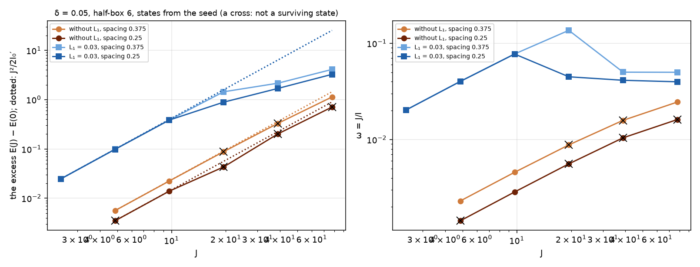
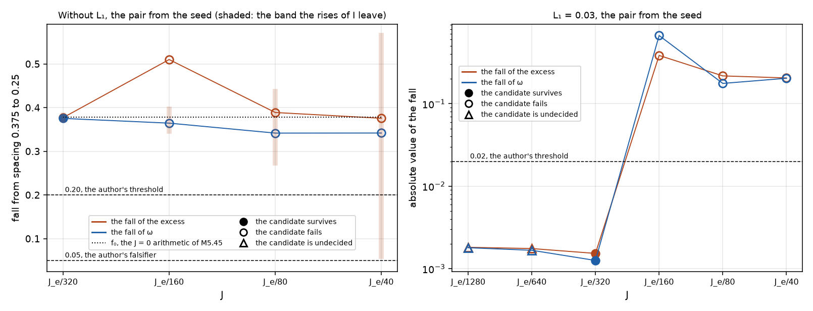
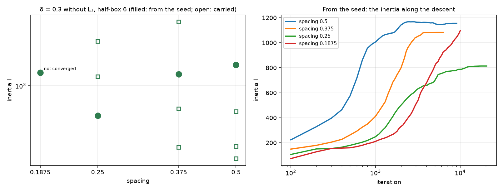

# M5.48: The author's three predictions after M5.45

> Opened 2026-11-19. Roadmap row: [`m5_roadmap.md`](../m5_roadmap.md). Thread record: [`m5_32_convo.md`](m5_32_convo.md).

## TASK PLANNING (2026-11-19; the readings of § 4 for P1 and P3 were frozen before the chains they judge; the window rule of P2 was rewritten while its chain ran, § 13)

**Scope.** The three predictions the author registered on discussion #186 on 2026-11-18, after the results of [M5.45](m5_45_task_details.md) ([discussioncomment-19715873](https://github.com/vantasnerdan/substrate-framework/discussions/186#discussioncomment-19715873); point 4 of the row of that date in the [thread record](m5_32_convo.md)), each read on the rigid-twist functional of [M5.42](m5_42_task_details.md) with the instrument of M5.45: half-box 6, the faces held to the frame, the mirror-averaged stencil, the chart fixed, κ = v = 1. The run reports one word per prediction by the rules of § 4, or the words "no label" with the rule that withheld it. Out of scope: another box; a clock other than the rigid twist about the radial direction; a limit at zero spacing; a search for the lowest state of a grid; L₁ = 0.01; any icon or pointer of [`MODELS.md`](../../../../../MODELS.md).

| # | Prediction, as registered | Confidence stated | Falsifier or reading named in the post |
| --- | --- | --- | --- |
| P1 | Without L₁, at δ = 0.05, half-box 6 and a small fixed J (small enough that the J = 0 structure survives), E(J) − E(0) and ω = J/I each fall by at least 20 percent from spacing 0.375 to 0.25; with L₁ = 0.03 they change by less than 2 percent | 65 percent | a change of the excess under 5 percent without L₁ |
| P2 | The chain from the seed at spacing 0.1875, run to convergence: I·h between 1000 and 1300 (I between 5300 and 6900), U within 3 percent of 14.69 | 55 percent | none named beyond the window |
| P3 | At δ = 0.3 without L₁ (half-box 6, spacings 0.375 and 0.25): the inertia grows by a factor of 1.4 or less, and the spread over starts at 0.375 is 1.2 or less | 45 percent | if both stay as at δ = 0.05, the exactly flat one-generator family drives the effect and not the δ-soft channels |

**Where M5.45 left it.** The chain from the seed at spacing 0.1875 was cut by its wall-time cap at iteration 27200, not converged, with I = 5296.5 (I·h = 993.1), U = 14.6924 and a largest gradient entry over h³ of 2.3 × 10⁻². M5.45 ran no J above 0 and no δ other than 0.05. M5.42 ran J above 0 at δ = 0.05 at one spacing only (0.375), and δ = 0.3 without L₁ on half-box 6 from the seed only, its J = 0 state converged on one grid of three.

**Five limits, stated before the run.** (1) At small J, P1 is for the most part a statement about the inertia at J = 0, on one condition. If the response of the state to the clock stays bounded as J → 0, a state M_J reached by descent from a J = 0 minimum has E_J − U → J²/2I₀ and ω → J/I₀, so both falls of P1 tend to f₀ = 1 − I₀(0.375)/I₀(0.25), which the tables of M5.45 hold: 0.378 for the states from the seed without L₁, 0.002 with L₁ = 0.03. The author's flat directions put the condition in doubt (along them the inertia grows at no cost in U), and the run tests it by the response ρ of § 4 at every candidate. At a finite J the measured rises of the inertia leave the fall of the excess a band, printed per candidate (§ 4). On the pair from the seed without L₁ a word other than HELD is reachable only where the state at spacing 0.375 responds strongly: a fall of the excess under 20 percent needs the inertia of that state to rise by at least 29 percent, FALSIFIED needs at least 53 percent, an excess that rises from 0.375 to 0.25 needs at least 69 percent, and a fall of ω under 20 percent needs the rise at 0.375 to be at least 1.29 times the rise at 0.25. M5.42 holds a rise of 51 percent at J_e/40 on that grid, which is why J_e/40 heads the ladder. (2) Without L₁ a grid holds several states (M5.45 § 8). Every label of this plan is the label of named states; on M5.45's inertias one of the twelve pairs of states (0.375 carried from 0.1875 against 0.25 from the seed) gives f₀ = 0.193, under the 20 percent of P1, so the choice of the pair is stated in § 4 and the other pairs are tabled. (3) P2 continues a chain that was cut: the continuation starts with an empty optimizer memory, as every resume of the M5.45 driver does, and is not the uninterrupted chain; its word is printed with the words "on the continued chain". (4) The ratios of P3 are properties of the pairs of states compared and of four kinds of starts, as in M5.45 § 8 item 5; the spread over all the states of a grid is at least the spread over those found. (5) One box. M5.42 § 11 and M5.45 § 13 found the inertia of the rigid twist growing with the box when L₁ is present; nothing here is a statement about another box or the continuum.

**Definition of done.** The controls of § 3 each reported as met or as the exact failing check; every chain of § 2 ended by its own rule or cut by a cap, with its words; the tables of § 4 written by the reads script from a tracked JSON; P1, P2 and P3 each carrying one word of § 4 or "no label" with its rule; the expectations of § 4 scored against the outcome; the findings embedding the plots of the excess and of ω against J for the two arms, the inertia along the chain of P2, and the inertia against the spacing at δ = 0.3; an adversarial audit on a different model, with its own evaluation of U, I and E_J on the saved end states, having tried to refute each word; the doc checker and the roadmap linter clean.

**Gating.** The user's go, given on 2026-11-19 at 13:31 local time, before the audit of this plan, so that the task ran back to back with [M5.47](m5_47_task_details.md). The plan was audited, and the audit folded, before any chain that the plan judges by a rule of its own: every chain of P1 and of P3. The chain of P2 started before the audit, with the user's agreement (§ 2). No answer of the author was waited for.

**Research body.** This document (plan, findings, review); scripts `m5_48_relax.py` (the driver), `m5_48_pool.py` (the order and the dependencies of § 2) and `m5_48_reads.py` in [`../scripts/`](../scripts/); the summaries `m5_48_summary.json` and `m5_48_controls.json` in [`../data/`](../data/) (tracked), the end states and stops `m5_48_*.npz` there (local-only, indexed by [`_DATASETS.md`](../data/_DATASETS.md)); plots `m5_48_*.png` in [`../plots/`](../plots/); checkpoints, chain records and the progress notes in `../checkpoints/m5_48/` (local-only), the records of the plan-time pilot in its `pilot/` folder. Files under `data/`, `plots/` and `scripts/` carry the task prefix; files under the checkpoints folder need not.

### 1. The functional, the settings and the descent rule

The functional is that of [M5.42](m5_42_task_details.md) as coded in [`m5_42_eq42.py`](../scripts/m5_42_eq42.py), unchanged: a real symmetric 3 × 3 field M on a grid of spacing h, with c_k = 1 + δ^k,

$$
U = h^3 \sum_n \Big[ L_1 \sum_i \lVert \partial_i M \rVert^2 + \kappa \sum_{i \lt j} \lVert [\partial_i M, \partial_j M] \rVert^2 + v \sum_{k=1}^{3} \big( \operatorname{tr} M^k - c_k \big)^2 \Big]
$$

$$
I = 2 h^3 \sum_n \Big[ L_1 \lVert K \rVert^2 + \kappa \sum_i \lVert [K, \partial_i M] \rVert^2 \Big] , \qquad K = [G, M] , \qquad G_{ab} = - \epsilon_{abc} \hat r_c
$$

$$
E_J = U + \frac{J^2}{2 I} , \qquad \omega = \frac{J}{I}
$$

The clock is the rigid twist about the radial direction at fixed J, as in M5.42 § 2 row 1: one ω for the whole box. A state at J is a state reached by descent of E_J; at J = 0 it is a descent of U.

| Setting | P1 | P2 | P3 |
| --- | --- | --- | --- |
| δ | 0.05 | 0.05 | 0.3 |
| L₁ | 0 and 0.03 | 0 | 0 |
| J | one fixed value, picked by the rule of § 4 from six candidates | 0 | 0 |
| Spacings (grids) | 0.375 (33³), 0.25 (49³) | 0.1875 (65³) | 0.375 and 0.25 for the word; 0.5 (25³) and 0.1875 as starts and descriptors |
| Common to the three | half-box 6; κ = v = 1; the mirror-averaged stencil; the chart fixed; the faces held to the frame; the seed of M5.42 | the same | the same |

**The descent rule** is that of M5.45 § 4, taken from [`m5_45_relax.py`](../scripts/m5_45_relax.py) line for line: L-BFGS-B over the six components of every free node, 20 correction pairs, function tolerance 10⁻¹⁵, the gradient stop off; after an end by the function tolerance a restart with an empty memory, until a restart ends within 25 iterations (40 restarts at most); a stalled line search restarted three times at most; U, I and E_J recorded every 100 iterations; stops saved at iterations 1000, 3000, 10000, 30000 and 100000; a checkpoint at every stop and every 15 minutes, from which an interrupted chain continues with an empty memory, the resume recorded. The driver of M5.48 adds three parameters to it (δ, J, and a start from a named file on the same grid) and writes under `data/` only files named `m5_48_*`.

| Word | Rule (M5.45 § 2 row 1 and § 15 deviation 1, as its tables applied them) |
| --- | --- |
| The gate | the largest entry of the gradient of E_J over h³, at the last stop, is at most the gate of the chain: 10⁻³, or the value of addition (a) |
| CONVERGED | not cut by a cap of wall time, never STALLED above its gate, and: the gate with an end by the function tolerance repeated after a restart; or, for a chain with a stalled line search in its record, the gate alone, the driver's own word printed beside it; or, for a chain at its cap of iterations, the gate with U and I within 10⁻³ (relative) of the previous target stop |
| STEADY, RISING | the inertia changed by less than 10⁻³ (relative) over the last tenth of the iterations, or grew by more. The two words describe a chain that is not CONVERGED, and nothing else: such a state enters no ratio, no fall and no window that carries a word (M5.45 § 7 item 2: STEADY passed a plateau) |
| SMOOTH | the label of M5.42 § 2 row 4 (no node holds more than 1 percent of the inertia, and none more than 50 times the mean of its 26 neighbors). A descriptor, tabled for every state; no clause of this plan uses it |

Two additions of this plan, neither of which changes the end of any chain of M5.45. (a) The three chains of P1 at a candidate J (the reference, the chain at J, the return, § 2) share one gate: the smaller of 10⁻³ and one tenth of the largest entry of the gradient of E_J over h³ on the J = 0 state of M5.45 that they start from, which is the force of the clock alone. The reason was measured at plan time: on the state from the seed at spacing 0.375 without L₁ that force is 5.3 × 10⁻³ at J_e/320, 1.3 × 10⁻³ at J_e/640 and 3.3 × 10⁻⁴ at J_e/1280 (5.1 × 10⁻³, 1.3 × 10⁻³ and 3.2 × 10⁻⁴ at spacing 0.25), so a gate of 10⁻³ is met or nearly met before the first iteration and tests nothing there. (b) An end by the function tolerance repeated within 25 iterations while the gate is not met is recorded as STALLED and the chain is restarted from that state with an empty memory, three times at most; a fourth is the end of the chain. A chain with a stall in its record that ends above its gate, by a fourth stall or on a line search that finds no lower point, carries the word STALLED and is never CONVERGED.

### 2. The chains

| Class | Chains | Grid | Start | Caps (iterations; wall time) |
| --- | --- | --- | --- | --- |
| P2 | `p2_h01875_L0` | 65³ | the end file of chain `h01875_L0` of M5.45, `m5_45_h01875_L0_end.npz` (iteration 27200) | 100000 in all, the cap of M5.45, of which 72800 are new; 4 hours |
| P1, the reference | `p1_<state>_j<k>_ref`: ten states of M5.45 (§ 4) times k = 40, 80, 160, 320, 640, 1280: 60 chains | 33³ and 49³ | the J = 0 state of M5.45, read from its end file, continued at J = 0 under the gate of the candidate J_e/k | 5000; 0.5 hours |
| P1, at J | `p1_<state>_j<k>`, with J = J_e/k: 60 at most, one where the reference is CONVERGED | the same | the end of the reference | 30000; 1 hour (33³), 2.5 hours (49³) |
| P1, the return | `p1_<state>_j<k>_back`: 60 at most, one where the chain at J is CONVERGED and passes S2, S3 and S5 of § 4 | the same | the end of the chain at J, descended at J = 0 under the same gate | 20000; 0.75 hours (33³), 1.75 hours (49³) |
| P3, from the seed | `p3_h0500`, `p3_h0375`, `p3_h0250`, `p3_h01875` | 25³, 33³, 49³, 65³ | the seed | 100000 and 1 hour (25³); 100000 and 1.5 hours (33³); 100000 and 2.5 hours (49³); 10000 and 2.5 hours (65³) |
| P3, carried | `p3_h0375_from_h0500`, `p3_h0375_from_h0250`, `p3_h0375_from_h01875`; `p3_h0250_from_h0375`, `p3_h0250_from_h01875`; `p3_h0500_from_h0375`, `p3_h0500_from_h0250`, `p3_h0500_from_h01875` | 33³, 49³, 25³ | the end file of the source chain, or for 0.1875 its stop at iteration 10000, sampled onto the grid by trilinear interpolation with the faces set back to the frame, as in M5.45 | 100000; 1 hour (25³, 33³), 2 hours (49³) |
| Controls | `k2_h0375_L0`, `k3_r6_L0.3_j40`, `k4_r6_L0_j40`, `k12_stalled` | 33³ | § 3 | 10000; 0.5 hours |

J_e = 8π(1 − δ)²/α = 3108.29 at δ = 0.05, so the six candidates are J = 77.707, 38.854, 19.427, 9.7134, 4.8567 and 2.4284. The three chains of a state at a candidate run one after the other; the candidates and the states are independent of each other. The wall-time caps are sized on the pool of M5.42, which ran 40 to 60 percent slower than the chains of M5.45, so that the cap of iterations is what a chain meets first. The chain `p3_h01875` exists only to give the same kind of start as in M5.45, where the carried states came from the stop at iteration 10000 of the chain at spacing 0.1875: it ends by its count of 10000 iterations (in M5.42 the same chain took 1.53 hours for them). A carried chain starts from its source's end file whatever the source's word, which is printed beside it.

**The chain of P2.** It continues the state of M5.45 under the descent rule of § 1 with the iteration counter at 27200 and the 272 trajectory points of the M5.45 record carried over, so that the words of § 1 are computed on the whole chain. Its files are `m5_48_p2_h01875_L0_*`, and no file of M5.45 is opened for writing (K10). The wall-time cap is four hours, so that the task is reviewed on the day of its go; the cap of 100000 iterations is not reached inside it. This chain started before the audit of the plan and before every other chain: its reading is the author's own window, fixed by the post, and its descent uses the rule of M5.45 with addition (b) alone, which the fold of the audit did not touch. It needed K1 on its start file and K10, which the driver enforces before the first iteration. An overnight continuation is a separate go: it resumes from the checkpoint under the same rule (`--resume-cut`), with a wall-time cap of ten hours and the cap of iterations raised to 200000 (a budget of M5.45, not part of its descent rule), and it would add a word for P2 where the day ended without one; its outcome is appended to the findings as a dated amendment with its own numbers check.

**Parallel shape.** One single-threaded process per chain (the five thread variables set to 1 before NumPy loads), at most twelve at once, P2 counted: eleven in the pool. Order in the pool, the largest grids first, and on one grid: the chains of P3 from the seed, the carried chains of P3, the references of P1, the chains at J (the largest J first, without L₁ before L₁ = 0.03), the returns. A carried chain of P3 starts when its source has ended; a chain at J when its reference has ended CONVERGED; a return when its chain at J has ended CONVERGED and passed S2, S3 and S5. The longest dependent path is `p3_h01875` (2.5 hours at most) followed by `p3_h0250_from_h01875` (2 hours at most), which feeds a descriptor; the longest that feeds a word is `p3_h0250` (2.5 hours at most) followed by `p3_h0375_from_h0250` (1 hour at most), and in P1 a reference, a chain at J and a return on 49³ (0.5, 2.5 and 1.75 hours at most). The pool script holds the order and the dependencies, starts a chain when a slot is free, and writes `pool_done.json` in the checkpoints folder when nothing is left to start or to wait for; it is restartable, since a finished chain is read from its record and an interrupted one continues from its checkpoint. Inside a chain the descent is sequential by nature. The GPU is not used: the kernel is compiled double-precision code on small grids. The reads run after the chains, in one process.

### 3. The controls

| Control | Input | The answer it must return | What a failure would look like |
| --- | --- | --- | --- |
| K1, the states read back | the ten J = 0 end files of M5.45 used by P1 and the start file of P2, evaluated by the driver with the settings of § 1 | U and I of [`m5_45_summary.json`](../data/m5_45_summary.json) to 10⁻¹² (relative); for the start of P2, U = 14.692442924782, I = 5296.463658838 and a largest gradient entry over h³ of 2.2895 × 10⁻² (evaluated at plan time) | a wrong δ, L₁ or file: a gap of order 1 |
| K2, the driver at J = 0 | `k2_h0375_L0`: δ = 0.05 without L₁ at spacing 0.375, from the seed | the first end by the function tolerance at iteration 8364 with U = 14.735914625035203 and I = 2095.989000791207 to 10⁻¹⁰ (the control of M5.45 § 6), and the end at iteration 8383 | a driver that is not the rule of M5.45: another iteration count |
| K3, the path at J above 0 | `k3_r6_L0.3_j40`: δ = 0.05, L₁ = 0.3, spacing 0.375, J = J_e/40, from `m5_42_r6_hb6_L0.3_j0_end.npz` | the first end by the function tolerance at iteration 224 with E_J = 94.018343943003, U = 87.809319080331 and I = 486.261744337 to 10⁻¹⁰ (chain `r6_hb6_L0.3`, path `j40`, of M5.42) | J missing from the gradient or entering with a wrong factor: another iteration count and another I |
| K4, the same without L₁ | `k4_r6_L0_j40`: δ = 0.05, L₁ = 0, J = J_e/40, from `m5_42_r6_hb6_L0.0_j0_end.npz` | the first end by the function tolerance at iteration 6205 with E_J = 15.866480031450, U = 14.914431896969 and I = 3171.280055079 to 10⁻¹⁰ (chain `r6_hb6_L0.0`, path `j40`) | as K3, in the regime of P1 |
| K5, δ as a parameter | `p3_h0375`, read at its first end by the function tolerance | iteration 6316 with U = 7.652590648826 and I = 1082.895769448 to 10⁻¹⁰ (chain `r3_g33_L0.0`, path `j0`, of M5.42) | δ = 0.05 left in the frame, the seed or c_k: U near 14.7 |
| K6, the gradient of E_J | central differences at 200 random interior entries, the best of three steps, at J_e/80 and J_e/1280: the clock term alone (the difference of J²/2I against the part of the gradient that J adds) on the two J = 0 states of spacing 0.375 (L₁ = 0 and 0.03); and the whole E_J on the seed of each of the two grids, which is not a stationary state | each within 10⁻⁶ of its largest entry | the sign or the weight of the clock term in the gradient |
| K7, the clauses of the survival test | S3: a J = 0 state against itself, the state of M5.42 at J_e/40 without L₁ against its J = 0 state, and the state of another start (carried from 0.1875) against the state from the seed. S2: a U equal, higher, and lowered by hand by 10⁻⁶ and by 10⁻¹⁰. S4: a return that does not move, that closes 80, 95 and 100 percent of the way, a tiny excursion, and another J = 0 state taken as the return. S5: a state against itself, and against the state with L₁ = 0.03 | S3: passes with a share of at least 0.95; passes with 0.928; fails (the share is computed in the control and must be under 0.90). S2: passes, passes, fails, passes. S4: fails, fails, passes, passes, passes by the floor, fails. S5: passes; fails, the radius being 0.38 against 3.13 | a clause that passes everything, a W₀ built on another density, a return rule that accepts a chain that did not move |
| K8, the ratios and words of P3 | the reads of § 4 for P3 applied to the records of M5.45 (δ = 0.05), and to made-up ratios | growth 1.609 from the seed and 1.446 for the lowest U found; spread 1.376 at spacing 0.375, 1.735 at 0.5 and 1.167 at 0.25; the ratio to spacing 0.1875 no value; on M5.45's own numbers NOT HELD and AS AT δ = 0.05; on the made-up ones each word and each line of § 4 once | a state that is not CONVERGED admitted as a value; the largest over the smallest taken on the wrong set |
| K9, the window of P2 | the cut state of M5.45, and seven made-up records, all CONVERGED: (I, U) = (5400, 14.70), (5310, 14.70), (6920, 14.70), (5290, 14.70), (6950, 14.70), (5400, 15.20), (5310, 14.20) | no label, with I·h = 993.09; then HELD, EDGE, EDGE, NOT HELD, NOT HELD, NOT HELD, NOT HELD | a word given to a cut state; an edge of either form misplaced; the two edges treated differently |
| K10, the continuation | the first evaluation of `p2_h01875_L0` | U and I of K1, the counter at 27200, 272 trajectory points loaded; the SHA-256 of `m5_45_h01875_L0_end.npz` equal before and after the chain (it begins a3b61f7e at plan time); the driver refuses an output name that does not begin with `m5_48_` | a chain started from the seed or from another stop; a file of M5.45 rewritten |
| K11, the reader of P1 | made-up tables of numbers passed through the reader of § 4 | each outcome once: HELD; HELD with START-DEPENDENT (M5.45's inertias, where one pair of twelve gives 0.193); FALSIFIED, from above and from below zero; each clause of NOT HELD alone; no label with no survivor; no label with a larger candidate UNDECIDED; a decided failure not hidden by an undecided state; the largest survivor taken; START-DEPENDENT on the fall of ω alone | a reader that returns HELD on every table; a J\* that skips an undecided candidate |
| K12, addition (b) and the gate | the rule that follows an end by the function tolerance on six constructed inputs; the gate on two clock forces; and `k12_stalled`, the chain of K3 under a gate of 10⁻¹², which no descent in double precision meets | restart, end, stall and restart, stall and restart (the third), stall and end (the fourth), end at forty ends; the gates 5.31 × 10⁻⁴ and 10⁻³; the chain records a stall and is not CONVERGED | an addition that never fires; a chain called CONVERGED above its gate |
| K13, the interpolated start | the interpolation of the driver applied to the sources of the 14 carried chains of M5.45 | U and I at the start as M5.45 recorded them, to 10⁻¹² (relative) | a start sampled on the wrong axis or with the faces left off the frame |

The try cap on the controls is three. Between tries only the input of the control or a defect of the script may change, never a threshold of § 3 or § 4 nor a definition of § 4, and each change is logged in the progress notes. What a failure costs: K1, K2 or K6, no pool and no P2; K3, K4, K7, K11 or K12, no chain at J and no word for P1; K5, K8 or K13, no word for P3; K9, no word for P2; K10, no P2. K5 is read from the first chain of P3. The evaluator itself is not new: its controls are M5.42 § 8 and the audit of M5.45 § 6, and the audit of this task evaluates U, I and E_J on end states with its own code.

### 4. The readings, frozen

**P1: the quantities.** For a grid of spacing h, a value of L₁, a start s and a candidate J, M₀ is the J = 0 state of M5.45 (its end file), M₀′ the reference (M₀ continued at J = 0 under the gate of the candidate, addition (a)), M_J the end of the descent of E_J started from M₀′, and M_ret the end of the descent at J = 0 started from M_J. The three chains meet the same gate, so the excess subtracts two states reached under one criterion:

$$
\Delta E = E_J[M_J] - U[M_0'] , \qquad \omega = \frac{J}{I[M_J]}
$$

Per pair of states, one at spacing 0.375 and one at 0.25, with the same L₁ and the same J, and X standing for ΔE or for ω:

$$
f_X = 1 - \frac{X(0.25)}{X(0.375)}
$$

With I₀ the inertia of M₀ in M5.45 and I₀′ that of the reference, the J = 0 arithmetic of limit (1), printed beside every f as f₀, the response of a state, printed beside every ΔE, and the rise of its inertia:

$$
f_0 = 1 - \frac{I_0 \text{ at } 0.375}{I_0 \text{ at } 0.25} , \qquad \rho = 1 - \frac{2 I_0' \Delta E}{J^2} , \qquad a = \frac{I[M_J]}{I_0'}
$$

The inertias of M5.45 stay the numbers of limit (1); the change from M₀ to M₀′ is tabled for every reference. Where S2 holds, J²/2I[M_J] ≤ ΔE ≤ J²/2I₀′ on each grid, so with r the ratio of the two reference inertias the measured rises leave the falls

$$
1 - r a_{0.375} \le f_{\Delta E} \le 1 - \frac{r}{a_{0.25}} , \qquad f_\omega = 1 - \frac{r a_{0.375}}{a_{0.25}}
$$

The band of the fall of the excess is printed per candidate. The upper half of the inequality on ΔE holds for any descent from M₀′ and is not a control.

**P1: the states.**

| Role | L₁ | Spacing 0.375 (I at J = 0) | Spacing 0.25 (I at J = 0) |
| --- | --- | --- | --- |
| Carries the word | 0 | from the seed, `h0375_L0` (2096.0) | from the seed, `h0250_L0` (3372.3) |
| Carries the word | 0.03 | from the seed, `h0375_L0.03` (119.101) | from the seed, `h0250_L0.03` (119.321) |
| Tabled | 0 | `h0375_L0_from_h0500` (1977.5), `h0375_L0_from_h0250` (2469.5), `h0375_L0_from_h01875` (2721.8) | `h0250_L0_from_h0375` (3434.7), `h0250_L0_from_h01875` (3936.2) |
| Tabled | 0.03 | none: every start of M5.45 ended on the state from the seed | `h0250_L0.03_from_no_L1` (119.167, a tilted loop) |

The pair from the seed carries the word because the seed is the one start defined in the same way on both grids, and the start that the registered wording of P2 names; "the lowest U found" is a property of four starts and not of a grid. All ten states were CONVERGED by the word of M5.45.

**P1: "the J = 0 structure survives", as a test.** A state at a candidate is UNDECIDED when one of its chains is not CONVERGED (S1): the reference, the chain at J, or the return where one is owed. A chain cut by a cap or STALLED therefore decides nothing. A decided state survives when the four clauses hold, and fails otherwise.

| Clause | Rule |
| --- | --- |
| S1 | the reference, the chain at J and the return are CONVERGED by § 1 under the gate of the candidate; otherwise the state is UNDECIDED at that candidate |
| S2 | U[M_J] ≥ (1 − 10⁻⁹) U[M₀′]: the descent at J has not left for a lower state. No clause limits the rise of the inertia |
| S3 | at least 0.90 of the inertia of M_J sits on W₀, the smallest set of nodes that holds 95 percent of the inertia of M₀′ (the inertia density of the functional per node, as in M5.45 § 2 row 4) |
| S4 | the return closes at least nine tenths of the way, in the inertia and in U: the absolute value of I[M_ret] − I₀′ is at most 0.1 times that of I[M_J] − I₀′, and the absolute value of U[M_ret] − U[M₀′] at most 0.1 times that of U[M_J] − U[M₀′]. A floor replaces either right side where it is larger: 10⁻⁶ I₀′ and 10⁻¹⁰ U[M₀′], the level at which the kicked states of M5.45 § 8 returned, or the change the reference itself made from M₀ |
| S5 | the loop reader of [M5.44](m5_44_task_details.md) finds as many loops on M_J as on M₀′, and the radius of the first within 10 percent |

**The rule that picks J, fixed before the chains.** A candidate SURVIVES when the four states that carry the word all survive at it, FAILS when one of them fails, and is UNDECIDED otherwise. J\* is the largest candidate that survives. One J serves both arms and both spacings ("a fixed J"). The word is given only if no candidate larger than J\* is UNDECIDED; otherwise P1 carries "no label (undecided at J = ...)" with every candidate tabled, since a larger J that was never decided could have been the J of the rule. No candidate is added during the run. If none survives, P1 carries no label, and f₀ is printed as the J = 0 arithmetic of M5.45, not as a value of the prediction.

**P1: the words, read at J\* on the pairs that carry the word.**

| Word | Rule |
| --- | --- |
| HELD | without L₁, f_ΔE ≥ 0.20 and f_ω ≥ 0.20; and with L₁ = 0.03 the absolute values of f_ΔE and of f_ω are both under 0.02 (the author's thresholds) |
| FALSIFIED | without L₁, the absolute value of f_ΔE is under 0.05 (the author's falsifier; the arm with L₁ does not enter it) |
| NOT HELD | any other outcome, printed with the clause that failed: f_ΔE from 0.05 up to 0.20; f_ΔE at or under −0.05 (the excess rose); f_ω under 0.20; an absolute value of 0.02 or more with L₁ |
| no label | no candidate survives, or a candidate larger than J\* is UNDECIDED |

Descriptors, with no word of their own: for every candidate and every state, the three chains with their words, ΔE, ω, ρ, the rise a, the share on W₀, the clauses, the loops and radii of the reader on M₀′ and on M_J, and the label SMOOTH; for every candidate, f_ΔE, f_ω, f₀ and the band on the pair that carries the word, so that the dependence of the reading on the choice of J is on the page; at J\*, both falls on each of the twelve pairs of states without L₁ (four at 0.375 times three at 0.25) whose two states are decided at J\*, with the number of pairs counted, the pairs left out named, whether both states of a pair survive, and the count of pairs at or above 0.20 in both falls; the qualifier START-DEPENDENT appended to the word when a counted pair falls on the other side of 0.20 than the pair from the seed in either fall; the pair of the lowest U found on each grid named among them; with L₁ = 0.03, the pair of the seed state at 0.375 with the tilted state at 0.25; and the reading by arm, in which each value of L₁ takes the largest candidate at which its own two states survive.

**P2: the words.** The post gives the window in two forms, I·h from 1000 to 1300 and I from 5300 to 6900, which at h = 0.1875 differ at both edges (I from 5333.3 to 6933.3 against 5300 to 6900). U within 3 percent of 14.69 is 14.2493 to 15.1307.

| Word | Rule |
| --- | --- |
| HELD | the chain is CONVERGED by § 1, the state is inside both forms of the window, and U is in its window |
| EDGE | CONVERGED, U in its window, and the state inside exactly one of the two forms (at either edge) |
| NOT HELD | CONVERGED, and the state outside both forms or U outside its window |
| no label | the chain is not CONVERGED: cut by the wall-time cap, at the cap of iterations, or STALLED. I and U at the last stop are then printed as the values at that stop, with the drift of I over the last tenth of the iterations, and with no statement about where the descent would end: a descent lowers U and nothing else monotonically |

Every word of P2 is printed with the words "on the continued chain" (limit (3)). The distance of I·h from the nearer edge of its form is printed in percent beside any word. The state is that of one start, the seed, which is what the prediction names; no second start is run on this grid.

**P3: the quantities, computed as M5.45 computed its 1.6 and 1.38** (its Table 5, "from the seed", and § 8 item 3).

$$
G = \frac{I[\text{from the seed, } 0.25]}{I[\text{from the seed, } 0.375]} , \qquad S = \frac{\max_s I_s}{\min_s I_s} \quad \text{over the states } s \text{ found at spacing } 0.375
$$

The states at 0.375 are those of four starts, the kinds of M5.45: the seed, the end state of 0.5, the end state of 0.25, and the stop at iteration 10000 of the chain at 0.1875. G is a value when both of its states are CONVERGED; from a state that is not, it is printed and carries no word. A state enters S only if it is CONVERGED.

| Word | Rule |
| --- | --- |
| HELD | both ratios from CONVERGED states: G a value at or under 1.4, and the four states at 0.375 CONVERGED with S at or under 1.2 |
| NOT HELD | G a value above 1.4; or S above 1.2 on the CONVERGED states found, two at least (the spread over all four is at least the spread over those, so the clause is already decided) |
| no label | every other case |

**P3: the author's second reading, as a descriptor.** "Both stay as at δ = 0.05" is read as: G a value at or above 1.448 and S at or above 1.239, nine tenths of the 1.609 and 1.376 of M5.45. Then the line printed is AS AT δ = 0.05, the author's reading that the exactly flat one-generator family drives the effect. When P3 is HELD the line is BELOW δ = 0.05. Anything else is BETWEEN, with the two numbers. Other descriptors: G below 1 is printed as "the inertia fell as the spacing fell" (the word HELD then holds by the letter of the prediction); G and S for the lowest U found on each grid, and S at spacings 0.5 and 0.25, beside the 1.446, 1.735 and 1.167 of M5.45; for every state, U by term, I, the inertia inside r below 2, the share of the nodes in W and the commutator ratio q on W and on the rest (M5.45 § 2 row 4), since M5.42 § 13 found under 1 percent of the inertia inside r below 2 at δ = 0.3 against a quarter at δ = 0.05, and a growth read on another kind of state is said to be so.

**How many nodes carry the inertia: three descriptors per state, with no word and no threshold** (added at the fold of the plan audit). With I_c the inertia of node c (the inertia density of the functional times h³):

$$
s_{\max} = \frac{\max_c I_c}{\sum_c I_c} , \qquad N_I = \frac{\big( \sum_c I_c \big)^2}{\sum_c I_c^2} , \qquad V_I = h^3 N_I
$$

The first is the largest share of one node. N_I is a participation number: it equals the number of nodes when the inertia is spread evenly over them and 1 when a single node holds it all. V_I is the volume those nodes fill. They are tabled for every state that enters a ratio or a fall (the references and the states at J of P1, the end state of P2, the states of P3), with the ratio of V_I between spacings 0.375 and 0.25 on the pairs from the seed.

**A pilot at plan time** (single L-BFGS-B calls from the J = 0 states from the seed, capped at 1500 iterations, with no restart rule; not audited; run before the fold of the audit; its records are in the `pilot/` folder of the checkpoints).

| L₁ | Spacing | J | Iterations and end | I[M_J]/I[M₀] | ΔE over J²/2I[M₀] | Share on W₀ |
| --- | --- | --- | --- | --- | --- | --- |
| 0.03 | 0.375 | J_e/160 | 398, a stalled line search, gradient 7.8 × 10⁻⁷ | 1.200 | 0.908 | 0.944 |
| 0.03 | 0.375 | J_e/320 | 312, the function tolerance | 1.055 | 0.973 | 0.948 |
| 0.03 | 0.25 | J_e/320 | 455, the function tolerance | 1.055 | 0.973 | not read |
| 0.03 | 0.375 | J_e/640 | 279, the function tolerance | 1.014 | 0.993 | not read |
| 0 | 0.375 | J_e/160 | 1500, the cap, gradient 3.9 × 10⁻³ | 1.052 | 0.975 | 0.949 (a second call, 1200 iterations) |
| 0 | 0.375 | J_e/320 | 1500, the cap, gradient 6.6 × 10⁻⁴ | 1.013 | 0.994 | not read |

**Registered before the run.** Expectations, which no script uses. P2, registered before its chain started: the chain converges inside the cap, 5000 to 25000 iterations after its start, with I between 5297 and 5310 (I·h from 993 to 996) and U = 14.692, within 0.02 percent of 14.69: the word EDGE or NOT HELD, by under 1 percent of the lower edge of the window. The inertia rose by 4.0 over the last 5200 iterations of M5.45 and by 0.8 over the last 1200, with the gradient at 2.3 × 10⁻²; a plateau followed by a rise, as the chain at spacing 0.25 showed in M5.45 near iteration 8000, is the case that would put it inside. P1, registered at the fold of the audit and before any of its chains: with no clause on the rise of the inertia, the rule no longer stops at J_e/320, where the first draft of this plan expected it. The state of M5.42 at J_e/40 without L₁ on the 0.375 grid passes S3 (a share of 0.928) and S5 (a radius 9.4 percent larger, against the 10 allowed), with its inertia up by 51 percent, so the arm without L₁ may survive to the top of the ladder. The arm with L₁ = 0.03 is expected to set J\*: at J_e/160 its inertia rose by 20 percent in the pilot with a share of 0.944, and the clock energy at J_e/40 exceeds its U, so it is expected to fail S3 or S5 at J_e/40 and perhaps at J_e/80. Expected: J\* between J_e/320 and J_e/80; at J\*, without L₁, f_ΔE and f_ω between 0.30 and 0.45 on the pair from the seed (f₀ = 0.378), and with L₁ = 0.03 both under 0.01 in absolute value (the pilot at J_e/320: 0.0015 and 0.0013); so HELD, and START-DEPENDENT, the pair of 2721.8 against 3372.3 being near 0.19 at J = 0. Not predicted: whether the chains on 49³ at J_e/40 and J_e/80 converge inside their caps; if one of them leaves a candidate above J\* UNDECIDED, the word is withheld. P3: G between 0.8 and 1.4, so that clause holds. The basis is thin: M5.42 left I = 1082.9 at spacing 0.375 (converged by its rule, without the restart rule) and 787.6 at 0.25, not converged at 10000 iterations and rising (619.0 at iteration 3000). S is not predicted, and with it the word of P3.

Nothing in this section sets an icon: the plan reports, and the scorecard cell is re-read later by the repo owner.

### 5. Blindspot pass, consumers, estimate

Read against the recurring failure families of the records of M5.45 and [M5.47](m5_47_task_details.md), for the instruments of this task.

| Unknown | Guard |
| --- | --- |
| A check that cannot fail: at small J the two falls of P1 are the ratio of the J = 0 inertias, known before the run; a survival test that limits the rise of the inertia would force them into a band where HELD is certain | stated as limit (1) with its condition; no clause limits the rise; J_e/40, where M5.42 holds a rise of 51 percent, heads the ladder; J\* is the largest surviving candidate; the band, f₀ and ρ are printed per candidate |
| A cut chain that lowers J\* and so moves the word toward HELD | UNDECIDED is not a failure; the word is withheld when a candidate above J\* is undecided; the caps are sized on the slower pool of M5.42 |
| A tolerance that tests nothing: the gate of 10⁻³ is under the clock force at the small candidates; a reference that never met the gate of its chain at J | addition (a), one gate for the three chains, the reference continued under it first; a state whose reference stalls above that gate is UNDECIDED and is not read as a failure of the structure |
| An optimizer stall read as a state | the gate is necessary in every branch of CONVERGED; the restart rule; addition (b); a chain that stalled above its gate is never CONVERGED; the drift words describe and decide nothing |
| A number set by a cap | a chain cut by a cap carries no word and enters none: no label for P2, no value for G, UNDECIDED in P1 |
| One start taken for the state | P1: the pair that carries the word is named, twelve pairs are tabled in both falls, START-DEPENDENT is a printed qualifier. P2: the seed chain is what was registered; a second start at 0.1875 is not computed, and the findings say so. P3: four kinds of starts, and the spread over all states is at least the spread found |
| The reference of the excess is not at its minimum, or the descent at J leaves it for a lower state; a return chain that does not move | S2; the reference M₀′ under the gate of the chain at J; S4 relative to the excursion, under the same gate |
| A continued chain is not the uninterrupted one, and the start decides the state without L₁ | stated as limit (3) and printed with the word; the resume is recorded; K10 |
| A diagnostic outside its regime: the loop reader on states whose core the grid does not resolve (M5.44 § 15: radii of one to two spacings without L₁), on which S5 asks for a radius within 10 percent; a growth of I read at δ = 0.3, where the inertia may not sit in walls | the radii of the reference and of the state at J are printed beside S5, and a failure by the radius alone is named as such in the table; SMOOTH is a descriptor only; where the inertia sits is printed for every state of P3 |
| This plan's reading taken for the author's | the open points are this plan's and are named as such in the findings: the ladder of six candidates; the largest surviving J as the J of the prediction; one J for both arms; the clauses S2 to S5 and their numbers; the pair from the seed; the word EDGE; the nine tenths of "stay as at δ = 0.05"; 14.69 as the center of the window of U |
| A clause met by the letter: any fall of I meets "a factor of 1.4 or less" | G below 1 is printed with its own sentence |
| A file of M5.45 overwritten | the driver writes under `data/` only `m5_48_*`; K10 |
| An unvalidated instrument (the family of the workflow) | K2 to K4 return one number of M5.45 and two of M5.42 at J above 0, and K5 a third number of M5.42 on the first chain of P3; K7 to K9 and K11 to K13 run every new rule on known answers, each with an input that fails; each control names its failing input |

**Consumers.** The three words are read by the author's registered predictions and by the results message of the repo owner: they need K1 to K13 met and the audit. P1 is, in the author's words, what decides whether a clock without L₁ has a frequency at all; the clock cell is re-read by the repo owner, on the bar of `MODELS.md`, and not by this task. The states at J of P1 and the states at δ = 0.3 of P3 are reusable by a later run: they need the word CONVERGED and K3 to K5.

**Estimate.** Compute, from the iteration counts of the record of M5.45 (5000 to 20000 per chain without L₁) at the slower pace of the pool of M5.42 (where 10000 iterations on 65³ took 1.53 hours): P2, one process for 4 hours at most, started before the pool; P1, about 31 process-hours (the 30 chains at J on 49³ about 16 of them, their returns about 9, the chains on 33³ about 6, the 60 references minutes in all); P3, about 8 process-hours. With eleven processes at once beside P2 the pool takes 3.5 to 4.5 hours of wall time, the longest dependent path of § 2 allowing 4.5 at most. With the reads, the findings and two audits in parallel after it (about an hour and a half), the review comes 5 to 6 hours after the start of the pool; that holds only because the chain of P2 started before the pool and ends, by its cap, before the pool does. What can be reviewed on the day of the go: P1, as a word or as "no label (undecided)" with its tables; P3, if `p3_h0250` converges inside its cap (M5.42 left that state not converged at 10000 iterations), and otherwise its tables with "no label"; P2 as a word if its chain converges inside four hours, and as the values at the cut if not. What cannot be promised for that day: a word for P2 from a chain that is cut, which waits for the overnight continuation of § 2. Model: the session's model for the plan and the build, in one sub-agent; the audit on Opus, a numbers check on Sonnet.

**Plan audit (2026-11-19, before the chains it judges).** An independent pass on a different model read this plan against the original post, the records of M5.45 and M5.42 and the action code, and recomputed its numbers. It confirmed every number quoted from M5.45 and M5.42, the thresholds, grids and couplings of P1 to P3 against the post, and that addition (b) changes no end of a chain of M5.45. It found fourteen faults, all folded above: a clause of the survival test (the inertia at J at most 1.10 times its J = 0 value) that forced both falls into a band where HELD without L₁ was certain and the registered falsifier could not fire; a word EDGE that resolved the two forms of the window of P2 in opposite directions at its two edges; chains cut by a cap or STALLED read as failures, which lowered J\* and moved P1 toward HELD, with caps sized on rates the slower pool would not reach; "a lower bound" written for the inertia of a cut chain and "a bound" for G, where a descent is monotone in U and not in I; controls with no failing input for S3, for the U clause of S2, for the reads of P1, for addition (b) and the tighter gate, and none for the interpolated start; return chains under the old gate, and a return rule that passed a chain that did not move; a gate below what some J = 0 states of M5.45 had reached, so that a stall was predictable from the start state and the excess subtracted states reached under different gates; a cap that would have cut the chain at 65³ of P3, the longest dependent path left unnamed, and an estimate that held only with P2 started first; the words STEADY and RISING called no evidence in § 1 yet used to demote G; limit (1) stated without its condition, and f₀ quoted as an extrapolation where no candidate survived; SMOOTH used as a clause while the blindspot table placed it outside its regime; START-DEPENDENT tested on one fall only and over pairs with no counting rule, with the ladder and the largest surviving J missing from the list of the plan's own choices; a try cap with no limit on what may change between tries, and limit (3) not carried on the word of P2; and 1.45 and 1.24 rounded up from nine tenths. Three decisions were carried out by the nearest thing that keeps their purpose. The reference under "the same gate" is one short chain per state and candidate, and the gate of the three chains is fixed once, from the clock force on the state of M5.45, so that it does not depend on the reference it is meant to judge. The return rule takes absolute values in both of its parts (the decision wrote the U part one-sided), with the floors stated in S4. NOT HELD in P3 is also given on G alone when G is a value above 1.4, a conjunction failing with one of its clauses. Folded at the same time, and not from the audit: the Gating paragraph as it happened; the three descriptors of how many nodes carry the inertia; and the control K6, rewritten before any chain it judges. As first written (the whole E_J on the two J = 0 states, within 10⁻⁶ of the largest entry of the gradient) K6 was run and NOT MET at J_e/1280: 2.7 × 10⁻⁵ without L₁ and 5.2 × 10⁻⁶ with L₁ = 0.03, against 1.1 × 10⁻⁷ and 2.2 × 10⁻⁸ at J_e/80. The cause is the round-off of the central difference of U (about 5 × 10⁻¹⁰) against a largest gradient entry that, on a converged state at the smallest J, is the clock force alone (1.7 × 10⁻⁵): a correct gradient could not meet that wording. The result as first written is kept in `m5_48_controls.json`. One more fact of the build belongs here: the chain of P2 started under the driver as it stood before the fold; none of the folded rules touches its descent (J = 0, the gate of 10⁻³, addition (b)), and its word is read by the folded rules. The controls K1 to K4 and K7 to K10 were met at their first try before the fold, and every control whose instrument changed was run again after it.

**Amendment after the fold (2026-11-19 14:30 local time, before any chain at J was read).** One rule of § 4 is narrowed; nothing else above changes. The reason is a test of the three-chain path made before the pool started, outside the chains of record: the state from the seed with L₁ = 0.03 at spacing 0.375, at J_e/40, stood after 3000 iterations as MIXED by the label of M5.42, one node holding 32 percent of the inertia, with I = 1557 against 119 and the gradient at 0.10, far from converging. Under the rule as folded, a chain like that one, cut by its cap, would leave the candidate UNDECIDED and withhold the word of P1 whatever the smaller candidates gave. The purpose of that rule is that a shortfall of compute must not pass for a failed survival and lower J\*; a chain that is cut while it has plainly left the structure is not that case. So a chain at a candidate J that is not CONVERGED (cut by a cap, or STALLED) is read at its last state against the two clauses that need no convergence, S3 and S5, with the reference of the same candidate. If that last state fails S3 or S5, the state does not survive at that candidate, the table says "failed at the cut, not converged", and the candidate does not block a word. If it passes both, the state is UNDECIDED as before, and blocks the word when the candidate lies above J\*. A reference or a return that is not CONVERGED leaves the state UNDECIDED, as before. What this assumes and does not prove: that a descent of E_J which has left the set W₀ and the loop of its reference does not come back to them. For every such chain the table prints its last U, I, gradient, the share on W₀ and the read of S5, so that a reader can judge it. K11 gained one known answer per branch and was met at its first try after the change: a cut chain that fails S3 at J_e/40, and one that fails S5, leave the word to the next candidate (HELD at J_e/80 on the made-up table); a cut chain that passes S3 and S5 at J_e/80, above a J\* of J_e/160, gives no label; the same below J\* does not block.

## FINDINGS (2026-11-19)

> Run of 2026-11-19: the continued chain of P2, 160 chains started by the pool for P1 and P3 (of the 192 the plan lists at most), four control chains, and one return added after the audit of these findings (Table 18), on grids of 25³ to 65³ of half-box 6. Every number below is carried by [`m5_48_summary.json`](../data/m5_48_summary.json) and [`m5_48_controls.json`](../data/m5_48_controls.json), written by [`m5_48_reads.py`](../scripts/m5_48_reads.py) from the chain records of [`m5_48_relax.py`](../scripts/m5_48_relax.py), which [`m5_48_pool.py`](../scripts/m5_48_pool.py) started; the tables are printed from those two files by [`m5_48_report.py`](../scripts/m5_48_report.py).

**Scope.** The three predictions the author registered on 2026-11-18, each read by the rules frozen in § 4 with the amendment after the fold, on states of the rigid-twist functional of M5.42 on half-box 6 (faces held to the frame, mirror-averaged stencil). The words are the words of those rules. Where a word hangs on a rule of this plan's own making (the ladder of candidates, the survival clauses, the largest surviving J, the word EDGE), the rule is named beside it. Nothing is said about another box, a clock that is not rigid, a limit at zero spacing, the lowest state of a grid or the number of states a grid has. Nothing here sets an icon.

**In short.** (1) **P1 reads HELD, START-DEPENDENT, at J\* = J_e/320 = 9.713**, the largest of the six candidates at which the four states from the seed pass the survival test of this plan. Without L₁ the excess falls by 0.3768 and ω by 0.3752 from spacing 0.375 to 0.25 (the author's threshold: 0.20); with L₁ = 0.03 they change by 0.0015 and 0.0013 (threshold: 0.02). At that J the response of the states is small (ρ = 0.006 and 0.004; the inertia up by 1.3 and 0.7 percent), and the two falls sit 0.002 and 0.003 from the J = 0 arithmetic of M5.45, f₀ = 0.3785: at J\* the word restates the ratio of the J = 0 inertias, as limit (1) said it would at small J. The word hangs on four rules of this plan's own making: the ladder of candidates, the survival clauses, the largest surviving J, and one J for both values of L₁. **At the largest candidate it rests on one read.** At J_e/40 the only clause that fails over the four states from the seed is S5 on the state at spacing 0.25 without L₁: its loop radius reads 0.435 on the reference and 0.505 at J, 16.1 percent against the 10 allowed, on 36 against 38 pierced plaquettes, and the audit found the spread of the plaquette radii to be 0.13 to 0.15, about twice that change of 0.07. With S5 read as a loop count alone, or with a tolerance of 16.1 percent or more, that state owes a return; the return, run after the audit with the word in view, does not close by S4 as frozen (Table 18: it leaves 0.01 of the excursion in I and 0.37 in U, where S4 allows 0.1, and ends 0.029 under its reference in U), so J_e/40 fails in that reading as well and the word is HELD at J_e/320 under either read of S5, with S4 as frozen. That rests on a further choice of this plan: S4 as frozen takes the absolute value of the change of U, and the return ended lower in U than its reference; with that part one-sided, as the plan audit first wrote it, the return passes, J\* is J_e/40 and the word is NOT HELD. Table 19 sets three readings side by side. (2) **The choice of J is what decides the half of P1 with L₁.** At the three larger candidates the falls without L₁ stay between 0.34 and 0.51, above 0.20; the falls with L₁ are 0.18 to 0.67, far above 0.02, on states that carry 1.2 to 16 times their J = 0 inertia, with a single node holding 28 to 81 percent of it at J_e/40 and J_e/80. Those three candidates fail the survival test on a state without L₁ (clause S5 or S2), not on a state with L₁: the states with L₁ pass every clause of the test as folded. The registered falsifier (a change of the excess under 0.05 without L₁) is met at none of the four decided candidates. One of the twelve pairs of states without L₁ reads 0.193 in both falls. The expectation that this plan registered for the mechanism was wrong: it expected the states with L₁ to fail the survival test above J_e/320 and so to set J\*; they pass it, and the states without L₁ set J\* (§ 12). (3) **P2 reads NOT HELD, on the continued chain.** The chain from the seed at spacing 0.1875 ended CONVERGED at iteration 34373 with I = 5296.50, so I·h = 993.09: 0.69 percent under the 1000 of the window, and 3.5 under the 5300 of its rounded form; U = 14.69243 is inside its window. (4) **P3 reads NOT HELD.** At δ = 0.3 without L₁ the four states found at spacing 0.375 are CONVERGED with inertias from 655.2 to 1556.6, a spread of 2.376 against the 1.2 of the prediction and the 1.376 of M5.45 at δ = 0.05; the growth from 0.375 to 0.25 is 0.752, under 1.4 because the inertia fell. The descriptor of the author's second reading is BETWEEN. (5) The thirteen controls are met; the first wording of K6 was NOT MET and was rewritten before any chain it judges. The rules were changed twice during the day, at the fold of the plan audit and by one amendment. Both came before any chain of P1 or P3 was read. That does not hold for P2: the rule for the two forms of its window was rewritten at the fold while the inertia of its chain was in view (the word is NOT HELD under both versions), and its chain was launched before the controls K2 and K6 had run. § 13 says what had been seen each time.

### 6. The controls

**Table 1. The controls (every one read from `m5_48_controls.json`).**

| Control | Result | The numbers |
| --- | --- | --- |
| K1 | PASS | largest relative difference 0.0e+00 over 11 states |
| K2 | PASS | first end at iteration 8364 (reference 8364); U = 14.735914625035, I = 2095.989000791207; largest relative difference 0.0e+00; the chain ended at 8383 |
| K3 | PASS | first end at iteration 224 (reference 224); E = 94.018343943003, U = 87.809319080331, I = 486.261744336871; largest relative difference 0.0e+00; the chain ended at 228 |
| K4 | PASS | first end at iteration 6205 (reference 6205); E = 15.866480031450, U = 14.914431896969, I = 3171.280055078903; largest relative difference 0.0e+00; the chain ended at 6227 |
| K5 | PASS | first end at iteration 6316 (reference 6316); U = 7.652590648826, I = 1082.895769448143; largest relative difference 0.0e+00; the chain ended at 6328 |
| K6 | PASS | clock term alone 5.4e-09 to 1.2e-08; whole E_J on the seeds 7.1e-09 to 1.5e-08. First wording: NOT MET, 2.7e-05 and 5.2e-06 at J_e/1280 (1.1e-07 and 2.2e-08 at J_e/80) |
| K7 | PASS | S3 shares 0.9500 (itself), 0.9282 (M5.42 at J_e/40), 0.6438 (another start, fails); S2 yes/yes/no/yes; S4 no/no/yes/yes/yes/no; S5 itself yes, against the state with L₁ no (radius 0.376 against 3.127) |
| K8 | PASS | growth 1.6089 and 1.4462; spread 1.3764, 1.7354, 1.1672; on M5.45: NOT HELD, AS AT delta = 0.05; 8 made-up cases |
| K9 | PASS | the cut state (I·h 993.087): no label; (5400, 14.7): HELD; (5310, 14.7): EDGE; (6920, 14.7): EDGE; (5290, 14.7): NOT HELD; (6950, 14.7): NOT HELD; (5400, 15.2): NOT HELD; (5310, 14.2): NOT HELD |
| K10 | PASS | counter 27200, 272 trajectory points, first new point at 27300; read-back relative 0.0e+00; SHA-256 unchanged at the end of the chain: yes; a name outside the prefix refused: yes |
| K11 | PASS | 18 made-up tables, every word and every branch once |
| K12 | PASS | six rule cases; gates 0.000531 and 0.001; the chain under a gate of 1e-12: 1 stall recorded, CONVERGED no |
| K13 | PASS | largest relative difference 0.0e+00 over 14 carried starts |

1. **Tries.** K1 to K4 and K7 to K10 were met at their first try before the fold of the plan audit. After the fold every control whose instrument had changed was run again, K2 to K4 on the changed driver, K7 to K9 with their added inputs, and K11 to K13, which the fold added: each was met at its first try under the try-cap rule of § 3. K11 was run once more after the amendment, with four more cases, and met. K5 was read from the first chain of P3. The second half of K10 (the start file of P2 unchanged at the end of the chain) was read after the chain ended.
2. **K6.** As first written the control compared the whole E_J on the two J = 0 states and was NOT MET at J_e/1280 (2.7 × 10⁻⁵ and 5.2 × 10⁻⁶ of the largest gradient entry, against 10⁻⁶), while it was met at J_e/80 (1.1 × 10⁻⁷ and 2.2 × 10⁻⁸). The absolute differences were 4.8 × 10⁻¹⁰ and 6.8 × 10⁻¹⁰, the size of the round-off of the central difference of U at the step used, against largest gradient entries of 1.7 × 10⁻⁵ and 1.3 × 10⁻⁴. The control was rewritten at the fold, before any chain at J, to two reads that a wrong gradient fails and a right one can meet; both results are in the JSON.
3. **What K2 to K5 return.** The driver reproduces, to the last digit, one first end of M5.45 (also a first end of M5.42) at J = 0, two first ends of M5.42 at J = J_e/40 and one at δ = 0.3: the same iteration counts and a relative difference of 0 in E, U and I.
4. **What K12 showed.** The chain under an unreachable gate stalled once, and at the restart the optimizer made no iteration and returned a line search with no lower point, so the message of the driver was not STALLED. The reads count any chain with a stall in its record that ends above its gate as STALLED; § 1 (b) carries that sentence since the fold.

### 7. The chains

**Table 2. The chains by class (all grids of half-box 6; iterations and wall time over the chains that ran).**

| Class | In the plan | Ran | CONVERGED | At the cap of iterations, not CONVERGED | Cut by the wall-time cap | STALLED above the gate | A line search with no lower point, above the gate | Not run | Iterations, from to | Wall time per chain, minutes, from to | Process-hours |
| --- | --- | --- | --- | --- | --- | --- | --- | --- | --- | --- | --- |
| P2 | 1 | 1 | 1 | 0 | 0 | 0 | 0 | 0 | 7173 to 7173 | 47.8 to 47.8 | 0.80 |
| P1, the reference, 33³ | 30 | 30 | 27 | 0 | 0 | 0 | 3 | 0 | 0 to 0 | 0.0 to 0.0 | 0.01 |
| P1, at J, 33³ | 30 | 27 | 27 | 0 | 0 | 0 | 0 | 3 | 234 to 30000 | 0.4 to 32.8 | 2.93 |
| P1, the return, 33³ | 30 | 20 | 20 | 0 | 0 | 0 | 0 | 10 | 224 to 20000 | 0.3 to 17.0 | 1.53 |
| P1, the reference, 49³ | 30 | 30 | 25 | 0 | 0 | 3 | 2 | 0 | 0 to 12 | 0.0 to 0.2 | 0.04 |
| P1, at J, 49³ | 30 | 25 | 21 | 3 | 0 | 1 | 0 | 5 | 330 to 30000 | 1.6 to 127.2 | 19.28 |
| P1, the return, 49³ | 30 | 16 | 16 | 0 | 0 | 0 | 0 | 14 | 332 to 15200 | 1.6 to 66.0 | 4.61 |
| P3, 25³ | 4 | 4 | 4 | 0 | 0 | 0 | 0 | 0 | 3395 to 9133 | 1.6 to 4.2 | 0.16 |
| P3, 33³ | 4 | 4 | 4 | 0 | 0 | 0 | 0 | 0 | 6328 to 12364 | 7.6 to 12.6 | 0.63 |
| P3, 49³ | 3 | 3 | 3 | 0 | 0 | 0 | 0 | 0 | 11821 to 31461 | 50.7 to 94.0 | 3.87 |
| P3, 65³ | 1 | 1 | 0 | 1 | 0 | 0 | 0 | 0 | 10000 to 10000 | 94.8 to 94.8 | 1.58 |
| K2 | 1 | 1 | 1 | 0 | 0 | 0 | 0 | 0 | 8383 to 8383 | 6.7 to 6.7 | 0.11 |
| K3 | 1 | 1 | 1 | 0 | 0 | 0 | 0 | 0 | 228 to 228 | 0.2 to 0.2 | 0.00 |
| K4 | 1 | 1 | 1 | 0 | 0 | 0 | 0 | 0 | 6227 to 6227 | 5.1 to 5.1 | 0.08 |
| K12 | 1 | 1 | 0 | 0 | 0 | 1 | 0 | 0 | 228 to 228 | 0.2 to 0.2 | 0.00 |
| P1-added | 1 | 1 | 1 | 0 | 0 | 0 | 0 | 0 | 11464 to 11464 | 27.1 to 27.1 | 0.45 |

Process-hours in all: 36.1.

**Table 3. The chains that ran and are not CONVERGED.**

| Chain | Grid | Iterations | Wall time, minutes | How it ended | Gate | Largest gradient entry over h³ | I |
| --- | --- | --- | --- | --- | --- | --- | --- |
| `p1_h0375_L0_j1280_ref` | 33³ | 0 | 0.0 | a line search with no lower point, no iteration made | 3.32e-05 | 3.63e-05 | 2095.989 |
| `p1_h0250_L0_j640` | 49³ | 3222 | 14.5 | STALLED above its gate (3 stalls recorded) | 1.27e-04 | 1.69e-04 | 3378.494 |
| `p1_h0250_L0_j1280_ref` | 49³ | 3 | 0.1 | STALLED above its gate (1 stalls recorded) | 3.19e-05 | 5.61e-05 | 3372.312 |
| `p1_h0375_L0_from_h0250_j1280_ref` | 33³ | 0 | 0.0 | a line search with no lower point, no iteration made | 2.20e-05 | 3.04e-05 | 2469.492 |
| `p1_h0375_L0_from_h01875_j1280_ref` | 33³ | 0 | 0.0 | a line search with no lower point, no iteration made | 2.63e-05 | 3.87e-05 | 2721.793 |
| `p1_h0250_L0_from_h0375_j640_ref` | 49³ | 12 | 0.2 | STALLED above its gate (1 stalls recorded) | 1.18e-04 | 2.16e-04 | 3434.668 |
| `p1_h0250_L0_from_h0375_j1280_ref` | 49³ | 12 | 0.2 | STALLED above its gate (1 stalls recorded) | 4.62e-05 | 2.16e-04 | 3434.668 |
| `p1_h0250_L0_from_h01875_j640_ref` | 49³ | 0 | 0.0 | a line search with no lower point, no iteration made | 8.49e-05 | 2.41e-04 | 3936.182 |
| `p1_h0250_L0_from_h01875_j1280_ref` | 49³ | 0 | 0.0 | a line search with no lower point, no iteration made | 2.40e-05 | 2.41e-04 | 3936.182 |
| `p1_h0250_L0.03_from_no_L1_j40` | 49³ | 30000 | 126.9 | the cap of iterations | 1.00e-03 | 6.87e-03 | 2042.466 |
| `p1_h0250_L0.03_from_no_L1_j80` | 49³ | 30000 | 127.2 | the cap of iterations | 1.00e-03 | 9.16e-03 | 972.001 |
| `p1_h0250_L0.03_from_no_L1_j160` | 49³ | 30000 | 123.7 | the cap of iterations | 1.00e-03 | 1.61e-03 | 460.821 |
| `p3_h01875` | 65³ | 10000 | 94.8 | the cap of iterations | 1.00e-03 | 1.37e-01 | 1096.210 |
| `k12_stalled` | 33³ | 228 | 0.2 | STALLED above its gate (1 stalls recorded) | 1.00e-12 | 5.36e-06 | 486.262 |

**Table 4. The chains of the plan that were not run, with the reason the pool recorded.**

| Chain | Reason |
| --- | --- |
| `p1_h0375_L0_j80_back` | the state fails S5 |
| `p1_h0375_L0_j160_back` | the state fails S5 |
| `p1_h0375_L0_j1280` | undecided: the reference is not CONVERGED under its gate 3.32e-05 |
| `p1_h0375_L0_j1280_back` | its chain at J, p1_h0375_L0_j1280, was not run |
| `p1_h0250_L0_j40_back` | the state fails S5 |
| `p1_h0250_L0_j80_back` | the state fails S2 |
| `p1_h0250_L0_j160_back` | the state fails S2 |
| `p1_h0250_L0_j640_back` | undecided: the chain at J is not CONVERGED |
| `p1_h0250_L0_j1280` | undecided: the reference is not CONVERGED under its gate 3.19e-05 |
| `p1_h0250_L0_j1280_back` | its chain at J, p1_h0250_L0_j1280, was not run |
| `p1_h0375_L0_from_h0500_j40_back` | the state fails S5 |
| `p1_h0375_L0_from_h0500_j80_back` | the state fails S5 |
| `p1_h0375_L0_from_h0250_j40_back` | the state fails S5 |
| `p1_h0375_L0_from_h0250_j80_back` | the state fails S5 |
| `p1_h0375_L0_from_h0250_j1280` | undecided: the reference is not CONVERGED under its gate 2.20e-05 |
| `p1_h0375_L0_from_h0250_j1280_back` | its chain at J, p1_h0375_L0_from_h0250_j1280, was not run |
| `p1_h0375_L0_from_h01875_j40_back` | the state fails S5 |
| `p1_h0375_L0_from_h01875_j1280` | undecided: the reference is not CONVERGED under its gate 2.63e-05 |
| `p1_h0375_L0_from_h01875_j1280_back` | its chain at J, p1_h0375_L0_from_h01875_j1280, was not run |
| `p1_h0250_L0_from_h0375_j80_back` | the state fails S5 |
| `p1_h0250_L0_from_h0375_j320_back` | the state fails S2 |
| `p1_h0250_L0_from_h0375_j640` | undecided: the reference is not CONVERGED under its gate 1.18e-04 |
| `p1_h0250_L0_from_h0375_j640_back` | its chain at J, p1_h0250_L0_from_h0375_j640, was not run |
| `p1_h0250_L0_from_h0375_j1280` | undecided: the reference is not CONVERGED under its gate 4.62e-05 |
| `p1_h0250_L0_from_h0375_j1280_back` | its chain at J, p1_h0250_L0_from_h0375_j1280, was not run |
| `p1_h0250_L0_from_h01875_j640` | undecided: the reference is not CONVERGED under its gate 8.49e-05 |
| `p1_h0250_L0_from_h01875_j640_back` | its chain at J, p1_h0250_L0_from_h01875_j640, was not run |
| `p1_h0250_L0_from_h01875_j1280` | undecided: the reference is not CONVERGED under its gate 2.40e-05 |
| `p1_h0250_L0_from_h01875_j1280_back` | its chain at J, p1_h0250_L0_from_h01875_j1280, was not run |
| `p1_h0250_L0.03_from_no_L1_j40_back` | undecided: the chain at J is not CONVERGED |
| `p1_h0250_L0.03_from_no_L1_j80_back` | undecided: the chain at J is not CONVERGED |
| `p1_h0250_L0.03_from_no_L1_j160_back` | undecided: the chain at J is not CONVERGED |

1. **How the chains ended.** Of the 166 chains that ran (the added return of Table 18 among them), 152 are CONVERGED by the word of § 1. 79 of those have a stalled line search in their record (the line search of the optimizer found no lower point) and are CONVERGED by the branch of the word that asks for the gate alone (M5.45 § 15, deviation 1); 43 of them are references that made no iteration, the state of M5.45 already meeting the gate of the candidate. Three chains are CONVERGED by the branch for a chain at its cap of iterations (the gate met, U and I within 10⁻³ of the previous target stop): `p1_h0375_L0.03_j40` (30000 iterations, gradient 9.75 × 10⁻⁴ against a gate of 10⁻³) and the returns `p1_h0375_L0.03_j40_back` and `p1_h0375_L0.03_j80_back` (20000 iterations, gradients 3.9 × 10⁻⁵ and 1.3 × 10⁻⁵). No chain was cut by a wall-time cap.
2. **Not CONVERGED.** Eight references without L₁ at J_e/640 or J_e/1280 did not meet the gate of their candidate, which lies under the gradient the reference reached (Table 3: gates of 2.2 × 10⁻⁵ to 1.2 × 10⁻⁴ against gradients of 3.0 × 10⁻⁵ to 2.4 × 10⁻⁴); their chains at J were not run and the states are UNDECIDED at those candidates. One chain at J stalled three times above its gate (`p1_h0250_L0_j640`: 1.7 × 10⁻⁴ against 1.3 × 10⁻⁴). Three chains at J of the tilted state with L₁ = 0.03 reached their cap of 30000 iterations above the gate. `p3_h01875` ended by its count of 10000 iterations, as planned: it is a start only.
3. **Not run.** Table 4 lists the 32 chains of the plan that the pool did not start, each with its reason: a chain at J whose reference is not CONVERGED, and a return that is not owed, because the chain at J failed a clause as a decided state or is not CONVERGED.
4. **Time.** The pool started at 14:23 local time and wrote its end marker at 18:03; the chains of P1 and P3 took 34.6 process-hours. The ceiling of the pool was 9 in its first minute, then 11 beside P2, then 12 from 14:36, after P2 had ended: at most twelve processes at once. The chain of P2 took 47.8 minutes.

### 8. P1: the excess and ω at a fixed J, from spacing 0.375 to 0.25

**Table 5. P1, the references: each J = 0 state of M5.45 continued at J = 0 under the gate of each candidate (δ = 0.05, half-box 6).**

| L₁ | Spacing | State (start in M5.45) | J_e/40: gate; iterations; CONVERGED | J_e/80: gate; iterations; CONVERGED | J_e/160: gate; iterations; CONVERGED | J_e/320: gate; iterations; CONVERGED | J_e/640: gate; iterations; CONVERGED | J_e/1280: gate; iterations; CONVERGED | Largest change of U, of I (relative) over the six |
| --- | --- | --- | --- | --- | --- | --- | --- | --- | --- |
| 0 | 0.375 | `h0375_L0` (seed) | 1.00e-03; 0; yes | 1.00e-03; 0; yes | 1.00e-03; 0; yes | 5.31e-04; 0; yes | 1.33e-04; 0; yes | 3.32e-05; 0; no | 0.0e+00, 0.0e+00 |
| 0 | 0.25 | `h0250_L0` (seed) | 1.00e-03; 3; yes | 1.00e-03; 3; yes | 1.00e-03; 3; yes | 5.10e-04; 3; yes | 1.27e-04; 3; yes | 3.19e-05; 3; no | 5.2e-13, 2.0e-13 |
| 0 | 0.375 | `h0375_L0_from_h0500` (carried from 0.5) | 1.00e-03; 0; yes | 1.00e-03; 0; yes | 1.00e-03; 0; yes | 5.13e-04; 0; yes | 1.28e-04; 0; yes | 3.21e-05; 0; yes | 0.0e+00, 0.0e+00 |
| 0 | 0.375 | `h0375_L0_from_h0250` (carried from 0.25) | 1.00e-03; 0; yes | 1.00e-03; 0; yes | 1.00e-03; 0; yes | 3.53e-04; 0; yes | 8.82e-05; 0; yes | 2.20e-05; 0; no | 0.0e+00, 0.0e+00 |
| 0 | 0.375 | `h0375_L0_from_h01875` (carried from 0.1875) | 1.00e-03; 0; yes | 1.00e-03; 0; yes | 1.00e-03; 0; yes | 4.20e-04; 0; yes | 1.05e-04; 0; yes | 2.63e-05; 0; no | 0.0e+00, 0.0e+00 |
| 0 | 0.25 | `h0250_L0_from_h0375` (carried from 0.375) | 1.00e-03; 12; yes | 1.00e-03; 12; yes | 1.00e-03; 12; yes | 4.70e-04; 12; yes | 1.18e-04; 12; no | 4.62e-05; 12; no | 5.7e-12, 1.4e-09 |
| 0 | 0.25 | `h0250_L0_from_h01875` (carried from 0.1875) | 1.00e-03; 0; yes | 1.00e-03; 0; yes | 1.00e-03; 0; yes | 3.39e-04; 0; yes | 8.49e-05; 0; no | 2.40e-05; 0; no | 0.0e+00, 0.0e+00 |
| 0.03 | 0.375 | `h0375_L0.03` (seed) | 1.00e-03; 0; yes | 1.00e-03; 0; yes | 1.00e-03; 0; yes | 1.00e-03; 0; yes | 9.94e-04; 0; yes | 2.48e-04; 0; yes | 0.0e+00, 0.0e+00 |
| 0.03 | 0.25 | `h0250_L0.03` (seed) | 1.00e-03; 0; yes | 1.00e-03; 0; yes | 1.00e-03; 0; yes | 1.00e-03; 0; yes | 1.00e-03; 0; yes | 2.53e-04; 0; yes | 0.0e+00, 0.0e+00 |
| 0.03 | 0.25 | `h0250_L0.03_from_no_L1` (the state without L₁) | 1.00e-03; 0; yes | 1.00e-03; 0; yes | 1.00e-03; 0; yes | 1.00e-03; 0; yes | 1.00e-03; 0; yes | 3.71e-04; 0; yes | 0.0e+00, 0.0e+00 |

**Table 6. P1, every state at every candidate: the chain at J, the clauses and the status (δ = 0.05, half-box 6; ΔE, ω, ρ and a against the reference of the same candidate).**

| L₁ | Spacing | State | J_e/k | Iterations, end | ΔE | ω | ρ | a = I/I₀′ | S2: U − U₀′ | S3: share on W₀ | S5: loops, radius on the reference; at J; change | S4: left over in I, in U; return iterations, end | Label | Status |
| --- | --- | --- | --- | --- | --- | --- | --- | --- | --- | --- | --- | --- | --- | --- |
| 0 | 0.375 | `h0375_L0` | 40 | 5867, function tolerance, then a stalled line search | 1.130565 | 0.024503 | 0.2151 | 1.5130 | +1.79e-01 (yes) | 0.9282 (yes) | 1, 0.376; 1, 0.411; 9.4 % (yes) | 0.008, 0.008; 4318, function tolerance, repeated (yes) | SMOOTH | survives |
| 0 | 0.375 | `h0375_L0` | 80 | 3611, function tolerance, repeated | 0.328790 | 0.015840 | 0.0870 | 1.1703 | +2.11e-02 (yes) | 0.9449 (yes) | 1, 0.376; 1, 0.324; 14.0 % (no) | not run | SMOOTH | fails S5 (radius alone) |
| 0 | 0.375 | `h0375_L0` | 160 | 3619, a stalled line search, the gate met | 0.087771 | 0.008805 | 0.0251 | 1.0526 | +2.24e-03 (yes) | 0.9487 (yes) | 1, 0.376; 1, 0.261; 30.7 % (no) | not run | SMOOTH | fails S5 (radius alone) |
| 0 | 0.375 | `h0375_L0` | 320 | 3099, function tolerance, repeated | 0.022366 | 0.004577 | 0.0063 | 1.0126 | +1.38e-04 (yes) | 0.9497 (yes) | 1, 0.376; 1, 0.376; 0.0 % (yes) | 0.000, 0.000; 3351, function tolerance, repeated (yes) | SMOOTH | survives |
| 0 | 0.375 | `h0375_L0` | 640 | 2610, function tolerance, repeated | 0.005618 | 0.002310 | 0.0016 | 1.0032 | +8.96e-06 (yes) | 0.9500 (yes) | 1, 0.376; 1, 0.376; 0.0 % (yes) | 0.001, 0.000; 2604, function tolerance, then a stalled line search (yes) | SMOOTH | survives |
| 0 | 0.375 | `h0375_L0` | 1280 | not run | n/a | n/a | n/a | n/a | n/a | n/a | n/a | n/a | n/a | undecided: the reference is not CONVERGED under its gate |
| 0 | 0.25 | `h0250_L0` | 40 | 21338, function tolerance, repeated | 0.706097 | 0.016130 | 0.2113 | 1.4285 | +7.94e-02 (yes) | 0.9101 (yes) | 1, 0.435; 1, 0.505; 16.1 % (no) | not run | SMOOTH | fails S5 (radius alone) |
| 0 | 0.25 | `h0250_L0` | 80 | 7141, function tolerance, repeated | 0.200992 | 0.010430 | 0.1020 | 1.1047 | -1.63e-03 (no) | 0.9476 (yes) | 1, 0.435; 1, 0.453; 3.9 % (yes) | not run | SMOOTH | fails S2 |
| 0 | 0.25 | `h0250_L0` | 160 | 8304, function tolerance, repeated | 0.043013 | 0.005597 | 0.2313 | 1.0292 | -1.14e-02 (no) | 0.9494 (yes) | 1, 0.435; 1, 0.446; 2.5 % (yes) | not run | SMOOTH | fails S2 |
| 0 | 0.25 | `h0250_L0` | 320 | 4298, function tolerance, repeated | 0.013938 | 0.002859 | 0.0036 | 1.0073 | +5.03e-05 (yes) | 0.9499 (yes) | 1, 0.435; 1, 0.435; 0.0 % (yes) | 0.000, 0.000; 4280, function tolerance, repeated (yes) | SMOOTH | survives |
| 0 | 0.25 | `h0250_L0` | 640 | 3222, STALLED above its gate | 0.003494 | 0.001438 | 0.0009 | 1.0018 | +3.19e-06 (yes) | 0.9500 (yes) | 1, 0.435; 1, 0.435; 0.0 % (yes) | not run | SMOOTH | undecided: the chain at J is not CONVERGED and its last state passes S3 and S5 |
| 0 | 0.25 | `h0250_L0` | 1280 | not run | n/a | n/a | n/a | n/a | n/a | n/a | n/a | n/a | n/a | undecided: the reference is not CONVERGED under its gate |
| 0 | 0.375 | `h0375_L0_from_h0500` | 40 | 6236, function tolerance, repeated | 1.158207 | 0.024911 | 0.2414 | 1.5775 | +1.90e-01 (yes) | 0.9295 (yes) | 1, 0.591; 1, 0.709; 19.9 % (no) | not run | SMOOTH | fails S5 (radius alone) |
| 0 | 0.375 | `h0375_L0_from_h0500` | 80 | 7055, function tolerance, then a stalled line search | 0.341257 | 0.016196 | 0.1060 | 1.2132 | +2.66e-02 (yes) | 0.9454 (yes) | 1, 0.591; 1, 0.691; 17.0 % (no) | not run | SMOOTH | fails S5 (radius alone) |
| 0 | 0.375 | `h0375_L0_from_h0500` | 160 | 5226, function tolerance, repeated | 0.091928 | 0.009176 | 0.0366 | 1.0706 | +2.79e-03 (yes) | 0.9490 (yes) | 1, 0.591; 1, 0.595; 0.8 % (yes) | 0.051, 0.161; 5318, a stalled line search, the gate met (no) | SMOOTH | fails S4 |
| 0 | 0.375 | `h0375_L0_from_h0500` | 320 | 2550, function tolerance, repeated | 0.023692 | 0.004845 | 0.0069 | 1.0138 | +1.61e-04 (yes) | 0.9498 (yes) | 1, 0.591; 1, 0.591; 0.0 % (yes) | 0.000, 0.000; 2547, function tolerance, repeated (yes) | SMOOTH | survives |
| 0 | 0.375 | `h0375_L0_from_h0500` | 640 | 2180, function tolerance, repeated | 0.005954 | 0.002447 | 0.0018 | 1.0035 | +1.04e-05 (yes) | 0.9500 (yes) | 1, 0.591; 1, 0.591; 0.0 % (yes) | 0.000, 0.000; 2070, a stalled line search, the gate met (yes) | SMOOTH | survives |
| 0 | 0.375 | `h0375_L0_from_h0500` | 1280 | 1659, function tolerance, repeated | 0.001490 | 0.001227 | 0.0004 | 1.0009 | +6.57e-07 (yes) | 0.9500 (yes) | 1, 0.591; 1, 0.591; 0.0 % (yes) | 0.002, 0.000; 1483, function tolerance, then a stalled line search (yes) | SMOOTH | survives |
| 0 | 0.375 | `h0375_L0_from_h0250` | 40 | 10746, function tolerance, repeated | 0.973480 | 0.021684 | 0.2038 | 1.4511 | +1.31e-01 (yes) | 0.9177 (yes) | 1, 0.601; 1, 0.864; 43.8 % (no) | not run | SMOOTH | fails S5 (radius alone) |
| 0 | 0.375 | `h0375_L0_from_h0250` | 80 | 5747, function tolerance, repeated | 0.274934 | 0.013656 | 0.1005 | 1.1521 | +9.64e-03 (yes) | 0.9406 (yes) | 1, 0.601; 1, 0.701; 16.8 % (no) | not run | SMOOTH | fails S5 (radius alone) |
| 0 | 0.375 | `h0375_L0_from_h0250` | 160 | 4700, function tolerance, repeated | 0.074436 | 0.007549 | 0.0259 | 1.0421 | +1.11e-03 (yes) | 0.9477 (yes) | 1, 0.601; 1, 0.622; 3.6 % (yes) | 0.210, 0.278; 6121, function tolerance, repeated (no) | SMOOTH | fails S4 |
| 0 | 0.375 | `h0375_L0_from_h0250` | 320 | 3197, function tolerance, repeated | 0.019014 | 0.003896 | 0.0047 | 1.0095 | +8.96e-05 (yes) | 0.9497 (yes) | 1, 0.601; 1, 0.601; 0.0 % (yes) | 0.000, 0.000; 2892, function tolerance, repeated (yes) | SMOOTH | survives |
| 0 | 0.375 | `h0375_L0_from_h0250` | 640 | 2215, function tolerance, then a stalled line search | 0.004770 | 0.001962 | 0.0012 | 1.0024 | +5.61e-06 (yes) | 0.9500 (yes) | 1, 0.601; 1, 0.601; 0.0 % (yes) | 0.001, 0.000; 2113, function tolerance, repeated (yes) | SMOOTH | survives |
| 0 | 0.375 | `h0375_L0_from_h0250` | 1280 | not run | n/a | n/a | n/a | n/a | n/a | n/a | n/a | n/a | n/a | undecided: the reference is not CONVERGED under its gate |
| 0 | 0.375 | `h0375_L0_from_h01875` | 40 | 9045, function tolerance, repeated | 0.921439 | 0.020751 | 0.1693 | 1.3759 | +1.15e-01 (yes) | 0.9230 (yes) | 1, 0.855; 1, 1.146; 34.0 % (no) | not run | SMOOTH | fails S5 (radius alone) |
| 0 | 0.375 | `h0375_L0_from_h01875` | 80 | 8209, a stalled line search, the gate met | 0.263062 | 0.012950 | 0.0514 | 1.1024 | +1.15e-02 (yes) | 0.9455 (yes) | 1, 0.855; 1, 0.851; 0.4 % (yes) | 0.060, 0.017; 6290, a stalled line search, the gate met (yes) | SMOOTH | survives |
| 0 | 0.375 | `h0375_L0_from_h01875` | 160 | 3169, function tolerance, repeated | 0.068461 | 0.006962 | 0.0125 | 1.0251 | +8.32e-04 (yes) | 0.9493 (yes) | 1, 0.855; 1, 0.841; 1.7 % (yes) | 0.000, 0.000; 3259, function tolerance, then a stalled line search (yes) | SMOOTH | survives |
| 0 | 0.375 | `h0375_L0_from_h01875` | 320 | 2730, function tolerance, repeated | 0.017276 | 0.003546 | 0.0032 | 1.0065 | +5.56e-05 (yes) | 0.9498 (yes) | 1, 0.855; 1, 0.855; 0.0 % (yes) | 0.001, 0.000; 2732, function tolerance, repeated (yes) | SMOOTH | survives |
| 0 | 0.375 | `h0375_L0_from_h01875` | 640 | 2117, function tolerance, then a stalled line search | 0.004330 | 0.001781 | 0.0008 | 1.0016 | +3.53e-06 (yes) | 0.9500 (yes) | 1, 0.855; 1, 0.855; 0.0 % (yes) | 0.000, 0.000; 2215, function tolerance, then a stalled line search (yes) | SMOOTH | survives |
| 0 | 0.375 | `h0375_L0_from_h01875` | 1280 | not run | n/a | n/a | n/a | n/a | n/a | n/a | n/a | n/a | n/a | undecided: the reference is not CONVERGED under its gate |
| 0 | 0.25 | `h0250_L0_from_h0375` | 40 | 17039, function tolerance, repeated | 0.734268 | 0.016647 | 0.1647 | 1.3591 | +8.75e-02 (yes) | 0.9341 (yes) | 1, 0.276; 1, 0.299; 8.3 % (yes) | 0.047, 0.029; 15200, function tolerance, then a stalled line search (yes) | SMOOTH | survives |
| 0 | 0.25 | `h0250_L0_from_h0375` | 80 | 12492, function tolerance, repeated | 0.206189 | 0.010123 | 0.0618 | 1.1174 | +9.52e-03 (yes) | 0.9463 (yes) | 1, 0.276; 1, 0.310; 12.2 % (no) | not run | SMOOTH | fails S5 (radius alone) |
| 0 | 0.25 | `h0250_L0_from_h0375` | 160 | 7497, function tolerance, repeated | 0.053918 | 0.005486 | 0.0186 | 1.0310 | +6.32e-04 (yes) | 0.9495 (yes) | 1, 0.276; 1, 0.276; 0.0 % (yes) | 0.063, 0.173; 10793, function tolerance, repeated (no) | SMOOTH | fails S4 |
| 0 | 0.25 | `h0250_L0_from_h0375` | 320 | 11429, function tolerance, repeated | 0.013545 | 0.002801 | 0.0139 | 1.0097 | -5.79e-05 (no) | 0.9499 (yes) | 1, 0.276; 1, 0.295; 6.9 % (yes) | not run | SMOOTH | fails S2 |
| 0 | 0.25 | `h0250_L0_from_h0375` | 640 | not run | n/a | n/a | n/a | n/a | n/a | n/a | n/a | n/a | n/a | undecided: the reference is not CONVERGED under its gate |
| 0 | 0.25 | `h0250_L0_from_h0375` | 1280 | not run | n/a | n/a | n/a | n/a | n/a | n/a | n/a | n/a | n/a | undecided: the reference is not CONVERGED under its gate |
| 0 | 0.25 | `h0250_L0_from_h01875` | 40 | 14551, function tolerance, repeated | 0.657149 | 0.015264 | 0.1433 | 1.2934 | +6.41e-02 (yes) | 0.9320 (yes) | 1, 0.418; 1, 0.449; 7.3 % (yes) | 0.012, 0.137; 8568, function tolerance, repeated (no) | SMOOTH | fails S4 |
| 0 | 0.25 | `h0250_L0_from_h01875` | 80 | 11819, function tolerance, then a stalled line search | 0.181676 | 0.009112 | 0.0526 | 1.0832 | +4.65e-03 (yes) | 0.9471 (yes) | 1, 0.418; 1, 0.395; 5.5 % (yes) | 0.007, 0.481; 7567, function tolerance, repeated (no) | SMOOTH | fails S4 |
| 0 | 0.25 | `h0250_L0_from_h01875` | 160 | 6196, function tolerance, then a stalled line search | 0.047417 | 0.004829 | 0.0109 | 1.0220 | +5.08e-04 (yes) | 0.9494 (yes) | 1, 0.418; 1, 0.411; 1.7 % (yes) | 0.000, 0.000; 5112, function tolerance, repeated (yes) | SMOOTH | survives |
| 0 | 0.25 | `h0250_L0_from_h01875` | 320 | 3948, function tolerance, then a stalled line search | 0.011952 | 0.002454 | 0.0028 | 1.0056 | +3.32e-05 (yes) | 0.9499 (yes) | 1, 0.418; 1, 0.411; 1.7 % (yes) | 0.000, 0.000; 3919, function tolerance, then a stalled line search (yes) | SMOOTH | survives |
| 0 | 0.25 | `h0250_L0_from_h01875` | 640 | not run | n/a | n/a | n/a | n/a | n/a | n/a | n/a | n/a | n/a | undecided: the reference is not CONVERGED under its gate |
| 0 | 0.25 | `h0250_L0_from_h01875` | 1280 | not run | n/a | n/a | n/a | n/a | n/a | n/a | n/a | n/a | n/a | undecided: the reference is not CONVERGED under its gate |
| 0.03 | 0.375 | `h0375_L0.03` | 40 | 30000, the cap of iterations | 4.089450 | 0.049913 | 0.8387 | 13.0717 | +2.15e+00 (yes) | 0.9809 (yes) | 1, 3.127; 1, 3.272; 4.6 % (yes) | 0.000, 0.000; 20000, the cap of iterations (yes) | MIXED | survives |
| 0.03 | 0.375 | `h0375_L0.03` | 80 | 18830, function tolerance, then a stalled line search | 2.148924 | 0.050048 | 0.6609 | 6.5183 | +1.18e+00 (yes) | 0.9669 (yes) | 1, 3.127; 1, 3.263; 4.3 % (yes) | 0.000, 0.000; 20000, the cap of iterations (yes) | MIXED | survives |
| 0.03 | 0.375 | `h0375_L0.03` | 160 | 396, function tolerance, repeated | 1.439121 | 0.135882 | 0.0917 | 1.2004 | +1.19e-01 (yes) | 0.9441 (yes) | 1, 3.127; 1, 3.354; 7.2 % (yes) | 0.000, 0.000; 338, function tolerance, repeated (yes) | SMOOTH | survives |
| 0.03 | 0.375 | `h0375_L0.03` | 320 | 318, function tolerance, repeated | 0.385363 | 0.077290 | 0.0271 | 1.0552 | +9.99e-03 (yes) | 0.9479 (yes) | 1, 3.127; 1, 3.186; 1.9 % (yes) | 0.000, 0.000; 319, function tolerance, then a stalled line search (yes) | SMOOTH | survives |
| 0.03 | 0.375 | `h0375_L0.03` | 640 | 284, function tolerance, repeated | 0.098315 | 0.040200 | 0.0072 | 1.0144 | +6.95e-04 (yes) | 0.9494 (yes) | 1, 3.127; 1, 3.127; 0.0 % (yes) | 0.000, 0.000; 282, function tolerance, repeated (yes) | SMOOTH | survives |
| 0.03 | 0.375 | `h0375_L0.03` | 1280 | 234, function tolerance, then a stalled line search | 0.024711 | 0.020315 | 0.0018 | 1.0036 | +4.48e-05 (yes) | 0.9499 (yes) | 1, 3.127; 1, 3.127; 0.0 % (yes) | 0.000, 0.000; 224, function tolerance, repeated (yes) | SMOOTH | survives |
| 0.03 | 0.25 | `h0250_L0.03` | 40 | 14516, function tolerance, repeated | 3.250220 | 0.039765 | 0.8715 | 16.3775 | +1.71e+00 (yes) | 0.9968 (yes) | 1, 3.112; 1, 3.158; 1.5 % (yes) | 0.000, 0.000; 628, function tolerance, then a stalled line search (yes) | ONE-CELL | survives |
| 0.03 | 0.25 | `h0250_L0.03` | 80 | 9624, function tolerance, then a stalled line search | 1.682040 | 0.041232 | 0.7341 | 7.8974 | +8.81e-01 (yes) | 0.9935 (yes) | 1, 3.112; 1, 3.158; 1.5 % (yes) | 0.000, 0.000; 623, a stalled line search, the gate met (yes) | ONE-CELL | survives |
| 0.03 | 0.25 | `h0250_L0.03` | 160 | 18800, function tolerance, repeated | 0.885905 | 0.044812 | 0.4398 | 3.6332 | +4.51e-01 (yes) | 0.9818 (yes) | 1, 3.112; 1, 3.168; 1.8 % (yes) | 0.000, 0.000; 1177, function tolerance, repeated (yes) | ONE-CELL | survives |
| 0.03 | 0.25 | `h0250_L0.03` | 320 | 454, function tolerance, then a stalled line search | 0.384771 | 0.077192 | 0.0268 | 1.0546 | +9.87e-03 (yes) | 0.9480 (yes) | 1, 3.112; 1, 3.217; 3.4 % (yes) | 0.000, 0.000; 456, function tolerance, repeated (yes) | SMOOTH | survives |
| 0.03 | 0.25 | `h0250_L0.03` | 640 | 385, function tolerance, then a stalled line search | 0.098142 | 0.040133 | 0.0071 | 1.0142 | +6.86e-04 (yes) | 0.9495 (yes) | 1, 3.112; 1, 3.138; 0.8 % (yes) | 0.000, 0.000; 391, function tolerance, then a stalled line search (yes) | SMOOTH | survives |
| 0.03 | 0.25 | `h0250_L0.03` | 1280 | 330, a stalled line search, the gate met | 0.024666 | 0.020279 | 0.0018 | 1.0036 | +4.41e-05 (yes) | 0.9499 (yes) | 1, 3.112; 1, 3.138; 0.8 % (yes) | 0.000, 0.000; 332, function tolerance, repeated (yes) | SMOOTH | survives |
| 0.03 | 0.25 | `h0250_L0.03_from_no_L1` | 40 | 30000, the cap of iterations | 3.140078 | 0.038046 | 0.8761 | 17.1395 | +1.66e+00 (yes) | 0.9969 (yes) | 1, 3.134; 1, 3.218; 2.7 % (yes) | not run | ONE-CELL | undecided: the chain at J is not CONVERGED and its last state passes S3 and S5 |
| 0.03 | 0.25 | `h0250_L0.03_from_no_L1` | 80 | 30000, the cap of iterations | 1.649485 | 0.039973 | 0.7396 | 8.1566 | +8.73e-01 (yes) | 0.9934 (yes) | 1, 3.134; 1, 3.224; 2.8 % (yes) | not run | ONE-CELL | undecided: the chain at J is not CONVERGED and its last state passes S3 and S5 |
| 0.03 | 0.25 | `h0250_L0.03_from_no_L1` | 160 | 30000, the cap of iterations | 0.861714 | 0.042157 | 0.4558 | 3.8670 | +4.52e-01 (yes) | 0.9854 (yes) | 1, 3.134; 1, 3.197; 2.0 % (yes) | not run | ONE-CELL | undecided: the chain at J is not CONVERGED and its last state passes S3 and S5 |
| 0.03 | 0.25 | `h0250_L0.03_from_no_L1` | 320 | 5478, function tolerance, repeated | 0.385321 | 0.077309 | 0.0267 | 1.0543 | +9.85e-03 (yes) | 0.9464 (yes) | 1, 3.134; 1, 3.229; 3.0 % (yes) | 0.000, 0.000; 3399, a stalled line search, the gate met (yes) | SMOOTH | survives |
| 0.03 | 0.25 | `h0250_L0.03_from_no_L1` | 640 | 1377, function tolerance, repeated | 0.098272 | 0.040187 | 0.0070 | 1.0141 | +6.83e-04 (yes) | 0.9495 (yes) | 1, 3.134; 1, 3.137; 0.1 % (yes) | 0.000, 0.000; 1380, function tolerance, repeated (yes) | SMOOTH | survives |
| 0.03 | 0.25 | `h0250_L0.03_from_no_L1` | 1280 | 1338, function tolerance, then a stalled line search | 0.024698 | 0.020305 | 0.0018 | 1.0036 | +4.39e-05 (yes) | 0.9499 (yes) | 1, 3.134; 1, 3.134; 0.0 % (yes) | 0.000, 0.000; 920, function tolerance, repeated (yes) | SMOOTH | survives |

**Table 7. P1, the chains at J that are not CONVERGED, read at their last state against S3 and S5 (the amendment after the fold).**

| L₁ | Spacing | State | J_e/k | How it ended | U | I | Largest gradient entry over h³ (gate) | Share on W₀ (S3) | Loops, radius: reference; last state (S5) | Read as |
| --- | --- | --- | --- | --- | --- | --- | --- | --- | --- | --- |
| 0 | 0.25 | `h0250_L0` | 640 | STALLED above its gate | 15.129193 | 3378.494 | 1.7e-04 (1.3e-04) | 0.9500 (yes) | 1, 0.435; 1, 0.435 (yes) | UNDECIDED |
| 0.03 | 0.25 | `h0250_L0.03_from_no_L1` | 40 | the cap of iterations | 25.153587 | 2042.466 | 6.9e-03 (1.0e-03) | 0.9969 (yes) | 1, 3.134; 1, 3.218 (yes) | UNDECIDED |
| 0.03 | 0.25 | `h0250_L0.03_from_no_L1` | 80 | the cap of iterations | 24.364667 | 972.001 | 9.2e-03 (1.0e-03) | 0.9934 (yes) | 1, 3.134; 1, 3.224 (yes) | UNDECIDED |
| 0.03 | 0.25 | `h0250_L0.03_from_no_L1` | 160 | the cap of iterations | 23.943953 | 460.821 | 1.6e-03 (1.0e-03) | 0.9854 (yes) | 1, 3.134; 1, 3.197 (yes) | UNDECIDED |

**Table 8. P1, the candidates: the four states from the seed and the falls on their two pairs (spacing 0.375 against 0.25).**

| J_e/k | J | Status | `h0375_L0` | `h0250_L0` | `h0375_L0.03` | `h0250_L0.03` | Without L₁: f_ΔE | f_ω | f₀ | a at 0.375, at 0.25 | Band left to f_ΔE | L₁ = 0.03: f_ΔE | f_ω | f₀ | a at 0.375, at 0.25 |
| --- | --- | --- | --- | --- | --- | --- | --- | --- | --- | --- | --- | --- | --- | --- | --- |
| 40 | 77.7073 | FAILS | survives | fails (S5, radius alone) | survives | survives | 0.3754 | 0.3417 | 0.3785 | 1.5130, 1.4285 | 0.0596 to 0.5649 | 0.20522 | 0.20332 | 0.00184 | 13.0717, 16.3775 |
| 80 | 38.8536 | FAILS | fails (S5, radius alone) | fails (S2) | survives | survives | 0.3887 | 0.3415 | 0.3785 | 1.1703, 1.1047 | 0.2726 to 0.4374 | 0.21726 | 0.17615 | 0.00184 | 6.5183, 7.8974 |
| 160 | 19.4268 | FAILS | fails (S5, radius alone) | fails (S2) | survives | survives | 0.5099 | 0.3643 | 0.3785 | 1.0526, 1.0292 | 0.3458 to 0.3961 | 0.38441 | 0.67021 | 0.00184 | 1.2004, 3.6332 |
| 320 | 9.7134 | SURVIVES | survives | survives | survives | survives | 0.3768 | 0.3752 | 0.3785 | 1.0126, 1.0073 | 0.3707 to 0.3830 | 0.00154 | 0.00126 | 0.00184 | 1.0552, 1.0546 |
| 640 | 4.8567 | UNDECIDED | survives | undecided (the chain at J is not CONVERGED and its last state passes S3 and S5) | survives | survives | n/a | n/a | n/a | n/a | n/a | 0.00176 | 0.00168 | 0.00184 | 1.0144, 1.0142 |
| 1280 | 2.4284 | UNDECIDED | undecided (the reference is not CONVERGED under the gate 3.32e-05) | undecided (the reference is not CONVERGED under the gate 3.19e-05) | survives | survives | n/a | n/a | n/a | n/a | n/a | 0.00182 | 0.00180 | 0.00184 | 1.0036, 1.0036 |

The reading: J\* = 9.7134 (J_e/320); the word **HELD**, START-DEPENDENT; pairs at or above 0.20 in both falls: 11 of 12 counted, 0 left out; by arm: without L1: J_e/320 (f_ΔE 0.3768, f_ω 0.3752); L1 = 0.03: J_e/40 (f_ΔE 0.2052, f_ω 0.2033).

**Table 9. P1, the twelve pairs of states without L₁ at J\* = J_e/320 (four states at spacing 0.375 times three at 0.25).**

| State at 0.375 | State at 0.25 | f_ΔE | f_ω | f₀ | At or above 0.20 in both | Both states survive |
| --- | --- | --- | --- | --- | --- | --- |
| `h0375_L0` | `h0250_L0` | 0.3768 | 0.3752 | 0.3785 | yes | yes |
| `h0375_L0` | `h0250_L0_from_h0375` | 0.3944 | 0.3880 | 0.3898 | yes | no |
| `h0375_L0` | `h0250_L0_from_h01875` | 0.4656 | 0.4638 | 0.4675 | yes | yes |
| `h0375_L0_from_h0500` | `h0250_L0` | 0.4117 | 0.4098 | 0.4136 | yes | yes |
| `h0375_L0_from_h0500` | `h0250_L0_from_h0375` | 0.4283 | 0.4219 | 0.4243 | yes | no |
| `h0375_L0_from_h0500` | `h0250_L0_from_h01875` | 0.4955 | 0.4935 | 0.4976 | yes | yes |
| `h0375_L0_from_h0250` | `h0250_L0` | 0.2669 | 0.2661 | 0.2677 | yes | yes |
| `h0375_L0_from_h0250` | `h0250_L0_from_h0375` | 0.2876 | 0.2812 | 0.2810 | yes | no |
| `h0375_L0_from_h0250` | `h0250_L0_from_h01875` | 0.3714 | 0.3702 | 0.3726 | yes | yes |
| `h0375_L0_from_h01875` | `h0250_L0` | 0.1932 | 0.1935 | 0.1929 | no | yes |
| `h0375_L0_from_h01875` | `h0250_L0_from_h0375` | 0.2160 | 0.2101 | 0.2076 | yes | no |
| `h0375_L0_from_h01875` | `h0250_L0_from_h01875` | 0.3082 | 0.3079 | 0.3085 | yes | yes |

With L₁ = 0.03 at J\*, the state from the seed at 0.375 against the tilted state at 0.25: f_ΔE = 0.00011, f_ω = -0.00025 (f₀ = 0.00056).

**Table 18. P1, the one return added after the audit of the findings, with the word in view and carrying no word: the state from the seed at spacing 0.25 without L₁ at J_e/40, descended at J = 0 under the gate and the rule of the other returns (wall-time cap 40 minutes).**

| Iterations, wall time | How it ended | Words | Gradient (gate) | U: reference; at J; return | I: reference; at J; return | Left over in I, in U (S4 allows 0.1) | U of the return minus U of the reference | S4, as frozen (absolute values) | S4 with the U part one-sided | The state at J_e/40 with S5 read as a loop count alone |
| --- | --- | --- | --- | --- | --- | --- | --- | --- | --- | --- |
| 11464, 27.1 minutes | function tolerance, repeated | CONVERGED | 1.37e-05 (1e-03) | 15.129190; 15.208569; 15.100024 | 3372.312; 4817.501; 3381.818 | 0.0066, 0.3674 | -2.9165e-02 | no | yes | fails |

**Table 19. P1, three readings side by side, each also with S5 read as a loop count alone (descriptors, added after the audit of the findings: the word of record is the first, as the frozen rules give it).**

| Reading | J\* | Word | With S5 read as a loop count alone: J\* | Word |
| --- | --- | --- | --- | --- |
| the frozen rules (the word of record) | J_e/320 | HELD, START-DEPENDENT | J_e/320 | HELD, START-DEPENDENT |
| by arm: each value of L₁ takes its own largest surviving candidate | without L₁ J_e/320; with L₁ J_e/40 | NOT HELD (an absolute value of 0.02 or more with L₁ = 0.03); changes with L₁ 0.2052 and 0.2033, falls without L₁ 0.3768 and 0.3752 | without L₁ J_e/320; with L₁ J_e/40 | NOT HELD (an absolute value of 0.02 or more with L₁ = 0.03); changes with L₁ 0.2052 and 0.2033, falls without L₁ 0.3768 and 0.3752 |
| with the label SMOOTH as a clause of the survival test | J_e/320 | HELD, START-DEPENDENT; by arm the same: without L₁ J_e/320; with L₁ J_e/320, HELD | J_e/320 | HELD, START-DEPENDENT; by arm: without L₁ J_e/320; with L₁ J_e/320, HELD |

The last two columns rest on S4 as frozen, with absolute values. With S5 read as a loop count alone and the U part of S4 one-sided, the form in which the plan audit first wrote it, the added return passes and the three readings give: the frozen rules (the word of record): J_e/40, NOT HELD (an absolute value of 0.02 or more with L₁ = 0.03); by arm: each value of L₁ takes its own largest surviving candidate: without L₁ J_e/40; with L₁ J_e/40, NOT HELD (an absolute value of 0.02 or more with L₁ = 0.03); changes with L₁ 0.2052 and 0.2033, falls without L₁ 0.3754 and 0.3417; with the label SMOOTH as a clause of the survival test: J_e/320, HELD, START-DEPENDENT.

1. **The references.** Of the 60 references, 48 made no iteration and 12 made 3 or 12 (the two states at spacing 0.25 from the seed and carried from 0.375, at each candidate): continued at J = 0 under the gate of a candidate, a state of M5.45 changed by at most 5.7 × 10⁻¹² in U and 1.4 × 10⁻⁹ (relative) in I (Table 5). So ΔE and ρ are read against the states of M5.45 themselves, each checked against the gate of its own candidate; eight of them fail that check at the two smallest candidates (§ 7 item 2).
2. **The word, as the rule gives it.** J\* = J_e/320 = 9.713: the four states from the seed survive there, and each of the three larger candidates FAILS on a decided state, so none of them is UNDECIDED and the word is given (Table 8). At J\*, without L₁, f_ΔE = 0.3768 and f_ω = 0.3752, both at or above 0.20; with L₁ = 0.03, f_ΔE = 0.0015 and f_ω = 0.0013, both under 0.02: **HELD**. The falsifier is not met (0.3768 against 0.05). The word hangs on four rules of this plan: the ladder of six candidates, the survival clauses S2 to S5, the largest surviving candidate taken as "the fixed J small enough that the J = 0 structure survives", and one J for both values of L₁ (items 6 and 11, Table 19).
3. **What the word says at J\*.** The response there is ρ = 0.0063 at spacing 0.375 and 0.0036 at 0.25, with the inertia up by 1.26 and 0.73 percent, and the band that these rises leave to f_ΔE is 0.3707 to 0.3830. The J = 0 arithmetic of M5.45 is f₀ = 0.3785. The two falls at J\* are therefore the ratio of the two J = 0 inertias of M5.45 (2096.0 and 3372.3) to within 0.003. What the chains add to that ratio: on both grids a CONVERGED state at J exists next to the J = 0 state, on the same set of nodes (shares on W₀ of 0.9497 and 0.9499), and returns to it when J is removed (nothing left over in I or U to three decimals).
4. **Every candidate, the half without L₁.** On the pair from the seed the two falls are 0.3754 and 0.3417 at J_e/40, 0.3887 and 0.3415 at J_e/80, 0.5099 and 0.3643 at J_e/160, 0.3768 and 0.3752 at J_e/320: at or above 0.20 at each of the four candidates where both states are decided, and never under 0.05. At J_e/40 the rises of the inertia (51 and 43 percent) leave the band 0.06 to 0.56, so a fall under 0.20 was open there and did not occur. The band assumes S2 on both states; at J_e/160, where S2 fails at 0.25, the fall of the excess lies outside it (0.510 against 0.346 to 0.396). At the three larger candidates the pair is not a pair of surviving states (item 6), so these numbers carry no word. At J_e/640 the state at 0.25 is UNDECIDED and at J_e/1280 both references are; the last states at J_e/640 give ΔE = 0.005618 and 0.003494, a fall of 0.378, printed here and carrying no word.
5. **Every candidate, the half with L₁ = 0.03.** The absolute values of the two falls are 0.0018 and 0.0018 at J_e/1280, 0.0018 and 0.0017 at J_e/640, 0.0015 and 0.0013 at J_e/320, then 0.384 and 0.670 at J_e/160, 0.217 and 0.176 at J_e/80, 0.205 and 0.203 at J_e/40. The change under 2 percent holds at the three candidates where both states keep the label SMOOTH and an inertia within 6 percent of its J = 0 value, and fails by a factor of 8.8 to 34 at the three where a state is ONE-CELL or MIXED: at J_e/160 the state at 0.25 is ONE-CELL with 3.6 times its J = 0 inertia while the state at 0.375 is SMOOTH with 1.2 times; at J_e/80 and J_e/40 both are ONE-CELL or MIXED, with 6.5 to 16 times (Table 6, Table 15). Had the rule taken any of the three larger candidates, the word would have been NOT HELD on this half.
6. **Why the three larger candidates fail, clause by clause, and the one read at J_e/40.** At J_e/40: one clause on one state, S5 on the state at 0.25 without L₁, by the radius alone: one loop on the reference and one at J, of radius 0.435 and 0.505 (16.1 percent, against the 10 allowed), on 36 and 38 pierced plaquettes. The audit of these findings found, with the reader of this task, that the radii of the plaquettes of that loop spread by 0.13 to 0.15, about twice the change of 0.07 that fails the clause. The state at 0.375 survives at J_e/40 with its inertia up by 51 percent (S5: 0.376 to 0.411, 9.4 percent), and the two states with L₁ pass every clause there (item 9). So, by the reads of the pool alone, the word HELD turned on this one read: with S5 read as a loop count alone, or with a tolerance of 16.1 percent or more, the state at 0.25 owes a return at J_e/40, and J_e/40 is then UNDECIDED (no label) or, if the return closes, J\* = J_e/40, where the changes with L₁ are 0.205 and 0.203 and the word is NOT HELD. The return was run after the audit, with the word in view (Table 18): CONVERGED after 11464 iterations, it does not close by S4 as frozen. It leaves 0.007 of the excursion in I and 0.367 in U (S4 allows 0.1) and misses the clause on its U part, with U ending 0.0292 under that of the reference and I at 3381.8 against 3372.3: it ended on a state other than its reference. With S5 read as a loop count alone the state at 0.25 therefore fails S4 at J_e/40, the candidate fails there as it does by the frozen rule, and J\* = J_e/320 with the word HELD under either read of S5, with S4 as frozen (Table 19). What the return does not show is why it ended elsewhere: a return that ends lower in U than its reference is the pattern of item 8, and the two accounts given there apply to it. One more choice of this plan enters here. The plan audit wrote the U part of S4 one-sided (U of the return minus U of the reference at most a tenth of the excursion), a form that a return ending lower than its reference passes; this plan took absolute values in both parts, a choice stated in the plan audit paragraph and frozen before the chains of P1. Under the one-sided form the added return passes, and with S5 read as a loop count alone the four states from the seed survive at J_e/40: J\* is J_e/40 and the word is NOT HELD on the half with L₁ (the sentence under Table 19). So the reading with S5 as a loop count hangs on that second choice, and this task does not settle which form of S4 is the reading of "the structure survives". At J_e/80 and J_e/160: S5 on the state at 0.375 (0.376 to 0.324 and to 0.261, 14 and 31 percent smaller) and S2 on the state at 0.25, where the descent at J ended 1.6 × 10⁻³ and 1.1 × 10⁻² lower in U than its reference. No state from the seed fails S3 at any candidate (shares on W₀ of 0.910 to 0.997).
7. **What the failures of S5 do and do not show.** Without L₁ the reader of M5.44 finds one loop of radius 0.376 at spacing 0.375 and 0.435 at 0.25, one to two spacings: a core the grid does not resolve (M5.44 § 15), on which 10 percent is a few hundredths of a length unit. On the state at 0.375 the radius at J reads 0.411, 0.324, 0.261 and 0.376 from J_e/40 down to J_e/320, not monotone in J, while the rise of the inertia is monotone (51, 17, 5 and 1 percent). Whether the failures of S5, at J_e/40 on the state at 0.25 (the one that decides the word) and at J_e/80 and J_e/160 on the state at 0.375, mark a change of the structure or the resolution of the reader on one or two cells is not shown by these reads. The blindspot table of § 5 named this clause as read outside its regime.
8. **What the failures of S2 show.** At spacing 0.25 the descents at J_e/80 and J_e/160 from the state from the seed ended on states of lower U than that state, so the excess there (ρ = 0.102 and 0.231, against 0.087 and 0.025 at 0.375) is not the excess of the clock on one state. That this grid holds states lower than the one from the seed is in M5.45 § 8 (0.393 lower in U was found there). Which state these two descents reached was not identified, and the data do not exclude a second account: the same structure relaxing further along a soft valley from a reference that was only gated, not at its minimum. The two states at J keep shares on W₀ of 0.948 and 0.949 and loop radii within 3.9 and 2.5 percent of the reference, both are SMOOTH, the reference stands at a gradient of 5.6 × 10⁻⁵, and the drop of U is not monotone in J (1.6 × 10⁻³ at J_e/80, 1.1 × 10⁻² at J_e/160, none at J_e/320). The status, fails S2, stands under either account. The same clause fails for the state carried from 0.375 at J_e/320 (5.8 × 10⁻⁵ lower).
9. **The states with L₁ pass every clause while ONE-CELL or MIXED.** At J_e/40 and J_e/80 the two states from the seed with L₁ = 0.03 hold 28 to 81 percent of their inertia on one node (Table 15), and at J_e/160 the state at 0.25 holds 63 percent. These five states pass S2, S3 (the node lies inside W₀, a fifth of the grid: shares of 0.967 to 0.997), S5 (one loop, its radius within 1.5 to 4.6 percent of the reference) and S4 (the return ends on the reference: nothing left over to three decimals). The share of 0.944 and the radius change of 7.3 percent of Table 6 belong to the state at 0.375 at J_e/160, which is SMOOTH. The label SMOOTH would have failed them; it was a clause of the survival test in the first draft of the plan and became a descriptor at the fold of the audit (decision 11), before any of these chains ran. With or without that label as a clause, J\* is J_e/320: every state from the seed is SMOOTH there, and each larger candidate fails on a state without L₁ in any case.
10. **START-DEPENDENT.** All twelve pairs of states without L₁ are decided at J\* (Table 9). Eleven are at or above 0.20 in both falls; the pair of the state carried from 0.1875 at spacing 0.375 with the state from the seed at 0.25 reads 0.1932 and 0.1935, under the threshold in both, as its f₀ of 0.1929 does. In four of the twelve pairs one state fails a clause at J\* (the state carried from 0.375 at spacing 0.25, by S2); among the eight pairs of surviving states seven are at or above 0.20 and the same pair is under. The pair of the lowest U found on each grid (carried from 0.1875 on both) reads 0.3082 and 0.3079.
11. **Three readings side by side (Table 19), descriptors.** The word of record is the first, as the frozen rules give it. By arm, each value of L₁ taking its own largest surviving candidate: the arm without L₁ picks J_e/320 as well; the arm with L₁ picks J_e/40, where its two states pass every clause as MIXED and ONE-CELL states and its changes are 0.205 and 0.203, so that half reads NOT HELD. With the structure judged also by the label SMOOTH, or by the descriptors of § 11, the states with L₁ fail at J_e/40 to J_e/160 (one node holding 28 to 81 percent of the inertia; V_I falling from about 190 to between 0.02 and 0.31): J\* is J_e/320 with one J and for the arm with L₁ alike, and HELD then depends neither on the read of S5 nor on one J for both arms. The label was a clause of the first draft and was made a descriptor at the fold (item 9).
12. **UNDECIDED, and the amendment.** J_e/640 and J_e/1280 are UNDECIDED; both lie below J\* and by the rule do not withhold the word. The branch added by the amendment after the fold, "failed at the cut, not converged", applied to no chain: the four chains at J that are not CONVERGED all pass S3 and S5 at their last state (Table 7) and are UNDECIDED, none of them on a state from the seed above J\*. The chain of record that matches the test which prompted the amendment, `p1_h0375_L0.03_j40`, reached its cap of iterations and is CONVERGED by the cap branch of the word (§ 7 item 1), MIXED, with I = 1556.9 against 119.1.

### 9. P2: the chain from the seed at spacing 0.1875, continued

**Table 10. P2, the chain from the seed at spacing 0.1875 without L₁ (δ = 0.05, 65³): the stops of M5.45, carried, and those of the continuation.**

| Iteration | Stop | U | I | I·h | Largest gradient entry over h³ |
| --- | --- | --- | --- | --- | --- |
| 1000 | M5.45, target | 17.204129736 | 718.3471 | 134.690 | 3.59e+01 |
| 3000 | M5.45, target | 15.827053342 | 2448.3913 | 459.073 | 9.71e+00 |
| 10000 | M5.45, target | 14.857040698 | 4533.1911 | 849.973 | 2.48e+00 |
| 27200 | M5.45, its cut | 14.692442925 | 5296.4637 | 993.087 | 2.29e-02 |
| 30000 | M5.48, target | 14.692435001 | 5296.1476 | 993.028 | 7.14e-03 |
| 34373 | M5.48, the end | 14.692434335 | 5296.4961 | 993.093 | 5.09e-04 |

**Table 11. P2, the end state against the two forms of the author's window.**

| Iterations (new) | How it ended | Words | Gradient (gate) | Drift of I over the last tenth | I | I·h | Inside I·h from 1000 to 1300 | Inside I from 5300 to 6900 | I·h from the nearer edge | U | U inside 14.2493 to 15.1307 | Word |
| --- | --- | --- | --- | --- | --- | --- | --- | --- | --- | --- | --- | --- |
| 34373 (7173) | function tolerance at 34364, then a stalled line search at 34373 (the driver's record: converged True) | CONVERGED | 5.09e-04 (1e-03) | +3.7e-05 | 5296.4961 | 993.093 | no | no | -0.69 % | 14.692434335 | yes | NOT HELD, on the continued chain |

1. **The end.** Continued from the cut of M5.45 at iteration 27200 with an empty optimizer memory, the chain ended by the function tolerance at iteration 34364 (gradient 3.2 × 10⁻⁴) after 7164 iterations; the restart made 9 iterations and ended on a line search with no lower point, and the restart after that made none. The largest gradient entry over h³ at the end is 5.09 × 10⁻⁴, under the gate of 10⁻³: CONVERGED, by the branch of the word that asks for the gate alone where a line search stalled. The end by the function tolerance was not repeated within 25 iterations of a restart; the driver's own record reads converged by its other clause, U and I within 4.5 × 10⁻⁸ and 6.6 × 10⁻⁵ of the stop at iteration 30000.
2. **The word.** I = 5296.4961 and I·h = 993.093. The state is outside both forms of the window: 0.69 percent under I·h = 1000, and 3.50 under I = 5300 (0.07 percent). U = 14.692434 is inside its window, 0.017 percent above 14.69. **NOT HELD, on the continued chain.** The word EDGE of this plan would have needed I at or above 5300.
3. **What the continuation changed.** From the cut of M5.45 to the end, U fell by 8.6 × 10⁻⁶ and I rose by 0.032 (6 × 10⁻⁶, relative), after a dip to 5295.99 near iteration 29200. The state that M5.45 reported as cut and not converged, with I·h = 993.087, was within 10⁻⁵ (relative, in U and in I) of the state on which the chain converged.
4. **What the word does not cover.** One start, the seed, and a chain continued after a cut (limit (3)). M5.45 found the inertia of the converged states of one grid 17 to 74 percent apart by start on the three coarser grids; no second start was run at this spacing, so nothing is said about other states of this grid.
5. **The rule and what had been seen.** The chain started at 13:47 under the first draft of the plan, in which EDGE covered the lower edge only. The symmetric rule for the two forms of the window was written at the fold of the audit, between 14:05 and 14:19, with the progress of the chain in view (its inertia then stood between 5296.0 and 5296.5, under 5300). The word is the same under both versions of the rule: NOT HELD.

### 10. P3: δ = 0.3 without L₁, the growth and the spread of the inertia

**Table 12. P3, every state found at δ = 0.3 without L₁ on half-box 6, lowest U first on each grid.**

| Spacing | Start | U | I | I inside r < 2 (share) | W: share of the nodes | q on W | q on the rest | Iterations | How it ended | Words | Largest gradient entry over h³ |
| --- | --- | --- | --- | --- | --- | --- | --- | --- | --- | --- | --- |
| 0.5 | carried from spacing 0.1875 | 7.536125 | 605.005 | 3.7 (0.006) | 0.2147 | 0.01501 | 0.1319 | 3395 | function tolerance, repeated | CONVERGED | 1.5e-06 |
| 0.5 | carried from spacing 0.25 | 7.567669 | 659.279 | 3.3 (0.005) | 0.2189 | 0.01289 | 0.1286 | 4018 | a stalled line search, the gate met | CONVERGED | 3.5e-06 |
| 0.5 | carried from spacing 0.375 | 7.606828 | 836.602 | 4.8 (0.006) | 0.1720 | 0.00931 | 0.1302 | 3775 | function tolerance, repeated | CONVERGED | 3.1e-06 |
| 0.5 | seed | 7.776952 | 1155.402 | 215.6 (0.187) | 0.1238 | 0.00328 | 0.1136 | 9133 | function tolerance, then a stalled line search | CONVERGED | 1.1e-05 |
| 0.375 | carried from spacing 0.25 | 7.585156 | 852.662 | 3.6 (0.004) | 0.1899 | 0.00762 | 0.1257 | 7709 | function tolerance, then a stalled line search | CONVERGED | 2.1e-06 |
| 0.375 | carried from spacing 0.1875 | 7.633165 | 655.224 | 3.9 (0.006) | 0.2136 | 0.01329 | 0.1216 | 6641 | function tolerance, repeated | CONVERGED | 1.3e-05 |
| 0.375 | seed | 7.652591 | 1082.896 | 4.8 (0.004) | 0.1411 | 0.00602 | 0.1318 | 6328 | function tolerance, repeated | CONVERGED | 1.7e-05 |
| 0.375 | carried from spacing 0.5 | 7.878759 | 1556.628 | 313.2 (0.201) | 0.0922 | 0.00129 | 0.1185 | 12364 | function tolerance, repeated | CONVERGED | 2.9e-05 |
| 0.25 | seed | 7.629192 | 813.847 | 4.2 (0.005) | 0.1869 | 0.00952 | 0.1159 | 20596 | function tolerance, then a stalled line search | CONVERGED | 5.8e-05 |
| 0.25 | carried from spacing 0.1875 | 7.648750 | 1066.108 | 4.2 (0.004) | 0.1534 | 0.00615 | 0.1155 | 11821 | function tolerance, repeated | CONVERGED | 2.9e-05 |
| 0.25 | carried from spacing 0.375 | 7.693477 | 1362.897 | 5.1 (0.004) | 0.1121 | 0.00330 | 0.1162 | 31461 | function tolerance, repeated | CONVERGED | 4.0e-05 |
| 0.1875 | seed | 7.651506 | 1096.210 | 4.3 (0.004) | 0.1483 | 0.00594 | 0.1082 | 10000 | the cap of iterations | not converged, RISING | 1.4e-01 |

**Table 13. P3, the ratios of the inertia between spacings, for the two families of M5.45 (δ = 0.3; beside them the ratios of M5.45 at δ = 0.05).**

| States | From spacing (I) | To spacing (I) | Ratio of I | Read as | At δ = 0.05 (M5.45) |
| --- | --- | --- | --- | --- | --- |
| from the seed | 0.5 (1155.4) | 0.375 (1082.9) | 0.937 | a value | 1.763 |
| from the seed | 0.375 (1082.9) | 0.25 (813.8) | 0.752 | a value | 1.609 |
| from the seed | 0.25 (813.8) | 0.1875 (1096.2) | 1.347 | no value (a state not CONVERGED) | 1.571, no value |
| the lowest U found on each grid | 0.5 (605.0) | 0.375 (852.7) | 1.409 | a value | 1.717 |
| the lowest U found on each grid | 0.375 (852.7) | 0.25 (813.8) | 0.954 | a value | 1.446 |
| the lowest U found on each grid | 0.25 (813.8) | 0.1875 (1096.2) | 1.347 | no value (a state not CONVERGED) | 1.346, no value |

**Table 14. P3, the spread of the inertia over the CONVERGED states found on each grid (δ = 0.3; beside it the spread of M5.45 at δ = 0.05).**

| Spacing | States found | CONVERGED | I from | I to | Spread S | At δ = 0.05 (M5.45) |
| --- | --- | --- | --- | --- | --- | --- |
| 0.5 | 4 | 4 | 605.0 | 1155.4 | 1.910 | 1.735 |
| 0.375 | 4 | 4 | 655.2 | 1556.6 | 2.376 | 1.376 |
| 0.25 | 3 | 3 | 813.8 | 1362.9 | 1.675 | 1.167 |
| 0.1875 | 1 | 0 | n/a | n/a | n/a | n/a |

The reading: G = 0.752 (a value), S = 2.376 on 4 CONVERGED of 4 states at spacing 0.375: the word **NOT HELD**; the second reading: BETWEEN; the inertia fell as the spacing fell.

1. **The two numbers.** The four states at spacing 0.375 are CONVERGED: I = 655.2 (carried from 0.1875), 852.7 (carried from 0.25), 1082.9 (from the seed) and 1556.6 (carried from 0.5), so S = 2.376. The two states from the seed are CONVERGED with I = 1082.9 at 0.375 and 813.8 at 0.25, so G = 0.752, a value.
2. **The word.** S is above 1.2 on four CONVERGED states: **NOT HELD**, on the clause of the spread. The clause of the growth holds by its letter, G being under 1.4, with the inertia falling as the spacing falls and not growing by a smaller factor.
3. **The author's second reading.** The descriptor is BETWEEN, and it is so on G alone. S, at 2.376, meets what the descriptor asks of "as at δ = 0.05" (at or above 1.239; it is above the 1.376 of M5.45 itself); G, at 0.752, does not (it asks 1.448 or more). The author's sentence was conditional on both staying, and one of the two did. Nothing is concluded here about the flat one-generator family or the δ-soft channels: the reads of this task do not separate them.
4. **Two kinds of states.** In two of the 12 states a fifth of the inertia sits inside r below 2 (the state from the seed at spacing 0.5, 215.6 of 1155.4, and the state carried from it at 0.375, 313.2 of 1556.6); in the 10 others it is 0.4 to 0.6 percent. The state carried from 0.5 is the one with the largest inertia and the highest U at 0.375 (7.879 against 7.585 to 7.653), and the commutator ratio q on its set W is 0.0013 against 0.006 to 0.013 for the three others. Without it the spread at 0.375 would be 1.653 (1082.9 over 655.2), still above 1.2; that number is given for the reader and is no reading of the rule.
5. **Against δ = 0.05.** In both families of Table 13 the ratios of the inertia between neighboring spacings are 0.75 to 1.41 where both states are CONVERGED, against 1.45 to 1.76 in M5.45; the spread over starts is larger on every grid (1.910, 2.376, 1.675 against 1.735, 1.376, 1.167).
6. **The start at 0.1875.** `p3_h01875` ended by its count of 10000 iterations, not CONVERGED (gradient 0.14, RISING), and returns the stop of M5.42 on that grid (I = 1096.2). It served as a start and enters no ratio as a value.
7. **The last chain.** `p3_h0250_from_h0375` (the state from the seed at 0.375 carried to 0.25) ended by its own rule after 31461 iterations and 94 minutes, CONVERGED, with U = 7.6935, I = 1362.9 and a largest gradient entry over h³ of 4.0e-05. It is the third CONVERGED state at spacing 0.25 and enters the spread there and the family of the lowest U (Tables 13 and 14), two descriptors.

### 11. How many nodes carry the inertia

**Table 15. How many nodes carry the inertia, P1: the ten states, on the reference and at J (δ = 0.05, half-box 6; in each cell the largest share of one node; N_I; V_I).**

| L₁ | Spacing | State | On the reference | At J_e/40 | At J_e/80 | At J_e/160 | At J_e/320 | At J_e/640 | At J_e/1280 |
| --- | --- | --- | --- | --- | --- | --- | --- | --- | --- |
| 0 | 0.375 | `h0375_L0` | 0.00351; 1133; 59.75 | 0.00267; 1427; 75.27 | 0.00326; 1225; 64.62 | 0.00342; 1163; 61.32 | 0.00349; 1140; 60.11 | 0.00351; 1135; 59.84 | n/a |
| 0 | 0.25 | `h0250_L0` | 0.00157; 2739; 42.80 | 0.00148; 3368; 52.63 | 0.00157; 2838; 44.34 | 0.00157; 2769; 43.26 | 0.00156; 2746; 42.91 | 0.00157; 2741; 42.83 | n/a |
| 0 | 0.375 | `h0375_L0_from_h0500` | 0.00306; 1181; 62.27 | 0.00226; 1510; 79.60 | 0.00266; 1305; 68.81 | 0.00287; 1221; 64.38 | 0.00302; 1188; 62.63 | 0.00305; 1183; 62.37 | 0.00305; 1181; 62.30 |
| 0 | 0.375 | `h0375_L0_from_h0250` | 0.00306; 1313; 69.24 | 0.00257; 1593; 84.00 | 0.00284; 1415; 74.61 | 0.00298; 1343; 70.80 | 0.00305; 1319; 69.54 | 0.00305; 1314; 69.31 | n/a |
| 0 | 0.375 | `h0375_L0_from_h01875` | 0.00307; 1308; 68.98 | 0.00259; 1513; 79.77 | 0.00295; 1363; 71.87 | 0.00304; 1320; 69.60 | 0.00306; 1311; 69.14 | 0.00307; 1309; 69.02 | n/a |
| 0 | 0.25 | `h0250_L0_from_h0375` | 0.00165; 2775; 43.36 | 0.00164; 3185; 49.77 | 0.00164; 2923; 45.67 | 0.00165; 2812; 43.93 | 0.00165; 2788; 43.57 | n/a | n/a |
| 0 | 0.25 | `h0250_L0_from_h01875` | 0.00124; 3099; 48.42 | 0.00113; 3423; 53.48 | 0.00120; 3193; 49.89 | 0.00123; 3123; 48.80 | 0.00124; 3105; 48.51 | n/a | n/a |
| 0.03 | 0.375 | `h0375_L0.03` | 0.00064; 3592; 189.41 | 0.32060; 5; 0.24 | 0.28498; 6; 0.31 | 0.00065; 3740; 197.24 | 0.00063; 3672; 193.62 | 0.00064; 3615; 190.62 | 0.00064; 3598; 189.72 |
| 0.03 | 0.25 | `h0250_L0.03` | 0.00019; 12198; 190.59 | 0.81430; 1; 0.02 | 0.76506; 2; 0.03 | 0.62540; 3; 0.04 | 0.00019; 12459; 194.68 | 0.00019; 12274; 191.78 | 0.00019; 12217; 190.90 |
| 0.03 | 0.25 | `h0250_L0.03_from_no_L1` | 0.00019; 12248; 191.37 | 0.73135; 2; 0.03 | 0.70352; 2; 0.03 | 0.58258; 3; 0.05 | 0.00019; 12513; 195.51 | 0.00019; 12326; 192.59 | 0.00019; 12268; 191.69 |

**Table 16. The ratio of V_I from spacing 0.375 to 0.25 on the pairs from the seed (P1), at J and on the references.**

| Arm | J_e/40: at J; on the references | J_e/80: at J; on the references | J_e/160: at J; on the references | J_e/320: at J; on the references | J_e/640: at J; on the references | J_e/1280: at J; on the references |
| --- | --- | --- | --- | --- | --- | --- |
| without L₁ | 0.699; 0.716 | 0.686; 0.716 | 0.706; 0.716 | 0.714; 0.716 | 0.716; 0.716 | n/a |
| L₁ = 0.03 | 0.0972; 1.006 | 0.0866; 1.006 | 0.000202; 1.006 | 1.01; 1.006 | 1.01; 1.006 | 1.01; 1.006 |

**Table 17. How many nodes carry the inertia, P2 (δ = 0.05) and P3 (δ = 0.3), without L₁ on half-box 6.**

| Task | δ | Spacing | State | I | Largest share | N_I | V_I |
| --- | --- | --- | --- | --- | --- | --- | --- |
| P2 | 0.05 | 0.1875 | from the seed, continued | 5296.496 | 0.00090 | 5522 | 36.40 |
| P3 | 0.3 | 0.5 | carried from spacing 0.1875 | 605.005 | 0.00524 | 658 | 82.29 |
| P3 | 0.3 | 0.5 | carried from spacing 0.25 | 659.279 | 0.00580 | 729 | 91.12 |
| P3 | 0.3 | 0.5 | carried from spacing 0.375 | 836.602 | 0.00675 | 659 | 82.33 |
| P3 | 0.3 | 0.5 | seed | 1155.402 | 0.00487 | 756 | 94.47 |
| P3 | 0.3 | 0.375 | carried from spacing 0.25 | 852.662 | 0.00267 | 1442 | 76.04 |
| P3 | 0.3 | 0.375 | carried from spacing 0.1875 | 655.224 | 0.00386 | 1026 | 54.12 |
| P3 | 0.3 | 0.375 | seed | 1082.896 | 0.00399 | 1158 | 61.05 |
| P3 | 0.3 | 0.375 | carried from spacing 0.5 | 1556.628 | 0.00313 | 1252 | 66.02 |
| P3 | 0.3 | 0.25 | seed | 813.847 | 0.00237 | 2096 | 32.75 |
| P3 | 0.3 | 0.25 | carried from spacing 0.1875 | 1066.108 | 0.00186 | 2215 | 34.62 |
| P3 | 0.3 | 0.25 | carried from spacing 0.375 | 1362.897 | 0.00202 | 2565 | 40.08 |
| P3 | 0.3 | 0.1875 | seed (not CONVERGED) | 1096.210 | 0.00115 | 3367 | 22.20 |

The ratio of V_I from spacing 0.375 to 0.25 on the states from the seed of P3: 0.537.

1. **Without L₁, δ = 0.05.** On the J = 0 references the participation volume V_I is 59.8 to 69.2 at spacing 0.375 and 42.8 to 48.4 at 0.25, and 36.4 on the converged state at 0.1875; on the pair from the seed its ratio from 0.375 to 0.25 is 0.716, against 0.667 for the spacings. The largest share of one node is 0.0035, 0.0016 and 0.0009 on the states from the seed of the three grids. At J the participation volume grows with J on every state without L₁ (from 59.8 to 75.3 at J_e/40 on the state from the seed at 0.375), and the ratio between the two spacings stays between 0.686 and 0.716.
2. **With L₁ = 0.03.** V_I is 189 to 191 on the references of the three states, the same on the two spacings (ratio 1.006), within 2.2 percent of that at J_e/320 and below, and 4.1 percent above at J_e/160 on the state at 0.375. On the ONE-CELL and MIXED states it falls to 0.02 to 0.31, with a participation number of 1 to 6 nodes and a largest share of 0.28 to 0.81. The three descriptors separate these states from the SMOOTH ones without a threshold.
3. **δ = 0.3 without L₁.** V_I is 82 to 94 at spacing 0.5, 54 to 76 at 0.375 and 33 to 40 at 0.25 on the CONVERGED states; on the states from the seed its ratio from 0.375 to 0.25 is 0.537.
4. No word and no threshold of this task reads these numbers.

### 12. The expectations of the plan against the outcome

| # | Registered before the run | Outcome |
| --- | --- | --- |
| 1 | P2 (before its chain started): the chain converges inside the cap, 5000 to 25000 iterations after its start | as registered: 7173 iterations, 47.8 minutes of the 4 hours |
| 2 | P2: I between 5297 and 5310 (I·h from 993 to 996) | FAILED by 0.5 in I: 5296.496; I·h = 993.09 is inside the range given for it |
| 3 | P2: U = 14.692, within 0.02 percent of 14.69 | as registered: 14.692434, 0.017 percent |
| 4 | P2: the word EDGE or NOT HELD, by under 1 percent of the lower edge | as registered: NOT HELD, 0.69 percent under |
| 5 | P2: a plateau followed by a rise is the case that would put it inside | did not occur: the inertia moved by 0.5 at most |
| 6 | P1 (at the fold, before its chains): J\* between J_e/320 and J_e/80 | as registered: J_e/320 |
| 7 | P1: the arm with L₁ = 0.03 sets J\*, failing S3 or S5 at J_e/40 and perhaps at J_e/80 | WRONG: the states with L₁ pass every clause at every candidate, as ONE-CELL or MIXED states above J_e/320; the states without L₁ set J\*, by S5 and S2 |
| 8 | P1: the arm without L₁ may survive to the top of the ladder | in part: the state at 0.375 survives at J_e/40, the state at 0.25 fails S5 there; both fail a clause at J_e/80 and J_e/160 |
| 9 | P1: at J\*, without L₁, both falls between 0.30 and 0.45 | as registered: 0.3768 and 0.3752 |
| 10 | P1: at J\*, with L₁, both under 0.01 in absolute value | as registered: 0.0015 and 0.0013 |
| 11 | P1: HELD, and START-DEPENDENT, the pair of 2721.8 against 3372.3 near 0.19 | as registered: 0.1932 and 0.1935 |
| 12 | P1, not predicted: whether the chains on 49³ at J_e/40 and J_e/80 converge inside their caps | the four chains of the states from the seed did (7141 to 21338 iterations); three chains of the tilted state with L₁ reached their cap, on a state that carries no word |
| 13 | P1, first draft of the plan (before the fold): J\* = J_e/320, set by a limit of 10 percent on the rise of the inertia of the arm with L₁ | the same J\*, for another reason: that clause was removed at the fold, and J\* is set by S5 and S2 on the states without L₁ |
| 14 | P3: G between 0.8 and 1.4, so that clause holds | FAILED on the range: G = 0.752; the clause holds |
| 15 | P3, not predicted: S, and with it the word | S = 2.376; NOT HELD |

Row 7 is the expectation of this plan for the mechanism of P1, and it was wrong. Not expected and found: that the states with L₁ = 0.03 turn ONE-CELL at J_e/160 on the 0.25 grid and not on the 0.375 grid; that the survival test as folded passes ONE-CELL states; that the spread over starts at δ = 0.3 exceeds the spread at δ = 0.05 on every grid.

### 13. Deviations, what was not computed, and how to regenerate

**Deviations from the plan, and every rule that changed, with what had been seen.**

1. **The go came before the plan.** The user's go was given at 13:31, before the plan was written and audited, so that the task ran the same day as M5.47 (the Gating paragraph).
2. **P2 started before the audit of the plan** (13:47:31), under the first draft, with the user's agreement. Seen by then: the plan-time pilot of § 4 and the controls K1, K3 and K10. Its descent rule was not touched afterwards; its word was read by the folded rule (§ 9 item 5).
3. **P2 started before two controls it was to wait for.** § 3 says that a failure of K1, K2 or K6 costs "no pool and no P2". The chain was launched before K2 had run (K2 was met at 13:55) and before K6 first ran (about 13:52, NOT MET as first worded). K2 and the rewritten K6 were met afterwards, and an independent evaluator of the audits returns U and I of the end state of P2 to 10⁻¹³.
4. **The pilot and the first draft.** The pilot of § 4 ran from 13:28 to 13:37, and its numbers (the inertia with L₁ up by a factor 1.200 at J_e/160, shares on W₀ of 0.944 to 0.949) were in view when the first draft set the limit on the rise of the inertia at 1.10 and S3 at 0.90.
5. **The fold of the plan audit** (14:05 to 14:19) changed the survival test (the limit on the rise of the inertia removed, S5 added, SMOOTH made a descriptor, S4 made relative), the ladder (J_e/40 added), the status UNDECIDED, the references under one gate, the window of P2, the rule for G and the constants 1.448 and 1.239, and the try-cap rule. Seen by then: the pilot, the controls, and the progress of P2 up to about iteration 32600; no chain of P1 or P3 had run.
6. **K6 was rewritten at the fold** after its first wording was NOT MET (§ 6 item 2). Seen by then: its own failing numbers.
7. **A test of the three-chain path** was run in a test folder between the fold and the start of the pool (14:20 to 14:23): the state from the seed with L₁ = 0.03 at spacing 0.375, at J_e/1280 (its three chains to their ends) and at J_e/40 (3000 iterations, then stopped). It is the same computation as two triples of record and was seen before them.
8. **The amendment after the fold** (14:30, written under the plan audit paragraph) was made seven minutes after the pool started, on what the test of item 7 had shown at J_e/40, and before any record of a chain at J was read. One more thing had been seen by then: at 14:24 the log of the pool showed that the reference of the state from the seed at spacing 0.25 at J_e/1280 had not converged under its gate; no chain at J had ended. The new branch applied to no chain (§ 8 item 12), so no word of this task depends on it.
9. **Three decisions of the fold were carried out by the nearest thing** (the plan audit paragraph): one short reference per state and candidate, with the gate fixed from the clock force on the state of M5.45; absolute values in both parts of S4, with stated floors; NOT HELD in P3 also on G alone.
10. **The driver.** It enforces K1 and K10 on the start of P2 itself. It evaluates the end state once more at every end by the function tolerance (not counted, the optimizer untouched). It checks progress, deadline and power guard every 25 iterations. P2 ran under the driver as it stood before the fold.
11. **The pool.** Its ceiling was 9 for its first minute, while two jobs of M5.47 were ending, then 11, then 12 from 14:36, when P2 had ended. Its log words a chain at J that is not CONVERGED as UNDECIDED in every case; the reads, which carry the amendment, decide the status.
12. **A script not named in the plan.** `m5_48_report.py` prints the tables of these findings from the two tracked summaries; it holds no rule. The table of chains and three of the five figures were added to the reads after most chains had ended; they hold no rule either.
13. **The estimate.** The plan gave 3.5 to 4.5 hours for the pool and about 39 process-hours; the pool took 3.7 hours and 34.6 process-hours.
14. **One chain added after the audit of the findings** (18:19), with the word of P1 in view: the return of Table 18. It carries no word and changes none; it answers the one question of § 8 item 6.
15. **These findings were revised after their two audits** (§ 14): eleven faults folded, Tables 18 and 19 added, the figure of the falls redrawn, and the header of the planning part corrected, which had read "the readings of § 4 are frozen before the chains they judge".

**A correction of arithmetic in limit (1), found by the audit (2026-11-19).** Limit (1) of the planning part says that "an excess that rises from 0.375 to 0.25 needs at least 69 percent". Any rise of the excess (f_ΔE under zero) needs the inertia of the state at 0.375 to rise by at least 61 percent (a factor 1/r = 1.609, with r = 0.6215 the ratio of the two J = 0 inertias); 69 percent is what the clause of NOT HELD "the excess rose" needs (f_ΔE at or under −0.05). The 29 and 53 percent of the same sentence stand. The frozen text is left as written.

**Not computed.** A second start on the grid of spacing 0.1875, and the uninterrupted chain there. A candidate above J_e/40 or between two candidates. The survival test with another tolerance on the radius of S5, or with the label SMOOTH as a clause, as a run of the rule (the tables allow a reader to apply either). The state that the descents at J_e/80 and J_e/160 reached at spacing 0.25. A return for a state that failed S2, S3 or S5. The chains at J of the eight states whose reference did not meet its gate. More than four kinds of starts at δ = 0.3, or a kick of its states. Another box; a clock that is not rigid; any limit at zero spacing.

**Reproduce.** From `research/`, with one thread per process: `python scripts/m5_48_relax.py --list` names the 198 chains. `python scripts/m5_48_relax.py --chain p2_h01875_L0` runs the chain of P2 (48 minutes) and `--chain k2_h0375_L0`, `k3_r6_L0.3_j40`, `k4_r6_L0_j40`, `k12_stalled` the control chains (7 minutes for the longest). `python scripts/m5_48_pool.py --tasks P1,P3 --max 11` starts the chains of P1 and P3 in the order of § 2 (3.7 hours in the run, whose ceiling was 9, then 11, then 12; a return or a chain at J is started only where § 2 says it is owed), and `python scripts/m5_48_relax.py --chain p1_h0250_L0_j40_back_added` the return added after the audit (27 minutes). `python scripts/m5_48_reads.py` writes the two summaries and the five figures and takes about a minute; `python scripts/m5_48_report.py` prints the tables. The starts are local arrays of M5.45 and M5.42 (their own records say how to regenerate them); the end states and stops of this task are local arrays as well, indexed by [`_DATASETS.md`](../data/_DATASETS.md).

### 14. The audits (2026-11-19)

**The numbers.** A pass on a smaller model recomputed, with its own code on the saved states, the end state of P2, P1 at J_e/320 and at J_e/160, all twelve pairs of Table 9, P3, the three descriptors of § 11 and the survival clauses. It found no mismatch of substance; two trailing digits differ at 10⁻¹² in the column of the largest change of U of Table 5. It did not run any chain again, so K2 to K5, K13 and the words of the chains (how each ended, CONVERGED or not) are not independently checked.

**The words.** A pass on a larger model, with an evaluator of its own that does not import the action module, confirmed the three words by the rules, every control, the counts of chains, the radii that S5 reads and the timing of the amendment. It found eleven faults, all folded above: the word HELD was said to hang on S5 at J_e/80 and J_e/160, where it turns on one read at J_e/40, a radius change of 16.1 percent within the spread of the reader; "one J for both arms" was not named among the rules the word hangs on, and the readings by arm and with the label SMOOTH were not set beside it; "both before any chain they judge was read" was false for the window rule of P2 and for the launch of P2 before K2 and K6; a failure of S5 by the radius alone was not named as such in the tables, as § 5 had promised; the shares and radius changes of a SMOOTH state were given for the ONE-CELL and MIXED states; S was offered as evidence against "as at δ = 0.05", where the descriptor is BETWEEN on G alone; the falsifier was said to be met at no candidate, where four are decided; one account was given for the failures of S2 where the data leave two; the order of events around the pilot, the log of the pool at 14:24 and the ceiling of the pool was not disclosed; the figure of the falls drew undecided candidates as failing ones and overprinted its tick labels; and limit (1) held a slip of arithmetic and § 11 a rounded range. Checked by neither pass: no copy of the first draft of the plan exists, so the statements about what preceded what rest on the run notes; the loop reader of M5.44 was not checked independently, the audit having used the reader of this task; the author's original post was read by the audit only through the thread record. The return of Table 18 and the readings of Table 19 were added after the two passes and were read by neither.

## TASK REVIEW (2026-11-19)

**Task Duration:** 05:19 (from 2026-11-19 13:31 EST to 2026-11-19 18:50 EST)
**Usage Cap Triggered:** NO

**Results.** ✅ The thirteen controls are met; K2 to K4 reproduce M5.42 and M5.45 exactly; K6 was not met as first worded (round-off at the smallest J) and was rewritten at the plan audit, before the chains it judges. 🔶 P1 reads HELD, START-DEPENDENT by the frozen rules, at J_e/320: without L₁ the excess falls by 0.377 and ω by 0.375 from spacing 0.375 to 0.25 (threshold 0.20), with L₁ = 0.03 they change by 0.0015 and 0.0013 (threshold 0.02), and the registered falsifier is met at none of the four decided candidates. ❌ P2 reads NOT HELD on the continued chain: CONVERGED with I·h = 993.09 (I = 5296.50), 0.69 percent under the window, U inside its own. ❌ P3 reads NOT HELD: at δ = 0.3 the four CONVERGED states at spacing 0.375 have inertias from 655 to 1557, a spread of 2.376 against 1.2, and the inertia fell between the spacings (growth 0.752). ✅ The largest share, the participation number and the participation volume of the inertia are tabled for every state, with no threshold and no word.

**Issues / blockers.** The word of P1 hangs on rules of this plan's own making (family: artifact read as result), stated beside it in § 8: with one J per arm the half with L₁ reads NOT HELD at J_e/40, and so it does with the return clause read one-sided together with the loop clause read as a count alone (the frozen word rests on one read of the loop radius at J_e/40, § 8); with smoothness as a clause the word is HELD under every variant. At J_e/320 the states without L₁ barely respond and the falls restate the J = 0 arithmetic of M5.45, f₀ = 0.3785. One pair of twelve reads 0.193. The frozen survival clauses did not see that with L₁ the states at the larger J put 28 to 81 percent of the inertia on one node (family: wrong diagnostic for the regime); the smoothness clause that would have seen it was dropped at the fold of the plan audit. The rule for the two forms of the P2 window was rewritten while the inertia of P2 was in view (the word is the same under both versions), and P2 started before two of its controls had run (both met afterwards). The expectation registered in the plan for the mechanism of P1 was wrong.

**Deviations from plan.** The go preceded the plan, at the user's decision, to run the task back to back with M5.47; the plan was drafted, audited, folded and amended before the chains of P1 and P3, and P2 started before the audit. The plan, the build and the findings ran in one sub-agent on the session's model. One return chain was added after the last audit, with no word. A fourth script holds the tables. The fifteen deviations are listed in § 13.

**Action needed.** The results go to the author with those of [M5.46](m5_46_task_details.md) and [M5.47](m5_47_task_details.md). No cell of `MODELS.md` is read by this task. A structure test that sees a collapse onto one node is owed to any later run at J above 0.

**Scope**: The three predictions registered on 2026-11-18, read by the rules of this plan on the rigid-twist functional of M5.42 on half-box 6 at spacings 0.5 to 0.1875; nothing is said about another box, a clock that is not rigid, a limit at zero spacing or the number of states a grid has.

**Findings.** Two of the three predictions are not held and one is held by a margin that depends on the plan's own rules. P2 misses its window by 0.7 percent on a converged chain. P3 fails on the spread over starts, with the inertia falling between spacings. P1 holds at the largest J that passes the plan's survival test, where it mostly restates the J = 0 inertias; at larger J the half with L₁ fails, on states collapsed onto one node.

**Research docs created / updated.** [`m5_48_task_details.md`](m5_48_task_details.md) (this document) · [`m5_48_relax.py`](../scripts/m5_48_relax.py) · [`m5_48_pool.py`](../scripts/m5_48_pool.py) · [`m5_48_reads.py`](../scripts/m5_48_reads.py) · [`m5_48_report.py`](../scripts/m5_48_report.py) · [`m5_48_summary.json`](../data/m5_48_summary.json) · [`m5_48_controls.json`](../data/m5_48_controls.json) · key plot [`m5_48_p1_falls.png`](../plots/m5_48_p1_falls.png) · [`m5_48_p2_inertia_along_the_chain.png`](../plots/m5_48_p2_inertia_along_the_chain.png) · [`m5_48_p3_inertia_against_spacing.png`](../plots/m5_48_p3_inertia_against_spacing.png) · [`m5_roadmap.md`](../m5_roadmap.md).

