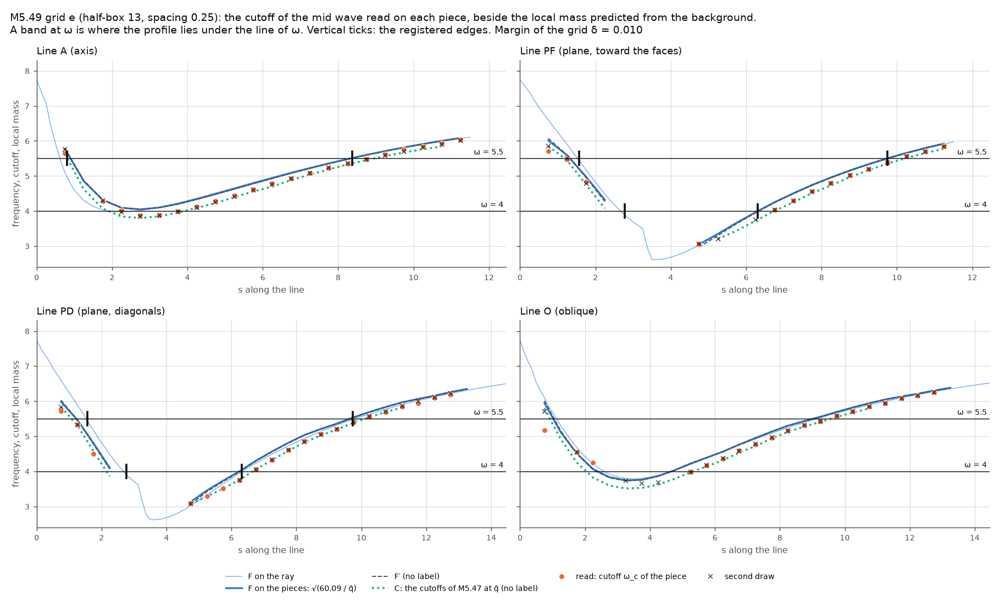
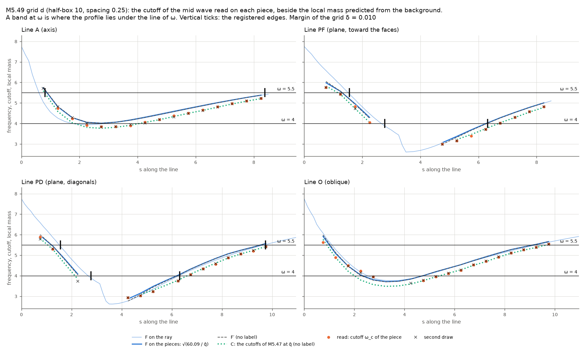
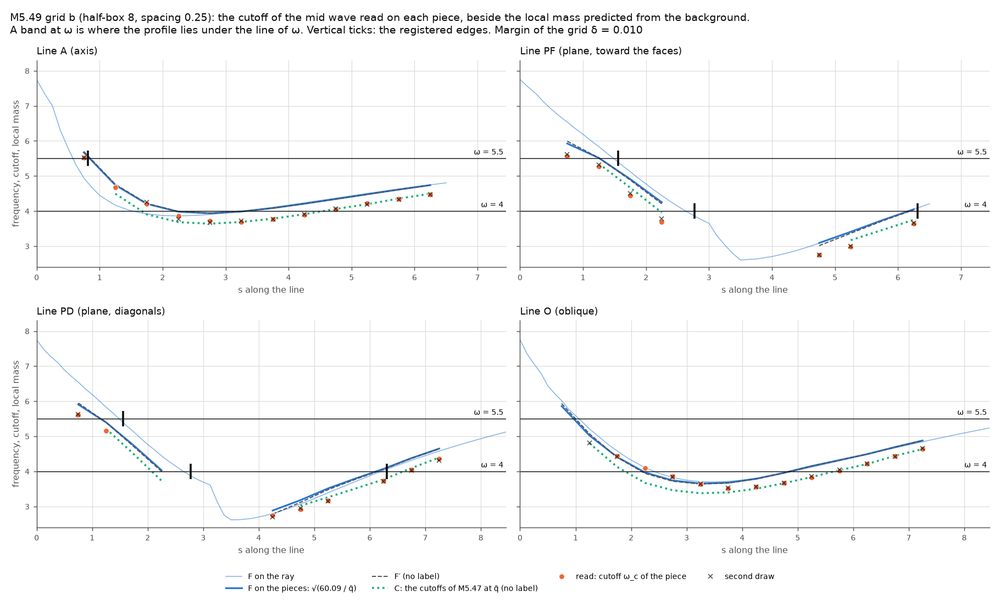
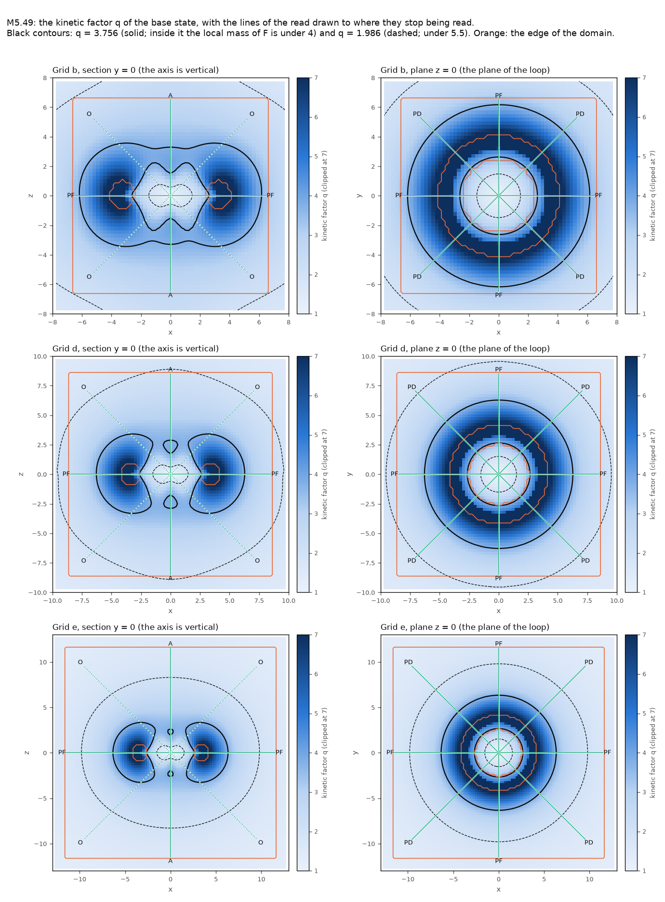
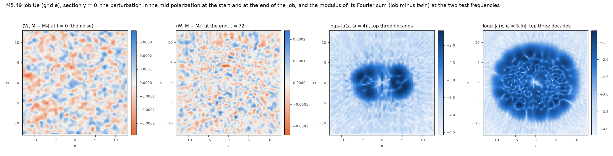

# M5.49: The author's registered bands: where a wave of the mid branch propagates on the relaxed unit

> Opened 2026-11-19, staged 2026-11-20. Roadmap row: [`m5_roadmap.md`](../m5_roadmap.md). Thread record: [`m5_32_convo.md`](m5_32_convo.md). The cell it reads for: the quantum wave equation (Klein-Gordon) in the M5 table of [`MODELS.md`](../../../../../MODELS.md).

## TASK PLANNING (2026-11-20; staged: the readings of § 5 are frozen before any wave is read along a ray)

**Scope.** The port of the read on the charge that the author registered on discussion #186 on 2026-11-19 ([discussioncomment-19756045](https://github.com/vantasnerdan/substrate-framework/discussions/186#discussioncomment-19756045), as edited at 18:25 UTC; the row of that date in the [thread record](m5_32_convo.md)). The post states that OpenWave ports each run independently and that only the ports move rows. The run reports; the cell is re-read afterwards by the repo owner, on the bar of `MODELS.md`.

| # | Statement of the post, on the author's converged charge | What the port reads, on the relaxed states of OpenWave |
| --- | --- | --- |
| 1 | A wave of the mid branch propagates on a ray where the local mass m_eff(r) = √(L₁ m² / I(r)) is under ω | the band of each line predicted by the same formula from the background of OpenWave (prediction F, § 1), written to a file before any wave is read along a ray |
| 2 | At ω = 4: no propagating band along the axis (ω² = 16 under the axis minimum of m_eff², 16.58), and a band from 2.77 to 6.31 in the ring plane | readings R1 and R2 against F; N1 and N2 against the registered numbers (§ 5) |
| 3 | At ω = 5.5: bands from 0.81 to 8.38 on the axis and from 1.56 to 9.74 in the ring plane | readings R3 and R4 against F; N3 and N4 against the registered numbers |
| 4 | Tolerance 10 percent | the same tolerance on each edge, in both sets of readings, which are tabled apart and never merged |

The post withdraws the author's earlier test of the wavenumber along a ray: the turning radius differs between the axis and the ring plane, the measured reflection is 0.02, and the wave refracts around the turning region. The archive attached to the author's post of 2026-11-20 ([discussioncomment-19766100](https://github.com/vantasnerdan/substrate-framework/discussions/186#discussioncomment-19766100)) holds the registration, its script and the script of the author's run. Read as text, they say three things this plan uses. The header of the registration's script asks that the bands be computed from the port's own background before the ported wave is read; the port does that with its own code, and nothing of the archive is run. The author's run is a driven wave: a source at the origin, an absorbing layer within 2 of the faces, half-box 12 at spacing 0.5, records along +z, +x and the xz diagonal, the two registered profiles being those of +z and +x. And the registration names its falsifier at ω = 4 as a wave advancing in phase along the axis.

**What the port reads, and what it does not.** It reads the registered band: the stretch of a line on which the local cutoff of the mid wave lies under ω. It does not read the registered falsifier, the advance of a phase, which free noise in a box with a held shell cannot show. Free noise in place of a drive is this plan's choice (§ 3), not the author's design.

**Where M5.47 left it.** [M5.47](m5_47_task_details.md) evolved free noise about the relaxed unit and kept the Fourier sums of the field at seventeen frequencies, 4 and 5.5 among them, on four grids (half-boxes 8 and 10, spacings 0.5 and 0.25). It read them in bins of the kinetic factor q, whose inverse times the vacuum mass is the m_eff² of statement 1, and in shells of r; it read nothing along a ray, and its read region leaves out the inside of the loop. Its § 11 tables, without label, a cutoff for each bin of q that lies 1.6 to 7.7 percent under √(m² / q̄).

**Six limits, stated before the run.** (1) The time part of the action is the one the plan of M5.47 supplied (its § 1), so every label here is conditional on that reading of the action, as there. (2) On grids a to d this is not a blind read. The same Fourier sums were read in M5.47 in bins of q over all directions, and its table of cutoffs foretells part of the outcome; § 5 registers what it implies for each edge. A tracked figure of M5.47, [`m5_47_sections.png`](../plots/m5_47_sections.png) (its § 14), already shows q on the section y = 0 of grids b and d, on a color scale clipped at 1 and 7, and the modulus of the wave at ω = 6 on the same section, which holds line A and one ray of line PF; no number was read from it for this plan. What a read along rays adds on those grids is the direction, which the bins mix, and the inside of the loop. Grid e (§ 3) is a base state and two noise draws that no read has seen. (3) "Propagates" is read as a local property, the cutoff of a piece of a line lying under ω (§ 2), and that cutoff is an intercept: it is extrapolated from the targets above the piece's target of least K², so a piece can read under ω = 4 with no mid wave measured at 4 itself. No advance of a phase, no reflection and no decay rate beyond an edge is read, and nothing is driven. (4) The boxes of M5.47 end before the bands at ω = 5.5 do: with the registered outer edges at 8.38 and 9.74, no line of half-boxes 8 or 10 holds the window an edge needs (§ 5). Stage 2 adds one wider box, half-box 13. (5) An edge under a radius of 2.5 cannot be placed within 10 percent by pieces of length 0.5: the inner edges registered at 0.81 and 1.56 carry no label for the wave on any grid, and are compared background against background only. The inner edge at 2.77 lies half a unit from the loop line, where the polarization may not be defined; it carries a label only if its pieces are read. (6) The bias of the cutoff rule is measured on a uniform background only (C6); a bias that a varying background adds is not measured.

**Definition of done.** The prediction file of each grid written, with its hash noted, before any Fourier sum of that grid is opened (C5); the controls of § 4 each reported as met or as the exact failing check; the six jobs of § 3 ended at their length with their sums saved; every entry of the two tables of § 5 carrying one word, or "no label" with the rule that withheld it; the expectations of § 5 scored against the outcome; the findings embedding, per line and grid, the profile of the read cutoff beside the predicted profiles, and the map of q with the lines drawn on it; an adversarial audit on a different model, with its own code on the arrays, having tried to refute each word; the doc checker and the roadmap linter clean.

**Gating.** The user's go. [M5.48](m5_48_task_details.md) closed on 2026-11-19. No answer of the author is waited for. The plan was audited on a different model on 2026-11-20, before any wave was read along a ray; the fold of that audit is recorded at the end of this section.

**Research body.** This document (plan, findings, review); scripts `m5_49_predict.py` (the prediction; it opens base states only), `m5_49_waves.py` (the base state and the six jobs of § 3: it calls the functions of the runners [`m5_46_pull.py`](../scripts/m5_46_pull.py) and [`m5_47_waves.py`](../scripts/m5_47_waves.py) with its own job list and writes files named `m5_49_*`; where a function cannot take them without an edit, the edit is a parameter whose default is the old value, and C1 and C13 show the instruments unchanged), `m5_49_reads.py` (the controls and the readings) and `m5_49_report.py` (tables and plots) in [`../scripts/`](../scripts/); the prediction `m5_49_bands_predicted.json` and the summary `m5_49_reads.json` in [`../data/`](../data/) (tracked; arrays local, indexed by [`_DATASETS.md`](../data/_DATASETS.md)); plots `m5_49_*.png` in [`../plots/`](../plots/); checkpoints and the progress notes in `../checkpoints/m5_49/` (local-only).

### 1. The prediction from the background, written first

The kinetic factor q(x) is that of M5.47 § 3, computed from the base state alone with the stencil of the action, W(x) being the mid polarization defined there. The mid mass is that of the coded Hessian at the vacuum, 60.0891 (M5.47 § 8), the value the registration uses. With I = L₁ q, the local mass of statement 1 is

$$
m_F^2(x) = \frac{m_{\mathrm{mid}}^2}{q(x)} , \qquad m_{\mathrm{mid}}^2 = 60.0891 , \qquad q(x) = 1 + \frac{\kappa}{L_1} \sum_j \tfrac{1}{2} \Big( \lVert [W, \partial_j^{+} M_0] \rVert^2 + \lVert [W, \partial_j^{-} M_0] \rVert^2 \Big)
$$

so the band of F at a frequency ω is where q is above m²_mid / ω²: 3.7556 at ω = 4 and 1.9864 at ω = 5.5.

**The author's I and the q of OpenWave.** The archive's script of the driven run defines I(x) = L₁ + κ Σ ‖[P, ∂M]‖², with the same average of forward and backward differences as q, and P "the mode's direction at x": the middle eigenvector of the Hessian of the potential in the three eigenvalues at the vacuum (1, δ, 0), carried into the local eigenframe of the background. Recomputed for this plan, its weights on the major, middle and minor axes are (0.1277, −0.6954, −0.7072). The W of M5.47 is the same direction with equal weights on the two small axes, (0.1278, −0.7013, −0.7013): the answer of its two-direction problem, written with the major axis alone because the two small axes are not a stable frame. So I = L₁ q holds up to the difference of the two small weights: a turn of the major axis toward the middle axis carries the factor 0.823² with P, toward the minor axis 0.835², against 0.829² for both with W, which is 1.4 percent either way in q − 1 and cancels where the two turns are alike. The prediction file therefore holds a second kinetic factor, q_P: the same sum with the three-weight direction in the eigenframe of the background, computed with the code of this task. F with q carries the labels, since q is the kinetic factor of the polarization the read projects on (C3); F with q_P is tabled beside it and controlled (C14).

The file `m5_49_bands_predicted.json` holds, for every grid and every line of § 2:

| Entry | Definition |
| --- | --- |
| F, on the pieces | m_F(s_i) = √(m²_mid / q̄_i), with q̄_i the mean of q over the nodes of piece i (the same nodes the wave is read on); the profile is joined by straight lines between the centers of the pieces, and an edge is a radius where it crosses ω |
| F, on the ray | the same with q interpolated trilinearly at points half a spacing apart on each ray of the line, averaged over the rays of the line: the form the registration uses on its two profiles |
| F with q_P | both forms again, with q_P in place of q |
| F′, no label | the local mass of M5.47 § 3, with the second derivative of the potential along W at the local background in place of the vacuum mass |
| C, no label | the cutoffs that M5.47 § 11 fitted per bin of q on the same grid (those of grid d for grid e), interpolated linearly in q̄ and read at q̄_i; no value outside the range of the fitted bins |
| The geometry | the loop's center, normal and radius; the nodes of every piece and how many lie in the domain; the radius at which each line stops being read; for every edge of F its window of § 5 and whether the read pieces cover it |

**Which prediction carries the labels.** F with q on the pieces, for the readings R1 to R4: it is the author's rule applied to the background of OpenWave. The two speeds that the linearized action gives a wave (M5.47 § 3) do not enter an edge of F, which depends only on where the local mass equals ω. The offset of the cutoffs under √(m² / q̄) that M5.47 tabled is the content of C. C carries no label: it comes from the same Fourier sums as the read on grids a to d, and from one grid's bins on grid e. A read that lands on C and off F is worded as the offset M5.47 had already tabled, seen along a line.

**At plan time.** The rule of the registration (m_eff² = L₁ m² / I on samples half a unit apart, a cubic interpolation, the radii where it crosses ω²) was applied, with code written for this plan, to the two profiles I(r) of the author's archive. It returned the registered numbers: no band on the axis at ω = 4, with a least m_eff² of 16.577 at r = 2.50; 2.77 to 6.31 in the plane; 0.81 to 8.38 and 1.56 to 9.74 at ω = 5.5. On those profiles I / L₁ runs from 1.43 to 3.62 on the axis and from 1.21 to 8.70 in the plane. Neither profile is at its tail by r = 12: (I / L₁ − 1) r² is 67, 77 and 87 at r = 8, 10 and 12 on the axis and 100, 93 and 87 in the plane, so the 88 that M5.47 registered for q − 1 as a median over directions is of the same size and no closer a check than that. No q was computed along a ray of a state of OpenWave, and no Fourier sum was opened, before this plan was frozen.

### 2. The read: lines, pieces, and the cutoff of a piece

**The lines.** The loop's center c, unit normal ν and radius R come from the reader of [M5.44](m5_44_task_details.md) on the base state, as in M5.47 (on grids a to d: the center of the box, ν along a box axis, R = 3.29 and 3.32). A ray starts at c.

| Line | Rays | Role |
| --- | --- | --- |
| A, the axis | the two rays along ν and −ν | the author's +z |
| PF, the plane toward the faces | the four rays in the plane through c normal to ν, along the two box axes of that plane, both ways | the author's ray in the ring plane, their +x, a box axis |
| PD, the plane on the diagonals | the four rays of that plane at 45° from those of PF | a second ray of the plane, added by this plan: the one that stays farthest from the faces |
| O, oblique (no label) | the eight rays at 45° from ν, above and below the four directions of PF | a line the registration does not name |

**The pieces.** With s the coordinate along a ray and t the distance from it, the node set of a line is the union over its rays of the nodes with s at least 0 and t at most the larger of t₀ and s tan 15°. A node inside the sets of two rays of a line is counted once, with the ray it is nearest to (the smaller s on a tie). Piece i holds the nodes with s from iΔ to (i + 1)Δ and has its center at s_i = (i + ½)Δ. On the grids of spacing 0.25: Δ = 0.5, t₀ = 1.0, a floor of 150 nodes. On those of spacing 0.5: Δ = 1.0, t₀ = 1.5, a floor of 100 nodes. The domain D is the set of nodes at least 1.5 inside every face at which the two largest eigenvalues of the background are at least 0.5 apart, the condition under which M5.47 defines W. Only the nodes of D enter the sums of a piece: K², q̄, C7 and C8. A piece is read when its nodes in D reach the floor and are at least 90 percent of its nodes. The two other conditions of the read region of M5.47 (1.5 from the loop line; the loop's radius from its center) are dropped, since the registered bands run through the inside of the loop; that is why the twin and the linearized equations are controlled again on every piece (C7, C8).

The reasons of these numbers, where there is one. The half angle of 15° keeps the change of an edge across the cone small: between the axis and the plane the registered outer edges differ by 16 percent over 90°, about 1 percent within 15°. The tube of t₀ = 1.0 gives the pieces near the center about 200 nodes on line A at spacing 0.25 (196 by the geometry of the grid), and is the plan's choice. The floors and the 90 percent are the plan's choice. By the geometry alone the first piece of every line falls under the floor at spacing 0.25 (147, 73 and 101 nodes on A, PF and PD, the rays of a line sharing the nodes near the center), so the lines are read from s = 0.5.

**The estimator** is that of M5.47 § 3, on a piece S in place of a bin:

$$
K^2(S, \omega) = - \frac{\sum_{x \in S} \operatorname{Re} \big( \bar a \quad \Delta_h a \big)}{\sum_{x \in S} \lvert a \rvert^2} , \qquad a(x, \omega) = \big\langle W(x), A_{\mathrm{job}}(x, \omega) - A_{\mathrm{twin}}(x, \omega) \big\rangle
$$

with A the six-component Fourier sum at a target and Δ_h the seven-point Laplacian. In the vacuum jobs there is no twin and a is the projection of the job's sum.

**The cutoff of a piece** is read by the rule of M5.47 § 11, restated. Over the targets ω_t of the job (the seventeen of the unit jobs and of Vq4 and Vq55; the twenty-three of V1 and V2), t\* is the target of least K². The kept targets are those above t\* with 1 ≤ K² ≤ 4/h². With four kept targets or more, the least-squares line

$$
\omega_t^2 = c^2 K^2(S, \omega_t) + m^2 , \qquad \omega_c(S) = \sqrt{m^2}
$$

is fitted, and the piece is fitted when m² is positive and every kept target lies within 0.10 ω_t² of the line (the lines of the bins of M5.47 lie within 0.086; the plan's choice above that). Against a test frequency ω (4 or 5.5) a read piece is:

| Status | Rule |
| --- | --- |
| UNDER | fitted, t\* not the first target, and ω_c ≤ (1 − δ) ω |
| OVER | fitted, t\* not the first target, and ω_c ≥ (1 + δ) ω; or fewer than four kept targets and t\* ≥ ω + 0.5 (on the bins of M5.47 t\* − ω_c runs from −0.38 to +0.27, so half a unit clears it) |
| OPEN | anything else, a piece whose least K² is at the first target among them (its cutoff is an extrapolation below the targets) |

**The margin and the bias.** With β(ω) the bias that C6 measures on a uniform vacuum whose mid mass is ω, the margin of a grid is

$$
\delta = \max \big( 0.01 , \quad 2 g_a , \quad 2 d , \quad 2 \lvert \beta(4) \rvert , \quad 2 \lvert \beta(5.5) \rvert \big)
$$

with g_a the worst gap of C6 (a) and d the median of C10 on that grid. Every edge of the read is found three times: on the profile ω_c, on ω_c (1 + b) and on ω_c (1 − b), with b = \|β\| at the test frequency. An entry whose word is not the same on the three carries no label, with the words "inside the bias of the estimator".

**What "propagates" means here, and why.** The mid wave is read as propagating at ω on a piece when the piece is UNDER. Two simpler rules were weighed and set aside on the record of M5.47. The sign of K² at the target does not separate the two cases: under a cutoff the projection on W is a wave of the soft polarizations, whose K² is positive and large (in the vacuum jobs 8.9 at ω = 3, the light branch; on the unit 11 to 28 in the bin of q from 1.75 to 2 of grid d at the targets 3 to 4.75). A level of the power in W needs a reference that the data do not hold, and the level falls without a step through a turning point; the Hann window of length 72 also mixes into a target the frequencies within about 0.17 of it, which at an outer edge is worth several percent of the radius. The cutoff uses both signs at once: K² falls to its least value where the mid wave enters, the power in W rises there by one to three orders of magnitude, and above it K² follows one line whose intercept is the cutoff. The rule returns the cutoffs of § 11 of M5.47 on its bins, and 7.753 against 7.752 on the vacuum job V2 with its twenty-three targets (checked at plan time on the rows of [`m5_47_reads.json`](../data/m5_47_reads.json)). K² at the target, the share of the power outside W and the power in W are tabled per piece at ω = 4 and 5.5, without label.

**An edge of the read** at ω on a line is a radius where the profile ω_c(s_i), joined by straight lines between the centers of consecutive fitted pieces no more than 2Δ apart, crosses ω: an outer edge where it goes from under to over as s grows, an inner edge the other way. Where a fitted UNDER piece is next to an OVER piece that is not fitted, the midpoint of their two centers is an edge "by its midpoint", which § 5 scores by its own rule. Two edges of one line and frequency closer than 2Δ carry no label.

**A band, a zone, or none.** On a line at a frequency ω, a run is a set of consecutive UNDER pieces; its length is the number of its pieces times Δ. With c² and ω_c from the fitted line of the middle piece of the run (of two middle pieces, the one with the higher cutoff), K² = (ω² − ω_c²) / c² and the half wavelength is π / K. The read says BAND where a run is at least as long as its half wavelength; ZONE where the line has a run and none that long; NO BAND when at least nine pieces in ten of the line are read (the plan's choice) and every read piece is OVER; otherwise it is undecided. A statement of the read counts only if the second draw of the grid gives the same statement (C10).

### 3. The grids: the stored sums, and one wider box

| Grid | Base state | Half-box | Spacing (N) | Read | A and PF read to; PD read to | An outer edge at r₀ is covered up to (A and PF; PD) | Source |
| --- | --- | --- | --- | --- | --- | --- | --- |
| a | B0a | 8 | 0.5 (33) | Ua against Na; Sa against Na | 7; 8 | tabled only | the sums of M5.47 |
| b | B0b | 8 | 0.25 (65) | Ub against Nb; Sb against Nb | 6.5; 7.5 | 5.68; 6.59 | the sums of M5.47 |
| c | B0c | 10 | 0.5 (41) | Uc against Nc | 9; 10 | tabled only | the sums of M5.47 |
| d | B0d | 10 | 0.25 (81) | Ud against Nd; Sd against Nd | 8.5; 10 | 7.50; 8.86 | the sums of M5.47, and Sd of stage 2 |
| e | B0e | 13 | 0.25 (105) | Ue against Ne; Se against Ne | 11.5; 13.5 | 10.23; 12.05 | stage 2 |
| vacuum | uniform | 8, 6 | 0.5 (33), 0.25 (49) | V1, V2; Vq4, Vq55 on the grid of V2 | 7 and 4.5; 8 and 5.5 | | the sums of M5.47, and Vq4, Vq55 of stage 2 |

The ends of the lines are those the box gives: the inset of 1.5 and, on PD, the 90 percent rule on a cone that the inset cuts. The condition on the eigenvalues can remove pieces inside them, which only the prediction file shows. The fifth column is the largest r₀ whose window of § 5 the read pieces can cover.

**Stage 1, the stored sums.** The prediction file of grids a to d is written, then the controls and the reads are made on the sums of M5.47. By the box alone, the labels these grids can carry are those at ω = 4. No read of the unit along a ray is made before C6 is met, which waits for Vq4 and Vq55; the words of grid d wait for Sd.

**Stage 2, the jobs.** One base state and six jobs are added, with the instruments of the two earlier tasks unchanged:

| Job | What it is | Settings |
| --- | --- | --- |
| Vq4, Vq55 | the uniform vacuum on the grid of V2 (half-box 6, spacing 0.25), with v scaled so that the mid mass is 16 and 30.25: v = 0.266271 and 0.503419 (the masses are linear in v, and q = 1) | the settings of record of V2 (M5.47 § 7: noise in all six components at 10⁻⁵, step 0.01, length 72), with the seventeen targets of the unit jobs |
| Sd | a second draw of the noise on grid d | the settings of record of M5.47 for Ud, another seed |
| B0e | the base state on half-box 13 at spacing 0.25 | the base chain of [M5.46](m5_46_task_details.md): from the seed, the outer shell held at the seed, the descent rule and the gate of M5.45, as B0a to B0d |
| Ue | noise in the mid polarization about B0e | the settings of record of M5.47 § 7: amplitude 10⁻⁴, smoothing 0.35, step 0.02, length 72, the Hann window, the seventeen targets, E, T and U every 20 steps |
| Ne | the unperturbed twin | the same, no noise |
| Se | a second draw of the noise | the same, another seed |

**Why Vq4 and Vq55.** On V2 the kept targets start half a unit above a cutoff of 7.75, and on the unit they start 0 to 0.4 above cutoffs near 4 and 5.5. The two jobs put a known cutoff at each test frequency under the unit's own targets, so that the intercept is tested in the design it is used in (C6 (b)).

**Why half-box 13.** It is chosen from the box alone. With it, lines A and PF are read to 11.5, which covers the windows of both registered outer edges at ω = 5.5 on the author's own two rays (8.38 on +z and 9.74 on +x: the windows end at 9.72 and 11.21), and the window of an axis edge of F as far out as the tail q = 1 + 88/r² would put it (9.45, ending at 10.89). A half-box of 12 reads those lines to 10.5 and loses the plane edge on PF and the tail case on A.

**Why no drive.** The registered band is a local statement, the free noise holds at each target every wave the box supports at that frequency, and a source in a box with a held shell and no absorbing layer would add a design (where, in which polarization, how long until a steady state) with no control behind it. The price is the one named in the Scope: the falsifier of the registration is not read.

**Parallel shape.** One single-threaded process per job (the thread variables set to 1 before NumPy loads), four long processes at once at most: the base chain, Sd, Vq4 and Vq55 first; Ue, Ne and Se as those end, the prediction of grid e being written when B0e has ended and before its jobs end. One more process holds the desk reads: stage 1 once Vq4 and Vq55 have ended, the reads of grid e after its jobs. The base chain is a descent, sequential by nature. The GPU is not used: the action needs f64.

### 4. The controls

| Control | Input | The answer it must return | What a failure would look like |
| --- | --- | --- | --- |
| C1, the stepper again | `m5_47_evolve.py --controls`, unchanged | K0 to K5 of M5.47: the physical values of [`m5_47_controls_stepper.json`](../data/m5_47_controls_stepper.json) to 10⁻¹⁰ (relative); the entries that are round-off (gaps, asymmetries, residuals, drifts) under the thresholds of their own K control | a stepper that is no longer the one M5.47 controlled |
| C2, the readers on made-up inputs | (a) profiles given as functions of s on pieces of 0.5: q = 1 + 88/s²; a flat q = 1.5; q = 2 with a plateau of 3.60, and of 3.95, from s = 1.5 to 4.5; each read at δ = 0.01 and at δ = 0.03. (b) a table of K² against the targets built from a line of slope 0.87 and cutoff 5.5, with large values under it; the same with three kept targets; a table whose least K² is at the first target; a table of twenty-three targets. (c) made-up profiles of ω_c, with slopes, for every branch of § 2 and § 5 | (a) edges at 9.45 and 5.65 within 0.02; no edge; at δ = 0.01 NO BAND for the plateau of 3.60 and BAND for 3.95, at δ = 0.03 no statement for either. (b) a cutoff of 5.5 within 0.01 and the kept targets as built; not fitted; OPEN; the rule on its own targets. (c) each outcome once: HELD, NOT HELD, and no label by the cover, by the radius of 2.5, by two edges too close, by the two forms of F apart, by one form of F lacking the edge, by the bias, by C14; an edge by its midpoint in each of its three cases; UNDER, OVER and OPEN; BAND, ZONE, NO BAND and undecided; a statement the second draw does not repeat; F with no band and F with two bands; a band not predicted | a finder that draws an edge on a flat profile or misses a band; a reader that returns HELD on every table |
| C3, q | q from its definition against W·𝒜(M₀)·W / (2 L₁) from the matrix of the stepper, on every node of D of every grid | equal to 10⁻¹² | a q that is not the kinetic factor of the action |
| C4, the base state B0e | the end of its chain and the loop reader | the gate of M5.45 met (the largest entry of the gradient over h³ at most 10⁻³); one loop, its center within one spacing of the center of the box, its normal within 1° of a box axis, its radius within 1 percent of the 3.316 of B0b and B0d | another object in the wider box |
| C5, the prediction first | the prediction file of a grid and the progress notes | the SHA-256 of the file is in the notes before the reads script opens a Fourier sum of that grid; the reads script takes that hash as an argument and stops on a mismatch; `m5_49_predict.py` has no code path that opens a Fourier file | a prediction written or changed after the read |
| C6, the vacuum on the pieces | (a) V2 with its twenty-three targets (V1 tabled), read with the pieces of the four lines about the center of the box and a box axis. (b) Vq4 and Vq55 read the same way with the seventeen targets, by the rule the unit is read with | (a) every fitted piece within 1 percent of 7.7517, at least nine pieces in ten fitted, every read piece OVER at ω = 4 and at 5.5, no line with an edge. (b) every fitted piece within 1 percent of 4 and of 5.5, at least nine pieces in ten fitted; the bias β(ω), the median of ω_c over ω less 1, at each of the two | a band where there is no structure; an intercept biased when its kept targets start at the cutoff |
| C7, the twin | every kept target of every fitted piece of the unit | the Fourier power of the twin, in six components, at most 1 percent of that of the difference (K8 of M5.47) | a background that moves as much as the wave |
| C8, the linearized equations | the same points | the six-component quotient of K12 of M5.47 within 3 percent of ω² | sums that are not solutions of the linearized equations |
| C9, the energy | Sd, Ue, Se, Vq4, Vq55 | E within 2 percent of the perturbation's energy over the length (K11 of M5.47) | energy lost to the scheme |
| C10, the second draw | Sb against Ub, Sd against Ud, Se against Ue | per grid: over the pieces fitted in both draws, the median of the relative difference of ω_c at most 0.015; every edge that carries a label found again within 3 percent of its radius; every statement of § 2 (BAND, ZONE, NO BAND) the same in both | a cutoff, an edge or a band set by the draw |
| C11, the rays of a line | q̄ of each ray alone, on every piece inside a window of § 5 | within 2 percent of the q̄ of the line (a fifth of the 10 percent that an edge is allowed, on a tail where q − 1 and the radius move alike; the plan's choice) | rays pooled that are not alike |
| C12, the swap | two lines of a grid whose edges of F at one ω differ by more than 10 percent of their mean | the read edges are in the same order and differ by at least half as much (the plan's choice) | a read that does not tell one line from another |
| C13, the reader on the bins of M5.47 | the reads script given the read region and the bins of q of M5.47 on grids a to d | the cutoffs of M5.47 § 11 to six digits | an estimator that is no longer that of M5.47 |
| C14, the two kinetic factors | on every line of every grid, each edge of F with q_P against the same edge of F with q, and the band-or-none statement of F with each | the edges within 2 percent of the radius (the two factors differ by about 0.7 percent where one rotation dominates a ray, which moves an outer edge by about 1 percent); the same statement | a label that hangs on which of the two directions defines the kinetic factor |

C1, C2, C3, C5, C13 and C14 run before any read along a ray, and C6 before any read of the unit along a ray; C4 before the jobs on grid e; the others are read from the sums. The try cap on the controls is three. Between tries only the input of a control or a defect of a script may change, never a threshold of § 4 or § 5 nor a definition of § 2, and each change is logged in the progress notes. What a failure costs: C1 or C4, no job on grid e; C2, C3, C5 or C13, no label on any grid; C6 (a), no label on any grid; C6 (b), no label at the frequency of the job that failed; C7 or C8, the piece is treated as not fitted; C9, no label from the sums of that job; C10, on that grid: an edge not found again within 3 percent carries no label, a statement the second draw does not repeat is undecided, and a median above 0.015 withholds the band-or-none entries; C11 or C12, no label for the edges concerned; C14, no label for the R entries of that edge or that statement, both values printed.

### 5. The readings, frozen

Labels are given on the grids of spacing 0.25 (b, d, e); grids a and c are tabled. For an edge expected at a radius r₀ on a line, its window is the set of pieces whose centers lie from 0.9 r₀ − Δ to 1.1 r₀ + Δ, and it is covered when all of them are read and each is fitted or OVER.

| Word | Rule, for one edge on one line of one grid |
| --- | --- |
| HELD | the window is covered and the read has an edge of the same kind (inner or outer) from 0.9 r₀ to 1.1 r₀. An edge by its midpoint counts only when both of its centers lie in that range |
| NOT HELD | the window is covered and the read has no edge of that kind in that range. An edge by its midpoint is absent only when both of its centers lie outside the range |
| no label | the window is not covered (the box ends, or pieces are not read); r₀ is under 2.5; an edge by its midpoint has one center inside the range and one outside; the word differs on the three profiles of the bias (§ 2); a control withheld it. For an R entry also: the two forms of F differ by more than 3 percent of the radius, or only one of them has the edge (the cone does not resolve the ray; 3 percent is the plan's choice, about a third of the tolerance), or C14. The nearest read edge of that kind is printed |

Both words need the cover, so that neither is given where the other could not have been.

**Band-or-none entries.** F says NO BAND on a line at ω when the least m_F of the line is at least (1 + δ) ω in both of its forms; BAND when two consecutive pieces (one unit; the plan's choice) have m_F at most (1 − δ) ω and the ray form has a band; otherwise F's own statement lies inside the margin of the read. The read's statement is that of § 2. Such an entry is HELD when F and the read both make a statement of BAND or NO BAND and agree, and in the case of BAND at least one edge of the band is HELD and none is NOT HELD; NOT HELD when both make one and they differ, or an edge of the band is NOT HELD; no label when either makes none, when the read says ZONE (printed with the length of the run and its half wavelength), when both say BAND and no edge carries a word, or when δ is above 0.03.

**The other cases.** Where F has no band on a line at a frequency, the entry of that line is a band-or-none entry. Where F has two bands or more, each edge of F is an entry, named by its order from the center. A BAND of the read that lies wholly outside every band of F by more than 10 percent of its radius is an entry of its own, "band not predicted", NOT HELD.

| Reading | Against F, the prediction from the background of the same grid | Against the registered numbers |
| --- | --- | --- |
| ω = 4, line A | **R1.** a band-or-none entry if F has no band there, otherwise the edges of F by the edge rule | **N1.** HELD when the read says NO BAND; NOT HELD when it says BAND; no label when it says ZONE, is undecided, or δ is above 0.03 |
| ω = 4, lines PF and PD | **R2.** the outer and the inner edge of F, each by the edge rule | **N2.** the same with r₀ = 6.31 and 2.77 |
| ω = 5.5, line A | **R3.** the outer and the inner edge of F | **N3.** the same with r₀ = 8.38 and 0.81 |
| ω = 5.5, lines PF and PD | **R4.** the outer and the inner edge of F | **N4.** the same with r₀ = 9.74 and 1.56 |

Every entry (reading, line, edge, grid) carries its own word. The word of a reading is HELD when at least one entry is HELD and none is NOT HELD; NOT HELD when any entry is, the entry named; no label when no entry carries a word. The words are also tabled per grid, so that the number of grids behind a word is on the page. The two columns are two tables in the findings and are scored apart: R is the author's rule on the state of OpenWave, N is the author's numbers on it, and a difference between them is the difference of the two backgrounds, which descriptor B tables. The registered numbers of the plane are those of the author's +x, so line PF is their like; PD is read against the same numbers and named as the plan's addition.

**Known before the run, for the N column, from the box and the radius of 2.5.** The entries of the inner edges at 0.81 and 1.56 carry no label. The outer edge at 8.38 can carry a word on line A of grid e alone. The outer edge at 9.74 can carry one on lines PF and PD of grid e alone. The outer edge at 6.31 can carry one on PF and PD of grids d and e and on PD of grid b. Whether the inner edge at 2.77 and the entry N1 carry a word depends on which pieces the condition on the eigenvalues leaves read. **For the R column nothing of this kind is known before the prediction file exists:** its windows sit on the edges of F, and the fifth column of the table of § 3 says how far out an edge of F can lie and still be covered.

**Descriptors, with no word of their own.** B, the backgrounds: the edges of F on the ray against the registered numbers, in percent; the two forms of F side by side (on the tail the cone moves an edge by about 1.75 percent); F with q_P beside F with q; the least m_F² of the axis and its radius beside the 16.58 of the registration (16.577 at r = 2.50 on its profile). Every read edge against C, in percent. Per line and grid: the profile ω_c(s) with F, F′ and C, the slope c² of each fitted piece, the status of each piece at the two frequencies, the three profiles of the bias, and the three single-target rows of § 2. Every run with its length and its half wavelength. The read edges of grids b, d and e side by side on each line. Line O. Grids a and c.

**Registered before the run.** Expectations, which no script uses. By the table of M5.47 § 11 the cutoff of a bin is 0.962 to 0.974 of √(m² / q̄) where q is 1.75 to 2.25, and 0.923 to 0.939 where q is 3.25 to 4.25, on the grids of spacing 0.25. If a line follows the tail q = 1 + 88/r² that M5.47 registered as a median over directions, an outer edge of the read then lies outside that of F by 6 to 8 percent of the radius at ω = 5.5 and by 9 to 12 percent at ω = 4. A single ray need not follow that tail: on the two profiles of the author's archive, taken as a stand-in for rays not computed at this date, the same ratios move the outer edge out by 5 to 7 percent in the plane and by 8 to 12 percent on the axis at ω = 5.5, and by 8 to 10 percent in the plane at ω = 4. Expected, then, for the edges: R4 HELD on grid e, on PD and on PF if the edge of F on PF lies inside 10.23, the read edge 5 to 8 percent outside F; R3 and R2 at the tolerance, their outer edges 8 to 12 percent outside F, the side not predicted, and an entry that close reads "inside the bias of the estimator" as soon as β is a percent or more; every such edge within 3 percent of C. For line A at ω = 4, with the same ratios and δ = 0.01, a piece is OVER where q̄ is at most 3.14 to 3.25 and UNDER where it is at least 3.26 to 3.38. If the axis of OpenWave's state resembles the author's (I / L₁ up to 3.62, above 3.3 over 2.1 to 2.5 units): F says NO BAND only while δ is under 0.018 (the least m_eff of that profile is 4.07); the read has a run of 2 to 2.5 units beside a half wavelength of 2.2 to 2.6 (cutoffs of 3.77 to 3.84 at its middle, a slope of 0.87), so ZONE or BAND, not predicted. Then N1 is no label or NOT HELD, and R1 the same, or no label by the margin if δ reaches 0.018. If the peak of q on the axis is under about 3.1, R1 and N1 are HELD. The peak is not known beyond what the color scale of the figure named in limit (2) shows; no number was read from it. N differs from R by what B shows; the loop of OpenWave's state has a radius of 3.3, and the author's profile in the plane peaks near 3.5 to 3.7, so B is expected within 10 percent on the outer edges and is not predicted on the inner ones.

Nothing in this section sets an icon: the plan reports, and the scorecard cell is re-read later by the repo owner.

### 6. Blindspot pass, consumers, estimate

Read against the recurring failure families of the records of [M5.47](m5_47_task_details.md) and [M5.48](m5_48_task_details.md), for the instruments of this task.

| Unknown | Guard |
| --- | --- |
| The read is foretold in part: grids a to d are the sums of M5.47, whose cutoffs sit 1.6 to 7.7 percent under the formula, and a tracked figure of M5.47 shows q and a wave on a section that holds two of the lines | limit (2); the expectations of § 5 are derived from that table before any ray is read; C carries no label and a read that lands on it is worded as M5.47's offset; grid e is new data |
| A band read on evidence the registration does not count: a short run of pieces under ω, each an intercept | BAND needs a run as long as its half wavelength; a shorter run is ZONE and no label; the Scope says the falsifier of the registration is not read; limit (3) |
| The words at the tolerance are set by an offset of a few percent, and nothing tells physics from a bias of the intercept | Vq4 and Vq55 measure the bias at the two frequencies under the unit's targets; δ holds twice that bias; every edge is found on three profiles and a word that changes is no label; limit (6) for what stays unmeasured |
| A word that could not have been the other one: HELD read on a window the box cuts, or on a statement inside the margin | both words need the cover; F's statement must clear the margin δ; the entries of N that cannot carry a word are named before the run |
| The cutoff rule leans on the soft waves keeping K² large under the cutoff, and M5.47 § 16 has no known answer under K² of about 4 | C6 (a) and (b) on the pieces themselves; C13 ties the reader to the bins of M5.47; C8 on every kept point |
| A piece holds a few hundred nodes where a bin of M5.47 held thousands, and is narrower than a wavelength | C10 on the three labeled grids; δ grows with the scatter; an edge or a statement not found in the second draw carries no label |
| The window mixes frequencies within about 0.17 of a target, which is more than the margin of the registered yes or no (√16.58 = 4.07 against 4) | no label rests on one target; the cutoff comes from a line through the targets above it; δ is set by C6 and C10, and the band-or-none entries are withheld above 0.03 |
| The cone is wider than the scale on which q changes near the loop, so a piece is not the ray | F in two forms, and no label where they differ by more than 3 percent of the radius or only one has the edge; the 90 percent rule; R compares the read with F on the same nodes |
| W is not defined where the two largest eigenvalues meet, near the loop line | the domain D, whose nodes alone enter the sums; pieces under 90 percent are not read; the inner edge at 2.77 is labeled only if read |
| The shell is held and the box is a cube: the background along PF, PD and A differs by more than the unit does | F is computed per line and per grid; PD is read beside PF; the three boxes are tabled side by side; the inset of M5.47 is kept |
| Rays pooled into a line are assumed alike | C11; a node shared by two rays is counted once |
| The author's I is built on a direction with three weights, the q of OpenWave on W with two | § 1 states both and the size of the difference (1.4 percent either way in q − 1); q_P is computed; C14 withholds an R entry where the two disagree by more than 2 percent of a radius or in a statement; descriptor B |
| The wider box holds another state, or a state not at rest | C4; the twin Ne and C7; the second draw |
| This plan's choices taken for the author's | named as the plan's in the findings: free noise in place of the author's driven wave with its absorbing layer; line PD beside the author's +x; the cone of 15°, the tube and the pieces of 0.5; the cutoff of a piece as the meaning of "propagates"; a band as a run of half a wavelength; the margin δ and the three profiles of the bias; the cover; the radius of 2.5; the half-box of 13; W in place of the three-weight direction for the labels |
| An unvalidated instrument, an artifact read as a result, a check that cannot fail, a diagnostic outside its regime (the families of the workflow) | C2, C6 and C13 give every reader a known answer and an input that fails; three second draws and three boxes; the cover rule; the regime of the estimator (1 ≤ K² ≤ 4/h², W defined) is part of what makes a piece read |

**Consumers.** The words of R and N are read by the re-read of the Klein-Gordon cell and by the results message of the repo owner: they need C1 to C14 met and the audit. The base state B0e and its Fourier sums are reusable by a later read in a wider box: they need C4, C7 and C9.

**Not computed.** A driven wave, the advance of a phase, a reflection, the decay beyond an edge, the pattern of the wave in three dimensions. The inner edges at ω = 5.5 as a wave read. A half-box above 13, a spacing under 0.25. The light and the soft polarizations. Another time part. An error bar beyond the second draw. The bias of the cutoff on a background that is not uniform.

**Estimate.** Stage 1 is a desk read of stored sums: four scripts, the controls and the reads, with no pool. The clock of the task is stage 2: the base chain on 105³, then three jobs whose cost per job is about 2.2 times that of the 81³ jobs of M5.47 § 14 (the ratio of the node counts), beside one more 81³ job and two on the grid of V2. The reads of grid e, the findings and two audits in parallel follow. Model: the session's model for the build, in one sub-agent; the audit on Opus, a numbers check on Sonnet.

**Plan audit (2026-11-20, before any wave was read along a ray).** An independent pass on a different model read the draft of this plan against the two posts, the registration and its script in the author's archive, the record and the tracked summary of M5.47 and the scripts, and recomputed its numbers with its own code. It opened no Fourier array and computed no profile along a ray. It confirmed the registered numbers from the archive's two profiles, the cutoff rule against the bins of M5.47 § 11 (to about 10⁻⁷), the ratios and cutoffs quoted in the expectations and the shifts of the edges derived from them, the quotes of K², the width of the window, the settings of the jobs, the loop radii, and the half-box of the draft under the draft's own assumption. It found nineteen faults (two critical, three high, six medium, eight low), all folded above. Those that changed a reading, a control or the job list: a band was read on two pieces under ω, evidence the registration does not count, so BAND now needs a run of half a wavelength, a shorter run is ZONE without label, and the Scope says the falsifier is not read; the cutoff rule was written for seventeen targets and could not pass its vacuum control, whose job has twenty-three and whose kept targets start far above the cutoff, so the rule reads the targets of the job and two vacuum jobs with the mid mass at 4 and at 5.5 were added (C6 (b)); no control told the offset of the cutoffs from a bias of the intercept, so that bias enters the margin and every edge is found on three profiles; the second draw did not exist on grid d, so job Sd was added, C10 runs per grid, and a statement must repeat in the second draw; "R does not depend on" the identity of the author's I with L₁ q was false, so § 1 states the author's three-weight direction, q_P is computed and C14 was added; the entries said to be known before the run assumed that F equals the registered numbers, so that paragraph is limited to the N column and stage 2 moved from half-box 12 to 13, which also covers the author's own ray in the plane; cases were missing (an edge by its midpoint, F with no band or with several, a band not predicted, one form of F lacking an edge, a least K² at the first target) and each has its rule; the nodes that enter a piece and the count of a node shared by two rays were not stated; the made-up profiles of C2 contradicted the rule they test; C1 compared round-off to ten digits; the rule for a piece that is not fitted used a margin of 0.25 where the bins show 0.27, now 0.5. The others corrected numbers and wording (1.6 to 7.7 percent; 16.577 at r = 2.50; the half wavelength defined; a reason or the words "the plan's choice" for each threshold; the tracked figure disclosed; the expectations rewritten with the undecided range and the margin; the runners and their file names; the author's design stated). One fact was settled after the audit, by reading the archive's script of the driven run as text: the definition of the author's direction and the design of their run, on which the fold of the fifth fault and the roles of lines PF and PD rest. Three points of the fold are the nearest thing that keeps a decision's purpose: the margin δ is per grid, since a second draw withholds on its own grid; C6 (b) costs the labels of its own frequency; and C14 also compares the band-or-none statement of F under the two kinetic factors. Added at the fold from the geometry of the grids, which needs no state: the ends of the lines (7.5 and 10 on PD of grids b and d, where the draft wrote about 7.7 and 10.1), the largest covered r₀ per line, and the first piece of every line falling under the floor. Not checked by the audit: anything that needs the arrays (the node counts of real pieces, the size of the region where the eigenvalue condition fails, whether C3, C7, C8 and C11 pass on pieces); the posts online; the plots.

## FINDINGS (2026-11-20)

> The run of the plan above, made on 2026-11-20. Scripts: [`m5_49_predict.py`](../scripts/m5_49_predict.py), [`m5_49_waves.py`](../scripts/m5_49_waves.py), [`m5_49_reads.py`](../scripts/m5_49_reads.py), [`m5_49_report.py`](../scripts/m5_49_report.py). Prediction: [`m5_49_bands_predicted.json`](../data/m5_49_bands_predicted.json). Summary of the reads: [`m5_49_reads.json`](../data/m5_49_reads.json). One `m5_49_<job>.json` per job and `m5_49_chain_B0e.json` in [`../data/`](../data/).

**In brief.** (1) The controls were met, with two exceptions, neither of which changes a word (§ 7). C12 is not met on three pairs of inner edges of grid b. The statement clause of C10 is not met on three statements at ω = 4, which become undecided by the plan: line PF of grid d and line PD of grid e (BAND, then ZONE in the second draw) and line O of grid e (undecided, then ZONE). C2 took two tries; C2 and C13 were met again on the final reads script. The prediction of every grid was written and hashed before any Fourier sum of that grid was read along a ray, as local file times and notes show (§ 7, C5). (2) Against F, the author's rule on the background of OpenWave, over the grids of spacing 0.25: R2, R3 and R4 HELD; R1 no label on b, d and e. On grid b the run first routed R1 by a literal crossing of ω and gave NOT HELD. F's own statement on that line lies inside the margin, and by the ruling recorded in § 12 (item 15) R1 there is a band-or-none entry without label (§ 8). (3) Against the registered numbers: N2, N3 and N4 HELD; N1 NOT HELD, on grid b alone, where the read finds a band on the axis at ω = 4 from s = 2 to 4.5, longer than its half wavelength of 1.88; on grids d and e the axis reads ZONE, a run shorter than its half wavelength, which carries no label (§ 9). (4) Every HELD rests on an outer edge, and N1's NOT HELD rests on a band statement of the axis. No inner edge carries a word on any grid: all lie under the radius of 2.5, or their windows hold pieces next to the loop that are not read. (5) On the labeled grids every read edge that carries HELD lies 3.4 to 7.4 percent outside the edge it is scored against, and within 1.4 percent of the edge of C, the cutoffs that M5.47 fitted per bin of q (§ 10). On the tabled grids the HELD edges reach +9.8 percent (a) and +9.1 percent (c). The HELD words therefore hold the offset of the cutoffs under the formula that M5.47 had already tabled, inside the tolerance of 10 percent. (6) Every reading is on the action of M5.42 with κ = v = 1, δ = 0.05 and L₁ = 0.03, the action on which the author registered the bands. It is not on the action of the author's later post, and no label carries over to that one (§ 13). (7) The cell is not re-read here.

**Scope.** The relaxed unit of M5.42 at J = 0, the shell held, on half-boxes 8, 10 and 13 at spacings 0.5 and 0.25 (labels on 0.25 only). Free noise in the mid polarization W was evolved over a length of 72 with the time part of M5.47, and read on pieces of four lines through the center of the loop. The statement read is the registered band, the stretch of a line where the local cutoff of the mid wave lies under ω. The registered falsifier, a wave advancing in phase, is not read (limit (3) of the plan).

### 7. The controls

| Control | Tries | Word | What was read |
| --- | --- | --- | --- |
| C1, the stepper again | 1 | ✅ met | `m5_47_evolve.py --controls` unchanged, its output written outside `data/`: 91 numeric and boolean leaves of [`m5_47_controls_stepper.json`](../data/m5_47_controls_stepper.json) reproduced bit for bit; K0 to K5 passed by their own thresholds |
| C2, the readers on made-up inputs | 2, and a third run | ✅ met | 50 of 50 at the second try. At the first, 47 of 50: three made-up inputs contradicted the rule they test (§ 12, item 8). Run a third and last time on the final reads script (after the fix of § 12, item 15): 50 of 50, no input changed |
| C3, q | 1 | ✅ met | q from its definition against $W \cdot \mathcal{A}(M_0) \cdot W / (2 L_1)$ on every node of D: largest gap 6.2 × 10⁻¹⁵ on a to e |
| C4, the base state B0e | 1 | ✅ met | gate met at the end (9.8 × 10⁻⁶ against 10⁻³); one loop; center at the center of the box; normal along z; radius 3.337, 0.64 % from 3.316 |
| C5, the prediction first | 1 | ✅ met | block hashes of V1, V2, a to d noted before any Fourier sum was opened by a script of this task, and of e before its jobs were launched; every read along a ray took the hash of its block and matched it before it opened a sum. The hashes of a to d are unchanged after block e was added. The proof is local (see below) |
| C6 (a), V2 on the pieces | 1 | ✅ met | 36 pieces read, 36 fitted, worst gap 0.135 % from 7.7517, every read piece OVER at 4 and 5.5, no edge. V1 (tabled) fits no piece |
| C6 (b), Vq4 and Vq55 | 1 | ✅ met | Vq4: 36 of 36 fitted, worst gap 0.397 % from 4, β(4) = −0.00137. Vq55: 36 of 36 fitted, worst gap 0.288 % from 5.5, β(5.5) = −0.00015 |
| C7, the twin | 1 | ✅ met | twin power over difference power at every kept target of every fitted piece, both draws: worst 7.1 × 10⁻⁷ (b), 4.1 × 10⁻⁷ (d), 4.4 × 10⁻⁷ (e); no piece set aside |
| C8, the linearized equations | 1 | ✅ met | worst gap of the quotient from ω², both draws: 1.80 % (b), 1.97 % (d), 1.71 % (e); 2.24 % and 2.95 % on the tabled a and c; no piece set aside |
| C9, the energy | 1 | ✅ met | largest drift of E over the perturbation's energy: Sd 0.45 %, Ue 0.36 %, Se 0.36 %, Vq4 0.018 %, Vq55 0.12 % (the second draws checked by eye, since the script withholds on the first draw's C9 only) |
| C10, the second draw | 1 | ⚠️ met on the median and the edges, not met on three statements | median relative difference of ω_c over the pieces fitted in both draws: 0.0051 over 36 pieces (b), 0.0026 over 52 (d), 0.0019 over 70 (e). Every edge with a word found again within 0.7 %. The statements of the axis at ω = 4 repeat (BAND on b, ZONE on d and e). Three statements at ω = 4 do not repeat and are undecided by the plan: PF of d and PD of e (BAND, then ZONE), O of e (undecided, then ZONE). No word changes: those lines carry edge entries, and their HELD edges are found again within 0.7 %. The HELD edges at 6.73 (d, PF) and 6.66 (e, PD) sit on bands that the second draw reads as ZONE |
| C11, the rays of a line | 1 | ✅ met | worst gap of the q̄ of one ray from that of its line over the windows: 0.32 % (b), 0.28 % (d), 0.26 % (e) |
| C12, the swap | 1 | ⚠️ met on 5 pairs, not met on 3 | met: A against PD (outer, ω = 4) on b; A against PF and against PD, outer and inner, at ω = 5.5 on e. Not met on b: the inner edges of A against PF at ω = 4, and of A against PF and against PD at ω = 5.5, read within 0.12 of each other where F puts them 0.31 to 0.58 apart. Those entries carry no word for other reasons (the radius of 2.5, the cover). Pairs with a read edge missing are not scored |
| C13, the reader on the bins of M5.47 | 1, and a second run | ✅ met | the cutoffs of M5.47 § 11 reproduced on 8, 9, 8 and 10 bins of a to d, worst relative gap 2.1 × 10⁻⁷ (the stored values carry seven digits); the same numbers on the final reads script |
| C14, the two kinetic factors | 1 | ✅ met | every edge of F with q_P within 1.46 % of the edge of F with q (edges: 9 of 9 on b, 8 of 8 on d, 10 of 10 on e); the band-or-none statement of F alike under both on the one statement entry of each of b, d and e |

The margin δ is 0.0102 on grid b (twice the median of C10), 0.0100 on d and e (the floor), and 0.0258 on grid a (tabled). The three profiles of the bias are 0.14 % apart at ω = 4 and 0.015 % at 5.5. No entry changed its word between them.

The words of C7 to C12 and C14 come from one run of the reads script over all grids, made again after the fix of § 12, item 15. Two earlier runs on the grids that had ended were trials and are not the record.

**How C5 is shown.** The proof that each prediction preceded its read rests on local file times, the run notes and the log of the hash checks, kept with the checkpoints. The prediction file was not under version control at the time. Blocks V1, V2 and a to d were written at 09:57 and the first sum of the unit was read along a ray at 11:07. Block e was written at 10:43; the first Fourier sum of grid e was written at 17:29 and opened at 17:47.

### 8. The readings against F (R1 to R4)

The labeled grids, every entry. "F on the pieces" is the edge that carries the label, with the ray form in brackets. "Read" is the read edge of the same kind nearest to it, printed also where no word is given.

| Reading | Grid | Line | ω | Entry | F on the pieces (ray form) | Read | Read against F | Second draw | Word | What withheld it |
| --- | --- | --- | --- | --- | --- | --- | --- | --- | --- | --- |
| R1 | b | A | 4 | band or none | F: inside the margin | BAND (run 2 to 4.5, half wavelength 1.88) | | BAND | no label | the statement of F lies inside the margin. The word of the literal-crossing routing the run first used: ❌ NOT HELD, outer edge 3.32 against 4.58 (+38.0 %) |
| R1 | d | A | 4 | band or none | F: inside the margin | ZONE (run 2 to 4, half wavelength 2.64) | | ZONE | no label | the statement of F lies inside the margin |
| R1 | d | A | 4 | inner edge | ray form only, 1.75 | n/a | | n/a | no label | only the ray form of F has the edge |
| R1 | d | A | 4 | outer edge | ray form only, 2.89 | n/a | | n/a | no label | only the ray form of F has the edge |
| R1 | e | A | 4 | band or none | F: inside the margin | ZONE (run 2.5 to 3.5, half wavelength 2.91) | | ZONE | no label | the statement of F lies inside the margin |
| R1 | e | A | 4 | inner edge | ray form only, 1.95 | n/a | | n/a | no label | only the ray form of F has the edge |
| R1 | e | A | 4 | outer edge | ray form only, 2.61 | n/a | | n/a | no label | only the ray form of F has the edge |
| R2 | b | PF | 4 | inner edge | 2.79 (2.63) | 2.05 | −26.7 % | 2.10 | no label | the window is not covered |
| R2 | b | PF | 4 | outer edge | 6.17 (6.17) | n/a | | n/a | no label | the window is not covered |
| R2 | b | PD | 4 | inner edge | 2.30 (2.64) | n/a | | n/a | no label | the radius is under 2.5 |
| R2 | b | PD | 4 | outer edge | 6.12 (6.21) | 6.69 | +9.3 % | 6.70 | no label | the window is not covered |
| R2 | d | PF | 4 | inner edge | 2.85 (2.65) | n/a | | n/a | no label | the window is not covered |
| R2 | d | PF | 4 | outer edge | 6.26 (6.28) | 6.73 | +7.4 % | 6.73 | ✅ HELD | |
| R2 | d | PD | 4 | inner edge | 2.38 (2.66) | n/a | | 2.08 | no label | the radius is under 2.5 |
| R2 | d | PD | 4 | outer edge | 6.20 (6.29) | 6.64 | +7.1 % | 6.69 | no label | the window is not covered |
| R2 | e | PF | 4 | inner edge | 2.88 (2.66) | n/a | | n/a | no label | the window is not covered |
| R2 | e | PF | 4 | outer edge | 6.31 (6.33) | n/a | | 6.69 | no label | the window is not covered |
| R2 | e | PD | 4 | inner edge | 2.51 (2.67) | n/a | | n/a | no label | the window is not covered |
| R2 | e | PD | 4 | outer edge | 6.24 (6.33) | 6.66 | +6.6 % | 6.67 | ✅ HELD | |
| R3 | b | A | 5.5 | inner edge | 0.84 (0.58) | 0.76 | −9.8 % | 0.76 | no label | the radius is under 2.5 |
| R3 | b | A | 5.5 | outer edge | beyond the line | n/a | | n/a | no label | F is under ω out to where the line stops being read |
| R3 | d | A | 5.5 | inner edge | 0.88 (0.60) | n/a | | 0.86 | no label | the radius is under 2.5 |
| R3 | d | A | 5.5 | outer edge | beyond the line | n/a | | n/a | no label | F is under ω out to where the line stops being read |
| R3 | e | A | 5.5 | inner edge | 0.90 (0.62) | 0.85 | −4.8 % | 0.93 | no label | the radius is under 2.5 |
| R3 | e | A | 5.5 | outer edge | 8.33 (8.29) | 8.84 | +6.1 % | 8.85 | ✅ HELD | |
| R4 | b | PF | 5.5 | inner edge | 1.26 (1.49) | 0.88 | −30.6 % | 0.93 | no label | the radius is under 2.5 |
| R4 | b | PF | 5.5 | outer edge | beyond the line | n/a | | n/a | no label | F is under ω out to where the line stops being read |
| R4 | b | PD | 5.5 | inner edge | 1.15 (1.48) | 0.87 | −24.1 % | n/a | no label | the radius is under 2.5 |
| R4 | b | PD | 5.5 | outer edge | beyond the line | n/a | | n/a | no label | F is under ω out to where the line stops being read |
| R4 | d | PF | 5.5 | inner edge | 1.30 (1.52) | 1.14 | −12.6 % | 1.13 | no label | the radius is under 2.5 |
| R4 | d | PF | 5.5 | outer edge | beyond the line | n/a | | n/a | no label | F is under ω out to where the line stops being read |
| R4 | d | PD | 5.5 | inner edge | 1.20 (1.51) | 1.08 | −10.1 % | 1.05 | no label | the radius is under 2.5 |
| R4 | d | PD | 5.5 | outer edge | 9.54 (9.67) | n/a | | n/a | no label | the window is not covered |
| R4 | e | PF | 5.5 | inner edge | 1.32 (1.53) | 1.21 | −8.8 % | 1.25 | no label | the radius is under 2.5 |
| R4 | e | PF | 5.5 | outer edge | 9.73 (9.80) | 10.07 | +3.5 % | 10.10 | ✅ HELD | |
| R4 | e | PD | 5.5 | inner edge | 1.22 (1.52) | 1.03 | −15.8 % | 1.08 | no label | the radius is under 2.5 |
| R4 | e | PD | 5.5 | outer edge | 9.65 (9.80) | 10.07 | +4.4 % | 10.04 | ✅ HELD | |

No read BAND lies outside every band of F, so no entry "band not predicted" exists. Where a window on lines PF and PD is not covered, one of three things stops it. The box ends (PF of b at ω = 4; the outer edges at ω = 5.5 on b and d). Or pieces next to the loop line are not read, since the eigenvalue condition removes their nodes (every inner edge at ω = 4 that lies above 2.5). Or pieces have kept targets more than 0.10 ω² off their line, so they are neither fitted nor OVER: s = 5.75 on PD of b and d (worst gaps 0.124 and 0.118), and the three pieces at s = 5.25, 5.75 and 6.25 on PF of e (0.101 to 0.178).

**R1 on grid b.** On the pieces of the axis of grid b, F dips under 4 by at most 1.6 %: m_F is 3.981, 3.936 and 3.986 at s = 2.25, 2.75 and 3.25, against the limit (1 − δ) ω = 3.959. One piece is under that limit, where § 5 asks for two, so F's statement lies inside the margin and R1 is a band-or-none entry without label. The run first routed this line by a literal crossing of ω, under which F has a band from 2.21 to 3.32, and scored its outer edge by the edge rule: NOT HELD, 3.32 against a read edge of 4.58 (+38.0 %). That word is kept in the summary file as the word of the first routing, and the ruling is recorded in § 12 (item 15). The read lies under F by 3.1 to 7.6 % on those three pieces (cutoffs 3.68 to 3.86). On a profile this flat, that offset moves the outer edge from 3.32 to 4.58. The read edge lies 0.6 % from the edge of C (4.55), the cutoffs of M5.47 at the same q̄. In the words of § 1, it is the offset that M5.47 had already tabled, seen along a line. On grids d and e, F on the pieces of the axis stays above 4 (least 4.010 and 4.047), inside the margin, so R1 carries no label there either.

| Grid | R1 | R2 | R3 | R4 | N1 | N2 | N3 | N4 |
| --- | --- | --- | --- | --- | --- | --- | --- | --- |
| a (tabled) | no label | HELD | no label | no label | no label | HELD | no label | no label |
| b | no label | no label | no label | no label | NOT HELD | no label | no label | no label |
| c (tabled) | no label | HELD | no label | no label | no label | HELD | no label | no label |
| d | no label | HELD | no label | no label | no label | HELD | no label | no label |
| e | no label | HELD | HELD | HELD | no label | HELD | HELD | HELD |
| **b, d, e** | **no label** | **HELD** | **HELD** | **HELD** | **NOT HELD** | **HELD** | **HELD** | **HELD** |

Grids b, d and e carry the words. Behind each word: R2 two grids (d on PF, e on PD); R3 and R4 one (e); N1 one (b); N2 two (d on PF, e on PD); N3 and N4 one (e). R1 carries no word; under the literal-crossing routing it was NOT HELD on grid b. On grids a and c (tabled) R2 and N2 read HELD on their outer edges at ω = 4 (a: PD, 6.77 against F 6.17; c: PF 6.87 against 6.39, PD 6.83 against 6.25).







### 9. The readings against the registered numbers (N1 to N4)

| Reading | Grid | Line | ω | Entry | Registered | Read | Read against the registered number | Second draw | Word | What withheld it |
| --- | --- | --- | --- | --- | --- | --- | --- | --- | --- | --- |
| N1 | b | A | 4 | band or none | no band | BAND (run 2 to 4.5, half wavelength 1.88) | | BAND | ❌ NOT HELD | the read says BAND |
| N1 | d | A | 4 | band or none | no band | ZONE (run 2 to 4, half wavelength 2.64) | | ZONE | no label | the read says ZONE |
| N1 | e | A | 4 | band or none | no band | ZONE (run 2.5 to 3.5, half wavelength 2.91) | | ZONE | no label | the read says ZONE |
| N2 | b | PF | 4 | inner edge | 2.77 | 2.05 | −26.2 % | 2.10 | no label | the window is not covered |
| N2 | b | PF | 4 | outer edge | 6.31 | n/a | | n/a | no label | the window is not covered |
| N2 | b | PD | 4 | inner edge | 2.77 | n/a | | n/a | no label | the window is not covered |
| N2 | b | PD | 4 | outer edge | 6.31 | 6.69 | +6.0 % | 6.70 | no label | the window is not covered |
| N2 | d | PF | 4 | inner edge | 2.77 | n/a | | n/a | no label | the window is not covered |
| N2 | d | PF | 4 | outer edge | 6.31 | 6.73 | +6.6 % | 6.73 | ✅ HELD | |
| N2 | d | PD | 4 | inner edge | 2.77 | n/a | | 2.08 | no label | the window is not covered |
| N2 | d | PD | 4 | outer edge | 6.31 | 6.64 | +5.3 % | 6.69 | no label | the window is not covered |
| N2 | e | PF | 4 | inner edge | 2.77 | n/a | | n/a | no label | the window is not covered |
| N2 | e | PF | 4 | outer edge | 6.31 | n/a | | 6.69 | no label | the window is not covered |
| N2 | e | PD | 4 | inner edge | 2.77 | n/a | | n/a | no label | the window is not covered |
| N2 | e | PD | 4 | outer edge | 6.31 | 6.66 | +5.5 % | 6.67 | ✅ HELD | |
| N3 | b | A | 5.5 | inner edge | 0.81 | 0.76 | −6.2 % | 0.76 | no label | the radius is under 2.5 |
| N3 | b | A | 5.5 | outer edge | 8.38 | n/a | | n/a | no label | the window is not covered |
| N3 | d | A | 5.5 | inner edge | 0.81 | n/a | | 0.86 | no label | the radius is under 2.5 |
| N3 | d | A | 5.5 | outer edge | 8.38 | n/a | | n/a | no label | the window is not covered |
| N3 | e | A | 5.5 | inner edge | 0.81 | 0.85 | +5.5 % | 0.93 | no label | the radius is under 2.5 |
| N3 | e | A | 5.5 | outer edge | 8.38 | 8.84 | +5.4 % | 8.85 | ✅ HELD | |
| N4 | b | PF | 5.5 | inner edge | 1.56 | 0.88 | −43.8 % | 0.93 | no label | the radius is under 2.5 |
| N4 | b | PF | 5.5 | outer edge | 9.74 | n/a | | n/a | no label | the window is not covered |
| N4 | b | PD | 5.5 | inner edge | 1.56 | 0.87 | −44.1 % | n/a | no label | the radius is under 2.5 |
| N4 | b | PD | 5.5 | outer edge | 9.74 | n/a | | n/a | no label | the window is not covered |
| N4 | d | PF | 5.5 | inner edge | 1.56 | 1.14 | −27.0 % | 1.13 | no label | the radius is under 2.5 |
| N4 | d | PF | 5.5 | outer edge | 9.74 | n/a | | n/a | no label | the window is not covered |
| N4 | d | PD | 5.5 | inner edge | 1.56 | 1.08 | −30.9 % | 1.05 | no label | the radius is under 2.5 |
| N4 | d | PD | 5.5 | outer edge | 9.74 | n/a | | n/a | no label | the window is not covered |
| N4 | e | PF | 5.5 | inner edge | 1.56 | 1.21 | −22.6 % | 1.25 | no label | the radius is under 2.5 |
| N4 | e | PF | 5.5 | outer edge | 9.74 | 10.07 | +3.4 % | 10.10 | ✅ HELD | |
| N4 | e | PD | 5.5 | inner edge | 1.56 | 1.03 | −34.0 % | 1.08 | no label | the radius is under 2.5 |
| N4 | e | PD | 5.5 | outer edge | 9.74 | 10.07 | +3.4 % | 10.04 | ✅ HELD | |

**N1, the axis at ω = 4.** The read cutoff on the pieces of the axis, from s = 1.75 to 4.75:

| Grid | Largest q̄ on the axis | Least read cutoff | Pieces UNDER at 4 (margin) | Run | Half wavelength | Statement | Second draw |
| --- | --- | --- | --- | --- | --- | --- | --- |
| b | 3.878 | 3.683 | s = 2.25 to 4.25 (δ = 0.0102) | 2.0 to 4.5 (2.5) | 1.88 | BAND | BAND |
| d | 3.737 | 3.839 | s = 2.25 to 3.75 (δ = 0.0100) | 2.0 to 4.0 (2.0) | 2.64 | ZONE | ZONE |
| e | 3.669 | 3.872 | s = 2.75 and 3.25 (δ = 0.0100) | 2.5 to 3.5 (1.0) | 2.91 | ZONE | ZONE |

The kinetic factor on the axis falls as the box grows, so the cutoffs rise toward 4 and the run shortens, while the half wavelength grows as $\omega^2 - \omega_c^2$ shrinks. The word NOT HELD rests on the smallest box alone; the two larger boxes give no label.

### 10. Descriptors, without label

**B, the two backgrounds.** The edges of F on the ray form against the registered numbers, on the labeled grids:

| Edge | Registered | b | d | e |
| --- | --- | --- | --- | --- |
| PF outer at 4 | 6.31 | 6.17 (−2.3 %) | 6.28 (−0.4 %) | 6.33 (+0.4 %) |
| PD outer at 4 | 6.31 | 6.21 (−1.6 %) | 6.29 (−0.3 %) | 6.33 (+0.4 %) |
| A outer at 5.5 | 8.38 | beyond the line | beyond the line | 8.29 (−1.0 %) |
| PF outer at 5.5 | 9.74 | beyond the line | beyond the line | 9.80 (+0.6 %) |
| PD outer at 5.5 | 9.74 | beyond the line | 9.67 (−0.7 %) | 9.80 (+0.6 %) |
| PF inner at 4 | 2.77 | 2.63 (−5.1 %) | 2.65 (−4.2 %) | 2.66 (−3.8 %) |
| PD inner at 4 | 2.77 | 2.64 (−4.7 %) | 2.66 (−4.0 %) | 2.67 (−3.7 %) |
| A inner at 5.5 | 0.81 | 0.58 (−28.9 %) | 0.60 (−25.5 %) | 0.62 (−23.9 %) |
| PF inner at 5.5 | 1.56 | 1.49 (−4.7 %) | 1.52 (−2.9 %) | 1.53 (−2.0 %) |
| PD inner at 5.5 | 1.56 | 1.48 (−4.9 %) | 1.51 (−3.2 %) | 1.52 (−2.4 %) |

On the axis at ω = 4 the registration has no band. The ray form of F has a short one on every grid (1.52 to 3.29 on b, 1.75 to 2.89 on d, 1.95 to 2.61 on e). The least $m_F^2$ of the axis is 14.92, 15.52 and 15.82 on the ray form (at r = 2.25) and 15.50, 16.08 and 16.38 on the pieces, against 16.577 at r = 2.50 in the registration. The two forms of F differ by at most 1.56 % on the outer edges that carry a word (PD of e at ω = 5.5, 9.65 against 9.80). F with q_P lies within 1.46 % of F with q (C14).

**The read against C.** Every read outer edge that carries a word lies within 1.4 % of the edge of C on the same line, and so does the edge of R1 on grid b, which carries none:

| Grid | Line | ω | Read | C | F on the pieces |
| --- | --- | --- | --- | --- | --- |
| b | A | 4 | 4.58 | 4.55 | 3.32 |
| d | PF | 4 | 6.73 | 6.69 | 6.26 |
| e | PD | 4 | 6.66 | 6.66 | 6.24 |
| e | A | 5.5 | 8.84 | 8.95 | 8.33 |
| e | PF | 5.5 | 10.07 | 10.21 | 9.73 |
| e | PD | 5.5 | 10.07 | 10.10 | 9.65 |

Over the fitted pieces with q̄ above 2, the read cutoff lies under the local mass $\sqrt{m^2_{\mathrm{mid}} / \bar q}$ on 31 of 35 pieces of grid b, 45 of 49 of d and 41 of 44 of e. The median of the read against F is −6.2, −4.2 and −3.7 % over all those pieces, and −6.65, −4.45 and −3.74 % over the pieces that lie under F. The bins of M5.47 showed the same. The exceptions lie within 5 % over F, on the inner pieces of line O and on single pieces of A, PD and PF. Where the outer edges are read, the read follows C, not F.

**The read edges of the three boxes.** The outer edge at ω = 4 reads 6.69 (b, PD), 6.73 and 6.64 (d, PF and PD), and 6.66 (e, PD); the second draw of e has 6.69 on PF. At ω = 5.5 only grid e holds the outer edges: 8.84 on the axis, 10.07 on PF and PD.

**Line O and grids a and c.** On line O of grid e the outer edges read 5.31 at ω = 4 (F 4.66, C 5.33) and 9.48 at 5.5 (F 9.02, C 9.57). Grids a and c are in the tables above. The full tables per piece (q̄, m_F, F′, C, ω_c of both draws, c², t\*, the statuses, K² and the share of the power outside W at the two frequencies) are in the summary file.





### 11. The expectations of the plan against the outcome

| Registered before the run (§ 5) | Outcome |
| --- | --- |
| R4 HELD on grid e, on PD, and on PF if the edge of F on PF lies inside 10.23; the read edge 5 to 8 % outside F | HELD on PD and PF (F on PF at 9.73); the read edges 4.4 % and 3.5 % outside F, under the range expected |
| R3 and R2 at the tolerance, their outer edges 8 to 12 % outside F; "inside the bias of the estimator" as soon as β is a percent or more | R3 HELD at +6.1 %; R2 HELD at +7.4 % (d, PF) and +6.6 % (e, PD): both under the 8 to 12 % expected, not at the tolerance. β was 0.14 % and 0.015 %, so no entry fell inside the bias |
| Every such edge within 3 % of C | within 1.4 % (§ 10) |
| On the axis at ω = 4, with δ = 0.01: a piece OVER where q̄ is at most 3.14 to 3.25, UNDER where it is at least 3.26 to 3.38 | held on the outer side of the run (OVER at q̄ 3.19 to 3.26, UNDER at 3.39 to 3.47 on b and d). Not on the inner side: the pieces at s = 1.75 with q̄ 3.28 (d) and 3.40 (b) read 4.23 and 4.21, OVER. On e two pieces at q̄ 3.40 and 3.59 read 3.99 and 4.02, OPEN |
| If the axis resembles the author's: F says NO BAND only while δ is under 0.018; the read a run of 2 to 2.5 beside a half wavelength of 2.2 to 2.6, ZONE or BAND; N1 no label or NOT HELD, R1 the same or no label by the margin | The axis peaks at q̄ 3.88, 3.74 and 3.67. F's statement lies inside the margin on b, d and e (on b one piece under (1 − δ) ω where § 5 asks for two). Runs: 2.5 (half wavelength 1.88) on b, 2.0 (2.64) on d, 1.0 (2.91) on e. N1 NOT HELD on b, no label on d and e; R1 no label by the margin on all three (NOT HELD on b under the literal-crossing routing the run first used) |
| If the peak of q on the axis is under about 3.1, R1 and N1 HELD | the peak is above 3.6 on every grid; not this case |
| B within 10 % on the outer edges; the inner edges not predicted | outer edges within 2.3 %; inner edges 2.0 to 5.1 % under in the plane, 24 to 29 % under on the axis at ω = 5.5 |
| The labels these grids could carry: the registered inner edges none; 8.38 on A of e alone; 9.74 on PF and PD of e alone; 6.31 on PF and PD of d and e and PD of b | as registered. 6.31 carried a word on PF of d and PD of e; on PD of b and d and PF of e an unfitted piece in the window left it without one. The inner edge at 2.77 carried no word on any grid |

### 12. Deviations from plan (logged as they happen)

1. **The wall-time cap of the base chain.** B0e runs under a cap of three hours where the chains of M5.46 ran under one (grids of at most 81³). The cap is a limit of the machine and not part of the descent rule; the descent rule, the gate, the iteration cap and the reads of the chain are unchanged.
2. **Seeds the plan does not fix.** Vq4 and Vq55 use the seed of V2 (4722), so that they differ from V2 by v and by the targets alone. Sd, Ue and Se use 4714, 4705 and 4715, on the pattern of M5.47.
3. **The runners are not edited at all.** The plan allowed an edit by a parameter whose default is the old value. [`m5_49_waves.py`](../scripts/m5_49_waves.py) instead enters its jobs in the tables of the two runners inside its own process, lets them write under their own names into a staging folder, and renames the files `m5_49_*`. The scripts of M5.46 and M5.47 are unchanged in the repository.
4. **One hash per grid.** The prediction file holds one block per grid, and the hash that the reads script takes is the hash of the block of the grid it opens (the SHA-256 of the block's JSON text: keys sorted, separators `,` and `:`, UTF-8, floats with seven significant digits). The plan wrote of the hash of the file; a hash per block lets the block of grid e be added when its base state exists without changing the hashes of grids a to d.
5. **C14 before the reads.** The plan runs C14 before any read along a ray, and its second clause (the same band-or-none statement of F under the two kinetic factors) needs the margin δ, which is known only after C6 and C10. The edges were compared before the reads; the statements are compared with the margin of each grid once it exists.
6. **The pieces "of the line" in the rule of NO BAND.** The plan asks that nine pieces in ten of the line be read and does not say which pieces are the line's. The script counts the pieces from the center out to the radius at which the line stops being read.
7. **Where F has an edge in one form only.** An edge that only the ray form of F has is listed as an entry with no label; where F is under the frequency out to the end of a line, the missing outer edge is listed the same way.
8. **C2, two tries.** The first try failed on three of its fifty made-up inputs, each a defect of the input and not of a reader (a table built with two kept targets where three were meant; a table of slope 0.87 whose target 11 has K² above 4/h²; a profile whose two close edges lay outside the range tested). The inputs were corrected; no reader, threshold or definition changed.
9. **Choices the plan left open and the scripts fixed.** A read BAND counts as "not predicted" only on a line where F on the pieces has at least one band (after item 15: only on a line where F says BAND by § 5); where F has none, the line's one entry is the band-or-none entry. The three profiles of the bias are applied to the band-or-none statements as well as to the edges. For an entry that reads NOT HELD the second draw's word is printed beside it and does not withhold it (C10 as written asks only that a labeled edge be found again). C11 is read on the windows of the N entries as well as of the R entries. C12 compares the outermost outer and the innermost inner edge of F between lines A, PF and PD, and is not scored where a read edge is missing. The median of C10 is taken over the pieces of all four lines. C7 and C8 are also read on the second draws. F on the pieces joins consecutive read pieces whatever their distance (the distance is recorded); "the ray form has a band" means a sample of the ray form under the frequency. F′ of a piece is the square root of the mean of the local mass squared over its nodes. In C6 (a) the status of a vacuum piece is taken at the largest margin, 0.03. On the grids of spacing 0.5 (tabled) V1 fits no piece, since K² up to 4/h² = 16 leaves two targets above its cutoff, so the gap of V2 stands in the margin there.
10. **How the base chain B0e ended.** B0e ended by a stalled line search at iteration 1502, after a restart that stalled with no iteration made, where B0b to B0d ended by the function tolerance repeated after a restart. The gate of M5.45 was met at the end (the largest entry of the gradient over h³ 9.8 × 10⁻⁶ against 10⁻³), and C4 asks for nothing more; a stalled end is one the runner of M5.46 allows, as on B0a. The end state was taken as it is.
11. **The desk reads beside the four long jobs.** C6 (b) and the reads of the stored sums on the pieces ran as a fifth, short process while the four long jobs ran, as the parallel shape of § 3 provides ("one more process holds the desk reads").
12. **Trial runs of the words.** The reads script made the words twice before the record, on the grids whose sums existed (a to d without Sd, then with it), to test that path on real data. The reads were not changed between those runs and the first making of the record, whose entries for grids a to d equalled those of the second trial. The record was made again after the fix of item 15, and only the entry of that item changed.
13. **Wall times out of the tracked records.** The runners write the wall time of each job and of each read of the base chain into their summaries. These fields were removed from the tracked `m5_49_*.json` files and are kept with the local checkpoints, and `m5_49_waves.py` writes them there. No other field was touched.
14. **Fixes in the report script, presentation only.** The curves of F, F′ and C are not drawn across pieces that are not read. A statement of the read that is None is printed as "undecided", and the second-draw column reads "n/a" on a grid without a second draw. The labels of the two test frequencies, the y labels and the space under the title of the map of q were moved or changed so that nothing collides. No number, threshold or rule changed.
15. **The routing of R1 (a reading of a rule).** The reads script first routed an R entry by a literal crossing of ω: the edges of F on the pieces were scored by the edge rule wherever F on the pieces crossed ω, and the band-or-none entry was made only where it did not. On line A of grid b at ω = 4 that gave R1 NOT HELD (3.32 against 4.58). The audit of the record found that § 5 defines when F says BAND (two consecutive pieces with m_F at most (1 − δ) ω, and a band in the ray form; otherwise F's statement lies inside the margin), and that § 6 asks F's statement to clear the margin. On that line one piece (3.936) lies under the limit 3.959, so F's statement is inside the margin; the script's own field said so. The ruling: "if F has no band there" in the row of R1 is read by the definition of § 5, not by a literal crossing. An entry is scored by the edge rule only where F says BAND by § 5, on every line, grid and frequency. The script was fixed as a defect after all the reads had been made, before the record's words were final. C2, C13, the words and the report were run again on the final script. One entry changed: R1 on line A of grid b at ω = 4 became a band-or-none entry with no label, in place of an inner edge with no label and an outer edge NOT HELD. The word of the first routing is kept in the field `as_run_literal_crossing`. No threshold, tolerance or definition changed.

**Audits of the record (2026-11-20).** Two passes read the record, the scripts and the data, and recomputed with their own code. A record audit ran in a fresh context on the same model as the builder that wrote these findings, so not on a model different from the writer. It re-applied the word rules and found eight faults: one high (the routing of R1, item 15), three medium and four low. A numbers check ran on a different model. It recomputed the cutoffs of 507 pieces within 1.6 × 10⁻⁷, all seven block hashes and every word of R and N, and found five mismatches of prose against data, none of which changed a word. All of these are folded above. Not tested by either: the sums of grids d and e on the pieces against the raw Fourier arrays; C1, C3 and C4 beyond their stored numbers.

### 13. Limits, not computed, and how to regenerate

**Limits.**

1. **The action.** Every reading of this task is on the action of M5.42 with κ = v = 1, δ = 0.05 and L₁ = 0.03, the action on which the author registered the bands. The author's post of 2026-11-20 at 19:28 UTC ([discussioncomment-19782482](https://github.com/vantasnerdan/substrate-framework/discussions/186#discussioncomment-19782482); the row of that date in the [thread record](m5_32_convo.md)) reported a relaxed ring on a different action. That action has a gradient term $L_V \, s(M) \, \lvert \nabla M \rvert^2$, weighted by the potential's own density $s(M) = \sum_k \big( \operatorname{tr} M^k - c_k \big)^2$, with $L_V = 1$, $L_1 = 0$ and $\delta = 0$. No reading of this task was made on that action and no label carries over to it. The post changed nothing in the frozen plan.
2. **The time part.** Every label is conditional on the time part supplied by the plan of M5.47 (its § 1), as there.
3. **A band, not a wave.** "Propagates" is read as the cutoff of a piece lying under ω. That cutoff is an intercept of a line through the targets above it. No advance of a phase, reflection or decay beyond an edge is read, and nothing is driven. The registered falsifier is not read.
4. **The words carry the offset of C.** The read edges that carry HELD on the labeled grids sit on the cutoffs that M5.47 fitted per bin of q (within 1.4 %) and 3.4 to 7.4 % outside the edge they are scored against; on the tabled grids a and c they reach +9.8 % and +9.1 %. They are HELD because that offset fits inside the tolerance of 10 %. R2 on grid d, at +7.4 %, is the closest to the end of the range. The bias of the cutoff was measured on a uniform background only, 0.14 % at ω = 4 and 0.015 % at 5.5; a bias that a varying background adds is not measured.
5. **Few grids behind each word.** N1 NOT HELD rests on grid b alone, the smallest box, where the axis has its largest kinetic factor; the two larger boxes give no label. It also rests on the plan's rule of the middle piece. The middle piece of the run on b has the run's lowest cutoff, 3.683, and a half wavelength of 1.88. At the run's highest cutoff, 3.893 (s = 4.25), the half wavelength is about 3.2, longer than the run of 2.5. The run's inner end, at the read edge 2.05, is where C12 is not met. R3, R4, N3 and N4 rest on grid e alone. R2 and N2 rest on one line of each of grids d and e, on bands that the second draw reads as ZONE (C10).
6. **No inner edge carries a word.** On every grid the registered inner edges and those of F lie under the radius of 2.5, or their windows hold pieces next to the loop that are not read.
7. **Grids a to d are not a blind read.** Their sums were read by M5.47 in bins of q (limit (2) of the plan). Grid e is new data: its prediction was hashed before its jobs were launched.
8. **The error bar** is the second draw alone (C10), and the cone of 15° pools rays that C11 shows to be alike within 0.32 %.

**Not done in this run.** The regeneration of the index [`_DATASETS.md`](../data/_DATASETS.md) for the arrays of this task.

**Not computed.** A driven wave, the advance of a phase, a reflection, the decay beyond an edge, the pattern of the wave in three dimensions. The inner edges at ω = 5.5 as a wave read; the inner edge at 2.77, which no grid covers. The outer edges at ω = 5.5 on grids of half-box 8 and 10, which end before them. A half-box above 13, a spacing under 0.25. The light and the soft polarizations. Another time part, and the action of the author's later post. An error bar beyond the second draw. The bias of the cutoff on a background that is not uniform.

**Regenerate.** From `research/`, with one thread per process (each script sets the thread variables itself):

```bash
python scripts/m5_47_evolve.py --controls --data checkpoints/m5_49/c1/data --work checkpoints/m5_49/c1/work   # C1: compare with data/m5_47_controls_stepper.json
python scripts/m5_49_waves.py --chain B0e                         # the base state of grid e
python scripts/m5_49_waves.py --job Vq4                           # and Vq55, Sd, Ue, Ne, Se (Ue, Ne, Se after B0e)
python scripts/m5_49_predict.py --grids V1 V2 a b c d             # the prediction, then --grids e once B0e exists
python scripts/m5_49_reads.py --pure                              # C2
python scripts/m5_49_reads.py --bins --hash a=<h> b=<h> c=<h> d=<h>                    # C13
python scripts/m5_49_reads.py --vacuum V1 V2 Vq4 Vq55 --c6                              # C6
python scripts/m5_49_reads.py --pieces a b c d e --hash a=<h> b=<h> c=<h> d=<h> e=<h>  # the sums on the pieces
python scripts/m5_49_reads.py --words                             # C7 to C12, C14 and the readings
python scripts/m5_49_report.py --tables --plots --profile-grids b d e
```

The hash `<h>` of a grid is that of its block in the `hashes` field of the prediction file. The heavy arrays are written to [`../data/`](../data/) and ignored by git: `m5_49_B0e_end.npz` (by `--chain B0e`), `m5_49_<job>_fourier.npz` for Sd, Ue, Ne, Se, Vq4 and Vq55, and `m5_49_Vq4_modes.npz`, `m5_49_Vq55_modes.npz` (each by `--job <job>`). The sums on the pieces, the tables and the run notes stay in the local checkpoints.

## TASK REVIEW (2026-11-20)

**Task Duration:** 08:25 (from 2026-11-20 09:48 EST to 2026-11-20 18:13 EST; one go with [M5.50](m5_50_task_details.md), this is the segment of M5.49)
**Usage Cap Triggered:** NO

**Results.** ✅ Twelve of the fourteen controls are met; the two that are met in part change no word (C12 on three pairs of inner edges of grid b; the statement clause of C10 on three statements at ω = 4, which become undecided). ✅ Against the registered numbers, N2, N3 and N4 read HELD: the outer edges at 6.66 and 6.73 against 6.31, at 8.84 against 8.38, and at 10.07 against 9.74, inside the tolerance of 10 percent. ❌ N1 reads NOT HELD on grid b alone: the registration says no band on the axis at ω = 4, and the read finds a run from 2 to 4.5, longer than its half wavelength of 1.88; on grids d and e the run is shorter than its half wavelength and carries no label. ✅ Against F, R2, R3 and R4 read HELD; R1 carries no label on b, d and e. 🔶 Every HELD edge lies 3.4 to 7.4 percent outside F and within 1.4 percent of the cutoffs of [M5.47](m5_47_task_details.md): the HELD words carry that offset inside the tolerance.

**Issues / blockers.** One word was changed by the record audit and a ruling: the run first routed R1 on grid b by a literal crossing of ω and gave NOT HELD (3.32 against 4.58); by the definition of § 5 the statement of F on that line lies inside the margin, so the entry is a band-or-none entry without label, and the first word is printed beside it (§ 12, item 15). The user accepted the ruling at the review. N1's NOT HELD rests on one grid, the smallest box, and on the plan's choice of the piece that sets the half wavelength (family: artifact read as result; limit 5). The proof that each prediction preceded its read is local: file times, the run notes and the hash log. The record audit ran in a fresh context on the same model as the builder that wrote the findings; the numbers check ran on a different model.

**Deviations from plan.** Fifteen, listed in § 12. Outside that list: the build started in one sub-agent and was handed over to a second, on a different model, 25 minutes after the go; the scripts and the first controls are the first's, the remaining jobs, the reads and the findings the second's.

**Action needed.** The results go to the author on discussion #186 with those of [M5.50](m5_50_task_details.md). The Klein-Gordon cell of `MODELS.md` stays partial by the user's ruling at this review. The registered falsifier, a driven wave advancing in phase on the axis at ω = 4, is the read that would decide N1 on the larger boxes.

**Scope**: The relaxed unit of the action of M5.42 (δ = 0.05, L₁ = 0.03) at J = 0 on half-boxes 8, 10 and 13 at spacing 0.25, read from free noise on four lines; nothing is said about a driven wave, an inner edge, another action, or a limit at zero spacing.

**Findings.** On OpenWave the outer edges of the author's registered bands are found inside their tolerance of 10 percent at three of the four readings, each shifted outward by the offset of the cutoffs that M5.47 had tabled. The registered absence of a band on the axis at ω = 4 is not held on the smallest box and is undecided on the two larger ones. No reading tests the registered falsifier.

**Research docs created / updated.** [`m5_49_task_details.md`](m5_49_task_details.md) (this document) · [`m5_49_predict.py`](../scripts/m5_49_predict.py) · [`m5_49_waves.py`](../scripts/m5_49_waves.py) · [`m5_49_reads.py`](../scripts/m5_49_reads.py) · [`m5_49_report.py`](../scripts/m5_49_report.py) · [`m5_49_bands_predicted.json`](../data/m5_49_bands_predicted.json) · [`m5_49_reads.json`](../data/m5_49_reads.json) · key plots [`m5_49_profiles_e.png`](../plots/m5_49_profiles_e.png) and [`m5_49_qmap.png`](../plots/m5_49_qmap.png) · the thread record [`m5_32_convo.md`](m5_32_convo.md) · the [roadmap](../m5_roadmap.md)

