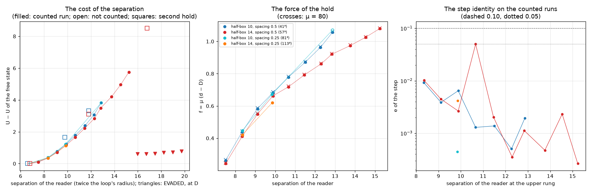
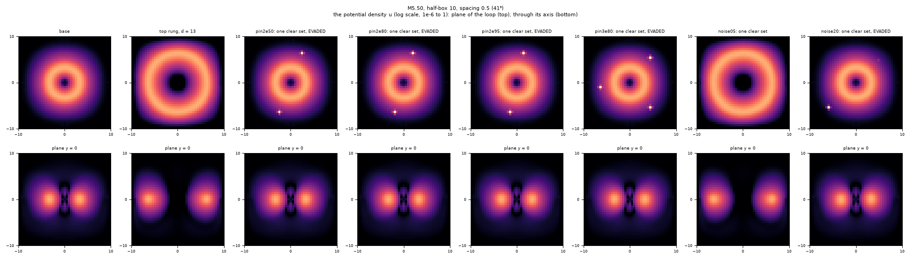
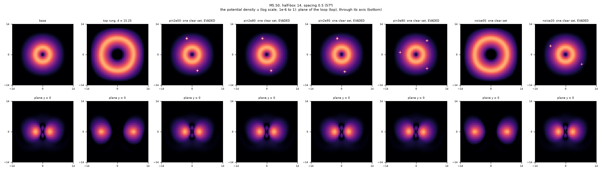
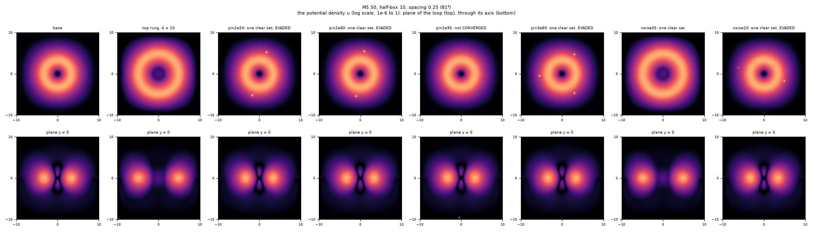
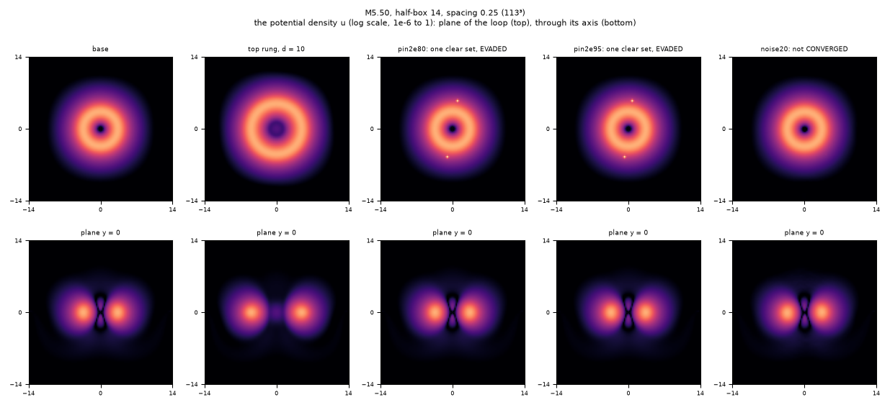
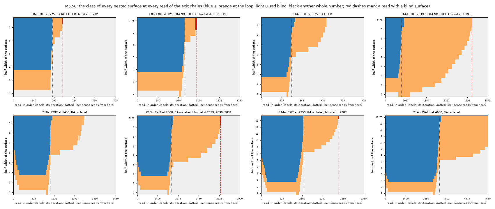

# M5.50: Charge quantization: the two +½ lines held apart on a ladder, in a larger box

> Opened 2026-11-19, staged 2026-11-20. Roadmap row: [`m5_roadmap.md`](../m5_roadmap.md). Thread record: [`m5_32_convo.md`](m5_32_convo.md). The cell it reads for: charge quantization in the M5 table of [`MODELS.md`](../../../../../MODELS.md).

## TASK PLANNING (2026-11-20; staged: the readings of § 4 are frozen before any rung is relaxed)

**Scope.** The run that [M5.46](m5_46_task_details.md) named as the stronger one and did not make: the relaxed unit with the separation of its two +½ lines held at a value and that value raised in steps, the energy and the charge read at every step. The row's test is an integer topological charge with a split e → e/2 + e/2 impossible; its regime is `static`, so a descent is the process. The run reports one word per reading of § 4, or "no label" with the rule that withheld it. Out of scope: two straight lines in place of the loop; another δ or L₁; J above 0; a limit at zero spacing; a box beyond half-box 14; any icon or pointer of `MODELS.md`.

**Where M5.46 left it.** Pulled by a dilation to separations 10 and 13.8 and released with free faces, the unit relaxed back as one loop and every liftable surface around it read 1; nothing read ½; in a box it could leave it left as one set. The author's own run, posted on discussion #186 on 2026-11-19 ([discussioncomment-19756045](https://github.com/vantasnerdan/substrate-framework/discussions/186#discussioncomment-19756045); the row of that date in the [thread record](m5_32_convo.md)), reports the same on their code. The cell stayed partial on two limits that M5.46 states in its own scope: the integer on a liftable surface holds by construction, the base relaxing from a seed of degree 1; and a release reads the sign of the force at two separations without holding one, so a split is not shown impossible.

| # | What a ladder adds to a release | What it has to read |
| --- | --- | --- |
| 1 | The energy as a function of a separation that is held, not passed through | U at each held separation, the state relaxed under the constraint, converged by a stated gate |
| 2 | Whether the energy keeps rising as far as the box allows, or flattens (a split that costs nothing more) | the slope of U against the separation over the last steps, at two spacings and in two boxes |
| 3 | Whether the charge splits before the box does | the sets of the line and the charge on nested surfaces at every step, with the instrument of M5.46 |
| 4 | A perturbation that seeks a split, which a release never applied | a stated family of perturbations at the largest held separation, relaxed under the constraint |

**The clause the run reads.** The author posted on discussion #186 on 2026-11-20 a definition of "stays whole" for this row ([discussioncomment-19766100](https://github.com/vantasnerdan/substrate-framework/discussions/186#discussioncomment-19766100); the row of that date in the thread record), in three parts: (a) every liftable surface enclosing the unit reads 1 from the pull until the exit; (b) no liftable surface ever reads ½; (c) the reads between the last 1 and the first 0 are exactly those in which the loop pierces the surface. A ladder in a box with held faces has no exit, and on it neither (a) nor (b) can fail for a state with one set (limit (2)): the informative read of the ladder is the number of clear sets, at rest under the hold and at rest after the hold is taken away. Parts (a) and (c) are tested on the chains that leave a box with free faces (R4 of § 4). M5.46 read (a) and (b) on its planned chains and not (c).

**Five limits, stated before the run.** (1) On a grid the two +½ lines of the clause are the two points at which a plane through the loop's axis meets one closed loop. The separation held here is the size of that loop, which separates the two points in every such plane at once. For a closed line with a positive energy per length, U rises with its size by geometry, so a rising U is the expected outcome; what the ladder can refute is that the cost per unit of separation stays positive and does not fall away as far as the box allows. (2) Part (b) cannot fail on this instrument: the degree of a liftable surface is a whole number by construction (M5.46 § 3), and it is read in the form M5.46 used, no liftable surface outside 0 and 1. With held faces part (a) cannot fail either for a state with one set: the faces hold a frame of degree 1, and a liftable cube around all of the line is joined to the faces by a shell that holds no line, so it reads the degree of the faces. No outcome of this run removes the first limit of the cell. (3) The reads along a chain are reads along an optimizer's path and not along a motion in time. (4) Two boxes and two spacings are not a continuum limit: every label is the label of named grids. (5) The room rule of § 4 is learned on loops of radius up to about 6.4, the largest that half-box 10 holds, and is applied as a room to the larger loops of half-box 14: an extrapolation in the size of the loop.

**Definition of done.** The controls of § 3 each reported as met or as the exact failing check; every chain of § 2 ended by its own rule or cut by a cap, with its word; the tables of § 4 written by the reads script from a tracked JSON; R1 to R5 each carrying one word or "no label" with its rule, per grid; the expectations of § 4 scored against the outcome; the findings embedding U and the force of the hold against the separation for the four ladders, the cross-sections of the base, the top rung and each end state of the perturbation family, and the surface reads of the exit chains; an adversarial audit on a different model, with its own evaluation of U and of the held quantity on saved end states, having tried to refute each word; the doc checker and the roadmap linter clean.

**Gating.** An audit of this plan by an independent model, folded here; then the user's go. No answer of the author is waited for, and nothing in this plan reads a result of [M5.49](m5_49_task_details.md).

**Research body.** This document (plan, findings, review); scripts `m5_50_hold.py` (the hold, the driver and the pool), `m5_50_reads.py` and `m5_50_report.py` in [`../scripts/`](../scripts/); summaries `m5_50_*.json` in [`../data/`](../data/) (tracked), the states `m5_50_*.npz` there (local-only, indexed by [`_DATASETS.md`](../data/_DATASETS.md)); plots `m5_50_*.png` in [`../plots/`](../plots/); checkpoints, chain records and progress notes in `../checkpoints/m5_50/` (local-only).

### 1. The action, the hold and the descent rule

The action is that of [M5.42](m5_42_task_details.md) as coded in [`m5_42_eq42.py`](../scripts/m5_42_eq42.py), at J = 0, unchanged:

$$
U = h^3 \sum_n \Big[ L_1 \sum_i \lVert \partial_i M \rVert^2 + \kappa \sum_{i \lt j} \lVert [\partial_i M, \partial_j M] \rVert^2 + v \sum_{k=1}^{3} \big( \operatorname{tr} M^k - c_k \big)^2 \Big]
$$

with κ = v = 1, δ = 0.05, L₁ = 0.03, c_k = 1 + δ^k, the mirror-averaged stencil, the chart fixed, the faces held to the frame except where a chain is named free.

**The hold.** The potential density is zero in the vacuum and largest on the core of the line, where the two largest eigenvalues meet. Its square is taken as a density of the line, and the separation held is twice the mean distance of that density from its own center:

$$
u_n = \sum_{k=1}^{3} \big( \operatorname{tr} M_n^k - c_k \big)^2 , \qquad w_n = u_n^2 , \qquad \bar{x} = \frac{\sum_n w_n x_n}{\sum_n w_n}
$$

$$
D[M] = \frac{2 \sum_n w_n \lVert x_n - \bar{x} \rVert}{\sum_n w_n}
$$

$$
E_\mu = U + \frac{\mu}{2} \big( D[M] - d \big)^2 , \qquad f = \mu \big( d - D[M] \big)
$$

A rung is a descent of E_μ at a target d. At a state at rest of E_μ the gradient of U equals f times the gradient of D: the state is a stationary point of U on a level set of D, whatever μ, and f is the slope of U against D along the family of such states. The hold energy is reported apart from U and is never part of it. Between two neighboring rungs k and k + 1 on one branch of states, the step identity and its error, the error always taken against the absolute value of the step in U:

$$
T_k = \tfrac{1}{2} \big( f_k + f_{k+1} \big) \big( D_{k+1} - D_k \big) , \qquad e_k = \frac{\lvert ( U_{k+1} - U_k ) - T_k \rvert}{\lvert U_{k+1} - U_k \rvert}
$$

| Choice | Reason |
| --- | --- |
| A functional of the field, not pinned nodes | pinned nodes fix a core profile by hand and their energy is not relaxed; here every interior node stays a variable of U |
| The square of the potential density | a faint halo over a large volume costs energy in proportion to u and gains weight in proportion to u², so the hold cannot be met cheaply by a halo. On the base states of M5.46 at spacing 0.25, 89 percent of the weight lies within 1.0 of the loop's circle (63 percent for the first power) |
| The distance from the weight's own center, in three dimensions | the hold names no point and no axis of the box, so a loop that moves or tilts gains nothing |
| The held value measured apart from the hold | the abscissa of every reading is the separation of the line reader of [M5.44](m5_44_task_details.md), twice the radius of the one clear set, and D is printed beside it. On the base states D is 6.87 and 6.88 against 6.59 and 6.63 from the reader |
| Two strengths, μ = 20 and μ = 80 | the points of both must lie on one curve U(D) (K8) |
| A second kind of hold, as a control | an obstacle on the director inside the loop, which presses on the line from the inside and not on its core (K9) |
| A release of every state in two pieces | the hold can be met by two pieces: with weights W₁ and W₂ at a distance s, D is about 4 W₁ W₂ s / (W₁ + W₂)², so the unit at its free size with a small second loop far from it meets a large target at a cost that does not grow with the target. A split found under the hold is therefore tested again with the hold taken away (below) |

**The release.** Every CONVERGED state with two clear sets or more, from a rung or from the family of § 4, is relaxed again with no hold, the faces held, by the same descent rule. Two words follow, and the reads of § 4 use them.

| Word | Rule |
| --- | --- |
| PERSISTENT SPLIT | the release is CONVERGED and ends with two clear sets or more: the line is in two pieces at rest with no hold |
| MADE BY THE HOLD | the release is CONVERGED and ends with one clear set. Printed with E_μ and U of the split state against the one-loop state at the same target, where one exists, and with the share of the weight that lies within 1.5 of each piece |

**The second kind of hold.** On the plane of the loop, inside it, the long axis stands along the loop's normal (on the base states M_zz is above 0.97 out to 2.0 from the center). With Δ(R_d) the nodes of the plane z = 0 at a distance of at most R_d from the axis:

$$
E_o = U + \frac{\mu_o}{2} h^3 \sum_{n \in \Delta(R_d)} \big( 1 - (M_n)_{zz} \big)^2
$$

with μ_o = 100. A loop that contracts into the disk pays; a loop outside it pays little.

**The descent rule** is that of M5.45 § 4 as [M5.48](m5_48_task_details.md) § 1 states it, with E_μ in place of U: L-BFGS-B over the six components of every free node, 20 correction pairs, function tolerance 10⁻¹⁵; after an end by the function tolerance a restart with an empty memory, until a restart ends within 25 iterations (40 restarts at most); a stalled line search restarted three times at most; a checkpoint at every stop, from which an interrupted chain continues with an empty memory, the resume recorded.

| Word | Rule |
| --- | --- |
| The gate | the largest entry of the gradient of E_μ over h³ at the end is at most the smaller of 10⁻³ and one tenth of the largest entry of the hold's own force there (f times the gradient of D, over h³), and not under 10⁻⁴, the bound that serves where no hold acts |
| CONVERGED | not cut by a cap, the gate met, and an end by the function tolerance repeated after a restart (or, for a chain with a stalled line search in its record, the gate alone, the driver's word printed beside it) |
| STALLED | an end by the function tolerance repeated within 25 iterations with the gate not met, restarted three times at most; a chain that ends so is never CONVERGED |
| EVADED | a CONVERGED rung whose end state has one clear set and either a reader's separation more than 0.75 from D, or less than 0.80 of the weight within 1.5 of the loop's plaquettes. The hold did not hold the line; the rung gives no point of the curve |

A chain that is not CONVERGED carries no value of U into any reading.

### 2. The ladder and the chains

Two boxes, half-box 10 and half-box 14, at spacings 0.5 and 0.25: grids of 41³ and 81³, 57³ and 113³. The base states of half-box 10 are those of M5.46 (B0c, B0d). The base states of half-box 14 are relaxed from the seed by the rule of M5.45 (B14a, B14b). A rung starts fresh: the base dilated about its loop's center by the ratio of the target to the base's D (the dilation of M5.46), with the faces set back to the frame. The targets rise in steps of 1.5 at spacing 0.25 and of 0.75 at spacing 0.5. At the top target the loop stands 3.6 from the nearest face on half-box 10 and 3.9 on half-box 14.

| Class | Chains | Grid | Start | Caps (iterations; wall time) |
| --- | --- | --- | --- | --- |
| Bases | `B14a`, `B14b` | 57³, 113³ | the seed, faces held | 20000; 1 hour, 2.5 hours |
| The free state (K6) | on each of the four grids: the base continued with no hold, and the rung whose target is the base's own D, μ = 20. The second is the origin of the ladder of its grid | all four | the base | as the rung of the grid |
| The force of the hold (K7) | four rungs on half-box 10 at spacing 0.5, with targets 0.1, 0.2, 0.3 and 0.4 above the base's D, μ = 20 | 41³ | the dilated base | 20000; 0.5 hours |
| Rungs, half-box 10 | targets 7.75 to 13 in steps of 0.75 (spacing 0.5), and 8.5, 10, 11.5, 13 (spacing 0.25); inward targets 5.5 and 4, descriptors; μ = 20 | 41³, 81³ | the dilated base | 20000; 0.5 hours, 2 hours |
| Rungs, half-box 14 | targets 7.75 to 20.5 in steps of 0.75 (spacing 0.5), and 8.5 to 20.5 in steps of 1.5 (spacing 0.25); μ = 20 | 57³, 113³ | the dilated base | 20000; 1 hour, 3 hours |
| The second strength | μ = 80 on every outward rung at spacing 0.5; at spacing 0.25 on targets 10 and 13 (half-box 10) and 14.5 (half-box 14) | as the rung | as the rung | as the rung |
| Bisections | by the rule of § 4: one rung at the middle target of a step that fails the identity, two per ladder at most, so eight at most | the grid of the step | the dilated base | as the rung |
| Branch checks | by the rule of § 4: one chain per step on which U falls between two eligible rungs; their number is not known before the run | the grid of the step | the end state of the upper rung, under the hold at the lower target | as the rung |
| Continuation | at spacing 0.5 on each box: one chain up the ladder, each rung from the end of the rung below, and one chain back down from the top | 41³, 57³ | the rung before | as the rung, per rung |
| The second hold | the obstacle at R_d = 1.5, 4.5, 5.5 (half-box 10) and 1.5, 5.5, 8 (half-box 14), spacing 0.5 | 41³, 57³ | the base dilated so that its loop stands 0.5 outside the disk; for R_d = 1.5 the base | as the rung |
| Perturbations | the family of § 4 on the end state of the top counted rung: six chains per grid, three on 113³ | all four | the perturbed state, under the hold of that rung | as the rung |
| Releases | by the rule of § 1: one per CONVERGED state with two clear sets or more, from a rung or from the family; their number is not known before the run | the grid of the state | that state, no hold, faces held | as the rung |
| Exits, the top rung released | `Z10a`, `Z10b`, `Z14a`, `Z14b`: the end state of the top counted rung with free faces and no hold, the gate stop off | all four | as named | 20000; as the rung |
| Exits, M5.46 again | `E0a`, `E0b`, `E14c`, `E14d`: the chains X0a, X0b, X14c and X14d of M5.46 § 12 run again from the same end states (F0a, F0b, P14c, P14d) | 33³, 65³, 41³, 81³ | as named | 20000; 0.5 hours, 1 hour, 0.5 hours, 2 hours |

**Reads and stops.** Reads are taken at the start, every 10 iterations up to 300, every 25 after, and at the end, with the instrument of M5.46: the cadence of M5.46. An exit chain is read in addition at every iteration from the first cadence read at which its loop stands within 2 of a face or the box surface does not read 1, whichever comes first. These dense reads are recorded and enter R4; no stop rule counts them. An exit chain stops by the EXIT rule of M5.46, counted on the cadence reads alone (no set clear of the faces and the box surface at 0 on three cadence reads in a row), by the descent rule, or at a cap.

**Parallel shape.** One single-threaded process per chain (the five thread variables set to 1 before NumPy loads). The pool holds ten processes at once, under the ceiling of twelve, and eight while the wave jobs of [M5.49](m5_49_task_details.md) run beside it. Order: the bases, the controls, the chains of K6 and K7 and the four `E` chains, which depend on nothing; then the whole of spacing 0.5 on both boxes, which gives a first reading on two boxes while the large grids run; then the rungs at spacing 0.25, the largest grid first. Dependencies: a rung on half-box 14 waits for its base; a bisection or a branch check waits for the two rungs of its step; the perturbations, the `Z` chain and the releases of a grid wait until the counted run of that grid is final, which needs every rung of both boxes at that spacing ended, their bisections and branch checks ended, and K8 read, since the room rule joins the two boxes; a release waits for the state it releases. The longest dependent path is `B14b`, the rungs of 113³, a bisection or a branch check on 113³ where a step calls for one, a member of the family or `Z14b` on 113³, and the release of a member that ended in two sets. Inside a chain the descent is sequential by nature. The GPU is not used: the kernel is double precision. The pool script holds the order and the dependencies and is restartable, a finished chain read from its record and an interrupted one continued from its checkpoint.

### 3. The instruments and their controls

The line and the charge are read by [`m5_46_degree.py`](../scripts/m5_46_degree.py), unchanged: the sets of pierced plaquettes with their place against the faces, and the absolute degree on every nested cube surface that is liftable. One addition: at a read with two sets or more, cubes centered on each set are read as well, so that the whole number around each piece is on record.

| Control | Input | The answer it must return | What a failure would look like |
| --- | --- | --- | --- |
| K1, the states read back | the end files of B0c and B0d of M5.46 | U of [`m5_46_summary.json`](../data/m5_46_summary.json) to 10⁻¹² (relative); one loop of radius 3.293 and 3.316 | a wrong δ, L₁ or file: a gap of order 1 |
| K2, the new bases | `B14a`, `B14b` | CONVERGED; one loop, centered within 0.01, its radius within 0.03 of the base of half-box 10 at the same spacing | no loop, two loops, or another radius |
| K3, the instrument of M5.46 | its seven controls on the four base states | as in M5.46 § 6 | as in M5.46 § 3 |
| K4, the held quantity | a base state shifted by whole cells along z and along x, the cells that the shift leaves empty at the faces filled with the frame; a base dilated by 1.5 and by 2; the base and the dilated states against the reader | D unchanged by the shift to 10⁻⁸; D in the ratio of the dilation within 2 percent; D above the reader's separation by 0.1 to 0.6 | the same sum taken about the box center moves by more than 0.1 under the shift |
| K5, the gradients | central differences at 200 random interior entries, the best of three steps, on a dilated base, which is not at rest, with the target 0.5 above its D so that the hold term is not zero: the gradient of D alone, the hold term alone, the whole E_μ, and the obstacle term | each within 10⁻⁶ of its largest entry | the term of the moving center left out, or a wrong sign |
| K6, the free state returned | on each grid, the rung whose target is the base's own D, against the base continued with no hold under the same rule and gate | U equal to 10⁻⁸ (relative), the hold energy under 10⁻¹², the loop unchanged | a target 0.5 above must raise U by more than 10⁻³ |
| K7, the force of the hold | the four rungs of § 2, all on one side of the free state | the error e of the step identity under 1 percent on each of the three steps between them | f with the other sign, or μ doubled: off by a factor |
| K8, two strengths | the points at μ = 80 against the cubic through the points and slopes at μ = 20 | within the larger of 2 percent of the rise of U from the free state and 0.005 | a hold energy counted into U: a gap that grows with μ |
| K9, the second hold | the obstacle at R_d = 1.5; then at the larger disks | at 1.5: the obstacle energy at the end not above its value on the base, U within 10⁻³ (relative) of the base, the loop's radius within half a cell. At the larger disks: U against the curve of the first hold at the same reader's separation, printed as a fraction of the rise and used by R1 | the disk laid on another plane than the loop's: the loop is pushed and U rises at 1.5 |
| K10, the readers of the labels | the made-up records of the table below, passed through the reads script | the word listed beside each record | a reader that returns HELD on every record |
| K11, the exits repeated | `E0a` and `E14c` against the records of M5.46 | 775 and 975 iterations, and U at the end 4.1007 and 4.5414 to the printed digits, with the dense reads taken | a dense read counted by the EXIT rule, or a read that changes the descent: another count |
| K12, the maps of the family | each map at zero amplitude; the pinch with two lobes at 0.5 on a base | the same field to 10⁻¹⁴; no source point outside the box; one set whose plaquettes span radii in the ratio 0.5, within 0.1 (0.52 and 0.48 on the two bases of half-box 10, evaluated at plan time) | a map applied about another axis than the loop's |

**The made-up records of K10.** The ladder of a record has six outward rungs at D = 8.5, 10, 11.5, 13, 14.5 and 16, the tolerance of spacing 0.25, every rung CONVERGED, not EVADED, with one clear set and inside the room rule, and U built from the step identity, except where the record says otherwise. The base ladder A has f = 0.40, 0.42, 0.44, 0.45, 0.46, 0.46.

| # | Record | Word it must return |
| --- | --- | --- |
| 1 | R1: ladder A | HELD, the run ending at 16, the top of the ladder |
| 2 | R1: f = 0.40, 0.30, 0.20, 0.10, 0.04, 0.02 | NOT HELD (LEVEL): the mean of the last two is 0.075 of the largest |
| 3 | R1: f = 0.40, 0.36, 0.30, 0.24, 0.18, 0.14 | no label: the mean of the last two is 0.40 of the largest |
| 4 | R1: ladder A with f = 0.005 at the fifth rung | NOT HELD (LEVEL): a rung at or under 0.02 of the largest |
| 5 | R1: ladder A with U at the fourth rung 0.3 under U at the third; the branch check ends CONVERGED with one clear set at the third rung's own U | NOT HELD (BRANCH) |
| 6 | R1: ladder A, the fifth rung not CONVERGED | HELD, the run ending at 13 on a rung that is not CONVERGED |
| 7 | R1: ladder A, the third to sixth rungs not CONVERGED | no label: two counted rungs |
| 8 | R1: record 7 with U at the second rung 0.1 under U at the first; the branch check ends CONVERGED with one clear set at the first rung's own U | NOT HELD (BRANCH): NOT HELD outranks no label |
| 9 | R1: ladder A, the fourth rung EVADED | HELD, the run ending at 11.5 on an EVADED rung |
| 10 | R1: ladder A, the sixth rung with less room than the room rule | HELD, the run ending at 14.5 by the room rule |
| 11 | R1: ladder A with U raised by 0.2 from the fourth rung on (the step from 11.5 to 13 fails, e = 0.23), and a bisection rung at 12.25 with f = 0.445 and U on the identity from 11.5 (the half step from 12.25 to 13 fails, e = 0.37) | HELD, the run ending at 11.5 on the identity, the step classed as two branches |
| 12 | R1: f = 0.40, 0.42, 0.44, 0.10, 0.10, 0.10, with the step from 11.5 to 13 equal to 0.4725 in U (e = 0.14), and a bisection rung at 12.25 with f = 0.36 whose two half steps are 0.30 and 0.1725 (both pass) | no label: the run goes through the bisected step to 16, and the mean of the last two is 0.23 of the largest |
| 13 | R1: ladder A with three failing steps, the first two passing on bisection | HELD, the run ending below the third failing step, which is not bisected |
| 14 | R1: ladder A, and a second hold whose U falls between its two larger disks | no label: the two kinds of hold disagree in sign |
| 15 | R1: ladder A, and a member of the family that ends with one clear set and U 0.05 under the top rung | HELD (LOWER STATE), read with that state in the rung's place, the first print beside it |
| 16 | R1 at spacing 0.5: ladder A, and a continuation rung that differs from its fresh partner by 2 percent of the rise | HELD, START-DEPENDENT |
| 17 | R1: ladder A with U at the first rung under U of the free state | no label: a rung under the free state |
| 18 | R2: every CONVERGED rung with one clear set, every surface read at 0 or 1 | HELD |
| 19 | R2: a CONVERGED rung above the counted run with two clear sets, 1 and 0 around them; its release CONVERGED with two clear sets | NOT HELD (PERSISTENT SPLIT) |
| 20 | R2: record 19 with a release that ends with one clear set | no label (MADE BY THE HOLD) |
| 21 | R2: record 19 with a release that is not CONVERGED | no label |
| 22 | R2: record 18 with a liftable surface that reads 2 at one read | NOT HELD |
| 23 | R2: records 20 and 22 together | NOT HELD |
| 24 | R2: record 18 with one outward rung chain of eight counted reads | no label |
| 25 | R3: six members CONVERGED, one clear set each | HELD |
| 26 | R3: one member with two clear sets, its release with two | NOT HELD (PERSISTENT SPLIT) |
| 27 | R3: one member with two clear sets, its release with one | no label (MADE BY THE HOLD) |
| 28 | R3: one member not CONVERGED, the others with one clear set | no label |
| 29 | R3: records 26 and 28 together | NOT HELD |
| 30 | R3: a grid with no counted rung | no label |
| 31 | R4, a chain that ends by EXIT through one face, the reads of a surface: 1, at the loop, 0 | HELD |
| 32 | R4: 1, then 0, with no read between | HELD |
| 33 | R4: 1, at the loop by a fragment alone, 0 | HELD |
| 34 | R4: 1, blind, 0 | NOT HELD |
| 35 | R4: 1, at the loop, 1, at the loop, 0 | NOT HELD |
| 36 | R4: 1, 0, 1 | NOT HELD |
| 37 | R4: a liftable surface that reads 2 | NOT HELD |
| 38 | R4: the sets at the last read with a set touch two faces | no label: cut by the box |
| 39 | R4: the sets at the last read with a set touch no face | no label: vanished inside |
| 40 | R4: a chain cut by a cap | no label |
| 41 | R5: R1 and R2 with the same words at the two spacings of a box, R3 the same on the members both grids ran | HELD |
| 42 | R5: R1 HELD at one spacing and NOT HELD at the other | NOT HELD, the reading named |
| 43 | R5: one grid with no label in R1 | no label |
| 44 | R1: ladder A with the fresh state of the third rung 0.9 above its U on the identity, so that U falls by 0.2325 from the third rung to the fourth; the branch check ends CONVERGED with one clear set at the U and f of ladder A at 11.5 | HELD (LOWER STATE at 11.5), the ladder read again as ladder A, the run ending at 16 |
| 45 | R1: record 44 with a branch check that is not CONVERGED | no label: the step from 11.5 to 13 is not decided, printed |

The try cap is three. Between tries the input of a control or a defect of a script may change. Of the instrument, only the pair of strengths (to 10 and 40, or 40 and 160) and the power of u in the weight (2 to 3) may change, and only after a failure of one of K4 to K9 or of the one-third rule below, each change logged with its reason; never a threshold or a definition of § 4, and never the list of targets. A ladder on which more than a third of the rungs are EVADED is an instrument failure and ends the try. The tables and the words of every try are kept and printed in the findings, the changed instrument named beside them. What a failure costs: K1 to K3, no ladder; K4 to K7, no rung; K8, no R1 on that grid; K9, R1 printed with the words "one kind of hold"; K10, no label; K11, no R4; K12, no R3.

### 4. The readings, frozen

**The quantities.** Per grid and per rung: the target d, the D reached, the reader's separation, U and its three terms, the force f, the hold energy, the rise ΔU = U − U of the free state (the rung of K6 on that grid), the room (the half-box less the loop's radius), the sets and the surface reads at every read of the chain. The free state is the origin of the ladder and not a rung of it: its f is zero by definition.

**Precedence.** In every reading NOT HELD outranks no label, and no label outranks HELD.

**The counted run of a ladder.** An outward rung is eligible when its chain is CONVERGED, it is not EVADED, its end state has one clear set, and its room is at least the room rule below. The counted run starts at the first outward target and is the unbroken run of eligible rungs from there. It ends before the first rung that is not eligible, or at a step between two eligible rungs whose error e is above 10 percent (5 percent at spacing 0.5) and which does not pass its bisection. The step from the free state to the first outward target is not tested by the identity: the trapezoid is not accurate across the foot of the curve, and that end is covered by K6 and K7. A rung above the counted run enters no label of R1. Every label of R1 names the separation at which its counted run ends and the rule that ended it: the top of the ladder, a rung that is not CONVERGED, an EVADED rung, two sets, the room rule, or the identity.

**The bisection.** A step that fails the identity is bisected once: a rung at the middle target, from a fresh start. If the middle rung is eligible and both half steps pass, the run continues through it and the middle rung is counted. If not, the run ends at the lower rung of the step, and the failing half step is printed with its class: a fall of the force inside the step when f at its upper rung is under 0.8 of f at its lower rung, two branches otherwise. Two bisections per ladder at most; a third failing step ends the run without one. The bisection is a rule of this plan and not a change of its targets.

**The check of a branch.** Before the word NOT HELD (BRANCH) is given for a step on which U falls between two eligible rungs, the end state of the upper rung is continued down to the lower target, under the hold of the lower rung, in one chain with the same descent rule and gate. A fresh start can land on a state that is not the lowest at its target, and a fall of U from such a state is start dependence and not a fall of the cost. If the continued chain is CONVERGED, ends with one clear set, and has a U lower than the lower rung's by more than 10⁻⁶ (relative, the margin of LOWER STATE), the lower rung takes that state, the change is printed as LOWER STATE, and the step and the counted run are read again. BRANCH is given only when U still falls after that: the continued chain CONVERGED with no lower state at the lower target. A continued chain that is not CONVERGED leaves the step at no label, printed. A continued chain that ends in two clear sets is released by the rule of § 1, and the lower rung stands.

**The room rule.** A shared target is one present on both boxes at one spacing with both rungs CONVERGED, not EVADED and with one clear set. On a shared target the rung of half-box 10 agrees when its rise is within 5 percent of the rise on half-box 14. The room rule is the smallest room of half-box 10 such that this rung and every shared rung with more room agree, and it is never under 2, the room that the maps of the family need. A rung of either box with less room is printed and not eligible. If no shared target agrees, R1 carries no label on either box at that spacing.

| Reading | HELD | NOT HELD | no label |
| --- | --- | --- | --- |
| R1, the cost of the separation, per grid | the counted run has three rungs or more, U rises from each to the next, f is above 0.02 of its largest value at every rung, and the mean of f over the last two rungs is at least half the largest f of the run | BRANCH: U falls between two rungs at neighboring targets that are both eligible, anywhere on the ladder and whatever the identity says, and still falls after the check of a branch above. LEVEL: a counted rung with f at or under 0.02 of the largest; or the mean of f over the last two counted rungs under one tenth of the largest | fewer than three counted rungs; the mean over the last two between one tenth and one half (a slope that falls: a rise without bound and a leveling are not told apart inside the box); a counted rung with U at or under the free state's; a step on which U falls and whose branch check is not CONVERGED; the second hold giving a fall of U between its two larger disks where the first hold gives a rise |
| R2, one line, per grid | every CONVERGED outward rung of the ladder, counted or not, ends with one clear set; at every read of every rung chain no liftable surface reads anything but 0 or 1, and each liftable surface around the loop reads 1 (which the held faces fix for a state with one set, limit (2)) | PERSISTENT SPLIT: a CONVERGED rung that ends with two clear sets or more and whose release keeps them, the whole number around each set printed; or any liftable surface outside 0 and 1, or one around the loop that does not read 1 | a rung in two sets that is MADE BY THE HOLD, or whose release is not CONVERGED; fewer than three counted rungs; an outward rung chain with fewer than ten counted reads (the rung of K6 is not such a chain) |
| R3, the family that seeks a split, per grid | every chain of the family is CONVERGED and ends with one clear set | PERSISTENT SPLIT: a CONVERGED chain of the family that ends with two clear sets or more and whose release keeps them, whatever its U | a member in two sets that is MADE BY THE HOLD, or whose release is not CONVERGED; a member that is not CONVERGED; a grid with no top counted rung |
| R4, the exit, per exit chain that ends by EXIT through one face | for every nested surface that is liftable and around the loop at the first read: its reads are a run of 1, then reads at the loop, then a run of 0, and no read at the loop lies outside that stretch (parts (a) and (c)); no liftable surface outside 0 and 1 | a blind read between the last 1 and the first 0; a read at the loop before the last 1; a 1 after a 0; a liftable surface outside 0 and 1 | a chain that does not end by EXIT (a `Z` chain cut by a cap among them); a chain cut by the box (two faces or more touched, as P14a of M5.46); a chain whose line vanished inside (no face touched), printed |
| R5, the two spacings of a box | R1 and R2 carry the same word at the two spacings, and R3 the same word on the members that both grids ran | a word that differs, named | a grid with no label |

**Terms of the table, fixed here.** A clear set is a set of 8 plaquettes or more whose least distance to the faces is above one cell (M5.46 § 8). A surface is around the loop when it is a liftable cube wider than the largest coordinate of the loop's plaquettes. A read of a surface is at the loop when the surface is not liftable and either holds a pierced triangle or has a pierced plaquette of the line reader within 1.0 of it, every pierced plaquette counting, those of fragments under 8 included; a read that is not liftable for another reason is blind. An exit is through one face, cut by the box or vanished inside by the faces that the sets touch at the last read that has a set: one, two or more, or none. The top counted rung of a grid is the last rung of its counted run. The two thresholds of R1, one half and one tenth, are this plan's.

**Two prints of R1.** R1 is printed on the counted run, which carries the label, and a second time on all CONVERGED rungs with one clear set and no cut by the identity or the room rule, as a descriptor with no word: a cut moves which rungs are the last two, and the second print shows what the cut removed. The agreement of the two boxes on the shared targets is a descriptor as well, since over that range the room rule builds part of it in.

**The family of R3.** Each map is applied to the end state of the top counted rung, the faces set back to the frame, and the result is relaxed under the hold of that rung. With (ρ, φ, z) the cylinder coordinates about the loop's axis, R the loop's radius and s(φ) = 1 − ε cos²(mφ/2), the pinch is a radial map that is the identity beyond R + 2: the new field at (ρ, φ, z) is the old field at (σ, φ, z), the six components sampled by trilinear interpolation,

$$
\sigma = \frac{\rho}{s} \quad \text{for } \rho \le s R , \qquad \sigma = R + \frac{2 ( \rho - s R )}{R + 2 - s R} \quad \text{for } s R \lt \rho \le R + 2 , \qquad \sigma = \rho \quad \text{beyond}
$$

The line at azimuth φ moves from R to s(φ) R. No source point lies outside the box when the room is at least 2, which the room rule guarantees.

| Member | Map | Amplitudes |
| --- | --- | --- |
| The pinch with two lobes | m = 2: two opposite points of the loop are brought toward the axis, to a fraction 1 − ε of the radius | ε = 0.5, 0.8, 0.95 (at 0.95 the two cores overlap on the axis) |
| The pinch with three lobes | m = 3 | ε = 0.8 |
| Noise | six independent white Gaussian fields, one per component, smoothed by a Gaussian of width 1, multiplied by the window exp(−d²/4.5) with d the distance of a node to the loop's fitted circle, and scaled so that the rms of the added field over the nodes with d under 1.5 is the amplitude. The window, in place of a cut, leaves the far field and the faces untouched without a step in the field | 0.05 (seed 5001) and 0.2 (seed 5002), in units of the largest eigenvalue of the frame, which is 1 |

On 113³ the family is the pinch with two lobes at 0.8 and 0.95 and the noise at 0.2. A CONVERGED chain of the family that ends with one clear set and a U lower than the rung's by more than 10⁻⁶ (relative) is printed as LOWER STATE: the label of R1 is then the one read with that state in the rung's place, and the first print stands beside it.

**The exit, from stored records and from new chains.** (i) A desk read, with no compute: the per-read records of the four added chains of M5.46 hold, for every nested surface at every read, its class (liftable with its value, pierced with the count, or under the gap) and the circle fitted to the loop, at a cadence of 25 iterations. They do not hold the plaquettes, so "at the loop" for a read under the gap is taken from the fitted circle. The table of R4 is filled for them and marked as a re-read: M5.46 § 12 item 3 already states the outcome on the box surface. (ii) `E0a`, `E0b`, `E14c` and `E14d`: the chains X0a, X0b, X14c and X14d again, with the dense reads through the exit and the plaquettes in hand. M5.46 repeated X0a and X14c exactly (its § 12 item 5); X0b and X14d are run a second time here for the first time. (iii) `Z10a` to `Z14b`: the top rung released, which reads the clause from the pull to the exit on one chain. R4 is given per chain of (ii) and (iii).

**What each outcome would and would not support.** The run reports; the cell is re-read by the repo owner on the bar of `MODELS.md`, in the pull request that lands the record.

| Outcome | It would support | It would not support |
| --- | --- | --- |
| R1 to R5 HELD | the second limit of the cell is answered inside the box: with the separation held and raised to the top of the counted run, the cost keeps rising, the line is one piece at every rung, and the family left no second piece at rest | "impossible": a finite ladder, one family, two boxes; a statement about the whole number around the line on the ladder, which follows from the held faces; and the first limit of the cell, which no read on a liftable surface can remove |
| R1 NOT HELD (LEVEL) | a separation inside the box beyond which pulling the two lines apart costs nothing more: the clause loses its energetic support | a statement about the number of pieces, which R2 reads |
| R1 NOT HELD (BRANCH) | a held state at a larger separation that costs less than every state found at the smaller one, the state continued down from it included | that no lower state exists at the smaller separation: one continuation is one more start |
| LOWER STATE by a branch check | that the fresh start of that rung did not reach the lowest state found at its target: start dependence, printed with both states | a fall of the cost: the ladder is read again with the lower state |
| R2 or R3 NOT HELD (PERSISTENT SPLIT) | a state at rest, with no hold, in which the line is in two pieces, with the whole number each piece carries | a charge of ½: the pieces carry whole numbers that add to 1 |
| MADE BY THE HOLD | that this hold can be met by two pieces at that target, with what it cost | a split of the unit: the pieces did not stay apart without the hold. A neutral loop shed by the unit shrinks under its own tension once released, so this run can find a PERSISTENT SPLIT only where both pieces stay at rest |
| R4 NOT HELD | a read between the last 1 and the first 0 that the loop's crossing does not explain | anything about the ladder |
| no label | the rule that withheld it, with the numbers | either side |

**Registered before the run.** Expectations, which no script uses. R1: f between 0.1 and 0.8 at every outward rung, the mean of the last two at least 0.8 of the largest, HELD on every grid whose top rungs converge. The basis is one number with another boundary: P14c of M5.46, with free faces, twenty iterations after a dilation and not at rest, stood 4.89 above its own end state, between separations 6.8 and 13.5, a mean slope of about 0.7; the ladder holds the faces. The two boxes agree on all shared targets, so the room rule is at most 3.6. No step needs a bisection. R2 HELD, with no rung in two sets. R3: the pinches at 0.5 and 0.8 and the noise return to one loop; the pinch at 0.95 is not predicted, and a split there is expected to be MADE BY THE HOLD. R4 HELD on the chains that exit through one face; whether `Z14a` and `Z14b` contract before they leave, or reach several faces, is not predicted. Not predicted: whether every rung on 113³ converges inside its cap; a rung that does not shortens the counted run and is never read as a failure of the unit.

Nothing in this section sets an icon.

### 5. Blindspot pass, consumers, estimate

Read against the recurring failure families of the records of M5.46 to [M5.48](m5_48_task_details.md), for the instruments of this task.

| Unknown | Guard |
| --- | --- |
| A check that cannot fail: U rises with the size of a closed line by geometry; a whole number on a liftable surface holds by construction; with held faces a cube around a one-set state reads the faces | limits (1) and (2); R1 reads the fall of the force and not the sign alone; R2 reads the number of sets; parts (a) and (c) are read where the faces are free; the table of outcomes names what HELD does not support |
| The hold carries the answer | the hold energy apart from U; the abscissa from the reader; K6 returns the free state; K8, two strengths on one curve; K9, a hold of another kind; EVADED |
| A hold that is met without holding the line: by a loop that moves aside, or by a second piece far away, which the form of D rewards (§ 1) | the moving center and the squared density against the first; against the second, every state in two pieces is released, and only a split that persists with no hold gives NOT HELD; a split that does not persist is printed as MADE BY THE HOLD with its cost and gives no label |
| An optimizer stall read as a state, a gate that tests nothing | the gate at most one tenth of the force it balances; the restart rule; STALLED is never CONVERGED; the step identity between rungs, which a stalled rung breaks |
| A number set by a cap, and a cut that moves a word | a chain that is not CONVERGED enters no reading. A cut of the counted run (a cap, the room rule, the identity, an EVADED rung) makes no word by itself, but it moves which rungs are the last two; so R1 is printed a second time with no cut, every label names where its run ends and why, a failing step is bisected before it cuts, and a fall of U between two eligible rungs that survives the check of a branch is NOT HELD whether or not the run was cut there |
| One start taken for the state | fresh starts carry the label; a fall of U between two rungs is checked by a continuation from the upper one before it gets a word; the continuation chains up and down at spacing 0.5 are tabled beside them, and a rung that differs from its fresh partner by more than 1 percent of the rise appends START-DEPENDENT to R1 |
| The box read as the unit | two boxes; the room rule with its eligibility; limit (5); the rungs with less room printed and not counted |
| A dilated start is not a state of the action (its core is widened) | it is a start only; no read of a start enters a label except the first read of R4's surfaces |
| The reader outside its regime: a pinched loop whose cores overlap, sets under 8 plaquettes | fragments are reported at every read; the labels of R1 to R3 are read on states at rest; in R4 a fragment's plaquettes count for "at the loop", so a late piece of the line is not read as a blind surface |
| A read of the exit that depends on where a read falls (M5.46 § 12 item 4), and dense reads that change when a chain stops | dense reads through the exit, which no stop rule counts; part (c) classes each read and does not count steps; K11 |
| The instrument tuned with outcomes in view | a change of the strengths or of the weight only after a failed control or the one-third rule; every try kept and printed |
| This plan's reading taken for the author's | the open points are this plan's and are named as such in the findings: the held quantity and its two strengths, the targets, the two thresholds of R1, the bisection, the check of a branch, the room rule, the family, the release and its two words, "at the loop" within 1.0, a split read as two pieces at rest with no hold |
| A file of M5.46 overwritten | the driver writes under `data/` only `m5_50_*`; the end files of M5.46 are opened read-only and their hashes compared before and after |
| An unvalidated instrument (the family of the workflow) | K1 to K12, each with the input that fails it |

**Consumers.** R1 to R5 are read by the re-read of the charge-quantization cell and by the results message of the repo owner: they need K1 to K12 met and the audit. The base states of half-box 14 and the held states are reusable by a later run: they need the word CONVERGED and K2.

**Estimate.** The clock of the run is set by the longest dependent path of § 2 on the 113³ grid; everything at spacing 0.5 is short beside it and reports first. The build of the hold and the controls overlaps the two base chains, which need no new code. The reads, the findings and two audits follow the pool. The estimate in hours is given at staging and is not part of this document. Model: the session's model for the plan and the build, in one sub-agent; the audit on Opus, a numbers check on Sonnet.

**Not planned.** Two straight +½ lines held apart in place of the loop; a continuation ladder at spacing 0.25; a hold at a separation beyond 20.5 or a box beyond half-box 14; a start that is already in two pieces; a steepest-descent version of any chain; the second hold at spacing 0.25.

**Plan audit (2026-11-20, before any rung was relaxed).** An independent pass on a different model read the draft of this plan against the action code, the instrument and the records of M5.46, the thread record and the cell, and ran its own checks on stored states and on model curves. It found eighteen faults, two critical, five high, eight medium and three low, all folded above. The two critical ones were controls that a correct build could not meet: K7 put its four targets on both sides of the free state, where the middle step crosses the minimum of U and the trapezoid fails on any curve (the targets are now on one side, and the error of the identity is defined against the step in U); and K11 asked for the iteration counts of M5.46 while reading at every iteration, where the EXIT rule of M5.46 counts reads (the dense reads are now extra reads that no stop rule counts). The faults that changed a reading: R2 could not be NOT HELD by a split, a rung in two sets never being counted (R2 now reads every CONVERGED rung, and NOT HELD outranks no label in every reading); a failed step of the identity turned a jump to a cheaper branch, or a fall of the force inside a step, into a shorter run read as HELD (R1 gained the word BRANCH, a failing step is bisected once, R1 is printed a second time with no cut, and every label names where its run ends and why); the step from the free state to the first target could fail the identity on a correct curve and leave no counted rung (it is no longer tested there); with held faces part (a) of the clause cannot fail for a state with one set (limit (2) says so, and the ladder's read is the number of sets); and the hold can be met by two pieces at a cost that does not grow with the target, so that a split could be made by the hold and read as NOT HELD (every state in two pieces is now released, and only a split that persists with no hold gives the word). The faults that changed a control, a rule or the job list: the map of the family took its source from outside the box at about half of the nodes (it is now radial and the identity beyond R + 2, checked on stored states); the released top rung was read at every iteration from its first read, and a late fragment made a blind read (the dense reads start within 2 of a face, and a fragment's plaquettes count); two tolerances failed correct code (10⁻⁸ for the shift of K4, 10⁻¹⁴ for the maps at zero amplitude); K10 listed no expected word (its records now do); the dependencies of the top counted rung were misstated (the family, the releases and the `Z` chains wait for the counted run of both boxes at their spacing); the room rule had no eligibility and extrapolates in the size of the loop (eligibility stated, limit (5) added, the agreement of the two boxes made a descriptor); the instrument could be changed between tries with outcomes in view (only after a failed control or the one-third rule, every try printed); the first bound of K9 was under the start value; two claims about M5.46 overreached (only two of the four exits were repeated there, and the rise of 4.1 compared a chain with free faces to a base with held faces); and a list of terms was left open (the denominator of the identity, the free state in R1, the reads rule of R2, R3 with no counted rung, an exit that touches no face, the tolerance of K8, the noise, LOWER STATE, the target of K5, the chains of K6 and K7 and the caps of the `E` chains in the job list, the members compared by R5). Two things were added at the fold and not from the audit. A counted rung with U at or under the free state's gives no label for R1. And, on the drafter's objection to the word BRANCH as the fold first had it, a step on which U falls is checked by continuing the upper rung's state down to the lower target before the word is given, since a fresh start that lands above the lowest state at the lower rung would otherwise read as a fall of U. The auditor found sound: D and the reader on the base states, the share of the weight near the loop, M_zz inside the loop, the dilation clauses of K4, the gradient of D against central differences, the gate, the margins of EVADED on the bases, the room at the top targets, the counts of targets, the algebra of the force of the hold, the numbers quoted from M5.46, the author's definition against the thread record, and the two limits of the cell against `MODELS.md` and M5.46 § 15. It did not check, and could not at plan time: any relaxation under the hold, so whether the rungs converge, the real curve U(D), whether the hold makes a split cheaper than one loop, and whether K6 and K9 are met; and it read the author's post through the thread record and not at its source.

## FINDINGS (2026-11-20)

> Run of 2026-11-20, one try. The numbers and the words below are carried by [`m5_50_summary.json`](../data/m5_50_summary.json), written by [`m5_50_reads.py`](../scripts/m5_50_reads.py) from the local chain records; the tables are printed from it by [`m5_50_report.py`](../scripts/m5_50_report.py). Every deviation from the plan and every reading of a rule is in the list after these findings. Two audits of this record are folded in (§ 17).

⚠️ **No label of R1, R2, R3 or R5 is given on any grid: K2 is not met as worded, at either spacing.** The two new bases of half-box 14 relaxed to one centered loop, CONVERGED, and the reader's radius of that loop is larger than on the base of half-box 10 at the same spacing by more than the bound of 0.03: 3.3887 against 3.2930 at spacing 0.5 (a gap of 0.096) and 3.3613 against 3.3159 at spacing 0.25 (a gap of 0.045). That radius is the mean radius of the pierced plaquettes, and it moves in jumps of the plaquette grid larger than the bound; by continuous measures the difference of the two boxes lies inside the bound: half the gap of D is 0.0225 and 0.0218, and the radius at which the two largest eigenvalues meet (a descriptor outside the plan, § 7) differs by 0.022 and 0.021. No change of an input or of a script that the plan allows can alter the reader's numbers, so no second try was spent, and the labels stay withheld as the plan prices K2: no ladder on that base, and with it no room rule for either box at that spacing. All chains were run as planned, and the words that the frozen rules give on the chains as run are printed beside each withheld label, marked "as run"; they are not labels. R4 on the four `E` chains, which do not start from a base of half-box 14, keeps its label.

**In brief.** (1) The controls: K1, K3, K4 (on its second try), K5, K6, K7, K9, K10 (on its third run), K11 and K12 met. K2 NOT MET as worded on both bases of half-box 14, on a radius read that moves in jumps larger than its bound, which withholds every label of R1, R2, R3 and R5 (above). K8 met on half-box 10 at spacing 0.5 and NOT MET on the three other grids, on points at μ = 80 that have no curve to be compared with; where a point has a curve it lies on it to 10⁻⁴ or better, but as built K8 could not fail for the failure it names (§ 6). (2) The cost of the separation: on every grid U rose from each held rung to the next, and the force of the hold grew with the separation, from 0.24 to 0.45 at the first target to 1.06 at 13 on half-box 10 and 1.08 at 15.25 on half-box 14 (spacing 0.5); the mean of f over the last two rungs of each run read was 0.83 to 0.98 of its largest. This holds up to 13 and 15.25 at spacing 0.5 and up to 10 at spacing 0.25, on the fresh rungs, which are not always the lowest states at their D; f on half-box 10 is above f on half-box 14 at every shared target, by 3 to 15 percent (§ 8). As run, R1 gives no word on any grid: the rises of U of the two boxes differ by 6 to 14 percent at every shared target, above the 5 percent of the room rule, so no room rule exists, and read literally no rung is then eligible. The reads script skips that clause; read so, the runs end at 13 on half-box 10 at spacing 0.5 (the top), at 15.25 on half-box 14 at spacing 0.5 (the next rung EVADED) and at 10 on both grids at spacing 0.25 (the rung at 11.5 cut by its wall cap); the family and the `Z` chains started from those top rungs (deviation 26). (3) The hold was met without holding the line: the loop went back to about its free size and one to three single nodes far from the vacuum carried most of the weight of D, on half-box 14 at spacing 0.5 from the target 16 on, on the rungs of 113³ from 14.5 on (at their wall caps), on the continuation chains, and on every pinch and the larger noise of the family. Such CONVERGED states are EVADED by § 1 and give no point of the curve; they cost less U than the stretched loop at the same target. On the fresh ladders at the first strength 6 of 18 rungs of half-box 14 are EVADED, one third, one short of the plan's instrument failure; under the readings that also count the walled rungs or the continuation chains the instrument failure is met, and no second try was run (§ 10). (4) One line or two: no state of any chain ended with two clear sets, so no release was owed; R2 and R3 as run read HELD at spacing 0.5 and no label at 0.25 with the room clause skipped, no label everywhere read literally (§ 11). (5) R4 is NOT HELD on `E0a`, `E0b` and `E14d` and HELD on `E14c`. The early R4 result on `E0a` and `E0b`, a blind read on the box surface between the last 1 and the first 0 with no pierced plaquette left in the box, is NOT HELD by the frozen rule and is reported as that; `E14d` reads the same. A descriptor outside the plan places those reads: the gap closed for one or two iterations on a handful of nodes of the face the loop had just left, within 0.5 of the center of its last set (§ 12). (6) Every reading is on the action of M5.42 with $\kappa = v = 1$, $\delta = 0.05$ and $L_1 = 0.03$; none is on the density-weighted action of the author's post of 2026-11-20 on discussion #186, and no word printed here carries over to it (§ 15, item 9).

**Scope.** The relaxed unit of the action of M5.42 at J = 0, held by the functional D of § 1 at targets on a ladder, on half-boxes 10 and 14 at spacings 0.5 and 0.25, and the four exits of M5.46 run again. Nothing here is said about another action, another δ or L₁, J above 0, a limit at zero spacing, or a box beyond half-box 14. Nothing in this section sets or suggests a mark of [`MODELS.md`](../../../../../MODELS.md).

### 6. The controls

**Table 1. The controls.**

| Control | Word | The numbers |
| --- | --- | --- |
| K1 | met | B0c: U 31.197579244458, relative gap 0.0e+00, 1 loop of radius 3.2930; B0d: U 31.399283010231, relative gap 0.0e+00, 1 loop of radius 3.3159 |
| K2 | NOT MET | B14a: CONVERGED, 1 loop, center within 0.0000, radius 3.3887 against 3.2930 (gap 0.0957, bound 0.03); D 6.9169 against 6.8719 (half the gap 0.0225); B14b: CONVERGED, 1 loop, center within 0.0000, radius 3.3613 against 3.3159 (gap 0.0454, bound 0.03); D 6.9244 against 6.8807 (half the gap 0.0218) |
| K3 | met | the seven controls of M5.46 on the four base states: K1 met, K2 met, K3 met, K4 met, K5 met, K6 met, K7 met |
| K4 | met | 10a: D 6.8719, reader 6.5860 (D above it by 0.286); shifts of two cells change D by 2.1e-09, 4.7e-09, 2.1e-09 (the shift alone 9e-16, 2e-15, 9e-16); dilations 1.5 and 2: ratio 1.0059, 1.0049 of the dilation, D above the reader by 0.337, 0.547; 10b: D 6.8807, reader 6.6318 (D above it by 0.249); shifts of two cells change D by 4.3e-10, 8.5e-10, 4.3e-10 (the shift alone 9e-16, 3e-15, 9e-16); dilations 1.5 and 2: ratio 1.0013, 1.0010 of the dilation, D above the reader by 0.333, 0.446 |
| K5 | met | worst gap over the largest entry, 200 entries each: D 3.1e-07, hold 1.8e-07, E 4.3e-07, obstacle 9.7e-13 (bound 1e-6) |
| K6 | met | 10a: U 31.1975792445 against 31.1975792445 (relative gap 1.1e-16), hold energy 2.0e-28, radius 3.2930 and 3.2930, iterations 1 and 1 (one end by the function tolerance within 25 iterations of the start, no restart); 10b: U 31.3992830102 against 31.3992830102 (relative gap 0.0e+00), hold energy 0.0e+00, radius 3.3159 and 3.3159, iterations 0 and 0 (the gate alone, a stalled line search in its record); 14a: U 38.6983326330 against 38.6983326330 (relative gap 0.0e+00), hold energy 0.0e+00, radius 3.3887 and 3.3887, iterations 0 and 0 (the gate alone, a stalled line search in its record); 14b: U 38.9015736733 against 38.9015736733 (relative gap 0.0e+00), hold energy 0.0e+00, radius 3.3613 and 3.3613, iterations 0 and 0 (the gate alone, a stalled line search in its record) |
| K7 | met | e of the three steps: 0.0017, 0.0010, 0.0008 (bound 0.01); f at the four rungs: 0.0338, 0.0666, 0.0983, 0.1291; U: 31.199249, 31.204192, 31.212316, 31.223521 |
| K8 | NOT MET | 10a: met, largest gap 1.8e-05 on 8 of 8 points; 14a: NOT MET, largest gap 9.9e-05 on 11 of 18 points; 10b: NOT MET, largest gap 1.8e-06 on 1 of 2 points; 14b: NOT MET, largest gap 0.0e+00 on 0 of 1 points; with the hold energy counted into U at both strengths (the failure the control names) the gaps would be 10a 0.0013 to 0.0208, 14a 0.0011 to 0.0218, 10b 0.0084 to 0.0084, every one under its tolerance: as built the control could not fail for its named failure |
| K9 | met | 10a: R_d 1.5: CONVERGED, U 31.19863, obstacle energy 2.86e-04 (start 6.31e-03), radius 3.2930; R_d 4.5: CONVERGED, U 32.85516, obstacle energy 7.47e-02 (start 7.30e+00), radius 4.8833; R_d 5.5: CONVERGED, U 34.52454, obstacle energy 9.80e-02 (start 1.26e+01), radius 5.9067; 14a: R_d 1.5: CONVERGED, U 38.69932, obstacle energy 2.69e-04 (start 5.92e-03), radius 3.3887; R_d 5.5: CONVERGED, U 41.80198, obstacle energy 9.58e-02 (start 1.53e+01), radius 5.9067; R_d 8: CONVERGED, U 47.19992, obstacle energy 1.34e-01 (start 4.10e+01), radius 8.3926 |
| K10 | met | 45 made-up records, failed: [] |
| K11 | met | E0a: 775 iterations against 775, U at the end 4.10065157 against 4.10065157, 72 dense reads from iteration 700; E14c: 975 iterations against 975, U at the end 4.54137439 against 4.54137439, 120 dense reads from iteration 850 |
| K12 | met | 10a: largest change at zero amplitude 0e+00, source points outside the box 0, the pinch at 0.5 gives 1 set with radii in the ratio 0.515; 10b: largest change at zero amplitude 0e+00, source points outside the box 0, the pinch at 0.5 gives 1 set with radii in the ratio 0.476 |

| Control | Tries | Word | What changed between the tries |
| --- | --- | --- | --- |
| K1 | 1 | met | nothing |
| K2 | 1 | NOT MET as worded on `B14a` and on `B14b` (the reader's radius, which moves in plaquette jumps; continuous measures of the size lie inside the bound, § 7) | nothing: no admissible change alters it |
| K3 | 1 | met | nothing; the four base states were all present at its first run |
| K4 | 2 | met on try 2 | the input: the shift is two cells (try 1 shifted by 2, 3 and 4 cells at spacing 0.5 and moved D by up to 1.9 × 10⁻⁸ through the far-field weight that leaves the box; the shift alone moves D by 2 × 10⁻¹⁵) |
| K5 | 1 | met | nothing |
| K6 | 1 | met on all four grids | nothing |
| K7 | 1 | met | nothing |
| K8 | 1 | met on half-box 10 at spacing 0.5; NOT MET on the three other grids; as built it could not fail for its named failure | nothing |
| K9 | 1 | met | nothing |
| K10 | 3 | met on run 3 | a defect of the reader (a step on which U falls is not bisected after its branch check) and the input of record 45; later changes of the reads script (deviations 17, 18, 22 to 24, 26 to 28) were each followed by a confirmation run on all 45 records, with the same words |
| K11 | 1 | met | nothing |
| K12 | 1 | met | nothing |

1. **K6 tests little here.** On all four grids both chains of the pair ended at iteration 0 or 1: the base is already at rest, so the rung whose target is its own D does nothing. The free state is returned, but the hold is not exercised by K6; it is exercised by K7, whose four rungs raise U by 1.7 × 10⁻³ to 2.6 × 10⁻² above the free state and meet the step identity to 0.17 percent or better.
2. **K8.** On half-box 10 at spacing 0.5 the eight points at μ = 80 lie on the cubic through the points and slopes at μ = 20 to 1.8 × 10⁻⁵ at most (the tolerance there is 0.005 to 0.077); at the top target the point at μ = 80 lies 0.04 beyond the last node and the cubic's end segment is extended to it (deviation 18). A check by hand at d = 13 gives a gap of 1.5 × 10⁻⁶. On the other grids every point at μ = 80 that has a curve lies on it to 10⁻⁴ (half-box 14 at spacing 0.5: eleven points) or 1.8 × 10⁻⁶ (half-box 10 at spacing 0.25: one point). K8 is NOT MET there by the reading of deviation 9, on the points that have no curve: on half-box 14 at spacing 0.5 the rungs at μ = 20 at 16 to 19.75 are EVADED and give no node, and the rung at 20.5 was cut by its wall cap; at 13 on half-box 10 and at 14.5 on half-box 14 at spacing 0.25 the chain at μ = 80, or its partners at μ = 20, were cut by the wall cap. **What K8 can detect.** The failure that K8 names is a hold energy counted into U. Counted at both strengths, it would move the points off the curve by 0.0011 to 0.0218 at the 19 points of spacing 0.5 (0.0013 to 0.0208 on half-box 10, 0.0011 to 0.0218 on half-box 14), against tolerances of 0.005 to 0.116, every one inside: as built the control could not fail for its named failure. What it shows is that the points of both strengths lie on one curve far inside its tolerance.
3. **K9.** At R_d = 1.5 the obstacle left the base where it was (U within 3.4 × 10⁻⁵ relative, the radius unchanged, the obstacle energy down from 6.3 × 10⁻³ to 2.9 × 10⁻⁴). At the larger disks the loop was pushed out to radii 4.88 to 8.39, and U stood above the curve of the first hold at the same reader's separation by 25 to 43 percent of the rise (Table 7): the second hold costs more for the same separation, as a hold that presses on the inside of the line rather than on its core may. U rose from the smaller to the larger disk on both boxes, so the two kinds of hold agree in sign.

### 7. The bases and the chains

The two bases of half-box 14 met the gate of M5.45 (`B14a` at iteration 1146, `B14b` at 1665, max \|dE/dm\|/h³ 1.2 × 10⁻⁵ at the end of `B14b`), each with one loop centered on the box. U is larger in the larger box (38.698 against 31.198, 38.902 against 31.399), which holds more of the frame's far field. An independent count of the pierced plaquettes, with a grouping written apart from the scripts, returns the same set, the same count (56 and 112) and the same reader's radius on both bases, and on three rungs checked the same way.

**A descriptor outside the plan: the size of the bases by a continuous measure.** The reader's radius is the mean radius of the pierced plaquettes, a set of grid cells, and it moves in jumps of that grid. The radius at which the two largest eigenvalues meet was read on the four bases by [`m5_50_diag_radius.py`](../scripts/m5_50_diag_radius.py): in the plane of the loop, along 72 azimuths, the least of l₃ − l₂ located by a parabola through the samples about it, the mean over the azimuths.

| Spacing | Half-box 10 | Half-box 14 | Gap (K2's bound 0.03) | The reader's radii and their gap | Half the gap of D |
| --- | --- | --- | --- | --- | --- |
| 0.5 | 3.3288 | 3.3508 | 0.022 | 3.2930, 3.3887: 0.096 | 0.0225 |
| 0.25 | 3.3327 | 3.3537 | 0.021 | 3.3159, 3.3613: 0.045 | 0.0218 |

The record audit (§ 17) read the same radius with its own code and found 3.3286 against 3.3525 and 3.3322 against 3.3565, gaps of 0.024; the two reads agree within 0.004. By both continuous measures the size of the loop differs between the boxes by less than the bound; K2 is not met as worded, and the plan's price of K2 stands.

**Table 13. The chains by class.**

| Class | Chains | CONVERGED | EXIT | Other ends | With two clear sets or more at the end |
| --- | --- | --- | --- | --- | --- |
| base | 2 | 2 | 0 | none | 0 |
| cont_down | 7 | 7 | 0 | none | 0 |
| cont_up | 24 | 17 | 0 | WALL | 0 |
| exit | 8 | 0 | 7 | WALL | 0 |
| family | 21 | 19 | 0 | WALL | 0 |
| k6 | 8 | 8 | 0 | none | 0 |
| k7 | 4 | 4 | 0 | none | 0 |
| mu2 | 29 | 23 | 0 | WALL | 0 |
| obstacle | 6 | 6 | 0 | none | 0 |
| rung | 43 | 33 | 0 | WALL | 0 |

The wall caps of the plan were set from a staging estimate and, under the load of the batch, the chains ran slower than that estimate; the pool held nine chains while three wave processes of the other task were alive, against the eight of the plan's parallel shape (deviation 28). Twenty-six chains ended at their wall cap (Table 13; none at the cap of 20000 iterations): on 113³ seven of the nine outward rungs (11.5 to 20.5), the point at μ = 80, one member of the family and `Z14b`; on 81³ the rung at 11.5, the inward rung at 4, the point at μ = 80 at 13 and one member of the family; on 57³ the rung at 20.5, four points at μ = 80 (16.75 to 19.75) and seven rungs of the continuation chain. Seven of them reached the cap with the gate met but before the second end by the function tolerance that CONVERGED needs, among them the rung `R10b_d1150_m20` (max \|dE/dm\|/h³ = 3.4 × 10⁻⁵ against the gate of 10⁻³). By § 1 a chain that is not CONVERGED carries no value of U into any reading. The state of `R10b_d1150_m20` at its cap (U = 33.7718, f = 0.874, one clear set) lies between its neighbors on the curve, and is printed here as a descriptor only. In the tables the driver's word FUNCTION TOLERANCE, REPEATED AFTER A RESTART is printed with how the chain ended by its events: the two chains of the K6 pair on half-box 10 at spacing 0.5 ended at iteration 1 with one end by the function tolerance and no restart, and `R14a_d1450_m20` and `R14b_d1000_m20` are CONVERGED by the gate alone, a stalled line search in their record.

### 8. The cost of the separation (R1)

**Table 2a. The ladder of half-box 10, spacing 0.5 (41³).** Free state: U 31.197579, D 6.8719, reader's separation 6.5860.

| Target d | Kind | D reached | Reader's separation | U | Rise of U | f | Hold energy | Room | Word | Clear sets | Weight within 1.5 | Counted | e of the step from the counted rung below |
| --- | --- | --- | --- | --- | --- | --- | --- | --- | --- | --- | --- | --- | --- |
| 4 | inward | 4.0029 | 6.5287 | 31.394741 | 0.197162 | -0.0582 | 8.47e-05 | 6.736 | CONVERGED, EVADED (the gate alone, a stalled line search in its record) | 1 | 0.489 | no: an EVADED rung |  |
| 5.5 | inward | 5.5289 | 5.2805 | 31.562586 | 0.365007 | -0.5780 | 8.35e-03 | 7.360 | CONVERGED (the function tolerance repeated after a restart) | 1 | 0.992 | no |  |
| 7.75 | rung | 7.7369 | 7.5156 | 31.316676 | 0.119097 | 0.2627 | 1.73e-03 | 6.242 | CONVERGED (the function tolerance repeated after a restart) | 1 | 0.992 | yes |  |
| 8.5 | rung | 8.4781 | 8.3390 | 31.579042 | 0.381462 | 0.4387 | 4.81e-03 | 5.831 | CONVERGED (the function tolerance repeated after a restart) | 1 | 0.992 | yes | 0.0093 |
| 9.25 | rung | 9.2208 | 9.1104 | 31.960059 | 0.762480 | 0.5833 | 8.51e-03 | 5.445 | CONVERGED (the function tolerance repeated after a restart) | 1 | 0.992 | yes | 0.0039 |
| 10 | rung | 9.9659 | 9.8825 | 32.428436 | 1.230856 | 0.6821 | 1.16e-02 | 5.059 | CONVERGED (the function tolerance repeated after a restart) | 1 | 0.992 | yes | 0.0064 |
| 10.75 | rung | 10.7111 | 10.6615 | 32.973306 | 1.775727 | 0.7784 | 1.51e-02 | 4.669 | CONVERGED (the function tolerance repeated after a restart) | 1 | 0.992 | yes | 0.0013 |
| 11.5 | rung | 11.4565 | 11.5013 | 33.588770 | 2.391191 | 0.8707 | 1.90e-02 | 4.249 | CONVERGED (the gate alone, a stalled line search in its record) | 1 | 0.992 | yes | 0.0014 |
| 12.25 | rung | 12.2018 | 12.2675 | 34.271863 | 3.074284 | 0.9631 | 2.32e-02 | 3.866 | CONVERGED (the function tolerance repeated after a restart) | 1 | 0.991 | yes | 0.0005 |
| 13 | rung | 12.9472 | 12.8677 | 35.022798 | 3.825218 | 1.0558 | 2.79e-02 | 3.566 | CONVERGED (the gate alone, a stalled line search in its record) | 1 | 0.992 | yes | 0.0019 |

**Table 2b. The ladder of half-box 14, spacing 0.5 (57³).** Free state: U 38.698333, D 6.9169, reader's separation 6.7774.

| Target d | Kind | D reached | Reader's separation | U | Rise of U | f | Hold energy | Room | Word | Clear sets | Weight within 1.5 | Counted | e of the step from the counted rung below |
| --- | --- | --- | --- | --- | --- | --- | --- | --- | --- | --- | --- | --- | --- |
| 7.75 | rung | 7.7379 | 7.5156 | 38.802565 | 0.104232 | 0.2424 | 1.47e-03 | 10.242 | CONVERGED (the gate alone, a stalled line search in its record) | 1 | 0.992 | yes |  |
| 8.5 | rung | 8.4794 | 8.3492 | 39.047871 | 0.349539 | 0.4125 | 4.25e-03 | 9.825 | CONVERGED (the function tolerance repeated after a restart) | 1 | 0.992 | yes | 0.0102 |
| 9.25 | rung | 9.2225 | 9.1104 | 39.406972 | 0.708640 | 0.5496 | 7.55e-03 | 9.445 | CONVERGED (the gate alone, a stalled line search in its record) | 1 | 0.992 | yes | 0.0045 |
| 10 | rung | 9.9669 | 9.8825 | 39.859213 | 1.160880 | 0.6622 | 1.10e-02 | 9.059 | CONVERGED (the function tolerance repeated after a restart) | 1 | 0.992 | yes | 0.0027 |
| 10.75 | rung | 10.7141 | 10.6615 | 40.350433 | 1.652101 | 0.7183 | 1.29e-02 | 8.669 | CONVERGED (the function tolerance repeated after a restart) | 1 | 0.992 | yes | 0.0499 |
| 11.5 | rung | 11.4604 | 11.4615 | 40.915262 | 2.216929 | 0.7924 | 1.57e-02 | 8.269 | CONVERGED (the gate alone, a stalled line search in its record) | 1 | 0.991 | yes | 0.0020 |
| 12.25 | rung | 12.2070 | 12.2954 | 41.532408 | 2.834076 | 0.8603 | 1.85e-02 | 7.852 | CONVERGED (the function tolerance repeated after a restart) | 1 | 0.991 | yes | 0.0004 |
| 13 | rung | 12.9540 | 12.8413 | 42.196839 | 3.498507 | 0.9207 | 2.12e-02 | 7.579 | CONVERGED (the function tolerance repeated after a restart) | 1 | 0.991 | yes | 0.0011 |
| 13.75 | rung | 13.7013 | 13.7608 | 42.905198 | 4.206865 | 0.9741 | 2.37e-02 | 7.120 | CONVERGED (the function tolerance repeated after a restart) | 1 | 0.990 | yes | 0.0005 |
| 14.5 | rung | 14.4487 | 14.5356 | 43.654393 | 4.956060 | 1.0260 | 2.63e-02 | 6.732 | CONVERGED (the gate alone, a stalled line search in its record) | 1 | 0.990 | yes | 0.0023 |
| 15.25 | rung | 15.1960 | 15.2329 | 44.441212 | 5.742879 | 1.0790 | 2.91e-02 | 6.384 | CONVERGED (the gate alone, a stalled line search in its record) | 1 | 0.990 | yes | 0.0003 |
| 16 | rung | 15.9902 | 6.7134 | 39.293297 | 0.594964 | 0.1954 | 9.54e-04 | 10.643 | CONVERGED, EVADED (the gate alone, a stalled line search in its record) | 1 | 0.171 | no: an EVADED rung |  |
| 16.75 | rung | 16.7411 | 6.7176 | 39.290673 | 0.592340 | 0.1789 | 8.00e-04 | 10.641 | CONVERGED, EVADED (the gate alone, a stalled line search in its record) | 1 | 0.171 | no: an EVADED rung |  |
| 17.5 | rung | 17.4908 | 6.6931 | 39.314451 | 0.616118 | 0.1850 | 8.55e-04 | 10.653 | CONVERGED, EVADED (the function tolerance repeated after a restart) | 1 | 0.160 | no: an EVADED rung |  |
| 18.25 | rung | 18.2387 | 6.7176 | 39.380457 | 0.682125 | 0.2266 | 1.28e-03 | 10.641 | CONVERGED, EVADED (the function tolerance repeated after a restart) | 1 | 0.135 | no: an EVADED rung |  |
| 19 | rung | 18.9881 | 6.6931 | 39.409030 | 0.710697 | 0.2379 | 1.42e-03 | 10.653 | CONVERGED, EVADED (the function tolerance repeated after a restart) | 1 | 0.126 | no: an EVADED rung |  |
| 19.75 | rung | 19.7365 | 6.6870 | 39.458416 | 0.760084 | 0.2702 | 1.82e-03 | 10.657 | CONVERGED, EVADED (the gate alone, a stalled line search in its record) | 1 | 0.112 | no: an EVADED rung |  |
| 20.5 | rung | 20.4949 | 6.7250 | 39.159787 | 0.461454 | 0.1027 | 2.64e-04 | 10.638 | WALL | 1 | 0.244 | no: a rung that is not CONVERGED |  |

**Table 2c. The ladder of half-box 10, spacing 0.25 (81³).** Free state: U 31.399283, D 6.8807, reader's separation 6.6318.

| Target d | Kind | D reached | Reader's separation | U | Rise of U | f | Hold energy | Room | Word | Clear sets | Weight within 1.5 | Counted | e of the step from the counted rung below |
| --- | --- | --- | --- | --- | --- | --- | --- | --- | --- | --- | --- | --- | --- |
| 4 | inward | 4.0010 | 6.6320 | 31.473475 | 0.074192 | -0.0204 | 1.05e-05 | 6.684 | WALL | 1 | 0.471 | no: a rung that is not CONVERGED |  |
| 5.5 | inward | 5.5298 | 5.2101 | 31.777790 | 0.378507 | -0.5962 | 8.89e-03 | 7.395 | CONVERGED (the gate alone, a stalled line search in its record) | 1 | 0.990 | no |  |
| 8.5 | rung | 8.4777 | 8.3504 | 31.785095 | 0.385812 | 0.4463 | 4.98e-03 | 5.825 | CONVERGED (the function tolerance repeated after a restart) | 1 | 0.991 | yes |  |
| 10 | rung | 9.9664 | 9.8419 | 32.617669 | 1.218386 | 0.6717 | 1.13e-02 | 5.079 | CONVERGED (the function tolerance repeated after a restart) | 1 | 0.991 | yes | 0.0004 |
| 11.5 | rung | 11.4563 | 11.3805 | 33.771752 | 2.372469 | 0.8743 | 1.91e-02 | 4.310 | WALL | 1 | 0.991 | no: a rung that is not CONVERGED |  |
| 13 | rung | 12.9465 | 12.8725 | 35.219853 | 3.820570 | 1.0708 | 2.87e-02 | 3.564 | CONVERGED (the function tolerance repeated after a restart) | 1 | 0.991 | no |  |

**Table 2d. The ladder of half-box 14, spacing 0.25 (113³).** Free state: U 38.901574, D 6.9244, reader's separation 6.7226.

| Target d | Kind | D reached | Reader's separation | U | Rise of U | f | Hold energy | Room | Word | Clear sets | Weight within 1.5 | Counted | e of the step from the counted rung below |
| --- | --- | --- | --- | --- | --- | --- | --- | --- | --- | --- | --- | --- | --- |
| 8.5 | rung | 8.4790 | 8.3504 | 39.255820 | 0.354246 | 0.4202 | 4.42e-03 | 9.825 | CONVERGED (the function tolerance repeated after a restart) | 1 | 0.991 | yes |  |
| 10 | rung | 9.9690 | 9.8584 | 40.028297 | 1.126724 | 0.6210 | 9.64e-03 | 9.071 | CONVERGED (the gate alone, a stalled line search in its record) | 1 | 0.991 | yes | 0.0042 |
| 11.5 | rung | 11.4605 | 11.3488 | 41.085018 | 2.183445 | 0.7894 | 1.56e-02 | 8.326 | WALL | 1 | 0.991 | no: a rung that is not CONVERGED |  |
| 13 | rung | 12.9540 | 12.8998 | 42.380267 | 3.478693 | 0.9191 | 2.11e-02 | 7.550 | WALL | 1 | 0.990 | no: a rung that is not CONVERGED |  |
| 14.5 | rung | 14.4972 | 6.7249 | 39.004330 | 0.102756 | 0.0558 | 7.78e-05 | 10.638 | WALL | 1 | 0.546 | no: a rung that is not CONVERGED |  |
| 16 | rung | 15.9979 | 6.7274 | 39.049340 | 0.147766 | 0.0424 | 4.50e-05 | 10.636 | WALL | 1 | 0.377 | no: a rung that is not CONVERGED |  |
| 17.5 | rung | 17.4974 | 6.7375 | 39.101729 | 0.200155 | 0.0529 | 6.99e-05 | 10.631 | WALL | 1 | 0.290 | no: a rung that is not CONVERGED |  |
| 19 | rung | 18.9982 | 6.6642 | 39.181903 | 0.280329 | 0.0352 | 3.11e-05 | 10.668 | WALL | 1 | 0.231 | no: a rung that is not CONVERGED |  |
| 20.5 | rung | 20.4976 | 6.7398 | 39.181120 | 0.279546 | 0.0485 | 5.88e-05 | 10.630 | WALL | 1 | 0.188 | no: a rung that is not CONVERGED |  |

**Table 3. The room rule: the shared targets of the two boxes.**

| Spacing | Target | Room on half-box 10 | Rise on half-box 10 | Rise on half-box 14 | Gap | Agrees (5 percent) | Room rule |
| --- | --- | --- | --- | --- | --- | --- | --- |
| 0.5 | 7.75 | 6.242 | 0.119097 | 0.104232 | 0.1426 | no | none |
| 0.5 | 8.5 | 5.831 | 0.381462 | 0.349539 | 0.0913 | no | none |
| 0.5 | 9.25 | 5.445 | 0.762480 | 0.708640 | 0.0760 | no | none |
| 0.5 | 10 | 5.059 | 1.230856 | 1.160880 | 0.0603 | no | none |
| 0.5 | 10.75 | 4.669 | 1.775727 | 1.652101 | 0.0748 | no | none |
| 0.5 | 11.5 | 4.249 | 2.391191 | 2.216929 | 0.0786 | no | none |
| 0.5 | 12.25 | 3.866 | 3.074284 | 2.834076 | 0.0848 | no | none |
| 0.5 | 13 | 3.566 | 3.825218 | 3.498507 | 0.0934 | no | none |
| 0.25 | 8.5 | 5.825 | 0.385812 | 0.354246 | 0.0891 | no | none |
| 0.25 | 10 | 5.079 | 1.218386 | 1.126724 | 0.0814 | no | none |

**Table 5. The counted runs: the numbers under R1.**

| Grid | Counted rungs | Ends at | Ended by | Largest f | Mean of f on the last two | Ratio | Largest e of a counted step | Bisections | Lower states | Start dependence |
| --- | --- | --- | --- | --- | --- | --- | --- | --- | --- | --- |
| half-box 10, spacing 0.5 (41³) | 8 (7.75, 8.5, 9.25, 10, 10.75, 11.5, 12.25, 13) | 13.0 | the top of the ladder | 1.0558 | 1.0094 | 0.956 | 0.0093 | 0 | none | none |
| half-box 14, spacing 0.5 (57³) | 11 (7.75, 8.5, 9.25, 10, 10.75, 11.5, 12.25, 13, 13.75, 14.5, 15.25) | 15.25 | an EVADED rung | 1.0790 | 1.0525 | 0.975 | 0.0499 | 0 | none | none |
| half-box 10, spacing 0.25 (81³) | 2 (8.5, 10) | 10.0 | a rung that is not CONVERGED | 0.6717 | 0.5590 | 0.832 | 0.0004 | 0 | none | none |
| half-box 14, spacing 0.25 (113³) | 2 (8.5, 10) | 10.0 | a rung that is not CONVERGED | 0.6210 | 0.5206 | 0.838 | 0.0042 | 0 | none | none |

**Table 4. R1 to R3 per grid.** Where a label is withheld, the words that the frozen rules give on the chains as run are printed beside it; they are not labels.

Two readings of the room clause are printed when no room rule exists (deviation 26): the reads script skips the clause ("skipped"), and the literal reading, in which eligibility needs a room rule and no rung is counted ("literal"). The print with no cut is given as the plan defines it (EVADED rungs out) and with the EVADED rungs in (deviation 27).

| Grid | Labels R1, R2, R3 | R1 as run, skipped | R1 as run, literal | R1 with no cut | R1 with no cut, EVADED rungs in | R2 as run, skipped / literal | R3 as run, skipped / literal |
| --- | --- | --- | --- | --- | --- | --- | --- |
| half-box 10, spacing 0.5 (41³) | no label (all three): K2 is not met on the base of half-box 14 at this spacing | no label: no shared target agrees between the two boxes: no room rule; the run ending at 13, the top of the ladder | no label: no room rule, so no rung is eligible and none is counted (the literal reading) | 8 rungs, U rises at every step: yes, largest f 1.0558, mean of the last two 1.0094 (0.956 of the largest), least f 0.249 of the largest | 8 rungs, U rises at every step: yes, largest f 1.0558, mean of the last two 1.0094 (0.956 of the largest) | HELD: every CONVERGED outward rung ends with one clear set; every liftable surface reads 0 or 1, and 1 around the loop / no label: fewer than three counted rungs (the literal reading: no counted rung) | HELD: the 6 chains of the family are CONVERGED and end with one clear set / no label: the grid has no top counted rung (the literal reading: no counted rung) |
| half-box 14, spacing 0.5 (57³) | no label (all three): K2 is not met on the base of half-box 14 at this spacing | no label: K8 is not met on this grid (no R1); the rules applied to the chains as run give: no label: no shared target agrees between the two boxes: no room rule; the run ending at 15.25, on an EVADED rung | no label: no room rule, so no rung is eligible and none is counted (the literal reading) | 11 rungs, U rises at every step: yes, largest f 1.0790, mean of the last two 1.0525 (0.975 of the largest), least f 0.225 of the largest | 17 rungs, U rises at every step: no, largest f 1.0790, mean of the last two 0.2540 (0.235 of the largest) | HELD: every CONVERGED outward rung ends with one clear set; every liftable surface reads 0 or 1, and 1 around the loop / no label: fewer than three counted rungs (the literal reading: no counted rung) | HELD: the 6 chains of the family are CONVERGED and end with one clear set / no label: the grid has no top counted rung (the literal reading: no counted rung) |
| half-box 10, spacing 0.25 (81³) | no label (all three): K2 is not met on the base of half-box 14 at this spacing | no label: K8 is not met on this grid (no R1); the rules applied to the chains as run give: no label: no shared target agrees between the two boxes: no room rule; two counted rungs; the run ending at 10, on a rung that is not CONVERGED | no label: no room rule, so no rung is eligible and none is counted (the literal reading) | 3 rungs, U rises at every step: yes, largest f 1.0708, mean of the last two 0.8712 (0.814 of the largest), least f 0.417 of the largest | 3 rungs, U rises at every step: yes, largest f 1.0708, mean of the last two 0.8712 (0.814 of the largest) | no label: fewer than three counted rungs / no label: fewer than three counted rungs (the literal reading: no counted rung) | no label: P10b_pin2e95: not CONVERGED / no label: the grid has no top counted rung (the literal reading: no counted rung) |
| half-box 14, spacing 0.25 (113³) | no label (all three): K2 is not met on the base of half-box 14 at this spacing | no label: K8 is not met on this grid (no R1); the rules applied to the chains as run give: no label: no shared target agrees between the two boxes: no room rule; two counted rungs; the run ending at 10, on a rung that is not CONVERGED | no label: no room rule, so no rung is eligible and none is counted (the literal reading) | 2 rungs, U rises at every step: yes, largest f 0.6210, mean of the last two 0.5206 (0.838 of the largest), least f 0.677 of the largest | 2 rungs, U rises at every step: yes, largest f 0.6210, mean of the last two 0.5206 (0.838 of the largest) | no label: fewer than three counted rungs / no label: fewer than three counted rungs (the literal reading: no counted rung) | no label: P14b_noise20: not CONVERGED / no label: the grid has no top counted rung (the literal reading: no counted rung) |

1. **U rises and the force grows.** On every grid U rose at every step between CONVERGED rungs with one clear set that are not EVADED, and f grew with the separation: on half-box 10 at spacing 0.5 from 0.263 at 7.75 to 1.056 at 13; on half-box 14 at spacing 0.5 from 0.242 at 7.75 to 1.079 at 15.25; at spacing 0.25 from 0.446 and 0.420 at 8.5 to 0.672 and 0.621 at 10, and to 1.071 at 13 on half-box 10. Over the range read, U against the separation is convex, and the cost per unit of separation does not fall away; the range read is up to 13 and 15.25 at spacing 0.5 and up to 10 at spacing 0.25 (13 on half-box 10 with the rung at 11.5 missing). The step identity holds on every step to 1.1 percent or better (e = 0.0102 on half-box 14 from 7.75 to 8.5), except the step from 10 to 10.75 on half-box 14 at spacing 0.5, at e = 0.0499 against the tolerance of 0.05; no step called for a bisection and no fall of U called for a branch check.
2. **Part of the force is the box.** At every shared target f on half-box 10 is above f on half-box 14: by a ratio of 1.03 to 1.15 at spacing 0.5, rising from 1.03 at 10 to 1.147 at 13, and 1.06 and 1.08 at spacing 0.25. The smaller box adds to the cost of a given separation, more as the loop nears its faces.
3. **The fresh rungs are not always the lowest states at their D.** The continuation chain coming down on half-box 10 reaches U = 31.282 at 7.75 against 31.317 for the fresh rung there; that state is EVADED (§ 9), so it enters no comparison, but it shows that a fresh start does not find the lowest U at a given D.
4. **As run, R1 gives no word**, on every grid, under both readings of the room clause. The rises of U on half-box 10 are above those on half-box 14 by 6.0 to 14.3 percent at all ten shared targets (Table 3), so no shared target agrees and no room rule exists. This is a separate quantity from the size of the loop that K2 reads: it is the cost of the separation in two boxes, not the size of the free loop. Read literally, eligibility needs a room rule, so with none no rung is eligible and no rung is counted. The reads script skipped the room clause when no room rule exists (deviation 26); read so, the counted run ends at 13 on half-box 10 at spacing 0.5 (the top of the ladder, eight rungs, the mean of f over the last two 0.956 of its largest), at 15.25 on half-box 14 at spacing 0.5 (the next rung EVADED, eleven rungs, 0.975), and at 10 on both grids at spacing 0.25 (the rung at 11.5 cut by its wall cap, two rungs, 0.832 and 0.838). The top rungs of those runs are the ones the family and the `Z` chains started from. The print with no cut (Table 4) is given in two versions (deviation 27). As the plan defines it, with the EVADED rungs out, it has the same rungs at spacing 0.5 and adds the rung at 13 on half-box 10 at spacing 0.25 (three rungs, 0.814). With the EVADED rungs in, half-box 14 at spacing 0.5 has 17 rungs, U falls from 44.44 at 15.25 to 39.29 at 16, and the mean of f over the last two is 0.235 of the largest.
5. **An independent check of the step identity.** From the raw records, by hand: on half-box 14 at spacing 0.5, the step from 7.75 to 8.5 has ΔU = 0.24531 against T = 0.24281 (e = 0.0102), and the step from 10 to 10.75 has e = 0.0499; on half-box 10 at spacing 0.25 the step from 8.5 to 10 has e = 0.0004. The reads script returns the same values, the same largest f and the same ratio of the last two.

### 9. The second strength, the second hold and the continuation chains

**Table 6. K8: the second strength (μ = 80) against the cubic through the points and slopes at μ = 20.**

| Grid | Target | D reached | U | Cubic at that D | Gap | Tolerance | Gap with the hold energy counted into U | Word |
| --- | --- | --- | --- | --- | --- | --- | --- | --- |
| half-box 10, spacing 0.5 (41³) | 7.75 | 7.7467 | 31.319269 | 31.319269 | 0.000000 | 0.0050 | 0.0004 | CONVERGED: met |
| half-box 10, spacing 0.5 (41³) | 8.5 | 8.4945 | 31.586267 | 31.586267 | 0.000000 | 0.0078 | 0.0012 | CONVERGED: met |
| half-box 10, spacing 0.5 (41³) | 9.25 | 9.2427 | 31.972832 | 31.972814 | 0.000018 | 0.0155 | 0.0022 | CONVERGED: met |
| half-box 10, spacing 0.5 (41³) | 10 | 9.9914 | 32.445897 | 32.445896 | 0.000001 | 0.0250 | 0.0029 | CONVERGED: met |
| half-box 10, spacing 0.5 (41³) | 10.75 | 10.7402 | 32.996046 | 32.996048 | 0.000002 | 0.0360 | 0.0038 | CONVERGED: met |
| half-box 10, spacing 0.5 (41³) | 11.5 | 11.4891 | 33.617221 | 33.617224 | 0.000003 | 0.0484 | 0.0048 | CONVERGED: met |
| half-box 10, spacing 0.5 (41³) | 12.25 | 12.2379 | 34.306669 | 34.306664 | 0.000005 | 0.0622 | 0.0059 | CONVERGED: met |
| half-box 10, spacing 0.5 (41³) | 13 | 12.9867 | 35.064637 | 35.064639 | 0.000002 | 0.0773 | 0.0070 | CONVERGED: met |
| half-box 14, spacing 0.5 (57³) | 7.75 | 7.7469 | 38.804772 | 38.804772 | 0.000000 | 0.0050 | 0.0004 | CONVERGED: met |
| half-box 14, spacing 0.5 (57³) | 8.5 | 8.4948 | 39.054260 | 39.054260 | 0.000000 | 0.0071 | 0.0011 | CONVERGED: met |
| half-box 14, spacing 0.5 (57³) | 9.25 | 9.2431 | 39.418313 | 39.418312 | 0.000000 | 0.0144 | 0.0019 | CONVERGED: met |
| half-box 14, spacing 0.5 (57³) | 10 | 9.9917 | 39.875673 | 39.875574 | 0.000099 | 0.0235 | 0.0029 | CONVERGED: met |
| half-box 14, spacing 0.5 (57³) | 10.75 | 10.7410 | 40.369792 | 40.369794 | 0.000002 | 0.0334 | 0.0032 | CONVERGED: met |
| half-box 14, spacing 0.5 (57³) | 11.5 | 11.4901 | 40.938818 | 40.938821 | 0.000002 | 0.0448 | 0.0039 | CONVERGED: met |
| half-box 14, spacing 0.5 (57³) | 12.25 | 12.2392 | 41.560175 | 41.560172 | 0.000003 | 0.0572 | 0.0047 | CONVERGED: met |
| half-box 14, spacing 0.5 (57³) | 13 | 12.9885 | 42.228644 | 42.228639 | 0.000006 | 0.0706 | 0.0053 | CONVERGED: met |
| half-box 14, spacing 0.5 (57³) | 13.75 | 13.7378 | 42.940799 | 42.940804 | 0.000005 | 0.0848 | 0.0060 | CONVERGED: met |
| half-box 14, spacing 0.5 (57³) | 14.5 | 14.4871 | 43.693885 | 43.693895 | 0.000010 | 0.0999 | 0.0066 | CONVERGED: met |
| half-box 14, spacing 0.5 (57³) | 15.25 | 15.2365 | 44.484888 | 44.484902 | 0.000013 | 0.1157 | 0.0073 | CONVERGED: met |
| half-box 14, spacing 0.5 (57³) | 16 | 15.9976 | 39.291550 | n/a | n/a | 0.0119 | n/a | CONVERGED, EVADED: NOT MET |
| half-box 14, spacing 0.5 (57³) | 16.75 | 16.7478 | 39.290614 | n/a | n/a | 0.0118 | n/a | WALL: NOT MET |
| half-box 14, spacing 0.5 (57³) | 17.5 | 17.4973 | 39.350623 | n/a | n/a | 0.0130 | n/a | WALL: NOT MET |
| half-box 14, spacing 0.5 (57³) | 18.25 | 18.2471 | 39.390814 | n/a | n/a | 0.0138 | n/a | WALL: NOT MET |
| half-box 14, spacing 0.5 (57³) | 19 | 18.9986 | 39.235163 | n/a | n/a | 0.0107 | n/a | CONVERGED, EVADED: NOT MET |
| half-box 14, spacing 0.5 (57³) | 19.75 | 19.7485 | 39.245989 | n/a | n/a | 0.0110 | n/a | WALL: NOT MET |
| half-box 14, spacing 0.5 (57³) | 20.5 | 20.4984 | 39.277241 | n/a | n/a | 0.0116 | n/a | CONVERGED, EVADED: NOT MET |
| half-box 10, spacing 0.25 (81³) | 10 | 9.9916 | 32.634605 | 32.634603 | 0.000002 | 0.0247 | 0.0029 | CONVERGED: met |
| half-box 10, spacing 0.25 (81³) | 13 | 12.9865 | 35.262885 | n/a | n/a | 0.0773 | n/a | WALL: NOT MET |
| half-box 14, spacing 0.25 (113³) | 14.5 | 14.5003 | 39.227322 | n/a | n/a | 0.0065 | n/a | WALL: NOT MET |

**Table 7. K9 and the second kind of hold (the obstacle), spacing 0.5.**

| Grid | R_d | Word | U | Reader's separation | D | U of the first hold at that separation | Gap over the rise | U of the first hold at that D | Gap over the rise |
| --- | --- | --- | --- | --- | --- | --- | --- | --- | --- |
| half-box 10, spacing 0.5 (41³) | 1.5 | CONVERGED | 31.198630 | 6.5860 | 6.8769 | n/a | n/a | n/a | n/a |
| half-box 10, spacing 0.5 (41³) | 4.5 | CONVERGED | 32.855156 | 9.7666 | 9.7835 | 32.358176 | 0.4282 | 32.306709 | 0.4945 |
| half-box 10, spacing 0.5 (41³) | 5.5 | CONVERGED | 34.524538 | 11.8134 | 11.5560 | 33.866979 | 0.2463 | 33.675995 | 0.3424 |
| half-box 14, spacing 0.5 (57³) | 1.5 | CONVERGED | 38.699319 | 6.7774 | 6.9217 | n/a | n/a | n/a | n/a |
| half-box 14, spacing 0.5 (57³) | 5.5 | CONVERGED | 41.801977 | 11.8134 | 11.7556 | 41.175666 | 0.2528 | 41.153229 | 0.2643 |
| half-box 14, spacing 0.5 (57³) | 8 | CONVERGED | 47.199922 | 16.7852 | 16.6067 | n/a | n/a | n/a | n/a |

**Table 8. The continuation chains at spacing 0.5 against the fresh rungs.** Up: each rung from the end of the rung below, from the free state; down: from the top, each from the end of the rung above. The share is that of the weight within 1.5 of the loop's plaquettes.

| Grid | Direction | Target d | Word | D reached | Reader's separation | Share | U | U of the fresh rung | Gap over the rise |
| --- | --- | --- | --- | --- | --- | --- | --- | --- | --- |
| half-box 10, spacing 0.5 (41³) | up | 7.75 | CONVERGED | 7.7369 | 7.5156 | 0.992 | 31.316676 | 31.316676 | -0.0000 |
| half-box 10, spacing 0.5 (41³) | up | 8.5 | CONVERGED, EVADED | 8.4805 | 7.2536 | 0.997 | 31.569679 | 31.579042 | -0.0245 |
| half-box 10, spacing 0.5 (41³) | up | 9.25 | CONVERGED | 9.2212 | 9.1104 | 0.992 | 31.959335 | 31.960059 | -0.0009 |
| half-box 10, spacing 0.5 (41³) | up | 10 | CONVERGED, EVADED | 9.9728 | 6.7774 | 0.183 | 31.781458 | 32.428436 | -0.5256 |
| half-box 10, spacing 0.5 (41³) | up | 10.75 | CONVERGED, EVADED | 10.4959 | 7.0046 | 0.039 | 32.578770 | 32.973306 | -0.2222 |
| half-box 10, spacing 0.5 (41³) | up | 11.5 | CONVERGED, EVADED | 10.5778 | 7.5156 | 1.000 | 33.343454 | 33.588770 | -0.1026 |
| half-box 10, spacing 0.5 (41³) | up | 12.25 | CONVERGED, EVADED | 10.5967 | 7.7668 | 0.012 | 33.808162 | 34.271863 | -0.1508 |
| half-box 10, spacing 0.5 (41³) | up | 13 | CONVERGED, EVADED | 12.6147 | 6.7774 | 0.020 | 33.073578 | 35.022798 | -0.5096 |
| half-box 10, spacing 0.5 (41³) | down | 7.75 | CONVERGED, EVADED | 7.7458 | 6.8442 | 0.859 | 31.282030 | 31.316676 | -0.2909 |
| half-box 10, spacing 0.5 (41³) | down | 8.5 | CONVERGED, EVADED | 8.4963 | 6.7774 | 0.734 | 31.360715 | 31.579042 | -0.5723 |
| half-box 10, spacing 0.5 (41³) | down | 9.25 | CONVERGED, EVADED | 9.2460 | 6.7774 | 0.601 | 31.417581 | 31.960059 | -0.7115 |
| half-box 10, spacing 0.5 (41³) | down | 10 | CONVERGED, EVADED | 9.9950 | 6.7774 | 0.470 | 31.484298 | 32.428436 | -0.7671 |
| half-box 10, spacing 0.5 (41³) | down | 10.75 | CONVERGED, EVADED | 10.7427 | 6.7774 | 0.341 | 31.574081 | 32.973306 | -0.7880 |
| half-box 10, spacing 0.5 (41³) | down | 11.5 | CONVERGED, EVADED | 11.4865 | 6.7774 | 0.213 | 31.720133 | 33.588770 | -0.7815 |
| half-box 10, spacing 0.5 (41³) | down | 12.25 | CONVERGED, EVADED | 12.2045 | 6.7774 | 0.090 | 32.066057 | 34.271863 | -0.7175 |
| half-box 14, spacing 0.5 (57³) | up | 7.75 | CONVERGED | 7.7379 | 7.5156 | 0.992 | 38.802565 | 38.802565 | -0.0000 |
| half-box 14, spacing 0.5 (57³) | up | 8.5 | CONVERGED, EVADED | 8.4801 | 7.2442 | 0.997 | 39.065782 | 39.047871 | 0.0512 |
| half-box 14, spacing 0.5 (57³) | up | 9.25 | CONVERGED | 9.2231 | 9.1104 | 0.992 | 39.404982 | 39.406972 | -0.0028 |
| half-box 14, spacing 0.5 (57³) | up | 10 | CONVERGED, EVADED | 9.9729 | 6.7774 | 0.186 | 39.278949 | 39.859213 | -0.4998 |
| half-box 14, spacing 0.5 (57³) | up | 10.75 | CONVERGED, EVADED | 10.4963 | 7.1671 | 0.520 | 40.074841 | 40.350433 | -0.1668 |
| half-box 14, spacing 0.5 (57³) | up | 11.5 | not CONVERGED | 11.4772 | 7.2045 | 0.575 | 39.632983 | 40.915262 | -0.5784 |
| half-box 14, spacing 0.5 (57³) | up | 12.25 | CONVERGED, EVADED | 12.2223 | 7.3097 | 0.564 | 40.009584 | 41.532408 | -0.5373 |
| half-box 14, spacing 0.5 (57³) | up | 13 | CONVERGED, EVADED | 12.9010 | 6.8389 | 0.067 | 40.033072 | 42.196839 | -0.6185 |
| half-box 14, spacing 0.5 (57³) | up | 13.75 | CONVERGED, EVADED | 13.6453 | 6.7473 | 0.058 | 40.069368 | 42.905198 | -0.6741 |
| half-box 14, spacing 0.5 (57³) | up | 14.5 | not CONVERGED | 14.4880 | 6.7277 | 0.185 | 39.278524 | 43.654393 | -0.8829 |
| half-box 14, spacing 0.5 (57³) | up | 15.25 | CONVERGED, EVADED | 15.2176 | 6.7164 | 0.096 | 39.561417 | 44.441212 | -0.8497 |
| half-box 14, spacing 0.5 (57³) | up | 16 | not CONVERGED | 15.7656 | 6.6939 | 0.028 | 40.462032 | 39.293297 | 1.9644 |
| half-box 14, spacing 0.5 (57³) | up | 16.75 | not CONVERGED | 16.2936 | 6.6397 | 0.018 | 41.289096 | 39.290673 | 3.3738 |
| half-box 14, spacing 0.5 (57³) | up | 17.5 | not CONVERGED | 17.2570 | 6.6309 | 0.018 | 40.655322 | 39.314451 | 2.1763 |
| half-box 14, spacing 0.5 (57³) | up | 18.25 | not CONVERGED | 17.3690 | 6.5293 | 0.007 | 41.651207 | 39.380457 | 3.3289 |
| half-box 14, spacing 0.5 (57³) | up | 19 | not CONVERGED | 17.3968 | 6.4917 | 0.005 | 42.285054 | 39.409030 | 4.0468 |

1. **The continuation chains** (Table 8) agree with the fresh rungs to within 0.3 percent of the rise where they hold the line (at 7.75 and 9.25 on both boxes). At 8.5 the up chain of each box is EVADED by the separation clause alone: the reader's separation is 7.24 on half-box 14 and 7.25 on half-box 10, against D = 8.48 (§ 10). From 10 on the chains are EVADED by the share. No continuation rung enters a comparison of START-DEPENDENT (deviation 22), so START-DEPENDENT is read on two rungs per box, and on neither. Of the up chain of half-box 14 the rungs from 7.75 to 19 ran (16 rungs; from 10 on each EVADED or cut by its wall cap of one hour), and the chain was cut by the builder before 19.75, after the outcomes of the other chains were known (deviation 25); its down chain was not run. On half-box 10 both chains ran in full: up from 7.75 to 13 (6 of 8 rungs EVADED) and back down to 7.75 (7 of 7 EVADED).

### 10. The hold met without holding the line

The functional D measures the spread of the weight w = u², with u the potential density. The fresh rungs met it by stretching the loop (the share of the weight within 1.5 of the loop's plaquettes was 0.99 on every fresh rung up to 15.25). Other chains met it another way: one to three single nodes, far from the vacuum, carried most of the weight, and the loop stood at or near its free size.

| State | Target d | D reached | Reader's separation | Share within 1.5 of the loop | The hottest nodes: place, u, share of the weight | U | U of the stretched loop at that target |
| --- | --- | --- | --- | --- | --- | --- | --- |
| `R14a_d1600_m20` (fresh rung) | 16 | 15.990 | 6.713 | 0.171 | (−2.5, 9, 0) and (3, −8, 0): u = 2.09 and 2.06, 0.42 and 0.41 | 39.293 | none: no fresh rung at 16 held the loop (44.441 at 15.25) |
| `R14a_d2050_m20` (fresh rung, cut by its cap, gate met) | 20.5 | 20.495 | 6.725 | 0.244 | (0, 13.5, 7.5) and (−2.5, −8.5, 0): u = 1.81 and 1.51, 0.45 and 0.31 | 39.160 at the cap | none |
| `R14b_d1450_m20` to `R14b_d2050_m20` (113³, cut by their caps) | 14.5 to 20.5 | 14.50 to 20.50 | 6.66 to 6.74 | 0.55, 0.38, 0.29, 0.23, 0.19 | the largest u 3.58 to 5.95; the two hottest nodes 0.45 to 0.81 of the weight | 39.00 to 39.18 at the caps | none (42.38 at 13, also at its cap) |
| `U10a_d0850` (continuation) | 8.5 | 8.481 | 7.254 | 0.997 | (3, −3.5, 0) and (−3, 3.5, 0): u = 1.24 each, 0.31 each, about 1.0 from the line | 31.570 | 31.579 (fresh, not EVADED) |
| `U14a_d1000` (continuation) | 10 | 9.973 | 6.777 | 0.186 | (3.5, −4, 0) and (−3.5, 4, 0): u = 2.00 each, 0.41 each | 39.279 | 39.859 |
| `U10a_d1225` (continuation) | 12.25 | 10.597 | 7.767 | 0.012 | (3.5, −4, 0) and (−3.5, 4, 0): u = 8.29 each, 0.49 each | 33.808 | 34.272 |
| `P10a_pin3e80` (family) | 13 | 12.970 | 6.743 | 0.121 | three nodes: (−6.5, −1, 0), (4.5, 5.5, 0), (4.5, −5.5, 0); u = 2.18, 2.10, 1.86; 0.33, 0.31, 0.24 | 32.087 | 35.023 |
| `R10b_d0400_m20` (inward, cut by its cap) | 4 | 4.001 | 6.632 | 0.471 | (0, −1.5, 0): u = 4.15, 0.52 | 31.473 | none |

On the core of the loop u is about 0.1; at those nodes the three eigenvalues stand far from the vacuum (at the hottest node of `R14a_d1600_m20` they are −0.24, −0.16 and 0.51). Since the weight is u², one node at u = 2 weighs as much as 400 nodes of the core, and two of them a distance d apart give D close to d at a cost in U of order one, whatever d. The loop stood at its free size (a reader's separation of 6.71 to 6.78) on most such states, but not on all: 7.25 on `U10a_d0850`, where the loop is round (its line radius 3.566, the 72 azimuths within 0.095 of each other) and two hot nodes about 1.0 from the line carry 61 percent of the weight, which the share clause counts as on the loop (0.997), so only the separation clause caught the state; 7.52 on `U10a_d1150` and 7.77 on `U10a_d1225`. The pinch with three lobes left three hot nodes, the other members two.

**The one-third rule.** § 3 ends a try as an instrument failure when more than a third of the rungs of a ladder are EVADED. The reading used here counts the fresh outward ladders at the first strength only, and a rung as EVADED only when it is CONVERGED (the word of § 1). On that reading half-box 14 at spacing 0.5 has 6 of 18 rungs EVADED (16 to 19.75), exactly one third; the rule says more than a third, so it is missed by one rung, and no other ladder comes near. Beside it, other readings count the same failure:

| Ladder | EVADED | Fraction |
| --- | --- | --- |
| Half-box 14 at spacing 0.5, fresh, the reading used | 16 to 19.75 | 6 of 18, one third |
| The same, with the rung at 20.5 (cut by its wall cap with the gate met, share 0.244, the same hot nodes) | 16 to 20.5 | 7 of 18 |
| Half-box 14 at spacing 0.25, fresh, with the rungs at 14.5 to 20.5 cut by their caps in the hot-node configuration (largest u 3.6 to 6.0, the two hottest nodes 0.45 to 0.81 of the weight, the reader's separation about 6.7; not EVADED only because that word needs CONVERGED) | 14.5 to 20.5 | 5 of 9 |
| Half-box 10 at spacing 0.5, continuation up | 8.5, and 10 to 13 | 6 of 8 |
| Half-box 10 at spacing 0.5, continuation down | every rung | 7 of 7 |
| Half-box 14 at spacing 0.5, continuation up | 8.5, 10, 10.75, 12.25 to 13.75, 15.25 | 7 of 16 |

Under the readings that count the walled rungs or the continuation ladders the plan's instrument failure is met: the hold of § 1 fails above 15.25 on half-box 14 at spacing 0.5 and from 14.5 on half-box 14 at spacing 0.25. The second try that § 3 then allows (another pair of strengths, or the power of u in the weight raised from 2 to 3) was not run. A power of 3 rewards a few hot nodes more, not less, and a weaker pair moves D away from the target without changing which state is cheaper at a given D, so neither change addresses the mechanism; that is a reading, not run. Every label of these grids is withheld by K2 in any case. The pinches of the family, and its noise at 0.2, went the same way (§ 11).

### 11. One line or two (R2), the family (R3), the releases

**Table 9. The family that seeks a split, on the top counted rung of each grid.**

| Grid | Member | Sets of the start | Word of the chain | Clear sets at the end | U at the end | U of the rung | D | Reader's separation | Release | Word |
| --- | --- | --- | --- | --- | --- | --- | --- | --- | --- | --- |
| half-box 10, spacing 0.5 (41³) | pin2e50 | 1 | the gate alone, a stalled line search in its record [CONVERGED, EVADED] | 1 | 31.887676 | 35.022798 | 12.9788 | 6.7774 | none | one clear set |
| half-box 10, spacing 0.5 (41³) | pin2e80 | 1 | the function tolerance repeated after a restart [CONVERGED, EVADED] | 1 | 32.039280 | 35.022798 | 12.9635 | 6.7774 | none | one clear set |
| half-box 10, spacing 0.5 (41³) | pin2e95 | 1 | the function tolerance repeated after a restart [CONVERGED, EVADED] | 1 | 32.244428 | 35.022798 | 12.9326 | 6.7774 | none | one clear set |
| half-box 10, spacing 0.5 (41³) | pin3e80 | 1 | the function tolerance repeated after a restart [CONVERGED, EVADED] | 1 | 32.086781 | 35.022798 | 12.9696 | 6.7427 | none | one clear set |
| half-box 10, spacing 0.5 (41³) | noise05 | 1 | the function tolerance repeated after a restart [CONVERGED] | 1 | 35.022798 | 35.022798 | 12.9472 | 12.8677 | none | one clear set |
| half-box 10, spacing 0.5 (41³) | noise20 | 2 | the gate alone, a stalled line search in its record [CONVERGED, EVADED] | 1 | 31.616128 | 35.022798 | 12.9937 | 6.7183 | none | one clear set |
| half-box 14, spacing 0.5 (57³) | pin2e50 | 1 | the gate alone, a stalled line search in its record [CONVERGED, EVADED] | 1 | 39.708688 | 44.441212 | 15.2056 | 6.7774 | none | one clear set |
| half-box 14, spacing 0.5 (57³) | pin2e80 | 1 | the function tolerance repeated after a restart [CONVERGED, EVADED] | 1 | 39.991876 | 44.441212 | 15.1602 | 6.7774 | none | one clear set |
| half-box 14, spacing 0.5 (57³) | pin2e95 | 1 | the function tolerance repeated after a restart [CONVERGED, EVADED] | 1 | 39.652683 | 44.441212 | 15.2121 | 6.7322 | none | one clear set |
| half-box 14, spacing 0.5 (57³) | pin3e80 | 1 | the gate alone, a stalled line search in its record [CONVERGED, EVADED] | 1 | 39.820123 | 44.441212 | 15.2075 | 6.7187 | none | one clear set |
| half-box 14, spacing 0.5 (57³) | noise05 | 1 | the function tolerance repeated after a restart [CONVERGED] | 1 | 44.441212 | 44.441212 | 15.1960 | 15.2273 | none | one clear set |
| half-box 14, spacing 0.5 (57³) | noise20 | 1 | the gate alone, a stalled line search in its record [CONVERGED, EVADED] | 1 | 39.300374 | 44.441212 | 15.2386 | 6.7102 | none | one clear set |
| half-box 10, spacing 0.25 (81³) | pin2e50 | 1 | the gate alone, a stalled line search in its record [CONVERGED, EVADED] | 1 | 31.625850 | 32.617669 | 9.9938 | 6.7730 | none | one clear set |
| half-box 10, spacing 0.25 (81³) | pin2e80 | 1 | the function tolerance repeated after a restart [CONVERGED, EVADED] | 1 | 31.616477 | 32.617669 | 9.9945 | 6.7730 | none | one clear set |
| half-box 10, spacing 0.25 (81³) | pin2e95 | 1 | WALL [not CONVERGED] | 1 | 31.452841 | 32.617669 | 9.9992 | 6.6731 | none | not CONVERGED |
| half-box 10, spacing 0.25 (81³) | pin3e80 | 1 | the function tolerance repeated after a restart [CONVERGED, EVADED] | 1 | 31.668711 | 32.617669 | 9.9921 | 6.7737 | none | one clear set |
| half-box 10, spacing 0.25 (81³) | noise05 | 1 | the gate alone, a stalled line search in its record [CONVERGED] | 1 | 32.617669 | 32.617669 | 9.9664 | 9.8374 | none | one clear set |
| half-box 10, spacing 0.25 (81³) | noise20 | 2 | the function tolerance repeated after a restart [CONVERGED, EVADED] | 1 | 31.580563 | 32.617669 | 9.9958 | 6.7118 | none | one clear set |
| half-box 14, spacing 0.25 (113³) | pin2e80 | 1 | the function tolerance repeated after a restart [CONVERGED, EVADED] | 1 | 39.117633 | 40.028297 | 9.9945 | 6.7730 | none | one clear set |
| half-box 14, spacing 0.25 (113³) | pin2e95 | 1 | the function tolerance repeated after a restart [CONVERGED, EVADED] | 1 | 39.124004 | 40.028297 | 9.9941 | 6.7730 | none | one clear set |
| half-box 14, spacing 0.25 (113³) | noise20 | 1 | WALL [not CONVERGED] | 1 | 39.053466 | 40.028297 | 9.9968 | 6.7646 | none | not CONVERGED |

1. **No state in two clear sets.** No chain of the run ended with two clear sets: not a rung, a point at μ = 80, a continuation, an obstacle chain or a member of the family. No release was owed, and none ran. At every read of every chain with held faces no liftable surface read anything but 0 or 1, and each liftable surface around the loop read 1, which the held faces fix for a state with one set (limit (2)).
2. **The family.** On each grid the family was applied to the end state of the top rung of the counted run as the reads script read it, with the room clause skipped (13 on half-box 10 and 15.25 on half-box 14 at spacing 0.5, 10 on both grids at spacing 0.25); read literally there is no top counted rung (deviation 26). The noise at 0.05 returned the rung's own state on every grid where it ran (U equal to the rung's to six digits or better, one clear set, the share 0.99). Every pinch, at every amplitude and with two or three lobes, and the noise at 0.2 ended EVADED: the loop shrank back to its free size (a reader's separation of 6.67 to 6.78) and two or three hot nodes met the hold (shares 0.04 to 0.36), at a U below the rung's (on half-box 10 at spacing 0.5, 31.62 to 32.24 against 35.02; on half-box 14, 39.30 to 39.99 against 44.44). Two members were cut by their wall cap: the pinch at 0.95 on half-box 10 at spacing 0.25, and the noise at 0.2 on half-box 14 at spacing 0.25. No member ended in two clear sets; the pinch at 0.95, where the two cores overlap on the axis, healed into one loop as well. Two clear sets stood at some reads of the noise at 0.2: at read 0 on half-box 10 at both spacings (made by the added noise, gone by iteration 10), and at the reads at iterations 10 and 20 on half-box 14 at spacing 0.25, gone after. Read by § 1 and deviation 23, none of the EVADED members is a LOWER STATE: it gives no point of the curve.
3. **As run, R2 and R3.** With the room clause skipped, R2 reads HELD on both grids at spacing 0.5 and no label at spacing 0.25 (two counted rungs), and R3 reads HELD on both grids at spacing 0.5 (all six members CONVERGED with one clear set) and no label at spacing 0.25 (one member not CONVERGED). Read literally (no room rule, no counted rung), R2 and R3 are no label on every grid. R3 as frozen has no clause for an EVADED member, so the HELD as run counts five EVADED members of six as one clear set: what it supports is that no member ended in two pieces, and nothing about a split under a hold that held the line, since the members did not hold it.

### 12. The exits (R4)

**Table 10. R4: the exit chains.** One character per read: 1 or 0 on a liftable surface, L at the loop, B blind; runs are written as class × number of reads.

| Chain | How it ended | Iterations | Cadence reads, dense reads (from) | Faces touched at the last read with a set | Surfaces around the loop at the first read | The box surface, read by read | R4 |
| --- | --- | --- | --- | --- | --- | --- | --- |
| E0a | EXIT | 775 | 50, 72 (700) | +z | 8 | 1×46, L×12, B×1, 0×63 | NOT HELD: surface 7.5: a blind read between the last 1 and the first 0 |
| E0b | EXIT | 1250 | 69, 72 (1175) | +z | 9 | 1×65, L×15, B×2, 0×59 | NOT HELD: surface 7.5: a blind read between the last 1 and the first 0; surface 7.75: a blind read between the last 1 and the first 0 |
| E14c | EXIT | 975 | 58, 120 (850) | +z | 12 | 1×59, L×54, 0×65 | HELD: 12 surfaces around the loop at the first read, each a run of 1, then reads at the loop, then a run of 0 |
| E14d | EXIT | 1375 | 74, 312 (1050) | -x | 13 | 1×71, L×254, B×1, 0×60 | NOT HELD: surface 9.5: a blind read between the last 1 and the first 0; surface 9.75: a blind read between the last 1 and the first 0 |
| Z10a | EXIT | 1450 | 77, 120 (1325) | +z | 6 | 1×75, L×61, 0×61 | no label: K2 is not met on the base of half-box 14 at this spacing, so every label of this spacing is withheld. As run, not a label: no label: surface 7.5: a read outside the order 1, at the loop, 0 (a blind read in the run of 1, or a read that is not 0 after the first 0) |
| Z10b | EXIT | 2900 | 135, 240 (2650) | +z | 10 | 1×131, L×172, B×3, 0×69 | no label: K2 is not met on the base of half-box 14 at this spacing, so every label of this spacing is withheld. As run, not a label: NOT HELD: surface 9.5: a blind read between the last 1 and the first 0; surface 9.75: a blind read between the last 1 and the first 0 |
| Z14a | EXIT | 2350 | 113, 144 (2200) | +z | 12 | 1×106, L×87, B×1, 0×63 | no label: K2 is not met on the base of half-box 14 at this spacing, so every label of this spacing is withheld. As run, not a label: NOT HELD: surface 13.5: a blind read between the last 1 and the first 0 |
| Z14b | WALL | 4650 | 205, 168 (4475) | +z | 18 | 1×203, L×170 | no label: K2 is not met on the base of half-box 14 at this spacing, so every label of this spacing is withheld. As run, not a label: no label: the chain does not end by EXIT (WALL) |

**Table 11. The desk re-read of the four added chains of M5.46 (no label of R4).**

| Chain of M5.46 | How it ended | Reads | Faces touched at the last read with a set | The outermost surface around the loop, read by read | The rules of R4 applied to the stored record |
| --- | --- | --- | --- | --- | --- |
| X0a | EXIT | 50 | none | 1×46, L×1, 0×3 | no label: vanished inside (no face touched at the last read with a set) |
| X0b | EXIT | 69 | +z | 1×65, L×1, 0×3 | HELD: 9 surfaces around the loop at the first read, each a run of 1, then reads at the loop, then a run of 0 |
| X14c | EXIT | 58 | +z | 1×53, L×2, 0×3 | HELD: 12 surfaces around the loop at the first read, each a run of 1, then reads at the loop, then a run of 0 |
| X14d | EXIT | 74 | -x | 1×61, L×10, 0×3 | HELD: 13 surfaces around the loop at the first read, each a run of 1, then reads at the loop, then a run of 0 |

1. **R4 HELD on `E14c`**: twelve surfaces around the loop at the first read, each a run of 1, then reads at the loop, then a run of 0.
2. **R4 NOT HELD on `E0a`, `E0b` and `E14d`**, by the clause "a blind read between the last 1 and the first 0": on the box surface (and on the surface inside it, for `E0b` and `E14d`) one or two reads between the last read at the loop and the first 0 were blind, with no pierced plaquette anywhere in the box. All three are dense reads, which M5.46 did not take. The desk re-read of the stored records of M5.46 at its cadence of 25 iterations (Table 11) has no such read, since its reads skip those iterations.
3. **The `Z` chains** (the top rung of the run read, released with free faces) carry no label: the grids' labels are withheld by K2, and read literally there is no top counted rung to release. As run: `Z10b` and `Z14a` left through +z with a blind read between the last read at the loop and the first 0, on the box surface, like `E0a`, `E0b` and `E14d` (NOT HELD as run). `Z10a` left through +z; its surface of half-width 7.5 reads 1 × 71, at the loop × 54, 0 × 1, at the loop × 1, 0 × 70. Under deviation 6 that is no word, but a read at the loop after the first 0 breaks part (c) of the author's clause, so NOT HELD as run is equally defensible. `Z14b` was cut by its wall cap before it left (no word).

**A descriptor outside the plan: the surfaces at the blind reads.** The blind reads were looked at once more, with no label read from what follows. The three `E` chains were run again exactly, in a separate work folder, by [`m5_50_diag_r4.py`](../scripts/m5_50_diag_r4.py): each rerun returns the record of the pool to the last digit (775, 1250 and 1375 iterations; U at the end 4.100651565559661, 6.561808139710491 and 6.936522481110179; 72, 72 and 312 dense reads; the same class string at every read). At each blind read the script printed the least gap over the nodes of each blind surface, the node where it sits, the number of nodes at or under the bound 0.2, and the pierced plaquettes of the line reader at the reads before and after.

| Chain | Read | Surface (half-width) | Least gap on it | Where (face, distance to the face's edge) | Nodes at or under 0.2 | Pierced plaquettes before (read) | After (read) |
| --- | --- | --- | --- | --- | --- | --- | --- |
| `E0a` | 712 | 7.5 (the box surface) | 0.116 | (−1.5, 2.0, 7.5): +z, 5.5 | 2 of 5402 | 9, one set of radius 0.84 touching +z (711) | 0 (713) |
| `E0b` | 1190 | 7.5 | 0.115 | (−3.25, 2.0, 7.5): +z, 4.25 | 18 of 21602 | 5, one fragment (1189) | 0 (1192) |
| `E0b` | 1190 | 7.75 (the box surface) | 0.085 | (−3.25, 2.0, 7.75): +z, 4.5 | 22 of 23066 | 5 (1189) | 0 (1192) |
| `E0b` | 1191 | 7.5 | 0.173 | (−3.25, 2.0, 7.5): +z, 4.25 | 6 of 21602 | 5 (1189) | 0 (1192) |
| `E0b` | 1191 | 7.75 | 0.144 | (−3.25, 2.0, 7.75): +z, 4.5 | 11 of 23066 | 5 (1189) | 0 (1192) |
| `E14d` | 1315 | 9.5 | 0.168 | (−9.5, −0.75, 1.25): −x, 8.25 | 5 of 34658 | 3, one fragment (1314) | 0 (1316) |
| `E14d` | 1315 | 9.75 (the box surface) | 0.115 | (−9.75, −0.75, 1.25): −x, 8.5 | 8 of 36506 | 3 (1314) | 0 (1316) |

In all three chains the loop left through one face as one shrinking set (in `E0a` of radius 2.41 at iteration 705 down to 0.84 at 711; in `E0b` 1.66 at 1185 down to 0.50 at 1188, then a fragment of 5 plaquettes; in `E14d` 0.98 at 1311 down to 0.55 at 1313, then a fragment of 3). At the blind reads no plaquette was pierced anywhere in the box, and the gap was at or under 0.2 on a few nodes of the outer surfaces only, inside the face the loop was leaving and away from its edges, within 0.5 of the center of the last set (at (−1.17, 1.92, 7.81) in `E0a`, (−3.20, 1.85, 7.84) in `E0b`, (−9.78, −0.77, 1.38) in `E14d`). One or two reads later the gap there was above 0.2 and the surfaces read 0. As a description: the core of the vanishing piece kept the gap closed on the surface for one or two iterations after its last pierced plaquette had gone. The frozen rule counts a read with no pierced plaquette within 1.0 as blind, so R4 stays NOT HELD on the three chains; the descriptor names what the blind read is made of, and the rule is not read again on it. The descriptor was made after the words of R4 were known.

### 13. The two spacings (R5)

**Table 12. R5: the two spacings of a box.**

| Box | R5 | As run, the room clause skipped | As run, literal |
| --- | --- | --- | --- |
| half-box 10 | no label: a grid with no label in R1, R2, R3 on pin2e95: one clear set at spacing 0.5, not CONVERGED at spacing 0.25 | no label: a grid with no label in R1, R2, R3 on pin2e95: one clear set at spacing 0.5, not CONVERGED at spacing 0.25 | no label: a grid with no label in R1, R2, R3 on pin2e95: one clear set at spacing 0.5, not CONVERGED at spacing 0.25 |
| half-box 14 | no label: a grid with no label in R1, R2, R3 on noise20: one clear set at spacing 0.5, not CONVERGED at spacing 0.25 | no label: a grid with no label in R1, R2, R3 on noise20: one clear set at spacing 0.5, not CONVERGED at spacing 0.25 | no label: a grid with no label in R1, R2, R3 on noise20: one clear set at spacing 0.5, not CONVERGED at spacing 0.25 |

R5 carries no label on either box: R1 to R3 carry none on any grid. As run it carries none either, under both readings of the room clause, since R1 as run carries no word on any grid (§ 8 item 4).

### 14. The expectations of the plan against the outcome

| # | Registered before the run | Outcome |
| --- | --- | --- |
| 1 | R1: f between 0.1 and 0.8 at every outward rung | FAILED above 0.8: f passed 0.8 at 11.5 on half-box 10 and at 12.25 on half-box 14 (spacing 0.5), at 13 on half-box 10 (spacing 0.25), and reached 1.06 to 1.08 at the top of the runs read; it was between 0.24 and 0.8 below those targets |
| 2 | R1: the mean of f over the last two at least 0.8 of the largest | as registered on the runs read with the room clause skipped: 0.956, 0.975, 0.832 and 0.838 (0.235 on half-box 14 at spacing 0.5 with the EVADED rungs kept in) |
| 3 | R1: HELD on every grid whose top rungs converge | not read: every label is withheld by K2, and as run R1 gives no word (no room rule) |
| 4 | The two boxes agree on all shared targets, so the room rule is at most 3.6 | WRONG: no shared target agrees (the rises of U differ by 6 to 14 percent), and no room rule exists |
| 5 | No step needs a bisection | as registered: no step failed the identity (the largest e of a step 0.0499 at spacing 0.5, 0.0042 at 0.25) |
| 6 | R2 HELD, with no rung in two sets | no label (K2); as run HELD at spacing 0.5 and no label at 0.25 with the room clause skipped, no label everywhere read literally; no rung of any grid ended in two clear sets |
| 7 | R3: the pinches at 0.5 and 0.8 and the noise return to one loop; the pinch at 0.95 not predicted, a split there expected MADE BY THE HOLD | in part: every member ended with one clear set where it converged, the pinch at 0.95 included, and no split was made by the hold; but the pinches and the noise at 0.2 returned to one loop at its free size, EVADED, and not to the held loop; only the noise at 0.05 returned to the rung |
| 8 | R4 HELD on the chains that exit through one face | FAILED on three of four `E` chains: NOT HELD on `E0a`, `E0b` and `E14d` (a blind read on the box surface between the last read at the loop and the first 0), HELD on `E14c` |
| 9 | Not predicted: whether `Z14a` and `Z14b` contract before they leave, or reach several faces | `Z14a` left through one face (+z) after 2350 iterations; `Z14b` was cut by its wall cap at 4650 iterations with the loop touching +z and U = 17.16; on half-box 10 both `Z` chains left through +z |
| 10 | Not predicted: whether every rung on 113³ converges inside its cap | seven of the nine outward rungs on 113³ were cut by the wall cap (11.5 to 20.5), and the point at μ = 80; none reached the cap of 20000 iterations |

Not expected and found: K2 failing on the reader's plaquette granularity while continuous measures of the size agree within its bound; the rises of U of the two boxes differing by 6 to 14 percent, with f larger in the smaller box; the hold met by a few hot nodes (§ 10), on fresh rungs above 15.25 on half-box 14 at spacing 0.5, at the caps from 14.5 at spacing 0.25, and on every pinch and the larger noise of the family; a force that grows with the separation over the whole range read.

### 15. Limits

1. **With held faces the whole number around a single line reads 1 by construction** (limit (2) of the plan). On every rung the liftable surfaces around the loop read 1 and no liftable surface read anything but 0 or 1; that is what the held frame forces on a state with one set, and it is not evidence about the charge. The informative reads of the ladder are two: the cost of the separation (U and f against the separation held) and the number of clear sets, under the hold and with no hold.
2. **A rising U is expected by geometry** (limit (1)): what is held is the loop's size, and a closed line with a positive energy per length costs more as it grows. What the ladder can refute is that the cost per unit of separation stays positive and does not fall away; the force f is that read, and it grew. It was read up to 13 and 15.25 at spacing 0.5 and up to 10 at spacing 0.25 (13 on half-box 10, without the rung at 11.5); nothing is said beyond.
3. **K2 withholds every label, as worded.** K2 is not met on a radius read that moves in plaquette jumps larger than its bound; by two continuous measures (half the gap of D, and the radius where the two largest eigenvalues meet) the size of the loop differs between the boxes by less than the bound (§ 7). The labels stay withheld as the plan prices K2. The difference of the rises of U between the boxes (6 to 14 percent), which defeats the room rule, is a separate quantity. Every word printed beside a withheld label is what the frozen rules give on the chains as run, not a label.
4. **Part of the force is the box.** f on half-box 10 is above f on half-box 14 at every shared target, by 3 to 15 percent, more at the larger targets: part of the growth of f with the separation is the approach of the faces.
5. **The fresh rungs are not the lowest states found at their D**: the continuation chain coming down on half-box 10 reaches 31.282 at 7.75 against 31.317 for the fresh rung, though by an EVADED state.
6. **The hold did not hold the line above 15.25 on half-box 14 at spacing 0.5, nor from 14.5 on half-box 14 at spacing 0.25** (at the wall caps, in the hot-node configuration), nor on any pinch or on the noise at 0.2 of the family (§ 10, § 11). There the states found met D with a few hot nodes, not with the line. On the reading of the one-third rule used here the instrument failure is missed by one rung; on readings that count the walled rungs or the continuation ladders it is met, and no second try was run. Above those targets the ladder reads nothing about the line, and the family read nothing about a split.
7. **Wall caps cut the large grids.** The runs at spacing 0.25 end at 10 because the rungs at 11.5 were cut by their wall caps, one of them with the gate met. Longer caps would not by themselves have extended the run on half-box 14: its rungs from 14.5 on stood at their caps in the hot-node configuration, which a converged chain would read EVADED.
8. **Reads along a chain are reads along an optimizer's path** (limit (3)); two boxes and two spacings are not a continuum limit (limit (4)); the room rule extrapolates in the size of the loop (limit (5)).
9. **Another action, posted during the run.** Every reading of this task is on the action of M5.42 with $\kappa = v = 1$, $\delta = 0.05$ and $L_1 = 0.03$. After the go the author posted on discussion #186 ([discussioncomment-19782482](https://github.com/vantasnerdan/substrate-framework/discussions/186#discussioncomment-19782482); the row of 2026-11-20 19:28 UTC in the [thread record](m5_32_convo.md)) a relaxed ring on a different action, with a gradient term weighted by the potential's own density,

$$
L_V \, s(M) \, \lVert \nabla M \rVert^2 , \qquad s(M) = \sum_{k=1}^{3} \big( \operatorname{tr} M^k - c_k \big)^2 ,
$$

at $L_V = 1$, $L_1 = 0$ and $\delta = 0$, and described the charge there as a half-disclination loop carrying the whole degree ($Q / 4\pi = 0.999$, with 93 to 96 percent within one unit of the line; the author's numbers, not checked in this task). No reading of this task was made on that action, no label or word printed here carries over to it, and the post changed nothing in the frozen plan.

### 16. Not computed, and how to regenerate

**Not computed.** A second try of any control. A second try of the instrument: under the reading of the one-third rule used here it was not owed, under the readings that count the walled rungs or the continuation ladders it was owed and was not run (§ 10). Any release (no state in two clear sets). The continuation of half-box 14 at spacing 0.5 above 19 and back down: 19 chains of the plan cut by the builder, so the definition of done ("every chain of § 2 ended by its own rule or cut by a cap") is not met for those 19 (deviation 25). The members of the family on 113³ that the plan leaves out (the pinches at 0.5 and with three lobes, and the noise at 0.05). Any value of U from the chains cut by a wall cap (Table 13), including the rung at 11.5 on half-box 10 at spacing 0.25 that met the gate. The least gap at the blind reads of `Z10b` (three reads) and `Z14a` (one), outside the descriptor of § 12, which covers the three `E` chains. A rung beyond its wall cap. Any reading on the action of the author's post of 2026-11-20.

**Regenerate.** From `research/scripts/`, with one thread per process (the script sets the five thread variables to 1 before NumPy loads). `python m5_50_hold.py --list` names every chain of the static list; `python m5_50_hold.py --pool` runs the whole plan by its dependencies, the bisections, branch checks, family, `Z` chains and releases added by the reads as the outcomes call for them, and is restartable; one chain alone is `python m5_50_hold.py --chain NAME --out-dir ../data --work-dir ../checkpoints/m5_50` once its `spec.json` exists in `../checkpoints/m5_50/chains/NAME/` (the pool writes it). Each chain writes its end state `data/m5_50_NAME_end.npz` (local, indexed by [`_DATASETS.md`](../data/_DATASETS.md)) and its record `checkpoints/m5_50/chains/NAME.json` (local). The base states `m5_50_B14a_end.npz` and `m5_50_B14b_end.npz` come from `--chain B14a` and `--chain B14b`, and every other held state from its chain of the same name; the descriptor reruns of § 12 write `checkpoints/m5_50/diag/data/m5_50_E0a_end.npz` and its two partners (`python m5_50_diag_r4.py E0a E0b E14d`), and the line radius of § 7 is `python m5_50_diag_radius.py m5_46_B0c_end.npz m5_50_B14a_end.npz m5_46_B0d_end.npz m5_50_B14b_end.npz`. Then `python m5_50_hold.py --controls` (K1, K3, K4, K5, K12), `python m5_50_reads.py --k10`, `python m5_50_reads.py --summary` (the tracked summary and the words) and `python m5_50_report.py --tables --plots` (the tables of these findings and the plots).

### 17. Audits of the record (2026-11-20)

Two audits read this record after the run. A record audit, in a fresh context on the same model as the builder that wrote these findings (so not a different model from the writer), recomputed U on 9 states with its own stencil (to 10⁻⁹), D on 13, the words of all 152 chains, the ladders and the exit sequences, and found thirteen faults: one high (what the failure of K2 measures, § 7), the others medium or low, none changing a label. A numbers check on a different model matched every table cell against the 152 chain records, recomputed D on 17 end states (to 10⁻¹²), the controls and the exit words, and found four mismatches of prose. All are folded above: the reading of K2 (§ 7, § 15 item 3), the room clause with no room rule (deviation 26), what K8 can detect (§ 6 item 2), the one-third rule under its readings (§ 10), the descriptions of the EVADED states (§ 10), the limits on f (§ 8, § 15), the two prints with no cut (deviation 27), `Z10a` (§ 12), and the smaller corrections. Not tested by either: a rerun of K10, K3, K4, K5, K9 and K12 from the arrays, and U on the 113³ grid.

## DEVIATIONS AND READINGS OF THE RULES (2026-11-20, logged as they happened)

The plan above is unchanged. Each entry names what the run did where the plan was silent or could not be followed as written, with the conservative option taken.

| # | What | What the run did | Kind |
| --- | --- | --- | --- |
| 1 | K2 on the base of half-box 14 at spacing 0.5 (`B14a`) | NOT MET on the radius clause: the reader gives 3.3887 against 3.2930 on half-box 10, a gap of 0.096 against the bound of 0.03. The other clauses are met (CONVERGED, one loop, centered). By the held quantity the gap is smaller: D is 6.9169 against 6.8719, half the gap 0.022. No change of an input or of a script that the plan allows can alter this, so no second try was spent. The cost of K2 is the ladder: the chains of half-box 14 at spacing 0.5 are run and tabled, and every label of the two grids at spacing 0.5 is withheld (with no ladder on half-box 14 no shared target exists, so no room rule), the words that the frozen rules give on the chains as run printed beside | control not met |
| 2 | K4, the shift | Try 1 shifted the base by 1, 1.5 and 2 length units and failed on two of three shifts (changes of D of 1.5e-8 and 1.3e-8 at spacing 0.5, 1.9e-8 and 1.5e-8 at spacing 0.25, bound 1e-8). The change is the weight of the layers that the shift pushes out of the box; the shift alone changes D by 2e-15. Try 2 shifts by two cells, the input measured at the plan audit, and is met (2e-9 to 5e-9). The input of a control changed, which the plan allows; no threshold changed | try 2 of 3 |
| 3 | K10, the readers | Met on the third run. Run 1 failed records 5, 8 and 45 and run 2 record 45: the reader asked for a bisection of a step on which U falls. The reader was changed (entry 4), and record 45 was completed with the bisection rung that its failing step from 10 to 11.5 calls for, on the curve of ladder A. A defect of a script and the input of a control changed | try 3 of 3 |
| 4 | A step on which U falls, after its branch check | Not bisected: the counted run ends at the lower rung of that step, named "on a fall of U". The plan asks for a bisection of every step that fails the identity and gives the words of records 5, 8 and 45 with no bisection rung; the word is the same under both readings | reading of a rule |
| 5 | A branch check that ends CONVERGED in two clear sets | Read as written: the lower rung stands, U still falls, the word is BRANCH, and the state is released | reading of a rule |
| 6 | R4, a surface whose reads leave the order 1, at the loop, 0 without meeting a clause of NOT HELD (a blind read inside the run of 1, a read that is not 0 after the first 0, a surface that never reads 0) | no label, the reads printed | reading of a rule |
| 7 | The faces of a rung's start | Set back to the face values of the base (the seed on the faces, which is the frame to 1e-7), not to the analytic frame, so that K6 compares like with like | reading of a rule |
| 8 | K1, the reference value | U to twelve digits is taken from the function-tolerance event of the chain in `m5_46_summary.json`; its `U_at_the_end` holds nine digits | reading of a rule |
| 9 | K8 with a point that has no CONVERGED chain | NOT MET on that grid | reading of a rule |
| 10 | The cubes about each set at a read with two sets or more | Three cubes centered on the set, of half-width its extent plus 0.5, 1.0 and 1.5, rounded up to a multiple of 0.5 | choice of this run |
| 11 | The second hold | The disk lies in the plane z = 0 about the z axis of the box (the base loops are centered within 0.01) | choice of this run |
| 12 | The noise of the family | The rms is taken over the six components of the nodes within 1.5 of the fitted circle | choice of this run |
| 13 | The releases | Also started for a state in two clear sets from a bisection, a branch check, a rung at the second strength or a continuation chain | wider than the plan |
| 14 | The continuation back down | Ends at the first outward target | choice of this run |
| 15 | The order of the pool | The rungs of half-box 10 at spacing 0.25 were started before the whole of spacing 0.5 had run; the grids of 65³ nodes or more hold at most the pool's size less two while a smaller chain is ready | order of the run |
| 16 | The chain records | Kept local with the checkpoints; the tracked record is `m5_50_summary.json`, written by the reads script | choice of this run |
| 17 | The middle rung of a bisection at spacing 0.5 | A defect of the reads script, fixed before any bisection ran: the reader took a rung's target from its chain name, which keeps two decimals, and the middle of a step at spacing 0.5 has three (8.125 is named `d0812`), so a bisection rung would never have been found and the ladder never read as final. The target is now read from the chain's own hold. No threshold or rule changed. The pool, which imports the reads script once, was started again so that it uses the fixed reader: the running pool was told to stop starting chains (the stop file of the handover, read once and kept), and a new pool adopted every running chain | defect of a script |
| 18 | K8 at the top target | A defect of the reads script, fixed before K8 was read: the cubic through the points and slopes at μ = 20 returned no value outside its nodes, and at the top target the point at μ = 80 reaches D = d − f/80, above the point at μ = 20 (D = d − f/20) by about 0.04, so every ladder whose top target carries a point at μ = 80 would have failed K8 for want of a curve. The two end segments of the cubic are extended by 0.1 in D; the tolerance of K8 is unchanged | defect of a script |
| 19 | K2 on the base of half-box 14 at spacing 0.25 (`B14b`) | NOT MET on the radius clause as on `B14a`: the reader gives 3.3613 against 3.3159 on half-box 10, a gap of 0.045 against the bound of 0.03; CONVERGED, one loop, centered (by the held quantity D is 6.9244 against 6.8807, half the gap 0.022). No second try: no admissible change of an input or of a script alters it. As for spacing 0.5 (entry 1), every label of the two grids at spacing 0.25 is withheld and the words that the frozen rules give on the chains as run are printed beside, marked as such. With both spacings withheld, R1, R2, R3 and R5 carry no label on any grid, and the run reports descriptors and as-run words; R4 on the four `E` chains, which do not depend on a base of half-box 14, keeps its label | control not met |
| 20 | The early R4 result on `E0a` and `E0b` | A descriptor added outside the plan, with no label: the two exit chains run again exactly (and `E14d`, which ended later with the same kind of blind read, in a slot left idle near the end of the pool), in a separate work folder, printing at each blind read the least gap on each blind surface, where it sits, and the pierced plaquettes at the reads before and after ([`m5_50_diag_r4.py`](../scripts/m5_50_diag_r4.py)) | addition outside the plan |
| 21 | The order of the pool, second change | The continuation chains up and down the ladders at spacing 0.5 were moved ahead of the other rungs of the same size: each is one serial chain of up to 35 rungs, the longest path of the run, and the first order left it last. The rule of a chain, its spec and its dependencies are unchanged. The pool was started again for it by the same stop file as in entry 17 | order of the run |
| 22 | START-DEPENDENT against an EVADED continuation rung | The continuation chains up the ladders at spacing 0.5 reached EVADED states (the weight of the hold carried by two nodes, § 1 says such a rung gives no point of the curve). The first build compared every CONVERGED continuation rung with one clear set to its fresh partner; an EVADED one is now left out of the comparison and printed with its word. Fixed in the reads script before any reading was made; no threshold changed | reading of a rule |
| 23 | An EVADED state from a branch check or from the family | Read by § 1 (an EVADED state gives no point of the curve): an EVADED branch check is neither a lower state nor a branch, and the step is left not decided (no label, printed); an EVADED member of the family is never a LOWER STATE (its R3 word is read as written, with EVADED printed beside). Changed in the reads script before any reading; K10 run again on the changed script as a confirmation, all 45 records as before | reading of a rule |
| 24 | R3 on a family with members missing | A defect of the reads script, found on a trial read before the family ran: with no record of the family the reader returned HELD on zero chains. R3 now carries no label when fewer chains of the family have a record than the plan names (six, three on 113³). K10 confirmed on the changed script, all 45 records as before | defect of a script |
| 25 | The continuation chain of half-box 14 at spacing 0.5 | Cut by the builder: the chain up the ladder ran from 7.75 to 19 (16 rungs), and its rungs from 19.75 on and the whole chain back down (17 rungs) were not run. From 10 on its rungs were EVADED or cut by their wall cap of one hour, and the 19 rungs left, run one after another, could each take up to that cap; every label of that grid is withheld by K2, and an EVADED or walled rung enters no comparison of START-DEPENDENT. The pool was told to start nothing more when this chain was the only work left. The cut was decided after the outcomes of every other chain were known. It leaves 19 chains of § 2 not run, so the definition of done (every chain ended by its own rule or cut by a cap) is not met for those 19 | not run |
| 26 | The room clause when no room rule exists | Found by the record audit, not logged during the run. No shared target agreed at either spacing, so no room rule exists. The reads script then skipped the room clause of eligibility (`why_not` tests the room only when a rule exists), and that reading built the counted runs, the top rungs from which the family and the `Z` chains started, and the as-run words of R2 and R3. Read literally, eligibility needs a room rule, so no rung is eligible and no rung is counted: R1, R2 and R3 as run are then no label on every grid, and there is no top counted rung for the family or the `Z` chains. Both readings are printed wherever an as-run word appears (Tables 4 and 12, § 8, § 11). No label changes: every label is withheld by K2 | reading of a rule |
| 27 | The print of R1 with no cut | The plan removes only the cuts by the identity and by the room rule; the first build also left out the EVADED rungs. Both versions are printed (Table 4): with the EVADED rungs in, on half-box 14 at spacing 0.5 U falls from 44.44 at 15.25 to 39.29 at 16 and the mean of f over the last two is 0.235 of the largest, not 0.975. A descriptor; no label depends on it | reading of a rule |
| 28 | The size of the pool | The pool held nine chains while three wave processes of M5.49 were alive (the coordinator's sizing rule, ten less the live count of the other task, under the ceiling of twelve), against the eight of the plan's parallel shape. It bears on the wall caps of § 7: the chains ran slower under that load than the staging estimate assumed | order of the run |
| 29 | Prints added after the audits | The reads and report scripts print, beside what they printed before: how each CONVERGED chain ended by its events (the driver's word FUNCTION TOLERANCE, REPEATED AFTER A RESTART is wrong where no restart followed an end by the function tolerance, or where the chain converged by the stall clause); the gap of K8 with the hold energy counted into U at both strengths; the literal reading of deviation 26; the print of deviation 27. A tracked script was added for the descriptor of § 7 ([`m5_50_diag_radius.py`](../scripts/m5_50_diag_radius.py)). No rule, threshold or word changed; K10 was run again on the changed scripts, all 45 records as before | prints only |

## TASK REVIEW (2026-11-20)

**Task Duration:** 12:18 (from 2026-11-20 09:48 EST to 2026-11-20 22:06 EST; one go with [M5.49](m5_49_task_details.md), this is the segment of M5.50)
**Usage Cap Triggered:** NO

**Results.** ⚠️ No label of R1, R2, R3 or R5 on any grid: K2 is not met as worded on both bases of half-box 14, and the plan prices that as no ladder on those bases; the words that the frozen rules give on the chains as run are printed beside each withheld label and are not labels. 🔶 As run, U rose at every held step and the force of the hold grew with the separation, to 1.06 at 13 on half-box 10 and 1.08 at 15.25 on half-box 14 at spacing 0.5, and up to 10 at spacing 0.25; no state of any chain ended in two clear sets. ❌ The hold was met without holding the line from 16 on half-box 14 at spacing 0.5, from 14.5 at spacing 0.25, on the continuation chains and on every pinch and the larger noise of the family: the loop went back to about its free size and one to three single nodes carried the held quantity. ❌ R4 reads NOT HELD on three of the four exits of M5.46 run again (`E0a`, `E0b`, `E14d`) and HELD on `E14c`: a read on the box surface that is not liftable, between the last 1 and the first 0, with no pierced plaquette left in the box. Ten of the twelve controls are met; K2 is not, and K8 is not on three grids.

**Issues / blockers.** K2 fails on a reader, not on the boxes: the radius of the pierced plaquettes moves in jumps larger than the bound of 0.03, while two continuous measures put the difference of the boxes at 0.021 to 0.024 (family: resolution mistaken for accuracy). The held quantity, a moment of the potential density, can be met by single nodes: counted with the walled rungs or the continuation ladders, the plan's instrument failure is met and its second try was not run; on the reading used it is missed by one rung (family: unvalidated instrument). The rises of U on the two boxes differ by 6 to 14 percent at every shared target, so no room rule exists, and part of the growth of the force is the approach of the faces. Twenty-six chains ended at their wall caps, most of the rungs of the largest grid among them. K8 as built could not fail for the failure it names, and K6 is met at rest. The record audit ran in a fresh context on the same model as the builder that wrote the findings; the numbers check ran on a different model and read the findings again after they were rebuilt at the fold.

**Deviations from plan.** Twenty-nine, in the list above. Those with the most weight: every ladder label withheld on K2 (1, 19); the room clause skipped where no room rule exists (26); the continuation of half-box 14 cut by the builder after outcomes were known, so that the definition of done is not met for nineteen chains (25); a pool of nine beside the other task's three processes against the plan's eight (28). Outside that list: the build started in one sub-agent and was handed over to a second, on a different model, 25 minutes after the go.

**Action needed.** The results go to the author on discussion #186 with those of [M5.49](m5_49_task_details.md). The charge-quantization cell of `MODELS.md` stays partial by the user's ruling at this review, its text and its way back rewritten. A later ladder needs a hold that follows the line itself, a radius measure finer than its bound, and wall caps taken from a measured cost.

**Scope**: The relaxed unit of the action of M5.42 (δ = 0.05, L₁ = 0.03) at J = 0, held by one moment of the potential density on half-boxes 10 and 14; where that hold worked no split was found and the cost rose, which is not a test that a split is excluded; nothing is said about another action, another hold, or a box beyond half-box 14.

**Findings.** The ladder gave no label: its base control failed on a reader coarser than its bound, and its hold was met by single nodes, on the fresh ladder above a separation of about 15 and on the continuation chains from lower targets. Where the hold worked, the cost of the separation rose at every step and no state split. The exit clause of the author's definition is not held on three of four free-faced exits, on a surface that is not liftable for one or two reads as the loop leaves.

**Research docs created / updated.** [`m5_50_task_details.md`](m5_50_task_details.md) (this document) · [`m5_50_hold.py`](../scripts/m5_50_hold.py) · [`m5_50_reads.py`](../scripts/m5_50_reads.py) · [`m5_50_report.py`](../scripts/m5_50_report.py) · [`m5_50_diag_r4.py`](../scripts/m5_50_diag_r4.py) · [`m5_50_diag_radius.py`](../scripts/m5_50_diag_radius.py) · [`m5_50_summary.json`](../data/m5_50_summary.json) · key plots [`m5_50_ladders.png`](../plots/m5_50_ladders.png) and [`m5_50_exits.png`](../plots/m5_50_exits.png) · [`MODELS.md`](../../../../../MODELS.md) · the [model briefing](../../__M5_model_briefing.md) · the [roadmap](../m5_roadmap.md)

