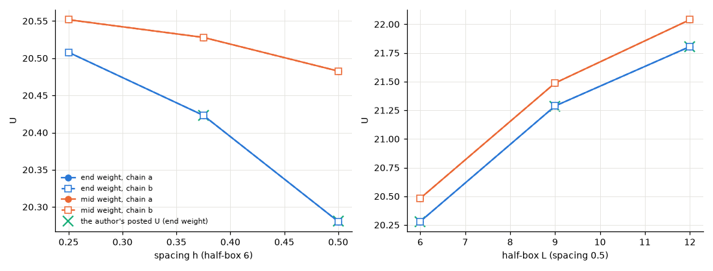
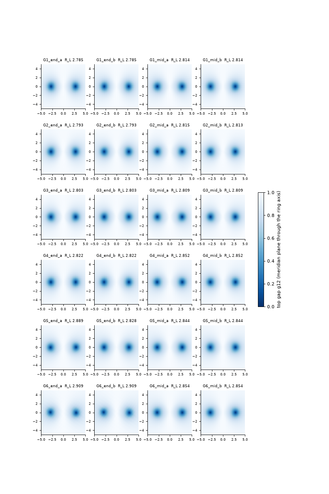
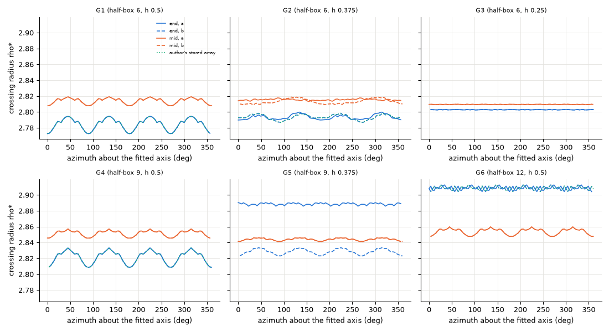
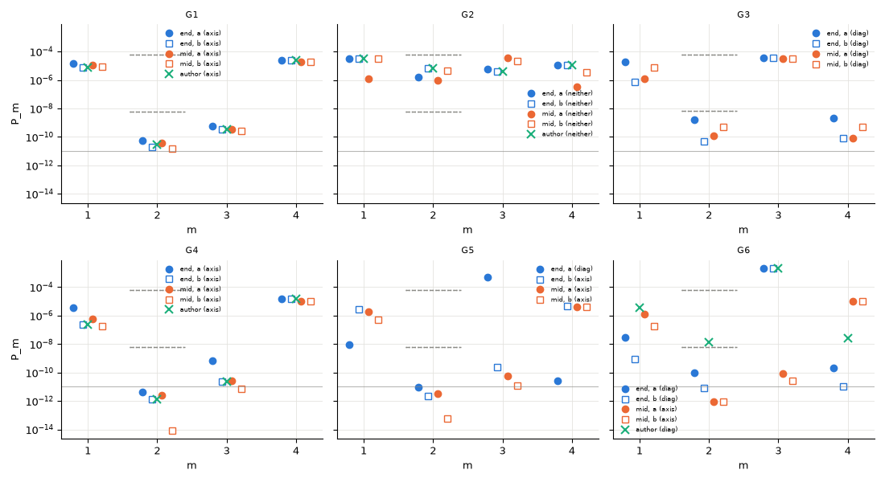

# M5.51: the author's new action ported with the link weight at the midpoint (rung A)

> Opened and staged 2026-11-23. Roadmap row: [`m5_roadmap.md`](../m5_roadmap.md). Thread record: [`m5_32_convo.md`](m5_32_convo.md). Sister task of the same go: [M5.52](m5_52_task_details.md), independent of this one (it runs on the action of [M5.42](m5_42_task_details.md)). The pinned-line ladder [M5.53](m5_53_task_details.md) picks its action from this result.

## TASK PLANNING (2026-11-23; staged: the words of § 5 are frozen before any chain is relaxed)

**Scope.** The port that the author offered as rung A in their post of 2026-11-20 ([discussioncomment-19782482](https://github.com/vantasnerdan/substrate-framework/discussions/186#discussioncomment-19782482), 19:28 UTC; the row of that date in the [thread record](m5_32_convo.md)), with the correction of their post of 2026-11-21 ([discussioncomment-19800127](https://github.com/vantasnerdan/substrate-framework/discussions/186#discussioncomment-19800127), 19:43 UTC, item 5): an action whose gradient term is weighted by the potential's own density, that weight taken at the midpoint of each link. The task builds the action in the author's discretization, checks it against the author's stored states to round-off, relaxes it from the radial hedgehog with the midpoint weight (the port asked for) and with the end-site weight (the author's runs, for the controls and the comparison) on six grids, and reads U, the ring radius, the m = 2 power, the inertial mass over the rest energy and the degree. It reports words. No cell of `MODELS.md` changes by this plan; the cells are re-read later, by a ruling of the repo owner.

| # | The author's statement (source) | What the port reads |
| --- | --- | --- |
| 1 | The action: $U = h^3 \sum [ \kappa \sum_{i \lt j} \lVert [\partial_i M, \partial_j M] \rVert^2 + v s(M) + L_V s(M) \lVert \nabla M \rVert^2 ]$, $s(M) = \sum_k (\operatorname{tr} M^k - c_k)^2$, $c_k = 1 + \delta^k$, with $L_V = 1$, $L_1 = 0$, $\delta = 0$ (post of 2026-11-20, item 1); $\kappa = v = 1$ are the defaults of the archive's engine `clock3d_v2.py` | the action of § 1, both link weights |
| 2 | From the radial hedgehog, a smooth axisymmetric ring of radius 2.73 to 2.83 (post of 2026-11-20, item 1); an m = 2 power of 10⁻¹¹ (release v4.1, [doi:10.5281/zenodo.23994958](https://doi.org/10.5281/zenodo.23994958)) | the ring reads of § 4 on every grid |
| 3 | U = 20.281 and 20.423 on half-box 6 at spacings 0.5 and 0.375; 21.287 and 21.805 on half-boxes 9 and 12 at 0.5; spacing 0.25 running, 20.509 so far (post of 2026-11-20, item 1) | U per grid with the end weight, words of § 5 |
| 4 | N/U = 0.947, 0.968, 1.005 read directly on half-boxes 6, 9, 12 (post of 2026-11-20, item 1); 0.968, 0.978, 0.987 from $N = \tfrac23 E_2 + \tfrac43 E_4$ (release v4.1; the archive's `laue.json` and `laue12_now.json`) | N/U with the end weight, words of § 5; the virial form as a descriptor |
| 5 | Q/4π = 0.999, the whole charge on the loop (post of 2026-11-20, item 2), a source integral of the author's | the degree on nested cube surfaces, a check of the regime with no word against 0.999 (§ 4) |
| 6 | With the end-site weight a jump of about 90° of the minor frame between two vacuum sites costs nothing; the weight at the link midpoint closes it; at fixed field the rung-A states rise in U by 1.07, 0.54 and 1.01 percent (half-box 6 at 0.5 and 0.375, half-box 9 at 0.5); the port asked for with the midpoint weight (post of 2026-11-21, item 5) | K3, the loophole in closed form; K2, the fixed-field rises; the midpoint chains and the statement S1 of § 5 |

**What the author's archives hold, read as text.** The archives attached to the two posts (the engine with its midpoint option and its diff, two fixed-field audits, the four stored arrays, the driver of the rung A relaxations) and the archive of the author's post of 2026-11-20 05:14 UTC (their ring reader) were read as text and never run or imported; the arrays are opened with `allow_pickle=False`. They were produced with AI assistance on the author's side and are evidence, not resolution: this plan re-derives every formula it uses from them. Four facts of the archives shape the plan. (a) The rung A runs were built with faces held at the seed $M_0$ (not at the exact vacuum), the stencil the engine calls `ma`, the chart fix on and $L_V = 1$, $L_1 = 0$, $\delta = 0$, started from the seed with no perturbation, and relaxed by L-BFGS-B with `ftol` 10⁻¹², `gtol` 10⁻⁷ and a cap of 12000 iterations. (b) The posted N/U values come from the archive's script of the Laue check (`laue.py`, `laue12_now.py`), a translational inertia summed with the engine's own stencil over the free nodes of the cube; an earlier inertial read of the archive (0.85 to 0.92, on spheres with central differences) is marked there as withdrawn by the author. (c) The archive does not define the m = 2 power: the release names it "the co-rotating m = 2 power" and gives 10⁻¹¹ with no formula. (d) The release gives the radii per grid (2.73 and 2.74 on half-box 6 at 0.5 and 0.375, 2.83 on half-box 9, 2.82 on half-box 12); the archive's ring reader is that of `ring_tools.py`, a weighted mean over the nodes at which the top two eigenvalues lie within 0.15 of each other.

**At plan time**, with code written for this plan (NumPy, no part of the author's code), these checks were made on the stored arrays and on constructed fields; no relaxation was run and no read of a new state was made. The `ma` energy of § 1, with each weight, returned the archive's audited U with the end weight and with the midpoint weight on the three arrays the audit covers, to the last digit or one unit of it, and the posted 21.805 on half-box 12. On half-box 12, which the author's audit does not cover, the fixed-field rise from the end weight to the midpoint weight is this plan's own number: 1.69 percent (U from 21.805155 to 22.173789), above the three posted rises; that stored ring is the one whose normal lies along a body diagonal. The inertial read of § 4 returned the posted 0.947, 0.968 and 1.005. The archive's ring reader, ported, returned the release's 2.83 on half-box 9 and did not return the release's radii on the three other arrays; on the author's own arrays its nodes do not form one connected set, so it serves here as a first guess and a descriptor only. The line reader of § 4 met its bounds on the constructed rings of K4 (a) in the three orientations at both spacings, and its fallback start found the ring on all three. The four stored rings do not share one orientation on the lattice: the normal lies along a box axis on half-box 6 at 0.5 and on half-box 9, near a body diagonal on half-box 12, and off both on half-box 6 at 0.375. The m = 2 power $P_2$ of § 4 on the stored arrays, against the bounds of K4 (b) at spacing 0.5: $2.75 \times 10^{-11}$ on half-box 6 at 0.5 and $1.40 \times 10^{-12}$ on half-box 9 (box axis; bounds $6.20 \times 10^{-9}$ and $6.20 \times 10^{-5}$), $1.28 \times 10^{-8}$ on half-box 12 (body diagonal; bounds $6.10 \times 10^{-9}$ and $6.10 \times 10^{-5}$), and no reading about a lattice axis on half-box 6 at 0.375.

**Eight limits, stated before the run.** (1) The port uses the author's discretization, so a word of REPRODUCED tests the port and the descent, not a second discretization; the continuum is approached only through the three spacings of half-box 6. (2) For the midpoint weight at δ = 0 the author gave fixed-field shifts and no relaxed number, so the midpoint table carries no word against the author; its one registered statement, S1, is this plan's. (3) The m = 2 power is defined here (§ 4). About a box axis or a body diagonal the lattice itself forbids m = 2 and puts its own anisotropy into m = 4 or m = 3, so $P_2$ measures only what breaks the lattice's symmetry, not axisymmetry; it is set beside the release's 10⁻¹¹ as an order only. (4) The radius words rest on the continuous line reader, like with like: the reader on this task's state against the same reader on the author's stored array of the same grid; the archive's reader and the release's radii are tabled beside with no word. (5) The time part behind N is the author's, with the potential's density at the node, for both link weights (a link of the time direction shrinks to a node in the limit of a small time step); N/U is a read in a finite box, and its limit in an infinite box is not read. (6) The action does not fix the ring's orientation on the lattice. Different orientations are different states on the lattice, with energies that can differ by the lattice's anisotropy; a word against the author is given only to a state of the same orientation as the author's stored state of its grid, and states are never averaged. (7) The faces are held at the seed, as in the author's runs, so U includes the potential of the face nodes, a constant; free faces enter only the wall control K3. The held faces also carry the hedgehog, so the degree on a cube between the ring and the faces reads 1 unless a defect sits between them. (8) The author's runs started from the exact seed, whose cubic symmetry was broken by round-off, so their orientations were set by round-off; the orientations of this task's chains `a` are set by the registered noise of § 3.

**Definition of done.** The controls of § 2 each reported as met or as the exact failing check; the hashes of the author's arrays and of their archive recorded; the 24 chains and the re-relaxations of K5 (24 at most) ended by their own rule or cut by a cap, each with its labels; every read of § 4 at the end of each chain and at its earlier state (§ 3); every entry of the tables of § 5 carrying one word or "no label" with the rule that withheld it; the STATIONARY test on the end-weight chains `b`; S1 worded; the two-state rule applied and stated per grid; the registered expectations of § 5 scored against the outcome; findings that embed the energies against the spacing and the box for both weights, the gap on a meridian plane of each state, the line radius against the azimuth, and the spectrum $P_m$; a numbers check on a different model recomputing every word from the summary JSON and the closed forms; an adversarial audit on a different model, with its own code on the stored states, trying to refute each word; the doc checker and the roadmap linter clean.

**Gating.** The user's go, one go with [M5.52](m5_52_task_details.md); the two tasks share no input and no output. The plan audit and its fold are recorded at the end of this section. No answer of the author is waited for.

**Research body.** This document (plan, findings, review). Scripts in [`../scripts/`](../scripts/): `m5_51_action.py` (the action, its gradient, the twist inertia, the controls K1 to K3 with `--selftest`), `m5_51_relax.py` (the chains, the stops, the checkpoints, the labels, K5) and `m5_51_reads.py` (the readers of § 4, K4, the tables of § 5 and the plots). The summary `m5_51_summary.json` in [`../data/`](../data/) (tracked); the stored states and chain records in `../checkpoints/m5_51/` (local-only, the author's arrays under `author/` with their hashes in this document); plots `m5_51_*.png` in [`../plots/`](../plots/). The data folder's manifest [`_DATASETS.md`](../data/_DATASETS.md) is regenerated at the end.

### 1. The action and its discretization

The field is a real symmetric 3 × 3 matrix $M(n)$ at the nodes $n$ of an $N^3$ grid of spacing $h$ in $[-L, L]^3$, stored as six components (xx, xy, xz, yy, yz, zz), the order of the stored arrays. $\lVert A \rVert^2 = \sum_{ab} A_{ab}^2$. With $\chi_a^{\sigma}(n) = 1$ when the neighbor $n + \sigma e_a$ exists and 0 otherwise, and

$$
D_a^{\sigma} M(n) = \frac{M(n + \sigma e_a) - M(n)}{\sigma h} , \qquad \sigma = \pm 1 , \qquad D_a M(n) = D_a^{+} M(n)
$$

the energy is

$$
U = h^3 \sum_{n} \Big[ \kappa \sum_{a<b} \sum_{\sigma, \tau = \pm 1} \tfrac14 \chi_a^{\sigma}(n) \chi_b^{\tau}(n) \big\lVert [D_a^{\sigma} M(n), D_b^{\tau} M(n)] \big\rVert^2 + v s\big(M(n)\big) \Big] +
L_V h^3 \sum_{a=1}^{3} \sum_{n : \chi_a^{+}(n) = 1} w_a(n) \big\lVert D_a M(n) \big\rVert^2
$$

with $s(M) = \sum_{k=1}^{3} (\operatorname{tr} M^k - c_k)^2$, $c_k = 1 + \delta^k$, the sum over $n$ running over every node, the held faces included, and every forward link counted once. The two link weights are

$$
w_a^{\mathrm{end}}(n) = \tfrac12 \Big[ s\big(M(n)\big) + s\big(M(n + e_a)\big) \Big] , \qquad w_a^{\mathrm{mid}}(n) = s\Big( \tfrac12 \big[ M(n) + M(n + e_a) \big] \Big)
$$

The weight is the potential's density at $v = 1$ whatever $v$ is (the engine's choice; here $v = 1$). This is the engine's `ma` stencil, read from its code: each quartic plane averaged over the four sign pairs with weight ¼ each, a pair counted where its two neighbors exist; the potential at every node; the $L_V$ term on forward links; the end weight as the mean of $s$ at the two end sites and the midpoint weight as $s$ of the mean matrix (the engine's option `lv_mid`). At δ = 0 the chart fix of the author's build has no effect: it moves only the minor axis of the vacuum frame, which enters with the factor δ.

**The seed and the faces.** As built by the author with δ = 0 and the faces not exact:

$$
M_0(x) = \tfrac13 \mathbb{1} + \tanh\big(r / 1.2\big) \big( \hat r \hat r^{\mathsf T} - \tfrac13 \mathbb{1} \big) , \qquad r = \lvert x \rvert + 10^{-12} , \qquad \hat r = x / r
$$

so that the center node holds $\tfrac13 \mathbb{1}$. The face nodes hold $M_0$ throughout; only the free nodes are optimized, and the gradient on the faces is zero.

**How this differs from the averaged stencil of [M5.42](m5_42_task_details.md).** The stencil `averaged` of [`m5_42_eq42.py`](../scripts/m5_42_eq42.py) weights each of the eight sign orientations 1/8 and counts an orientation only where all three of its neighbors exist; it weights the potential of a node by the share of its orientations that exist. On the nodes inside the faces the two stencils give every term the same weight. They differ on face nodes, in the quartic of the plane parallel to the face (and, on edges and corners, of more planes) and in the potential there: every term that differs couples only nodes of one face. With the faces held, the difference is therefore a constant: the two stencils have the same gradient on the free nodes and the same relaxed states, and their energies differ by the face terms alone. With free faces (K3) they differ in terms that move. The new module implements `ma` exactly, so that a stored energy is reproduced to round-off (K2) and the free-faced wall has its closed form (K3); the identity of gradients is control K1 (b).

**The gradient.** For symmetric $A$, $B$ and $C = [A, B]$: $\partial \lVert C \rVert^2 / \partial A = 2 [C, B]$ and $\partial \lVert C \rVert^2 / \partial B = 2 [A, C]$. With $t_k = \operatorname{tr} M^k - c_k$, $s'(M) = 2 t_1 \mathbb{1} + 4 t_2 M + 6 t_3 M^2$. For one link from $i$ to $j$ with $D = (M_j - M_i)/h$, $\bar M = \tfrac12 (M_i + M_j)$ and $e = w \lVert D \rVert^2$:

$$
\frac{\partial e^{\mathrm{mid}}}{\partial M_i} = \tfrac12 s'(\bar M) \lVert D \rVert^2 - \frac{2}{h} s(\bar M) D , \qquad \frac{\partial e^{\mathrm{mid}}}{\partial M_j} = \tfrac12 s'(\bar M) \lVert D \rVert^2 + \frac{2}{h} s(\bar M) D
$$

$$
\frac{\partial e^{\mathrm{end}}}{\partial M_i} = \tfrac12 s'(M_i) \lVert D \rVert^2 - \frac{1}{h} \big( s(M_i) + s(M_j) \big) D , \qquad \frac{\partial e^{\mathrm{end}}}{\partial M_j} = \tfrac12 s'(M_j) \lVert D \rVert^2 + \frac{1}{h} \big( s(M_i) + s(M_j) \big) D
$$

each multiplied by $L_V h^3$. The gradient over the six components is formed from that over the nine entries as in `m5_42_eq42.py` (`grad_to6`).

**The module.** `m5_51_action.py` follows the conventions of `m5_42_eq42.py`: one numba kernel, one pass over the nodes, analytic gradient, single thread. It returns the parts $U_4$, $U_V$, $U_{LV}$ and $U$, and the gradient; it takes `weight` (`mid` or `end`), δ, κ, $v$, $L_V$ and `free_faces`. A second function returns, with no gradient, the twist inertia that the labels of § 3 use (the engine's inertia at $L_1 = 0$):

$$
I = 2 h^3 \sum_n \Big[ L_V s\big(M(n)\big) \lVert K(n) \rVert^2 + \kappa \sum_a \sum_{\sigma} \tfrac12 \chi_a^{\sigma}(n) \big\lVert [K(n), D_a^{\sigma} M(n)] \big\rVert^2 \Big] , \qquad K = [G, M] , \qquad G_{ab} = - \epsilon_{abc} \hat r_c
$$

### 2. The controls

The norm of a gradient comparison is the largest absolute difference over the compared components divided by the largest absolute component of the reference.

| Control | Input | The answer it must return | What a failure would look like (an input that fails it) |
| --- | --- | --- | --- |
| K1 (a), the gradient | $N = 9$, $h = 0.5$ (half-box 2). The field: $M_0$ of that grid plus $\sum_{j=1}^{4} 0.1 S_j \sin(k_j \cdot x + \varphi_j)$, with $S_j$ symmetric, its six components standard normal draws, scaled to $\lVert S_j \rVert = 1$; $k_j$ with components uniform in $[-\pi/2, \pi/2]$; $\varphi_j$ uniform in $[0, 2\pi)$; all drawn by `numpy.random.default_rng(51000)` in that order. Both weights, δ = 0 and δ = 0.05, held and free faces; 200 components drawn from the same generator; one direction of standard normal components over the free components, scaled to unit Euclidean norm | each component within $10^{-5}$ relative or $10^{-9}$ absolute of the central difference at step $10^{-5}$; along the direction, the error of the central difference falling as the square of the step over steps $10^{-2}$ to $10^{-4}$ (a ratio of 80 to 120 per decade) | a midpoint gradient without its $\tfrac12 s'$ term, or the end formula used for the midpoint weight, misses by order one |
| K1 (b), against the controlled kernel | the same field with $L_V = 0$, against `m5_42_eq42.py` with the stencil `averaged`, $L_1 = 0$, held faces | the gradients on the free nodes equal to $10^{-12}$ in the norm above; the energies differing by the face terms of § 1 evaluated alone, to $10^{-12}$ relative | a quartic or potential that is not the one M5.42 controlled |
| K1 (c), the inertia, quartic part | the four stored arrays with $L_V = 0$, against the inertia of `m5_42_eq42.py` (stencil `averaged`, $L_1 = 0$) | equal to $10^{-12}$ relative (at δ = 0 the held faces carry $K = 0$, so the face weights do not enter) | an inertia read on another stencil |
| K1 (d), the inertia, $L_V$ part | the four stored arrays with $L_V = 1$, against a dense NumPy evaluation written from the equation of $I$ in § 1 | equal to $10^{-12}$ relative | an $L_V$ term with a link weight, or without its factor 2 |
| K2, the author's states at fixed field | the four stored arrays, faces reset to $M_0$ | $U^{\mathrm{end}}$ and $U^{\mathrm{mid}}$ of half-box 6 at 0.5 and 0.375 and of half-box 9 at 0.5 within $10^{-9}$ relative of the 16-digit values of the archive's audit (`audit_d0.json`), hence the posted rises of 1.07, 0.54 and 1.01 percent; $U^{\mathrm{end}}$ of half-box 12 within 0.0005 of the posted 21.805; the parts $U_{LV}$, $U_4$, $U_V$ of half-box 6 and 9 at 0.5 against the archive's `laue.json` (2.4592, 13.4883, 4.33299 and 2.4699, 14.374, 4.44365) to their printed digits | the stencil `averaged` (off by the face constant), the two weights swapped (off by about 1 percent), the potential left out on the faces, faces held at the exact vacuum |
| K3, the loophole in closed form | free faces, $N = 9$ and $N = 10$, $h = 0.5$; a planar wall normal to each box axis in turn between two uniform vacuum domains: δ = 0 with $\hat x \hat x^{\mathsf T}$ against $\hat y \hat y^{\mathsf T}$; δ = 0.05 with diag(1, δ, 0) against diag(1, 0, δ) | $U_4 = 0$ and $U_V = 0$ to $10^{-14}$ absolute; $U^{\mathrm{end}} = 0$ to $10^{-14}$ absolute; $U^{\mathrm{mid}}$ equal to the closed form below within $10^{-12}$ relative at δ = 0 and $10^{-10}$ relative at δ = 0.05 (where $s$ is a difference of numbers near 1, so its last digits cancel) | a midpoint weight evaluated at the end sites returns zero; a weight on the wrong link or a missing link returns another multiple of $N^2$ |
| K4, the readers | the constructed fields of § 4 and the stored arrays | the known answers of § 4 | each row of § 4 names its failing input |
| K5, the convergence gate | every end of a chain `a` that is CONVERGED (12 at most; seeds 51101 to 51112), and every end of a chain `b` that is a different state from the chain `a` of its grid and weight by the two-state rule of § 3 (12 at most; seeds 51201 to 51212); seeds in the order G1 to G6 and, within a grid, `end` then `mid`. Each end perturbed by noise of $10^{-4}$ in each component of each free node and relaxed again by the rules of § 3 with a cap of 10000 | U back within $10^{-6}$ relative, $R_L$ within 0.002, the same orientation class and degree | a chain end that is a stall or a saddle: the perturbed relaxation goes lower |

**The closed form of K3.** All gradients point along the wall normal, so every commutator vanishes. Both domains lie on the vacuum spectrum, so $s = 0$ on every node and the end weight is zero on the $N^2$ links that cross the wall. The midpoint matrix is $\tfrac12 (\hat x \hat x^{\mathsf T} + \hat y \hat y^{\mathsf T})$ at δ = 0, with eigenvalues ½, ½, 0, so $t_1 = 0$, $t_2 = -\tfrac12$, $t_3 = -\tfrac34$ and $s = \tfrac{13}{16}$; with $\lVert D \rVert^2 = 2/h^2$,

$$
U^{\mathrm{mid}}_{\delta = 0} = N^2 h^3 \cdot \frac{13}{16} \cdot \frac{2}{h^2} = \frac{13}{8} N^2 h
$$

At δ = 0.05 the midpoint matrix is diag(1, δ/2, δ/2): $t_1 = 0$, $t_2 = -\delta^2/2$, $t_3 = -3\delta^3/4$, $s = \delta^4/4 + 9\delta^6/16$, $\lVert D \rVert^2 = 2\delta^2/h^2$, so

$$
U^{\mathrm{mid}}_{\delta} = N^2 h \Big( \frac{\delta^6}{2} + \frac{9 \delta^8}{8} \Big)
$$

The second wall is the author's case: a jump of 90° of the minor frame between two vacuum sites. The first is the same jump of the major axis, the case that exists at δ = 0.

**Order, cap, cost.** K1 to K3 run first, then K4, all before any chain; K5 after the chains. The try cap on each control is three. Between tries only an input of a control or a defect of a script may change, never a threshold of § 2, § 4 or § 5, and each change is logged in the progress notes. What a failure costs: K1, K2 or K3, no chain is run; K4 on one reader, no word from that reader (the other reads keep theirs); K5 on one chain end, that state carries no word and is named STALLED, both states tabled.

### 3. The grids, the starts and the chains

| Grid | Half-box | Spacing | N | The author's numbers | The author's stored array |
| --- | --- | --- | --- | --- | --- |
| G1 | 6 | 0.5 | 25 | U 20.281, N/U 0.947 | yes |
| G2 | 6 | 0.375 | 33 | U 20.423 | yes |
| G3 | 6 | 0.25 | 49 | "running, 20.509 so far" (a running value, no word) | no |
| G4 | 9 | 0.5 | 37 | U 21.287, N/U 0.968 | yes |
| G5 | 9 | 0.375 | 49 | none | no |
| G6 | 12 | 0.5 | 49 | U 21.805, N/U 1.005 | yes |

The ring radius (2.73 to 2.83) and the m = 2 power (10⁻¹¹) are given without a grid and are tabled on every grid as the sources state them.

**The chains.** Each grid is relaxed with both weights from two starts, 24 chains named `<grid>_<weight>_<start>`:

| Start | Definition |
| --- | --- |
| a, the seed with noise | $M_0$ on every node, plus on each free node a symmetric perturbation whose six components are independent normal draws of standard deviation $10^{-4}$; the generator `numpy.random.default_rng` with seeds 51001 to 51012, in the order G1 to G6 and, within a grid, `end` then `mid`. The amplitude lies far under the field's own scale and far above round-off, so that the direction in which a chain leaves the symmetric saddle of the hedgehog is set by the registered draw and not by the order of a sum (limit 8) |
| b, the author's state or this task's own | on G1, G2, G4 and G6, the author's stored array of that grid; on G3 and G5, the end state of this task's chain `a` of the same weight on the coarser grid of the same half-box (G2 for G3, G4 for G5), interpolated componentwise by `scipy.ndimage.map_coordinates` with order 3; the faces reset to $M_0$ in either case |

The midpoint chain from the author's state is the check the author made at δ = 0.05 (post of 2026-11-21, item 5), made here at δ = 0: their state relaxed under the corrected weight.

**Run rules.**

| Rule | Value |
| --- | --- |
| Optimizer | `scipy.optimize.minimize`, L-BFGS-B, over the six components of the free nodes; `maxcor` 10, `ftol` $10^{-12}$, `gtol` $10^{-7}$ on the gradient as the kernel returns it (with its factor $h^3$), `maxfun` 1.25 times the cap: the author's settings |
| Cap | 30000 iterations per chain (the author's cap of 12000 raised, since the archive records their half-box 12 state as still settling); 10000 per re-relaxation of K5 |
| Stops | at 1000, 3000, 10000, 20000 and 30000 iterations and at the optimizer's own end: the field saved, with the parts of U, the gate and every read of § 4 |
| Checkpoints | every 500 iterations and at each stop; an interrupted chain resumes from its checkpoint with a fresh optimizer memory, recorded as a resume |
| Restarts | an abnormal end of the line search is restarted from the last iterate at most three times, each logged (as in `m5_42_relax.py`) |
| Wall cap | 5 hours per process; a chain cut by it ends CAPPED, with the state it reached |
| The gate | $g = \max \lvert \partial U / \partial m \rvert / h^3$ over the free components, as in M5.42 |
| CONVERGED | $g \le 10^{-3}$ at the end, and either the optimizer ended by its own tolerance (`ftol` or `gtol`), or the last two stops lie at least 5000 iterations apart and differ by at most $10^{-6}$ relative in U and 0.002 in the line radius $R_L$. A chain that ends by its tolerance before its first stop meets the first clause only and is named so |
| CAPPED | any end that is not CONVERGED. A CAPPED state carries no word; its reads are tabled |
| Labels | SMOOTH, ONE-CELL and MIXED by the rule of [M5.42](m5_42_task_details.md) § 2, row 4, on the density of the twist inertia of § 1: SMOOTH when no node holds more than 1 percent of it and no node holding more than $10^{-4}$ of it holds more than 50 times the mean of its 26 neighbors; ONE-CELL when a node holds more than half; MIXED otherwise. The author's own label rule (the engine's readout) is printed beside. The range of the eigenvalues is printed with every label |
| The second step | every read of § 4 is taken at the end and at the earlier state: the last saved state at least 500 iterations before the end, or the start state when the chain is shorter than that (the entry says so). A read carries no word when its two values differ by more than: $10^{-4}$ relative for U; a tenth of $\tau_L$ for $R_L$; 0.0005 for N/U; for $P_2$, lying on different sides of either bound of § 5; for the degree, the orientation class and one ring, any difference. Both values are printed |
| Two states | two chain ends of one grid and weight are the same state when U agrees within $10^{-5}$ relative, $R_L$ within 0.01, and the orientation class and the degree are equal; otherwise they are two states, each with its own reads and words, never averaged |

**Parallel shape.** One single-threaded process per chain and per re-relaxation (the thread variables set to 1 before NumPy and numba load); the parallelism is across jobs. A descent is sequential by nature, and a $49^3$ field is too small for the node loop of the kernel to gain from threads; this is the plan's documented choice. The GPU is not used: the action needs double precision. The two tasks of the go together hold at most 12 long processes: this task holds at most eight while M5.52 has jobs running or queued, and M5.52 at most four; when the queue of either task is empty, the other may take the freed slots, the two together never above twelve. The first wave holds G2 `a` and G4 `a` of both weights (G3 `b` and G5 `b` wait for them) and, longest first, the chains on $49^3$ that need no other chain (G3 a, G5 a, G6 a and G6 b, both weights); then G4 b, G2 b and G1; the four chains `b` of G3 and G5 as their sources end; the re-relaxations of K5 as their chains end. The reads of § 4 and § 5 run in one more process when a slot is free, after the chains of a grid have ended.

### 4. The reads

Each read below states its regime and its known-answer control (K4). λ₁ ≥ λ₂ ≥ λ₃ are the eigenvalues of $M$, $g_{12} = \lambda_1 - \lambda_2$ the top gap, and $\hat n$ the top eigenvector, defined up to sign.

**The constructed ring (the input of K4 (a) and (b)), frozen.** About a center $c$ with unit normal ν and in-plane unit vector $e_1$, with cylindrical coordinates $(\rho, \phi, \zeta)$, the distance to the circle $d = \sqrt{(\rho - R_0)^2 + \zeta^2}$ and the angle about it $\theta = \operatorname{atan2}(\zeta, \rho - R_0)$:

$$
\hat n = \cos\tfrac{\theta}{2} \hat \rho + \sin\tfrac{\theta}{2} \nu , \qquad \hat m = - \sin\tfrac{\theta}{2} \hat \rho + \cos\tfrac{\theta}{2} \nu , \qquad M = \tfrac12 (1 + f) \hat n \hat n^{\mathsf T} + \tfrac12 (1 - f) \hat m \hat m^{\mathsf T} , \qquad f = \tanh d
$$

The field is continuous across θ = ±π, its top gap is $f(d)$ (a core width of 1), which closes on the circle of radius $R_0$, and its top eigenvector turns by π about the circle (a half-disclination loop). It is exactly axisymmetric. The elliptic variant takes $R_0 (1 + \epsilon \cos 2\phi)$ in place of $R_0$. The box is half-width 6 at $h = 0.5$ ($25^3$) and $h = 0.375$ ($33^3$) for K4 (a), and half-width 6 at each spacing of the chains (0.5, 0.375, 0.25) for K4 (b); the center $c$ is the origin, the center node of the grid. The three orientations: a box axis, $\nu = \hat x$, $e_1 = \hat y$; a body diagonal, $\nu = (1, 1, -1)/\sqrt3$, $e_1 = (1, -1, 0)/\sqrt2$; tilted, $\nu = (\sin 16^{\circ}, 0, \cos 16^{\circ})$, $e_1 = \hat y$. The radii of K4 (a): $R_0 = 2.75$, $2.75 + h/3$ and $2.75 + 2h/3$; of K4 (b): $R_0 = 2.75$.

| Read | Definition | Regime | K4: the known answer it must return, and the input that fails it |
| --- | --- | --- | --- |
| $R_A$, the archive's ring reader (a descriptor and a first guess, no word) | ported from `ring_tools.py`: the nodes with $g_{12} < 0.15$ and $r < 0.93 L$, weights $0.15 - g_{12}$, the weighted centroid $c_A$, the normal $\nu_A$ as the least eigenvector of the weighted covariance, $R_A$ the weighted mean distance from $c_A$ in the plane | none stated: its node set is sparse and need not be connected, on the author's own arrays included | (a) no pass bound; on every constructed ring of K4 (a) its error $R_A - R_0$, the error of $\nu_A$ and its jitter $j_A$ (the largest change of $R_A - R_0$ across the three offsets of one spacing and orientation) are recorded as numbers |
| $R_L$, the line radius (continuous; the radius words rest on it) | the first guess is $(c_A, \nu_A, R_A)$ when $R_A$ has at least 4 nodes. Otherwise, about the box center and each of the 13 lattice directions (3 box axes, 6 face diagonals, 4 body diagonals), 24 meridian half-planes are searched at steps of $h/4$ over $\rho$ from 0.5 to $L - 1.5$ and $\zeta$ within ±1.5, each least sample refined as below; the direction with the most crossings of $g_{12} \le 0.02$ is kept, a tie going to the least root mean square of $\zeta^{\ast}$, and its crossings fitted as below give the first guess. Then two passes: in each of 96 meridian half-planes about the current axis, the field interpolated trilinearly, $g_{12}$ sampled at steps of $h/10$ for $\rho$ within 1.5 of the current radius and $\zeta$ within ±1.5, the least sample refined by Nelder-Mead on the interpolated $g_{12}$ (tolerance $10^{-5}$ in place) to a crossing $(\rho^{\ast}, \zeta^{\ast})$; the crossings fitted by a plane (normal $\nu_L$) and a circle in it (center $c_L$); $R_L$ is the mean in-plane distance of the crossings from $c_L$. The second pass runs about the result of the first; its result is the read. It extends the in-plane measure of [`m5_50_diag_radius.py`](../scripts/m5_50_diag_radius.py) to the meridian half-plane | a crossing found with interpolated $g_{12} \le 0.02$ on every half-plane, and the top eigenvector reversing sign on a circle of radius 0.5 about each crossing (the half-turn) | (a) on every constructed ring: $R_L$ within 0.01 of $R_0$, its jitter $j_L$ under 0.005, $\nu_L$ within 0.5°; the fallback start, run on the three orientations at $h = 0.5$ with the first guess withheld, returns the same bounds. A reader with node resolution moves in steps of order $h$ and fails |
| $P_m$, the co-rotating azimuthal power | about the axis $(c_L, \nu_L)$, snapped to the box center and to the lattice direction when they lie within $h/4$ and 1°; on the twelve circles $\rho \in \lbrace 1, 2, 3, 4 \rbrace$, $\zeta \in \lbrace -1, 0, 1 \rbrace$, at 96 azimuths $\phi_k$, with $R_k$ the rotation by $\phi_k$ about the axis and $y$ the circle's point at $\phi = 0$: $\tilde M_k = R_k^{\mathsf T} M(c + R_k y) R_k$ (trilinear), $\hat M_m = \tfrac{1}{96} \sum_k \tilde M_k e^{-i m \phi_k}$, and $P_m = \sum (\lVert \hat M_m \rVert^2 + \lVert \hat M_{-m} \rVert^2) / \sum \lVert \hat M_0 \rVert^2$ over the circles. $P_2$ carries the words; $P_1$, $P_3$ and $P_4$ are tabled beside it with no word ($P_4$ holds the lattice's own anisotropy about a box axis, $P_3$ about a body diagonal) | only when the snapped axis is a box axis or a body diagonal: the quarter turn about a box axis and the third of a turn about a body diagonal map the grid and the 96 azimuths onto themselves and forbid $m = 2$ in a state that has the lattice's symmetry, so $P_2$ measures what breaks that symmetry. About any other axis $P_2$ holds the lattice's own anisotropy and carries no word | (b) at each spacing of the chains, the exactly axisymmetric constructed ring about a box axis and about a body diagonal: $P_2 \le 10^{-20}$; the elliptic variant about each of the two with ε = $10^{-2}$ and $10^{-3}$: $P_2$ falling by a factor 90 to 110 between them. For each class and spacing these give the two bounds of § 5: $B_{\mathrm{abs}} = P_2(\epsilon = 10^{-3})/100$, an ellipticity of $10^{-4}$, and $B_{\mathrm{pres}} = P_2(\epsilon = 10^{-2})$. A reader that mixes the frame (no co-rotation) returns $m = 2$ content on the axisymmetric ring and fails |
| N/U, the inertial mass over the rest energy | the author's Laue read, re-derived from `laue.py`: per axis $a$, $V_a = \tfrac12 (\chi_a^{+} D_a^{+} M + \chi_a^{-} D_a^{-} M)$ (central inside, half the one-sided difference on a face), $N_a = 2 h^3 \sum_{\mathrm{free}} [ L_V s(M) \lVert V_a \rVert^2 + \kappa \sum_b \sum_\tau \tfrac12 \chi_b^\tau \lVert [V_a, D_b^\tau M] \rVert^2 ]$, $N/U = (N_x + N_y + N_z) / (3U)$, with U the state's own energy (end or midpoint). The node weight $s(M)$ for both link weights, by limit (5). Beside it, $N_{\mathrm{vir}} / U$ with $N_{\mathrm{vir}} = \tfrac23 U_{LV} + \tfrac43 U_4$, and the three $N_a$ | a finite-box read of a relaxed state; its limit in an infinite box is not read | (c) on the stored arrays of G1, G4 and G6: the posted 0.947, 0.968 and 1.005 within 0.001 (the rounding and, on G6, a stored state that the archive shows to be later than the one read for the post), and the archive's $N_a$ of G1 and G4 (18.478, 19.573, 19.573 and 20.248, 20.79, 20.79) to their printed digits. On the field $M(z) = R_x(kz) \operatorname{diag}(0.8, 0.3, 0) R_x(kz)^{\mathsf T}$ with $k = 0.7$, in a box of half-width 3 at $h = 0.5$ and 0.25: $N_x = N_y = 0$ exactly, and the error of $N_z$ against the exact density $2 s \lVert \partial_z M \rVert^2$ summed on the same free nodes falling by a ratio of 3 to 5 between the two spacings (second order, ratio 4, with a fourth-order part that at $kh = 0.35$ moves the ratio by up to a fifth; the plan-time value lies inside). A first-order read gives about 2 and fails; a read on the wrong axis or with the link weight returns other values |
| The degree | the charge of the long axis on nested cube surfaces by [`m5_46_degree.py`](../scripts/m5_46_degree.py), unchanged: $\lvert q \rvert$ on every liftable centered cube whose half-width is the multiple of $h$ nearest to 3.5, 4, 4.5 and so on up to $L - h$ | no defect between the ring and the faces: a surface that is liftable ($g_{12} > 0.2$ on it and no pierced triangle) and surrounds the ring. The held faces carry the hedgehog, so in this regime the read is 1 by construction; a value other than 1 shows a defect between the ring and the faces. It is not the author's instrument (their 0.999 is a source integral on the loop) | (d) its own `--selftest` (K1 to K7 of [M5.46](m5_46_task_details.md)) and the seed $M_0$ of each grid, which must read 1 on every liftable surface. A reader that returns the same value on every input fails the self-test |
| The orientation class | $\nu_L$ within 1° of a box axis (one class by the lattice's symmetry), within 1° of a body diagonal (one class), or neither, with the angles to the nearest box axis and the nearest body diagonal printed | a state with one ring | covered by K4 (a) |
| One ring | the crossing found on all 96 half-planes of $R_L$, consecutive crossings within $2h$ of each other, and no node with $g_{12} < 0.15$ farther than 1.5 from the fitted circle | a relaxed state | (a) the constructed ring passes; a field of two constructed rings fails it: radius 1.5, normal $\hat z$, centers $(0, 0, \pm 3)$, each node taking the field of the nearer center, in a box of half-width 6 at $h = 0.5$ (the second ring lies about 6 from the first, far from the 1.5 threshold) |

**Descriptors, with no word.** U and its parts per stop; the eigenvalue range; the gate; the angles of $\nu_L$ to the box axes; the out-of-plane spread of the crossings and the m = 2 harmonic of $\rho^{\ast}(\phi)$; the least $g_{12}$ on the nodes; $R_A$ beside $R_L$; the inertia of the twist; the count of links between two near-vacuum nodes ($s < 10^{-4}$ at both ends) whose top eigenvectors differ by more than 45°, the loophole read directly on every state; the shift $U^{\mathrm{mid}}/U^{\mathrm{end}} - 1$ against the spacing (a smooth field gives a difference of the two weights of order $h^2$, a field with jumps does not).

### 5. The words, frozen

**(i) The end weight against the author's numbers.** A word is given per state (per chain end) that is CONVERGED, SMOOTH and one ring, on its own grid; a CAPPED, STALLED or non-SMOOTH state carries no word, its reads printed. The word of a grid is that of its chain `a` (from the seed), and only when that state has the orientation of the author's stored array of its grid: the same class, and for the class "neither" the same angles to the nearest box axis and the nearest body diagonal within 1°. Otherwise each entry reads "no label (other orientation)" with its numbers.

| Quantity | Reference | REPRODUCED | NOT REPRODUCED | Reason of the tolerance |
| --- | --- | --- | --- | --- |
| U | the posted value of the grid (G1, G2, G4, G6) | $\lvert U - U_{\mathrm{post}} \rvert \le 10^{-3} U_{\mathrm{post}}$ | above it | 40 times the rounding of three decimals; under a fifth of the posted step between spacings 0.5 and 0.375 (0.7 percent) and under a fifth of the posted midpoint rises (0.54 to 1.07 percent), so a state of the wrong weight or of the coarser grid fails it |
| $R_L$ | $R_L$ of the author's stored array of the grid | within $\tau_L = \max(0.01, 2 j_L)$, $j_L$ from K4 (a) at that spacing | outside it | like with like, so the reader's bias cancels; the continuous reader's own jitter |
| m = 2 | the release's "m = 2 power 10⁻¹¹", read as: no ellipticity above $10^{-4}$ that breaks the lattice's symmetry | $P_2 \le B_{\mathrm{abs}}$ of the state's class and spacing | $P_2 \ge B_{\mathrm{pres}}$ of the state's class and spacing, an ellipticity of 1 percent or more | the source's own definition is not known (limit 3); between the two bounds no label, the value printed; no label off the lattice's symmetry axes (§ 4) |
| N/U | the posted value of the grid (G1, G4, G6) | within 0.005 | outside it | 10 times the rounding; a quarter of the posted step from half-box 6 to 9 (0.021), so a state of another box fails it |

Every word is printed with its two numbers and their difference. Tabled beside, with no word: $R_A$; the release's radii (2.73, 2.74, 2.83, 2.82) and the posted range 2.73 to 2.83; the release's 10⁻¹¹ and $P_1$, $P_3$, $P_4$; the posted Q/4π = 0.999 beside the degree. On G3 the posted "20.509 so far" and on G3, G5 the absence of a posted number leave the end-weight reads as a table.

**STATIONARY, the author's state under the port.** On G1, G2, G4 and G6 the end-weight chain `b` starts from the author's stored state. At its end, whatever its label: STATIONARY when U has fallen by less than $10^{-4}$ relative from the stored state, $R_L$ lies within $\tau_L$ of the stored state's $R_L$ and the orientation class is unchanged; NOT STATIONARY otherwise, with the clause named. On G6 the archive records a state still settling, which this test can show.

**(ii) The midpoint weight.** The table of reads (U and its parts, $R_L$, $R_A$, $P_2$ with $P_1$, $P_3$, $P_4$, N/U, the degree, the labels, the orientation class) per state and grid, beside the end-weight state of the same grid and start, with no word against an author number: the author gave none for relaxed states at δ = 0. The chains `b` start from the stored states on G1, G2, G4 and G6 only, and there the fixed-field rises (the posted 1.07, 0.54, 1.01 percent and this plan's 1.69 percent on G6) are tabled beside the relaxed shifts: since a descent only lowers U, the relaxed midpoint energy of such a chain lies at most that rise above the author's end-weight energy, by construction.

**S1, registered: the ring survives the corrected weight.** On every grid where the chains `a` of both weights end CONVERGED, SMOOTH and one ring (a qualifying grid):

| Clause | Rule |
| --- | --- |
| Energy | $\lvert U^{\mathrm{mid}}/U^{\mathrm{end}} - 1 \rvert < 0.03$ |
| Size | $\lvert R_L^{\mathrm{mid}}/R_L^{\mathrm{end}} - 1 \rvert < 0.03$ |
| Shape | the midpoint state is one ring and SMOOTH, with no defect between the ring and the faces ($\lvert q \rvert = 1$ on every liftable surrounding surface) |

S1 is NOT HELD when any clause fails on any qualifying grid, the grid and the clause named, however many grids qualify; HELD when every clause holds on every qualifying grid and at least two grids qualify; no label when nothing fails and fewer than two grids qualify. The falsifier: under the midpoint weight the relaxation from the seed ends as something other than one ring (no crossing on some half-plane, two rings, a collapse onto the center, a defect between the ring and the faces), or the energy or the size moves past its bound. S1 is read on the chains `a`, because on the chains `b` the energy clause cannot fail upward (the paragraph above); the pairs `b` are tabled with the same three clauses and no word. The bounds are the plan's: the energy bound lies under twice the largest fixed-field rise found on a stored array (1.69 percent, on G6); the size bound is three times the radius shift the author reported for their relaxed δ = 0.05 state (0.99 percent, with 0.92 percent in U; post of 2026-11-21, item 5), well over the resolution of $R_L$ (K4 (a)).

**(iii) Two starts, two states.** Where the chains `a` and `b` of one grid and weight end in two states (§ 3), both are reported with their reads; the words of (i) are those of chain `a`, and S1 is read on chains `a`; nothing is averaged. Where the two orientation classes differ, the lower U is named.

**Registered expectations, which no script uses.** With the end weight: STATIONARY on G1, G2 and G4; on G6 U may fall by a few parts in $10^4$ (the archive records that state as still settling), so STATIONARY or NOT STATIONARY by the energy clause; every chain `a` forms one ring with degree 1, SMOOTH; the orientation class of each chain `a` is not predicted, so some entries may read "no label (other orientation)"; where the class matches, U, $R_L$ and N/U REPRODUCED. For m = 2, from the plan-time reads of the stored arrays: a matching chain `a` on G1 or G4 (box axis) is expected under $B_{\mathrm{abs}}$, as the author's arrays are; on G6 the author's own array lies between the bounds of its class and reads no label; on G2 the author's ring lies off the lattice's axes, so a matching state carries no m = 2 word. With the midpoint weight: U above the end weight by 0.3 to 1.7 percent on G1, G2, G4 and G6 and by less on G3 (the posted fixed-field rise halves from spacing 0.5 to 0.375 on half-box 6, near the factor of $h^2$), the line radius within 1.5 percent, S1 HELD; the loophole count of § 4 near zero on every relaxed state of either weight, since a smooth state has no use for jumps.

Nothing in this section sets an icon or moves a cell.

### 6. Blindspot pass, consumers, estimate

| Family or unknown | Guard |
| --- | --- |
| Unvalidated instrument: the kernel, its gradient, the inertia, the optimizer's end, the readers | K1 (finite differences; the controlled kernel of M5.42; both parts of the inertia), K2 (the author's audited energies to round-off), K3 (closed forms that the loophole itself would fail), K4 per reader with a known answer and a failing input, K5 on every chain end that carries a word |
| Artifact read as result: the noise draw, the stop, the interpolation of a start | the second-step rule of § 3, per read; two starts per grid and weight; three spacings and three boxes; K5's fresh draw |
| Unfalsifiable check: the end-weight chain `b` starts at the author's state; the midpoint chain `b` cannot rise above the fixed-field shift; the degree reads 1 by construction while no defect sits between the ring and the faces | the word of a grid is that of chain `a`; chain `b` carries only STATIONARY, a test of the port at the author's state; S1 is read on chains `a`; the degree carries no word against 0.999 and enters S1 only as the condition of no defect between the ring and the faces; each control states its failing input |
| Resolution mistaken for accuracy: radii read in node steps, $P_2$ under the floor of the reader, U past its drift | the radius words on $R_L$ with its K4 jitter; $R_A$ a descriptor; $P_2$ worded only between bounds measured in K4 (b) for the state's own class and spacing; U printed with its drift between the last two stops; the tolerance of each word in § 5 with its reason |
| Ceiling-to-point creep: the posted "20.509 so far", a still-settling state on half-box 12, the author's limit of an infinite box | none of them enters a word; G3 is a table; U of G6 is worded against the posted 21.805, with STATIONARY beside it; no limit is fitted |
| Wrong diagnostic for the regime: $P_2$ about an axis that is not a lattice axis, or read as axisymmetry; the degree read as the author's charge; N/U as an infinite-box quantity | the regimes of § 4 withhold the word; $P_2$ worded as a statement about the lattice's symmetry (limit 3); the degree's regime stated; N/U worded against the posted finite-box values only |
| The symmetric saddle of the hedgehog: a chain may sit on it | the registered noise of start `a`; one-ring and label tests; K5 |
| The lattice picks the ring's orientation, and the stored rings do not share one | no word across orientations (§ 5 (i)); the class and angles printed; two states never averaged; limits (6) and (8) |
| The archive's reader does not return all of the release's radii, and its nodes are not one set on the author's own arrays | $R_A$ a descriptor and a first guess, with a frozen fallback; the radius words on $R_L$, like with like (limit 4) |
| The m = 2 power is not defined in the archive | the plan's $P_2$ with constructed known answers in both lattice classes; the release's number as an order (limit 3) |
| The `ma` stencil and the stencil `averaged` of M5.42 differ | stated in § 1 (a constant with held faces); K1 (b) on the gradients; K2 to round-off on the energies |
| The time part is assumed | the author's node weight for both link weights (limit 5); N/U carries no claim about a dynamics |
| This plan's choices taken for the author's | named as the plan's in the findings: the noise start, the cap of 30000, the CONVERGED rule, the line reader and its fallback, the definition of $P_2$ and its bounds, the tolerances of § 5, STATIONARY, S1 and its bounds, the half-box 9 at 0.375 and the spacing 0.25 |

**Deviations.** Anything forced off this plan takes the conservative option (the word withheld rather than given, the stricter of two readings) and is logged in the progress notes and in this document as it happens.

**Consumers.**

| Sub-result | Who reads it | The instrument check it needs |
| --- | --- | --- |
| The end-weight words of § 5 (i) and STATIONARY | the results post of the repo owner to the author on discussion #186 | K1 to K5 met, the numbers check and the audit |
| The midpoint table and S1 | the same post; the choice of action of [M5.53](m5_53_task_details.md) | K1 to K5, the qualifying grids CONVERGED and SMOOTH, K4 (a) |
| The relaxed midpoint states | [M5.53](m5_53_task_details.md), as base states of the ladder | CONVERGED, one ring, K5 on that chain end |
| The line reader $R_L$ | the base control of M5.53, which [M5.50](m5_50_task_details.md) could not meet on a reader that moved in steps | K4 (a), with its jitter |
| The scorecard cells of M5 | only a later ruling of the repo owner | none from this plan |

**Estimate.** Machine: at most 48 single-threaded processes, 24 chains capped at 30000 iterations and at most 24 re-relaxations capped at 10000, under a wall cap of 5 hours each. Twelve chains and at most twelve re-relaxations run on $49^3$ grids (G3, G5, G6) and set the clock; the others are on $25^3$ to $37^3$. The controls K1 to K4 and the reads are desk work on stored or constructed fields. Sub-agents: one builder on Opus (the three scripts, the controls, the chains, the reads, the findings); one numbers check on Sonnet (every word recomputed from the summary JSON and the closed forms); one adversarial audit on Opus (its own code on the stored states); the plan audit, folded below. The user's touchpoints: the go (shared with M5.52) and the review; none between, unless a control reaches its try cap. Autonomy: unattended from the go to the review.

**Not computed.** δ above 0 beyond the controls K1 and K3; a time evolution on the new action and its spectrum; the coupled Maxwell exterior (the author's rung B); the limit of an infinite box, and any fit in $1/L$; the pinned-line ladder ([M5.53](m5_53_task_details.md)); the twist clock at $J > 0$; a spacing under 0.25 or a half-box above 12; a Hessian of the relaxed states beyond the re-relaxations of K5; the dynamical meaning of N; the author's charge integral on the loop.

**Plan audit (2026-11-23, before any chain was relaxed).** An independent pass in a fresh context read the draft against the two posts, the author's archives and the scripts, and recomputed its numbers with its own code, relaxing nothing. It confirmed the energies of the stored arrays to round-off under both weights, the closed form of the wall, the inertial read, the gradients of the link terms, and the relation of the two stencils (a constant with held faces). It changed, by item: the node-connectivity clause of the archive's ring reader fails on the author's own arrays, so that reader became a descriptor and a first guess with a frozen fallback, and the radius words rest on the line reader alone; no word is given across orientations of the ring on the lattice, and chain `b` carries the STATIONARY test instead; K5 runs on the chain ends that carry the words; the m = 2 word is a statement about the lattice's symmetry, with bounds per class; the degree's regime is stated and it carries no word against the author's charge; the fixed-field rise on half-box 12 (1.69 percent) was added and S1's energy bound set to 3 percent; the second-step rule is defined per read; and smaller fixes to the controls, the citations and the scheduling. The drafter and the auditor ran on the same model in separate contexts, and the session's model read the draft in full and each revision beside them.

## FINDINGS (2026-11-23)

> Every chain ended CONVERGED and SMOOTH, with one ring and degree 1, and every re-relaxation of K5 returned to its state. With the end weight, on the three grids where this task's chain from the seed took the orientation of the author's stored ring (G1, G4, G6), U, $R_L$ and N/U are REPRODUCED and the m = 2 word is REPRODUCED on G1 and G4; on G2 the chain ended 4.30° from the author's angle to the nearest body diagonal while its orientation was still turning, with U and $R_L$ within $5.5 \times 10^{-8}$ and $4 \times 10^{-5}$ of the author's state, and every entry reads "no label (other orientation)" by the rule as written; whether the two are one state along one slow rotation is unresolved. On the chains from the seed the ring's orientation was still turning over the last 500 to 1000 iterations before the stop (§ 8); continued with the energy tolerance switched off, three of the four G2 states stopped by the gradient tolerance without turning further (§ 17). The author's four stored states are STATIONARY under the port. S1 reads "no label": every clause holds on all six grids, but on G2 the midpoint chain ended after 628 iterations, so its earlier state is the start and the second-step rule withholds its energy, its radius and its shape.

All numbers below are read from [`m5_51_summary.json`](../data/m5_51_summary.json), written by `m5_51_reads.py --summary` from the chain records. The choices named as this plan's in § 6 (the noise start, the cap, the CONVERGED rule, the line reader and its fallback, $P_2$ and its bounds, the tolerances, STATIONARY, S1, the grids G3 and G5) are the plan's, not the author's.

### 7. The controls

| Control | Result | Tries | Deciding numbers |
| --- | --- | --- | --- |
| K1 (a), the gradient | met | 2 | 200 components per case, 0 outside $10^{-5}$ relative or $10^{-9}$ absolute, in all 8 cases (both weights, δ = 0 and 0.05, held and free faces); ratios per decade 99.99 to 100.01 (steps $10^{-2}$ to $10^{-3}$) and 94.78 to 110.51 ($10^{-3}$ to $10^{-4}$) |
| K1 (b), against `m5_42_eq42.py` | met | 1 | gradient norm $4.2 \times 10^{-16}$; energy difference against the face terms evaluated alone $3.2 \times 10^{-15}$ relative; every differing term couples face nodes only |
| K1 (c), inertia, quartic part | met | 1 | $8.4 \times 10^{-15}$ to $2.0 \times 10^{-14}$ relative on the four stored arrays |
| K1 (d), inertia, $L_V$ part | met | 1 | $3.8 \times 10^{-15}$ to $8.0 \times 10^{-15}$ relative against the dense evaluation |
| K2, the author's states at fixed field | met | 1 | $U^{\mathrm{end}}$, $U^{\mathrm{mid}}$ of G1, G2, G4 within $1.3 \times 10^{-14}$ relative of `audit_d0.json`; rises 1.0709, 0.5358, 1.0084 percent; G6 $U^{\mathrm{end}}$ 21.805155 (0.00015 from 21.805), rise 1.6906 percent; the parts of G1 and G4 match `laue.json` to every printed digit |
| K3, the loophole in closed form | met | 1 | $U_4$, $U_V$, $U^{\mathrm{end}}$ zero to $10^{-14}$ in all 12 walls; $U^{\mathrm{mid}}$ against the closed form within $4.0 \times 10^{-13}$ relative (worst case, δ = 0.05) |
| K4 (a), the line reader | met | 1 | $R_L - R_0$ from $-0.0057$ to $-0.0022$ on the 18 constructed rings; jitter $j_L$ at most 0.0019 (h = 0.5) and 0.0009 (h = 0.375); $\nu_L$ within 0.018°; regime met on all; the fallback start returns the same values; the two-ring field fails one ring (crossings missing, 6 far nodes); a field with no ring is flagged only by the regime flags and by $R_L$ (see below) |
| K4 (b), $P_2$ | met | 1 | axisymmetric ring $P_2 \le 1.2 \times 10^{-32}$ in both classes at the three spacings; ratio 99.98 to 99.99 between ε = $10^{-2}$ and $10^{-3}$; the reader without co-rotation returns $P_2$ = 0.264 on the axisymmetric ring |
| K4 (c), N/U | met | 1 | G1 0.94712, G4 0.96815, G6 1.00461 (posted 0.947, 0.968, 1.005); $N_a$ of G1 and G4 match to every printed digit; twisted field $N_x = N_y = 0$, error ratio 3.65 between h = 0.5 and 0.25 |
| K4 (d), the degree | met | 1 | `m5_46_degree.py --selftest` ALL PASS; the seed of each of the six grids reads 1 on every surface, all liftable |
| K5, the convergence gate | met on all 13 | 1 each | U back within $1.8 \times 10^{-10}$ relative at worst, $R_L$ within $4.1 \times 10^{-6}$, class and degree unchanged (table of § 8) |

**A limit of the line reader.** K4 (a) tested the failing input the plan asked for, two rings. On a field with no ring (the pure seed of G1 and of G2, and the noisy start of `G2_mid_a`) the reader still returns "one ring", the class "neither" and SMOOTH, with $R_L$ under 0.003, and with `line_regime` and `halfturn_all` false. Such a field is flagged only by those two flags and by $R_L$. This record therefore claims "one ring" only where `line_regime` and `halfturn_all` are both true; they are true on all 24 end states and on the author's four stored states (`m5_51_summary.json`, keys `line_regime` and `halfturn_all`).

K1 (a), try 1: every component met its bound, and the directional ratio from step $10^{-3}$ to $10^{-4}$ read 47.67, 18.28, 162.72, 27.07, 23.11, 8.58, 46.95 and 51.79 in the eight cases (8.58 to 162.72, seven below the band of 80 to 120 and one above it; `controls_k1_k3_try1.json`) because the two totals of U carried round-off of the size of the truncation error at step $10^{-4}$. Try 2 computed the difference node by node (an exactly rounded sum of the differences of each node's share of U) and compared it with the gradient along the step actually applied in floating point; no threshold changed (deviation 1).

**The bounds of K4 (b)**, by class and spacing, used by the m = 2 words:

| Spacing | $B_{\mathrm{abs}}$, box axis | $B_{\mathrm{pres}}$, box axis | $B_{\mathrm{abs}}$, body diagonal | $B_{\mathrm{pres}}$, body diagonal |
| --- | --- | --- | --- | --- |
| 0.5 | $6.20 \times 10^{-9}$ | $6.20 \times 10^{-5}$ | $6.10 \times 10^{-9}$ | $6.10 \times 10^{-5}$ |
| 0.375 | $6.31 \times 10^{-9}$ | $6.31 \times 10^{-5}$ | $6.27 \times 10^{-9}$ | $6.27 \times 10^{-5}$ |
| 0.25 | $6.39 \times 10^{-9}$ | $6.39 \times 10^{-5}$ | $6.37 \times 10^{-9}$ | $6.37 \times 10^{-5}$ |

With $j_L \le 0.0019$, $2 j_L < 0.01$ at both spacings of K4 (a), so $\tau_L = 0.01$ on every grid.

**The author's arrays**, copied to `checkpoints/m5_51/author/` and read with `allow_pickle=False`:

| File | SHA-256 |
| --- | --- |
| `milestone_action_halfbox6_h0p5.npz` | `c89056fb1feaadd3f13e69d02dc2cc55b7e3b200029d66b84554402e550a7448` |
| `milestone_action_halfbox6_h0p375.npz` | `159bdb19c5fc38f75d7a2c0cc0f7ee4b8e510f50c45140434f4189c212b50777` |
| `milestone_action_halfbox9_h0p5.npz` | `62b8b5fa4207ed90fd089f39be92367d55c9e1a36ffef954d54d16f8a4429283` |
| `milestone_action_halfbox12_h0p5_final.npz` | `28691bf52d9085b41c4a1c1b4da92ca88e1008ee2013580083a7eec663dbc156` |
| archive `LdGS_milestone_arrays_20nov.zip` | `9d1bc04ef8a2a3eba47501538c4fde4430e3ae4fc43f9a0c5d7c4d99a1d6ae9c` |
| archive `LdGS_v42_engine_midpoint.zip` | `87620fa4ef1729a484f15df758abf730566d4b4bbcd7e964f1b3f66f0b1a594b` |

**The author's stored states read by this task** (faces reset to $M_0$, end weight):

| Grid | U | $R_L$ | $R_A$ | Class (angles to axis, diagonal) | Label | $P_2$ | N/U | One ring |
| --- | --- | --- | --- | --- | --- | --- | --- | --- |
| G1 | 20.280477 | 2.7846 | 2.7978 | axis (0.15°, 54.59°) | SMOOTH | $2.75 \times 10^{-11}$ | 0.9471 | yes |
| G2 | 20.423145 | 2.7934 | 2.7800 | neither (17.46°, 42.49°) | SMOOTH | $6.37 \times 10^{-6}$ (no regime) | 0.9467 | yes |
| G4 | 21.287491 | 2.8215 | 2.8325 | axis (0.03°, 54.71°) | SMOOTH | $1.40 \times 10^{-12}$ | 0.9681 | yes |
| G6 | 21.805155 | 2.9087 | 2.8504 | diag (54.65°, 0.10°) | SMOOTH | $1.28 \times 10^{-8}$ | 1.0046 | yes |

### 8. The chains

All 24 chains ended by the optimizer's relative-reduction tolerance with the gate under $10^{-3}$, so every one is CONVERGED; none was cut by a cap, restarted or resumed. Every end state is SMOOTH, one ring, and reads $\lvert q \rvert = 1$ on every liftable surrounding surface, with eigenvalues between $-0.267$ and $1.006$. The column "Earlier state" gives the iteration of the state of the second step and the reads it withholds; the last column gives the angle between the ring normals of the earlier state and of the end (`rotation_deg_earlier_to_end` in the summary).

| Chain | Start | End | Iterations | U | Gate | $R_L$ | Class (angles to axis, diagonal) | $P_2$ | N/U | Earlier state | Rotation, earlier to end |
| --- | --- | --- | --- | --- | --- | --- | --- | --- | --- | --- | --- |
| `G1_end_a` | seed + noise | CONVERGED | 6960 | 20.280478 | $3.9 \times 10^{-5}$ | 2.7846 | axis (0.21°, 54.55°) | $5.54 \times 10^{-11}$ | 0.9471 | 6000 | 0.59° |
| `G1_end_b` | stored array | CONVERGED | 32 | 20.280477 | $3.0 \times 10^{-5}$ | 2.7846 | axis (0.15°, 54.59°) | $2.06 \times 10^{-11}$ | 0.9471 | 0 | 0.00° |
| `G1_mid_a` | seed + noise | CONVERGED | 8663 | 20.482703 | $6.5 \times 10^{-5}$ | 2.8140 | axis (0.18°, 54.56°) | $3.77 \times 10^{-11}$ | 0.9345 | 8000 | 0.29° |
| `G1_mid_b` | stored array | CONVERGED | 232 | 20.482703 | $5.7 \times 10^{-6}$ | 2.8140 | axis (0.15°, 54.59°) | $1.59 \times 10^{-11}$ | 0.9345 | 0: withholds U, $R_L$, N/U | 0.00° |
| `G2_end_a` | seed + noise | CONVERGED | 6846 | 20.423146 | $9.0 \times 10^{-5}$ | 2.7934 | neither (16.60°, 38.19°) | $1.54 \times 10^{-6}$ | 0.9467 | 6000 | 0.34° |
| `G2_end_b` | stored array | CONVERGED | 2 | 20.423145 | $5.0 \times 10^{-6}$ | 2.7934 | neither (17.46°, 42.49°) | $6.37 \times 10^{-6}$ | 0.9467 | 0 | 0.00° |
| `G2_mid_a` | seed + noise | CONVERGED | 628 | 20.527989 | $3.8 \times 10^{-5}$ | 2.8154 | neither (51.80°, 4.39°) | $9.25 \times 10^{-7}$ | 0.9382 | 0: withholds U, $R_L$, N/U, class, one ring | out of regime at the start |
| `G2_mid_b` | stored array | CONVERGED | 8511 | 20.527962 | $1.1 \times 10^{-4}$ | 2.8133 | neither (36.56°, 18.31°) | $4.68 \times 10^{-6}$ | 0.9388 | 8000 | 1.85° |
| `G3_end_a` | seed + noise | CONVERGED | 4079 | 20.507914 | $2.4 \times 10^{-4}$ | 2.8029 | diag (54.59°, 0.22°) | $1.62 \times 10^{-9}$ | 0.9463 | 3500: withholds $P_2$ | 0.48° |
| `G3_end_b` | `G2_end_a`, order 3 | CONVERGED | 5696 | 20.507914 | $1.9 \times 10^{-5}$ | 2.8029 | diag (54.71°, 0.04°) | $5.15 \times 10^{-11}$ | 0.9463 | 5000 | 0.25° |
| `G3_mid_a` | seed + noise | CONVERGED | 1514 | 20.551763 | $1.3 \times 10^{-4}$ | 2.8095 | diag (54.68°, 0.05°) | $1.14 \times 10^{-10}$ | 0.9436 | 1000: withholds $P_2$, class | 2.37° |
| `G3_mid_b` | `G2_mid_a`, order 3 | CONVERGED | 2918 | 20.551763 | $1.1 \times 10^{-4}$ | 2.8095 | diag (54.64°, 0.14°) | $4.89 \times 10^{-10}$ | 0.9436 | 2000 | 0.24° |
| `G4_end_a` | seed + noise | CONVERGED | 5651 | 21.287491 | $7.0 \times 10^{-5}$ | 2.8216 | axis (0.10°, 54.64°) | $4.17 \times 10^{-12}$ | 0.9681 | 5000 | 0.55° |
| `G4_end_b` | stored array | CONVERGED | 1 | 21.287491 | $2.0 \times 10^{-5}$ | 2.8215 | axis (0.03°, 54.71°) | $1.40 \times 10^{-12}$ | 0.9681 | 0 | 0.00° |
| `G4_mid_a` | seed + noise | CONVERGED | 4485 | 21.487779 | $4.3 \times 10^{-5}$ | 2.8516 | axis (0.04°, 54.71°) | $2.64 \times 10^{-12}$ | 0.9558 | 3500 | 0.48° |
| `G4_mid_b` | stored array | CONVERGED | 415 | 21.487779 | $3.4 \times 10^{-5}$ | 2.8516 | axis (0.02°, 54.71°) | $8.20 \times 10^{-15}$ | 0.9558 | 0: withholds U, $R_L$, N/U | 0.00° |
| `G5_end_a` | seed + noise | CONVERGED | 5735 | 21.437038 | $1.2 \times 10^{-4}$ | 2.8886 | diag (54.73°, 0.01°) | $9.55 \times 10^{-12}$ | 0.9723 | 5000 | 0.06° |
| `G5_end_b` | `G4_end_a`, order 3 | CONVERGED | 544 | 21.444097 | $8.3 \times 10^{-5}$ | 2.8285 | axis (0.09°, 54.65°) | $2.15 \times 10^{-12}$ | 0.9657 | 0: withholds U, $R_L$, N/U | 0.01° |
| `G5_mid_a` | seed + noise | CONVERGED | 6625 | 21.548266 | $8.6 \times 10^{-5}$ | 2.8439 | axis (0.07°, 54.67°) | $3.23 \times 10^{-12}$ | 0.9594 | 6000 | 0.14° |
| `G5_mid_b` | `G4_mid_a`, order 3 | CONVERGED | 513 | 21.548266 | $1.1 \times 10^{-4}$ | 2.8439 | axis (0.04°, 54.71°) | $6.15 \times 10^{-14}$ | 0.9594 | 0: withholds U, $R_L$, N/U | 0.00° |
| `G6_end_a` | seed + noise | CONVERGED | 4264 | 21.805154 | $5.9 \times 10^{-5}$ | 2.9087 | diag (54.73°, 0.01°) | $9.26 \times 10^{-11}$ | 1.0046 | 3500: withholds $P_2$ | 0.25° |
| `G6_end_b` | stored array | CONVERGED | 1003 | 21.805154 | $1.0 \times 10^{-5}$ | 2.9087 | diag (54.73°, 0.00°) | $7.69 \times 10^{-12}$ | 1.0046 | 500 | 0.06° |
| `G6_mid_a` | seed + noise | CONVERGED | 6386 | 22.039628 | $4.8 \times 10^{-5}$ | 2.8539 | axis (0.06°, 54.68°) | $9.24 \times 10^{-13}$ | 0.9677 | 5500 | 0.29° |
| `G6_mid_b` | stored array | CONVERGED | 6256 | 22.039628 | $4.9 \times 10^{-5}$ | 2.8539 | axis (0.02°, 54.72°) | $9.52 \times 10^{-13}$ | 0.9677 | 5500 | 0.20° |

**The error budget of the reads of chains `a`.** Between the earlier state and the end, over the eleven chains `a` other than `G2_mid_a`, U moved by at most $9.88 \times 10^{-7}$ relative (`G3_mid_a`; at most $1.5 \times 10^{-7}$ over the chains that carry words), $R_L$ by at most $2.1 \times 10^{-4}$ and N/U by at most $1.9 \times 10^{-5}$; K5 returned U within $1.8 \times 10^{-10}$ relative and $R_L$ within $4.1 \times 10^{-6}$. The reader's own jitter, from K4 (a), is at most 0.0019 in $R_L$.

**The orientation was still turning before the stop.** The ring normal turned by 0.06° to 0.59° between the earlier state and the end on the chains `a` with a saved earlier state, by 2.38° on `G3_mid_a` and by 1.85° on `G2_mid_b` (its last 511 iterations). `G2_end_a` went from (42.74°, 26.39°) at iteration 1000 to (29.93°, 30.61°) at 3000, (16.94°, 37.85°) at 6000 and (16.60°, 38.19°) at its end at 6846: a monotone drift up to the stop by the relative-reduction tolerance. On every grid but G2 the drift runs toward a box axis or a body diagonal; on G2 no chain had reached either. The stop rule, K5 and STATIONARY cannot see this mode: K5's re-relaxations stop by the same tolerance after 99 to 237 iterations, and the chains `b` from the author's states on G2 and G4 ran 2 and 1 iterations. § 17 continues the four G2 states with that tolerance switched off: three stop by the gradient tolerance within 130 iterations without turning further, so on G2 the ring sits, to both tolerances, at angles that are neither a box axis nor a body diagonal. What a tighter gradient tolerance would do there is not computed.

On `G2_mid_a` the earlier state is the start (no saved state lies 500 iterations or more before its end at 628), so U, $R_L$, N/U, the class and one ring carry no word there. `G2_mid_a` lies above `G2_mid_b` by $1.32 \times 10^{-6}$ relative in U and 0.0021 in $R_L$, both above K5's own bars ($10^{-6}$ and 0.002), so the K5 return of `G2_mid_a` does not show that it is the end of its descent.

**K5.** Twelve chains `a` (all CONVERGED, seeds 51101 to 51112) and the one chain `b` that ended as a second state (`G5_end_b`, seed 51209):

| Re-relaxation of | Iterations | $\lvert \Delta U \rvert / U$ | $\lvert \Delta R_L \rvert$ | Class, degree |
| --- | --- | --- | --- | --- |
| `G1_end_a` | 102 | $5.3 \times 10^{-11}$ | $1.2 \times 10^{-7}$ | same, same |
| `G1_mid_a` | 99 | $7.0 \times 10^{-11}$ | $8.3 \times 10^{-7}$ | same, same |
| `G2_end_a` | 105 | $7.3 \times 10^{-12}$ | $6.5 \times 10^{-7}$ | same, same |
| `G2_mid_a` | 103 | $4.3 \times 10^{-12}$ | $8.4 \times 10^{-7}$ | same, same |
| `G3_end_a` | 155 | $1.2 \times 10^{-10}$ | $1.3 \times 10^{-6}$ | same, same |
| `G3_mid_a` | 143 | $4.4 \times 10^{-11}$ | $2.0 \times 10^{-6}$ | same, same |
| `G4_end_a` | 145 | $9.0 \times 10^{-11}$ | $1.5 \times 10^{-7}$ | same, same |
| `G4_mid_a` | 135 | $5.7 \times 10^{-11}$ | $2.9 \times 10^{-7}$ | same, same |
| `G5_end_a` | 237 | $1.8 \times 10^{-10}$ | $4.1 \times 10^{-6}$ | same, same |
| `G5_mid_a` | 165 | $7.7 \times 10^{-11}$ | $9.0 \times 10^{-7}$ | same, same |
| `G6_end_a` | 213 | $1.5 \times 10^{-11}$ | $3.5 \times 10^{-7}$ | same, same |
| `G6_mid_a` | 218 | $1.4 \times 10^{-10}$ | $1.5 \times 10^{-6}$ | same, same |
| `G5_end_b` | 164 | $4.7 \times 10^{-11}$ | $1.8 \times 10^{-6}$ | same, same |

No state is STALLED. That is the output of the rule; the rule cannot see a slow rotation of the ring that the relative-reduction tolerance also stops (above).

**Two starts, two states (§ 5 (iii)).** Eleven of the twelve pairs end in one state ($\lvert \Delta U \rvert / U \le 1.3 \times 10^{-6}$, $\lvert \Delta R_L \rvert \le 0.0021$, the same class and degree). The pair G5, end weight, ends in two states: `G5_end_a` on a body diagonal (U 21.437038, $R_L$ 2.8886) and `G5_end_b` on a box axis (U 21.444097, $R_L$ 2.8285); the classes differ and the lower U is that of chain `a`, by $3.3 \times 10^{-4}$ relative. The U of `G5_end_b` is a read that the second step withholds (it moved by $3.7 \times 10^{-4}$ from its start in 544 iterations); its K5 returned U within $4.7 \times 10^{-11}$ and $R_L$ within $1.8 \times 10^{-6}$. Both are reported; nothing is averaged.

### 9. The end weight against the author's numbers (§ 5 (i))

The word of a grid is that of its chain `a`. All twelve chains `a` are CONVERGED, SMOOTH, one ring and passed K5, so the orientation rule decides: on G1 and G4 the chain `a` lies on a box axis like the author's array, on G6 on a body diagonal like the author's array; on G2 both lie in the class "neither", at angles (16.60°, 38.19°) against the author's (17.46°, 42.49°), 0.86° and 4.30° apart, so the second angle is outside 1°. The chain ended there while its orientation was still turning (§ 8; its continuation in § 17 stopped after 58 iterations without turning further), with U and $R_L$ within $5.5 \times 10^{-8}$ relative and $4 \times 10^{-5}$ of the author's state; the word stays "no label (other orientation)" by the rule as written, and whether the two are one state along one slow rotation is unresolved.

| Grid | Quantity | This task | Reference | Difference | Tolerance or bounds | Word |
| --- | --- | --- | --- | --- | --- | --- |
| G1 | U | 20.280478 | 20.281 (posted) | $-0.00052$ | 0.0203 | REPRODUCED |
| G1 | $R_L$ | 2.78458 | 2.78456 (stored array) | $+0.00002$ | 0.01 | REPRODUCED |
| G1 | m = 2 | $P_2 = 5.54 \times 10^{-11}$ | $10^{-11}$ (release) | | $B_{\mathrm{abs}} = 6.20 \times 10^{-9}$ | REPRODUCED |
| G1 | N/U | 0.94712 | 0.947 (posted) | $+0.00012$ | 0.005 | REPRODUCED |
| G2 | U | 20.423146 | 20.423 | $+0.00015$ | 0.0204 | no label (other orientation) |
| G2 | $R_L$ | 2.79345 | 2.79341 | $+0.00004$ | 0.01 | no label (other orientation) |
| G2 | m = 2 | $P_2 = 1.54 \times 10^{-6}$ | $10^{-11}$ | | | no label (other orientation) |
| G4 | U | 21.287491 | 21.287 | $+0.00049$ | 0.0213 | REPRODUCED |
| G4 | $R_L$ | 2.82157 | 2.82153 | $+0.00003$ | 0.01 | REPRODUCED |
| G4 | m = 2 | $P_2 = 4.17 \times 10^{-12}$ | $10^{-11}$ | | $B_{\mathrm{abs}} = 6.20 \times 10^{-9}$ | REPRODUCED |
| G4 | N/U | 0.96815 | 0.968 | $+0.00015$ | 0.005 | REPRODUCED |
| G6 | U | 21.805154 | 21.805 | $+0.00015$ | 0.0218 | REPRODUCED |
| G6 | $R_L$ | 2.90866 | 2.90869 | $-0.00002$ | 0.01 | REPRODUCED |
| G6 | m = 2 | $P_2 = 9.26 \times 10^{-11}$ at the end, $8.93 \times 10^{-8}$ at iteration 3500 | $10^{-11}$ | | $B_{\mathrm{abs}} = 6.10 \times 10^{-9}$ | no label (second step: the two values lie on two sides of $B_{\mathrm{abs}}$) |
| G6 | N/U | 1.00460 | 1.005 | $-0.00040$ | 0.005 | REPRODUCED |

Every word above passed the second step (U within $1.5 \times 10^{-7}$ relative, $R_L$ within $2.1 \times 10^{-4}$, N/U within $1.4 \times 10^{-5}$ of the earlier state, against the bars $10^{-4}$, 0.001 and 0.0005).

**Tabled beside, with no word.**

| Grid | $R_A$ | Release radius | $P_1$ | $P_3$ | $P_4$ | Degree (surfaces) | $N_{\mathrm{vir}}/U$ |
| --- | --- | --- | --- | --- | --- | --- | --- |
| G1 | 2.7978 | 2.73 | $1.4 \times 10^{-5}$ | $6.0 \times 10^{-10}$ | $2.5 \times 10^{-5}$ | 1 (5) | 0.9676 |
| G2 | 2.7869 | 2.74 | $3.3 \times 10^{-5}$ | $6.1 \times 10^{-6}$ | $1.1 \times 10^{-5}$ | 1 (5) | 0.9612 |
| G3 | 2.8017 | none | $1.9 \times 10^{-5}$ | $3.8 \times 10^{-5}$ | $2.1 \times 10^{-9}$ | 1 (6) | 0.9559 |
| G4 | 2.8325 | 2.83 | $3.5 \times 10^{-6}$ | $6.7 \times 10^{-10}$ | $1.4 \times 10^{-5}$ | 1 (11) | 0.9777 |
| G5 | 2.8712 | none | $9.5 \times 10^{-9}$ | $4.9 \times 10^{-4}$ | $2.5 \times 10^{-11}$ | 1 (11) | 0.9735 |
| G6 | 2.8505 | 2.82 | $2.9 \times 10^{-8}$ | $2.2 \times 10^{-3}$ | $2.0 \times 10^{-10}$ | 1 (17) | 0.9874 |

Three readers give three sets of radii for the author's four arrays (G1, G2, G4, G6): this task's $R_L$ 2.7846, 2.7934, 2.8215, 2.9087; the archive's reader $R_A$ 2.7978, 2.7800, 2.8325, 2.8504; the release's radii 2.73, 2.74, 2.83, 2.82. G6's $R_L$ lies 0.09 above its release radius and outside the posted range; no word. The posted range of radii is 2.73 to 2.83, the release's m = 2 power $10^{-11}$, the posted Q/4π = 0.999 (a source integral on the loop, not this read). On G3 the posted "20.509 so far" stands beside $U$ = 20.507914 of `G3_end_a`, with no word; G3 and G5 are tables.

**STATIONARY.**

| Grid | U stored | U at the end of chain `b` | Fall (relative) | $\lvert \Delta R_L \rvert$ | Class | Word |
| --- | --- | --- | --- | --- | --- | --- |
| G1 | 20.280477485 | 20.280477483 | $7.4 \times 10^{-11}$ | $5.1 \times 10^{-7}$ | axis, axis | STATIONARY |
| G2 | 20.423144527 | 20.423144527 | $3.5 \times 10^{-12}$ | $3.3 \times 10^{-9}$ | neither, neither | STATIONARY |
| G4 | 21.287491291 | 21.287491291 | $6.7 \times 10^{-13}$ | $2.1 \times 10^{-8}$ | axis, axis | STATIONARY |
| G6 | 21.805154769 | 21.805154108 | $3.0 \times 10^{-8}$ | $3.1 \times 10^{-5}$ | diag, diag | STATIONARY |

The bars are $10^{-4}$ relative in U and $\tau_L = 0.01$ in $R_L$. On G6 the state the archive records as still settling fell by $3.0 \times 10^{-8}$ in 1003 iterations.

### 10. The midpoint weight (§ 5 (ii)) and S1

| Grid, start | $U^{\mathrm{end}}$ | $U^{\mathrm{mid}}$ | Relaxed shift | Fixed-field rise of the author's state | $R_L^{\mathrm{end}}$ | $R_L^{\mathrm{mid}}$ | Radius shift | Classes (end, mid) |
| --- | --- | --- | --- | --- | --- | --- | --- | --- |
| G1, a | 20.280478 | 20.482703 | 0.997 % | | 2.7846 | 2.8140 | 1.057 % | axis, axis |
| G1, b | 20.280477 | 20.482703 | 0.997 % | 1.07 % (posted) | 2.7846 | 2.8140 | 1.058 % | axis, axis |
| G2, a | 20.423146 | 20.527989 | 0.513 % | | 2.7934 | 2.8154 | 0.785 % | neither, neither |
| G2, b | 20.423145 | 20.527962 | 0.513 % | 0.54 % (posted) | 2.7934 | 2.8133 | 0.712 % | neither, neither |
| G3, a | 20.507914 | 20.551763 | 0.214 % | | 2.8029 | 2.8095 | 0.236 % | diag, diag |
| G3, b | 20.507914 | 20.551763 | 0.214 % | | 2.8029 | 2.8095 | 0.236 % | diag, diag |
| G4, a | 21.287491 | 21.487779 | 0.941 % | | 2.8216 | 2.8516 | 1.063 % | axis, axis |
| G4, b | 21.287491 | 21.487779 | 0.941 % | 1.01 % (posted) | 2.8215 | 2.8516 | 1.064 % | axis, axis |
| G5, a | 21.437038 | 21.548266 | 0.519 % | | 2.8886 | 2.8439 | $-1.546$ % | diag, axis |
| G5, b | 21.444097 | 21.548266 | 0.486 % | | 2.8285 | 2.8439 | 0.546 % | axis, axis |
| G6, a | 21.805154 | 22.039628 | 1.075 % | | 2.9087 | 2.8539 | $-1.883$ % | diag, axis |
| G6, b | 21.805154 | 22.039628 | 1.075 % | 1.69 % (this plan) | 2.9087 | 2.8539 | $-1.883$ % | diag, axis |

Every midpoint state is SMOOTH, one ring, degree 1 on every liftable surrounding surface, with zero jump links between near-vacuum nodes. On G1, G2, G4 and G6 the relaxed midpoint energy of chain `b` lies below the fixed-field value of the author's state, as a descent must: 0.997 against 1.07, 0.513 against 0.54, 0.941 against 1.01 and 1.075 against 1.69 percent above the author's end-weight energy. The pairs `b` meet the three clauses of S1 on all four grids (tabled, no word). On G6 the midpoint chain from the author's body-diagonal state ended on a box axis, the state that the midpoint chain from the seed also reached.

**S1.** All six grids qualify (both chains `a` CONVERGED, SMOOTH, one ring, K5 met).

| Grid | Energy $U^{\mathrm{mid}}/U^{\mathrm{end}} - 1$ | Size $R_L^{\mathrm{mid}}/R_L^{\mathrm{end}} - 1$ | Shape | Second step on the reads of the clauses |
| --- | --- | --- | --- | --- |
| G1 | 0.0100 | 0.0106 | holds | passes |
| G2 | 0.0051 | 0.0078 | holds | withholds the energy, the size and the shape (`G2_mid_a`: earlier state = the start, outside the reader's regime) |
| G3 | 0.0021 | 0.0024 | holds | passes |
| G4 | 0.0094 | 0.0106 | holds | passes |
| G5 | 0.0052 | $-0.0155$ | holds | passes |
| G6 | 0.0108 | $-0.0188$ | holds | passes |

**S1: no label.** No clause fails on any grid (bounds 0.03 and 0.03), so it is not NOT HELD; the energy, size and shape clauses of G2 rest on reads that the second-step rule withholds, and the plan's HELD needs every clause to hold on every qualifying grid, so it is not HELD either (the reading of deviation 3). The values that the rule withholds, 0.0051 and 0.0078, both lie inside the bounds.

### 11. Plots

### 12. The registered expectations against the outcome

| Expectation (§ 5) | Outcome | Scored |
| --- | --- | --- |
| STATIONARY on G1, G2, G4 | STATIONARY on all three | met |
| G6 STATIONARY, or NOT STATIONARY by the energy clause | STATIONARY (fall $3.0 \times 10^{-8}$) | met |
| every chain `a` one ring, degree 1, SMOOTH | all twelve | met |
| some entries may read "no label (other orientation)" | G2 | not scored (a possibility, not a prediction) |
| where the class matches, U, $R_L$, N/U REPRODUCED | G1, G4, G6: all REPRODUCED | met |
| m = 2: a matching chain `a` on G1 or G4 under $B_{\mathrm{abs}}$; the author's G6 array between the bounds of its class; no m = 2 word on G2 | G1 and G4 REPRODUCED; the author's G6 array at $1.28 \times 10^{-8}$, between $6.10 \times 10^{-9}$ and $6.10 \times 10^{-5}$; G2 no word (orientation) | met |
| midpoint U above the end weight by 0.3 to 1.7 percent on G1, G2, G4, G6, less on G3 | 0.997, 0.513, 0.941, 1.075; G3 0.214 | met |
| the line radius within 1.5 percent | G5 $-1.546$ % and G6 $-1.883$ %, where the midpoint state took the box axis and the end state the body diagonal; the four others within 1.07 % (G4 1.063 and 1.064) | not met |
| S1 HELD | no label | not met |
| the loophole count near zero on every relaxed state | 0 jump links on all 24 end states | met |

### 13. Observations the plan did not foresee

- The relative-reduction tolerance of $10^{-12}$ ended every chain, all before 9000 iterations; the cap of 30000 was never reached. Eight chains ended by the tolerance before their first stop, so they meet the first clause of CONVERGED only (`only_first_clause` in the summary), and their earlier state is the start: `G1_end_b` (32 iterations), `G1_mid_b` (232), `G2_end_b` (2), `G2_mid_a` (628), `G4_end_b` (1), `G4_mid_b` (415), `G5_end_b` (544), `G5_mid_b` (513). On the five of them that moved from their start (`G1_mid_b`, `G2_mid_a`, `G4_mid_b`, `G5_end_b`, `G5_mid_b`) the second step withholds U, $R_L$ and N/U.
- The lattice orientation of the ring differs between the two weights on two grids: with the end weight the seed chain ended on a body diagonal on G5 and G6, with the midpoint weight on a box axis. On G6 the midpoint chain from the author's diagonal state also moved to the box axis. On G5 the end weight holds both orientations (two states, the diagonal lower by $3.3 \times 10^{-4}$ in U, where the U of `G5_end_b` is a read the second step withholds; its K5 returned it within $4.7 \times 10^{-11}$).
- In the class "neither" on G2, the end-weight chain `a` and the author's array differ by $5.5 \times 10^{-8}$ in U and $4 \times 10^{-5}$ in $R_L$ but by 4.30° in the angle to the nearest body diagonal, and the chain ended while its orientation was still turning; whether the two are one state along one slow rotation is unresolved; the two midpoint ends of G2 lie at (51.80°, 4.39°) and (36.56°, 18.31°) with U equal to $1.3 \times 10^{-6}$. The two-state rule compares the class, not the angles, so it names these one state.
- The end-weight rings on a body diagonal at spacings 0.5 and 0.375 are less planar: the out-of-plane spread of the crossings is 0.126 on G6 and 0.049 on G5, against at most 0.005 on every other state, the body-diagonal rings of G3 at spacing 0.25 included (0.0038 and 0.0022).
- The order-3 interpolation of the starts of G3 and G5 differed from $M_0$ on the faces by at most 0.0039 before the faces were reset.

### 14. Deviations from the plan

1. K1 (a), try 2: the central difference of the control computed node by node, summed exactly, against the gradient along the step actually applied; a defect of the control script (round-off of the two totals at step $10^{-4}$). No threshold changed.
2. $\tau_L$ on G3 (spacing 0.25, not covered by K4 (a)): the floor 0.01, the strictest value of the rule. It enters only the second step of G3, which carries no word against the author.
3. S1 against the second-step rule, on which the plan is silent: NOT HELD only on a failing clause whose reads pass the second step; a clause that fails or holds on a withheld read gives "no label", never HELD. It was written after `G2_mid_a` had ended at 628 iterations; no timestamped log entry fixes when it was written.
4. A state qualifies for a word and for S1 only with K5 met, so "STALLED" and "K5 not run" both withhold; every chain `a` met K5, so this changed nothing.
5. Details the plan leaves open, fixed as follows: the noise of start `a` drawn as an $(N - 2)^3 \times 6$ array over the free nodes in C order; the draws of K1 (a) in the order $S_1$ to $S_4$, $k_1$ to $k_4$, $\varphi_1$ to $\varphi_4$, then per case (weight, δ, faces) the 200 components and the direction; the degree surfaces include the box surface $L - h$; the far-node clause of one ring runs over every node; `maxfun` of 1.25 times the cap is a total over restarts; the wall cap counts across resumes (no restart or resume happened); the map_coordinates mode of the interpolated starts is the default; the K5 seeds follow the order of the chains, whether or not a chain qualified.
6. The data manifest `_DATASETS.md` was not regenerated in this run (the run edits only this task's files); it is left to the review.
7. K5 also ran on the one chain `b` that ended as a second state by the two-state rule (`G5_end_b`), as the plan words it, whether or not such a chain is CONVERGED (it was).
8. The first launch of the chains died at start on a duplicate dictionary key in `m5_51_relax.py` (no iteration ran); the key was renamed and the chains relaunched.
9. `m5_51_relax.py` was edited at 13:39:52 while nine chains were running: only the description string of an earlier state that is the start changed (from "the chain is shorter than 500 iterations" to "no saved state lies 500 iterations or more before the end"). The running processes had loaded the earlier file, so the record of `G2_mid_a` carries the earlier string; no number changed.
10. `m5_51_reads.py` was edited after results existed: a type check in the difference column of the words (a crash on the m = 2 row; no value changed), the size and drawing order of the author's markers in the energy plot, the scoring of two expectations in the summary (m = 2, and the loophole count), and, after the audit, the regime guard of the second step (rulings below), the rotation and regime flags per chain, and the post-audit continuations in the summary.
11. A limit found by the audit: the one-ring read outside its regime returns "one ring" on a field with no ring (§ 7). The second step now withholds $R_L$, the class and one ring when either state lies outside the reader's regime; this withholds the class and one ring of `G2_mid_a`, and the shape clause of S1 on G2. S1 stays "no label".
12. After the audit, a run added to place the drift of § 8 (a descriptor, no word): the four G2 states continued with the relative-reduction tolerance switched off (§ 17).

### 15. Not computed

A continuation of the G2 states under a tighter gradient tolerance than that of the chains; a re-run of any chain, of K5, of K1 or of the readers by the checks of § 18; and everything the plan's own list names: δ above 0 beyond K1 and K3, a time evolution on the new action, the coupled Maxwell exterior, the limit of an infinite box, the pinned-line ladder of [M5.53](m5_53_task_details.md), the twist clock at $J > 0$, spacings under 0.25 or half-boxes above 12, a Hessian beyond K5, the dynamical meaning of N, and the author's charge integral on the loop.

### 16. The local arrays and how to regenerate them

The heavy arrays stay in `checkpoints/m5_51/` (gitignored). Every command runs from the research folder with `python3 -I` and the thread variables set to 1.

| Arrays | Script and mode | Command |
| --- | --- | --- |
| `author/*.npz` | copies of the author's archive (hashes in § 7) | extract `LdGS_milestone_arrays_20nov.zip` |
| `chains/<chain>/end.npz`, `sNNNNN.npz`, `ckpt_NNNNN.npz`, `chains/<chain>.json` | `m5_51_relax.py`, one chain | `python3 -I scripts/m5_51_relax.py --chain <chain>` (24 chains, `--list` prints them; G3 and G5 `b` after G2 and G4 `a` of the same weight) |
| `chains/k5_<chain>/`, `chains/k5_<chain>.json` | `m5_51_relax.py`, K5 | `python3 -I scripts/m5_51_relax.py --k5 <chain>` |
| `controls_k1_k3_try2.json` | `m5_51_action.py`, the controls | `python3 -I scripts/m5_51_action.py --selftest --out checkpoints/m5_51/controls_k1_k3_try2.json` |
| `controls_k4_try1.json`, `k4d_m5_46_selftest.json` | `m5_51_reads.py`, K4 | `python3 -I scripts/m5_51_reads.py --k4` |
| `stored_reads.json` | `m5_51_reads.py`, the author's arrays | `python3 -I scripts/m5_51_reads.py --stored` |
| `../data/m5_51_summary.json`, `../plots/m5_51_*.png` (tracked) | `m5_51_reads.py`, the summary | `python3 -I scripts/m5_51_reads.py --summary` |
| `chains/post_<chain>/`, `chains/post_<chain>.json` (§ 17) | `m5_51_relax.py`, the continuation after the audit | `python3 -I scripts/m5_51_relax.py --post <chain>` for `G2_end_a`, `G2_end_b`, `G2_mid_a`, `G2_mid_b` |

### 17. After the audit: the rotation on G2 continued (descriptor, no word)

Added after the audit, to place the drift of § 8; no rule changed and no word of §§ 9 to 10 changes. The four G2 end states were continued from their `end.npz`, same weight, with the relative-reduction tolerance switched off (`ftol` 0) and the other options of the chains (`maxcor` 10, `gtol` $10^{-7}$ on the gradient with its factor $h^3$), a cap of 30000 iterations from the continuation's start, a wall cap of 40 minutes, and a saved state with its reads every 1000 iterations and at the end.

| Continuation of | Iteration | U | Gate | $R_L$ | Class (angles to axis, diagonal) | Regime, half-turn | Stop |
| --- | --- | --- | --- | --- | --- | --- | --- |
| `G2_end_a` | 0 | 20.4231456479 | $9.0 \times 10^{-5}$ | 2.79345 | neither (16.595°, 38.192°) | true, true | |
| `G2_end_a` | 58 | 20.4231456473 | $1.7 \times 10^{-6}$ | 2.79344 | neither (16.595°, 38.192°) | true, true | gradient tolerance |
| `G2_end_b` | 0 | 20.4231445271 | $5.0 \times 10^{-6}$ | 2.79341 | neither (17.461°, 42.492°) | true, true | |
| `G2_end_b` | 128 | 20.4231445258 | $1.8 \times 10^{-6}$ | 2.79341 | neither (17.460°, 42.493°) | true, true | gradient tolerance |
| `G2_mid_a` | 0 | 20.5279886973 | $3.8 \times 10^{-5}$ | 2.81537 | neither (51.797°, 4.391°) | true, true | |
| `G2_mid_a` | 94 | 20.5279886966 | $1.5 \times 10^{-6}$ | 2.81537 | neither (51.797°, 4.391°) | true, true | gradient tolerance |
| `G2_mid_b` | 0 | 20.5279615508 | $1.1 \times 10^{-4}$ | 2.81329 | neither (36.555°, 18.310°) | true, true | |
| `G2_mid_b` | 1000 | 20.5279605420 | $1.9 \times 10^{-5}$ | 2.81340 | neither (37.065°, 17.681°) | true, true | |
| `G2_mid_b` | 1500 | 20.5279604979 | $1.9 \times 10^{-6}$ | 2.81341 | neither (37.066°, 17.673°) | true, true | gradient tolerance |

Each continuation stopped by the gradient tolerance, after 58, 128, 94 and 1500 iterations. The ring normal turned by under 0.001° on `G2_end_a`, `G2_end_b` and `G2_mid_a` and by 1.64° on `G2_mid_b`; U fell by $3.1 \times 10^{-11}$, $6.1 \times 10^{-11}$, $3.2 \times 10^{-11}$ and $5.1 \times 10^{-8}$ relative. The two end-weight states stay 0.87° and 4.30° apart in their two angles, $5.5 \times 10^{-8}$ apart in U and $3.8 \times 10^{-5}$ in $R_L$; the end-weight pair did not approach. The two midpoint states stay apart, at (51.80°, 4.39°) and (37.07°, 17.67°); the angles of `G2_mid_b` moved by 0.51° and 0.64° toward those of `G2_mid_a`, with U differing by $1.37 \times 10^{-6}$ relative (from $1.32 \times 10^{-6}$) and $R_L$ by 0.0020.

### 18. The checks of the record (2026-11-23)

Two independent passes in fresh contexts read this record before the review, and neither wrote in it.

| Pass | What it did | What it found |
| --- | --- | --- |
| The numbers | Recomputed U of all 24 end states under both weights, and their N/U, with code that shares nothing with the kernel of this task (largest relative difference $6.2 \times 10^{-14}$); read every table against the summary and the chain records; redid the arithmetic of every word, of S1, of STATIONARY and of the two-state rule; recomputed the six hashes | No number and no word to change. Three sentences that misdescribed the data (a maximum taken over three chains and stated for eleven, a bound of 1.06 that is 1.07 percent, five chains that are eight) |
| The record against the plan | Read the kernel, the driver and the readers against §§ 1 to 5 line by line; recomputed U of the stored G1 and G6 arrays and of five end states with its own code; ran the tracked reader on the seeds; read every word against its rule and the logs against the deviations | No word to change. Two gaps in the evidence: the orientation turning before the stop (§ 8), and the line reader outside its regime (§ 7), which withholds one more clause of S1 on G2. Nine smaller items: the try-1 ratios of K1 (a), the chains that meet the first clause only, the withheld U of the two-state sentence, four entries missing from the deviations, the time of deviation 3, the radii of the author's arrays beside the release's, two rows of § 12, a clause of § 15 |

Every finding was folded into §§ 7 to 15 where it applies, and § 17 was added to place the first gap. Neither pass re-ran a chain, K5 or the gradient control, and $R_L$, $P_2$ and the degree of the end states were checked as stored, not recomputed. The record and the second pass were written by instances of one model in separate contexts, the second under a neutral brief; the numbers pass ran on a different model.
