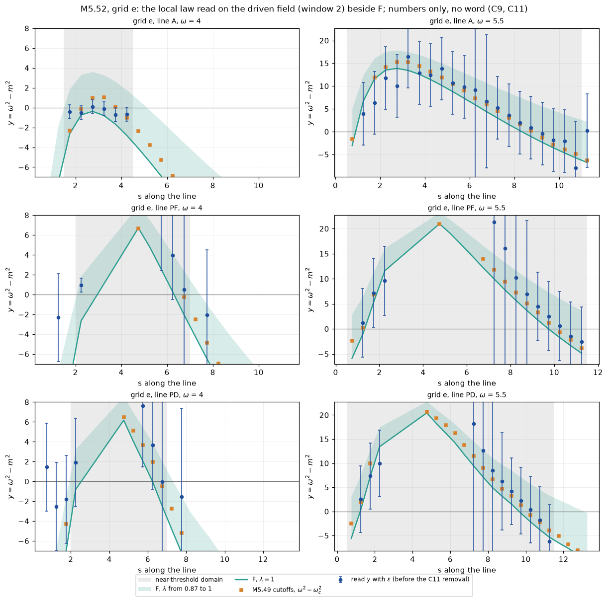
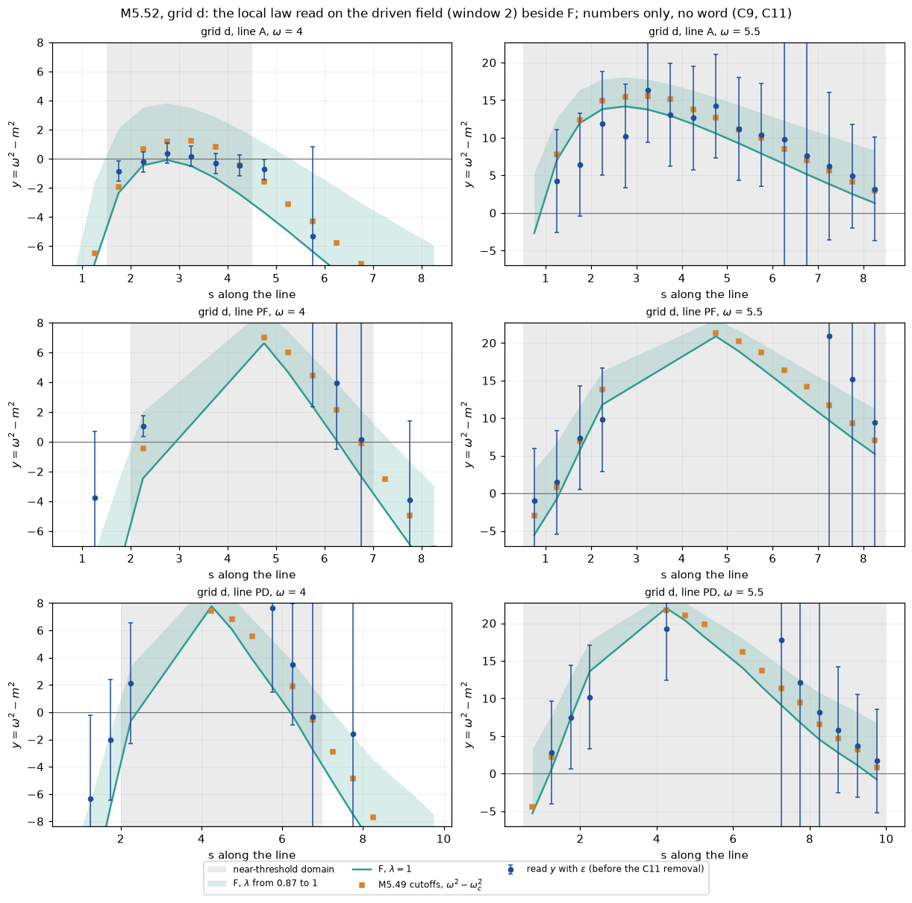
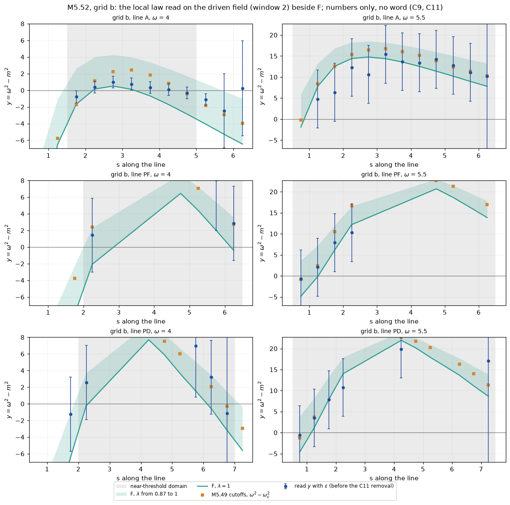
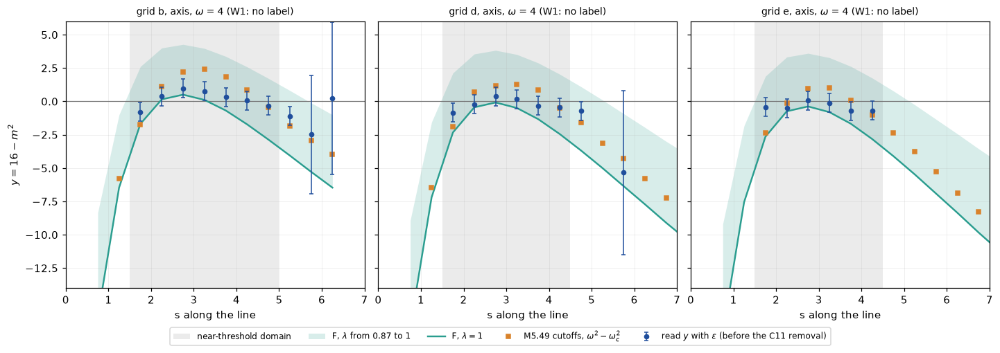

# M5.52: the driven wave on the registered lines, the falsifier of the author's bands

> Staged 2026-11-23. Roadmap row: [`m5_roadmap.md`](../m5_roadmap.md). Thread record: [`m5_32_convo.md`](m5_32_convo.md). It reads the falsifier that [M5.49](m5_49_task_details.md) registered as not read, on the same action, time part and backgrounds. Sister task of the same go: [M5.51](m5_51_task_details.md), the port of the author's newer action. The cell it reads for: the quantum wave equation (Klein-Gordon) in the M5 table of [`MODELS.md`](../../../../../MODELS.md); this plan changes no cell.

## TASK PLANNING (2026-11-23; staged)

**Scope.** The author registered the bands of the mid branch on their relaxed charge in their post of 2026-11-19 17:55 UTC, as edited at 18:25 UTC ([discussioncomment-19756045](https://github.com/vantasnerdan/substrate-framework/discussions/186#discussioncomment-19756045)); the registration file is in the archive attached to their post of 2026-11-20 05:14 UTC ([discussioncomment-19766100](https://github.com/vantasnerdan/substrate-framework/discussions/186#discussioncomment-19766100)). It names two falsifiers: "At ω = 4: a propagating (phase-advancing) wave along the axis", and "At either frequency: a turning radius off by more than 10 %". Under "Not predicted" it lists "The 3D wave pattern (local k near turning points, node positions, decay rates)". [M5.49](m5_49_task_details.md) read the bands from free noise, as local cutoffs on pieces of four lines, and did not read the first falsifier (its limit (3)). In their post of 2026-11-21 19:43 UTC ([discussioncomment-19800127](https://github.com/vantasnerdan/substrate-framework/discussions/186#discussioncomment-19800127); the row of that date in the [thread record](m5_32_convo.md)) the author accepts the words of M5.49 and counts the entry "no band on the axis at ω = 4" as a yes or no statement registered within a few percent of its threshold: their least m_eff² on the axis is 16.58 against ω² = 16, and on OpenWave it is 15.50, 16.08 and 16.38 on half-boxes 8, 10 and 13 ([M5.49](m5_49_task_details.md) § 10). They name the driven-wave falsifier as the read they would value most, if such a run is cheap. This task drives the mid wave at ω = 4 and 5.5 on the action of [M5.42](m5_42_task_details.md) at J = 0 (κ = v = 1, δ = 0.05, L₁ = 0.03), with the time part of [M5.47](m5_47_task_details.md) § 1, on the three relaxed backgrounds that carry the labels of M5.49, and reads along the lines and pieces of M5.49:

| Reading | What is read | Against |
| --- | --- | --- |
| W1 | the falsifier: a propagating wave along the axis at ω = 4 | the registration (no band on the axis) |
| W2 | the same statement on the axis | F, the author's rule on the background of OpenWave |
| R2 to R4, N2 to N4 | the turning radii (the second falsifier), at ω = 4 in the plane and at ω = 5.5 on the axis and in the plane, as in M5.49 | F (R) and the registered numbers (N) |
| P1 to P3 | the phase carried across a band | F, with the offset of M5.49 as a stated interval: this plan's extension of F, not a test of the registration, which declares the local wavenumber not predicted |

**The backgrounds.** Grid b is the base state B0b of [M5.46](m5_46_task_details.md) (half-box 8, 65³), grid d is B0d of M5.46 (half-box 10, 81³), grid e is B0e of M5.49 (half-box 13, 105³), all at spacing 0.25 with the outer shell held, stored as `m5_46_B0b_end.npz`, `m5_46_B0d_end.npz` and `m5_49_B0e_end.npz` in [`../data/`](../data/) and loaded as the function `background` of [`m5_49_predict.py`](../scripts/m5_49_predict.py) loads them, the loop's center, normal and radius from the reader of [M5.44](m5_44_task_details.md). Grid a (B0a of M5.46, half-box 8, spacing 0.5, 33³) carries controls only.

**The author's driven run, and what is ported.** The archive of the post of 2026-11-20 05:14 UTC holds the script of the author's driven run of 2026-11-19 and its reader. They were read as text, the parts used here re-derived, nothing run.

| Element | The author's run (archive) | This plan |
| --- | --- | --- |
| Dynamics | linear response about the relaxed ring: the force $-[\nabla U(m_{bg} + \delta m) - \nabla U(m_{bg})]$, the kinetic matrix frozen at the background, a leapfrog step of 0.02 | the stepper of M5.47, unchanged (fourth-order Runge-Kutta, 𝒜 at the current field), with the base state's residual force subtracted (§ 1): the same linearization at first order, the background exactly at rest. Ported in substance |
| Background | their ring at L₁ = 0.03, half-box 12, spacing 0.5, the faces held at the deposited seed (not the exact vacuum), the absorbing layer within 2 of them | B0b, B0d, B0e at spacing 0.25, the shell held |
| Source | a Gaussian of width 1 at the origin, along their three-weight direction P, amplitude 10⁻³ h³, one frequency per run, a linear ramp over 15 time units | two circles of the loop's radius at ±3 along its normal, a Gaussian section of width 0.5, an acceleration along W, both frequencies in one run, a smooth ramp over 8 (§ 1). This plan's choice |
| Damping | $-\gamma(x) p$, with $\gamma = 3 \big( (2 - d)/2 \big)^2$ within 2 of the faces (d the distance to the nearest face), zero elsewhere | $-\gamma p$ with γ = 0.3 at every node, no layer (§ 1). The author's form, made uniform: this plan's choice |
| Read | the complex amplitude at ω over the last 30 time units on single nodes of +z, +x and the xz diagonal; the wavenumber as minus the radial gradient of its phase; the decay of its modulus | the lock-in amplitude over two windows of whole periods; the local complex wavenumber on the pieces of M5.49 and the local cutoff it gives (§ 3). The author's phase gradient is tabled as a descriptor only |

**Why the read is not a phase gradient, and why the changes.** Three facts of the registered geometry decide the design.

1. **Every band is closed.** The vacuum mass of the mid branch, √60.09 = 7.75, lies above both 4 and 5.5, and q falls toward 1 away from the loop, so between every band and the faces the mid wave is evanescent; so is the core of the loop (on the axis pieces nearest to its center m_F is 5.7 to 6.6 in the prediction of M5.49). A band is a resonator. In a steady driven state without loss its field is a standing pattern whose phase is uniform up to jumps of π at its nodes: the gradient of that phase is not a wavenumber. A layer at the faces does not change this: it lies beyond the evanescent shell and acts on the soft polarizations and on the tail. The author's own post-hoc fit in the archive, of an outgoing and a reflected wave on the axis at ω = 5, leaves a relative residual of 0.42 with or without the reflected part, so their read at that frequency does not tell the two apart either.
2. **A steady state needs loss.** Without it, the free modes that the ramp excites never decay, and a closed band at these frequencies holds many modes within the resolution of any window this task can afford.
3. **Near the threshold the literal phase cannot decide.** Under a damping strong enough to give a steady state, a wave whose ω² lies 0.5 above or 0.5 below its local cutoff has a complex wavenumber of one size, with a positive real part both ways (for c² = 0.87 and γ = 0.3 at ω = 4: 1.02 + 0.68 i and 0.68 + 1.02 i), so "the phase advances" holds on both sides. A front read before its first return fails the other way: telling ω² = 16 from 16.5 needs a frequency resolution of about 0.06 at ω = 4, hence a nearly monochromatic front some 100 time units long, during which a wave near its cutoff crosses a band of two units several times.

So this task reads the local dispersion, not the phase. A damping proportional to the momentum (the author's form, made uniform) gives a steady state in a fixed time and leaves the real part of the local law unchanged (§ 3); the estimator of M5.47 applied to the steady lock-in field reads that law at the driven frequency itself, whatever the pattern: standing, traveling or refracted. A source at the loop's center, where the author put theirs, would sit in the evanescent core: at ω = 4 it would reach the plane band only through more than two units of it, while the soft waves it also launches propagate freely. The source is moved inside the bands of both frequencies.

**Seven limits, stated before the run.** (1) The time part is that of M5.47 § 1, supplied by its plan; every word here is conditional on it, as in M5.49. (2) The action is that of M5.42, on which the author registered the bands, not the action of their later post, which the sister task [M5.51](m5_51_task_details.md) ports; no word carries over to that action. (3) One spacing, 0.25; no limit at zero spacing. (4) This is not a blind read. M5.49 read the local cutoffs on the same three backgrounds with another instrument, and its numbers set the expectations of § 6. What this read adds: the cutoff measured at ω itself, where M5.49's cutoff of a piece was an intercept extrapolated from the targets above it (its limit (3)); the falsifier in its own format, a driven wave; the phase across a band, and the decay beyond it as a descriptor. (5) The uniform damping, the subtracted residual force and the source are additions of this plan to the equations of M5.47 (§ 1). The read is of the real part of the local law, which the damping leaves unchanged when one local law holds over a piece. On a background that varies within a piece, terms with the gradient of the local speed enter Z, part of them through the flux that the damping sets; control C11 is its test, and the bias of a cutoff on a background that is not uniform stays not computed, as in M5.49. (6) Beyond the reach of the mid wave the read is not possible. Where the mid wave is evanescent and has decayed, the projection on W carries the soft waves that the kinetic form mixes in, which travel with no decay of their own; the ratio then returns the soft wave's mass, near 0, or a mixture of the two. The soft rule of § 3 removes a piece only where a soft wave dominates the projection; a piece whose projection holds a soft share of roughly 10 to 60 percent near the threshold can still read PROP with a wrong mass, and nothing in the read of a piece itself withholds it; the word WAVE of W1 alone carries a measured guard, the purity clause of § 6. What keeps the other words where the mid wave dominates is the near-threshold domain of § 3, set from F before the run: a prediction of where the mid wave reaches, not a measurement. The soft rule costs this: a true mid cutoff under about 0.62 of F would come out not read, never PROP. (7) The wording of the falsifier gives no measure of "propagating" or of how much phase makes a wave; the rule of W1 (§ 6) is this plan's.

**Definition of done.** The prediction file written, and its hashes noted in the run log, before the first driven job starts (C5); the controls of § 5 each met, or reported with the exact failing check; the jobs of § 2 ended at their length or reported as capped; every entry of § 6 carrying one word, or "no label" with the rule that withheld it; the expectations of § 6 scored against the outcome; the findings embedding, per line and labeled grid, the profile of y_read with its budget beside F, the interval of the offset and the cutoffs that M5.49 read, and the axis at ω = 4 on the three grids side by side; a record audit in a fresh context and a numbers check on a different model, each with its own code on the arrays, having tried to refute each word; the doc checker and the roadmap linter clean.

**Gating.** The user's go, one go with M5.51. M5.49 closed on 2026-11-20. No answer of the author is waited for. The plan audit and its fold are recorded at the end of this section.

**Research body.** This document (plan, findings, review); in [`../scripts/`](../scripts/): `m5_52_drive.py` (the prediction, the driver and the jobs; it imports `m5_47_evolve.py`, `m5_47_waves.py` and `m5_49_predict.py` and edits none of them) and `m5_52_reads.py` (the controls, the reads, the words, the tables and the plots); in [`../data/`](../data/): the prediction `m5_52_drive_predicted.json` and the summary `m5_52_summary.json` (tracked, each under 1 MB); plots `m5_52_*.png` in [`../plots/`](../plots/); the lock-in amplitudes, end states, energy series, checkpoints and the run log in `../checkpoints/m5_52/` (local-only, gitignored).

### 1. The driven equations

The stepper of [`m5_47_evolve.py`](../scripts/m5_47_evolve.py) is imported and not edited. Its `Field.rhs` returns, at every node off the shell, the rate $R = h^{-3} \mathcal{A}(M)^{-1} p$ and the force $f(M, p) = \partial T / \partial M - \partial U / \partial M$ of the action of M5.42 with the time part of M5.47 § 1, both zero on the shell. The driver of `m5_52_drive.py` uses them inside each of the four stages of the classical Runge-Kutta step of `RK4.step`, written again in the driver with the added terms and the same order of accumulation:

$$
\dot M = R , \qquad \dot p = f(M, p) - f_0 + s(x, t) - \gamma p , \qquad f_0 = f(M_0, 0)
$$

on the nodes off the shell (zero on the shell, as in M5.47), from rest: M = M₀ and p = 0 at t = 0.

| Term | Definition | Why |
| --- | --- | --- |
| $f_0$ | the force of the base state at rest, held constant (the states are at the gate of M5.45, not at rest) | M₀ becomes an exact rest state of the driven equations, so no unperturbed twin is run; the author's linearization does the same. Controls C3 and C4 |
| $s(x, t)$ | the source, below | the drive |
| $-\gamma p$ | γ = 0.3 at every node off the shell (0.15 in job GbG) | the damping is proportional to the inertia, so every free mode above γ/2 decays as $e^{-\gamma t / 2}$; overdamped soft box modes decay more slowly and lie eight Hann bins from the tones. The real part of the local law is unchanged (§ 3) |

**The source.**

$$
s(x, t) = a_s r(t) \big( \sin 4t + \sin 5.5t \big) g(x) h^3 \mathcal{A}(M_0(x)) \hat W(x)
$$

with Ŵ(x) the six components of the mid polarization W of M5.47 § 3 (the direction along which M5.47 started its unit jobs) and 𝒜(M₀) the kinetic matrix of the base state at each node (`Field.a_matrices`), so that the source alone accelerates the field along W. The amplitude is a_s = 10⁻⁴ (5 × 10⁻⁵ in job GaH); the ramp is $r(t) = \sin^2(\pi t / 16)$ for t under 8 and 1 after. The profile is two circles:

$$
g(x) = \sum_{\pm} \exp \Big( - \frac{(\rho - R_s)^2 + (z \mp z_s)^2}{2 \sigma_s^2} \Big)
$$

with ρ and z the cylindrical coordinates about the loop's center and normal, R_s the loop's radius (3.3 in the vacuum jobs, about the center of the box with the normal along the third axis), z_s = 3.0, σ_s = 0.5, and g set to zero on the shell. Checked at plan time on the three base states (q only, no wave): q is 4.0 to 4.2 on the two circles, above the threshold of ω = 4 (3.7556) and of ω = 5.5 (1.9864), so the source sits inside both bands where W is defined (the two largest eigenvalues 0.87 apart), and by the geometry no node of a piece of lines A, PF or PD has g at 10⁻³ or more, on b, d, e or in the vacuum; line O loses its pieces from about 2.25 to 6.25. The width 0.5 weights a wavenumber k of the source by $e^{-k^2 \sigma_s^2 / 2}$: 0.14 at k = 4 and 0.02 at k = 5.5, where the soft waves of the drive lie, against 0.75 at k = 1.5.

**The energy.** With T = ½ Σ R · p as coded (sums over the nodes and the six components):

$$
H' = T + U(M) + f_0 \cdot (M - M_0) , \qquad H'(t) - H'(0) = \int_0^t \Big( \sum s \cdot R - 2 \gamma T \Big) dt'
$$

The work of the source $\mathcal{W}(t)$ and the loss $\mathcal{L}(t)$, the two terms of the integral, are accumulated with the weights (1, 2, 2, 1)/6 of the four stages of each step.

**The steady state at a frequency, to first order** (used by C12). With $M - M_0 = \operatorname{Re} \big( A e^{-i \omega t} \big)$ at the drive ω, H the Hessian of U at M₀ (∂T/∂M is of second order about rest) and $S = a_s g h^3 \mathcal{A}(M_0) \hat W$:

$$
\big( \omega^2 + i \omega \gamma \big) h^3 \mathcal{A}(M_0) A = H A - i S
$$

**The step and the windows.** The step is $\Delta t = 4\pi / 628 \approx 0.02001$, the step of record of M5.47 on the unit adjusted so that 4π, a common period of the two tones (8 periods of ω = 4, 11 of ω = 5.5), holds 628 steps. A job runs 3356 steps: the ramp, a settling to step 2100 (t ≈ 42.0), then two windows of 628 steps. The lock-in amplitude of window k at a tone is

$$
A_k(x, \omega) = \frac{2}{\sum_j w_j} \sum_{j = j_k}^{j_k + 627} w_j e^{i \omega t_j} \big( M(x, t_j) - M_0(x) \big) , \qquad w_j = \sin^2 \frac{\pi (j - j_k)}{628}
$$

with j₁ = 2100 and j₂ = 2728, so that $M - M_0 = \operatorname{Re}(A e^{-i \omega t})$ for a steady tone. Over whole periods of both tones the periodic Hann window returns a steady tone exactly and makes the two tones exactly orthogonal. From the end of the ramp, what remains of a free mode above γ/2 is $e^{-5.1}$ of its size at the start of window 1 and $e^{-7.0}$ at the start of window 2, so a transient that matters shows as a difference of the two windows (C10).

### 2. The jobs

| Job | Background | Grid | Settings | Role |
| --- | --- | --- | --- | --- |
| Ge | B0e | half-box 13, 105³ | the settings of § 1 (γ = 0.3, a_s = 10⁻⁴, 3356 steps) | the words of grid e; the only grid that holds the outer edges at ω = 5.5 |
| Gd | B0d | half-box 10, 81³ | the same | the words of grid d |
| Gb | B0b | half-box 8, 65³ | the same | the words of grid b |
| GbG | B0b | half-box 8, 65³ | γ = 0.15; settling to step 4200, windows from steps 4200 and 4828, 5456 steps | C11, the damping |
| VD1, VD2, VD3, VD4 | the uniform vacuum of M5.47 (`m5_47_waves.vacuum_matrix`) | half-box 6, 49³ | v = 0.553761, 0.250295, 0.282248, 0.473214, so that the mid mass squared is 33.275 (1.1 × 30.25), 15.04 (0.94 × 16), 16.96 (1.06 × 16) and 28.435 (0.94 × 30.25); otherwise § 1 | C9, the known answer (§ 5) |
| Ga0 | B0a | half-box 8, spacing 0.5, 33³ | § 1 | the first driven job (stage 0); the reference of C4, C6, C7 |
| GaH | B0a | 33³ | a_s = 5 × 10⁻⁵ | C6, linearity |
| GaS | B0a | 33³ | step 4π/1256, every step count doubled (the same times) | C7, the step |
| GaP, GaN | B0a | 33³ | f₀ not subtracted; GaN with a_s = 0 (its unperturbed twin) | C4, the subtraction against a twin |

On the vacuum jobs the heavy branch, up to 262 in mass squared, keeps ω Δt under 0.5. The lines of a vacuum job run from the center of the box with the normal along the third axis, as the vacuum blocks of M5.49.

**Per job.** E, T, U, $H'$, $\mathcal{W}$ and $\mathcal{L}$ every 20 steps; the largest $\lvert M - M_0 \rvert$; the lock-in amplitudes of both windows at both tones (six components, complex) and the end state, in `../checkpoints/m5_52/`; a restartable checkpoint every 200 steps on grids of 65³ and above. Wall caps, as run rules: Ge 7 hours, Gd and GbG 4 hours, Gb 3 hours, each vacuum job 2 hours, each job of grid a 1 hour. A job that reaches its cap checkpoints, stops and is reported as capped.

**The scope cut, decided now.** If Ge is capped, the entries of grid e carry no label ("capped"): R3, R4, N3, N4, P2 and the P3 entries of grid e carry none (only grid e holds them, but for P3 on PD of d), and W1 and W2 rest on grids b and d.

### 3. The read

**Polarization, lines and pieces: those of M5.49 § 2, unchanged.** The scalar $a(x, \omega) = \langle W(x), A_2(x, \omega) \rangle$ with the inner product of M5.47 § 3; lines A, PF, PD and O from the loop's center; pieces of Δ = 0.5 with the tube t₀ = 1.0 and the cone of 15°; the domain D (1.5 inside every face, the two largest eigenvalues of the background at least 0.5 apart); a piece read when its nodes in D reach 150 and 90 percent of its nodes. They are computed with the functions of [`m5_49_predict.py`](../scripts/m5_49_predict.py) and checked equal to the geometry stored in [`m5_49_bands_predicted.json`](../data/m5_49_bands_predicted.json) (C14).

**The estimator** is that of M5.47 § 3 on a piece S_i, kept complex, on the unfiltered field:

$$
Z_i = - \frac{\sum_{x \in S_i} \bar a \Delta_h a}{\sum_{x \in S_i} \lvert a \rvert^2}
$$

with Δ_h the seven-point Laplacian. Its real part is the K² that M5.49 tabled at a target.

**The local law with damping.** For a wave of the mid branch that obeys the local law of M5.47 about a point, $\omega^2 = c^2 K^2 + m^2$ (m the local cutoff, c the local speed along the wave), the damping $-\gamma p$ turns ω² into ω² + iωγ:

$$
K^2 = \frac{\omega^2 - m^2 + i \omega \gamma}{c^2}
$$

The phase of K² does not depend on c. Where one local law holds over a piece, a pattern of any directions (standing, traveling or refracted) gives Z_i = K², and

$$
m^2_{\mathrm{read}} = \omega^2 - \omega \gamma \frac{\operatorname{Re} Z_i}{\operatorname{Im} Z_i} , \qquad c^2_{\mathrm{read}} = \frac{\omega \gamma}{\operatorname{Im} Z_i} , \qquad y_i = \omega^2 - m^2_{\mathrm{read}}
$$

so the local cutoff is read without the speed. The ratio is exact for one local law. Where the waves of a piece travel at two speeds (M5.47 § 3), the cross terms of Z_i carry an error that grows as y/(ωγ) deep in a band: for three plane waves per piece at c² of 0.7 or 0.9, the 90th percentile of the error is 0.14 at y = ±0.5 and ω = 4, 1.35 at y = 6, and 2.2 at y = 14 and ω = 5.5 (a made-up input, C13 (b)). The binned damping term of the budget carries it (below, C11). In the vacuum the estimator is exact on the lattice: Δ_h is the operator of the lattice law of M5.47 § 1 (C9). The convention of § 1 gives Im Z_i > 0; a reversed sign shows in C9 and C13.

**When a piece is NOT READ.** When any of its nodes has g ≥ 10⁻³ (the source); when the root mean square of a over its nodes in D is under 10⁻¹² (four orders above the round-off of a field of order one); when $c^2_{\mathrm{read}}$ lies outside 0.4 to 2.5 (the fitted slopes of the pieces of M5.49 on grids b, d and e lie from 0.79 to 1.62; the bound is the plan's choice, wide around them, and guards against a ratio with a vanishing imaginary part); or, the soft rule, when $m^2_{\mathrm{read}} \lt 0.5 (0.87 m_F)^2$ (in the vacuum, m_F² is the set mass squared). A soft wave alone returns a mass near 0, and the cutoffs that M5.49 read on its fitted pieces lie at 0.868 to 1.049 of m_F, all above the 0.62 of m_F at which the soft rule acts, so no piece that M5.49 read would be lost to it. A piece NOT READ (soft) counts as not read for every cover.

**The near-threshold domain.** At a frequency ω, the pieces of a line where F on the pieces has $m_F^2 \le 1.2 \omega^2$. It is the cover domain of W1 and bounds the stretch of P (§ 6). Its reason: a mid wave read at a depth where it has decayed is taken over by the soft waves (limit (6)), and the read cannot tell. On the axis at ω = 4 the domain is one contiguous stretch on every grid: s = 1.75 to 4.75 on b (7 pieces), 1.75 to 4.25 on d and e (6 pieces each). Across it, the largest decay of the mid wave that F predicts along the axis, from the piece of least m_F to either end, is 1.54 (b), 1.42 (d) and 1.68 (e) e-folds at λ = 1, and under 0.7 at λ = 0.935. With $m_F^2 \le 1.3 \omega^2$ the stretch would reach 2.61 e-folds (factor 13.6) on grid e, at which a soft wave of a few percent of the mid amplitude on W would equal it; that is why the bound is 1.2.

**The filter**, used only as a term of the budget. The binomial filter [1, 2, 1]/4 along each axis, applied 8 times per axis, after extending a past the shell by odd reflection about the shell nodes (the shell is held, so a = 0 there). It commutes with Δ_h, so a field that obeys $\Delta_h a = -K^2 a$ with one K² over the reach of the filter (two length units) keeps its Z; a wave along an axis is weighted by $\cos^{16}(k h / 2)$: 0.75 at k = 1.5, 0.12 at k = 4, 0.016 at k = 5.5. It also widens the source: on piece nodes the filtered g reaches about 9 × 10⁻³ where the raw g is at most 3.3 × 10⁻⁴. So the filtered value $y_i^{\mathrm{filt}}$ enters ε only on pieces where the filtered g is under 10⁻⁵ at every node; elsewhere that term is absent and the entry is marked so. By the geometry the term is absent on every piece of the vacuum jobs and of the axis domain of W1; it is present only on the outer pieces, from s of about 6.25 to 6.75 outward (on d: 6.25 to 8.25 on A, 6.75 to 8.25 on PF, 6.75 to 9.75 on PD), and on no piece of PF on b.

**The budget** of a piece, a frequency and a grid:

$$
\varepsilon_i = \max \Big( 0.01 \omega^2 , \quad 2 \big\lvert y_i - y_i^{(1)} \big\rvert , \quad 2 \big\lvert y_i - y_i^{\mathrm{filt}} \big\rvert , \quad 2 b_\gamma(\omega, x_i) , \quad 2 b_{\mathrm{vac}}(\omega) \Big)
$$

with y_i read on window 2, $y_i^{(1)}$ the same on window 1, $y_i^{\mathrm{filt}}$ window 2 filtered (where allowed, above), and $b_{\mathrm{vac}}(\omega)$ the worst $\lvert m^2_{\mathrm{read}} - m^2 \rvert$ over the read pieces of the vacuum cases of C9 that carry a bound at that ω. The damping term is binned by $x_i = \lvert y_i \rvert / (\omega \gamma)$: bin I under 1, bin II from 1 to 4, bin III 4 and above; $b_\gamma(\omega, x_i)$ is the 90th percentile of $\lvert y(\mathrm{Gb}) - y(\mathrm{GbG}) \rvert$ over the read pieces of grid b in the bin of the piece, and a bin with fewer than five pieces on grid b takes the largest value of all bins. The bin of each piece on every grid sets its term. The floor 0.01 ω² is the tolerance of C9 (the plan's choice). Every y is printed with its ε.

**Status and profiles.** On a line the three profiles are y, y + ε and y − ε, each joined by straight lines between the centers of consecutive read pieces no more than 2Δ apart (the rule of M5.49 § 2). On a profile p a read piece is PROP when p ≥ 0 and EVAN when p < 0: the margin is carried by the shift alone. A piece PROP on all three profiles (y − ε ≥ 0) is PROP; EVAN on all three (y + ε < 0) is EVAN; otherwise it is MARGIN. An edge is a radius where a profile crosses 0: outer where it goes from positive to negative as s grows, inner the other way. On a stretch 𝒮 of joined pieces:

$$
\Phi[p] = \int_{\mathcal{S}} \sqrt{\max \big( p(s), 0 \big)} ds , \qquad \bar\kappa[p] = \frac{1}{n} \sum_{i \in \text{window}} \sqrt{\max ( - p_i, 0 )}
$$

The same functionals are applied to F, with $y_F(\lambda) = \omega^2 - \lambda^2 m_F^2$ on the same pieces. The units are those of the author's law, whose speed is 1: the ratio removes the speed from the read, and the registration's rule has none.

**The regime of each read.**

| Read | Valid where | Not valid where, and the guard |
| --- | --- | --- |
| $m^2_{\mathrm{read}}$ and y on a piece | in D, away from the source, the field above its floor, in a steady state, one local law over the piece, the mid wave dominant on W | near the loop line, where W is not defined (D); near the source (the rule on g); beyond the reach of the mid wave (the near-threshold domain, the soft rule, limit (6)); deep in a band with two speeds (the binned damping term); where the cutoff changes within a piece (C10, C11) |
| Φ | on a stretch of read pieces inside the near-threshold domain, shared by F and the read | the literal phase of the field: under the damping its gradient is positive on both sides of a cutoff (Scope), so it is a descriptor |
| $\bar\kappa$ | a descriptor only, on read pieces within 1.5 of an outer edge of F | deeper tails, where the soft waves take over |
| An edge | between read pieces no more than 2Δ apart | under a radius of 2.5 (pieces of 0.5); next to the loop |
| The lock-in amplitude | after the settling, over whole windows | during the ramp; a window that still holds a transient (C10, C12) |

**Descriptors, with no word of their own.** Per piece: $c^2_{\mathrm{read}}$, Re Z_i (the K² of M5.49 at the target), the filtered and window 1 values, the root mean square of a, the share of the six-component power outside W, and the status of the pieces outside the near-threshold domain. The decay beyond an outer edge: $\bar\kappa$ of the read on the read pieces within 1.5 of the edge, tabled beside the interval of F from $\bar\kappa_F(0.87)$ to $\bar\kappa_F(1)$. Per ray of A, PF and PD: the author's read, the phase of a along the ray and minus its gradient, and the modulus of a. Made only after the words: Re Z of the stored free-noise sums of M5.49 at the targets 4 and 5.5 (Ub, Ud and Ue against their twins), on the same pieces, beside the driven Re Z; with no damping in those jobs the ratio does not apply to them.

### 4. The prediction, written first

`m5_52_drive.py --predict` writes `../data/m5_52_drive_predicted.json` before Ga0, the first driven job, starts. It opens the base states and the tracked prediction of M5.49, and nothing that a driven job writes. It checks the hashes of the blocks b, d, e and V2 of `m5_49_bands_predicted.json` against that file's `hashes` field, and stops on a mismatch.

| Entry | Definition |
| --- | --- |
| F | m_F per piece and on the ray (with q and with q_P), copied from the hashed blocks of M5.49, with C, the cutoffs of M5.47 per bin, beside it (no label) |
| y_F(λ) | $\omega^2 - \lambda^2 m_F^2$ per piece at ω = 4 and 5.5, for λ = 1, 0.935 and 0.87 |
| Edges of F | as in M5.49, on the pieces and on the ray |
| The near-threshold domain | per line and ω, the pieces with $m_F^2 \le 1.2 \omega^2$; on the axis at ω = 4 its pieces and its largest predicted decay |
| The statement of F on the axis at ω = 4 | by the rule of W1 (§ 6) on y_F(1), with ε = 0.01 ω², on the pieces and on the ray |
| Φ_F(λ) and $\bar\kappa_F(\lambda)$ | on the stretches and windows that the read pieces of M5.49 give, for reference; the words apply the same functionals to the stretches the driven read gives (§ 6) |
| The source | g and the filtered g on every piece, the excluded pieces, the pieces where the filter term is allowed, q on the two circles |
| The vacuum | the known answers: per VD job the mid mass, y and Φ on each line at each ω |
| The settings | every number of §§ 1 to 3 |

The SHA-256 of each block (keys sorted, separators `,` and `:`, UTF-8, floats with seven significant digits: the rule of M5.49) and of the whole file are written in the run log before Ga0 starts. `m5_52_reads.py` takes the block hashes as arguments and stops on a mismatch, and the predict mode has no code path that opens a lock-in amplitude (C5).

**The offset of M5.49 as an interval, decided now.** On the grids of spacing 0.25, the bins of M5.47 § 11 fitted cutoffs from 0.923 to 0.984 of $\sqrt{m^2 / \bar q}$. The fitted pieces of M5.49 with q̄ above 2 read 0.868 to 1.049 of F (on PF of grid b, for one, 0.868 to 0.906 next to the band of ω = 4); their medians lie 3.7 to 6.2 percent under F over all those pieces and 3.74 to 6.65 percent under over the pieces that lie under F; its HELD edges lie 3.4 to 7.4 percent outside the edges they were scored against. λ = 1 is the author's rule on the background of OpenWave; λ = 0.87, the least piece ratio the record holds, is the low end; λ = 0.935 is tabled as the middle value. The interval λ from 0.87 to 1 is what is known before the run, and it is not a correction: no word is computed at a single λ chosen after the read.

**At plan time**, from the tracked blocks b, d and e of M5.49, with code written for this plan (no wave was read): on the axis pieces at ω = 4 the largest y_F(1) is +0.50 (b), −0.08 (d) and −0.38 (e). Over the near-threshold domain of the axis, Φ_F is about 0.6, 0 and 0 radians at λ = 1; 3.35, 2.57 and 2.16 at λ = 0.935; 5.49, 4.44 and 4.26 at λ = 0.87; on the ray form over all the axis at λ = 1, 1.4, 0.6 and 0.2. The cutoffs that M5.49 read on those pieces, put in place of m_F, give 3.05, 1.82 and 1.16. With the floor of ε, NO WAVE needs the cutoff measured at ω = 4 to lie at or above 1.021, 1.003 and 0.993 of F over the whole domain (b, d, e), and WAVE needs it at or under about 0.935, 0.915 and 0.907 of F. The cutoffs that M5.49 read on the domain pieces of grid b lie at 0.92 to 1.00 of F. Elsewhere the phases are many radians: P2 on the axis of e at ω = 5.5 is about 20 at λ = 1 and 33 at λ = 0.87.

### 5. The controls

| Control | Input | The answer it must return | What a failure would look like |
| --- | --- | --- | --- |
| C1, the stepper | `m5_47_evolve.py --controls`, unchanged, its output written outside `../data/` | K0 to K5 of M5.47: the leaves of [`m5_47_controls_stepper.json`](../data/m5_47_controls_stepper.json) reproduced bit for bit (timing and series fields left out), as C1 of M5.49 | a stepper that is no longer the one M5.47 controlled |
| C2, the driver reduces to the stepper | the driver on B0a with a_s = 0, γ = 0 and f₀ not subtracted, 50 steps, against `RK4.step` of M5.47, with the order of accumulation of `RK4.step` | `numpy.array_equal` on M and p after every step | a wrapper that changes the step |
| C3, the hold (a wiring check) | the driver on B0a with a_s = 0, γ = 0.3 and f₀ subtracted, 500 steps | largest $\lvert M - M_0 \rvert$ at most 10⁻¹² | f₀ from another routine or another state than the force of the step. With f₀ from the same routine it is zero by construction and cannot fail for a physical reason |
| C4, the subtraction against a twin | GaP − GaN against Ga0: the lock-in amplitudes of window 2, both tones, six components, on the nodes of D of grid a with g under 10⁻³ | relative difference in norm at most 1 percent | a subtraction that changes the response, not only the background |
| C5, the prediction first | the prediction file, the run log, the reads script | block and file hashes in the run log before Ga0 starts; the reads take the hashes and stop on a mismatch; the hashes of the four blocks of M5.49 match | a prediction written or changed after a driven job |
| C6, linearity | Ga0 against GaH, both tones and both windows, on the same nodes | $\lVert A(\mathrm{Ga0}) - 2 A(\mathrm{GaH}) \rVert / \lVert A(\mathrm{Ga0}) \rVert$ at most 2 percent (K9 of M5.47) | a response not linear in the source, or two tones that mix |
| C7, the step | Ga0 against GaS, the same norm | at most 1 percent | a read set by the step |
| C8, the energy | every job: the series of § 1 | the largest $\lvert H'(t) - H'(0) - \mathcal{W}(t) + \mathcal{L}(t) \rvert$ at most 2 percent of the largest $\lvert H'(t) - H'(0) \rvert$ (the 2 percent of K11 of M5.47) | a source or a damping that the equations of § 1 do not contain: a sign, a term missing in one stage. A factor common to the source and to its work (h³, a_s, 𝒜) passes C8; C12 catches it, with S computed in the reads script from the formula of § 1, not taken from the driver |
| C9, the known answer | the vacuum jobs on the pieces of A, PF and PD (26 read pieces), read as § 3 reads the unit. At ω = 4: VD2 (propagating, y = +0.96) and VD3 (evanescent, y = −0.96). At ω = 5.5: VD1 (evanescent, y = −3.02) and VD4 (propagating, y = +1.82) near the threshold, and VD2 and VD3 (y = +15.21, +13.29) deep in the propagating range | on each of these six cases: at least 24 of the 26 pieces read, none removed by the soft rule; every read piece within 0.01 ω² of the set mass squared; $c^2_{\mathrm{read}}$ within 1 percent of 1; the status of every read piece as set, with ε = max(0.01 ω², 2 $b_{\mathrm{vac}}$) and no damping term (that term is measured on grid b and does not enter the vacuum control); no edge on any line; Φ within 2 percent of $\sqrt{y}$ times the stretch where propagating. Checked at plan time on an exact linear steady state of these jobs (§ 9): 26 of 26 read, none soft, the worst error 0.011 against tolerances of 0.16 and 0.30, c² 1.000 to 1.006 | a reader that returns one answer at a frequency 6 to 10 percent from its threshold; a reversed sign convention; a source term in the read pieces |
| C9, the deep evanescent cases | VD1 and VD4 at ω = 4 (y = −17.3 and −12.4), with no bound on the mass | tabled, not scored: every piece lies outside the near-threshold domain (m² of 2.08 and 1.78 ω²), so none enters a word | none: these cases show why the domain exists (§ 9) |
| C10, the windows | every job, every read piece, both tones | per grid and ω, the median of $\lvert y_i - y_i^{(1)} \rvert$ at most 0.01 ω² | a transient that sets the read |
| C11, the damping | Gb against GbG, the read pieces of grid b, both tones, per bin of § 3 | the 90th percentile of $\lvert y(\mathrm{Gb}) - y(\mathrm{GbG}) \rvert$ at most 0.01 ω² in bin I, 0.06 ω² in bin II and 0.12 ω² in bin III (the plan's choice, of the size that the two-speed input of C13 (b) gives; in bin III at ω = 4 that input alone comes near the bound) | a read that depends on the damping beyond what two speeds give: a term with the gradient of the speed of the size of the law |
| C12, the steady state | every job, tone and window, on the nodes of D with g under 10⁻³ | $\lVert H A - (\omega^2 + i \omega \gamma) h^3 \mathcal{A}(M_0) A - i S \rVert$ at most 3 percent of $\lVert H A \rVert$ (the 3 percent of K12 of M5.47), with HA from central differences of the coded static force about M₀ along Re A and Im A, scaled so that the largest change of a component is 10⁻⁵, and S computed in the reads script from the formula of § 1 | a lock-in amplitude that is not the steady response of the linearized equations: a transient, a term of higher order, a wrong convention, a common factor in the source |
| C13, the readers on made-up inputs | (a) lock-in: a pure two-tone series; a tone at 5.5 alone read at 4; a tone at 4.3 read at 4. (b) estimator, on a 49³ lattice of spacing 0.25, on nodes at least 2.5 from the faces: plane waves $e^{i K \cdot x}$ with the complex K that solves the lattice law with damping for m² = 14 and 18 at ω = 4 and γ = 0.3, along an axis and along a diagonal, and the sum of two opposite ones; the same filtered; the same with a real plane wave of $\lvert k \rvert$ = 4 carrying 10 percent of the power; a massless damped wave carrying 90 percent of the power over the evanescent wave of m² = 18; the two-speed input, read at γ and at γ/2: per draw of `numpy.random.default_rng(52013)`, three plane waves, each with a direction uniform on the sphere, a complex amplitude with standard normal real and imaginary parts, c² of 0.7 or 0.9 with equal chance, and the complex K of the lattice law with damping for m² = ω² − y; a piece is the nodes of a slab 0.5 thick inside a tube of radius 1; 300 draws at each y of −3.2, −1, −0.5, 0.5, 1, 3, 6 and 7 at ω = 4 and of −3.2, −1, 1, 3, 6, 10 and 14 at ω = 5.5. (c) made-up profiles of y with budgets | (a) the amplitudes to 10⁻¹²; under 10⁻¹² of the 5.5 tone; the analytic response of the window to 10⁻¹⁰. (b) $m^2_{\mathrm{read}}$ to 10⁻⁹ and the right status; filtered unchanged to 10⁻⁶; with the added wave, filtered within 0.01 ω² of 14 and of 18 and unfiltered off by more than 0.05 ω² (so the filter term can be large); the 90 percent soft input NOT READ (soft); on the two-speed input, in every bin at each ω, the error of $m^2_{\mathrm{read}}$ exceeds ε on at most one draw in ten, with ε built from the floor and the damping term of the same input (bin I through the floor); the 90th percentiles of the error are printed and are no pass criterion. (c) each outcome of § 6 once: W1 HELD, NOT HELD, and no label by a zone, by the margin, by the cover of the domain, by the three profiles, by window 1, by the purity clause; W2 each word; an edge HELD, NOT HELD, and no label by the cover, by 2.5, by the three profiles, by the two forms of F; P each word and each rule of no label | a reader that returns one word; a filter that changes a clean field or misses the added wave; a soft rule that misses a soft piece; a budget that does not cover the two-speed error |
| C14, the backgrounds | the three base states as loaded | the loop's center, normal and radius equal to those of the blocks of M5.49 to 10⁻⁶, q on the pieces equal to the blocks to seven digits, the piece geometry identical | another state, or another geometry, than the one F was computed on |

**Order.** Stage 0, one process: C1, C14, the prediction and its hashes (C5), C13, C2, C3, then Ga0 with C8 and C12 on it. The long jobs start only when stage 0 has met all of these. C4, C6, C7, C9 and C11 are read as their jobs end; C8, C10 and C12 per job.

**Tries and costs.** The try cap of each control is three. Between tries only the input of a control or a defect of a script may change, never a threshold of §§ 3, 5 and 6 nor a setting of §§ 1 and 2; each change is logged in the run log. What a failure costs: C1, C2, C3, or C8 or C12 on Ga0, no job past stage 0; C5, C13 or C14, no label on any grid; C4, C6 or C7, no label on any grid; C11 in a bin at a tone, every piece of that bin at that tone not read, on every grid; C9, no label at the frequency that failed; C8 on a job, no label from that job; C10 or C12 on a grid and a frequency, no label there.

### 6. The readings, frozen

Labels are given on grids b, d and e. Every entry (reading, line, edge, grid) carries its own word; the word of a reading is HELD when at least one entry is HELD and none is NOT HELD, NOT HELD when any entry is (the entry named), and no label when no entry carries a word. The words are tabled per grid, so the number of grids behind each word is on the page.

**W1, the falsifier, against the registration.** On line A at ω = 4, inside the near-threshold domain of the axis (§ 3: s = 1.75 to 4.75 on b, 1.75 to 4.25 on d and e), the statement of the read is:

| Statement | Rule |
| --- | --- |
| WAVE | at least nine pieces in ten of the domain read, and on each of the three profiles a run of consecutive domain pieces with the profile at or above 0 whose Φ, the run extended to its crossings and cut at the centers of the first and last pieces of the domain, is at least π; and the purity clause below holds on every piece of the run of the profile y + ε, the widest of the three |
| NO WAVE | at least nine pieces in ten of the domain read, and every read piece of the domain below 0 on each of the three profiles (y + ε < 0) |
| ZONE | at least nine pieces in ten of the domain read, a run of domain pieces at or above 0 on the profile y, and neither statement above (printed with its Φ on the three profiles) |
| undecided | anything else, a cover under nine in ten included |

**The purity clause** (a measured guard on the one word that would count against the registration): on a piece, the power of the lock-in amplitude outside W, $\sum_x ( \lVert A_2 \rVert^2 - \lvert a \rvert^2 )$ over its nodes in D with the inner product of M5.47 § 3, is under its power on W, $\sum_x \lvert a \rvert^2$. A soft wave puts little of its power on W (M5.47 § 11: 0.02 to 19 percent on the unit, median 0.6), so a soft share that matters in the projection shows as power outside W; a mid wave carries most of its power on W. A run that meets every other clause of WAVE and fails this one is ZONE, printed with the ratio of each piece. The clause does not enter NO WAVE, P or the edges, and its bound of 1 is the plan's choice: it catches a soft share above about 8 percent of the projection for the median soft wave and misses one whose own share on W is near the 19 percent end.

Nine pieces in ten of a domain of six or seven pieces means every piece of it. The statement must also be the same on window 1; otherwise it is undecided. Word: NOT HELD on WAVE, HELD on NO WAVE, no label on ZONE or undecided. Why π: half a wavelength, the least phase over which a standing pattern changes sign once, and the BAND rule of M5.49 (a run as long as its half wavelength) written as a phase. Φ is in the units of the author's law, whose speed is 1 (the plan's choice), which is stricter than M5.49's half wavelength by 1/c, about 1.08 on the axis: on grid b, the run that M5.49 read carries 3.05 radians in these units and about 3.3 in M5.49's. The author's wording gives the statement ("a propagating (phase-advancing) wave along the axis"); this plan adds the domain where it is read, what propagating means on a piece (y above 0 by its budget), how much phase makes a wave (π), and what the opposite statement needs (every read piece evanescent beyond its budget).

**W2, the axis against F.** F's statement on the same domain at ω = 4 by the same rule on y_F(1), with ε = 0.01 ω²; the ray form must give the same statement, or F's statement lies inside its margin. HELD when F and the read both say WAVE or both say NO WAVE; NOT HELD when both make one of those statements and they differ; no label otherwise. No label, known before the run, from § 4: on b, y_F(1) − ε is positive on one domain piece only and y_F(1) + ε on three, with Φ about 0.6 on y_F(1), so F's statement is ZONE; on d y_F(1) + ε reaches +0.08, so it is undecided; on e the pieces say NO WAVE (largest y_F(1) of −0.38) while the ray form has y_F + ε above 0 near s = 2.25. W2 is tabled for the profile.

**R2 to R4 and N2 to N4, the turning radii.** The entries and rules of M5.49 § 5, with the read of this task: at ω = 4 the inner and outer edges on PF and PD (R2 against the edges of F; N2 with r₀ = 2.77 and 6.31); at ω = 5.5 on A (R3 against F; N3 with r₀ = 0.81 and 8.38) and on PF and PD (R4 against F; N4 with r₀ = 1.56 and 9.74). For an edge expected at r₀, the window is the set of pieces with centers from 0.9 r₀ − Δ to 1.1 r₀ + Δ, covered when every one of them is read (any status). HELD: covered, and an edge of the same kind from 0.9 r₀ to 1.1 r₀ on all three profiles. NOT HELD: covered, and no such edge on all three. No label: not covered; r₀ under 2.5; the three profiles disagree; for an R entry also the two forms of F more than 3 percent of the radius apart or only one of them with the edge. The nearest read edge is always printed. The near-threshold domain does not bound these windows, which lie within about 0.1 r₀ + Δ of their edge. Known before the run: no inner edge carries a word (under 2.5, or next to the loop); 8.38 and 9.74 can carry one on grid e alone; 6.31 on PF and PD of d and e and on PD of b.

**P1 to P3, the phase across a band: this plan's extension of F.** The registration lists the local wavenumber near the turning points among what it does not predict, so P is not a test of the registration; it tests the author's rule on the background of OpenWave, carried from the edges to the band between them. On a line at ω, the stretch 𝒮 is the longest run of joined read pieces of the job inside the near-threshold domain that contains the outer edge of F on the pieces. Φ_read = Φ[y] and Φ_F(λ) = Φ[y_F(λ)] on that same 𝒮. HELD when $0.9 \Phi_F(1) \le \Phi_{\mathrm{read}} \le 1.1 \Phi_F(0.87)$ on all three profiles; NOT HELD when it lies outside on all three; no label when Φ_F(1) is under 1 radian, when Φ_F(0.87) exceeds 2 Φ_F(1) (the offset alone would double the prediction), when the three profiles disagree, or when the outer edge of F lies beyond 𝒮. The 10 percent is the registration's tolerance on an edge, carried to the phase (the plan's choice). P1: ω = 4 on PF and PD; P2: ω = 5.5 on A; P3: ω = 5.5 on PF and PD. At plan time, on the stretches that the read pieces of M5.49 give inside the domain, the intervals are:

| Entry | Φ_F(1) | Φ_F(0.935) | Φ_F(0.87) | Interval of HELD |
| --- | --- | --- | --- | --- |
| P1, b PF | 2.45 | 3.21 | 3.73 | 2.20 to 4.10 |
| P1, b PD | 3.50 | 4.74 | 5.89 | 3.15 to 6.48 |
| P1, d PF | 2.65 | 3.79 | 4.67 | 2.38 to 5.14 |
| P1, d PD | 3.69 | 4.94 | 6.02 | 3.32 to 6.62 |
| P1, e PF | 2.74 | 3.89 | 4.73 | 2.47 to 5.20 |
| P1, e PD | 2.46 | 3.63 | 4.56 | 2.22 to 5.02 |
| P2, e A | 20.31 | 26.78 | 33.00 | 18.28 to 36.30 |
| P3, d PD | 16.34 | 19.19 | 21.16 | 14.71 to 23.28 |
| P3, e PF | 14.92 | 19.06 | 22.63 | 13.43 to 24.90 |
| P3, e PD | 14.39 | 18.46 | 22.27 | 12.95 to 24.49 |

No entry is withheld at plan time by the rule of 1 radian or by the factor of two; the stretches of the run may differ from these.

**Registered before the run.** Expectations, which no script uses. (1) W1: the cutoffs that M5.49 read on the axis lie between the two thresholds of § 4 on every grid (on the domain of grid b, 0.92 to 1.00 of F), so ZONE or undecided and no label on b, d and e, with b the nearest to WAVE (Φ of 3.05 by M5.49's cutoffs, 3.35 at λ = 0.935). W1 reads HELD only if the cutoff measured at ω itself lies on or above F over the domain (λ of 0.993 or more on e, 1.003 on d, 1.021 on b), and NOT HELD only if it lies under F by about 6.5 to 9.5 percent and the run also meets the purity clause. The one tracked record of the polarization on these pieces is the free noise of M5.49 (`outside_W` at the target 4.0 in [`m5_49_reads.json`](../data/m5_49_reads.json)): on the axis pieces that M5.49 read under ω = 4 the share of the power outside W is 0.54 to 0.78 on b, 0.87 to 0.94 on d and 0.87 to 0.88 on e, against 0.07 to 0.59 in the plane band. If the driven field is no purer than that noise, no axis piece meets the clause and WAVE is not reachable: W1 is then a one-sided read, HELD or no label. A source along W may give a purer field; that is not known before the run. (2) R2 to R4 and N2 to N4 as in M5.49: HELD where covered, the read edges 3 to 8 percent outside F. (3) P1 to P3 inside their intervals, near the middle value λ = 0.935 (3.2 to 4.9 for P1, 26.8 for P2, 18.5 to 19.2 for P3). (4) C9, C10 and C12 met; C11 met if the ratio holds on the unit as § 3 says. Nothing in this section sets an icon: the plan reports, and the Klein-Gordon cell is re-read later by the repo owner, by a ruling.

### 7. Blindspot pass

| Unknown | Guard |
| --- | --- |
| A steady state in a closed band, where the phase is not a wavenumber | the read is the local law, not the phase (Scope); the uniform damping; C10 and C12 |
| The damping changes what is read | the real part of the law is unchanged and the ratio removes the speed (§ 3); C9 in the vacuum, C11 at half the damping on the unit; the binned term $b_\gamma$ of ε |
| Two speeds on the unit make the ratio inexact, more so deep in a band | stated in § 3 with its size; the damping term binned by $\lvert y \rvert / (\omega \gamma)$; C11 per bin; C13 (b) shows the budget covers the made-up case |
| The mid wave out of reach, the soft waves on W | the near-threshold domain for W1 and P; the soft rule and the c² bound; the purity clause on the word WAVE of W1; limit (6) states what is left unguarded (a soft share of roughly 10 to 60 percent); C13 (b) for the soft rule; the deep vacuum cases of C9 tabled |
| The source next to a read | the rule on the raw g; the filter term only where the filtered g is under 10⁻⁵; C12 on the read nodes; C9 near the threshold |
| The background moves by itself | f₀ subtracted; C3 (wiring) and C4 |
| Two tones, terms of higher order | C6; the exact orthogonality of the windows, C13 (a) |
| Transients of the ramp | the settling; two windows, C10; C12 |
| The step | C7 |
| The read is not blind | limit (4); the prediction hashed before any driven job; the expectations written from M5.49 before the run |
| A yes or no at its threshold | W1 asks, inside the near-threshold domain, Φ of at least π on all three profiles or every piece evanescent beyond its budget, and the same on two windows; the continuous profile of y with ε is the result, the word only its summary; the two thresholds in λ are stated in § 4 |
| The offset of M5.49 | an interval decided now, from the least piece ratio the record holds, never a point; P withholds where the interval alone decides |
| The literal phase read as the falsifier | a descriptor only, with the reason (Scope, fact 3) |
| P taken for a test of the registration | named as this plan's extension of F, with the registration's own line on what it does not predict |
| This plan's choices taken for the author's | named as the plan's in the findings: the uniform damping in place of the layer; the subtracted residual force; the source's place, polarization, width, ramp and two tones; the ratio estimator and the budget; the soft rule and the near-threshold domain; the meaning of propagating and the π of W1 in units of speed 1; the interval of λ; the tolerance of P (10 percent); the floors and exclusions |
| An unvalidated instrument | C9 and C13 give every reader a known answer, with both answers near the threshold at each frequency; C12 ties the fields to the linearized equations; C1 to C3 tie the driver to the stepper of M5.47 |
| An artifact read as a result | the windows, the damping, the filter (where allowed) and the vacuum each enter ε; C7 for the step |
| An unfalsifiable check | each control states its failing input; C3 is named a wiring check; P gives no label where the interval spans a factor of two; C9 asks both answers |
| Resolution mistaken for accuracy | ε beside every y; numbers printed with their budget |
| Ceiling-to-point creep | λ = 0.87 enters only as an end of an interval; the expectations carry no word |
| A diagnostic outside its regime | the regime table of § 3 |

### 8. Consumers, parallel shape, estimate, not computed

**Consumers.** The words W1, R2 to R4, N2 to N4 and P1 to P3 are read by the repo owner's post to the author on discussion #186: they need C1 to C14 met and the two audits. The Klein-Gordon cell of `MODELS.md` reads them only through a later ruling of the repo owner. The driver of § 1 and the ratio estimator of § 3 are reusable by a driven read on another action (the action that M5.51 ports): they need C1 to C3, C8, C9 and C12 again on that action.

**Parallel shape.** One single-threaded process per job, the thread variables set to 1 before NumPy loads; the jobs are independent of each other, and inside a job the stepper makes one pass over the nodes per stage (M5.47). Stage 0 is serial, since it gates the launch; C1 runs its two short runs of E1 beside it. When stage 0 has met its controls, Ge starts first: it sets the clock, 3356 steps on 105³, about 2.2 times the cost per step of 81³ by the node count. Then Gd, GbG, Gb, VD1 to VD4, GaH, GaS, GaP and GaN, in that order, as slots free. The ceiling of twelve single-threaded processes holds for this task and the sister task together: while the sister task has chains running or queued, this task holds at most four long processes and the sister task at most eight (stage 0 with the two runs of C1 counts as three); when the queue of either task is empty, the other may take the freed slots, the two together never above twelve. The reads of a grid run as one more process when its job ends, counted in the ceiling. The GPU is not used: the action needs f64.

**Estimate.** Machine: thirteen driven jobs (three on the labeled grids, one more on grid b, four in the vacuum, five on grid a, GaN being the twin), set by the clock of Ge, with the caps of § 2; the reads and the plots are a desk pass. Sub-agents: the builder on Opus (one); a numbers check on Sonnet; a record audit on Opus in a fresh context. The user's touchpoints: the go, shared with M5.51, and the review. Autonomy: unattended from the go to the review; the scope cut on a cap of Ge is decided above, so no ruling is needed in between.

**Deviations.** Anything forced off this plan takes the conservative option (a word withheld rather than given) and is logged in this document as it happens, with what it changes.

**Not computed.** A front read before its first return; the literal phase as a word; the decay beyond an outer edge as a word (a descriptor only); a frequency scan; the author's layer and a source at the loop's center; a steady state without loss; the inner edges; the pattern of the wave in three dimensions; the light and the soft polarizations; the action of the author's later post; another time part; another spacing and the limit at zero spacing; the bias of a cutoff on a background that is not uniform; an error bar beyond ε; grids a and c as labeled grids.

### 9. The vacuum control checked at plan time

An exact linear steady state of the vacuum jobs was solved at plan time with code written for this plan (the held shell as a sine transform of the lattice law of M5.47 § 1 with the damping, the source of § 1 decomposed on the six branches of the coded Hessian; W carries 0.9999 on the mid branch, 0.0084 on the light branch and nothing on the rotations), and read with the estimator of § 3 on the 26 read pieces of A, PF and PD. It is a made-up vacuum, not data of the task. Near the threshold and deep in the propagating range the read is exact to the tolerances of C9 with a margin of fifteen or more; in the deep evanescent cases the light wave and the tail of the source take over the projection, and the soft rule alone does not withhold the pieces.

| Case | y | Read pieces | Removed by the soft rule | Worst error of $m^2_{\mathrm{read}}$ | Tolerance | $c^2_{\mathrm{read}}$ |
| --- | --- | --- | --- | --- | --- | --- |
| VD2, ω = 4 | +0.96 | 26 | 0 | 0.0004 | 0.16 | 1.000 |
| VD3, ω = 4 | −0.96 | 26 | 0 | 0.0017 | 0.16 | 1.000 to 1.001 |
| VD1, ω = 5.5 | −3.02 | 26 | 0 | 0.0098 | 0.30 | 1.000 to 1.006 |
| VD4, ω = 5.5 | +1.82 | 26 | 0 | 0.0007 | 0.30 | 1.000 |
| VD2, ω = 5.5 | +15.21 | 26 | 0 | 0.0063 | 0.30 | 1.000 |
| VD3, ω = 5.5 | +13.29 | 26 | 0 | 0.0107 | 0.30 | 1.000 to 1.001 |
| VD1, ω = 4 (tabled) | −17.3 | 12 (14 outside the c² bound) | 0 | 18.5 (median 4.1), all read EVAN | none | 1.04 to 2.11 |
| VD4, ω = 4 (tabled) | −12.4 | 22 (4 outside the c² bound) | 0 | 10.8 (median 2.2), all read EVAN | none | 0.56 to 1.89 |

On the two deep cases the mid branch read alone is off by up to 1.44 and 0.54, from the tail of the source (g up to 3.3 × 10⁻⁴ on piece nodes) in a field that evanescent; the mixture with the light wave does the rest. Their pieces lie outside the near-threshold domain, which is why no word reads them. The near-threshold evanescent cases (VD3 at ω = 4, VD1 at ω = 5.5) are read exactly on every piece, so C9 needs no restriction by distance from the source.

**Plan audit (2026-11-23, before any driven job).** An independent pass in a fresh context derived the driven equations, the steady state and the estimator again, solved the steady state of the vacuum jobs exactly with its own code and read it with the plan's estimator, and recomputed the plan-time numbers; it ran no driven job and opened no wave array. It confirmed the driven equations, H′ and its energy identity, the steady-state equation and its signs, the ratio and the sign of Im Z, the lock-in windows, the step, the settling and the decay factors, the wavenumbers of fact 3, the weights of the source and of the filter, the settings of the vacuum jobs, q on the circles, the exclusion by the source, the axis numbers and the quotations. It changed, by item: the read is unfiltered and the vacuum control sits near each threshold, the filtered read having failed on the widened source; the soft rule was added, with the limit it states; W1 has one cover domain near the threshold for both of its words; the decay beyond an edge was dropped as a word; the interval of the offset was widened to what the record holds; the damping term of the budget is binned; and P is named as this plan's extension of F. The drafter and the auditor ran on the same model in separate contexts, the session's model having read the draft in full and each revision beside them; the vacuum table of § 9 was recomputed by the drafter with its own code after the audit. A second pass of the same auditor on the revised plan solved the vacuum jobs again against the control as rewritten (every bound met by a correct reader with a margin of 28 times or more, none by construction) and found: that the purity clause, added by the session after the first pass, is not met by the free noise of M5.49 on any axis piece, which expectation (1) now states; the P3 rows computed over the whole line instead of the stretch, corrected; the bounds of C11 resting on an input whose recipe was not given, now given, with a failure of C11 costing its bin alone; and the budget of C9's statuses, now stated.

## FINDINGS (2026-11-23)

> The run of the plan above, made on 2026-11-23. Scripts: [`m5_52_drive.py`](../scripts/m5_52_drive.py) (the prediction, the driver, the jobs, stage 0) and [`m5_52_reads.py`](../scripts/m5_52_reads.py) (the controls, the reads, the words, the plots). Prediction: [`m5_52_drive_predicted.json`](../data/m5_52_drive_predicted.json). Summary: [`m5_52_summary.json`](../data/m5_52_summary.json).

**In brief.** (1) The thirteen driven jobs ended at their length; none was capped. (2) Two controls are not met, and by the costs of § 5 they withhold every word of § 6 on every grid. C9 is not met at ω = 5.5 on one clause of one vacuum case: the speed read on VD1 reaches 1.0244 against the 1 percent the clause allows, on its innermost pieces. That withholds R3, R4, N3, N4, P2 and P3. C11 is not met at ω = 4 in all three bins: the read on grid b moves with the damping by more than its bounds (bin I: 0.351 against 0.16; six of its eight pieces are the axis-domain pieces of grid b). At ω = 5.5 C11 is met only as each bin is scored on its own pieces (bin II: three pieces); C9 withholds that frequency in any case. C11 at ω = 4 removes every read piece at ω = 4 on every grid and leaves W1, W2, R2, N2 and P1 without read pieces. (3) Every entry of W1, W2, R2 to R4, N2 to N4 and P1 to P3 therefore reads no label on grids b, d and e. The registered falsifier is not decided by this run. (4) C8 and C12 are also not met on GaN, the unsourced twin of grid a, where they carry no label. Every other control is met. (5) The profiles of y with ε are reported below as numbers with no word (§ 13), with the read edges and phases as descriptors (§ 14). At ω = 4 every piece of those profiles is a piece that § 5 makes not read (C11), so their numbers carry no statement about W1, R2, N2 or P1 in either direction. (6) In the middle of the plane band the read fails on all three grids, unexplained: on PF and PD from s = 4.25 to 5.25 at ω = 4 (and to 6.75 at ω = 5.5) it returns an m² far under m_F² with a speed of 1.8 to 13, so the soft rule and the speed bound remove pieces that M5.49 read with cutoffs near F (§ 14). The plan's § 3 did not foresee it. (7) Every reading is on the action of M5.42 with the time part of M5.47; nothing carries over to the action that M5.51 ports.

### 10. The controls

| Control | Tries | Word | What was read |
| --- | --- | --- | --- |
| C1, the stepper | 1 | ✅ met | `m5_47_evolve.py --controls` unchanged, its output written to the local checkpoints: 97 leaves of [`m5_47_controls_stepper.json`](../data/m5_47_controls_stepper.json) reproduced bit for bit (timing and series left out), K0 to K5 passed |
| C2, the driver reduces to the stepper | 1 | ✅ met | from rest on B0a, a_s = 0, γ = 0, f₀ not subtracted: M and p equal to `RK4.step` after each of 50 steps (`numpy.array_equal`); the state moved by 1.45 × 10⁻⁷ |
| C3, the hold (a wiring check) | 1 | ✅ met | largest $\lvert M - M_0 \rvert$ after 500 steps: 0 |
| C4, the subtraction against a twin | 1 | ✅ met | GaP − GaN against Ga0, window 2, both tones, on the 15779 nodes of D of grid a with g under 10⁻³: worst 1.57 × 10⁻⁵ (bound 0.01) |
| C5, the prediction first | 1 | ✅ met | [`m5_52_drive_predicted.json`](../data/m5_52_drive_predicted.json) written by the stage-0 process, its block and file hashes written to the local run log, before Ga0 started in the same process; the hashes of blocks b, d, e and V2 of M5.49 matched; every read (`--read`) took the five block hashes and matched them before it opened a lock-in amplitude. `--c12` opens the amplitudes without a hash check; it was always run in the same call as `--read` with `--hash` |
| C6, linearity | 1 | ✅ met | Ga0 against GaH, both tones and windows: worst 1.65 × 10⁻⁷ (bound 0.02) |
| C7, the step | 1 | ✅ met | Ga0 against GaS: worst 5.0 × 10⁻⁵ (bound 0.01) |
| C8, the energy | 1 | ⚠️ met on every job but GaN | ratio of the largest residual to the largest $\lvert H'(t) - H'(0) \rvert$: Ga0 8.5 × 10⁻⁶, GaH 2.6 × 10⁻⁵, GaS 6.3 × 10⁻⁶, GaP 7.6 × 10⁻⁶, VD1 1.7 × 10⁻⁵, VD2 2.4 × 10⁻⁶, VD3 1.3 × 10⁻⁷, VD4 1.5 × 10⁻⁵, Gb 1.6 × 10⁻⁵, GbG 5.1 × 10⁻⁶. ❌ GaN 0.0918 (bound 0.02): with no source and f₀ not subtracted, its largest $\lvert H'(t) - H'(0) \rvert$ is 1.50 × 10⁻¹¹ and its residual 1.38 × 10⁻¹², the size of the residual of the other jobs of grid a (1.6 to 2.1 × 10⁻¹²). Cost by § 5: no label from GaN, which carries none |
| C9, the known answer | 1 | ⚠️ met at ω = 4, not met at ω = 5.5 | ω = 4, VD2 and VD3: 26 of 26 pieces read, none soft, worst $\lvert m^2_{\mathrm{read}} - m^2 \rvert$ 0.0014 and 0.0033 (tolerance 0.16), $c^2_{\mathrm{read}}$ within 0.10 and 0.52 % of 1, every status as set, no edge, Φ within 0.05 % of $\sqrt{y}$ times the stretch. ω = 5.5: VD4, VD2 and VD3 meet every clause; ❌ VD1 (y = −3.03) fails one clause, $c^2_{\mathrm{read}}$ within 1 % of 1: it reads 1.0244 (PF), 1.0239 (PD) and 1.0234 (A) on the innermost read piece (s = 0.75, where the field is smallest), falling toward 1 outward, while every other clause holds (26 read, none soft, worst mass error 0.050 against 0.30, every piece EVAN, no edge). Window 1 reads 0.92 to 0.93 on the same pieces. $b_{\mathrm{vac}}$ = 0.0033 at ω = 4 and 0.050 at 5.5. Cost by § 5: no label at ω = 5.5. The record audit inferred, as a model fit of its own and not a result of this run, that a leftover transient of the lowest mid mode of the box (frequency about 5.786, decaying at γ/2, beating against the 5.5 lock-in between the two windows) fits the speed read on VD1; with it removed, the audit's fit gives c² of 1.003 to 1.006 and m² of 33.28 to 33.29 against the set 33.275 |
| C10, the windows | 1 | ✅ met, per labeled grid and as pooled on grid a and on the vacuum jobs | the plan defines C10 per grid and ω; the labeled grids are one job each, grid a pools its five jobs and the vacuum its four. Median of $\lvert y_i - y_i^{(1)} \rvert$ against 0.16 (ω = 4) and 0.30 (5.5): b 0.0044 and 0.0045 (Gb; GbG alone 0.0025 and 0.0092), d 0.0127 and 0.0048, e 0.0123 and 0.0039, grid a pooled 0.0045 and 0.0101, vacuum pooled 0.0114 and 0.0112. Per job, VD1 and VD4 at ω = 4 (the deep evanescent cases, tabled in C9) read 1.64 and 0.88, above the bound; the plan grants their exemption inside C9 only, so the control is met as pooled and not job by job |
| C11, the damping | 1 | ❌ not met at ω = 4; met at 5.5 | 90th percentile of $\lvert y(\mathrm{Gb}) - y(\mathrm{GbG}) \rvert$ over the read pieces of grid b. ω = 4: bin I 0.351 over 8 pieces (bound 0.16), bin II 2.22 over 5 (bound 0.96), bin III 3.07 over 1 (bound 1.92). ω = 5.5: bin I no piece, bin II 0.48 over 3 (bound 1.815), scored on its own 90th percentile (under the convention of the budget, where a bin of fewer than five pieces takes the largest value, 3.44, it would not meet its bound), bin III 3.44 over 13 (bound 3.63). Six of the eight bin-I pieces at ω = 4 are the axis-domain pieces of grid b (A, s = 1.75 to 4.25), with $\lvert \Delta y \rvert$ of 0.03 to 0.32 between the two dampings; the median of bin I, 0.166, is itself above the bound. On the same pieces $c^2_{\mathrm{read}}$ itself moves with the damping (for one, the axis at s = 1.75: 0.87 at γ = 0.3, 1.42 at 0.15). Cost by § 5: at ω = 4 every piece of bins I, II and III is not read on every grid |
| C12, the steady state | 1 | ⚠️ met on every job but GaN | worst ratio: Ga0, GaH and GaS 3.7 × 10⁻⁴, GaP 5.5 × 10⁻⁴, VD1 2.1 × 10⁻³, VD2 3.0 × 10⁻⁴, VD3 7.1 × 10⁻⁴, VD4 4.9 × 10⁻³, Gb 1.8 × 10⁻⁴, GbG 1.1 × 10⁻⁴, Gd 1.81 × 10⁻⁴, Ge 1.75 × 10⁻⁴ (bound 0.03). ❌ GaN 758: no source, so its lock-in holds the drift of the base state, not a driven steady state; grid a carries no label |
| C13, the readers on made-up inputs | 1, run four times (in stage 0; after GbG ended; after the fix of deviation 4; on the final script), the same numbers each time | ✅ met | (a) amplitudes to 3.3 × 10⁻¹⁵, the 5.5 tone at 4 under 3.3 × 10⁻¹⁵, the tone at 4.3 against the analytic response 1.6 × 10⁻¹⁵. (b) every plane wave to 10⁻¹⁴ with the right status, filtered unchanged, the added wave read within 0.07 of 14 and 18 filtered and 1.6 to 1.85 off unfiltered, the soft input NOT READ (soft); the two-speed input over ε on at most 9.97 % of the draws of a bin (bin I at ω = 4), the 90th percentiles of the error 0.14 to 2.44 at ω = 4 and 0.19 to 4.26 at 5.5. (c) 24 of 24 outcomes |
| C14, the backgrounds | 1 | ✅ met | loop center equal, normal within 3.3 × 10⁻²⁴, radius within 6.1 × 10⁻⁸ of the blocks of M5.49 on b, d and e; piece geometry identical; q on the pieces equal to seven digits |

**What the controls leave.** By the costs of § 5, C9 at ω = 5.5 withholds every entry at that frequency (R3, R4, N3, N4, P2, P3), and C11 at ω = 4 removes every read piece of bins I to III at that frequency on every grid, which leaves the entries at ω = 4 (W1, W2, R2, N2, P1) without read pieces. Both follow from jobs of grid b and of the vacuum alone; they hold whatever grids d and e read.

### 11. The jobs

| Job | Grid | Steps | Capped | C8 |
| --- | --- | --- | --- | --- |
| Ga0, GaH, GaP | a, 33³ | 3356 of 3356 | no | met |
| GaN | a, 33³ | 3356 of 3356 | no | not met (round-off, above) |
| GaS | a, 33³ | 6712 of 6712 | no | met |
| VD1, VD2, VD3, VD4 | vacuum, 49³ | 3356 of 3356 | no | met |
| Gb | b, 65³ | 3356 of 3356 | no | met |
| GbG | b, 65³ | 5456 of 5456 | no | met |
| Gd | d, 81³ | 3356 of 3356 | no | met (1.8 × 10⁻⁵) |
| Ge | e, 105³ | 3356 of 3356 | no (cap 7 hours) | met (4.5 × 10⁻⁵) |

No job had a node where the kinetic matrix was not positive.

### 12. The words

Every entry carries "no label". The first reason in each row is the rule of § 6 as the read gave it; the controls that withhold the frequency follow it. The withholding by C9 (ω = 5.5) and by C11 (ω = 4) applies to every entry of its frequency, whatever the first reason.

| Reading | b | d | e | What withholds it |
| --- | --- | --- | --- | --- |
| W1 | no label | no label | no label | C11 at ω = 4: every domain piece of the axis is in a failed bin, so the cover of the domain is 0 of 6 or 7 (undecided) |
| W2 | no label | no label | no label | the read makes no statement (W1 undecided). F: ZONE on b; on d the pieces are undecided and the ray says ZONE; on e the pieces say NO WAVE and the ray ZONE, so F's statement lies inside its margin on d and e |
| R2 | no label | no label | no label | C11 at ω = 4; with the pieces removed, every window of an edge of F is not covered (inner edges also under 2.5 or with the two forms of F more than 3 % apart) |
| N2 | no label | no label | no label | C11 at ω = 4; every window not covered |
| R3 | no label | no label | no label | C9 at ω = 5.5; also: inner edges under 2.5, the outer edge of F beyond the line on b and d, the three profiles disagree on e |
| N3 | no label | no label | no label | C9 at ω = 5.5; inner edge under 2.5; outer edge: window not covered on b and d, the three profiles disagree on e |
| R4 | no label | no label | no label | C9 at ω = 5.5; inner edges under 2.5; outer edges beyond the line (b, d PF), window not covered (d PD), the three profiles disagree (e) |
| N4 | no label | no label | no label | C9 at ω = 5.5; the same as R4 by the registered radii |
| P1 | no label | no label | no label | C11 at ω = 4; with the pieces removed, the outer edge of F lies beyond the stretch |
| P2 | no label | no label | no label | C9 at ω = 5.5; F has no outer edge on A of b and d; the three profiles disagree on e |
| P3 | no label | no label | no label | C9 at ω = 5.5; F has no outer edge on PF of b and d and on PD of b; the three profiles disagree on PD of d; Φ_F(0.87) exceeds 2 Φ_F(1) on the stretches of e |

No grid carries a word for any reading. Every entry, with its numbers and reasons, is in the field `entries` of the summary file; the budget terms are in `b_gamma` and `b_vac`, and the outcome of each control per frequency and clause in `controls`.

### 13. The profiles of y with ε, numbers with no word

The budget of each piece (§ 3) on the labeled grids is set by its largest term. At ω = 4 the damping term of bin I, 2 × 0.351 = 0.70, exceeds the floor of 0.16 and sets ε on most pieces near the threshold; at ω = 5.5 the damping term is 2 × 3.44 = 6.87 in every bin (bins I and II have fewer than five pieces and take the largest). No read piece carries an infinite ε. Where the filter term is allowed, it uses the filtered y wherever that is finite (deviation 6); it sets ε on 39 of the 195 read pieces of b, d and e, up to 1454 on PF of e at s = 8.25 and ω = 5.5, none of them in a word. The status column is the position of the three profiles, printed as a number of the read and not a word; at ω = 4 every piece in the tables is removed from the words by C11.









**Grid b, line A.** y and ε of the read (window 2, before the C11 removal), the status the three profiles give as a number with no word, y_F at λ = 1 and 0.87, and ω² − ω_c² from the cutoffs of M5.49. "D" marks a piece of the near-threshold domain.

| s | y at 4 (± ε) | status at 4 | F at 4 (λ = 1; 0.87) | M5.49 at 4 | y at 5.5 (± ε) | status at 5.5 | F at 5.5 (λ = 1; 0.87) | M5.49 at 5.5 |
| --- | --- | --- | --- | --- | --- | --- | --- | --- |
| 0.75 | NOT READ (c2) |  | -16.17; -8.35 | -14.43 | D NOT READ (c2) |  | -1.92; 5.90 | -0.18 |
| 1.25 | NOT READ (c2) |  | -6.46; -1.00 | -5.80 | D 4.77 ± 6.87 | MARGIN | 7.79; 13.25 | 8.45 |
| 1.75 | D -0.79 ± 0.70 | EVAN | -1.68; 2.62 | -1.72 | D 6.34 ± 6.87 | MARGIN | 12.57; 16.87 | 12.53 |
| 2.25 | D 0.36 ± 0.70 | MARGIN | 0.15; 4.01 | 1.12 | D 12.27 ± 6.87 | PROP | 14.40; 18.26 | 15.37 |
| 2.75 | D 0.98 ± 0.70 | PROP | 0.51; 4.27 | 2.21 | D 10.63 ± 6.87 | PROP | 14.76; 18.52 | 16.46 |
| 3.25 | D 0.76 ± 0.70 | PROP | 0.11; 3.97 | 2.43 | D 15.42 ± 6.87 | PROP | 14.36; 18.22 | 16.68 |
| 3.75 | D 0.33 ± 0.70 | MARGIN | -0.68; 3.37 | 1.83 | D 13.65 ± 6.87 | PROP | 13.57; 17.62 | 16.08 |
| 4.25 | D 0.07 ± 0.70 | MARGIN | -1.72; 2.59 | 0.85 | D 13.40 ± 6.87 | PROP | 12.53; 16.84 | 15.10 |
| 4.75 | D -0.33 ± 0.70 | MARGIN | -2.87; 1.72 | -0.44 | D 14.22 ± 6.87 | PROP | 11.38; 15.97 | 13.81 |
| 5.25 | -1.10 ± 0.70 | EVAN | -4.06; 0.82 | -1.84 | D 12.75 ± 6.87 | PROP | 10.19; 15.07 | 12.41 |
| 5.75 | -2.48 ± 4.44 | MARGIN | -5.28; -0.11 | -2.91 | D 11.13 ± 6.87 | PROP | 8.97; 14.14 | 11.34 |
| 6.25 | 0.22 ± 5.71 | MARGIN | -6.47; -1.00 | -3.99 | D 10.14 ± 21.29 | MARGIN | 7.78; 13.25 | 10.26 |

**Grid b, line PF.** y and ε of the read (window 2, before the C11 removal), the status the three profiles give as a number with no word, y_F at λ = 1 and 0.87, and ω² − ω_c² from the cutoffs of M5.49. "D" marks a piece of the near-threshold domain.

| s | y at 4 (± ε) | status at 4 | F at 4 (λ = 1; 0.87) | M5.49 at 4 | y at 5.5 (± ε) | status at 5.5 | F at 5.5 (λ = 1; 0.87) | M5.49 at 5.5 |
| --- | --- | --- | --- | --- | --- | --- | --- | --- |
| 0.75 | NOT READ (c2) |  | -19.11; -10.57 | -15.09 | D -0.71 ± 6.87 | MARGIN | -4.86; 3.68 | -0.84 |
| 1.25 | NOT READ (c2) |  | -14.41; -7.02 | -11.83 | D 2.06 ± 6.87 | MARGIN | -0.16; 7.23 | 2.42 |
| 1.75 | NOT READ (c2) |  | -8.10; -2.24 | -3.77 | D 7.90 ± 6.87 | PROP | 6.15; 12.01 | 10.48 |
| 2.25 | D 1.44 ± 4.44 | MARGIN | -2.07; 2.33 | 2.38 | D 10.29 ± 6.87 | PROP | 12.18; 16.58 | 16.63 |
| 4.75 | D NOT READ (soft) |  | 6.45; 8.77 | 8.44 | D NOT READ (soft) |  | 20.70; 23.02 | 22.69 |
| 5.25 | D NOT READ (soft) |  | 4.39; 7.21 | 7.06 | D NOT READ (c2) |  | 18.64; 21.46 | 21.31 |
| 5.75 | D 8.12 ± 6.15 | PROP | 2.03; 5.42 | n/a | D NOT READ (c2) |  | 16.28; 19.67 | n/a |
| 6.25 | D 2.85 ± 4.44 | MARGIN | -0.40; 3.59 | 2.75 | D NOT READ (c2) |  | 13.85; 17.84 | 17.00 |

**Grid b, line PD.** y and ε of the read (window 2, before the C11 removal), the status the three profiles give as a number with no word, y_F at λ = 1 and 0.87, and ω² − ω_c² from the cutoffs of M5.49. "D" marks a piece of the near-threshold domain.

| s | y at 4 (± ε) | status at 4 | F at 4 (λ = 1; 0.87) | M5.49 at 4 | y at 5.5 (± ε) | status at 5.5 | F at 5.5 (λ = 1; 0.87) | M5.49 at 5.5 |
| --- | --- | --- | --- | --- | --- | --- | --- | --- |
| 0.75 | NOT READ (c2) |  | -18.87; -10.40 | -15.50 | D -0.52 ± 6.87 | MARGIN | -4.62; 3.85 | -1.25 |
| 1.25 | NOT READ (c2) |  | -13.13; -6.05 | -10.54 | D 3.51 ± 6.87 | MARGIN | 1.12; 8.20 | 3.71 |
| 1.75 | -1.25 ± 4.44 | MARGIN | -6.43; -0.97 | n/a | D 7.84 ± 6.87 | PROP | 7.82; 13.28 | n/a |
| 2.25 | D 2.56 ± 4.44 | MARGIN | -0.24; 3.71 | n/a | D 10.74 ± 6.87 | PROP | 14.01; 17.96 | n/a |
| 4.25 | D NOT READ (soft) |  | 7.70; 9.72 | 8.49 | D 19.85 ± 6.87 | PROP | 21.95; 23.97 | 22.74 |
| 4.75 | D NOT READ (soft) |  | 5.90; 8.36 | 7.51 | D NOT READ (soft) |  | 20.15; 22.61 | 21.76 |
| 5.25 | D NOT READ (soft) |  | 3.65; 6.65 | 6.01 | D NOT READ (c2) |  | 17.90; 20.90 | 20.26 |
| 5.75 | D 6.95 ± 6.15 | PROP | 1.56; 5.07 | n/a | D NOT READ (c2) |  | 15.81; 19.32 | n/a |
| 6.25 | D 3.20 ± 4.44 | MARGIN | -0.58; 3.45 | 2.07 | D NOT READ (c2) |  | 13.67; 17.70 | 16.32 |
| 6.75 | D -1.12 ± 9.58 | MARGIN | -3.15; 1.50 | -0.29 | D NOT READ (soft) |  | 11.10; 15.75 | 13.96 |
| 7.25 | NOT READ (c2) |  | -5.60; -0.35 | -2.95 | D 17.09 ± 51.48 | MARGIN | 8.65; 13.90 | 11.30 |

**Grid d, line A.** y and ε of the read (window 2, before the C11 removal), the status the three profiles give as a number with no word, y_F at λ = 1 and 0.87, and ω² − ω_c² from the cutoffs of M5.49. "D" marks a piece of the near-threshold domain.

| s | y at 4 (± ε) | status at 4 | F at 4 (λ = 1; 0.87) | M5.49 at 4 | y at 5.5 (± ε) | status at 5.5 | F at 5.5 (λ = 1; 0.87) | M5.49 at 5.5 |
| --- | --- | --- | --- | --- | --- | --- | --- | --- |
| 0.75 | NOT READ (soft) |  | -16.93; -8.93 | n/a | D NOT READ (c2) |  | -2.68; 5.32 | n/a |
| 1.25 | NOT READ (c2) |  | -7.20; -1.56 | -6.48 | D 4.25 ± 6.87 | MARGIN | 7.05; 12.69 | 7.77 |
| 1.75 | D -0.84 ± 0.70 | EVAN | -2.33; 2.13 | -1.91 | D 6.41 ± 6.87 | MARGIN | 11.92; 16.38 | 12.34 |
| 2.25 | D -0.21 ± 0.70 | MARGIN | -0.44; 3.55 | 0.69 | D 11.90 ± 6.87 | PROP | 13.81; 17.80 | 14.94 |
| 2.75 | D 0.38 ± 0.70 | MARGIN | -0.08; 3.83 | 1.18 | D 10.20 ± 6.87 | PROP | 14.17; 18.08 | 15.43 |
| 3.25 | D 0.18 ± 0.70 | MARGIN | -0.50; 3.51 | 1.26 | D 16.32 ± 6.87 | PROP | 13.75; 17.76 | 15.51 |
| 3.75 | D -0.32 ± 0.70 | MARGIN | -1.33; 2.88 | 0.84 | D 13.05 ± 6.87 | PROP | 12.92; 17.13 | 15.09 |
| 4.25 | D -0.46 ± 0.70 | MARGIN | -2.44; 2.04 | -0.47 | D 12.64 ± 6.87 | PROP | 11.81; 16.29 | 13.78 |
| 4.75 | -0.72 ± 0.70 | EVAN | -3.68; 1.10 | -1.59 | D 14.22 ± 6.87 | PROP | 10.57; 15.35 | 12.66 |
| 5.25 | NOT READ (c2) |  | -4.99; 0.11 | -3.12 | D 11.18 ± 6.87 | PROP | 9.26; 14.36 | 11.13 |
| 5.75 | -5.33 ± 6.15 | MARGIN | -6.36; -0.92 | -4.30 | D 10.38 ± 6.87 | PROP | 7.89; 13.33 | 9.95 |
| 6.25 | NOT READ (c2) |  | -7.72; -1.95 | -5.78 | D 9.78 ± 27.76 | MARGIN | 6.53; 12.30 | 8.47 |
| 6.75 | NOT READ (c2) |  | -9.11; -3.01 | -7.22 | D 7.57 ± 25.44 | MARGIN | 5.14; 11.24 | 7.03 |
| 7.25 | NOT READ (c2) |  | -10.43; -4.00 | -8.66 | D 6.21 ± 9.81 | MARGIN | 3.82; 10.25 | 5.59 |
| 7.75 | NOT READ (soft) |  | -11.73; -4.99 | -10.06 | D 4.91 ± 6.87 | MARGIN | 2.52; 9.26 | 4.19 |
| 8.25 | NOT READ (soft) |  | -12.94; -5.91 | -11.34 | D 3.17 ± 6.87 | MARGIN | 1.31; 8.34 | 2.91 |

**Grid d, line PF.** y and ε of the read (window 2, before the C11 removal), the status the three profiles give as a number with no word, y_F at λ = 1 and 0.87, and ω² − ω_c² from the cutoffs of M5.49. "D" marks a piece of the near-threshold domain.

| s | y at 4 (± ε) | status at 4 | F at 4 (λ = 1; 0.87) | M5.49 at 4 | y at 5.5 (± ε) | status at 5.5 | F at 5.5 (λ = 1; 0.87) | M5.49 at 5.5 |
| --- | --- | --- | --- | --- | --- | --- | --- | --- |
| 0.75 | NOT READ (c2) |  | -19.79; -11.09 | -17.20 | D -0.94 ± 6.87 | MARGIN | -5.54; 3.16 | -2.95 |
| 1.25 | -3.76 ± 4.44 | MARGIN | -14.98; -7.45 | -13.43 | D 1.45 ± 6.87 | MARGIN | -0.73; 6.80 | 0.82 |
| 1.75 | NOT READ (c2) |  | -8.58; -2.60 | -7.36 | D 7.37 ± 6.87 | PROP | 5.67; 11.65 | 6.89 |
| 2.25 | D 1.03 ± 0.70 | PROP | -2.47; 2.02 | -0.44 | D 9.77 ± 6.87 | PROP | 11.78; 16.27 | 13.81 |
| 4.75 | D NOT READ (c2) |  | 6.63; 8.91 | 7.02 | D NOT READ (soft) |  | 20.88; 23.16 | 21.27 |
| 5.25 | D NOT READ (soft) |  | 4.65; 7.41 | 6.02 | D NOT READ (c2) |  | 18.90; 21.66 | 20.27 |
| 5.75 | D 8.51 ± 6.15 | PROP | 2.39; 5.69 | 4.46 | D NOT READ (c2) |  | 16.64; 19.94 | 18.71 |
| 6.25 | D 3.94 ± 4.44 | MARGIN | 0.07; 3.94 | 2.16 | D NOT READ (c2) |  | 14.32; 18.19 | 16.41 |
| 6.75 | D 0.12 ± 17.34 | MARGIN | -2.32; 2.14 | -0.10 | D NOT READ (soft) |  | 11.93; 16.39 | 14.15 |
| 7.25 | NOT READ (c2) |  | -4.60; 0.41 | -2.50 | D 20.87 ± 63.65 | MARGIN | 9.65; 14.66 | 11.75 |
| 7.75 | -3.92 ± 5.32 | MARGIN | -6.88; -1.32 | -4.94 | D 15.13 ± 49.35 | MARGIN | 7.37; 12.93 | 9.31 |
| 8.25 | NOT READ (c2) |  | -9.03; -2.95 | -7.19 | D 9.44 ± 97.29 | MARGIN | 5.22; 11.30 | 7.06 |

**Grid d, line PD.** y and ε of the read (window 2, before the C11 removal), the status the three profiles give as a number with no word, y_F at λ = 1 and 0.87, and ω² − ω_c² from the cutoffs of M5.49. "D" marks a piece of the near-threshold domain.

| s | y at 4 (± ε) | status at 4 | F at 4 (λ = 1; 0.87) | M5.49 at 4 | y at 5.5 (± ε) | status at 5.5 | F at 5.5 (λ = 1; 0.87) | M5.49 at 5.5 |
| --- | --- | --- | --- | --- | --- | --- | --- | --- |
| 0.75 | NOT READ (c2) |  | -19.53; -10.89 | -18.68 | D NOT READ (c2) |  | -5.28; 3.36 | -4.43 |
| 1.25 | -6.36 ± 6.15 | EVAN | -13.67; -6.46 | -12.03 | D 2.82 ± 6.87 | MARGIN | 0.58; 7.79 | 2.22 |
| 1.75 | -2.02 ± 4.44 | MARGIN | -6.87; -1.31 | n/a | D 7.48 ± 6.87 | PROP | 7.38; 12.94 | n/a |
| 2.25 | D 2.12 ± 4.44 | MARGIN | -0.64; 3.40 | n/a | D 10.18 ± 6.87 | PROP | 13.61; 17.65 | n/a |
| 4.25 | D NOT READ (soft) |  | 7.77; 9.77 | 7.44 | D 19.29 ± 6.87 | PROP | 22.02; 24.02 | 21.69 |
| 4.75 | D NOT READ (soft) |  | 6.09; 8.50 | 6.81 | D NOT READ (soft) |  | 20.34; 22.75 | 21.06 |
| 5.25 | D NOT READ (soft) |  | 3.91; 6.85 | 5.58 | D NOT READ (c2) |  | 18.16; 21.10 | 19.83 |
| 5.75 | D 7.61 ± 6.15 | PROP | 1.87; 5.31 | n/a | D NOT READ (c2) |  | 16.12; 19.56 | n/a |
| 6.25 | D 3.50 ± 4.44 | MARGIN | -0.21; 3.73 | 1.91 | D NOT READ (c2) |  | 14.04; 17.98 | 16.16 |
| 6.75 | D -0.32 ± 13.58 | MARGIN | -2.72; 1.83 | -0.53 | D NOT READ (soft) |  | 11.53; 16.08 | 13.72 |
| 7.25 | NOT READ (c2) |  | -5.11; 0.02 | -2.89 | D 17.75 ± 54.38 | MARGIN | 9.14; 14.27 | 11.36 |
| 7.75 | -1.59 ± 10.29 | MARGIN | -7.47; -1.77 | -4.85 | D 12.12 ± 56.97 | MARGIN | 6.78; 12.48 | 9.40 |
| 8.25 | NOT READ (c2) |  | -9.72; -3.46 | -7.72 | D 8.13 ± 29.18 | MARGIN | 4.53; 10.79 | 6.53 |
| 8.75 | NOT READ (c2) |  | -11.48; -4.80 | -9.58 | D 5.83 ± 8.42 | MARGIN | 2.77; 9.45 | 4.67 |
| 9.25 | NOT READ (c2) |  | -13.16; -6.07 | -11.03 | D 3.70 ± 6.87 | MARGIN | 1.09; 8.18 | 3.22 |
| 9.75 | NOT READ (soft) |  | -15.03; -7.48 | -13.43 | D 1.70 ± 6.87 | MARGIN | -0.78; 6.77 | 0.82 |

**Grid e, line A.** y and ε of the read (window 2, before the C11 removal), the status the three profiles give as a number with no word, y_F at λ = 1 and 0.87, and ω² − ω_c² from the cutoffs of M5.49. "D" marks a piece of the near-threshold domain.

| s | y at 4 (± ε) | status at 4 | F at 4 (λ = 1; 0.87) | M5.49 at 4 | y at 5.5 (± ε) | status at 5.5 | F at 5.5 (λ = 1; 0.87) | M5.49 at 5.5 |
| --- | --- | --- | --- | --- | --- | --- | --- | --- |
| 0.75 | NOT READ (soft) |  | -17.30; -9.20 | -15.84 | D NOT READ (c2) |  | -3.05; 5.05 | -1.59 |
| 1.25 | NOT READ (c2) |  | -7.55; -1.83 | n/a | D 3.94 ± 6.87 | MARGIN | 6.70; 12.42 | n/a |
| 1.75 | D -0.44 ± 0.70 | MARGIN | -2.65; 1.89 | -2.34 | D 6.36 ± 6.87 | MARGIN | 11.60; 16.14 | 11.91 |
| 2.25 | D -0.50 ± 0.70 | MARGIN | -0.74; 3.33 | -0.12 | D 11.78 ± 6.87 | PROP | 13.51; 17.58 | 14.13 |
| 2.75 | D 0.07 ± 0.70 | MARGIN | -0.38; 3.60 | 0.97 | D 10.07 ± 6.87 | PROP | 13.87; 17.85 | 15.22 |
| 3.25 | D -0.11 ± 0.70 | MARGIN | -0.81; 3.28 | 1.01 | D 16.46 ± 6.87 | PROP | 13.44; 17.53 | 15.26 |
| 3.75 | D -0.70 ± 0.70 | EVAN | -1.67; 2.62 | 0.09 | D 12.88 ± 6.87 | PROP | 12.58; 16.87 | 14.34 |
| 4.25 | D -0.69 ± 0.70 | MARGIN | -2.82; 1.76 | -1.01 | D 12.41 ± 6.87 | PROP | 11.43; 16.01 | 13.24 |
| 4.75 | NOT READ (c2) |  | -4.11; 0.78 | -2.36 | D 13.80 ± 6.87 | PROP | 10.14; 15.03 | 11.89 |
| 5.25 | NOT READ (c2) |  | -5.48; -0.26 | -3.78 | D 10.73 ± 6.87 | PROP | 8.77; 13.99 | 10.47 |
| 5.75 | NOT READ (c2) |  | -6.92; -1.35 | -5.25 | D 9.82 ± 6.87 | PROP | 7.33; 12.90 | 9.00 |
| 6.25 | NOT READ (c2) |  | -8.36; -2.44 | -6.90 | D 9.12 ± 27.18 | MARGIN | 5.89; 11.81 | 7.35 |
| 6.75 | NOT READ (c2) |  | -9.85; -3.56 | -8.29 | D 6.69 ± 14.60 | MARGIN | 4.40; 10.69 | 5.96 |
| 7.25 | NOT READ (c2) |  | -11.27; -4.64 | -9.79 | D 5.25 ± 6.87 | MARGIN | 2.98; 9.61 | 4.46 |
| 7.75 | NOT READ (c2) |  | -12.69; -5.71 | -11.25 | D 3.59 ± 6.87 | MARGIN | 1.56; 8.54 | 3.00 |
| 8.25 | NOT READ (c2) |  | -14.04; -6.74 | -12.64 | D 1.97 ± 6.87 | MARGIN | 0.21; 7.51 | 1.61 |
| 8.75 | NOT READ (soft) |  | -15.36; -7.73 | -13.99 | D 0.83 ± 6.87 | MARGIN | -1.11; 6.52 | 0.26 |
| 9.25 | NOT READ (soft) |  | -16.61; -8.68 | -15.51 | D -0.44 ± 6.87 | MARGIN | -2.36; 5.57 | -1.26 |
| 9.75 | NOT READ (soft) |  | -17.82; -9.60 | -17.06 | D -1.83 ± 6.87 | MARGIN | -3.57; 4.65 | -2.81 |
| 10.25 | NOT READ (soft) |  | -18.94; -10.45 | -18.13 | D -2.07 ± 6.87 | MARGIN | -4.69; 3.80 | -3.88 |
| 10.75 | NOT READ (soft) |  | -20.02; -11.26 | -19.18 | D -7.97 ± 10.19 | MARGIN | -5.77; 2.99 | -4.93 |
| 11.25 | NOT READ (soft) |  | -21.03; -12.03 | -20.54 | 0.21 ± 8.06 | MARGIN | -6.78; 2.22 | -6.29 |

**Grid e, line PF.** y and ε of the read (window 2, before the C11 removal), the status the three profiles give as a number with no word, y_F at λ = 1 and 0.87, and ω² − ω_c² from the cutoffs of M5.49. "D" marks a piece of the near-threshold domain.

| s | y at 4 (± ε) | status at 4 | F at 4 (λ = 1; 0.87) | M5.49 at 4 | y at 5.5 (± ε) | status at 5.5 | F at 5.5 (λ = 1; 0.87) | M5.49 at 5.5 |
| --- | --- | --- | --- | --- | --- | --- | --- | --- |
| 0.75 | NOT READ (c2) |  | -20.12; -11.34 | -16.58 | D NOT READ (c2) |  | -5.87; 2.91 | -2.33 |
| 1.25 | -2.32 ± 4.44 | MARGIN | -15.25; -7.65 | -14.04 | D 1.19 ± 6.87 | MARGIN | -1.00; 6.60 | 0.21 |
| 1.75 | NOT READ (c2) |  | -8.81; -2.78 | -7.42 | D 7.18 ± 6.87 | PROP | 5.44; 11.47 | 6.83 |
| 2.25 | D 0.94 ± 0.70 | PROP | -2.66; 1.88 | n/a | D 9.60 ± 6.87 | PROP | 11.59; 16.13 | n/a |
| 4.75 | D NOT READ (soft) |  | 6.70; 8.96 | 6.67 | D NOT READ (soft) |  | 20.95; 23.21 | 20.92 |
| 5.25 | D NOT READ (soft) |  | 4.77; 7.50 | n/a | D NOT READ (c2) |  | 19.02; 21.75 | n/a |
| 5.75 | D 8.55 ± 6.15 | PROP | 2.54; 5.81 | n/a | D NOT READ (c2) |  | 16.79; 20.06 | n/a |
| 6.25 | D 3.95 ± 4.44 | MARGIN | 0.26; 4.09 | n/a | D NOT READ (c2) |  | 14.51; 18.34 | n/a |
| 6.75 | D 0.52 ± 18.86 | MARGIN | -2.07; 2.32 | -0.24 | D NOT READ (soft) |  | 12.18; 16.57 | 14.01 |
| 7.25 | NOT READ (c2) |  | -4.30; 0.64 | -2.49 | D 21.29 ± 66.26 | MARGIN | 9.95; 14.89 | 11.76 |
| 7.75 | -2.04 ± 6.55 | MARGIN | -6.51; -1.04 | -4.84 | D 16.03 ± 50.82 | MARGIN | 7.74; 13.21 | 9.41 |
| 8.25 | NOT READ (c2) |  | -8.58; -2.61 | -6.98 | D 10.23 ± 1454.41 | MARGIN | 5.67; 11.64 | 7.27 |
| 8.75 | NOT READ (c2) |  | -10.60; -4.13 | -9.20 | D 6.94 ± 14.70 | MARGIN | 3.65; 10.12 | 5.05 |
| 9.25 | NOT READ (soft) |  | -12.49; -5.57 | -11.01 | D 4.46 ± 6.87 | MARGIN | 1.76; 8.68 | 3.24 |
| 9.75 | NOT READ (c2) |  | -14.31; -6.94 | -13.02 | D 2.51 ± 6.87 | MARGIN | -0.06; 7.31 | 1.23 |
| 10.25 | NOT READ (soft) |  | -15.99; -8.21 | -14.93 | D 0.57 ± 6.87 | MARGIN | -1.74; 6.04 | -0.68 |
| 10.75 | NOT READ (soft) |  | -17.61; -9.44 | -16.46 | D -1.52 ± 6.87 | MARGIN | -3.36; 4.81 | -2.21 |
| 11.25 | NOT READ (soft) |  | -19.11; -10.58 | -18.15 | D -2.53 ± 6.87 | MARGIN | -4.86; 3.67 | -3.90 |

**Grid e, line PD.** y and ε of the read (window 2, before the C11 removal), the status the three profiles give as a number with no word, y_F at λ = 1 and 0.87, and ω² − ω_c² from the cutoffs of M5.49. "D" marks a piece of the near-threshold domain.

| s | y at 4 (± ε) | status at 4 | F at 4 (λ = 1; 0.87) | M5.49 at 4 | y at 5.5 (± ε) | status at 5.5 | F at 5.5 (λ = 1; 0.87) | M5.49 at 5.5 |
| --- | --- | --- | --- | --- | --- | --- | --- | --- |
| 0.75 | 1.44 ± 4.44 | MARGIN | -19.84; -11.13 | -16.78 | D NOT READ (c2) |  | -5.59; 3.12 | -2.53 |
| 1.25 | -2.52 ± 4.44 | MARGIN | -13.94; -6.66 | -12.32 | D 2.56 ± 6.87 | MARGIN | 0.31; 7.59 | 1.93 |
| 1.75 | -1.81 ± 4.44 | MARGIN | -7.09; -1.48 | -4.30 | D 7.35 ± 6.87 | PROP | 7.16; 12.77 | 9.95 |
| 2.25 | D 1.90 ± 4.44 | MARGIN | -0.83; 3.26 | n/a | D 9.97 ± 6.87 | PROP | 13.42; 17.51 | n/a |
| 4.75 | D NOT READ (soft) |  | 6.17; 8.56 | 6.46 | D NOT READ (soft) |  | 20.42; 22.81 | 20.71 |
| 5.25 | D NOT READ (soft) |  | 4.03; 6.94 | 5.12 | D NOT READ (c2) |  | 18.28; 21.19 | 19.37 |
| 5.75 | D 7.60 ± 6.15 | PROP | 2.02; 5.42 | 3.66 | D NOT READ (c2) |  | 16.27; 19.67 | 17.91 |
| 6.25 | D 3.66 ± 4.44 | MARGIN | -0.03; 3.87 | 1.98 | D NOT READ (c2) |  | 14.22; 18.12 | 16.23 |
| 6.75 | D -0.06 ± 14.59 | MARGIN | -2.50; 2.00 | -0.47 | D NOT READ (soft) |  | 11.75; 16.25 | 13.78 |
| 7.25 | NOT READ (c2) |  | -4.85; 0.22 | -2.75 | D 18.21 ± 56.47 | MARGIN | 9.40; 14.47 | 11.50 |
| 7.75 | -1.55 ± 8.90 | MARGIN | -7.17; -1.53 | -5.21 | D 12.63 ± 54.43 | MARGIN | 7.08; 12.72 | 9.04 |
| 8.25 | NOT READ (c2) |  | -9.37; -3.20 | -7.55 | D 8.56 ± 38.54 | MARGIN | 4.88; 11.05 | 6.70 |
| 8.75 | NOT READ (c2) |  | -11.11; -4.52 | -9.55 | D 6.26 ± 10.12 | MARGIN | 3.14; 9.73 | 4.70 |
| 9.25 | NOT READ (c2) |  | -12.76; -5.77 | -11.02 | D 4.17 ± 6.87 | MARGIN | 1.49; 8.48 | 3.23 |
| 9.75 | NOT READ (soft) |  | -14.63; -7.18 | -12.98 | D 2.21 ± 6.87 | MARGIN | -0.38; 7.07 | 1.27 |
| 10.25 | NOT READ (soft) |  | -16.40; -8.53 | -14.97 | D 0.38 ± 6.87 | MARGIN | -2.15; 5.72 | -0.72 |
| 10.75 | NOT READ (soft) |  | -18.05; -9.77 | -16.45 | D -1.80 ± 6.87 | MARGIN | -3.80; 4.48 | -2.20 |
| 11.25 | NOT READ (soft) |  | -19.59; -10.94 | -18.25 | D -6.17 ± 7.61 | MARGIN | -5.34; 3.31 | -4.00 |
| 11.75 | NOT READ (soft) |  | -20.78; -11.84 | -19.32 | NOT READ (c2) |  | -6.53; 2.41 | -5.07 |
| 12.25 | NOT READ (soft) |  | -21.91; -12.69 | -21.10 | NOT READ (c2) |  | -7.66; 1.56 | -6.85 |
| 12.75 | NOT READ (soft) |  | -23.17; -13.65 | -22.35 | NOT READ (soft) |  | -8.92; 0.60 | -8.10 |
| 13.25 | NOT READ (soft) |  | -24.32; -14.52 | n/a | NOT READ (soft) |  | -10.07; -0.27 | n/a |

### 14. Descriptors, without label

**The axis at ω = 4.** These pieces are not read by § 5 (C11 removes them), and the numbers below carry no statement about W1 in either direction. Over the near-threshold domain (s = 1.75 to 4.75 on b, 1.75 to 4.25 on d and e) the read y is −0.79, 0.36, 0.98, 0.76, 0.33, 0.07, −0.33 on b; −0.84, −0.21, 0.38, 0.18, −0.32, −0.46 on d; −0.44, −0.50, 0.07, −0.11, −0.70, −0.69 on e, each with ε = 0.70. Φ of the runs at or above 0 is 1.53, 0.44 and 0.04 on the profile y; on y + ε 2.94 (b), 1.79 (d), and on e two runs, 1.254 over s = 2.25 to 3.25 and 0.040 at 4.25; on y − ε 0.29 on b and no run on d and e. The share of the six-component power outside W on the domain pieces is 0.07 to 0.56 on b, 0.16 to 0.66 on d and 0.23 to 0.71 on e. The failure of C11 sits largely on these pieces: six of the eight bin-I pieces at ω = 4 are the axis-domain pieces of grid b. The profile before the removal is kept with that read in view (deviation 5).

**The read edges.** At ω = 4 these are edges of pieces that § 5 makes not read (C11), numbers with no word; at ω = 5.5 nothing was removed, and C9 withholds the words. On the profile y the outer edge at ω = 4 lies at 6.62 (b, PD), 6.78 and 6.71 (d, PF and PD), 6.953 and 6.74 (e, PF and PD), against the edges of F at 6.12, 6.26, 6.20, 6.308 and 6.24: 8.0 to 10.2 % outside F. ⚠️ On PF of e the read edge, 6.953 against F at 6.308 (+10.2 %) and against the registered 6.31, lies beyond the 10 percent of the registration; it carries no word (the window of N2 on that line is not covered: the piece at 5.25 is removed by the soft rule and the one at 7.25 by the speed bound; the three profiles disagree), and it is listed here so that the edges on both sides of the registration's 10 percent are in the record. None of these edges is a statement about R2 or N2 in either direction. At ω = 5.5 on grid e: 9.08 on A against F 8.33 (+9.0 %), 10.39 on PF against 9.73 (+6.7 %), 10.34 on PD against 9.65 (+7.1 %). With ε of 0.70 and 6.87 the profiles y + ε and y − ε mostly have no edge or one far away, which is why the three profiles disagree where a window is covered.

**The read in the middle of the plane band, an instrument failure the plan did not foresee.** The plan's § 3 rests on the premise that no piece M5.49 read would be lost to the soft rule. On PF and PD of all three grids it fails in the same way. At ω = 4, the 14 domain pieces from s = 4.25 to 5.25 (all read by M5.49; 13 of them with cutoffs that M5.49 fitted at 0.878 to 1.020 of F) read an m² of −2.43 to 3.36 against m_F² of 8.23 to 12.35, with c² of 1.89 to 2.59, so the soft rule (and once the speed bound) removes them; the share of the power outside W there is 0.18 to 0.52. The 17 pieces from 5.75 to 6.75 are read, with c² of 1.22 to 1.82. At ω = 5.5, 29 of the 31 domain pieces from 4.25 to 6.75 are removed: m² of −235.1 to 2.70, c² of 1.84 to 13.2, a share outside W of 0.21 to 0.61; only s = 4.25 on PD of b and d is read (c² 0.95 and 0.97). The cause is not known.

**κ̄ beyond the outer edges** (the mean of $\sqrt{\max(-y, 0)}$ on the read pieces within 1.5 of the edge), beside the interval of F from κ̄_F(0.87) to κ̄_F(1). The read has none at ω = 4 (the pieces are removed by C11) and none where it has no outer edge.

| Grid, line, ω | Outer edge of F | κ̄ read | κ̄_F(0.87) to κ̄_F(1) |
| --- | --- | --- | --- |
| e, A, 5.5 | 8.33 | 1.15 | 0 to 1.49 |
| e, PF, 5.5 | 9.73 | 1.41 | 0 to 1.13 |
| e, PD, 5.5 | 9.65 | 1.91 | 0 to 1.34 |
| d, PD, 5.5 | 9.54 | none | 0 to 0.88 |
| b, d, e, PF and PD, 4 | 6.12 to 6.31 | none (C11) | κ̄_F(0.87) 0 to 0.38; κ̄_F(1) 0.63 to 2.10 |

**Where the plan's rules live in the scripts.**

| Plan | Function |
| --- | --- |
| The driven step, § 1 (f₀, the source, the damping, the stage weights of $\mathcal{W}$ and $\mathcal{L}$) | `Driver.step` and `Driver._terms` in `m5_52_drive.py` |
| The source g and S | `source_profile`, `ramp`, `drive_time`, `job_setup` |
| The lock-in windows | `lockin_coefficients`, `window_norm`, `run_job` |
| H′ and C8 | `run_job` (the series and `C8_ratio`) |
| The estimator Z, the ratio, m²_read, c²_read | `inner_W`, `lap`, `read_field`, `ratio_read` in `m5_52_reads.py` |
| The NOT READ rules | `read_field` (with `piece_max` for g), `binomial_filter` and `gfilt_of` for the filter |
| ε and its terms | `eps_of`, `control_c11` (b_γ), `control_c9` (b_vac) |
| Statuses, profiles, edges, Φ | `words`, `edges0`, `joined_pairs`, `phi_on`, `phi_linear` |
| W1, W2 | `statement`, `runs_nonneg`, `run_phi`, `w1_word`, `w2_word`, `F_statement` |
| R and N | `edge_entry`, `window_cover` |
| P | `p_entry`, `p_stretch` |
| κ̄ | `kappa_bar` |
| The prediction (§ 4) | `predict` in `m5_52_drive.py`; `predict_grid`, `predict_vacuum`, `settings`, `domain_of`, `predicted_decay`, `m49_reference` |
| C1, C2, C3, stage 0 | `control_c1`, `control_c2`, `control_c3`, `stage0` in `m5_52_drive.py` |
| C4, C6, C7 | `grid_a_controls` |
| C9, C10, C11, C12, C13, C14 | `control_c9`, `words` (C10), `control_c11`, `control_c12`, `c13` and `c13_profiles`, `control_c14` |

**Other descriptors in the summary file.** Per piece: c²_read, Re Z (beside the free-noise Re Z of M5.49 at the targets 4 and 5.5, `free_noise_ReZ_m5_49`, made after the words), window 1 and filtered values, the root mean square of a, the share outside W, the terms of ε, the reason a piece is not read. Per ray of A, PF and PD: the author's read, minus the gradient of the phase of a and its modulus (`author_read_descriptor`). κ̄ beyond the outer edges, read and F.

### 15. The expectations of § 6 against the outcome

| Registered before the run | Outcome |
| --- | --- |
| (1) W1: ZONE or undecided and no label on b, d and e, b the nearest to WAVE (Φ of 3.05 by M5.49's cutoffs); WAVE likely out of reach by the purity clause | no label on b, d and e, by C11: every axis domain piece is not read by § 5, so the statement is undecided. The numbers of those removed pieces (§ 14) carry no statement about W1 in either direction |
| (2) R2 to R4 and N2 to N4 as in M5.49: HELD where covered, the read edges 3 to 8 % outside F | no label everywhere (C11 at 4, C9 at 5.5). The read outer edges on the profile y lie 8.0 to 10.2 % outside F at ω = 4 (pieces removed by C11) and 6.7 to 9.0 % at ω = 5.5 on e (nothing removed, C9 withholds); PF of e at ω = 4 lies beyond 10 % (§ 14) |
| (3) P1 to P3 inside their intervals, near λ = 0.935 | no label everywhere (C11 at 4, C9 at 5.5) |
| (4) C9, C10 and C12 met; C11 met if the ratio holds on the unit | C10 met on every job read; C12 met on every sourced job; C9 met at ω = 4 and not at 5.5 (one clause of VD1); C11 not met at ω = 4 in all three bins, met at 5.5 |

### Deviations from the plan (logged as they happen)

1. **Code tests before stage 0.** Before stage 0 the scripts were tested: the pure readers of C13 on their made-up inputs, a trial prediction written to a scratch file outside the repository (it reproduced the plan-time numbers of § 4 and the P table of § 6), and 41 steps of the driver on grid a written to scratch (no lock-in window reached, no amplitude written). Stage 0 then ran as one process in the plan's order. No threshold, setting or rule changed.
2. **The reads of grids d and e delayed by an instruction of the maintainer session.** While Gd and Ge ran, the maintainer session ordered that no read, lock-in inspection, C12, words or plot be made on the fields of Gd and Ge until a second, separate scoring rule for those fields, [M5.55](m5_55_task_details.md), had been frozen (commit `44660227`), so that it was frozen before anyone had read them. The jobs ran untouched. Gd ended under the hold and was read after the release; Ge ended after it. The reads of d and e were delayed, not changed: no rule, job or target of this plan changed.
3. **Choices the plan left open, fixed by the scripts.** The near-threshold domain of a line holds the pieces that M5.49 reads (F on the pieces is defined on those). A piece is excluded by the source when any of its nodes, in D or not, has g at 10⁻³ or more. The term $b_\gamma$ pools the read pieces of all four lines of grid b. Where window 1 does not read a piece that window 2 reads, the window term of ε is infinite (the piece can only be MARGIN). C9's "no edge" is checked on the three profiles. The reference Φ_F of the prediction file (§ 4) is taken on the stretches of the pieces M5.49 reads; it reproduced every number of § 4 and of the P table of § 6. In C11 a bin with fewer than five pieces is still scored on its own 90th percentile, while its budget term takes the largest of the bins as § 3 fixes.
4. **A script defect in `predict_grid`, removed.** A text replacement meant for the read of a job (it adds the samples along each ray) also matched two lines of `predict_grid` in [`m5_52_reads.py`](../scripts/m5_52_reads.py) and left four lines there with undefined names. The stage-0 process had imported the module before that edit, so the prediction file was written by the function as it stood before it, and holds no ray samples. The four lines were removed; the prediction then written again by `m5_52_drive.predict` into a scratch file is identical byte for byte to [`m5_52_drive_predicted.json`](../data/m5_52_drive_predicted.json). C13 was run again on the edited script and met, with the same numbers. No number changed. The commit `44660227` holds the script with the four dead lines; the fix is in the version of the record.
5. **Additions to the summary and the profile, at the maintainer session's request.** The summary file holds, by name, the binned damping term per frequency and bin (`b_gamma`, with the count of each bin and whether it took the largest value), the vacuum term per frequency (`b_vac`), and the outcome of every control per frequency and clause (`controls`; C9 by its clauses). Where C11 removes the pieces of a bin, the profile of y with ε as read before the removal is kept as numbers (`y_before_C11`, `status_before_C11_no_word`), and the removal applies to both windows (the scripts had first applied it to window 2 alone, which changed no word). The pre-removal profile was kept after the maintainer session asked, in its release of the hold, for the profiles to be reported as numbers. That request came after a trial of the words on grid b (deviation 6), made before GbG had ended and before C11 existed, had shown the axis read of grid b to the builder and to that session; the choice was made with that read in view. No word, threshold or rule changed.
6. **Further choices and trial runs.** The trial words ran twice on real data and wrote only to the local checkpoints, never to the record: on grid b alone, before GbG ended (so without the damping term and before C11 existed), and on grids b and d after the release, just before the last edit of the reads script. C10 is computed per labeled grid (one job each), pooled over the five jobs of grid a and over the four vacuum jobs (the plan defines it per grid and ω). Where the filter term of ε is allowed, it uses the filtered y wherever that is finite, also where the filtered piece would fail its own read rules (the plan is silent). The run log's clock times were written by hand and can differ by a minute or two from the file times; the order is the same.

### 16. Not computed, and how to regenerate

**Not computed.** A front read before its first return; the literal phase as a word (tabled per ray as the author's read, a descriptor); the decay beyond an outer edge as a word (κ̄ tabled only); a frequency scan; the author's absorbing layer and a source at the loop's center; a steady state without loss; the inner edges as words; the pattern of the wave in three dimensions; the light and the soft polarizations; the action of the author's later post; another time part; another spacing and the limit at zero spacing; the bias of a cutoff on a background that is not uniform; an error bar beyond ε; grids a and c as labeled grids; any word on grids b, d and e (withheld by C9 and C11). Not done in this run: the regeneration of the index [`_DATASETS.md`](../data/_DATASETS.md) for the arrays of this task.

**Who wrote the prediction.** [`m5_52_drive_predicted.json`](../data/m5_52_drive_predicted.json) was written by `m5_52_drive.py --stage0`, which calls `predict()` of the same script (it calls `predict_grid` and `predict_vacuum` of `m5_52_reads.py`) after C1 and C14 and before Ga0. `m5_52_drive.py --predict` runs the same function alone and refuses while the file exists; run with the file moved aside, it reproduces the file byte for byte (SHA-256 `13593daa600de3bee404912cf647d1e1a668a077ca29c8ee03932461eba40c51`, checked after the fix of deviation 4).

**Regenerate.** From `research/`, one thread per process (each script sets the thread variables itself):

```bash
python scripts/m5_52_drive.py --stage0          # C1, C14, the prediction and its hashes, C13, C2, C3, then Ga0 with C8 and C12
python scripts/m5_52_drive.py --job Ge          # and Gd, GbG, Gb, VD1 to VD4, GaH, GaS, GaP, GaN, one process each
python scripts/m5_52_reads.py --read Ge --c12 Ge --hash b=<h> d=<h> e=<h> V=<h> settings=<h>    # every job
python scripts/m5_52_reads.py --c13
python scripts/m5_52_reads.py --words --hash b=<h> d=<h> e=<h> V=<h> settings=<h>
python scripts/m5_52_reads.py --plots
```

The hash `<h>` of a block is that of the `hashes` field of the prediction file. The heavy arrays stay in the local checkpoints and are ignored by git: per job, `checkpoints/m5_52/jobs/<job>/lockin_w1.npz` and `lockin_w2.npz` (the lock-in amplitudes of the two windows at both tones, six components, complex as real and imaginary parts) and `end.npz` (the end state), each written by `m5_52_drive.py --job <job>`; `series.json` holds the energy series. The reads of each job (`checkpoints/m5_52/reads/<job>.json`) and C12 (`checkpoints/m5_52/c12/<job>.json`) are written by `m5_52_reads.py --read` and `--c12`.

### 17. The checks of the record (2026-11-23)

Two independent passes in fresh contexts read this record before the review, and neither wrote in it.

| Pass | What it did | What it found |
| --- | --- | --- |
| The numbers | Wrote its own estimator (Laplacian, projection, piece sums, the ratio) and recomputed y, the read speed, the read flags and their reasons on 2512 records of pieces, tones and windows over nine jobs (largest difference from a stored read $4.9 \times 10^{-6}$, no flag differing); recomputed ε from its terms on all 195 read pieces and every status; recomputed C4, C6, C7, C8, C9 clause by clause, C10 and C11; regenerated the 137 rows of § 13 and compared them as text; recomputed the block hashes | No number and no word to change. Six small items: the rounding of the edge percentages, two runs where the record said one, jobs missing from two control rows, a sentence on infinite ε that no piece has, the filter term's use where the plan is silent |
| The record against the plan | Read both scripts against §§ 1 to 6 and the logs against the deviations; regenerated the prediction, all thirteen reads and the summary byte for byte from the stored fields with the tracked code; recomputed pieces of Gb and GbG with its own estimator; rebuilt the timeline of the edits and of the hold | No word to change, and no edit that changed a number. Two faults of presentation: the profile of pieces that § 5 removes was compared with the thresholds of W1, on one side only; and the failure of the read in the middle of the plane band was absent from the prose. Ten smaller items, among them the grouping of C10, the caveat on C11 at ω = 5.5, the count of the runs of C13, trial runs missing from the deviations, and the missing map to the code |

Every finding is folded above (In brief, §§ 10, 12 to 15, the deviations, the map to the code). The second pass also fitted the VD1 speed read with a leftover transient of the lowest box mode; that fit is the audit's, stated as such under C9. Not recomputed by either pass: C12 (compared as stored), C1 to C3 and C13 (their stored outputs were read), the geometry of the pieces and the polarization W, which both passes took from the task's code, and no driven job was run again. The record and the second pass were written by instances of one model in separate contexts, the second under a neutral brief; the numbers pass ran on a different model.

## TASK REVIEW (2026-11-23)

**Task Duration:** 04:29 (from 2026-11-23 13:24 EST to 17:53 EST, the segment of M5.52; one of four tasks under one go of 2026-11-23 13:24 EST, a batch of 04:48 to the joint review at 18:12 EST)
**Usage Cap Triggered:** NO

**Results.** ⚠️ No word on any entry of W1, W2, R2 to R4, N2 to N4 and P1 to P3, on grids b, d and e: C9 is not met at ω = 5.5 (the read c² of the evanescent vacuum case 2.4 percent high against 1 percent) and C11 is not met at ω = 4 (the read moves with the damping in all three bins, 0.351 against 0.16 next to the threshold). ✅ The thirteen jobs ended at their length, and every other control is met on the sourced jobs. 🔶 The profiles of y with ε are tabled as numbers with no word.

**Issues / blockers.** The instrument is not validated for the question: its known-answer controls returned the other answer (family: unvalidated instrument, caught by the controls). The read fails, unexplained, in the middle of the plane band on all three grids, against the premise of § 3. The budget at ω = 5.5 is 6.87 in y. The profile of pieces that § 5 removes was kept as numbers at the request of the maintainer session, made with the axis read of grid b in view (deviation 5).

**Deviations from plan.** The six of the deviations list; a hold on the reads of grids d and e while the plan of [M5.55](m5_55_task_details.md) was frozen; none changes a word.

**Action needed.** A driven read that can decide the registered statements needs a smaller budget: no bulk damping (an absorbing shell), a damping twin on each labeled grid, a longer settling. It is not staged by this record.

**Scope.** This says that the damped drive as built cannot decide the author's registered band statements; it says nothing for or against the bands, and nothing on the action of the author's later posts.

**Findings.** The registered falsifier, a driven wave on the axis at ω = 4, is not decided: the read near the threshold depends on the damping that a steady state in a closed box needs.

**Research docs created / updated.** This document; [`m5_52_drive.py`](../scripts/m5_52_drive.py), [`m5_52_reads.py`](../scripts/m5_52_reads.py); [`m5_52_drive_predicted.json`](../data/m5_52_drive_predicted.json), [`m5_52_summary.json`](../data/m5_52_summary.json); key plot [`m5_52_profiles_e.png`](../plots/m5_52_profiles_e.png); the rung T4 scored on these fields in [M5.55](m5_55_task_details.md); roadmap [`m5_roadmap.md`](../m5_roadmap.md); thread record [`m5_32_convo.md`](m5_32_convo.md). The data manifest lists arrays under `data/`; the fields of this task stay in the local checkpoints. The review was approved by the repo owner on 2026-11-23.
