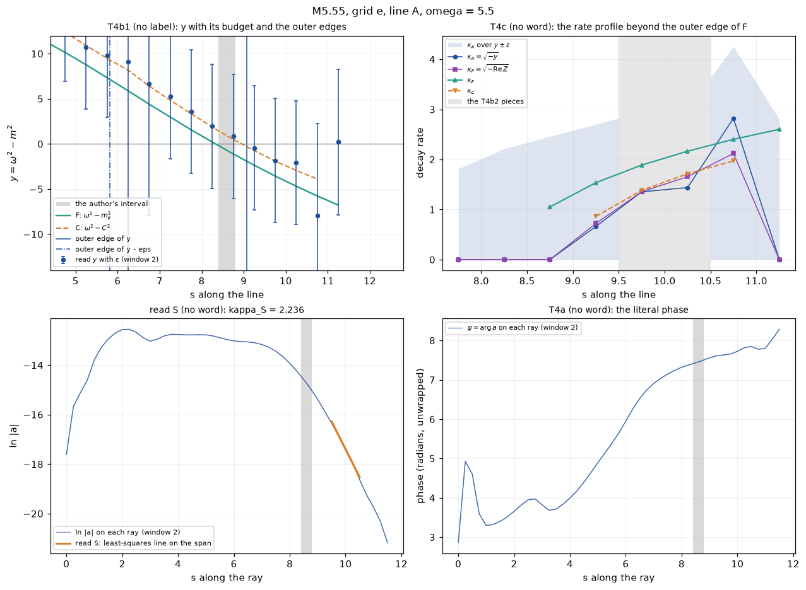
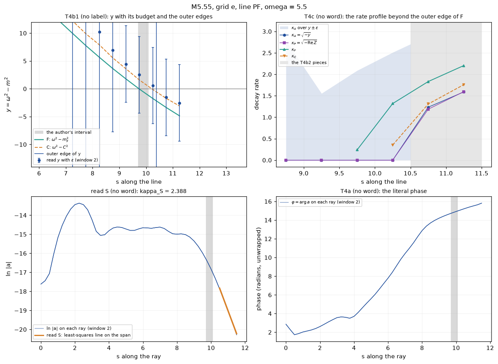
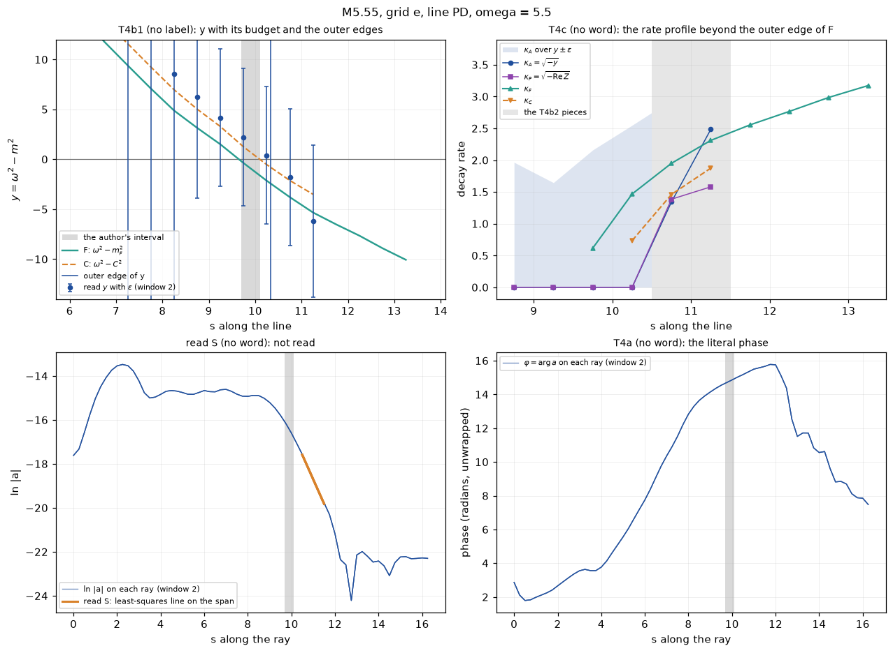

# M5.55: the author's rung T4 scored on the stored driven fields of M5.52

> Staged 2026-11-23. Roadmap row: [`m5_roadmap.md`](../m5_roadmap.md). Thread record: [`m5_32_convo.md`](m5_32_convo.md). It scores the rung T4 that the author posted on 2026-11-23 20:05 UTC ([discussioncomment-19840001](https://github.com/vantasnerdan/substrate-framework/discussions/186#discussioncomment-19840001)) on the lock-in fields at ω = 5.5 that the jobs of [M5.52](m5_52_task_details.md) store, with the read, the pieces and the budget of that task. It is a desk read: no job runs in this task. The cell it reads for: the quantum wave equation (Klein-Gordon) in the M5 table of [`MODELS.md`](../../../../../MODELS.md); this plan changes no cell.

## TASK PLANNING (2026-11-23; staged)

**Scope.** In their post of 2026-11-23 20:05 UTC (the last row of the [thread record](m5_32_convo.md)) the author states four rungs with predictions registered, by their statement, on 2026-11-23 at 20:53 CET, before any run. Rung T4, as the thread record gives it: a driven wave at ω = 5.5 near the core of the unit of M5.42, the phase read along the axis and in the ring plane; the phase advances inside the bands, the wave is evanescent beyond the outer edges (axis 8.4 to 8.8, plane 9.7 to 10.1), and the decay rate is √(m_eff² − ω²) within 15 percent (65 percent). Here m_eff is the local mass of their post of 2026-11-19 17:55 UTC, √(L₁ m² / I(r)), whose form on the background of OpenWave is F of [M5.49](m5_49_task_details.md) § 1. The plan of M5.52 was frozen before the post; its jobs drive ω = 5.5 on grids b, d and e, and its rules give no word to a literal phase or to a decay rate. This task scores T4 on the fields those jobs store, under rules frozen here:

| Entry | Clause of T4 | Read |
| --- | --- | --- |
| T4a | the phase advances inside the bands | the literal phase: a descriptor, no word (§ 3) |
| T4a′ | the same, in the form that can fail and tells a band from its outside | the status of the pieces inside the band of F: a word |
| T4b1 | the outer edges lie at axis 8.4 to 8.8, plane 9.7 to 10.1 | the read outer edge on three profiles, against the intervals: a word, expected "no label" (§ 3) |
| T4b2 | beyond them the wave is evanescent | the status of the pieces within 1.5 beyond the intervals: a word |
| T4c | the decay rate is √(m_eff² − ω²) within 15 percent | no word, decided at freeze by the budget (§ 3); the rate profile is a descriptor |

**Six limits, stated before the run.** (1) Every limit of M5.52 holds here: the time part of [M5.47](m5_47_task_details.md) § 1, the action of M5.42 and not that of the author's later posts, one spacing (0.25), the damping, the residual force and the source added by M5.52, and its limit (6) on the soft waves where the mid wave has decayed. (2) The source of M5.52 is two circles of the loop's radius at ±3 along its normal, inside both bands, not a source near the core as T4 states; the words rest on local reads of the piece estimator, which do not depend on where the source sits. (3) The literal phase cannot tell a band from its outside under the damping of the jobs (§ 3). (4) Within the region where the mid wave is read, a decay rate within 15 percent needs the local cutoff within about 1 to 2.5 percent of m_eff (§ 1), and M5.52's budget at ω = 5.5 is wider than the margin such a word needs on every piece: T4c carries no word, a decision made at freeze from the budget, not from a field. (5) Not blind, by grid (§ 5): grid b's fields had been read under M5.52's rules before this plan was written; grids d and e had been read by no one; M5.49 had read the cutoffs on the same pieces of grids d and e from free noise, and the expectations of § 6 come from that record. (6) The author's wording fixes neither the speed, nor the offset, nor where the rate is read, nor whether the intervals locate the edge or only bound where evanescence begins; the readings this plan adds are named in §§ 1 and 3.

**Definition of done.** The prediction file `m5_55_predicted.json` written and hashed before any read of grids d and e; the controls of § 4 each met, or reported with the exact failing check; T4a′, T4b1 and T4b2 each carrying one word, or "no label" with the rule that withheld it, per line and grid; the descriptors of § 3 tabled; the expectations of § 6 scored against the outcome; the findings embedding, per line of grid e, the profile of y with its three edges against the intervals, the rate profile κ_A and κ_P with ε beside κ_F and κ_C, the slope of the modulus and the literal phase; a record audit in a fresh context and a numbers check on a different model, each with its own code on the arrays; the doc checker clean.

**Gating.** The repo owner's commit of this plan, which freezes it and is the go for its reads, under the pre-flight already armed for M5.51 and M5.52. The order the record must show: the commit; `m5_55_predicted.json` written and its hashes in this task's run log; then the first read of grid d or e by either task. The reads run after M5.52's last job ends.

**Research body.** This document (plan, findings, review); in [`../scripts/`](../scripts/): `m5_55_reads.py` (the prediction file, the controls, the reads, the words, the descriptors and the plots). It imports [`m5_52_reads.py`](../scripts/m5_52_reads.py) and calls only its pure functions (`ratio_read`, `read_field`, `joined_pairs`, `edges0`, `bin_of`, `eps_of`, `kappa_bar`) and its read-only loader `load_lockin`; it never calls `read_job`, `check_hashes`, `words`, `control_c12` or any function that writes into M5.52's tree. Its inputs: the lock-in fields `lockin_w1.npz` and `lockin_w2.npz` of jobs Ge, Gd, Gb and VD1 to VD4, opened read-only in M5.52's job folders; the hashed prediction `m5_52_drive_predicted.json`; and the summary that M5.52 writes, `../data/m5_52_summary.json`, whose SHA-256 the run log records and which supplies b_γ (its C11 entry `b_gamma`), b_vac (its C9 entry `b_vac`) and M5.52's control outcomes. A term of ε missing from that summary makes every entry it enters "no label (budget input missing)". Geometry from [`m5_49_predict.py`](../scripts/m5_49_predict.py). Outputs: `../data/m5_55_predicted.json` and the summary `../data/m5_55_summary.json` (tracked, each under 1 MB); plots `m5_55_*.png` in [`../plots/`](../plots/); the run log and every intermediate file in `../checkpoints/m5_55/` (local-only, gitignored). Nothing is written under M5.52's folders.

### 1. What the decay rate is on OpenWave's equations

**The local law with damping.** For the mid wave about a point, M5.52 § 3 gives, with m the local cutoff, c the local speed along the wave and the uniform damping γ = 0.3 of the jobs:

$$
c^2 K^2 = \omega^2 - m^2 + i \omega \gamma = y + i \omega \gamma , \qquad y = \omega^2 - m^2
$$

A steady field at ω varies locally as $e^{i K s}$ with the root of positive imaginary part (the convention of M5.52 § 1, $M - M_0 = \operatorname{Re}(A e^{-i \omega t})$, under which a wave leaving the source has a phase that grows with s). Where the cutoff lies above ω (y < 0):

$$
\operatorname{Im} K = \frac{1}{c} \sqrt{\frac{\sqrt{y^2 + \omega^2 \gamma^2} - y}{2}} , \qquad \operatorname{Re} K = \frac{1}{c} \sqrt{\frac{\sqrt{y^2 + \omega^2 \gamma^2} + y}{2}}
$$

Im K is the decaying part and Re K the phase part; Re K > Im K exactly when y > 0. With $r = \omega \gamma / \lvert y \rvert$, $\operatorname{Im} K = (\sqrt{-y} / c) D(r)$ with $D(r) = \sqrt{(\sqrt{1 + r^2} + 1)/2}$, and $\operatorname{Re} K = \omega \gamma / (2 c \sqrt{-y})$ to first order in r.

**The author's expression and the terms that separate it from the physical rate.** The author's law has speed 1 and no loss, so its rate is $\kappa_{\mathrm{auth}} = \sqrt{m_{\mathrm{eff}}^2 - \omega^2}$. On OpenWave's damped equations:

$$
\operatorname{Im} K = \kappa_{\mathrm{auth}} \times \frac{1}{c} \times D(r) \times \sqrt{\frac{m^2 - \omega^2}{m_{\mathrm{eff}}^2 - \omega^2}}
$$

| Term | Size here | Where it comes from |
| --- | --- | --- |
| 1/c | 1.06 to 1.08 for c² of 0.86 to 0.89; the two speeds of a direction are not resolved | the slopes of the bins of M5.47 § 11 at spacing 0.25 |
| D(r) | 1.010 to 1.062 for $\lvert y \rvert$ from 5.8 down to 2.2 at ω = 5.5 (ωγ = 1.65) | the damping of the jobs |
| the offset of m under m_eff | $d \ln \kappa / d \ln m = m^2 / \lvert y \rvert$, about 6 to 15 beyond the outer edges inside M5.52's domain, so one percent in m is 6 to 15 percent in κ | C, the bin cutoffs of M5.47 § 11 as hashed, lies 2.5 to 3.9 percent under F over the 65 pieces with q̄ under 2.25 on grids b, d and e, all lines; the read cutoffs of M5.49 on grid e beyond the outer edges lie 1 to 2.5 percent under F |
| WKB | the local rate is the decay of the amplitude only where $w = \lvert d\kappa/ds \rvert / \kappa^2$ is small | a cutoff that changes along the line |

**The rate read without the damping.** The ratio of M5.52 § 3 gives on a piece $y_i = \omega^2 - m^2_{\mathrm{read}}$ and $c^2_{\mathrm{read}}$, exactly for one local law. From them:

$$
\kappa_{A,i} = \sqrt{-y_i} , \qquad \kappa_{P,i} = \sqrt{- \operatorname{Re} Z_i} = \frac{\sqrt{-y_i}}{c_{\mathrm{read}}}
$$

κ_A is the rate in the units of the author's law (speed 1, the convention of M5.52 for Φ and κ̄); κ_P is the rate an undamped field of OpenWave would show, the author's own read in their run of 2026-11-19 (the decay of the modulus, no loss inside their box).

**What the expression leaves unspecified.** Each reading is tabled; none carries a word (T4c, § 3).

| Unspecified | Readings tabled |
| --- | --- |
| The background of m_eff | F of the hashed file `m5_52_drive_predicted.json` (the author's rule on OpenWave's background); the author's own profiles are not used |
| The offset of the cutoffs | against $\kappa_F = \sqrt{m_F^2 - \omega^2}$ (λ = 1) and against $\kappa_C = \sqrt{C^2 - \omega^2}$, the formula with OpenWave's offset, which the author accepted for the edges on 2026-11-21 and which their T4 intervals carry (8.38 to 8.8 and 9.74 to 10.1 are their registered edges and up to about 5 percent outside) |
| The speed | κ_A (speed 1) and κ_P (physical, no loss) |
| Local or mean rate | per piece, and $\bar\kappa$ of M5.52 over the read pieces within 1.5 of the read outer edge |
| 15 percent of what | the ratios $\kappa_{A,i} / \kappa_{X,i}$ and $\kappa_{P,i} / \kappa_{X,i}$, X = F or C, printed with their budget |

### 2. The reads

**Read Z, the piece estimator** of M5.52 § 3 on window 2, unchanged: $Z_i$, $y_i$, $c^2_{\mathrm{read}}$, ε_i and the status of each piece (PROP when y − ε ≥ 0, EVAN when y + ε < 0, MARGIN otherwise), from `read_field` and `eps_of` on the stored fields (tone index 1, ω = 5.5; `Ar + i Ai`, six components, projected on W), with the ε terms of M5.52's summary. Every word of this task rests on read Z.

**The budget at ω = 5.5, known at freeze.** From the outcome of C11 that § 5 discloses (no piece of grid b in bin I, 0.48 in bin II, 3.44 in bin III) and the rule of `control_c11` (a bin with fewer than five pieces takes the largest value of all bins), the damping term of ε is 2 × 3.44 = 6.88 where $\lvert y \rvert$ < 1.65 (bin I) or $\lvert y \rvert$ ≥ 6.6 (bin III), and 2 × 0.48 = 0.96 where 1.65 ≤ $\lvert y \rvert$ < 6.6 (bin II); the floor (0.30), the windows, the filter and the vacuum term can only raise ε. So ε ≥ 0.96 on every read piece at 5.5. A piece with 0 < y < 1.65 or 6.6 ≤ y < 6.88 cannot be PROP; a piece with −1.65 < y < 0 or −6.88 < y ≤ −6.6 cannot be EVAN.

**Read S, the slope of the modulus: a descriptor, no word and no control of its own.** On every ray of a line (2 for A, 4 for PF, 4 for PD), the scalar a sampled at points h/2 apart by trilinear interpolation of its node values, $\kappa_S$ the least-squares slope of $- \ln \lvert a \rvert$ against s over the span of the T4b2 pieces of the line (9.5 to 10.5 on A, 10.5 to 11.5 on PF and PD), per ray, then averaged; tabled beside the mean of $\operatorname{Im} \sqrt{Z_i}$ over the same pieces. Its one check is the plan audit's exact lattice steady state of a blob source in the uniform vacuum with the held shell (below): in the evanescent case of VD1 the slope fell within 0.6 percent of that reference on A and PF and 0.3 percent on PD; in the propagating case of VD4 it read 3.4 and 4.5 percent high, of which 1.9 and 4.0 percent are images in the held faces of a half-box of 6; the phase slope of the lattice sits 2.4 percent under the continuum Re K. Its biases against Im K, none bounded by this plan:

| Bias | Size |
| --- | --- |
| Spreading | a pattern that spreads like a point source adds the least-squares slope of ln s over the span (0.3185 over s from 2 to 4.5 in the blob case, against 1/s̄ = 0.308) |
| WKB prefactor | $\kappa' / (2 \kappa)$ where the cutoff changes along the ray |
| Transverse structure of the tail | an angular order ℓ or a confinement $k_\perp$ steepens the modulus along a ray by about $k_\perp^2 / (2\kappa)$ or $\ell(\ell + 1) / (2 \kappa s^2)$; Z, which holds the whole Laplacian, does not show it |
| Geometry | Z averages a cone of radius 2.6 to 2.9 about the ray at s from 9.75 to 10.75; S reads on the ray |

**When a piece is NOT READ for T4b2 and the descriptors**, besides the rules of M5.52 (source, rms floor of 10⁻¹², c² outside 0.4 to 2.5, the soft rule):

| Rule | Bound | Reason |
| --- | --- | --- |
| Second window | $\lVert a_2 - a_1 \rVert / \lVert a_2 \rVert \le 0.02$ over the piece's nodes in D; for read S, $\lvert \ln \lvert a_2 \rvert - \ln \lvert a_1 \rvert \rvert \le 0.02$ at every sample of the span | on five samples over half a unit, 2 percent moves a least-squares slope by 0.096 in the worst case |
| Purity | the power of $A_2$ outside W under its power on W on the piece (the purity clause of M5.52 § 6) | beyond an edge the mid wave decays and a soft wave, which does not, takes over the projection and can read PROP with a wrong mass (M5.52 limit (6)) |
| The faces | $e^{-2 \kappa_F d_f} \le 0.01$, d_f the distance from the piece's outer end to the nearest face | the held shell reflects the decaying field |

**The reach of the read at 5.5.** The near-threshold domain of M5.52 (m_F² ≤ 1.2 ω²) is its closed rule, set at ω = 4, where it kept the axis stretch under 1.7 e-folds of predicted decay and rejected a bound reaching 2.61. At ω = 5.5 it does not carry that reason: from the outer edge of F to the end of the domain on grid e the predicted decay is 4.6 (A), 2.8 (PF) and 3.1 (PD) e-folds on F, and 3.6, 2.05 and 2.1 on the cutoffs that M5.49 read. M5.52's regime table limits its decay descriptor to within 1.5 of an outer edge. So the pieces of T4b2 stop 1.5 beyond the interval, and pieces farther out are tabled with the break of regime stated.

### 3. The entries, frozen

Words are given on grid e for T4b1 and T4b2, on grids d and e for T4a′; grid b carries tables only (§ 5). Every statement must be the same on window 1, otherwise it is no label. The plane is PF, the author's +x, with PD read against the same numbers as this plan's addition (the rule of M5.49): a plane entry is HELD when one line is HELD and none NOT HELD, NOT HELD when either is, no label otherwise.

**T4a, the literal phase: no word, a descriptor.** The phase $\varphi(s) = \arg a$ along each ray and its gradient are tabled. The clause can fail as written (a standing or an inward pattern inside a band gives a flat or falling phase), but its holding says nothing about a band: under γ = 0.3, Re K > 0 on both sides of a cutoff (§ 1; M5.52's Scope, fact 3); in the evanescent vacuum of VD1 (y = −3.025) Re K = 0.4587, and the audit's lattice steady state of a blob source there advances in phase at 2.4 percent under it. A word on it could not fail on the evanescent side.

**T4a′, inside the band the wave propagates.** By § 1, the phase part of the wave exceeds its decaying part exactly when y > 0. The scored pieces are the pieces inside the band of F at ω = 5.5 (y_F(1) > 0) whose centers lie at least 2Δ = 1 from each of its edges on the pieces form, read by the geometry of M5.49 and not excluded by the source, fixed from the prediction file:

| Grid, line | Scored pieces (centers) |
| --- | --- |
| e, A | 2.25 to 7.25 (11 pieces) |
| e, PF | 4.75 to 8.25 (8 pieces) |
| e, PD | 2.25, and 4.75 to 8.25 (9 pieces) |
| d, A | 2.25 to 8.25 (13 pieces) |
| d, PF | 4.75 to 8.25 (8 pieces) |
| d, PD | 2.25, and 4.25 to 8.25 (10 pieces) |

HELD: at least nine in ten of them read, and every read one PROP. NOT HELD: at least nine in ten read, and at least one EVAN, named. No label otherwise. By the budget above, a scored piece whose read y lies between 0 and 1.65, or between 6.6 and 6.88, cannot be PROP, and its line is then no label.

**T4b1, the outer edge in the author's interval.** The interval is 8.4 to 8.8 on A and 9.7 to 10.1 on PF and PD (grid e). Its window is the set of pieces with centers from 8.4 − Δ to 8.8 + Δ (8.25, 8.75, 9.25 on A) and from 9.7 − Δ to 10.1 + Δ (9.25, 9.75, 10.25 on PF and PD), covered when every one is read. An outer edge is that of M5.52 § 3 (`edges0`: a profile crossing 0 from positive to negative as s grows, between read pieces no more than 2Δ apart). On each of the three profiles y, y + ε, y − ε the outer edge nearest the interval is taken. HELD: covered, and all three inside the interval. NOT HELD: covered, and all three outside it on the same side. No label otherwise: the three straddle the interval, or a profile has no outer edge. **Known at freeze:** with ε ≥ 0.96 everywhere, the three edges fall inside an interval 0.4 wide only where the read y changes by more than 2 × 0.96 / 0.4 = 4.8 per unit across it, against 2.6 (A) and 3.4 (PF) for F there; with ε = 6.88 on the pieces next to an edge, where $\lvert y \rvert$ < 1.65, the three edges spread over more than a unit (§ 6). T4b1 cannot be HELD under the known budget and is expected "no label"; it is kept because NOT HELD stays possible.

**T4b2, the field within 1.5 beyond the interval.** The scored pieces have centers from the interval's top plus Δ to its top plus 1.5, fixed now: 9.75 and 10.25 on A; 10.75 and 11.25 on PF and on PD (grid e). A scored piece is NOT READ unless it meets the purity clause and the second-window rule of § 2. HELD: every scored piece read and EVAN. NOT HELD: every scored piece read, and at least one PROP, named. No label otherwise. The pieces read by the geometry beyond the top plus 1.5 (10.75 and 11.25 on A; 11.75 to 13.25 on PD; none on PF) are tabled with their status, under the break of regime of § 2. Grids d and b hold no scored piece of T4b1 or T4b2. T4b1 and T4b2 are two readings of the wording ("the edge lies in the interval", "beyond the interval the wave is evanescent"), tabled apart and never merged.

**T4c, the decay rate: no word, decided at freeze by the budget.** A word within 15 percent on a piece needs its budget under the tolerance's margin: half the narrower side of the band in y that 15 percent in κ allows ($1 - 0.85^2 = 0.2775$), so ε ≤ 0.139 $\lvert y_X \rvert$. Inside M5.52's domain beyond the outer edges $\lvert y_F \rvert$ ≤ 0.2 ω² = 6.05, so the margin is at most 0.139 × 6.05 = 0.84, under the least ε of 0.96 at ω = 5.5; outside the domain the pieces lie in bin III, with ε = 6.88. No piece can carry a word on F or on C. The descriptor, per piece beyond the outer edge of F on every line of grids d and e: y, ε, the bin, κ_A and κ_P, κ_F and κ_C, the four ratios, $\operatorname{Im} \sqrt{Z_i}$, the purity ratio, the second-window ratio, and read S per line.

**The prediction file.** `m5_55_reads.py --predict` writes `../data/m5_55_predicted.json` from the hashed blocks of `m5_52_drive_predicted.json` (it checks their hashes and stops on a mismatch) and the base states, and opens no lock-in amplitude: per line and grid at ω = 5.5, y_F, y_C, κ_F, κ_C, w, the scored pieces of T4a′ and T4b2, the windows of T4b1, the T4b2 spans of read S, the exact vacuum values of § 4 and every bound of §§ 2 and 3. Its block hashes (the rule of M5.49) are written in this task's run log before any read of grids d and e; the reads take them as arguments and stop on a mismatch.

### 4. The controls

| Control | Input | The answer it must return | What a failure would look like |
| --- | --- | --- | --- |
| K0, M5.52 at ω = 5.5 | the controls of M5.52 as its reads report them | a word of this task at 5.5 on a grid only where M5.52's own cost rules leave its labels at 5.5 there, with one exception, stated with its reason in § 5: the clause of C9 on the read speed (c² within 1 percent of 1) is not inherited. Every other clause of C9 at 5.5 is (the cutoff of each vacuum case within its bound, no edge, the statuses), and so are C8, C10, C12 and the binned damping term of C11 inside ε | a field that M5.52's controls do not stand behind |
| K1, the prediction first | `m5_55_predicted.json`, the run log, the reads | the hashes in this task's run log before any read of d or e, beside the SHA-256 of `m5_52_summary.json`; the reads stop on a mismatch | a scored set or a bound written after a read |
| K2, read Z on the evanescent vacuum (reported, no cost) | VD1 of M5.52 at ω = 5.5, window 2 (m² = 33.275, y = −3.025), the 26 read pieces of A, PF, PD | κ_A and κ_P within 2 percent of √3.025 = 1.7393; $\operatorname{Im} \sqrt{Z_i}$ within 2 percent of 1.7987, the imaginary part of $\sqrt{-3.025 + 1.65 i}$ | a ratio that does not remove the damping or the speed. Not fresh: it is algebra on C9's per-piece y and c² on VD1, computable from numbers the freezing session had; the worst innermost piece puts κ_P near 2.0 percent low, at the bar. It guards the descriptor only |
| K3, the rules on the vacuum (inherited) | VD4 (y = +1.815), VD2 and VD3 (y = +15.21 and +13.29), and VD1, at 5.5 | on VD4, VD2, VD3: no outer edge, no piece EVAN, every read piece PROP; on VD1: no edge, every read piece EVAN | an edge or a band where the medium has none. It is C9's status clause on the same fields, known met when this plan was frozen |
| K4, the rules on made-up profiles | profiles of y with budgets, pieces with set amplitudes and powers | each outcome once: T4a′, T4b1 and T4b2 each HELD, NOT HELD and no label by every rule (the cover, the three profiles straddling, a profile with no edge, the nine in ten, the purity, the second window, window 1, a missing budget term) | a rule that returns one word |

**Tries and costs.** The try cap of each control is three; between tries only the input of a control or a defect of the script may change, never a bound of §§ 2 to 4, each change logged in the run log. What a failure costs: K1 or K4, no word on any grid; K0, as M5.52's rules say for its own labels, with the exception above; K2, nothing (reported beside the descriptor); K3, no word of T4a′, T4b1 or T4b2.

### 5. Grids, blindness and the order of the record

| Grid | Words | Tables | Blind |
| --- | --- | --- | --- |
| e (half-box 13, job Ge) | T4a′, T4b1, T4b2 | every descriptor of §§ 2 and 3 | not read by anyone when this plan was written; M5.49 read its cutoffs on the same pieces from free noise (limit (5)) |
| d (half-box 10, job Gd) | T4a′ | the rate profile beyond PD's edge, read S where the line reaches, the literal phase | not read by anyone when this plan was written; M5.49 read its cutoffs from free noise on d as well |
| b (half-box 8, job Gb) | none | the same tables | no: read under M5.52's own rules before this plan was written |

The fields of grid b had been read under M5.52's rules before this plan was written. The drafter of this plan opened no file of M5.52's job outputs, reads, logs or findings; it designed from M5.52's plan, the source of its scripts, its hashed prediction file and the closed records of M5.47 and M5.49. A hold keeps grids d and e unread. The record must show, in this order: the commit of this plan; `m5_55_predicted.json` written and its hashes in this task's run log; then the first read of grid d or e by either task. The evidence of that order: the commit and its push time (the push is the one public mark), the file times of M5.52's reads of Gd and Ge, the lines of its hash log, and this task's run log, all local. A read of d or e found before the commit makes every word of this task on that grid "no label (not blind)".

**Known when this plan was frozen, and by whom.** The drafter knew none of M5.52's results. The session that folded the audit and froze the plan did know the outcome of M5.52's controls on the vacuum jobs and on grid b, which had ended and been read under M5.52's rules: C9 was not met at ω = 5.5 on one clause, the read speed on the evanescent case VD1 (c² up to 1.0244 on its innermost pieces, where the field is smallest, against 1 percent; window 1 reads 0.92 to 0.93 there), with every other clause of C9 at 5.5 met (the cutoff of VD1 within 0.0498 against 0.3025; VD4, VD2 and VD3 met); and C11 at ω = 5.5 was met with a 90th percentile of 0.48 in bin II and 3.44 in bin III, no piece of grid b lying in bin I. No field of grid d or e had been read by anyone.

With that knowledge, K0 was changed in one place from the drafter's text, which inherited every clause of C9: the speed clause is not inherited. What is right in the equations: for one local law the ratio gives $y = \omega\gamma \operatorname{Re} Z / \operatorname{Im} Z$, which holds no speed, so the statuses PROP and EVAN, the edges, T4a′, T4b1, T4b2 and κ_A do not depend on $c^2_{\mathrm{read}}$. What the failed clause shows: c² up to 1.0244 on the innermost pieces of VD1 against 0.92 to 0.93 in window 1 means that Z is not of the single-law form on those low-field pieces (a transient or a mixture), and the single-law form is the premise that makes y free of the speed. What licenses not inheriting the clause is C9's separate cutoff clause, met on the same pieces (0.0498 against 0.3025): there the y that the words use was read correctly although the speed was not. The pieces of T4b2 are the low-field analog of those VD1 pieces, which is why the second-window rule and the purity clause gate them. The speed enters this task only through κ_P, a descriptor. Under M5.52's own rule the clause withholds every label of M5.52 at 5.5, and that stays so in M5.52's record. The change is this plan's choice, made after the control's outcome was known, and the findings name it as such; had the clause been inherited, this task would give no word on any grid. The same outcome of C11 sets the budget of § 2, from which T4c's lack of a word and T4b1's expected "no label" follow at freeze.

### 6. Registered before the run

Expectations, which no script uses, from the free-noise cutoffs of M5.49 (`wc` in [`m5_49_reads.json`](../data/m5_49_reads.json)) put in place of the read, with ε from § 2. (1) T4a′: every scored piece PROP on A and PF of grid e and on A, PF and PD of grid d (on d, PD at 8.25 sits near y = 6.5, close under 6.6); on grid e PD at 8.25 sits near y = 6.7, where it cannot be PROP, so PD is no label and the plane entry rests on PF. Expected: HELD on the axis and the plane of grids d and e. (2) T4b1, recomputed here with the auditor's numbers reproduced: the outer edges of y − ε, y and y + ε at 7.89, 8.835 and 9.63 on A and at 9.39, 10.07 and 10.67 on PF and PD (on PD, y − ε crosses also at 8.21 and y + ε also at 12.26); the three straddle each interval: no label on both. (3) T4b2: y of −2.81 and −3.88 on A, −2.21 and −3.90 on PF, −2.20 and −4.00 on PD, all EVAN against ε = 0.96: HELD on both if the purity clause and the second window let the pieces be read. If the driven field on these pieces is no purer than M5.49's free noise was on the axis at ω = 4 (0.87 to 0.88 of the power outside W on grid e), they are not read and the entry is no label. (4) T4c: no word. The descriptor on grid e: κ_A/κ_F rising outward, 0 on A at 8.75 (the read edge lies beyond that piece), 0.73 at 9.25 and 0.89 to 0.93 from 9.75 to 10.75; 0.62 to 0.90 on PF and 0.58 to 0.95 on PD from 10.25 outward; κ_P about 7 percent higher; against C, about 1.0 to 1.3. (5) K2 met at its bar; K3 met (known). Nothing in this section sets an icon: the plan reports, and the cell is re-read later by the repo owner, by a ruling.

### 7. Blindspot pass

| Family | Guard here |
| --- | --- |
| Unvalidated instrument | read Z: C9 of M5.52 on its vacuum cases (cutoff and status clauses), K3; the rules: K4; read S has no control of its own and no word, its one check being the audit's lattice solve |
| Artifact read as result | window 1 repeats every statement; the second-window rule on the low-field pieces; the binned damping term in ε |
| Unfalsifiable check | the literal phase holds on the evanescent side, so it gets no word (T4a); T4a′ can fail by one EVAN piece; T4b1 keeps only the word it can still give (NOT HELD); K2 and K3 named as not fresh |
| Resolution mistaken for accuracy | ε beside every y; T4c withheld at freeze because ε exceeds the margin 15 percent needs; the sensitivity $m^2 / \lvert y \rvert$ stated (§ 1) |
| Ceiling-to-point creep | the offset is a second column of the descriptor (κ_C), never a correction of κ_F; the expectations carry no word |
| Wrong diagnostic for the regime | T4b2 stops 1.5 beyond the interval, the reach of M5.52's decay descriptor; the e-folds at 5.5 stated; the purity clause where the mid wave decays; read S's biases listed |
| The author's wording read one way after the run | T4b1 and T4b2 tabled apart; F and C, κ_A and κ_P tabled side by side; all decided here |
| This plan's choices taken for the author's | named in the findings: T4a′ in place of the literal phase; the windows of the intervals and the three-profile rule; the 1.5 of T4b2; the second-window floor; the purity clause on T4b2; C as the offset; the speed clause of C9 not inherited |

### 8. Consumers, parallel shape, estimate, not computed

**Consumers.** The words of § 3 are read by the repo owner's post to the author on discussion #186: they need K0, K1, K3 and K4 met and the two audits. The Klein-Gordon cell reads them only through a later ruling of the repo owner. The descriptor of T4c is reusable by a later driven read with a smaller budget beyond the edges; it would need its own control of read S there.

**Parallel shape.** No job runs. The reads are one single-threaded process after M5.52's last job ends, sequential by choice (three labeled grids and four vacuum cases, each read once, by a desk pass over stored arrays), counted in the ceiling of twelve processes shared with M5.51 and M5.52.

**Estimate.** Machine: one desk pass over stored lock-in fields. Sub-agents: the builder on Opus; a numbers check on Sonnet; a record audit on Opus in a fresh context. The user's touchpoints: the commit of this plan, and the review. Autonomy: unattended from the commit to the review.

**Deviations.** Anything forced off this plan takes the conservative option (a word withheld rather than given) and is logged in this document as it happens.

**Not computed.** Any new job; a source near the core; the author's absorbing layer; the rate on the author's own profiles; T4c as a word; read S as a word, and a control of read S on data; ω = 4; the inner edges; the literal phase as a word; a word beyond 1.5 past the intervals; the two speeds of a direction apart; another spacing; the action of the author's later posts; the rungs T1 to T3.

**Plan audit (2026-11-23, before any read of grids d and e).** An independent pass in a fresh context, blind to M5.52's outputs, derived § 1 again, solved the exact lattice steady state of a blob source in the uniform vacuum with the held shell, and worked out from the tracked files and the numbers disclosed in § 5 which entries could carry a word. It found three blockers and six major items, folded as follows; the plan and its audit were written by instances of one model in separate contexts.

| Item | Fault | Fold |
| --- | --- | --- |
| B1 | T4b1's NOT HELD fired when the band of the three profiles holds the interval | NOT HELD only with all three edges outside on one side; no label when they straddle or a profile has no edge; stated at freeze that it cannot be HELD; expectation (2) recomputed |
| B2, M1 | with ε ≥ 0.96 and a margin of at most 0.84, T4c could carry no word | T4c has no word, decided at freeze; the rate profile is a descriptor; the two vacuum jobs, their controls, the wrapper script and the agreement gate removed |
| B3 | T4b2's NOT HELD was the false mode of M5.52's limit (6); the domain's reason does not hold at 5.5 | scored pieces within 1.5 beyond the interval, gated by purity and the second window; the e-folds at 5.5 stated |
| M2 | the reason for not inheriting C9's speed clause was incomplete | the single-law premise, the cutoff clause as the license, and the low-field analog stated (§ 5) |
| M3 | K2 and K3 presented as fresh validation | named as computable from known numbers and as inherited; K2 without cost |
| M4 | the build could write into M5.52's tree and named no source for the ε terms | only pure functions and the read-only loader; outputs under this task's folder; `m5_52_summary.json` hashed as the budget input |
| M6 | the empty bin I's effect on T4a′ was not stated, and its rule was circular | the PROP gaps stated; scored pieces fixed from the prediction file and listed |
| Minor | the second-window bound, grid d's blindness, the evidence of the order, the offset's subset, K2's window | corrected in §§ 1, 2, 4 and 5 |

## FINDINGS (2026-11-23)

> The run of the plan above, made on 2026-11-23. Script: [`m5_55_reads.py`](../scripts/m5_55_reads.py). Prediction: [`m5_55_predicted.json`](../data/m5_55_predicted.json). Summary: [`m5_55_summary.json`](../data/m5_55_summary.json). Inputs: the lock-in fields of the jobs of [M5.52](m5_52_task_details.md), its hashed prediction [`m5_52_drive_predicted.json`](../data/m5_52_drive_predicted.json) and its summary [`m5_52_summary.json`](../data/m5_52_summary.json).

**In brief.** (1) Every entry carries "no label": T4a′ on the axis and the plane of grids d and e, T4b1 and T4b2 on the axis and the plane of grid e. T4a and T4c carry no word by the plan. (2) The controls are met: K0 withholds nothing (with the exception of § 4, the speed clause of C9, not inherited), K1 holds the order of the record, K4 met 40 of 40 cases; K2 and K3 are met, and neither is fresh validation (K2 is algebra on C9's per-piece numbers, K3 is C9's status clause on the same fields). (3) The budget is the one M5.52's summary gives: a damping term of 2 × 3.437 = 6.873 in every bin at ω = 5.5, so a read piece with $\lvert y \rvert$ under 6.87 is neither PROP nor EVAN. § 2 of this plan had stated 0.96 in bin II; that statement was wrong, and it was checkable in a tracked file at the freeze (§ 11, § 17 item 8). No word depends on which value is read: the audit of this record recomputed every line entry with bin II at 0.4815 and found every one still no label. What decides each entry (§ 12): T4a′ on the axis of d and e, MARGIN pieces, among them pieces whose ε is set by the filter term under either value (e A at 6.25 and 6.75; d A at 6.25 to 7.25); T4a′ on PF and PD of d and e, the cover (under nine in ten read); T4b1, profiles with no outer edge (under bin II at 0.4815, by the audit, three edges straddling the interval on A and a profile with no outer edge on PF and PD); T4b2 on all three lines, the purity clause. (4) T4a′: on the axis of d and e every scored piece is read; the inner ones read PROP and the outer ones (y from 3.2 to 9.8) MARGIN, none EVAN. On PF and PD the soft rule and the bound on c² leave 3 to 5 of 8 to 10 scored pieces read, under nine in ten. (5) T4b1: the profile y + ε has no outer edge on any line; the outer edge of y lies above each interval (9.08 on A, 10.39 on PF, 10.34 on PD). (6) T4b2: every scored piece fails the purity clause (power outside W 3.5 to 124 times that on W) and would be MARGIN if read (y from −1.5 to −6.2, ε 6.87 to 7.61). (7) As descriptors with no word: on the six T4b2 pieces of grid e, κ_A/κ_F is 0.66 to 1.08, κ_P/κ_F 0.65 to 0.76, κ_A/κ_C 0.84 to 1.33 and κ_P/κ_C 0.84 to 0.98. Every one of these pieces is NOT READ by the purity clause, with 3.5 to 124 times more power outside W than on W, so these numbers are not a rate of the mid wave (deviation 11). The gradient of the literal phase is positive over most of the bands, with falling samples near s = 3 to 3.5 (A at 3.0: −0.61 on d, −0.57 on e; PF at 3.5: −0.29 on d and e; PD at 3.5: −0.16 on d, −0.15 on e), and positive beyond the intervals except on A of e at s = 10.5 (−0.08); its cause is not established (§ 14).

### 9. The order of the record

The only public mark of the order is the commit of this plan and its push. Everything else below is local: the prediction file until it is committed, the logs and the file times. This task's run log is appended by hand. Times are given to the minute.

| Event | Time (2026-11-23, EST) | Evidence |
| --- | --- | --- |
| The plan frozen at commit `44660227` | pushed 16:20 | the commit and its push (public); the first line of this task's local run log, written by the maintainer session, which lists M5.52's reads folder with no read of Gd or Ge |
| K4 met and `m5_55_predicted.json` written | 16:31 | the birth time of the prediction file and of the local hash file; the run log line with the file SHA-256 `2ba91e87357d4114ece2e98a1a195d063860c430d7ce0ebf47e54a566b2a0229` and the five block hashes |
| The hold on the reads of Gd and Ge released | 16:34 | a line of this task's run log, written by the maintainer session |
| M5.52 reads Gd | 16:34 to 16:35 | the line of M5.52's hash log (16:34); the birth time of `reads/Gd.json` and the access time recorded on the two lock-in files of Gd, the same instant (16:35); no line of the hash log between the one of GbG (15:40) and the one of Gd |
| M5.52 reads Ge | 17:33 | the line of the hash log; the birth time of `reads/Ge.json` and the access time on the lock-in files of Ge, the same instant |
| `m5_52_summary.json` | SHA-256 `1cc6c2ecb3478c88c279a1e1779539250807e6b9bf80500c8c49ac05d86b820d` | computed by this task, equal to the value M5.52 recorded |
| This task's first call of the reads | 17:38 | the run log: the first call stopped at the hash check and opened nothing (the shell passed the five hashes as one argument); the second call, in the same minute, opened the lock-in fields |

Both reads of grids d and e by M5.52 are later than the commit and than this task's hash line, so neither grid is "not blind" by the rule of § 5, and K1 is met. Every read of this task took the five block hashes of its prediction and matched them before it opened a lock-in field.

### 10. The controls

| Control | Tries | Result | What was read |
| --- | --- | --- | --- |
| K0, M5.52 at ω = 5.5 | 1 | ✅ met, withholds nothing | From M5.52's summary: C1, C2, C3, C13, C14, C4, C6, C7 met; C8 met on Ge, Gd and Gb, none capped; C10 at 5.5 met on b, d, e (medians 0.0045, 0.0048, 0.0039 against 0.3025); C12 at 5.5 met on b, d, e; C11 at 5.5 met in bins II (0.48 against 1.815; M5.52's scoring of a bin of three pieces on its own percentile, while the budget takes 3.44 for that bin, § 11) and III (3.44 against 3.63), bin I holding no piece, so no bin is removed; C9 at 5.5: on VD1, VD4, VD2 and VD3 every clause but the speed is met (26 of 26 read, none soft, worst cutoff error 0.0498 against 0.3025, every status as set, no edge, Φ within 2 percent). The speed clause, not inherited (§ 4): 2.44 percent on VD1 against 1 percent; 0.12, 0.04 and 0.10 percent on VD4, VD2, VD3 |
| K1, the prediction first | 1 | ✅ met | § 9 |
| K2, read Z on the evanescent vacuum (reported, no cost) | 1 | ✅ met (not fresh: algebra on C9's per-piece y and c² of VD1, § 4) | VD1, window 2, the 26 read pieces of A, PF, PD: κ_A from +0.82 to −0.03 percent of 1.7393 (worst on PF at s = 0.75), κ_P from −0.40 to +0.26 percent, Im √Z from −0.49 to +0.21 percent of 1.7987. The plan put κ_P near 2.0 percent low on the innermost pieces, a number with no computation behind it in the record; it reads 0.40 percent low, and κ_A 0.82 percent high. On those pieces the misread sits in y (m² read 0.05 high, the b_vac of 0.0498) while κ_P stays accurate, so κ_A does depend on the misread there; the license of K0 (§ 5) holds through C9's cutoff clause, 0.05 against 0.3025 |
| K3, the rules on the vacuum (inherited) | 1 | ✅ met (not fresh: C9's status clause on the same fields) | ε = max(0.3025, 2 × 0.0498) = 0.3025. VD4, VD2, VD3: 26 of 26 read, all PROP, no edge on the three profiles. VD1: 26 of 26 read, all EVAN, no edge |
| K4, the rules on made-up profiles | 1 | ✅ met | 40 of 40 cases: each of T4a′, T4b1, T4b2 HELD, NOT HELD and no label by every rule of § 4 (the cover, nine in ten and exactly nine in ten, a MARGIN piece, the three profiles straddling, a profile with no edge, purity from set powers, the second window from set amplitudes, the faces, window 1, a missing budget term); the plane; K0 (the speed clause alone withholds nothing; the cutoff clause, C12, a capped job withhold); "not blind"; the status at its bounds |

### 11. The budget as read from M5.52's summary

| Term at ω = 5.5 | Pieces of grid b | 90th percentile | Took the largest | Value used | In ε |
| --- | --- | --- | --- | --- | --- |
| $b_\gamma$, bin I ($\lvert y \rvert$ under 1.65) | 0 | none | yes | 3.43659 | 6.873 |
| $b_\gamma$, bin II (1.65 to 6.6) | 3 | 0.4815 | yes | 3.43659 | 6.873 |
| $b_\gamma$, bin III (6.6 and above) | 13 | 3.43659 | no | 3.43659 | 6.873 |
| $b_{\mathrm{vac}}$ | | | | 0.04985 | 0.0997 |

$$
\varepsilon_i = \max \big( 0.3025 , \quad 2 \lvert y_i - y_i^{(1)} \rvert , \quad 2 \lvert y_i - y_i^{\mathrm{filt}} \rvert , \quad 6.873 , \quad 0.0997 \big)
$$

applied by `eps_of` of M5.52. **The error of § 2.** § 2 stated bin II at 0.48 (a damping term of 0.96), applying the rule of five pieces to the empty bin I alone. That statement was written by the session that froze this plan, which knew the outcome of C11 (§ 5). Bin II holds 3 pieces on grid b, so by the same rule it takes the largest value as well. The error was checkable in a tracked file at the freeze and was not checked: the same commit `44660227` carries M5.52's record, whose C11 row reads "bin II 0.48 over 3" and whose deviation 3 says that a bin with fewer than five pieces is scored on its own percentile while its budget term takes the largest of the bins; M5.52's local run log gave the term as 3.44 in every bin at 5.5 before the freeze. The folds of the plan audit and the expectations (1) and (3) of § 6 all rest on ε of at least 0.96. The plan's rule for the budget is the summary's C11 entry `b_gamma`, and it was used as the summary gives it; nothing was adjusted. The consequence: the least ε at 5.5 is 6.873 and not 0.96, so a read piece with $0 \le y \lt 6.873$ cannot be PROP and one with $-6.873 \le y \lt 0$ cannot be EVAN. On the scored pieces the window term never sets ε; the filter term sets it on the pieces from 6.25 to 8.75 (up to 1454 on PF of e at 8.25) and on A at 10.75 and 11.25 and PD at 11.25 of e.

### 12. The words

Every statement is the same on window 1. No word is withheld by K0, K1, K3 or K4; each "no label" is the frozen rule's own. Under the value of § 2 for bin II (0.4815), the audit of this record recomputed every line entry with `line_words` and `eps_of` and found every one still no label: T4a′ on the axis of d and e by MARGIN pieces whose ε is set by the filter term (e A at 6.25 and 6.75; d A at 6.25 to 7.25), on the plane lines by the cover; T4b1 on A by the three edges at 9.077, 9.847 and 8.265 straddling 8.4 to 8.8, on PF by y − ε and on PD by y + ε with no outer edge; T4b2 by the purity clause.

| Entry | Grid | Line | Word | What decides it |
| --- | --- | --- | --- | --- |
| T4a′ | e | A | no label | 11 of 11 scored pieces read; 8 PROP (2.25 to 5.75, y from 9.82 to 16.46, ε 6.87), 3 MARGIN (6.25: 9.12 ± 27.18; 6.75: 6.69 ± 14.60; 7.25: 5.25 ± 6.87), none EVAN |
| T4a′ | e | PF | no label | 3 of 8 read, under nine in ten (4.75 and 6.75 NOT READ by the soft rule, 5.25 to 6.25 by the bound on c²); the 3 read MARGIN |
| T4a′ | e | PD | no label | 4 of 9 read, under nine in ten (4.75 and 6.75 soft, 5.25 to 6.25 c²); 2.25 PROP, 7.25 to 8.25 MARGIN |
| T4a′ | d | A | no label | 13 of 13 read; 8 PROP (2.25 to 5.75), 5 MARGIN (6.25 to 8.25, y from 9.78 down to 3.17), none EVAN |
| T4a′ | d | PF | no label | 3 of 8 read, under nine in ten; the 3 read MARGIN |
| T4a′ | d | PD | no label | 5 of 10 read, under nine in ten; 2.25 and 4.25 PROP, 7.25 to 8.25 MARGIN |
| T4b1 | e | A | no label | the window (8.25, 8.75, 9.25) covered; y + ε has no outer edge (it stays at or above 0 on every read piece); the outer edge of y at 9.077 (above 8.8), of y − ε at 5.82 (below 8.4) |
| T4b1 | e | PF | no label | covered (9.25, 9.75, 10.25); y + ε and y − ε have no outer edge; y's at 10.387 (above 10.1) |
| T4b1 | e | PD | no label | covered; y + ε and y − ε have no outer edge; y's at 10.338 (above 10.1) |
| T4b2 | e | A | no label | 9.75 and 10.25 NOT READ by the purity clause (outside over inside 3.54 and 22.5); second window 0.0056 and 0.0062, faces met; both MARGIN (−1.83 ± 6.87, −2.07 ± 6.87) |
| T4b2 | e | PF | no label | 10.75 and 11.25 NOT READ by purity (3.81, 27.3); second window 0.0041, 0.0083; both MARGIN (−1.52 ± 6.87, −2.53 ± 6.87) |
| T4b2 | e | PD | no label | 10.75 and 11.25 NOT READ by purity (14.9, 124); second window 0.0040, 0.0109; both MARGIN (−1.80 ± 6.87, −6.17 ± 7.61) |

| Entry | d, axis | d, plane | e, axis | e, plane |
| --- | --- | --- | --- | --- |
| T4a′ | no label | no label | no label | no label |
| T4b1 | | | no label | no label |
| T4b2 | | | no label | no label |
| T4a, the literal phase | no word (§ 3) | no word | no word | no word |
| T4c, the decay rate | no word (§ 3) | no word | no word | no word |

The pieces past the reach of T4b2, tabled under the break of regime of § 2: on A of e, 10.75 (−7.97 ± 10.19) and 11.25 (0.21 ± 8.06), both MARGIN and NOT READ by purity; on PD of e, 11.75 and 12.25 NOT READ (c²), 12.75 and 13.25 NOT READ (soft); none on PF.

### 13. The profiles of y with ε, against the author's intervals

The status is the position of the three profiles and carries no word of its own. On grid e the author's intervals are 8.4 to 8.8 on A and 9.7 to 10.1 on PF and PD.







**Grid e, line A.** Window 2 (window 1 in brackets), with ε; the status of the three profiles; y_F and y_C of the prediction; ω² − ω_c² from the cutoffs of M5.49. Every piece that M5.49's geometry reads is listed, from s = 0.75. Marks: a, a scored piece of T4a′; w, a piece of the window of T4b1; b, a scored piece of T4b2.

| s | Mark | y ± ε (window 1) | Status | y_F | y_C | M5.49 |
| --- | --- | --- | --- | --- | --- | --- |
| 0.75 |  | NOT READ (c2) |  | −3.05 | −1.42 | −1.59 |
| 1.25 |  | 3.94 ± 6.87 (3.94) | MARGIN | 6.70 | 8.89 | n/a |
| 1.75 |  | 6.36 ± 6.87 (6.36) | MARGIN | 11.60 | 13.66 | 11.91 |
| 2.25 | a | 11.78 ± 6.87 (11.79) | PROP | 13.51 | 15.47 | 14.13 |
| 2.75 | a | 10.07 ± 6.87 (10.07) | PROP | 13.87 | 15.80 | 15.22 |
| 3.25 | a | 16.46 ± 6.87 (16.42) | PROP | 13.44 | 15.42 | 15.26 |
| 3.75 | a | 12.88 ± 6.87 (12.89) | PROP | 12.58 | 14.61 | 14.34 |
| 4.25 | a | 12.41 ± 6.87 (12.42) | PROP | 11.43 | 13.50 | 13.24 |
| 4.75 | a | 13.80 ± 6.87 (13.82) | PROP | 10.14 | 12.37 | 11.89 |
| 5.25 | a | 10.73 ± 6.87 (10.75) | PROP | 8.77 | 10.91 | 10.47 |
| 5.75 | a | 9.82 ± 6.87 (9.84) | PROP | 7.33 | 9.48 | 9.00 |
| 6.25 | a | 9.12 ± 27.18 (9.13) | MARGIN | 5.89 | 8.17 | 7.35 |
| 6.75 | a | 6.69 ± 14.60 (6.70) | MARGIN | 4.40 | 6.41 | 5.96 |
| 7.25 | a | 5.25 ± 6.87 (5.25) | MARGIN | 2.98 | 4.85 | 4.46 |
| 7.75 |  | 3.59 ± 6.87 (3.59) | MARGIN | 1.56 | 3.35 | 3.00 |
| 8.25 | w | 1.97 ± 6.87 (1.97) | MARGIN | 0.21 | 1.86 | 1.61 |
| 8.75 | w | 0.83 ± 6.87 (0.83) | MARGIN | −1.11 | 0.50 | 0.26 |
| 9.25 | w | −0.44 ± 6.87 (−0.44) | MARGIN | −2.36 | −0.75 | −1.26 |
| 9.75 | b | −1.83 ± 6.87 (−1.83) | MARGIN | −3.57 | −1.91 | −2.81 |
| 10.25 | b | −2.07 ± 6.87 (−2.07) | MARGIN | −4.69 | −2.94 | −3.88 |
| 10.75 |  | −7.97 ± 10.19 (−7.81) | MARGIN | −5.77 | −3.89 | −4.93 |
| 11.25 |  | 0.21 ± 8.06 (0.16) | MARGIN | −6.78 | n/a | −6.29 |

**Grid e, line PF.** The same columns.

| s | Mark | y ± ε (window 1) | Status | y_F | y_C | M5.49 |
| --- | --- | --- | --- | --- | --- | --- |
| 0.75 |  | NOT READ (c2) |  | −5.87 | −3.97 | −2.33 |
| 1.25 |  | 1.19 ± 6.87 (1.20) | MARGIN | −1.00 | 0.61 | 0.21 |
| 1.75 |  | 7.18 ± 6.87 (7.18) | PROP | 5.44 | 7.62 | 6.83 |
| 2.25 |  | 9.60 ± 6.87 (9.60) | PROP | 11.59 | 13.66 | n/a |
| 4.75 | a | NOT READ (soft) |  | 20.95 | n/a | 20.92 |
| 5.25 | a | NOT READ (c2) |  | 19.02 | 19.98 | n/a |
| 5.75 | a | NOT READ (c2) |  | 16.79 | 18.41 | n/a |
| 6.25 | a | NOT READ (c2) |  | 14.51 | 16.39 | n/a |
| 6.75 | a | NOT READ (soft) |  | 12.18 | 14.22 | 14.01 |
| 7.25 | a | 21.29 ± 66.26 (21.33) | MARGIN | 9.95 | 12.19 | 11.76 |
| 7.75 | a | 16.03 ± 50.82 (16.09) | MARGIN | 7.74 | 9.87 | 9.41 |
| 8.25 | a | 10.23 ± 1454.41 (10.24) | MARGIN | 5.67 | 7.90 | 7.27 |
| 8.75 |  | 6.94 ± 14.70 (6.94) | MARGIN | 3.65 | 5.57 | 5.05 |
| 9.25 | w | 4.46 ± 6.87 (4.46) | MARGIN | 1.76 | 3.58 | 3.24 |
| 9.75 | w | 2.51 ± 6.87 (2.52) | MARGIN | −0.06 | 1.58 | 1.23 |
| 10.25 | w | 0.57 ± 6.87 (0.57) | MARGIN | −1.74 | −0.12 | −0.68 |
| 10.75 | b | −1.52 ± 6.87 (−1.52) | MARGIN | −3.36 | −1.71 | −2.21 |
| 11.25 | b | −2.53 ± 6.87 (−2.54) | MARGIN | −4.86 | −3.09 | −3.90 |

**Grid e, line PD.** The same columns.

| s | Mark | y ± ε (window 1) | Status | y_F | y_C | M5.49 |
| --- | --- | --- | --- | --- | --- | --- |
| 0.75 |  | NOT READ (c2) |  | −5.59 | −3.73 | −2.53 |
| 1.25 |  | 2.56 ± 6.87 (2.56) | MARGIN | 0.31 | 1.97 | 1.93 |
| 1.75 |  | 7.35 ± 6.87 (7.34) | PROP | 7.16 | 9.32 | 9.95 |
| 2.25 | a | 9.97 ± 6.87 (9.97) | PROP | 13.42 | 15.40 | n/a |
| 4.75 | a | NOT READ (soft) |  | 20.42 | 20.79 | 20.71 |
| 5.25 | a | NOT READ (c2) |  | 18.28 | 19.46 | 19.37 |
| 5.75 | a | NOT READ (c2) |  | 16.27 | 17.94 | 17.91 |
| 6.25 | a | NOT READ (c2) |  | 14.22 | 16.12 | 16.23 |
| 6.75 | a | NOT READ (soft) |  | 11.75 | 13.81 | 13.78 |
| 7.25 | a | 18.21 ± 56.47 (18.25) | MARGIN | 9.40 | 11.58 | 11.50 |
| 7.75 | a | 12.63 ± 54.43 (12.67) | MARGIN | 7.08 | 9.24 | 9.04 |
| 8.25 | a | 8.56 ± 38.54 (8.56) | MARGIN | 4.88 | 6.96 | 6.70 |
| 8.75 |  | 6.26 ± 10.12 (6.25) | MARGIN | 3.14 | 5.02 | 4.70 |
| 9.25 | w | 4.17 ± 6.87 (4.16) | MARGIN | 1.49 | 3.27 | 3.23 |
| 9.75 | w | 2.21 ± 6.87 (2.21) | MARGIN | −0.38 | 1.24 | 1.27 |
| 10.25 | w | 0.38 ± 6.87 (0.38) | MARGIN | −2.15 | −0.54 | −0.72 |
| 10.75 | b | −1.80 ± 6.87 (−1.80) | MARGIN | −3.80 | −2.13 | −2.20 |
| 11.25 | b | −6.17 ± 7.61 (−6.00) | MARGIN | −5.34 | −3.51 | −4.00 |
| 11.75 |  | NOT READ (c2) |  | −6.53 | n/a | −5.07 |
| 12.25 |  | NOT READ (c2) |  | −7.66 | n/a | −6.85 |
| 12.75 |  | NOT READ (soft) |  | −8.92 | n/a | −8.10 |
| 13.25 |  | NOT READ (soft) |  | −10.07 | n/a | n/a |

**Grid d, line A.** The same columns (grid d holds no window of T4b1 and no piece of T4b2).

| s | Mark | y ± ε (window 1) | Status | y_F | y_C | M5.49 |
| --- | --- | --- | --- | --- | --- | --- |
| 0.75 |  | NOT READ (c2) |  | −2.68 | −1.06 | n/a |
| 1.25 |  | 4.25 ± 6.87 (4.24) | MARGIN | 7.05 | 9.22 | 7.77 |
| 1.75 |  | 6.41 ± 6.87 (6.41) | MARGIN | 11.92 | 13.97 | 12.34 |
| 2.25 | a | 11.90 ± 6.87 (11.91) | PROP | 13.81 | 15.74 | 14.94 |
| 2.75 | a | 10.20 ± 6.87 (10.21) | PROP | 14.17 | 16.07 | 15.43 |
| 3.25 | a | 16.32 ± 6.87 (16.30) | PROP | 13.75 | 15.69 | 15.51 |
| 3.75 | a | 13.05 ± 6.87 (13.05) | PROP | 12.92 | 14.96 | 15.09 |
| 4.25 | a | 12.64 ± 6.87 (12.63) | PROP | 11.81 | 13.86 | 13.78 |
| 4.75 | a | 14.22 ± 6.87 (14.24) | PROP | 10.57 | 12.74 | 12.66 |
| 5.25 | a | 11.18 ± 6.87 (11.21) | PROP | 9.26 | 11.43 | 11.13 |
| 5.75 | a | 10.38 ± 6.87 (10.39) | PROP | 7.89 | 10.02 | 9.95 |
| 6.25 | a | 9.78 ± 27.76 (9.79) | MARGIN | 6.53 | 8.74 | 8.47 |
| 6.75 | a | 7.57 ± 25.44 (7.57) | MARGIN | 5.14 | 7.27 | 7.03 |
| 7.25 | a | 6.21 ± 9.81 (6.21) | MARGIN | 3.82 | 5.76 | 5.59 |
| 7.75 | a | 4.91 ± 6.87 (4.91) | MARGIN | 2.52 | 4.37 | 4.19 |
| 8.25 | a | 3.17 ± 6.87 (3.17) | MARGIN | 1.31 | 3.06 | 2.91 |

**Grid d, line PF.** The same columns.

| s | Mark | y ± ε (window 1) | Status | y_F | y_C | M5.49 |
| --- | --- | --- | --- | --- | --- | --- |
| 0.75 |  | −0.94 ± 6.87 (−0.94) | MARGIN | −5.54 | −3.69 | −2.95 |
| 1.25 |  | 1.45 ± 6.87 (1.45) | MARGIN | −0.73 | 0.89 | 0.82 |
| 1.75 |  | 7.37 ± 6.87 (7.38) | PROP | 5.67 | 7.91 | 6.89 |
| 2.25 |  | 9.77 ± 6.87 (9.78) | PROP | 11.78 | 13.84 | 13.81 |
| 4.75 | a | NOT READ (soft) |  | 20.88 | n/a | 21.27 |
| 5.25 | a | NOT READ (c2) |  | 18.90 | 19.89 | 20.27 |
| 5.75 | a | NOT READ (c2) |  | 16.64 | 18.27 | 18.71 |
| 6.25 | a | NOT READ (c2) |  | 14.32 | 16.21 | 16.41 |
| 6.75 | a | NOT READ (soft) |  | 11.93 | 13.98 | 14.15 |
| 7.25 | a | 20.87 ± 63.65 (20.91) | MARGIN | 9.65 | 11.85 | 11.75 |
| 7.75 | a | 15.13 ± 49.35 (15.19) | MARGIN | 7.37 | 9.52 | 9.31 |
| 8.25 | a | 9.44 ± 97.29 (9.46) | MARGIN | 5.22 | 7.36 | 7.06 |

**Grid d, line PD.** The same columns.

| s | Mark | y ± ε (window 1) | Status | y_F | y_C | M5.49 |
| --- | --- | --- | --- | --- | --- | --- |
| 0.75 |  | NOT READ (c2) |  | −5.28 | −3.46 | −4.43 |
| 1.25 |  | 2.82 ± 6.87 (2.83) | MARGIN | 0.58 | 2.26 | 2.22 |
| 1.75 |  | 7.48 ± 6.87 (7.48) | PROP | 7.38 | 9.52 | n/a |
| 2.25 | a | 10.18 ± 6.87 (10.19) | PROP | 13.61 | 15.56 | n/a |
| 4.25 | a | 19.29 ± 6.87 (19.23) | PROP | 22.02 | n/a | 21.69 |
| 4.75 | a | NOT READ (soft) |  | 20.34 | 20.74 | 21.06 |
| 5.25 | a | NOT READ (c2) |  | 18.16 | 19.37 | 19.83 |
| 5.75 | a | NOT READ (c2) |  | 16.12 | 17.81 | n/a |
| 6.25 | a | NOT READ (c2) |  | 14.04 | 15.95 | 16.16 |
| 6.75 | a | NOT READ (soft) |  | 11.53 | 13.60 | 13.72 |
| 7.25 | a | 17.75 ± 54.38 (17.80) | MARGIN | 9.14 | 11.29 | 11.36 |
| 7.75 | a | 12.12 ± 56.97 (12.16) | MARGIN | 6.78 | 8.96 | 9.40 |
| 8.25 | a | 8.13 ± 29.18 (8.13) | MARGIN | 4.53 | 6.56 | 6.53 |
| 8.75 |  | 5.83 ± 8.42 (5.83) | MARGIN | 2.77 | 4.62 | 4.67 |
| 9.25 |  | 3.70 ± 6.87 (3.70) | MARGIN | 1.09 | 2.83 | 3.22 |
| 9.75 |  | 1.70 ± 6.87 (1.70) | MARGIN | −0.78 | 0.83 | 0.82 |

**Grid b, line A.** The same columns (grid b carries tables only, § 5; no scored piece is marked).

| s | Mark | y ± ε (window 1) | Status | y_F | y_C | M5.49 |
| --- | --- | --- | --- | --- | --- | --- |
| 0.75 |  | NOT READ (c2) |  | −1.92 | n/a | −0.18 |
| 1.25 |  | 4.77 ± 6.87 (4.77) | MARGIN | 7.79 | 10.05 | 8.45 |
| 1.75 |  | 6.34 ± 6.87 (6.34) | MARGIN | 12.57 | 15.01 | 12.53 |
| 2.25 |  | 12.27 ± 6.87 (12.27) | PROP | 14.40 | 16.68 | 15.37 |
| 2.75 |  | 10.63 ± 6.87 (10.63) | PROP | 14.76 | 17.01 | 16.46 |
| 3.25 |  | 15.42 ± 6.87 (15.43) | PROP | 14.36 | 16.64 | 16.68 |
| 3.75 |  | 13.65 ± 6.87 (13.66) | PROP | 13.57 | 15.95 | 16.08 |
| 4.25 |  | 13.40 ± 6.87 (13.40) | PROP | 12.53 | 14.97 | 15.10 |
| 4.75 |  | 14.22 ± 6.87 (14.23) | PROP | 11.38 | 13.78 | 13.81 |
| 5.25 |  | 12.75 ± 6.87 (12.78) | PROP | 10.19 | 12.65 | 12.41 |
| 5.75 |  | 11.13 ± 6.87 (11.15) | PROP | 8.97 | 11.29 | 11.34 |
| 6.25 |  | 10.14 ± 21.29 (10.17) | MARGIN | 7.78 | 10.05 | 10.26 |

**Grid b, line PF.** The same columns.

| s | Mark | y ± ε (window 1) | Status | y_F | y_C | M5.49 |
| --- | --- | --- | --- | --- | --- | --- |
| 0.75 |  | −0.71 ± 6.87 (−0.70) | MARGIN | −4.86 | n/a | −0.84 |
| 1.25 |  | 2.06 ± 6.87 (2.06) | MARGIN | −0.16 | 1.64 | 2.42 |
| 1.75 |  | 7.90 ± 6.87 (7.90) | PROP | 6.15 | 8.47 | 10.48 |
| 2.25 |  | 10.29 ± 6.87 (10.31) | PROP | 12.18 | 14.60 | 16.63 |
| 4.75 |  | NOT READ (soft) |  | 20.70 | n/a | 22.69 |
| 5.25 |  | NOT READ (c2) |  | 18.64 | 20.20 | 21.31 |
| 5.75 |  | NOT READ (c2) |  | 16.28 | 18.29 | n/a |
| 6.25 |  | NOT READ (c2) |  | 13.85 | 16.19 | 17.00 |

**Grid b, line PD.** The same columns.

| s | Mark | y ± ε (window 1) | Status | y_F | y_C | M5.49 |
| --- | --- | --- | --- | --- | --- | --- |
| 0.75 |  | −0.52 ± 6.87 (−0.52) | MARGIN | −4.62 | n/a | −1.25 |
| 1.25 |  | 3.51 ± 6.87 (3.51) | MARGIN | 1.12 | 3.06 | 3.71 |
| 1.75 |  | 7.84 ± 6.87 (7.84) | PROP | 7.82 | 10.09 | n/a |
| 2.25 |  | 10.74 ± 6.87 (10.75) | PROP | 14.01 | 16.33 | n/a |
| 4.25 |  | 19.85 ± 6.87 (19.83) | PROP | 21.95 | n/a | 22.74 |
| 4.75 |  | NOT READ (soft) |  | 20.15 | 21.14 | 21.76 |
| 5.25 |  | NOT READ (c2) |  | 17.90 | 19.61 | 20.26 |
| 5.75 |  | NOT READ (c2) |  | 15.81 | 17.90 | n/a |
| 6.25 |  | NOT READ (c2) |  | 13.67 | 16.04 | 16.32 |
| 6.75 |  | NOT READ (soft) |  | 11.10 | 13.50 | 13.96 |
| 7.25 |  | 17.09 ± 51.48 (17.13) | MARGIN | 8.65 | 10.94 | 11.30 |

**The read edges on the three profiles.** On grid e the profile y has its outer edge at 9.077 (A), 10.387 (PF) and 10.338 (PD), 9.0, 6.7 and 7.1 percent outside the edges of F (8.331, 9.734, 9.650) and above each interval of the author; window 1 gives 9.078, 10.387 and 10.337. The profile y + ε has no outer edge on any line of d or e. The profile y − ε has an outer edge only on the axis, at 5.82 on e and 5.83 on d. Grid b carries tables only (§ 5).

### 14. Descriptors, without a word

**The rate profile (T4c).** On every read piece beyond the outer edge of F, from window 2. Pieces marked NOT READ (purity) in the last column are NOT READ for the descriptors as well by § 2; their rates and ratios are printed with that gate shown (deviation 11), and they are not a rate of the mid wave: those pieces carry 3.5 to 1506 times more power outside W than on W. κ_A = √(−y), κ_P = √(−Re Z), each 0 where the read y or Re Z is not negative; κ_F and κ_C from the prediction; purity is the power outside W over the power on W; "T4b2 rules" says whether the piece meets the purity clause, the second window and the faces rule of § 2 (on every piece the damping term of ε is 6.873, whatever the bin).

| Grid, line | s | y ± ε | κ_A | κ_P | κ_F | κ_C | κ_A/κ_F | κ_P/κ_F | κ_A/κ_C | κ_P/κ_C | Im √Z | Purity | Second window | T4b2 rules |
| --- | --- | --- | --- | --- | --- | --- | --- | --- | --- | --- | --- | --- | --- | --- |
| e A | 8.75 | 0.83 ± 6.87 | 0.00 | 0.00 | 1.05 | n/a | 0.00 | 0.00 | n/a | n/a | 0.74 | 0.19 | 0.0047 | read |
| e A | 9.25 | −0.44 ± 6.87 | 0.66 | 0.72 | 1.54 | 0.86 | 0.43 | 0.47 | 0.77 | 0.84 | 1.13 | 0.71 | 0.0049 | read |
| e A | 9.75 | −1.83 ± 6.87 | 1.35 | 1.35 | 1.89 | 1.38 | 0.72 | 0.72 | 0.98 | 0.98 | 1.47 | 3.54 | 0.0056 | NOT READ (purity) |
| e A | 10.25 | −2.07 ± 6.87 | 1.44 | 1.66 | 2.17 | 1.72 | 0.66 | 0.76 | 0.84 | 0.97 | 1.77 | 22.52 | 0.0062 | NOT READ (purity) |
| e A | 10.75 | −7.97 ± 10.19 | 2.82 | 2.12 | 2.40 | 1.97 | 1.17 | 0.88 | 1.43 | 1.08 | 2.13 | 196.10 | 0.0082 | NOT READ (purity) |
| e A | 11.25 | 0.21 ± 8.06 | 0.00 | 0.00 | 2.60 | n/a | 0.00 | 0.00 | n/a | n/a | 1.27 | 1505.99 | 0.0110 | NOT READ (purity) |
| e PF | 9.75 | 2.51 ± 6.87 | 0.00 | 0.00 | 0.24 | n/a | 0.00 | 0.00 | n/a | n/a | 0.48 | 0.19 | 0.0024 | NOT READ (faces) |
| e PF | 10.25 | 0.57 ± 6.87 | 0.00 | 0.00 | 1.32 | 0.35 | 0.00 | 0.00 | 0.00 | 0.00 | 0.76 | 0.67 | 0.0030 | read |
| e PF | 10.75 | −1.52 ± 6.87 | 1.23 | 1.19 | 1.83 | 1.31 | 0.67 | 0.65 | 0.94 | 0.91 | 1.32 | 3.81 | 0.0041 | NOT READ (purity) |
| e PF | 11.25 | −2.53 ± 6.87 | 1.59 | 1.60 | 2.20 | 1.76 | 0.72 | 0.72 | 0.90 | 0.91 | 1.67 | 27.26 | 0.0083 | NOT READ (purity) |
| e PD | 9.75 | 2.21 ± 6.87 | 0.00 | 0.00 | 0.62 | n/a | 0.00 | 0.00 | n/a | n/a | 0.51 | 0.49 | 0.0023 | read |
| e PD | 10.25 | 0.38 ± 6.87 | 0.00 | 0.00 | 1.47 | 0.73 | 0.00 | 0.00 | 0.00 | 0.00 | 0.79 | 2.17 | 0.0027 | NOT READ (purity) |
| e PD | 10.75 | −1.80 ± 6.87 | 1.34 | 1.39 | 1.95 | 1.46 | 0.69 | 0.71 | 0.92 | 0.95 | 1.50 | 14.92 | 0.0040 | NOT READ (purity) |
| e PD | 11.25 | −6.17 ± 7.61 | 2.48 | 1.58 | 2.31 | 1.87 | 1.08 | 0.68 | 1.33 | 0.84 | 1.59 | 123.88 | 0.0109 | NOT READ (purity) |
| e PD | 11.75 | NOT READ (c2) | | | 2.56 | n/a | | | | | | 1044.8 | 0.0358 | |
| e PD | 12.25 | NOT READ (c2) | | | 2.77 | n/a | | | | | | 6443.0 | 0.0939 | |
| e PD | 12.75 | NOT READ (soft) | | | 2.99 | n/a | | | | | | 8982.9 | 0.1175 | |
| e PD | 13.25 | NOT READ (soft) | | | 3.17 | n/a | | | | | | 8486.6 | 0.1069 | |
| d PD | 9.75 | 1.70 ± 6.87 | 0.00 | 0.00 | 0.88 | n/a | 0.00 | 0.00 | n/a | n/a | 0.56 | 0.68 | 0.0031 | read |

On grid d only PD has an outer edge of F (9.544) inside its read pieces, and its one piece beyond it is in the table. The mean rate of M5.52 within 1.5 of the outer edge, $\bar\kappa$: read 1.151, 1.412 and 1.914 on A, PF and PD of e (from the read outer edge of y), against 1.492, 1.130 and 1.345 on F (from F's outer edge). The read values average over the impure pieces of each span (purity 3.5 to 124 beyond the intervals), so they are not a rate of the mid wave either. Every ratio carries ε of 6.87 or more on y, which spans κ from 0 to 3 or more at these pieces; the ratios are numbers of the read, not measurements within 15 percent (§ 3).

**Read S, the slope of the modulus.** The least-squares slope of $-\ln \lvert a \rvert$ along each ray over the span of the T4b2 pieces, samples h/2 apart, then averaged over the rays; beside it the mean of Im √Z_i and of κ_F, κ_C over the same two pieces.

| Grid, line | Span | Rays | κ_S | Largest second-window change | Mean Im √Z | Mean κ_F; κ_C |
| --- | --- | --- | --- | --- | --- | --- |
| e A | 9.5 to 10.5 | 2 | 2.236 | 0.0048 | 1.62 | 2.03; 1.55 |
| e PF | 10.5 to 11.5 | 4 | 2.388 | 0.0128 | 1.50 | 2.02; 1.53 |
| e PD | 10.5 to 11.5 | 4 | NOT READ (second window 0.0207 on every ray) | 0.0207 | 1.55 | 2.13; 1.67 |
| d PD | 10.5 to 11.5 | 4 | 2.087 (the line reaches the span; its pieces are not read by M5.49's geometry) | 0.0029 | | |

The rays of a line agree to 0.002. κ_S lies 38 percent (A) and 60 percent (PF) above the mean of Im √Z on the same pieces. The difference is not explained. Candidates, none computed: the two pieces of each span fail the purity clause (3.5 to 27 times more power outside W than on W), the soft-wave case of M5.52's limit (6), in which the modulus of a is not that of the mid wave; and the biases that § 2 lists (spreading, the WKB prefactor, the transverse structure of the tail, geometry), none bounded by this plan. Read S has no control on data.

**The literal phase (T4a).** The gradient of φ = arg a along the rays, averaged over the rays of a line, every 0.5, on window 2. Inside the stretch of the T4a′ pieces and the gap next to the loop line it is positive except near s = 3 to 3.5: A at 3.0, −0.61 (d) and −0.57 (e); PF at 3.5, −0.29 (d and e); PD at 3.5, −0.16 (d) and −0.15 (e). It runs up to 1.4 on A and 2.8 on PF and PD. Beyond the intervals, within the reach of T4b2: on A of e 0.24, 0.09, 0.32 and −0.08 at s = 9, 9.5, 10 and 10.5 (the top of the span); on PF 0.60, 0.51, 0.70 and on PD 0.63, 0.49, 0.39 at s = 10.5, 11 and 11.5. These are reads of a field that fails the purity clause on the pieces beyond the intervals; what sets the sign of the gradient on either side of the outer edge is not established.

**K2 per piece.** On VD1 κ_A runs from +0.82 percent (innermost pieces, where c²_read is 1.024) to −0.03 percent of 1.7393, while κ_P = κ_A / c_read stays within 0.40 percent: the speed that C9 reads high on the innermost pieces is taken out of κ_P and enters κ_A.

### 15. The expectations of § 6 against the outcome

| Registered before the run | Outcome |
| --- | --- |
| (1) T4a′: every scored piece PROP on A and PF of e and on A, PF, PD of d; on e PD at 8.25 near y = 6.7, not PROP, so PD no label and the plane resting on PF. HELD on the axis and the plane of d and e | no label on all four. With ε 6.873 (not 0.96), the outer scored pieces of the axis (y from 3.2 to 9.8) are MARGIN; on PF and PD the soft rule and the bound on c² leave 3 to 5 of the 8 to 10 scored pieces read, the same pieces that M5.52 does not read. Under the frozen budget HELD on the axis was out of reach at the freeze: on the outermost scored pieces of the axis of d and e, y_F is 1.31 to 2.98, y_C 3.06 to 4.85 and M5.49's cutoffs give 2.91 to 4.46, all under 6.873. On PF it stayed reachable on C and M5.49, by 0.2 to 1.0 (e PF at 8.25: 7.90 on C, 7.27 on M5.49; d PF at 8.25: 7.36 and 7.06), not on F (5.67 and 5.22). On PD, M5.49 gives 6.70 (e) and 6.53 (d) at 8.25, under 6.873; C gives 6.96 on e (by 0.09) and 6.56 on d. The read y against the predictions: on the scored pieces of the axis, y lies 1.7 to 4.0 from y_F and within 2.4 of M5.49's cutoffs except at 2.75, where e A reads 10.07 against 15.22 and d A 10.20 against 15.43 (and d A at 2.25, 3.0 under); on the plane, the read pieces from 7.25 to 8.25 lie far above both, e PF at 7.25: 21.29 against y_F 9.95 and M5.49 11.76; e PF at 7.75: 16.03 against 7.74 and 9.41; e PD at 7.25: 18.21 against 9.40 and 11.50; d PF at 7.25: 20.87 against 9.65 and 11.75. On the plane pieces from 7.25 to 8.25 the filter term of ε is 29 to 1454, which shows they are not reads of a single local law; no explanation is offered |
| (2) T4b1: the edges of y − ε, y, y + ε at 7.89, 8.835, 9.63 on A and 9.39, 10.07, 10.67 on PF and PD; no label on both | no label on both, by a profile with no outer edge (y + ε on every line, y − ε also on PF and PD), not by straddling. The edge of y lies at 9.08, 10.39 and 10.34, outside every interval on the same side |
| (3) T4b2: y of −2.81 and −3.88 on A, −2.21 and −3.90 on PF, −2.20 and −4.00 on PD, all EVAN against ε = 0.96; HELD if the purity clause and the second window let the pieces be read; no label if the field is no purer than M5.49's free noise | no label: the second window passes (0.004 to 0.011), the purity clause fails on every scored piece (3.5 to 124), and every piece is MARGIN under ε of 6.87 (y −1.83, −2.07; −1.52, −2.53; −1.80, −6.17). Under the frozen budget HELD was out of reach at the freeze: no prediction puts $\lvert y \rvert$ at or above 6.873 on a scored piece of T4b2 (the largest is 5.34, y_F on PD at 11.25; C gives 1.71 to 3.51, M5.49's cutoffs 2.20 to 4.00) |
| (4) T4c: no word; κ_A/κ_F rising outward on e: 0 on A at 8.75, 0.73 at 9.25, 0.89 to 0.93 from 9.75 to 10.75; 0.62 to 0.90 on PF and 0.58 to 0.95 on PD from 10.25 outward; κ_P about 7 percent higher; against C about 1.0 to 1.3 | no word. κ_A/κ_F: 0 at 8.75, 0.43 at 9.25, 0.72, 0.66, 1.17 from 9.75 to 10.75 on A; 0, 0.67, 0.72 on PF and 0, 0.69, 1.08 on PD from 10.25 outward. κ_P/κ_A from 0.64 to 1.15; against C 0 to 1.43 |
| (5) K2 met at its bar (the worst innermost κ_P near 2.0 percent low); K3 met (known) | K2 met, κ_P within 0.40 percent and κ_A within 0.82 percent; the plan's 2.0 percent has no computation behind it in the record (§ 10); K3 met |

### 16. This plan's choices, named

These are this plan's, not the author's: T4a′ in place of the literal phase; the windows of the intervals and the three-profile rule of T4b1; the reach of 1.5 for T4b2; the floor of the second window (0.02); the purity clause on T4b2; C as the reading of the offset; and the speed clause of C9 not inherited (K0). That last choice was made after C9's outcome was known; had the clause been inherited, every word would have been no label (§ 5). With it not inherited, every word still reads no label, each by its own rule (§ 12): MARGIN pieces on the axis lines of T4a′, the cover on its plane lines, profiles with no outer edge for T4b1, the purity clause for T4b2; the same holds under either value of bin II (the audit's recomputation).

### 17. Differences of the plan's text from the record

Found before any read (phase 1, from tracked files only), reported, and the plan left unchanged:

1. § 1: "C lies 2.5 to 3.9 percent under F over the 65 pieces with q̄ under 2.25". 65 pieces and 2.48 to 3.89 percent come out only when 17 pieces that M5.49's geometry does not read are counted (lines A, PF, PD, O); over the read pieces it is 48 pieces and 2.48 to 3.52 percent.
2. § 1: "the read cutoffs of M5.49 on grid e beyond the outer edges lie 1 to 2.5 percent under F". 1.1 to 2.7 percent inside the near-threshold domain (PD at 9.75: 2.73); 0.66 at A 11.25, outside it.
3. § 1: D(r) up to 1.062. It is 1.0607 at $\lvert y \rvert$ = 2.2.
4. § 2: the e-folds 4.6, 2.8, 3.1 on F and 3.6, 2.05, 2.1 on M5.49's cutoffs. A sum of κ times 0.5 over the domain pieces beyond the edge gives 4.52, 2.80, 3.17 and 3.50, 2.14, 2.17; the integral of the joined profile from the edge to the last domain center gives 3.97, 2.26, 2.52. The method of the plan's numbers was not identified.
5. § 6 (4): "κ_P about 7 percent higher". That holds with the bin slopes of M5.47 (1/c of 1.06 to 1.08); with M5.49's slopes per piece it is 9 to 10 percent on A and PF and 6 to 8 percent on PD.
6. § 6 (4): "against C about 1.0 to 1.3". Everywhere but PF at 10.25, where it is 2.34 (C lies close to ω there).
7. § 6 (1): "every scored piece PROP" holds on every scored piece that has a cutoff of M5.49; M5.49 has none on PF of e at 5.25, 5.75 and 6.25, on PD of d at 2.25 and 5.75, and on PD of e at 2.25.

Checkable at the freeze, and found by this builder only when M5.52's summary was opened:

8. § 2: bin II at 0.48 (a damping term of 0.96). Bin II holds 3 pieces, under five, so it takes the largest value of the bins, 3.437, and the least ε at 5.5 is 6.873 (§ 11). The statement was the freezing session's, and the tracked record of M5.52 in the same commit, with its local run log, held what was needed to check it (§ 11). The statements of § 2 and § 3 that rest on ε ≥ 0.96 (the PROP and EVAN gaps, "T4b1 cannot be HELD", the margin argument of T4c) hold a fortiori. What the error changed: the expectations (1) and (3) of § 6 were registered under ε of 0.96. Under the frozen rule, HELD was out of reach at the freeze for T4a′ on the axis of d and e (the outermost scored pieces at y_F 1.31 to 2.98, y_C 3.06 to 4.85, M5.49 2.91 to 4.46) and for T4b2 (no prediction puts $\lvert y \rvert$ at or above 6.873 on a scored piece; the largest is 5.34). It stayed reachable on PF by 0.2 to 1.0 on C and M5.49's cutoffs (e at 8.25: 7.90 and 7.27; d at 8.25: 7.36 and 7.06), not on F; on PD only C on e reached it, by 0.09 (6.96; M5.49 6.70 on e, 6.53 on d).
9. § 4, K2: "the worst innermost piece puts κ_P near 2.0 percent low", a number with no computation behind it in the record. It reads 0.40 percent low; κ_A reads 0.82 percent high there (§ 10).

### Deviations from the plan (logged as they happen)

1. **Functions outside the plan's list, re-implemented.** The plan names the functions of `m5_52_reads.py` that may be called. The projection on W, the six-component power, the filter of M5.52 § 3, the maximum of g per piece and the sampling along the rays are re-implemented in `m5_55_reads.py` with the same code as M5.52's reads script, rather than called. The base states and the source profile come from `m5_52_drive.background`, a loader with no write that delegates to `m5_49_predict.background`. The read y and ε equal those of M5.52's summary at ω = 5.5 on all 98 read pieces of A, PF and PD of b, d and e (to 10⁻⁶, the rounding of the files), with the same set of read pieces.
2. **Window 1.** A piece counts as read on window 1 when it is read on both windows, and its status on window 1 uses window 2's ε (ε is defined on window 2 and carries the window term).
3. **Read S.** A line's value is given only when every ray meets the second-window rule over the span, and read S is made only where the span lies inside the inset (where the line reaches). The prediction file holds a flag `nodes_in_domain` that is false on PF of e: the check counted an interpolation node of zero weight at the end of the span, and a weight-aware check finds every node in the domain. Found before any read; the flag is tabled and never used as a gate, and the prediction file was not rewritten.
4. **The faces rule.** d_f is the distance from the outer end of the piece along each ray of the line to the nearest face of the box (the held shell at the half-box), the least over the rays.
5. **w of the WKB condition.** Central differences of κ over consecutive pieces, one-sided at the ends of a run.
6. **K0.** Besides the cutoff, edge and status clauses that § 4 names, the Φ clause of C9 is inherited (conservative); it is met.
7. **Edits of the script after the prediction, in the read code only.** The read S gate (item 3); the times of the blindness record written as dates rather than rounded epochs; the three edges of a plot taken from the descriptor and the T4b2 shading drawn on the extents of the pieces. The prediction mode and the prediction file are unchanged. The version that wrote the prediction (SHA-256 `55278af1eae5f1fc74fe79900ed92669778d6a296a2970eeef512d55a02493df`) is not kept. The reads were made by the version `91bbc75b9140c8b6ea927f30f84aec98c97e6bf6ba26aca93f29a537855281c7`; the summary was written by an intermediate version whose hash is not logged; the final script is `eb2bd53deea4d054e85a5503db684e5667769715fefe9c093ec42666fbb45fc3`. The stored K4 file predates the last edits; the audit of this record ran K4 on the final script (40 of 40) and found that the final script reproduces the prediction file and the summary byte for byte.
8. **The first call of the reads** stopped at the hash check, the shell having passed the five block hashes as one argument; nothing was opened, and the call was repeated with the arguments split.
9. **T4b1's reason.** The rule stops at the first profile with no outer edge; the edges of all three profiles are tabled from the descriptor (§ 13).
10. **M5.52's reads script changed after the plan commit**, in its own words, the clauses of C9, the bookkeeping of C11, and the removal of four dead lines of `predict_grid`. The functions this task calls are unchanged (checked on the diff against `44660227`).
11. **Descriptors on pieces that § 2 makes NOT READ.** § 2 makes a piece that fails the purity clause NOT READ "for T4b2 and the descriptors", while § 3's descriptor list holds the purity ratio as a column. The plan is ambiguous; this record tables the rates and ratios on such pieces with the gate shown, computes $\bar\kappa$ over spans that include them, and gates read S by the second window alone. Every rate number beyond the outer edge quoted in these findings comes from pieces with 3.5 to 1506 times more power outside W than on W, and is not a rate of the mid wave.
12. **The first line of the run log** (the freeze, with a listing of M5.52's reads folder) was written by the maintainer session, not by this builder, as was the line of the release of the hold; a note in the run log says so.

### Not computed

Any new job; a source near the core; the author's absorbing layer; the rate on the author's own profiles; T4c as a word; read S as a word, and a control of read S on data; ω = 4; the inner edges; the literal phase as a word; a word beyond 1.5 past the intervals; the two speeds of a direction apart; another spacing; the action of the author's later posts; the rungs T1 to T3. Not done in this run: the record audit in a fresh context and the numbers check on a different model that the definition of done asks for.

### How to regenerate

From `research/`, one process, one thread (the script sets the thread variables itself); `<h>` are the block hashes of [`m5_55_predicted.json`](../data/m5_55_predicted.json), field `hashes`:

```bash
python scripts/m5_55_reads.py --k4                     # K4, written to the local checkpoints
python scripts/m5_55_reads.py --predict                # refuses while the prediction file exists
python scripts/m5_55_reads.py --expect                 # the expectations of section 6 from tracked files
python scripts/m5_55_reads.py --read --hash V=<h> b=<h> d=<h> e=<h> settings=<h>
python scripts/m5_55_reads.py --words --hash V=<h> b=<h> d=<h> e=<h> settings=<h>
python scripts/m5_55_reads.py --plots
```

The reads need the lock-in fields of M5.52 (`checkpoints/m5_52/jobs/<job>/lockin_w1.npz` and `lockin_w2.npz`, local, written by `m5_52_drive.py --job <job>`) and its summary [`m5_52_summary.json`](../data/m5_52_summary.json). The reads of this task (`checkpoints/m5_55/reads/<job>.json`), K4, the expectations and the run log stay in the local checkpoints; no heavy array is written.

### The equations and rules in the code

| Plan | Function of `m5_55_reads.py` |
| --- | --- |
| Read Z: $Z_i$, $y_i$, $c^2_{\mathrm{read}}$, the NOT READ rules of M5.52 (§ 2) | `read_job`, calling `read_field` (and through it `ratio_read`) of M5.52 on windows 2 and 1 and the filtered field |
| ε (§ 2) | `words`, calling `eps_of` of M5.52 with `b_gamma` and `b_vac` of M5.52's summary |
| PROP, EVAN, MARGIN | `status_of` |
| The second window, the purity clause, the faces | `second_window_ratio`, `purity_ok`, `face_distance` (in `predict_line`) |
| κ_F, κ_C, w (§ 1); the scored pieces, windows and spans (§ 3) | `predict_line`, `wkb_w` |
| T4a′, T4b1, T4b2 on one window | `t4a_window`, `t4b1_window` (with `edges0` of M5.52 and `nearest_to`), `t4b2_window` |
| The same on window 1; the plane | `both_windows`; `plane_word` |
| K0; K1 and the blindness of § 5 | `k0_reasons`, `c9_without_speed`; `blind_check`, `check_own_hashes`, `m52_prediction` |
| K2, K3 | `words` |
| K4 | `k4`, through `line_words` (the same path as the reads) |
| κ_A, κ_P, the ratios, $\bar\kappa$ (with `kappa_bar` of M5.52) | `words` |
| Read S; the literal phase | `read_job` (`sample_rays`), `read_S_of`; `read_job` (the phase and its gradient along the rays) |
| The expectations of § 6 | `expect` |

### The checks of the record (2026-11-23)

Two independent passes in fresh contexts read this record before the review, and neither wrote in it.

| Pass | What it did | What it found |
| --- | --- | --- |
| The numbers | Wrote its own estimator and recomputed, from the stored lock-in fields at ω = 5.5, y, the read speed, the purity ratio and the second-window ratio on VD1, VD4 and every piece of the three lines of grids d and e, both windows (largest difference from a stored read $4.6 \times 10^{-6}$, the same set of read pieces); recomputed the damping term from the reads of Gb and GbG, ε from its terms, every status, the three edges per line, every word, and the slope read on four lines; recomputed the hashes and compared the times with the files | No number and no word to change. Five small items: two dips of the phase gradient not named, pieces missing from the tables, two times that needed a qualifier |
| The record against the plan | Read the script against §§ 2 to 5; rebuilt the order of the record from the push of the commit, the birth and access times of the files and the logs of both tasks; reproduced the prediction file and the summary byte for byte with the final script and reran K4; recomputed y, the read speed and the purity on grid e with its own Laplacian; recomputed every entry with bin II at its own value of 0.48 | Every "no label" follows from its frozen rule, under either value of bin II, and nothing opened a field of grid d or e before the hash line. One wrong range in a sentence of the brief (a piece left out). Four faults of statement: the error of § 2 not described completely (whose it was, that it was checkable in the frozen commit, what it changed); rates tabled and summarized on pieces that the purity clause makes not read; causes given for the slope read and for the phase that were not computed; a sentence that the read lies near F, which the plane pieces contradict. Nine smaller items |

Every finding is folded above. Not recomputed by either pass: grid b and the vacuum reads by an independent method, the phase-1 numbers of § 17 items 1 to 7, and the geometry of the pieces and the polarization W, which both passes took from the code of M5.52 and M5.49. The record and the second pass were written by instances of one model in separate contexts, the second under a neutral brief; the numbers pass ran on a different model.

## TASK REVIEW (2026-11-23)

**Task Duration:** 01:42 (from the freeze of the plan, 2026-11-23 16:20 EST, to 18:02 EST, the segment of M5.55; one of four tasks under one go of 2026-11-23 13:24 EST, a batch of 04:48 to the joint review at 18:12 EST)
**Usage Cap Triggered:** NO

**Results.** ⚠️ Every entry of T4a′, T4b1 and T4b2 reads no label on the axis and the plane of grids d and e, each by its own frozen rule; T4a and T4c carry no word by the plan. ✅ The order of the record held: the plan pushed, the prediction hashed, then the first read of grids d and e. 🔶 Numbers without a word: on grid e the read y changes sign at 9.08 (axis) and at 10.39 and 10.34 (plane), above the author's intervals; within 1.5 beyond them the field carries 3.5 to 124 times more power outside the mid polarization than in it.

**Issues / blockers.** The plan stated the budget of bin II as 0.96 where the rule of M5.52 gives 6.87; the statement was the freezing session's, was checkable in the frozen commit and was not checked; no word depends on it (§ 11). One clause of C9 was set aside after its outcome was known (§ 5, § 16). Under the budget as it turned out, most entries could read only NOT HELD or no label for every profile predicted before the read. The source sits at ±3 along the normal, not near the core as T4 states.

**Deviations from plan.** Those of the deviations list; none changes a word.

**Action needed.** As for [M5.52](m5_52_task_details.md): a driven read with a smaller budget and a source at the core, before T4 can carry a word.

**Scope.** The stored fields of M5.52 at ω = 5.5 on the action of M5.42; it says that this scoring cannot decide T4, and nothing for or against it.

**Findings.** The author's rung T4 is not decided on OpenWave: the budget of the damped drive is wider than the effects the rung names, and beyond the outer edges the read field is not dominated by the mid polarization.

**Research docs created / updated.** This document; [`m5_55_reads.py`](../scripts/m5_55_reads.py); [`m5_55_predicted.json`](../data/m5_55_predicted.json), [`m5_55_summary.json`](../data/m5_55_summary.json); key plot [`m5_55_e_A.png`](../plots/m5_55_e_A.png); roadmap [`m5_roadmap.md`](../m5_roadmap.md); thread record [`m5_32_convo.md`](m5_32_convo.md). No array was stored by this task. The review was approved by the repo owner on 2026-11-23.
