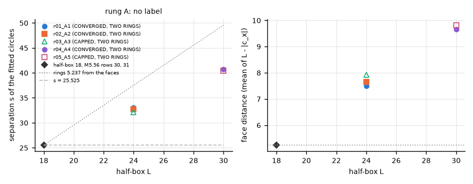
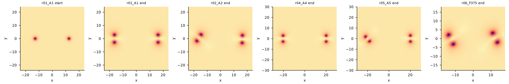

# M5.57: Two rings at δ = 0.05: the free pair in larger boxes, and the energy against a held separation

> Opened 2026-11-25 from the author's post of 2026-11-25 03:28 UTC on discussion #186 ([discussioncomment-19877260](https://github.com/vantasnerdan/substrate-framework/discussions/186#discussioncomment-19877260)), their answer to the results of [M5.56](m5_56_task_details.md), which asks for three runs, (a), (b) and (c), and registers two predictions, OW57-1 and OW57-2. Roadmap: [`m5_roadmap.md`](../m5_roadmap.md). Thread record: [`m5_32_convo.md`](m5_32_convo.md). It runs on the action of [M5.51](m5_51_task_details.md) with the midpoint weight at δ = 0.05, on the far fields, the pair seed and the stored pair ends of M5.56 §§ 10, 12 and 20, and reuses their readers. The plan went to the author with the questions of § 7 before any chain was relaxed. The author reviewed it on 2026-11-26 ([discussioncomment-19911695](https://github.com/vantasnerdan/substrate-framework/discussions/186#discussioncomment-19911695)): the defaults stand on questions 1 to 7 and 9, and question 8 takes the strict scoring. The amendment that folds the review is recorded at the end of § 9.

## TASK PLANNING (2026-11-25; staged: the words are frozen before any chain is relaxed)

**Scope.** On record from M5.56 § 20, at δ = 0.05 on half-box 18 at spacing 0.5: two free descents ended TWO RINGS (rows 30 and 31: U 39.898680, the fitted circles 25.5254 apart, each center 5.24 from the nearest face, both normals along the separation axis x) and one ONE OBJECT (row 33: U 40.311804, 0.41312 above, one ring of radius 6.34 with its normal along z). No energy against separation was computed, and one box cannot say whether the separation is set by the faces. The author's post of 2026-11-25 03:28 UTC asks, in this order: (a) the free pair in a larger box, "to see whether the separation stops before the faces"; (b) a curve E(d) under a hold on "the first moment of the degree (topological) density in each half-space", with a multiplier, the cores otherwise free, from separated to merged, on two spacings, far field fixed; (c) "only where the collar fits, one ring turned by 2π at a few d, to read whether the turned class costs more at contact". This task runs them as **rung A** (the free pair on half-boxes 18, 24 and 30), **rung B** (the held curve on half-box 18 at spacings 0.5 and 0.375) and **rung C** (one ring turned at up to three held separations). It reports words; no cell of [`MODELS.md`](../../../../../MODELS.md) changes by this plan.

**At plan time**, with code written for this plan and kept out of the repo, only fixed fields were read: energies, gradients, central-difference checks of gradients and reads of the stored ends of M5.56 (rows 22, 24, 30, 31, 33), of their copies moved by whole cells, of the pair seeds and of turned copies of a seed. No descent step of any kind was run, on any grid. Numbers so obtained are marked "at plan time, on fixed fields".

**What the plan-time reads changed.** Four facts, each with the rule it gives.

| # | Fact, at plan time, on fixed fields | Rule |
| --- | --- | --- |
| 1 | The density of [M5.54](m5_54_task_details.md) integrates to 1 in each half only with a lift that follows the pair's far field. With the lift radial about each ring's center (M5.54's lift, moved), the left half reads $Q_- = -0.500$ on row 30, with 1228 lift flips on its boundary: around the left ring the field is the half-turn image of a hedgehog. With the lift taken from the pair seed's own long axis (§ 1), both halves read 0.9992 with no flip on either boundary | the lift of § 1 |
| 2 | That moment, $D$, is not smooth on this lattice. Along the straight path from row 30's end to its copy moved by one cell along x, $D_+$ changes by 0.199 inside a displacement of 0.025 where the line crosses a row of nodes, by steps of up to 0.134 between neighboring points of a 41-point path (0.0125 apart) and up to 0.036 on an 81-point refinement of the crossing (0.0003 apart); its gradient, which holds the lift fixed, misses those steps by up to 0.119. A descent constrained by $D$ would meet a staircase | rung B holds the line weight $D'$ of § 1 (smooth: the same path reads every step within $8.3 \times 10^{-6}$ of its gradient's trapezoid) and **reads** $D$ at every rung end |
| 3 | The merged end does not sit at small d. Row 33's ring lies across the mid-plane: $D = 7.69$ (out of its regime: 167 and 180 lift flips on the half boundaries, $Q_\pm$ 0.965 and 0.970) and $D' = 8.44$, about the values of two rings 8 apart. A held separation therefore does not order the merged object below the pair | two ladders read as branches, and a contact maximum by the level rule of § 4 |
| 4 | A full turn of one core moves $D$: T[2π] about $\hat z$ on the collar centered at $(7.5, 0, 0)$ with $R_1 = 4.35$, $R_2 = 9.5$, on the pair seed $d_0 = 15$, raises $D_+$ from 7.518 to 8.851 (and to 9.533 at ψ = 1.25π); $D'$ is unchanged to every digit, since a turn keeps every node's eigenvalues | rung C holds $D'$ as well, so its turned start meets the hold exactly |

**Limits, stated before the run.** (1) Static states of one action, one descent per chain; no dynamics. (2) δ = 0.05 only. (3) Closed boxes with faces held at a far field of degree 2. (4) The hold of rung B is this plan's constraint and its held quantity is the plan's (fact 2), not the author's; it is not a state of the action. (5) Two spacings give a trend, not a limit: the author's condition of 2026-11-24 15:07 UTC (a tie needs the barrier to stay finite as h → 0) is not tested. (6) The contact maximum of § 4 is the largest of the least energies found on the held levels; a state on a level lower than every rung found there would lower it, so it is read as found and is not a bound. (7) Rung C cannot reach contact (§ 5). (8) Nothing here reads an exchange sign, a spin or a statistics. (9) $E_{\min}$, $D'_{\mathrm{free}}$ and the free end of half-box 18 belong to the state that box's faces set: if rung A reads KEEPS SEPARATING, $M_c$ is measured from a separation the box sets, and that is printed beside the score of OW57-2.

**Definition of done.** The controls of § 2 met, or reported with the exact failing check; every row of §§ 3 to 5 ended by its rule, cut by a cap, or "not run" with the rule that stopped it; every word of §§ 3 to 5 given or "no label" with the rule that withheld it; OW57-1 and OW57-2 scored by § 6 and the expectations of § 8 scored; findings that embed: the separation and the face distance against the half-box (rung A), U against s with $D'$ and $D$ for both ladders at both spacings (rung B), the path tables and turn profiles of rung C; a numbers check on a different model recomputing every word from the summary JSON; an adversarial audit with its own code on the stored ends; the doc checker and the roadmap linter clean.

**Gating.** (1) The author's answer to § 7, or the user's ruling to run without it: met on 2026-11-26 by the author's review ([discussioncomment-19911695](https://github.com/vantasnerdan/substrate-framework/discussions/186#discussioncomment-19911695)), folded in the amendment of that day (§ 9). (2) The user's go. No rule of §§ 1 to 6 changes after the go; an answer of the author that changes a rule is folded in a dated amendment before the go.

### 1. The action, the two moments, the hold and the descent rules

The action is that of M5.51 § 1 with the midpoint weight at δ = 0.05, as [`m5_51_action.py`](../scripts/m5_51_action.py) codes it, with the vacuum replacement of M5.56 § 10: $\kappa = v = L_V = 1$, $L_1 = 0$, faces held. Each grid's `M0` attribute is replaced by its far field before any `hold_faces`. The far field of half-box 18 at both spacings is $M_{0\delta}^{(2)}$ of M5.56 § 12 with $d_0 = 14$ (the record's).

$\lambda_1 \ge \lambda_2 \ge \lambda_3$ are the eigenvalues of $M$, $g_{12} = \lambda_1 - \lambda_2$, $\hat n$ the top eigenvector. A half is the set of inner nodes (off the faces) with $x > 0$ (the + half) or $x \lt 0$ (the − half); the node plane $x = 0$ belongs to neither.

**The degree moment $D$ (read).** With $\hat n_{\mathrm{ref}}$ the direction field of $z = z_1 z_2$ (M5.56 § 1) with centers $(\pm d_c/2, 0, 0)$, no ladder and no core, the lift, the density of M5.54 § 1 and the moment are

$$
\tilde n = s \hat n , \qquad s = \operatorname{sgn}\big( \hat n \cdot \hat n_{\mathrm{ref}} + 10^{-12} \big) , \qquad b_a = \tilde n \cdot \big( \partial_b \tilde n \times \partial_c \tilde n \big) \ \text{(cyclic)} , \qquad \rho = \textstyle\sum_a \partial_a b_a
$$

$$
Q_\pm = \frac{h^3}{4\pi} \sum_{\pm} \rho , \qquad D_\pm = \frac{h^3}{4\pi} \sum_{\pm} \lvert x \rvert \rho , \qquad D = D_+ + D_-
$$

with $\partial$ the differences of M5.54 (central inside, one-sided first order on a face) and $\sum_\pm$ the sum over a half. For one center the lift is M5.54's, $\hat n_{\mathrm{ref}} = \hat r$. On a rung end $d_c$ is the reader's separation $s$ (0 on a ONE OBJECT end). On the lattice $D_\pm = (h^3/4\pi) \sum_a \langle G_a^{\mathsf T} w_\pm, b_a \rangle$ exactly, $G_a$ the difference matrix and $w_\pm = \lvert x \rvert$ on the half: the volume sum and the face form of the brief are one sum, so neither carries less lattice noise. **Regime of a $D$ read:** $\lvert Q_\pm - 1 \rvert \le 0.01$, no lift flip ($\tilde n_i \cdot \tilde n_j \lt 0$) between neighbors on either half's boundary shell (its part of the two outer node layers of the box and the node planes $x = 0$ and $x = \pm h$), $g_{12} \ge 0.2$ on the planes $x = 0, \pm h$. Links with a node within $2h$ of the line $x = \pm d_c/2$, $y = 0$ on the two outer layers of the ±z faces are left out of the flip count: there the chart of $z_1 z_2$ has its pole (directly above or below a center) and the reference direction is the code's fallback; at plan time the on-node seeds read 8 flips per half there and none elsewhere. **Error budget:** 0.1 against the reader on the known answers (§ 2, C4), plus the staircase of fact 2 (0.2): $D$ is printed to two decimals and carries no word.

**The line moment $D'$ (held).** With $g_0 = 0.2$:

$$
w = \exp\big( -g_{12}^2 / g_0^2 \big) , \qquad g_{12}^2 = (\lambda_1 + \lambda_2)^2 - 4 \lambda_1 \lambda_2 , \qquad D'_\pm = \frac{\sum_{\pm} \lvert x \rvert w}{\sum_{\pm} w} , \qquad D' = D'_+ + D'_-
$$

$g_{12}^2$ is a smooth function of $M$ wherever $\lambda_2 \gt \lambda_3$ (a symmetric function of the top pair), so $D'$ is smooth where its weight lives; $D'$ is unchanged by any node-wise turn of the target (T and W of M5.56 keep every node's eigenvalues). The weight is bounded by 1 per node and normalized to 1 per half, the property the author's post asks of the density ("it cannot collapse onto one to three nodes as the gap moment did in M5.50"). Why $g_0 = 0.2$, at plan time on row 30: at 0.1 the line carries 2.96 node-equivalents of weight per half (a collapse onto a few nodes is then cheap); at 0.2, 40.47 per half with the share 0.999999 and $\lambda_2 - \lambda_3 \ge 0.374$ wherever $w \gt 10^{-6}$; at 0.3, nodes with $\lambda_2 = \lambda_3$ enter the weight above $10^{-6}$ and the share falls to 0.93. **Regime of a $D'$ read:** (i) the share of $w$ within 1.5 of the line is at least 0.99, the line being the large components of the low-gap set: the nodes with $g_{12} \lt 0.5$ and $r \lt 0.93 L$ split by 26-neighborhood, as the two-ring reader of M5.56 § 2 builds them, a component large when it holds at least 20 nodes; (ii) $\lambda_2 - \lambda_3 \ge 0.1$ on every node with $w \gt 10^{-6}$. It is read on every pair word, "neither" included. At plan time the share reads 0.999999 on row 30 (components of 338 and 338 nodes), on row 33 (658) and on row 33 dilated along x by 1.5 and 1.8 ($D'$ 12.57 and 15.05; one component of 1002 and 1192 nodes); 0.988 on row 30 with the node $(17, 0, 0)$ set to $\tfrac{1+\delta}{3} \mathbb{1}$ and 0.98 on row 22 with the node $(6, 0, 0)$ so set (a component of one node); the same for every minimum size from 4 to 40. The minimum 20 is the plan's choice: under the smallest ring on record (300 nodes) and above a few isolated nodes. **Error budget:** 0.01 against the reader on known answers whose centers sit on nodes (C1, within $2 \times 10^{-4}$ at plan time); a line off the nodes reads up to 0.0104 off at spacing 0.375 (the seed $d_0 = 10$, centers 0.125 from a node), so a read on a relaxed end carries 0.011. Plan-time values: row 30, $D'_\pm = 12.7669$ each, sum 25.534 against $s = 25.525$; row 33, 4.218 and 4.217, sum 8.435; a single node of row 30 at $(17, 0, 0)$ set to $\tfrac{1+\delta}{3} \mathbb{1}$ moves $D'_+$ by 0.102 at a fixed-field cost of 1.67 in U, about 700 times the slope of U along a held path that the record's 0.41 over a separation change of 17 implies.

**The hold.** As M5.50 § 1, with $D'$ in place of its moment and one multiplier on the sum, as the author's post states it:

$$
E_\mu = U + \frac{\mu}{2} \big( D'[M] - d \big)^2 , \qquad f = \mu \big( d - D' \big) , \qquad T_k = \tfrac12 ( f_k + f_{k+1} ) ( D'_{k+1} - D'_k )
$$

The author's post names a Lagrange multiplier; the plan applies it as this quadratic penalty, whose f is the multiplier at rest. At rest the gradient of U is f times that of $D'$, f is the slope of U against $D'$ along a branch, and $T_k$ is the step identity between neighboring rungs (M5.50 § 1). The hold energy is printed apart from U and never enters it. μ = 20 on every rung; μ = 1 on the rungs of C7 (two strengths far enough apart that their rungs differ by more than the convergence bars). At plan time on row 30: $\sum \lvert \partial D'_+ / \partial m \rvert^2 = 0.178$, the largest entry over $h^3$ 0.426. Printed per rung: $D'_+ - D'_-$ (the pair's offset from the mid-plane, which one multiplier leaves free).

**The descent and convergence rules (every chain of this task).**

| Rule | Value |
| --- | --- |
| Optimizer | L-BFGS-B of M5.56 § 4: `maxcor` 10, `ftol` 0, `gtol` $10^{-7}$ on the gradient with its factor $h^3$, `maxfun` 1.25 times the cap |
| The gate G | the largest entry of the gradient of the minimized energy (U, or $E_\mu$) over $h^3$ on the free nodes. Free chains: $G \le 10^{-3}$. Held chains: $G \le \max\big( 10^{-5}, \min( 10^{-3}, 0.1 F ) \big)$, F the largest entry of $f \, \partial D' / \partial m$ over $h^3$ (M5.50's gate, with a floor). Every chain also has the minor torque of M5.56 § 10 at most $10^{-5}$ |
| CONVERGED | the gate met and one of: (a) the end by `gtol`; (b) two major stops at least 5000 iterations apart within $10^{-8}$ relative in U, 0.002 in every $R_L$ (in s on a pair, not used on a ONE OBJECT end), $10^{-4}$ in $D'$ and $\mu_{\mathrm{free}} \le 0.003$; (c) **new:** an end by the relative-reduction test that repeats after its restarts, with $G \le 10^{-5}$ and the second step met |
| What (c) would wrongly pass | a chain drifting in a slow mode by less than the second-step bars over 500 iterations; K5 is its guard |
| Restarts | an abnormal line-search end, and an end by the relative-reduction test with the gate not met, restarted from the last iterate with a fresh memory, three times at most, logged |
| The second step | the reads at the end against the last saved stop at least 500 iterations earlier, else at least 100 earlier: U within $10^{-6}$ relative (the bar of K5; $10^{-7}$ fails on the record: the K5 of M5.56's row 31 ended at iteration 534, $7.5 \times 10^{-7}$ from its stop at 20), s (or every $R_L$) within 0.002, $D'$ within $10^{-4}$, $\mu_{\mathrm{free}} \le 0.003$, the same pair word. When no such stop exists the end is given a K5 and its second step reads "K5 met" or not. An end whose second step is not met carries no word and is not in hold |
| K5 | on the ends named in §§ 3 to 5: $10^{-4}$ normal noise on each free component (seed $57100 + n$, n as for the noise), relaxed by these rules and the same hold, cap 10000; met only when its own relaxation ends CONVERGED and U returns within $10^{-6}$ relative, the pair word is unchanged, s (or $R_L$) within 0.002, $D'$ within $10^{-4}$ and $\mu_{\mathrm{free}} \le 0.01$. A K5 that ends CAPPED reads "K5 not met (capped)" and its row carries no label; no other reading is used |
| Caps | 30000 iterations for the references and rung A, 10000 for a rung, a release or a K5; wall caps of 24 hours on $121^3$, 12 hours on $97^3$, 6 hours on $73^3$ and $49^3$, counted across resumes; a cut ends CAPPED |
| Stops and saved fields | those of M5.56 § 4; at the major stops the two-ring reader of M5.56 § 2, $D'$ with its regime, $D$ with its regime and $Q_\pm$; on $49^3$ M5.51's `read_state` |
| Noise | $10^{-4}$ normal draws on each free component, `numpy.random.default_rng(57000 + n)`, n the row's index in the builder's row list, fixed before the go, one array over the free nodes in C order; a continuation rung and a refinement start (§ 4) get none |
| The launcher | one single-threaded process per row (the five thread variables set to 1 before NumPy and numba load), at most 12 at once; it reaps every child, relaunches once a child that died without a record (from its last saved field, logged), and writes the end file itself when its queue is empty and no child is alive |

### 2. The controls

Each control runs before the rows it gates, has a try cap of three (between tries only an input or a defect of a script may change, never a threshold of this plan, each change logged), and states the node set and formula it is read on. "Moved by k cells" means the field taken at the node k cells back along the axis, the vacated layers filled by the nearest stored layer (edge padding), the faces then reset to the far field.

| Control | Input, node set and formula | The Answer It Must Return | An Input That Fails It | Cost Of A Failure |
| --- | --- | --- | --- | --- |
| C1, $D'$ known answers | $D'_\pm$ of § 1 over the inner nodes of each half: the pair seeds $d_0$ = 9, 15, 21 at spacings 0.5 and 0.375 (centers on nodes at both), no ladder, the value read and not the regime; row 30; row 30 moved by 2 cells along x and by 4 along y | seeds: $D'_\pm$ within 0.01 of $d_0/2$ (plan time 4.50011, 7.50004, 10.49996 at 0.5; 4.50016, 7.50005, 10.49995 at 0.375); row 30: $D'$ within 0.05 of s (25.534 against 25.525); moved along x: $D'_\pm$ change by +1 and −1 within 0.005 (1.0000); along y: within 0.005 (0.0000) | the weight not normalized, $\sum \lvert x \rvert w$: 516.7 on row 30's + half; $g_0 = 0.3$: the share clause fails (0.93) | no held chain |
| C2, the gradient of $D'$ | central differences, step $10^{-6}$, at 4 nodes in each of three classes on row 30 (within 0.5 of a fitted circle, 0.5 to 1.5, beyond 5 in the + half), all six components, against the analytic gradient | each within $10^{-6}$ of the largest analytic entry of the sample (plan time: worst $2.2 \times 10^{-9}$ against $4.2 \times 10^{-2}$) | the derivative of the normalization left out (the term $-D'_\pm / \sum w$) | no held chain |
| C3, a smooth hold | $D'_+$ on 41 evenly spaced points of the straight path from row 30's end to its copy moved by one cell along x | every step within $10^{-4}$ of the trapezoid of the analytic gradient (plan time $8.3 \times 10^{-6}$), the total change $0.5$ within 0.005 (0.50000) | $D_+$ of § 1 on the same path: a step off by 0.119 | no held chain |
| C4, the degree read | $D_\pm$, $Q_\pm$ and the regime of § 1: the seeds $d_0$ = 9, 15, 21 at both spacings ($d_c = d_0$); rows 30, 31 ($d_c = s$); row 33 ($d_c$ = 0, 2, 7.7, 12) | seeds: D within 0.1 of $d_0$, $Q_\pm$ within 0.002 of 1, in regime by the flip rule of § 1 (plan time 9.081, 15.036, 21.007 at 0.5 and 9.049, 15.023, 21.006 at 0.375; $Q_\pm$ 0.9989 to 0.9995); rows 30, 31: D within 0.1 of s (25.482 against 25.525), $Q_\pm$ 0.9992, in regime; row 33: out of regime | the lift radial about each center, no half-turn for the − half: $Q_- = -0.500$ on row 30, 1228 flips | D is not read; no word changes |
| C5, the hold moves a ring | row 22 of M5.56 (H1, one ring, normal along y) held by the one-ring form $D'_1 = \sum x w / \sum w$ over the inner nodes at $a$ = 1.0 and 2.0, μ = 20; then each released (no hold) | the fitted center's x within 0.1 of $a$ and y, z within 0.1 of 0; $R_L$ within 0.02 of 2.9391; the share of § 1 at least 0.99; $0 \le U - 19.497928 \le$ the fixed-field cost of the moved copy (0.1610 and 0.6999 at plan time); the release returns to row 22: U within $10^{-6}$ relative, the center within 0.05 of the origin. Plan time: the copies read $D'_1$ = 0.99999 and 1.99999 | (fixed fields) row 22 with the node $(6, 0, 0)$ set to $\tfrac{1+\delta}{3} \mathbb{1}$: $D'_1$ moves by 0.133 and the share falls to 0.98 | no held chain |
| C6, the force of the hold | four rungs of half-box 18 at 0.5 at targets $D'_{\mathrm{free}} - k$, $k = 1$ to 4 (one side of the free state), each from the rung before, the first from row 30's end | on each counted step, $\lvert \Delta U - T_k \rvert \le \max( 0.05 \lvert \Delta U \rvert, 10^{-4} )$. The floor is 2.5 times the second-step bar on U at these energies ($10^{-6}$ relative of U near 40): under it two converged rungs cannot be told apart. A step with $\lvert \Delta U \rvert \lt 2 \times 10^{-4}$ is not counted, and the control needs two counted steps (an estimate, not a read: the record's 0.41 over a separation change of 17 gives about 0.024 a step) | f taken with its sign reversed | no word of § 4 |
| C7, two strengths | μ = 1 at targets 20, 16 and 12 of the inward ladder at each spacing, from the same start as the μ = 20 rung. The two rungs at one target are neighboring points of one branch (their $D'$ differ by $f - f/20$), so the test is the step identity between them | $\lvert \Delta U - T \rvert \le \max( 0.05 \lvert \Delta U \rvert, 10^{-4} )$ (as C6); a target where either rung is not TWO RINGS in hold, or where $\lvert \Delta U \rvert \lt 2 \times 10^{-4}$, is "not read"; the control needs two targets read at the spacing. An estimate, not a read: the record's slope of about 0.024 gives $\lvert \Delta U \rvert$ near $5 \times 10^{-4}$ and a hold energy near $3 \times 10^{-4}$ at μ = 1, so the failing input fails | the hold energy counted into U | no word of § 4 at that spacing |
| C8, a release | the first inward rung (target 24) at each spacing, released (no hold) | returns to the free end of its spacing: U within $10^{-6}$ relative, TWO RINGS, s within 0.01 | the release with the hold left on: it stays near s = 24 | no word of § 4 at that spacing |
| C9, the two-ring reader | M5.56's C6 and C17 (pair part), unchanged | as there (met in M5.56 § 15) | as there | no pair word |
| C10, the turn reader about one ring of a pair | M5.56's C3 (c) on each reference of rung C, on the turn the start uses: T[2π] about ring 1's fitted normal, the other ring's ball and tube left out | σ = −1 (a 2π turn of either sign reads −1, M5.56 C3 (a)), the angle within 0.15 of $\Theta f(\rho_k)$, $r_k \le 0.15$ | the other ring's nodes left in and the shells read through the other ring: out of regime | no row of rung C on that reference |

C1 to C4 are fixed-field controls and run first. C5 and C6 gate the ladders: the launcher starts no rung of § 4 before both are met. C7, C8 and C10 run as named.

### 3. Rung A: the free pair in larger boxes

**Grids.** Half-box 18 (73³) is the record: rows 30 and 31 of M5.56, not rerun. Half-box 24 (97³) and half-box 30 (121³), spacing 0.5. Three boxes, so a trend has three points; one box alone cannot tell "stops" from "follows the box".

**The far field.** Every box holds its faces at $M_{0\delta}^{(2)}$ with $d_0 = 14$ (the record's). At plan time, on fixed fields, the face texture against its far-field separation: the faces of $d_0 = 14$ and 25.525 differ by up to 0.41 (the largest Frobenius norm of the node-wise difference over the face nodes) on half-box 18, 0.20 on half-box 24 and 0.12 on half-box 30; those of $d_0 = 14$ and 0 (the degree-2 map about the box center, which carries no separation) by up to 0.14, 0.077 and 0.051. **One control:** on half-box 24 the start A3 holds the faces of $d_0 = 0$.

**The starts.** Two per new box, at the two readings' predictions: $d_0 = 25.525$ (the record's separation: near the end if the separation stops) and $d_0 = 2(L - 5.237)$ (each center 5.237 from its face: near the end if it follows the box). Each start is the pair seed with the ladder of M5.56 § 12 recast for the box: $d(r) = d_0$ for $r \le R_{\mathrm{in}} = d_0/2 + 4.35$, the smoothstep to its far field's separation (14; 0 for A3) at $R_{\mathrm{out}} = L - h$; when $R_{\mathrm{out}} - R_{\mathrm{in}} \lt 4$ no ladder is used (the seed of $d_0$ everywhere, the faces reset). Start rule: no jump link (both nodes $s \lt 10^{-4}$, top eigenvectors more than 45° apart) anywhere, the box surface liftable with $\lvert q \rvert = 2$. At plan time, on fixed fields, every start passes:

| Row | Box | $d_0$ | Faces | Ladder | Largest Angle Between Near-Vacuum Nodes |
| --- | --- | --- | --- | --- | --- |
| A1 | 24 | 25.525 | $d_0 = 14$ | 17.11 to 23.5 | 8.88° |
| A2 | 24 | 37.526 | $d_0 = 14$ | none | 30.42° |
| A3 | 24 | 25.525 | $d_0 = 0$ (control) | 17.11 to 23.5 | 8.88° |
| A4 | 30 | 25.525 | $d_0 = 14$ | 17.11 to 29.5 | 8.88° |
| A5 | 30 | 49.526 | $d_0 = 14$ | none | 36.62° |

Free descents (no hold), noise of § 1, K5 on every CONVERGED end. **Reads:** the two-ring reader; s; the distance $g$ of each fitted center to the nearer face along x, $g = L - \lvert c_x \rvert$, and $\bar g$ their mean; U; radii, normals; $D'$ and $D$ as descriptors.

**The box word, per box.** A box counts when both of its main starts end CONVERGED with K5 met and agree: both TWO RINGS with s within 0.05 and U within $10^{-6}$ relative (the record's two ends agree to $2 \times 10^{-6}$ in s), or both ONE OBJECT with U within $10^{-6}$ relative. Its s and $\bar g$ are the means over the two.

| Word | Rule (half-box 18: $s_{18} = 25.525$, $\bar g_{18} = 5.237$) |
| --- | --- |
| KEEPS SEPARATING | all three boxes count as TWO RINGS, $s_{24} - s_{18} \gt 1.0$ and $s_{30} - s_{24} \gt 1.0$ (two spacings), and $s_{30} - s_{24} \ge \tfrac12 ( s_{24} - s_{18} )$ (the growth does not fall by more than half from one box step to the next). FOLLOWS THE BOX is printed beside it when $\lvert \bar g_{24} - 5.237 \rvert \le 0.5$ and $\lvert \bar g_{30} - 5.237 \rvert \le 0.5$ (one spacing) |
| STOPS | half-boxes 24 and 30 count as TWO RINGS and $\lvert s_{30} - s_{24} \rvert \le 1.0$ |
| MERGES | half-boxes 24 and 30 count as ONE OBJECT: a state with no separation replaces the pair |
| no label | otherwise (a box that does not count, starts that disagree, a separation that shrinks, mixed words, a second step over 1.0 and under half the first); printed with the numbers |

Inputs and their words: rings 5.24 from the faces on every box give KEEPS SEPARATING with FOLLOWS THE BOX; a separation in proportion to the box ($s/L$ constant: $s_{24} = 34.0$, $s_{30} = 42.5$, $\bar g$ 6.98 and 8.73) gives KEEPS SEPARATING without it; one separation on both larger boxes gives STOPS; rings that leave the faces and nearly stop ($s_{24} = 31.5$, $s_{30} = 33.0$) give no label. The face control: if A3 ends CONVERGED with another pair word than half-box 24's, or TWO RINGS with s more than 1.0 from half-box 24's s, the word reads "no label (the far field moves the separation)". A3 not CONVERGED leaves the word standing, printed beside it. The phrases "set by the box" and "box-limited" are not written about one box. **Descriptor, not a word:** U of the pair against twice a one-ring reference is not printed: no one-ring reference shares this far field (degree 2 against degree 1).

### 4. Rung B: the energy against a held separation

**Grids and ends.** Half-box 18 at spacing 0.5 ($73^3$) and 0.375 ($97^3$), the far field of § 1. At 0.5 the free end is row 30 of M5.56 and the merged end row 33, both on record CONVERGED with K5 met. At 0.375 two references, each interpolated from its 0.5 end by `map_coordinates` of order 3 (as M5.56's B2), the faces reset, relaxed free: **F375** (from row 30) and **M375** (from row 33), with K5.

**The ladders.** Targets of $D'$:

| Ladder | Spacing 0.5 | Spacing 0.375 |
| --- | --- | --- |
| Inward, from the free end | 24, 22, 20, 18, 16, 15, 14, 13, 12, 10, 8, 6, 4, 2; each rung from the end of the rung above (the first from row 30) | the same targets; each rung from its 0.5 parent (same ladder, same target) interpolated as F375, the faces reset |
| Outward, from the merged end | 10, 12, 14, 16, 20, 24; each rung from the end of the rung below (the first from row 33) | the same, from the 0.5 parents |
| C6, C7, C8 | § 2 | C7 and C8 |

At 0.375 the rungs are refinement starts, not a continuation at 0.375: a **refinement start** is the 0.5 parent's end interpolated to $97^3$ by `map_coordinates` of order 3 on the six components, the faces reset to the 0.375 far field, no noise, relaxed under the parent's target and μ. Each child lies on its parent's branch, and the children run side by side as the parents end (§ 9). A child runs only from a parent in hold; otherwise "not run: no parent". A rung that is not CONVERGED does not stop its ladder: the next rung starts from its last state, it gives no point, and every later rung of that ladder is flagged "after a capped rung" in the tables. A ladder stops after two consecutive rungs that are not CONVERGED (its later targets read "not run: the ladder broke").

**Releases.** At each spacing: C8; the first inward rung that reads ONE OBJECT; the first outward rung that reads TWO RINGS. Each is relaxed with no hold and printed with the end it reaches (U, the pair word, s).

**K5** on: F375, M375; the rung of the contact maximum and its two neighbors on the same ladder; the first ONE OBJECT rung of each inward ladder; every reference of rung C.

**Per rung, the reads and the class.** U and its parts; the hold energy; f; $D'$, $D'_+ - D'_-$; $D$ with its regime; the pair word; s, radii, normals. A rung is **in hold** when it is CONVERGED, its second step is met and $D'$ is in its regime. It is **EVADED** when it reads TWO RINGS and $\lvert D' - s \rvert \gt 0.5$ (plan time 0.009 on row 30). A rung is **usable** when it is in hold and not EVADED; an EVADED rung gives no point of the curve and does not enter $E_{\mathrm{low}}$.

**The curve, per spacing.** Two branches, U against s (abscissa: the reader's separation; $D'$ and $D$ printed beside), from the rungs in hold that read TWO RINGS and are not EVADED, and the ONE OBJECT rungs printed at their $D'$. On each ladder, the steps between neighboring such rungs that read TWO RINGS are checked by the identity: a step passes when $\lvert \Delta U - T_k \rvert \le \max( 0.05 \lvert \Delta U \rvert, 2 \times 10^{-4} )$ at 0.5 and $\max(0.10 \lvert \Delta U \rvert, 2 \times 10^{-4})$ at 0.375; a failing step is printed as a jump (two states on one ladder). **BRANCHES** at a target where both ladders hold a rung in hold whose U differ by more than $10^{-4}$; the lower is printed as the least state found at that level.

**The contact maximum, per spacing (the level rule).** The number is the author's (their post of 2026-11-24 15:07 UTC, answer 3): the maximum along d of the energy above $E_{\min}$, in units of the core energy. $D'$ is continuous on fields, so a continuous path from the free end to the merged end crosses every level of $D'$ between theirs. The range is the targets strictly between $D'_{\mathrm{merged}}$ and $D'_{\mathrm{free}}$ (at 0.5: 10 to 24, both in, since $8.44 \lt 10$ and $24 \lt 25.53$); the two ends enter through their own U. With $E_{\mathrm{low}}(d)$ the least U found among the usable rungs of both ladders at target d (any pair word) and $E_{\min}$ the least U among the two ends and the usable rungs:

$$
M_c = \frac{\max\big( \max_d E_{\mathrm{low}}(d), \ U_{\mathrm{merged}} \big) - E_{\min}}{E_{\mathrm{ring}}} , \qquad E_{\mathrm{ring}} = \tfrac12 U_{\mathrm{free}}
$$

$M_c$ is the largest of the least energies found on the held levels and the merged end, read as found (limit 6). $E_{\mathrm{ring}}$ is 19.949340 at 0.5 (half of row 30's U); M5.56's half-box-12 unit 19.497928 is printed beside. A profile that rises to the merged end and no higher gives $M_c = (U_{\mathrm{merged}} - E_{\min}) / E_{\mathrm{ring}}$, 0.0207 at 0.5 from the record. A target with no usable rung is skipped, and printed as skipped, when the levels next above and next below it both hold one (the free end and the merged end count as the levels beyond the range). $M_c$ reads no label when two neighboring targets hold none, or when the rung or end of the maximum lacks K5 met. Printed beside it: **INTERIOR MAXIMUM** when the largest $E_{\mathrm{low}}$ lies at a target in the range and exceeds $U_{\mathrm{merged}}$ by more than $10^{-4}$, **NO INTERIOR MAXIMUM** otherwise. As posted, these two words decided no score; by the amendment of 2026-11-26 the first clause of OW57-2 is scored by the rule of § 6, which is built on the same quantity. The margin $10^{-4}$ is 2.5 times the K5 bar on U at these energies ($10^{-6}$ relative of U near 40).

**The merged end, per spacing, two readings.** (i) Of the action with no hold: **A LOCAL MINIMUM** when the merged reference (row 33 at 0.5, M375 at 0.375) is CONVERGED with K5 met; **NOT A LOCAL MINIMUM** when its K5 relaxation ends CONVERGED and K5 is not met; no label otherwise. (ii) Of the held profile: **A HELD MINIMUM** when $E_{\mathrm{low}}$ at the target next above $D'_{\mathrm{merged}}$ and at the target next below it (10 and 8 at 0.5) both exceed $U_{\mathrm{merged}}$ by more than $10^{-4}$; **NOT A HELD MINIMUM** when one of them lies at or under it; no label when either target holds no usable rung. Reading (i) scores (§ 6), which the author's review of 2026-11-26 confirmed (§ 7, question 9); reading (ii) is printed beside. **The references must be what they are called (added by the amendment of 2026-11-26):** at a spacing whose merged reference does not read ONE OBJECT, or whose free reference does not read TWO RINGS, $M_c$ and both readings carry no label (at 0.5 rows 33 and 30 read so on record; at 0.375 M375 and F375 are relaxed free and could end otherwise). Printed too: where the release of the first inward ONE OBJECT rung lands.

**Which inputs give which word.** A profile that rises at every step from the free end to the merged end gives $M_c$ 0.0207 at 0.5 and NO INTERIOR MAXIMUM; a rung above the merged end's U inside the range gives a larger $M_c$ and INTERIOR MAXIMUM; an inward ladder whose rungs all read EVADED leaves neighboring targets with no usable rung, so $M_c$ reads no label.

### 5. Rung C: one ring turned at held separations

**Where it runs.** Spacing 0.5 only. On the inward rungs of § 4 at 0.5 that read TWO RINGS in hold, the collar about ring 1 (the ring with $c_x \gt 0$) of M5.56 § 4, computed on the relaxed rung end from its fitted circles: $R_1 = R_{L,1} + 1.5$, $R_2 = \min\big( \lvert c_1 - c_2 \rvert - R_{L,2} - 1.5, \ \min_a ( L - \lvert c_{1,a} \rvert ) - 2h \big)$, fit when $R_2 - R_1 \ge 8h = 4$. Of the rungs where it fits, at most three: the largest s, the smallest s, and the s nearest their mean (the smaller on a tie). None: "not run: the collar does not fit". With $R_L = 2.96$ on both rings (rows 30 and 31) this arithmetic gives a fit for s from about 12.9 to 17.1 on half-box 18: **rung C cannot reach contact** (the other ring takes the room a collar needs), and its separations are those of the inward targets 13 to 16. Rung C starts when the inward rungs at targets 16 to 13 at 0.5 have ended, whatever their words.

**The reference** of a separation is the rung end itself, under its own hold ($D'$, the same target and μ). **The start:** T[2π] about ring 1's fitted normal on that collar (M5.56 § 1), noise of § 1. T keeps every node's eigenvalues, so the start meets the reference's $D'$ exactly (fact 4).

**The start rule**, every clause evaluated on the relaxed reference and the start built from it: (i) $\lvert \Theta \rvert h / (R_2 - R_1) \le \pi/4$; (ii) no jump link of the long axis between near-vacuum nodes outside the tubes that the reference does not hold; (iv) no minor jump link (M5.56 § 10) outside the tubes that the reference does not hold; links are compared node pair by node pair. At plan time, on relaxed stored states: rows 30 and 31 hold no jump link (largest angle 7.6°) and 48 minor jump links each, every one within $R_L$ of a ring's center (largest 49.3°), none elsewhere; rows 22 and 24 hold 28 each inside the hole, and M5.56 § 23 records that the T and W starts made from them added none. No relaxed state where the pair collar fits exists at plan time, so the clauses on a pair collar are first evaluated at run time.

**The path tables** (fixed fields, on each reference): U along T[ψ] about ring 1's normal and its in-plane axis as M5.56's `inplane_axis` gives it (the unit projection of $\hat y$ on the ring's plane, since the normal lies within 25° of $\hat x$), ψ/π from 2 to 0 in steps of 0.125, $D'$ held exactly along the path. Word: **MONOTONE** when U falls at every step, else the largest rise printed as "a rise on this path", never as a barrier of the action.

**The chains** (rows CT1 to CT3), relaxed under the reference's hold, K5 on each CONVERGED end. **Words:** those of M5.56 § 5 with the readers of § 2 (the turn reader about $c_1$ with the other ring's ball and tube left out, C10) and "the readers agree" at δ > 0 of M5.56 § 10 against the reference: RELEASED, HELD, TORN, MOVED, no label. The cores are free and the turn has the falling path of M5.56 § 1, so a HELD is tabled as a stalled descent or a state the path does not reach, never as protection. **The line per separation:** MONOTONE and RELEASED reads "the turned class is not a state at this separation under the hold: the turn falls away"; any other pair of words is tabled. No number is called a barrier.

### 6. The author's predictions and their scoring, frozen

| # | Prediction (the author's post of 2026-11-25 03:28 UTC, registered before any run) | Confidence | Met | Not Met | Not Scored |
| --- | --- | --- | --- | --- | --- |
| OW57-1 | "in a larger box the free rings keep separating, so there is no minimum at finite d" | 60 percent | rung A reads KEEPS SEPARATING | rung A reads STOPS or MERGES | no label |
| OW57-2 | "the held E(d) has a contact maximum below 0.1 of the ring energy, and the merged state is a local minimum" | 50 percent | both spacings read met by the strict rule below | both spacings carry words by that rule and neither is met | otherwise (a spacing with no word, or one spacing met and the other not); both spacings printed |

**The strict scoring of OW57-2 (the author's review of 2026-11-26, question 8 of § 7).** The first clause counts as met only with a maximum before the merged end. The rule reads it on the quantity of § 4. Per spacing, with $E^{\ast}$ the largest $E_{\mathrm{low}}$ over the targets of the range, $\Delta_m = E^{\ast} - U_{\mathrm{merged}}$ and $\Delta_f = E^{\ast} - U_{\mathrm{free}}$ (the two references of that spacing):

| The interior reads | When |
| --- | --- |
| a maximum before the merged end | $M_c$ carries a number, $\Delta_m \gt 10^{-4}$ and $\Delta_f \gt 10^{-4}$ |
| none | $M_c$ carries a number, and $\Delta_m \lt -10^{-4}$ or $\Delta_f \lt -10^{-4}$ |
| unresolved | otherwise ($M_c$ without a label, or neither row above) |

| The spacing reads | When |
| --- | --- |
| met | a maximum before the merged end, and $M_c \lt 0.1$, and A LOCAL MINIMUM by reading (i) |
| not met | any one of: the interior reads none; $M_c \ge 0.1$; NOT A LOCAL MINIMUM |
| no word | otherwise |

The three rows of each table exclude one another and cover every outcome. With a maximum before the merged end, $E^{\ast}$ exceeds both ends, so the maximum inside $M_c$ is the interior one and the number scored is its height above $E_{\min}$. **The reading of "interior maximum" is the plan's:** the largest of the level energies of the range, above both ends by more than the margin, which is the quantity the posted § 4 named and the author's parenthesis "(before the merged end)" points to; a local maximum of the profile that stays under an end's U, followed by a dip, does not count. Three additions are the plan's and not the author's: the band of $10^{-4}$ on both sides (the margin of § 4, so that a difference under the plan's own bar on U gives no score in either direction); the comparison with the free end, which at 0.5 changes nothing ($U_{\mathrm{merged}}$ is 0.41312 above $U_{\mathrm{free}}$ on record) and at 0.375 keeps the edge of the range next to the free end from being read as a maximum should M375 end below F375; and the guard on the references of § 4.

**Printed beside the strict score**, per spacing and for the two together: the two words of § 4 (INTERIOR MAXIMUM or NO INTERIOR MAXIMUM, as posted), the target, the ladder and the pair word of the rung that holds $E^{\ast}$, and the score as written before the amendment. As written, a spacing is met when $M_c \lt 0.1$ and reading (i) gives A LOCAL MINIMUM, not met when $M_c \ge 0.1$ or reading (i) gives NOT A LOCAL MINIMUM, and has no word otherwise, whatever the interior; the two spacings combine as in the table's row (met when both are met, not met when both carry words and neither is met, not scored otherwise). Reading (ii) is printed beside and decides nothing.

Facts stated beside the scores. (a) The merged end at 0.5 (row 33, CONVERGED, K5 met) was on record before OW57-2 was registered, so reading (i) at 0.5 is a scoring after the fact; the author's review states the same and puts the weight of the score on the maximum before the merged end. (b) A local minimum of the action lies under the states next to it, so on the merged end's own branch the levels next to $D'_{\mathrm{merged}}$ lie above $U_{\mathrm{merged}}$, and the outward ladder's first rung (target 10, from row 33) starts on that branch. The interior therefore reads none only if, on every target of the range, some state under $U_{\mathrm{merged}}$ is found; where the rung that holds $E^{\ast}$ reads ONE OBJECT, the maximum scored is the wall of the merged state's own well as sampled at that target, and the print of that rung's target, ladder and pair word says so. (c) A profile whose levels all lie more than $10^{-4}$ under $U_{\mathrm{merged}}$ is scored not met by the strict score (as written before the amendment: met, with $M_c = 0.0207$ at 0.5). (d) "Met" and "not met by $M_c \ge 0.1$" read "as found" (limit 6): a lower state on the level of the maximum, missed by both ladders, would lower $M_c$ and could remove the maximum before the merged end; a lower $E_{\min}$, missed, would raise $M_c$ and could undo a met. "Not met by an interior that reads none" is not undone by a missed lower state, which only lowers a level; it is read on the targets of § 4, so a maximum between two neighboring targets (1 apart from 12 to 16, 2 apart elsewhere in the range), between the range and either end (at 0.5: $D'$ from 8.44 to 10 and from 24 to 25.53), or at a skipped target, is not seen, and the skipped targets are printed beside the score. (e) If rung A reads KEEPS SEPARATING, limit 9 is printed beside OW57-2. (f) Two spacings are a trend, not the limit h → 0.

### 7. Open to the author before the go

Each question carries the plan's default, which runs if the author does not answer.

| # | Question | Default |
| --- | --- | --- |
| 1 | The degree moment is a staircase on this lattice (fact 2), so a descent cannot hold it. Hold the line moment $D'$ (§ 1) and read the degree moment at every rung? | yes |
| 2 | The degree density integrates to 1 in each half with the lift from the pair seed's long axis, centers at ±s/2; a lift radial about each core reads −0.50 in one half (fact 1). This lift? | yes |
| 3 | One multiplier on the sum (as posted), applied as a quadratic penalty whose f is the multiplier at rest, or one per half, which also fixes the pair's center? | one, on the sum, as a penalty; the offset printed |
| 4 | The merged object on record lies across the mid-plane and sits at about the level of two rings 8 apart (fact 3). Is the contact maximum by the level rule of § 4, from two ladders, the number meant? | yes |
| 5 | Far field: two hedgehogs 14 apart on every box, with one control on half-box 24 holding the degree-2 map about the center? | yes |
| 6 | Rung C fits only at separations of about 12.9 to 17.1 and cannot reach contact; run it there, the turn about ring 1's normal? | yes |
| 7 | The ring energy for $M_c$: half the free pair's U on the same grid? | yes; the half-box-12 unit printed beside |
| 8 | The scoring of § 6: OW57-1 met on KEEPS SEPARATING and not met on STOPS or MERGES; OW57-2 by $M_c \lt 0.1$ (the merged end inside the maximum) and the merged end at both spacings, or its first clause met only with INTERIOR MAXIMUM (a maximum before the merged end)? | as written, the interior word printed beside |
| 9 | "The merged state is a local minimum": of the action with no hold (K5 on the merged reference), or of the held profile? | of the action; the held reading printed beside |

**Answered on 2026-11-26.** The author's review ([discussioncomment-19911695](https://github.com/vantasnerdan/substrate-framework/discussions/186#discussioncomment-19911695)) reads "run on defaults with one change". On questions 1 to 7 and 9 the defaults stand, each restated in the post: $D'$ held and $D$ read at every rung; the lift from the pair seed; one multiplier on the sum; the contact maximum over both ladders with the merged end included; the far field as on record, with the control; rung C only at separations of 12.9 to 17.1; the ring energy as half the free pair's U; the local minimum as that of the action with no hold. On question 8 the author asks the strict scoring, in their words "only with an interior maximum (before the merged end), with the as-written reading printed beside it", for the reason that the merged state's return after a kick was on record before the prediction was registered. § 6 carries it. The table above is kept as posted.

### 8. Registered expectations

No script uses them; scored in the findings. None was tuned to a plan-time read of a held or relaxed field (none exists); the turned-field reads of fact 4 bear only on the choice of hold.

| # | Expectation | Confidence | Contradicted By |
| --- | --- | --- | --- |
| X1 | rung A reads KEEPS SEPARATING | 50 percent | STOPS or MERGES |
| X2 | the face control A3 agrees with half-box 24 within 1.0 in s | 75 percent | A3 CONVERGED more than 1.0 away |
| X3 | C5 and C6 met at the first try | 65 percent | a try past the first |
| X4 | the inward ladder at 0.5 reads ONE OBJECT at some target of 2 or more | 55 percent | TWO RINGS or EVADED down to 2 |
| X5 | the contact maximum at 0.5 reads INTERIOR MAXIMUM | 40 percent | NO INTERIOR MAXIMUM |
| X6 | every path table of rung C reads MONOTONE and every rung C chain RELEASED | 75 percent | a rise, or another word |

### 9. Faults of the last plan, blindspot pass, consumers, research body, parallel shape, estimate

**The faults of M5.56's plan named at its review, and the rule each gets here.**

| Fault | Rule Here |
| --- | --- |
| A start-rule clause checked at plan time on the unrelaxed seed only | every clause of rung C is evaluated on the relaxed reference and its start; clause (iv) counts only links the turn creates; the plan-time counts on relaxed stored states are in § 5 |
| The pair collar did not survive the rings moving | the collar is computed on the relaxed held end, by rule, and its window is stated before the run (§ 5) |
| K5 said nothing of a re-relaxation that ends CAPPED | "K5 not met (capped)", the row without a label (§ 1) |
| Held chains stopped on the relative-reduction test with a small gate and got no label | restarts on that end, and clause (c) of CONVERGED, with what it would wrongly pass (§ 1) |
| A control's printed plan-time value could come from two readings | each control names its node set and formula (§ 2) |
| A launcher that did not reap a finished child held the end signal | the launcher reaps, relaunches once, writes the end file itself (§ 1) |
| "Set by the box" written with one box | the words of § 3 need three boxes, or two for STOPS and MERGES; the phrase is not used of one |

**Blindspot pass.**

| Family | Where It Lives Here | Guard |
| --- | --- | --- |
| Unvalidated instrument | $D'$, its gradient, the hold, $D$, the lift, the turn reader on a pair collar | C1 to C5 and C10, each with a failing input; C3 shows the hold smooth where $D$ is not |
| Artifact read as result | a rung's U set by μ, by the stop, or by the ladder's start | C7 (two strengths), the second step, K5, the step identity, two ladders read as branches, the children at 0.375 |
| Unfalsifiable check | a release of a turned free core (the zero mode); the face control that cannot move a word in one direction; the score of OW57-2 at 0.5, which the record nearly decides | rung C's HELD tabled, never protection; A3 can withhold rung A's word; the strict score of § 6, where the maximum before the merged end carries the first clause (the author's review of 2026-11-26), the score as written printed beside; fact (b) of § 6 names what the record still nearly decides, with the rung of the maximum printed |
| Resolution mistaken for accuracy | $D$ on a staircase; $M_c$ near the merged end's U | $D$ to two decimals, no word; the margin $10^{-4}$; the budgets of § 1 |
| Ceiling-to-point creep | $M_c$ read as the barrier | the largest of the least energies found, "as found" on both outcomes of the score (limit 6, § 6) |
| Wrong diagnostic for the regime | the half split on a ring crossing the mid-plane; $D'$ where $\lambda_2 = \lambda_3$; the collar near contact | the regimes of § 1 (row 33 out for $D$); the clause on $\lambda_2 - \lambda_3$; the collar window |
| The hold met without moving the line (M5.50) | far nodes closing their gap | the share clause at 0.99 about the large low-gap components (one such node reads 0.98 or 0.988), EVADED, C5 |
| This plan's choices taken for the author's | $D'$ and $g_0$, the lift, the far field, the targets, μ, the tolerances, the level rule, the collar | named as the plan's in the findings; § 7 |

**Consumers.**

| Sub-Result | Who Reads It | The Instrument Check It Needs |
| --- | --- | --- |
| Rung A's word, OW57-1 | the results post to the author on discussion #186 | C9, K5, A3 |
| The held profiles, $M_c$, the merged end, OW57-2 | the same post; a later task on the barrier as h → 0 | C1 to C8, K5, the numbers check, the audit |
| Rung C's path tables and words | the same post | C10, the start rule, K5 |
| The scorecard cells of M5 | only a later ruling of the repo owner | none from this plan |

**Research body.** This document (plan, findings, review). Scripts in [`../scripts/`](../scripts/), written by the builder after the go: `m5_57_hold.py` ($D'$, $D$, the lift, the holds, the starts of rung A, C1 to C4 under `--selftest`), `m5_57_relax.py` (the rows, the releases, K5, the launcher), `m5_57_reads.py` (the words, the scores, the summary, the plots). They import [`m5_51_action.py`](../scripts/m5_51_action.py), [`m5_51_reads.py`](../scripts/m5_51_reads.py), [`m5_54_charge.py`](../scripts/m5_54_charge.py), [`m5_56_turn.py`](../scripts/m5_56_turn.py) and the rules of [`m5_56_relax.py`](../scripts/m5_56_relax.py) unchanged, and write nothing into the folders of M5.51 or M5.56. Summary `m5_57_summary.json` in [`../data/`](../data/) (tracked); chain states in `../checkpoints/m5_57/` (local-only); plots `m5_57_*.png` in [`../plots/`](../plots/); nothing tracked over 1 MB.

**Parallel shape.** One single-threaded process per row, at most 12 at once. A descent is sequential; a ladder is sequential by continuation, so the shape is several chains side by side: the five rows of rung A (the two on $121^3$ first); the controls C5 and C6, which gate the ladders; the two ladders at 0.5; F375 and M375; each 0.375 child as its parent ends; C7, C8, the releases and K5 as their inputs end; rung C when the inward rungs at targets 16 to 13 at 0.5 have ended. No GPU: the action needs double precision. The clock is set by the longer of the two rows on half-box 30 and the chain of the inward ladder at 0.5 followed by its last child at 0.375.

**Estimate, as run rules.** At most 5 rows of rung A on $97^3$ and $121^3$ under their caps; 2 references on $97^3$; 20 rungs at 0.5 and 20 at 0.375; 4 rungs of C6 and 6 of C7; at most 6 releases; the 2 held rows and 2 releases of C5; at most 3 chains of rung C; K5 on the ends named; 2 path tables per rung C reference. Sub-agents: one builder on Opus, one numbers check on Sonnet, one adversarial audit on Opus in a fresh context with a neutral brief. The user's touchpoints: the post of this plan to the author, the go, the review; none between unless a control reaches its try cap. Autonomy: unattended from the go to the review.

**Deviations.** Anything forced off this plan takes the conservative option (the word withheld rather than given, the stricter reading) and is logged in the progress notes and in the task document as it happens.

**Not computed.** A barrier as h → 0 (two spacings); a hold on the degree moment itself (fact 2); a turned class at contact, or at a spacing other than 0.5; the twist of the minor frame (W) at held separations; a turned class at δ = 0; any start of rung B other than the record's ends and their continuations; a box beyond half-box 30 for rung A, or a second spacing there; the three runs the author asked on 2026-11-25 19:31 UTC with capstone 4.6, which are not part of this task; any exchange sign, spin or statistics.

**The plan audit and its fold (2026-11-25).** A fresh-context audit of the draft, with its own fixed-field probes and no descent, reproduced nearly every plan-time number and found one blocker, nine majors and eighteen minors, all folded above. The blocker: C1's seeds at spacing 0.375 had their centers off the nodes and read $D'_\pm$ 0.0104 off; the seeds are now $d_0$ = 9, 15, 21, on nodes at both spacings, and the budget of $D'$ names the off-node error. The majors: the regime of $D'$ tested the share about fitted circles, which a stretched merged loop fails, and now tests it about the large components of the low-gap set; $M_c$ was called a lower bound, and is now the largest of the least energies found, read as found; $M_c$ now follows the author's definition, the merged end included, and the merged end's two readings are named, with (i) scoring; rung A's words missed outcomes and now include KEEPS SEPARATING and MERGES, with OW57-1 decided by the prediction's own sentence; C7 compared against a cubic and is now the step identity between the two strengths at one target; an EVADED rung is now kept out of $E_{\mathrm{low}}$; a ladder no longer breaks at one capped rung; the second step's bar on U failed on the record and is now that of K5; and the dependence of $E_{\min}$ on the box is a stated limit. The auditor then read the folded plan again and recomputed every new number: no blocker, three majors that the fold had brought (a tolerance of C7 under the plan's own convergence bars; no band between KEEPS SEPARATING and STOPS; a score of OW57-2 at 0.5 that the record nearly decides) and two items resolved in part (a capped rung that leaves a target empty; an EVADED rung counted as in hold). Those five are folded above: the strengths and floors of C6 and C7, the third clause of KEEPS SEPARATING, the fact beside the score with question 8, the skip rule of $M_c$, and the usable rung. That last fold was not audited again. The draft, the audit and the fold were written by instances of one model in separate contexts.

**The author's review and the amendment (2026-11-26).** The author reviewed the posted plan ([discussioncomment-19911695](https://github.com/vantasnerdan/substrate-framework/discussions/186#discussioncomment-19911695)) and asked one change, the strict scoring of OW57-2 (§ 7). The amendment was made before the go and before any chain was relaxed. It changed: the opening note; the gating; in § 4, the sentence on the two interior words (which no longer says they decide no score) and the sentence on which reading of the merged end scores; in § 6, the row of OW57-2 and everything under the table; in § 7, the paragraph of answers under the table; the guard of the blindspot row on the unfalsifiable check. It added three rules that are the plan's and not the author's: the band in which the interior is unresolved and the spacing has no word; the comparison of the maximum with the free end; and, in § 4, that $M_c$ and the readings of the merged end carry no label at a spacing whose references do not read ONE OBJECT and TWO RINGS. The last one also applies to the score as written. Apart from that sentence, no instrument, control, row, cap, tolerance, target or word of §§ 1 to 5 changed; the two interior words of § 4 are defined as posted, and the expectations of § 8 stand as registered on 2026-11-25, X5 among them. The plan as posted, before the amendment, is [the file at the merge of its pull request](https://github.com/openwave-labs/openwave/blob/5801dc5adf8d2946a2ea0984a47275ab3ac15f16/openwave/xperiments/m5_liquid_crystal/research/tasks/m5_57_task_details.md). A fresh-context audit of the amendment against the author's post, with a neutral brief, found the quotations exact and the restated defaults matching item by item, no blocker, three majors and five minors, all folded above. The majors: the row of § 6 and the per-spacing rule gave different words inside the band; the interior word was not compared with the free end, so at 0.375 the edge of the range could have scored as a maximum; and nothing required the merged reference at 0.375 to be merged. The minors: this paragraph's list of changes, the reading of "interior maximum" named as the plan's, two sentences of the facts, the score as written defined in this file, and a row of the roadmap. The fold also added fact (b) of § 6 and the print of the rung that holds the maximum, which the audit had not raised. The fold was not audited again. The amendment and its fold were written by one model and audited by another of the same family, in a separate context.

## FINDINGS (2026-11-26)

> What the record holds. C1 to C4 and C9 were met at the first try. **C5 was not met** at two tries: held at $D'_1 = 1.0$ and $2.0$, the ring of M5.56's row 22 stood with its fitted center at $x = 0.851$ and $1.683$ and $y = -0.118$ and $0.128$, outside the bound of 0.1 in both clauses. Its cost is "no held chain", so rung B, rung C and the controls C6 to C8 and C10 did not run, $M_c$ carries no label at both spacings, and **OW57-2 is not scored**, strictly and as written. Rung A reads **no label**: on half-box 24 the two starts ended CONVERGED with K5 met in two states 0.276 apart in $s$, and on half-box 30 one start ended CAPPED. **OW57-1 is not scored.**

All numbers below are read from [`m5_57_summary.json`](../data/m5_57_summary.json), written by `m5_57_reads.py --summary` from the chain records, and from the control records named in § 10. The choices the plan names as its own (§ 9, the last row of the blindspot table: $D'$ and $g_0$, the lift, the far field, the targets, μ, the tolerances, the level rule, the collar) are the plan's, not the author's; so are the readings this task took where the plan was silent (§ 15).

### 10. The controls

| Control | Result | Tries | Deciding Numbers |
| --- | --- | --- | --- |
| C1, $D'$ known answers | met | 1 | seeds $d_0$ = 9, 15, 21: $D'_\pm$ = 4.50011, 7.50004, 10.49996 at 0.5 and 4.50016, 7.50005, 10.49995 at 0.375; row 30: $D'$ = 25.5339 against $s$ = 25.5254; moved by 2 cells along x: $D'_+$ by +0.99999943, $D'_-$ by −0.99999941; by 4 along y: $4.7 \times 10^{-9}$. Failing inputs: $\sum \lvert x \rvert w$ = 516.65; $g_0 = 0.3$, share 0.9286. Descriptors: share 0.999999 on rows 30 and 33 (components 338 and 338; 658); 0.9878 on row 30 with node (17, 0, 0) isotropic ($D'_+$ moved by 0.1021); 0.9778 on row 22 with node (6, 0, 0) isotropic; row 33 $D'$ = 4.2182 + 4.2174 = 8.4356 |
| C2, the gradient of $D'$ | met | 1 | worst central difference $3.8 \times 10^{-9}$ against the largest analytic entry $5.3 \times 10^{-2}$ (72 components, 12 nodes); failing input (the normalization's derivative left out): worst 2.54 |
| C3, a smooth hold | met | 1 | every step of $D'_+$ within $8.3 \times 10^{-6}$ of the trapezoid of its gradient; total change 0.4999997. Failing input, $D_+$ on the same path against its steps with the lift held fixed: off by up to 0.1189, the largest step 0.134 |
| C4, the degree read | met | 1 | seeds: $D$ = 9.081, 15.036, 21.007 at 0.5 and 9.049, 15.023, 21.006 at 0.375, $Q_\pm$ 0.9989 to 0.9995, no flip outside the pole links (8 per half there); rows 30 and 31: $D$ = 25.482, $Q_\pm$ 0.9992, in regime; row 33 out of regime at $d_c$ = 0, 2, 7.7, 12 ($Q_\pm$ 0.965 and 0.970 at $d_c = 0$, 161 and 174 flips). Failing input, the lift radial about each center: $Q_-$ = −0.489, 4319 flips |
| C9, the two-ring reader | met | 1 | M5.56's C6 (TWO RINGS, $R_L$ 2.7459, circles 8.508 apart; one ring reads ONE OBJECT; the coaxial pair reads "neither") and C17's pair part (two components of 132 nodes), unchanged |
| C5, the hold moves a ring | **not met** | 2 | see below |
| C6, C7, C8, C10 | not run | 0 | the cost of C5: no held chain |

**C5, the failing check.** Row 22 of M5.56 held by $D'_1$ at $a$ = 1.0 and 2.0 with μ = 20, then released:

| Read | $a$ = 1.0 (row 8) | $a$ = 2.0 (row 9) | Bound |
| --- | --- | --- | --- |
| The fitted center | (0.8508, −0.1181, 0.0000) | (1.6829, 0.1284, −0.0003) | x within 0.1 of $a$, y and z within 0.1 of 0: **fails** on both |
| $R_L$ | 2.9445 | 2.9412 | within 0.02 of 2.9391: holds |
| Share of § 1 | 0.999999 | 0.999999 | at least 0.99: holds |
| $U - 19.497928$ | 0.01386 | 0.05477 | between 0 and the moved copy's 0.1610 and 0.6999: holds |
| $D'_1$ at the end | 0.99845 | 1.99637 | |
| End (try 2) | CAPPED: three restarts on the relative-reduction test, then ABNORMAL at 3404, gate $3.4 \times 10^{-6}$, second step met | CONVERGED by `gtol` at 3470, second step met | |
| The release | back to row 22: U within $1.4 \times 10^{-11}$ relative, center $8 \times 10^{-5}$ from the origin, CONVERGED by `gtol` (its second step not met on the $D'$ clause, $7.8 \times 10^{-4}$) | U within $1.9 \times 10^{-11}$, center $6 \times 10^{-5}$ from the origin, CONVERGED (second step $2.2 \times 10^{-4}$ on $D'$) | U within $10^{-6}$, center within 0.05: holds |

Try 1 read the same held states (centers to $2 \times 10^{-7}$) with both held rows ended CAPPED by a defect of the relax script (§ 15, item 8). The center clause failed at both tries, on both values of $a$, by 0.149 and 0.317 in x and 0.118 and 0.128 in y. The verdict rests on the x clause: the y clause fails narrowly and depends on the fit, since the record audit's own fit of a plane and a circle read y = −0.103 and 0.109 (and x = 0.851 and 1.708) on the same two ends, while the x clause fails under both fits. No defect of a script or input remained to change, so no third try was made. On this action the one-ring hold met its target ($D'_1$ within 0.0016 and 0.0036 of $a$) with the ring center 85 and 84 percent of the way to $a$ and moved along its normal ($\hat y$) by 0.12 and 0.13. C6's first rung (row 12) had been launched beside C5 (§ 15, item 15) and was stopped by C5's verdict; the state at which it was stopped, at iteration 3000, not converged and not a read of the plan, had U 39.920574, $D'$ 24.53545 and $s$ 24.5280.

### 11. Rung A: the free pair in larger boxes

| Row | Box, Start | End | Iterations | U | $s$ | Face Distance $g$ | $R_L$ | Normals | $D'$, $D$ | K5 |
| --- | --- | --- | --- | --- | --- | --- | --- | --- | --- | --- |
| A1 | 24, $d_0$ = 25.525 | CONVERGED (`gtol`, one restart at 9534) | 9540 | 40.605781 | 32.9957 | 7.5022, 7.5022 | 2.9498, 2.9498 | both along $\hat x$ | 32.997, 33.150 | met ($2.4 \times 10^{-12}$) |
| A2 | 24, $d_0$ = 37.526 | CONVERGED (`gtol`) | 24098 | 40.601566 | 32.7194 | 7.4982, 7.7982 | 2.9508, 3.0094 | (0.999, −0.032, 0.012), (0.731, −0.485, −0.481) | 32.728, 32.676 | met ($1.8 \times 10^{-11}$) |
| A3 | 24, $d_0$ = 25.525, faces of $d_0 = 0$ | CAPPED (ABNORMAL at 12071; the restart took no step) | 12071 | 40.776878 | 32.1617 | 7.9191, 7.9191 | 2.9506, 2.9506 | both along $\hat x$ | 32.117, 32.378 | not run |
| A4 | 30, $d_0$ = 25.525 | CONVERGED by rule (c) as this task implemented it (the relative-reduction test at 14166, ABNORMAL at 14167, the relative-reduction test at 14168 and at the end, 14169; gate $1.3 \times 10^{-6}$); not CONVERGED under the plan's restarts row as written (§ 15, item 4) | 14169 | 40.960206 | 40.6706 | 9.6647, 9.6647 | 2.9470, 2.9470 | both along $\hat x$ | 40.719, 40.530 | met ($9.1 \times 10^{-12}$) |
| A5 | 30, $d_0$ = 49.526 | CAPPED (ABNORMAL at 20808 after restarts at 20772, 20799, 20804; gate $2.1 \times 10^{-6}$) | 20808 | 40.943760 | 40.3796 | 9.6561, 9.9663 | 2.9472, 3.0198 | (0.9998, 0.015, −0.010), (−0.638, −0.553, −0.535) | 40.423, 40.320 | not run |

Every start passed the start rule (no jump link, the box surface liftable with $\lvert q \rvert = 2$). Every end reads TWO RINGS with $D$ in its regime; the second step was met on all five. Half-box 18 is the record: $s_{18}$ = 25.5254, $\bar g_{18}$ = 5.2373 (rows 30 and 31 of M5.56, CONVERGED, K5 met).

Rule (c) as implemented accepts A4's sequence: it asks that the last end and the end before the last restart be by the relative-reduction test, so an ABNORMAL end between two relative-reduction ends does not stop it. The box word does not depend on this: A4 and A5 differ by 0.2911 in $s$ (40.6706 against 40.3796) and by $4.02 \times 10^{-4}$ relative in U (40.960206 against 40.943760), against the bounds 0.05 and $10^{-6}$, so half-box 30 does not count under any reading of the end states of A4 and A5.

**The box words.** Half-box 24 does not count: A1 and A2 both end CONVERGED with K5 met and read TWO RINGS, but 0.2763 apart in $s$ (bound 0.05) and $1.04 \times 10^{-4}$ apart in U relative (bound $10^{-6}$); A2's ring at negative x has its normal 43° from $\hat x$, A1's rings lie along $\hat x$, and A2's U is the lower by 0.00421. Half-box 30 does not count: A5 ended CAPPED. **Rung A: no label** (a box does not count). The face control A3 ended CAPPED and leaves the word as it stands; printed beside it: A3 reads TWO RINGS at $s$ = 32.162, 0.834 from A1 and 0.558 from A2. No phrase about the box is written of a single box.

### 12. Rung B: the references, and the ladders not run

| Reference | End | Iterations | U | Word | $s$ or Object | $D'$, $D$ | K5 |
| --- | --- | --- | --- | --- | --- | --- | --- |
| Free, 0.5 (M5.56 row 30) | CONVERGED (record) | 8184 | 39.898680 | TWO RINGS | 25.5254 | 25.534, 25.482 | met |
| Merged, 0.5 (M5.56 row 33) | CONVERGED (record) | 5438 | 40.311804 | ONE OBJECT | radius 6.34 | 8.436, out of regime | met |
| F375 (row 6) | CONVERGED (`gtol`) | 16977 | 39.963200 | TWO RINGS | 24.8068; $g$ 5.606; $R_L$ 3.0451, 3.0451; normals (0.805, 0.405, ±0.434) | 24.838, 24.816 | met ($9.7 \times 10^{-12}$) |
| M375 (row 7) | CAPPED (three restarts on the relative-reduction test at 5159, 5161, 5163, then ABNORMAL; gate $4.4 \times 10^{-6}$) | 5165 | 40.225388 | ONE OBJECT | one component of 1620 nodes, fitted circle of radius 6.449, normal $\hat z$ | 8.555, out of regime ($Q_\pm$ 0.972, 0.977) | met (run after the first findings, § 15, item 17): CONVERGED by `gtol` at 504, U within $5.0 \times 10^{-12}$ relative, ONE OBJECT, $D'$ within $7.9 \times 10^{-6}$, $\mu_{\mathrm{free}}$ $2.0 \times 10^{-5}$ |

The ladders, C6 to C8, the releases and every rung of § 4 are "not run: C5 not met". At both spacings $M_c$ carries **no label** by the plan's own clause: no target of the range holds a usable rung, so two neighboring targets are empty; it has no value (§ 15, item 13). The other clause of § 4, "the rung or end of the maximum lacks K5 met", does not apply at either spacing: with no rung in the range the maximum is the merged end, whose K5 is met (row 33 on record; M375 by the K5 of item 17). At 0.375 the stricter reading of § 15, item 12 also withholds it (M375 ended CAPPED). The merged end, reading (i): **A LOCAL MINIMUM** at 0.5 (row 33, on record); **no label** at 0.375, by the plan's sentence as written: M375 is not CONVERGED, so it is not "CONVERGED with K5 met", and its K5 relaxation ended CONVERGED with K5 met, so it is not NOT A LOCAL MINIMUM either. Printed beside it: M375 itself ended CAPPED (ABNORMAL at 5165 after three restarts), and its own second step failed on the $D'$ clause ($2.4 \times 10^{-4}$ against the bar of $10^{-4}$), while its K5 returned to it within $5.0 \times 10^{-12}$ in U. Reading (ii): no label at both (targets 10 and 8 hold no usable rung). The guard of the amendment holds at both spacings (the free references read TWO RINGS, the merged ones ONE OBJECT). No plot of U against $s$ exists: no rung ran.

### 13. Rung C

Not run: rung C runs on the inward rungs of § 4, which did not run (the cost of C5). No path table, C10 read or chain exists.

### 14. The scores

| # | Prediction (registered 2026-11-25 03:28 UTC) | Score | Deciding Numbers |
| --- | --- | --- | --- |
| OW57-1 | "in a larger box the free rings keep separating, so there is no minimum at finite d" | **not scored** | rung A reads no label: half-box 24 does not count (A1 and A2 0.276 apart in $s$, $1.04 \times 10^{-4}$ in U), half-box 30 does not count (A5 CAPPED) |
| OW57-2, strict (the amendment) | "the held E(d) has a contact maximum below 0.1 of the ring energy, and the merged state is a local minimum" | **not scored** | 0.5: no word (the interior reads unresolved, $M_c$ no label; reading (i) A LOCAL MINIMUM); 0.375: no word (the interior unresolved, $M_c$ no label; reading (i) no label: M375 CAPPED, its K5 met) |
| OW57-2, as written before the amendment | the same | not scored | 0.5: no word ($M_c$ no label, reading (i) A LOCAL MINIMUM); 0.375: no word ($M_c$ no label, reading (i) no label) |

Printed beside the scores: the interior words of § 4 are not read (no level of the range holds a rung); no rung holds $E^{\ast}$; skipped targets: none (every target of the range is empty, so the no-label rule applies, not the skip); limit 9 is not printed (rung A did not read KEEPS SEPARATING). Fact (a) of § 6 stands: reading (i) at 0.5 is the record's.

| # | Expectation | Confidence | Outcome |
| --- | --- | --- | --- |
| X1 | rung A reads KEEPS SEPARATING | 50 percent | not scored (no label) |
| X2 | A3 agrees with half-box 24 within 1.0 in $s$ | 75 percent | not scored (A3 CAPPED; half-box 24 does not count) |
| X3 | C5 and C6 met at the first try | 65 percent | wrong: C5 not met at two tries |
| X4 | the inward ladder at 0.5 reads ONE OBJECT at a target of 2 or more | 55 percent | not scored (not run) |
| X5 | the contact maximum at 0.5 reads INTERIOR MAXIMUM | 40 percent | not scored (not run) |
| X6 | every path table of rung C MONOTONE and every rung C chain RELEASED | 75 percent | not scored (not run) |

### 15. Deviations from the plan

1. The share clause of the $D'$ regime is read as one share over all inner nodes, the reading that reproduces the plan's printed values (0.988 and 0.98 for the isotropic nodes); the per-half shares are printed beside.
2. C6 would have counted a step only between rungs in hold, the step from the free end printed as a descriptor (it did not run past its first rung).
3. C5 and C8 require every chain involved to end CONVERGED with its second step met, besides the listed checks (the stricter reading). C5 fails on its listed center clause whichever reading is taken.
4. **The clause "with the gate not met" of the restarts row was dropped.** The plan restarts an end by the relative-reduction test only "with the gate not met"; this task restarted every such end (three restarts at most), so that rule (c), "an end by the relative-reduction test that repeats after its restarts", could be read. The cost, as written: an end by that test with the gate met is not restarted, rule (c) cannot be read on it, and it is CONVERGED only by rules (a) or (b). A4's first such end (14166) met the free gate: as written A4 has no restart, rule (c) cannot be read, and A4 is not CONVERGED (rule (b) fails between its major stops 3000 and 14169: $1.9 \times 10^{-4}$ relative in U, 0.109 in $s$). The other restarts of this kind (A1 at 9534, A5, M375, the held rows of C5 at try 2) came on chains whose gate read under $10^{-5}$ at their end, a few to a few tens of iterations later, so they met the gate when restarted as well; as written A1 would have ended at 9534 by that test and would not be CONVERGED either (rule (b) fails between its major stops, about $2.5 \times 10^{-5}$ relative in U; added on 2026-11-26 after the fact-check of the results post). No word depends on it: half-box 24 and half-box 30 do not count under either reading (§ 11), M375 is CAPPED either way, and C5 fails on its center clause either way.
5. F375 and M375 took the noise of § 1 (seeds 57006 and 57007): the noise row exempts only continuation rungs and refinement starts, which they are not. Cost: no word is affected; whether the tilt of F375's rings depends on the noise was not tested.
6. The ladder-break rule at 0.375 was to be applied after the fact (not exercised).
7. A rung C word was to require the K5 of its reference met, and the K5 of a rung C chain M5.56's turn clauses (not exercised).
8. **A defect of the relax script.** scipy's L-BFGS-B ends by the relative-reduction test with the message "RELATIVE REDUCTION OF F <= FACTR*EPSMCH"; the script recognized only the older spelling, so such an end restarted nothing and rule (c) could not be read. Found when C5's held rows ended that way (try 1, both CAPPED, gate $3.4 \times 10^{-6}$ and $3.6 \times 10^{-6}$). Fixed; C5 ran again as try 2; the eight rows then running (A1 to A5, F375, M375, C6k1) were stopped and resumed from their last saved stops (iterations 1000, 1000, 1000, 500, 500, 1000, 1000, 1500) with a fresh optimizer memory, so that their ends are read by the fixed rule. The launcher had written "not run" records for rows 16 to 70 on try 1; they were removed before the restart.
9. C5 not met at try 2; no third try (no defect or input left to change). Rows 12 to 70 are "not run: C5 not met"; row 12 was stopped at iteration 3000.
10. The local launcher stopped on an exception after C5's verdict (its read of C6 met the "not run" records) and was restarted later with its state kept; in that time no launch was owed but the K5 of A1, which ran after the restart. On restart it launched rows 13 to 15, which exited at once on their "not run" records.
11. A restart that took no step (A3 at 12071) is not restarted again: a fresh memory from the same point repeats the same end. M375 and A5 ended ABNORMAL after three restarts; rule (c) needs the last end to be by the relative-reduction test, so both are CAPPED.
12. At 0.375, $M_c$ also carries no label when a reference is not CONVERGED with its second step met (M375 is CAPPED); a box of rung A counts only when its rows also meet the second step (all five did).
13. **The interior word on an empty range.** With no rung in the range, this record reads no interior word and gives $M_c$ no value (the summary prints null for both), and X5 is not scored. Read literally, the "otherwise" of § 4 would print NO INTERIOR MAXIMUM on an empty range (and $M_c$ would be computed from the merged end alone: 0.0207 at 0.5, 0.0131 at 0.375), and X5 would read wrong. Both readings are stated; the record keeps "not scored".
14. **Relaxations after the go that are not rows of the plan** (smoke runs of the new scripts, in a scratch folder, on fields that are not starts of plan rows, outputs discarded): a held pair on $73^3$ from M5.56's row 31 at the target 23.7 (120 iterations); a one-ring hold on $49^3$ from row 22 at $a = 0.5$ (120 iterations); free descents on $97^3$ and $121^3$ from the rung A seed with $d_0 = 30$ (25 iterations each); row 31 interpolated to $97^3$ (25 iterations); and, for rung C's code, a constructed pair of M5.56's C17 at $x = \pm 7.5$ on $73^3$ (the rung C preparation and 12 iterations). Of the one-ring smoke hold, its log was read before C5 ran: at its last iteration (120, CAPPED) $D'_1$ 0.4939, the fitted center (0.229, 0.023, 0.000), $R_L$ 2.9366, U 19.5190. No reading, deviation, threshold or choice of this record used any of these outputs.
15. **C6 ran beside C5.** The launcher started C6's first rung (row 12) with C5's rows at the first launch (and again at the restart of item 8), before C5's verdict, as the parallel shape of § 9 lists them together; C5's cost, "no held chain", then stopped it at iteration 3000 (§ 10). No word or count uses it.
16. **The row list and the noise seeds** (n, and the seeds $57000 + n$ and $57100 + n$) were written into `m5_57_relax.py` after the go and before any chain of the plan ran; the plan says they are "fixed before the go".
17. **The K5 of M375 ran after the first findings were written.** § 4 names K5 on F375 and M375 with no condition; the launcher's queue had put a K5 only on CONVERGED ends, so M375's (CAPPED) was left out. It ran afterwards as § 1's K5 row states (seed 57107, cap 10000, the same end rules, one detached single-threaded process): CONVERGED by `gtol` at 504 iterations, K5 met. Nothing else of the record changed by its outcome except the cells that depend on it (§ 12: the K5 cell of M375 and the clauses behind $M_c$ and reading (i) at 0.375; § 14: the reasons printed at 0.375); the words and scores read before it stand.

### 16. What this does not show

The plan's limits, stated before the run, each with what this run left of it. (1) Static states of one action, one descent per chain; no dynamics. (2) δ = 0.05 only. (3) Closed boxes with faces held at a far field of degree 2. (4) The hold of rung B is the plan's constraint and its held quantity the plan's, not a state of the action; moot here, since no held chain ran. (5) Two spacings give a trend, not a limit, and the author's condition of 2026-11-24 15:07 UTC (a barrier finite as h → 0) is not tested; moot here, since no ladder ran. (6) The contact maximum is the largest of the least energies found, read as found, not a bound; moot here, since $M_c$ carries no value. (7) Rung C cannot reach contact; moot here, since rung C did not run. (8) Nothing here reads an exchange sign, a spin or a statistics. (9) $E_{\min}$, $D'_{\mathrm{free}}$ and the free end of half-box 18 belong to the state that box's faces set; rung A did not read KEEPS SEPARATING, so the note beside OW57-2 is not printed.

In this run the hold of § 1 did not pass its own control: held by the one-ring form of $D'$, a ring met the target without its center reaching $a$, so no held state of this task carries a word, and nothing is read about E(d), a contact maximum, the merged end as a held minimum, or the turned class at a held separation. Rung A reads no label: two free starts on half-box 24 ended in two CONVERGED states (K5 met on both) that differ by 0.276 in $s$ and by 0.0042 in U, with one ring of the lower state turned 43° from the separation axis, and A5 on half-box 30 ended CAPPED; the record does not say whether the separation stops or follows the box. F375, the free reference at 0.375, ended with its rings 24.807 apart, both normals 36° from $\hat x$, against 25.525 at 0.5 along $\hat x$.

Not computed (the plan's list, in full): a barrier as h → 0 (two spacings); a hold on the degree moment itself (fact 2); a turned class at contact, or at a spacing other than 0.5; the twist of the minor frame (W) at held separations; a turned class at δ = 0; any start of rung B other than the record's ends and their continuations; a box beyond half-box 30 for rung A, or a second spacing there; the three runs the author asked on 2026-11-25 19:31 UTC with capstone 4.6, which are not part of this task; any exchange sign, spin or statistics.

### 17. The local arrays and how to regenerate them

The heavy arrays stay in `checkpoints/m5_57/` (gitignored). Every command runs from the research folder with `python3 -I` and the thread variables set to 1.

| Arrays | Script And Mode | Command |
| --- | --- | --- |
| `control_C1_try1.json` to `control_C4_try1.json`, `control_C9_try1.json` | `m5_57_hold.py`, the fixed-field controls | `python3 -I scripts/m5_57_hold.py --selftest` (`--only C1` and `--try N` to repeat one) |
| `chains/rNN_<name>/` (stops `sNNNNN.npz`, `end.npz`, `state.json`, `log.txt`), `chains/rNN_<name>.json` | `m5_57_relax.py`, one row | `python3 -I scripts/m5_57_relax.py --row N` (`--list` prints the rows; rows 1 to 7 and 8 to 11 ran, row 12 ran in part) |
| `chains/k5_rNN_<name>/`, `.json` | `m5_57_relax.py`, K5 | `python3 -I scripts/m5_57_relax.py --k5 N` (N = 1, 2, 4, 6, 7) |
| `try1_C5/` | the rows of C5 at try 1 (before the fix of § 15, item 8) | kept as records only |
| `../data/m5_57_summary.json`, `../plots/m5_57_*.png` (tracked) | `m5_57_reads.py`, the summary | `python3 -I scripts/m5_57_reads.py --summary` |

The queue was run by a local launcher (`checkpoints/m5_57/pool.py`, not tracked) under a ceiling of 12 single-threaded processes.

**The checks of this record (2026-11-26).** A numbers check by recomputation, on a different model with its own code: the energies and gates of 13 stored ends identical to the records, the $D'$ reader and its shares reproduced, one digit corrected (a normal of A5); not reimplemented: the refined circle fit, the degree moment, the moved copy's cost. An adversarial audit in a fresh context with a neutral brief: no blocker, four majors and eight minors, all folded here; it re-derived C5's failure with its own fit, checked the gradient of the one-ring form against finite differences to $2.8 \times 10^{-10}$ and both held ends as stationary points. The fold was not audited again. The builder and the auditor were instances of the same model family, in separate contexts.

## TASK REVIEW (2026-11-26)

**Task Duration:** 10:17 (from the go, 2026-11-26 08:36 EST, to the review, 18:53 EST)
**Usage Cap Triggered:** NO

**Results.** ✅ C1 to C4 and C9 were met at the first try. ❌ C5 was not met at two tries: held at 1.0 and 2.0 by the one-ring form of $D'$, the ring's fitted center stood at x = 0.851 and 1.683 against a bound of 0.1, while the held moment read 0.998 and 1.996. By its cost, no held chain ran: rung B, rung C and C6 to C8 and C10 are "not run", $M_c$ has no label and no value, and OW57-2 is not scored, strictly and as written before the amendment. ✅ Rung A: five free descents ended TWO RINGS with separations 32.16 to 33.00 on half-box 24 and 40.38 and 40.67 on half-box 30, against 25.53 on half-box 18; neither box counts (the two starts of half-box 24 ended CONVERGED 0.276 apart in s; A5 ended CAPPED), so rung A reads no label and OW57-1 is not scored. ✅ F375 ended CONVERGED with both rings 36° from the separation axis; M375 ended CAPPED with its K5 met, so reading (i) has no label at 0.375. X3 is wrong; X1, X2, X4, X5 and X6 are not scored. 🔶 Not readings of the frozen rules: on every end, CONVERGED or CAPPED, the separation is larger on the larger box, the direction OW57-1 names, with no word; the two ends with a turned ring lie under the coaxial end of their box in U (A2 by 0.0042 under A1; A5, CAPPED, by 0.0164 under A4).

**Issues / blockers.** (1) Family: unvalidated instrument, caught by its control. The hold on the smooth line moment met its target with the ring's center short of it; the audit re-derived the failure with its own fit and found the gradient and both held ends sound, so the failure is the instrument's and not a script's. C5 pushes a ring in its own plane, while the rings of the pair move along their normals; the control does not say what the hold does along a normal. (2) The end rules: A3, A5 and M375 ended CAPPED at gates near $10^{-6}$ on an abnormal optimizer end after restarts, and A1 and A4 are CONVERGED only by restarts the plan's sentence does not grant (§ 15, item 4); no word depends on either. (3) Tooling: a defect of the relax script found at C5's first try, and a launcher that stopped once and left the K5 of M375 out of its queue (§ 15, items 8, 10 and 17).

**Deviations from plan.** The seventeen of § 15. One came from the fold of the audit and was decided by the session coordinating the run: the K5 of M375, run after the first findings (item 17). The repo owner approved this review with the deviations as listed there, the choice of no third try of C5 (item 9) among them.

**Action needed.** The results post to the author on discussion #186 (the [thread record](m5_32_convo.md) holds its row), with the question of how the held ladder is staged again: a control that moves a ring along its normal, or another hold. A later plan fixes its row list and seeds before the go, queues every K5 its text names, and states what an abnormal optimizer end after restarts gives.

**Scope.** One action (that of [M5.51](m5_51_task_details.md) with the midpoint weight), static states at δ = 0.05 in closed boxes with held faces up to half-box 30. The record supports that the one-ring hold of this plan does not carry a ring's center to its target in the ring's plane, and gives the ends of seven free descents with their reads. It supports no statement on the energy against a held separation, a contact maximum, the merged end as a held minimum, a turned class at a held separation, whether the free separation stops at a larger box, or either of the author's two predictions.

**Model documents.** The canonical registry takes one anti-recipe row for the hold ([`m5_theory_canonical.md`](../m5_theory_canonical.md) § 6). The model briefing and the scorecard state nothing this review changes.

**Findings.** The hold on the smooth line moment met its target while the ring's center reached 85 percent of it, so by the frozen plan no held ladder ran and OW57-2 is not scored. The free pair's separation was larger on each larger box, but the starts within a box did not agree within the frozen bounds, so OW57-1 is not scored. Ends with one ring turned from the separation axis lie under the coaxial ends in energy.

**Research docs created / updated.** This document (plan with its amendment, findings §§ 10 to 17, this review); [`m5_57_hold.py`](../scripts/m5_57_hold.py), [`m5_57_relax.py`](../scripts/m5_57_relax.py), [`m5_57_reads.py`](../scripts/m5_57_reads.py); [`m5_57_summary.json`](../data/m5_57_summary.json); the plots [`m5_57_rungA.png`](../plots/m5_57_rungA.png) and [`m5_57_fields.png`](../plots/m5_57_fields.png), embedded above; the [roadmap](../m5_roadmap.md) row and change-log entries; the [thread record](m5_32_convo.md); [`m5_theory_canonical.md`](../m5_theory_canonical.md) § 6.
